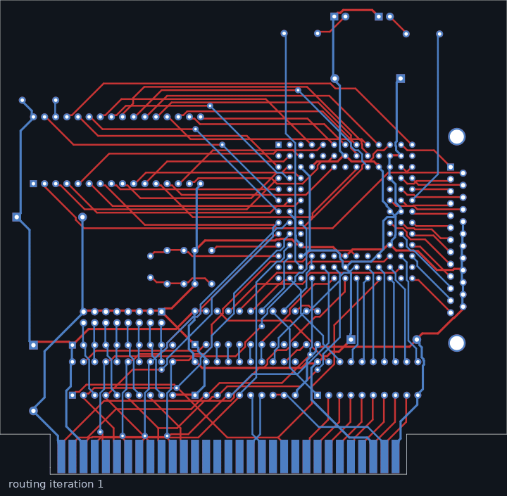
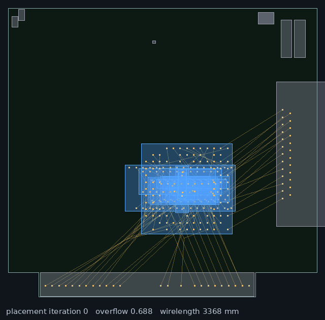

# pcb-maker

**Automatic placement and routing for KiCad boards, judged by KiCad itself.**

`pcb-maker` takes a KiCad project, places the footprints that are free to
move, routes every net, and hands the board back to KiCad's own ERC and DRC
before it calls the job done. It is a research project, written in Rust, with
one goal: the best open-source PCB placer and router.

<p align="center">
  
  <br>
  <sub>Routing the 110-net Interf-U demo from a bare board: every net is routed at once, conflicts are priced up, and only the losers move. The last frame is what KiCad accepted.</sub>
</p>

## Status

Not finished, but already useful.

- **Boards harvested from GitHub** (109 finished KiCad designs, 2 to 8
  layers, 44 with four or more; [the harvest](benchmarks/github/README.md)).
  Reduced to what an agent starts from - parts stacked, the designer's
  placement gone, a `constraints.json` of fixed connectors and edges -
  pcb-maker places and routes **42 of 109** to a clean KiCad verdict
  under the strict rule (0 unconnected, no copper error beyond what the
  designer's board has at the same place; 46 under the per-type rule)
  within 1500 s of work each, every board placed from stacked parts
  (sweep v18, 2026-10-21). Per board against the designer's own board
  (medians): 0.71 times the vias, 1.03 times the track length, 0.9 % of
  the connections left open, the ground pours cut no more than the
  designer's. Of the 67 that fail, 18 are within five connections and
  five errors of clean, 24 leave more than 20 connections open, and six
  have no result (panels, and one whose zone refill KiCad does not
  finish). Routed by the same binary on the designer's own placement, 50
  pass the strict rule; on the 97 target boards with both results our
  placement accounts for 71 % of the open connections and our router for
  29 %
  ([results](docs/benchmarks.md#layout-sweep-v18-2026-10-21)).
- **At scale, on the designer's placement:** 5 834 boards harvested from
  1 146 public KiCad repositories, each routed from stripped copper with a
  30 s budget: 2 309 route clean under KiCad's own DRC within 30 s, 3 896
  pass the designer-relative rule, 4 528 are complete at 300 s; the clean
  boards take a median 3.4 s
  ([details and caveats](docs/benchmarks.md#expansion-intake-5-834-boards-routed-on-the-designers-placement-2026-10-18)).
- **Against Freerouting** (2026-10-21, partial: the 40 largest of the 109
  boards so far): the same placements and the same wall per board, both
  judged by KiCad's DRC with the same rules. pcb-maker leaves fewer
  connections open on 35 boards and Freerouting on 4 (none of which it
  passes); on the 27 boards both finish, Freerouting leaves 2.6 times the
  unconnected items and ten times the DRC errors, at a median 1.29 times
  our CPU seconds per board
  ([table](docs/benchmarks.md#freerouting-against-x1367-2026-10-21)). The
  last complete round (2026-10-15, x738, the designer's placement with all
  copper removed, 1500 s each): fewer open connections on 47 boards against
  6, 51 boards clean against 8, at 0.65 times Freerouting's CPU
  ([table](docs/benchmarks.md#freerouting-against-our-cold-route-x738-2026-10-15)).
- **Open-source boards, PCBench / PCBWorld D3** (617 boards, prepared the
  way PCBWorld prepares them): pcb-maker routes 601 (97 %) clean,
  PCBench's Freerouting run 526 (85 %); vias about half and copper 93 % of
  the designers' boards. On the 114 D3 agent tasks 110 are laid out clean,
  median 9 s.
- **Not there yet.**
  - Pours: our fill model is more fragmented than KiCad's, which shows as
    starved thermal reliefs on dense boards and as pads routed by tracks
    that KiCad would have joined through the fill.
  - Placement: dense boards (a video board, ESC-class four-in-one
    controllers, a SNES motherboard) stay 110-200 connections short where
    our router routes the designer's own placement clean or nearly so
    (video 199 open against 0, the OpenESC 4in1 111 against 0,
    SNSP-CPU-01 136 against 23); the gap is the placement, not the number
    of seeds tried or the legaliser.
  - Features: no differential pairs or length matching; the placer does
    not choose sides by itself (constraints put parts on the back); pin
    swapping is opt-in.

Take a look at the [benchmarks](docs/benchmarks.md) before trusting any
number here; they are re-run and rewritten as the code changes.

## Try it

You need KiCad 10 on the `PATH` (`kicad-cli` runs the final
verification; pcb-maker writes KiCad 10 boards and is tested with 10.0.7,
and warns when `kicad-cli version` is older) and either a [snapshot build](https://github.com/floitsch/pcb-maker/releases/tag/snapshot)
(rebuilt on every push to `main`) or a Rust toolchain:

```sh
cargo build --release          # target/release/pcb-maker
```

### From a schematic to fab files

```sh
pcb-maker import-kicad-netlist myproject/myboard.kicad_sch board myboard
pcb-maker layout-kicad-board board myboard layout auto board/layout.json
pcb-maker fab-kicad-board layout/result myboard release
```

1. `import-kicad-netlist` makes the board KiCad's "Update PCB from
   Schematic" would: footprints from the libraries, on their nets, linked
   to their symbols. Next to it go a starter `constraints.json` (every part
   placed, the board sized from the parts, USB and other plug-in connectors
   on an edge) and the `layout.json` that uses it. Say where things go in
   `constraints.json` before the next step.
2. `layout-kicad-board` places and routes the board and has KiCad check
   it: `layout/result` is the finished project.
3. `fab-kicad-board` runs KiCad's DRC and ERC and, only when no copper
   error and no unconnected item remains, writes the Gerbers and drill
   files (zipped), the placement file, the BOM, netlists, the STEP model
   and `fab-manifest.json` with a sha256 per file (`--profile jlcpcb` for
   JLCPCB's BOM and placement columns). `export-kicad-fab` writes the fab
   files without the gate, with the estimated price at six fabs.

### Route a board

```sh
pcb-maker route-kicad-board <project-dir> <board-id> <out-dir> auto
```

`<board-id>` is the file stem (`myboard` for `myboard.kicad_pcb`), `auto`
takes track widths, clearances, via sizes and net classes from the project's
`.kicad_pro`. The board's own tracks and vias are kept (route the critical
nets by hand, the router routes what they leave open; `--strip` routes from
nothing); copper zones stay and are used: pads are connected to their pour, islands are stitched, and if
that leaves something open the pour nets are routed as tracks instead.
`<out-dir>` must not exist yet; it receives a copy of the project with the
routed board, KiCad's ERC and DRC reports, and `board-router.json` with
per-net results. The exit code says how it went: 0 complete (KiCad finds
nothing unconnected and no error beyond the input board's own), 1
incomplete, 2 a usage or input error, 3 incomplete because the wall clock
cut the run short, 4 an internal error; `verdict.json` says the same with
the details ([docs/agents.md](docs/agents.md#4-read-the-verdict-exit-code-and-out-dirverdictjson)).

### Place and route

```sh
pcb-maker layout-kicad-board <project-dir> <board-id> <out-dir> auto [layout.json]
```

Everything that is not locked, has no nets, or sits on the board edge (a
connector) is placed anew, then routed. The result lands in `<out-dir>/result`
together with `placement.html`, an animated playback of the placement. A
small JSON keeps parts where the designer put them:

```json
{"placer": {"fixed_patterns": ["J*", "H*"], "fixed": ["U3"]}}
```

<p align="center">
  
  <br>
  <sub>Placement of the same board: parts start on top of each other and spread out under net attraction and density repulsion, then are snapped to a legal, routable layout.</sub>
</p>

### Say where things go

For agents and people alike, `constraints.json` states placement intent:

- **Board shape.** The board size, or leave it out and it is estimated
  from the parts.
- **Edges.** Parts on an edge: flush, with a connector opening outwards, or
  an antenna reaching beyond it.
- **Placement.** Parts put in words ("front", "top-left", "center") or at
  an exact spot, regions, keepouts, rotations, fixed parts, and the side a
  part goes on.
- **Proximity.** Parts near other parts or near a given pad, groups kept
  together, and rows of parts at a pitch.
- **Shields and modules.** Parts inside a hollow part's outline, where
  only its pads block.

```json
{"version": 1,
 "outline": {"width": 60, "height": 40},
 "edge": [{"part": "J1", "edge": "left", "flush": true, "opening_outwards": true}],
 "near": [{"part": "C1", "pin_of": "U1:3", "max_mm": 2}]}
```

```sh
echo '{"placer": {"constraints": "constraints.json"}}' > layout.json
pcb-maker layout-kicad-board <project-dir> <board-id> <out-dir> auto layout.json
```

A ground plane is one line of router config, used in place of `auto`:
`{"add_pours": [{"net": "GND", "layers": ["B.Cu"]}]}`.

`fab-kicad-board` then checks the board with KiCad's DRC and writes the
Gerbers, drill files, BOM and placement file a fab takes.

The result reports every constraint as kept or missed, by how much. When
parts find no place, the error says why: how full each side is, or which
constraint holds the part. When connections stay open, `board-router.json` says which pads are unreachable
and where nets fought for room. See [docs/agents.md](docs/agents.md) and
[docs/constraints.md](docs/constraints.md).

### For agents

[docs/agents.md](docs/agents.md) is the guide for coding agents: the
commands, the verdict every run writes, exit codes and a cookbook from
what people say to constraints. Its short form is a skill file for agent
CLIs that read them (Claude Code and others with the same `SKILL.md`
format): copy `skills/pcb-maker` into your skills directory,

```sh
mkdir -p ~/.claude/skills && cp -r skills/pcb-maker ~/.claude/skills/   # every project
mkdir -p .claude/skills && cp -r <pcb-maker>/skills/pcb-maker .claude/skills/   # one project
```

and the agent picks it up when a task is about a KiCad board.

### Placement only

```sh
pcb-maker place-kicad-board <project-dir> <board-id> <out-dir> [placer.json]
```

## How it works

**The router** ([docs/router.md](docs/router.md)) is a whole-board
negotiated-congestion router in the PathFinder family. The board is lowered
to a lattice whose pitch is chosen from the pads on it; every net is routed
against the same occupancy maps, overlapping other nets' clearance at a
price that rises from iteration to iteration, until nothing overlaps. On top
of that: a coarse tile graph plans corridors before the fine search runs,
fine-pitch pads get pre-computed escapes, copper pours are first-class
(thermal guards, plane connections, island stitching), and an attempt
ladder retries with a plane skeleton, with pours as tracks, and with finer
lattices when something stays open. Finished boards go through a via
reduction pass and an exact geometric verifier before KiCad sees them.

**The placer** ([docs/placer.md](docs/placer.md)) is an electrostatic
global placer in the ePlace/RePlAce tradition: footprints are charges,
their density field is solved on a grid, nets pull with a smooth wirelength
model, and every part keeps a halo sized to the tracks that must escape it.
Global placement is followed by annealing on rotations and positions and a
legalisation step. The **layout loop** ([docs/coupling.md](docs/coupling.md))
then routes, reads the congestion back into the halos, and tries footprint
moves that reduce open connections.

**Verification** is never skipped. Both the router and the placer keep their
own exact checks, and every board that leaves the tool has been through
native KiCad ERC, DRC and connectivity. `pcb-maker` reports what KiCad says,
not what it hopes.

## Benchmarks

Everything is measured by KiCad's own DRC and connectivity on the result,
with the designer's own findings subtracted. The harvested GitHub boards are
the main corpus ([docs/benchmarks.md](docs/benchmarks.md)):

| Sweep | Boards | pcb-maker | Freerouting |
| --- | --- | --- | --- |
| Layout from stacked parts and constraints, 1500 s of work (v18, 2026-10-21) | 109 | 42 clean (strict rule; 46 per type), 2712 connections open in all | - |
| Routing the designer's placement, 1500 s of work (designer tier x1315, 2026-10-21) | 109 | 50 clean (strict rule; 58 per type), 430 open on the 97 target boards with a result | - |
| Routing the designer's placement cold, 1500 s (x738, 2026-10-15) | 109 | 62 clean (not comparable with the row above: every copper zone removed, judged per type against the stripped source's own DRC, a wall-clock budget, a binary 577 snapshots older); where both finish (67 boards) 51 clean, 184 open | 67 finished, 36 timed out, 6 failed; where both finish 8 clean, 873 open |

Smaller tiers of the same boards judge a change in minutes
([benchmarks/agent-tasks](benchmarks/agent-tasks/README.md)): the short
tier (12 boards that flip, a third of the budget) for iterating, the
quick tier (30 boards, full budget) as the merge gate, and the schematic
tier (12 boards laid out from the designer's schematic, as an agent
would). The tiers run 2 search threads a board and physical cores / 2
boards at once (8 x 2 on a 16-core machine); one benchmark at a time, so
run.py takes a lock (build/quick-tier.lock) and waits for it. The task
lists are committed (benchmarks/agent-tasks/tasks/v7, made by
from_pcbench.py from benchmarks/github/boards.json):

```sh
python3 benchmarks/github/harvest.py fetch                      # the harvested boards
benchmarks/agent-tasks/run.py build/layout \
  --tasks benchmarks/agent-tasks/tasks/v7/tasks.json --jobs 8 --threads 2  # the full sweep, a night
benchmarks/agent-tasks/run.py build/short --tier short             # takes build/quick-tier.lock itself
benchmarks/github/freerouting.py build/freerouting --ours      # both routers, headless
```

## Repository

| Crate | What it is |
| --- | --- |
| `crates/pcb-router` | the format-independent routing core: geometry, lattice, negotiation, pours, verifier |
| `crates/pcb-placer` | the electrostatic placer, annealer, legaliser and playback |
| `crates/pcb-kicad` | KiCad S-expression parsing and writing, project rules, the board adapters, native verification |
| `src/` | the `pcb-maker` command line: `main.rs` (dispatch, the inspection and benchmark commands), `agent_cli.rs` (the agent commands), `freerouting_backend.rs` |
| `benchmarks/corpus` | the KiCad-demo corpus runner (route and layout) |
| `benchmarks/github` | the harvested open-source boards: harvest, manifest, Freerouting comparison |
| `benchmarks/pcbench` | 617 open-source boards (PCBench through PCBWorld's D3 preparation): fetch, manifest, runner, triage |
| `benchmarks/agent-tasks` | layout tasks as an agent poses them: stacked parts, constraints, a finished board |
| `crates/pcb-congestion` | congestion features (RUDY) the placement race ranks its candidates by |
| `docs/` | design notes and results; [the hand-over](docs/handover.md) (current state, open problems, how to work on it) and [the changelog](docs/changelog.md) |
| `skills/pcb-maker` | the agent skill (`SKILL.md`): the short form of docs/agents.md for agent CLIs; tests/cli_exit_codes.rs checks it against the command table and the exit codes |
| `scripts/` | `worktree.sh`, `check.sh` (the test set), `snapshot.sh`, `check_links.py` |
| `tools/config-reference` | generates [the configuration reference](docs/config-reference.md) (every settings key with its type, default and doc comment) and the hand-over's environment index from the code |

`crates/pcb-topo` is a TopoR-style topological router, an experiment the
board router can call. `pcb-kicad`'s modules: the KiCad file layer
(`kicad_sexpr`, `kicad_nets`, `copper_emit`), geometry (`geometry`,
`copper_geometry`, `outline`, `roundrect_pad`), the adapters to the placer
and the router (`board_placer/`, `board_router/`, `board_layout`), KiCad's
checks (`verification`, `native_report`, `drc_cache`, `verdict`) and the
agent commands' tools (`fab_release` is `fab-kicad-board`'s); `lib.rs` lists them. The research stack of August
and September 2026 is in git history: the crates `layout-trace-routing`,
`pcb-routing`, `pcb-coordinator`, `pcb-placement`, `pcb-validate`,
`pcb-viewer`, `pcb-benchmark`, `pcb-pipeline` and their commands up to
commit be4b012 (removed 2026-10-20); `pcb-kicad`'s research modules (the
semantic ladder, the sequential and adaptive routers, the grid router's
inspections, via actions and route relaxation) with the crates
`pcb-engine`, `pcb-grid-router`, `layout-trace-model` and `pcb-core` up to
b306347 (removed 2026-10-21). The
[trust audit](docs/reviews/2026-09-21-trust-audit.md) explains what was
kept and why.

## License

MIT, see [LICENSE](LICENSE).
