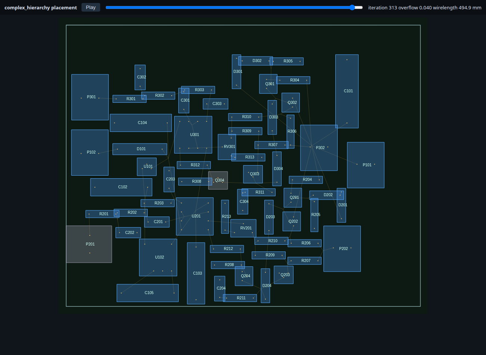
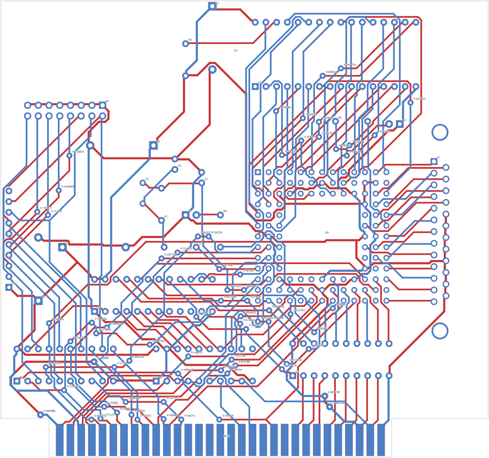

# The placer (`pcb-placer`) and the coupled layout loop

`pcb-placer` replaces the spring-plus-pairwise-pushing placer described in the
[trust audit](reviews/2026-09-21-trust-audit.md). Together with
[`pcb-router`](router.md) it forms the automatic layout flow:

```sh
# Placement only (writes the project plus placement.html, an animated playback)
cargo run --release -- place-kicad-board <source-dir> <board-id> <out-dir> [layout.json|placer.json]

# Coupled placement and routing
cargo run --release -- layout-kicad-board <source-dir> <board-id> <out-dir> <router.json> [layout.json]
```

Every key of `placer.json` and `layout.json` with its type, default and
doc comment is in the generated [configuration reference](config-reference.md).

## Results (2026-09-21, cold: all movable footprints re-placed, zero copper)

Every board below is placed and routed automatically, is electrically complete
in native KiCad (zero unconnected items, zero clearance/courtyard findings) and
has zero internal violations. The only remaining native findings are
silkscreen label cosmetics (2–19 per board), which the existing
`repair-kicad-silkscreen` tool reduces further.

| Board | Movable | Auto placement → routed | Human placement → routed |
| --- | ---: | --- | --- |
| ECC83 | 6 / 15 | 9/9, 0 vias, 368 mm | 9/9, 1 via, 344 mm |
| Complex hierarchy | 66 / 68 | 50/50, 0 vias, 1318 mm | 50/50, 0 vias, 1330 mm |
| PIC programmer | 55 / 63 | 34/34, 1 via, 1722 mm | 34/34, 1 via, 1907 mm |
| Interf-U | 22 / 25 | 110/110, 71 vias, 5103 mm | 110/110, 58 vias, 4789 mm |

Placement takes 0.6–3 s, routing 0.2–25 s. Both routed columns use the same
router and rules. On Interf-U the human placement is still better (fewer vias,
less copper); on PIC and the hierarchy board the automatic one is.

| Global placement (hierarchy board) | Placed and routed (Interf-U) |
| --- | --- |
|  |  |

## How it works

1. **Lowering.** Footprints become bodies (courtyard plus pad bounding box,
   rectangular or round) with pins at their true offsets. Locked footprints,
   footprints without nets, and footprints on the board edge (connectors) stay
   fixed; everything else may move and turn in 90° steps, from a
   canonical start (`orientation_search`, below). Large nets get a
   smaller weight so power does not collapse the layout. Pad boxes cover
   the drill. A through-hole part blocks the other side only with its
   holes and pads, and a part with a courtyard on both sides with that
   one too, against parts on either side. A hollow part (a shield outline) blocks only with its
   pads, and with its courtyard against parts with holes, since KiCad
   forbids holes in a courtyard unless the courtyard is malformed and
   KiCad skips it. A footprint without a courtyard blocks with its copper
   against parts with one, and against another without one also with the
   box of its pads, copper and fabrication (else silkscreen) outline,
   unless one is at most a quarter of the other's (a diode under its key);
   a footprint's own closed Edge.Cuts loops (a switch's peg holes) move
   with it and keep other bodies, copper and the board's cutouts off
   ("Footprints without a courtyard, and their slots (2026-11-04)",
   below). A board cutout keeps only copper away: a connector body
   may reach over its peg holes. A footprint's own mask graphics (an RF
   modulator's exposed 22 x 32 mm area) are part of its body, also where
   it blocks with its courtyard's shape (`mask_openings`, below), and so
   are its copper graphics (since 2026-10-23: a printed antenna's copper
   beside its three small pads, which the pads' box let hang over the
   board edge).
2. **Routing halos.** A PCB routes in the same plane it places in. Every body
   gets a halo proportional to its pin count; halos count as body area and as
   spacing. If the board cannot afford them they shrink uniformly.
3. **Global placement** (ePlace/RePlAce formulation). Body area is electric
   charge; the potential solves Poisson's equation on the board with a
   spectral method, so the spreading force acts at a distance and points to
   free space. Fixed parts and everything outside the outline are fixed
   charge; filler charge decides how much whitespace stays between the parts.
   Wirelength is the weighted-average model on true pin positions. Nesterov's
   method with a Barzilai–Borwein step minimizes
   `wirelength + lambda * density` while `lambda` grows until overlap is gone.
   Rotations are chosen greedily every few iterations.
4. **Annealing legalization.** Moves, quarter turns and swaps are judged on
   wirelength plus an overlap penalty that grows until no overlap survives.
   It starts cold so the global result is refined, not scrambled. An exact
   nearest-legal-position pass is the safety net. When it fails, it runs
   again with the stuck parts first. At the edge and courtyard levels
   (no halo, spacing or grid left to give), a level that keeps the
   placement of the level before, and whose few stuck parts find no room
   among the kept ones, legalizes its anneal again with them first, the
   parts that pass leaves without room joining them, up to four passes (a
   part placed first can take another's only spot: MIDAS-MK1, changelog
   "MIDAS-MK1 refusal"). Crowded boards then walk down relaxation levels:
   - smaller halos, then none;
   - spacing down to the copper clearance (the classes' largest, or a
     custom rule's between the pads of every two nets on some layer:
     docs/router.md, "Project rules");
   - a 0.1 mm grid;
   - bodies closer to the edge, as far as their copper allows;
   - where the project lets courtyards overlap, bodies shrunk to their
     fabrication outline and pads.

   The level used is reported, and the router-driven moves keep to it.
   Several seeds run in parallel (`placement_seeds`, 3; the layout asks for
   16, see the race below); the best placement by the placer's own key
   (fewest illegal parts, least missed constraints, least wirelength; a
   tie to the earlier seed) is kept, the others are the race's
   alternatives. The seeds share the work budget: seed k is kept while the
   seeds before it used less (three at least). They run in a pool of the
   process's search threads, judged in seed order whatever finishes first,
   in batches sized from the kept seeds' work (`race_seeds`), so the seeds
   run and kept do not depend on the threads; `board-placer.json` reports
   `seeds` (kept), `seeds_run`, `seed_kept`, `seeds_work_seconds` and
   `pool_work_seconds` (what the layout's clock counts: the kept seeds on
   the reference machine's eight threads).
5. **Refinement.** Greedy legal moves, rotations and swaps that strictly
   reduce wirelength.
6. **The placement race.** Wirelength is not routability. The layout ranks
   the seeds' legal placements (those that keep the constraints as well as
   the kept one) by RUDY: each net's spanning-tree length times its track
   pitch spread over its bounding box, summed per 16 x 16-node router tile,
   above a quarter of the tile's free capacity (every layer less obstacles
   and pad copper; `pcb_congestion::rudy_overflow`). The best three by that
   score are probed by the router for 75 s of work each, side by side, and
   the one with the fewest unfinished nets routes on (ties to the better
   ranked) where it leaves at least 5 % fewer than the first-ranked
   placement (`RACE_CONFIDENT_MARGIN`); else the first-ranked does (the
   probes do not separate them). Every probe that runs counts and is
   charged to the work clock; where the other probes would leave the
   final route less than 45 % of the budget (`RACE_MIN_FINAL_SHARE`),
   the race shortens every probe alike, down to a third of its 75 s, and
   below that probes fewer placements, the lowest-ranked dropped first
   (until 2026-10-25 a gate dropped, uncharged, every probe judged past
   40 % of the budget: see "The race counts every probe it ran
   (2026-10-25)"). Ranking takes 10-100 ms a placement (lowering, rasterizing);
   the 16 seeds cost placement wall time (about 30 s a board on the quick
   tier) but no extra placement work. Quick tier, 2026-10-10, one binary
   (x402), the plain race of three seeds against the pre-ranked race of 16:
   best race probe 204 -> 189 unfinished nets, open after the first route
   149 -> 112, KiCad unconnected 98 -> 64 (6 boards better, 2 worse),
   passes 16 -> 18. `congestion_score: "none"` in layout.json asks for the
   plain race; `congestion_model` ranks with the learned predictor
   instead (an experiment, [congestion-model.md](congestion-model.md)).
   Where the placement takes its whole 40 %, the race's other probes
   run but count for nothing (the probes past 40 % of the budget are
   dropped); `race_probe` (below, "The race's route probe") charges
   every probe to the clock and gives each a share of the budget.
7. **Coupling.** `layout-kicad-board` routes the placement once, then the
   router and placer take turns on one in-memory state: congested footprints
   are nudged, the router reroutes only what the nudge touched, and moves are
   kept when the board improves. See [coupling.md](coupling.md).

The written board is checked: every pad must land exactly where the placer's
model said it would, including rotated footprints (KiCad stores pad and text
angles as absolute values).

## A fast no, and the budget inside the passes (2026-10-15)

A board without room used to cost every relaxation level an anneal and a
legalisation in vain, each part without a spot searching the whole board
(urchin's 80 parts on 80 x 40 mm with its key grids as rows: 742 s of
wall on four threads; the work budget was checked only between levels,
so a seed overran its 600 s by a quarter). Now:

- **Before placement** (`placement_room::outline_holds`, after the
  constraints are applied; input errors, exit 2): a user's `row` that fits
  the outline's box in no orientation it may take, and the parts an edge
  constraint holds at one edge on one side that need more length than the
  edge has. Only parts too deep to stand two behind each other within
  their `max_mm` count, each by its shortest tight body; the two that could
  overhang the edge's ends at the edge-copper level count their copper
  only. Regions were checked this way already (`region_holds`); all such
  errors are now said together. Not for an automatic outline (the layout
  grows it). Urchin's case: exit 2 in 0.04 s.
- **At once, before the levels** (`place`, `hopeless`): when even the
  last (loosest) level's bodies cannot all be placed, by area (the movable
  tight bodies with the least spacing need more than a side's outline
  area) or by strips (`strips_hold`: bodies at least `t` across meet any
  line at most `floor(height / t)` times, so their least extents along it
  sum to at most that times the width), no level runs: the parts are
  legalized once from the global placement with the hurried search below,
  the rest are unplaced, and `Placement::overfull` (`"overfull": true` in
  board-placer.json) says why. Both tests are exact (a necessary
  condition for any packing): a board that can be placed never takes
  this way, so its placement is unchanged. Hollow parts (those without a
  courtyard block with their pads alone), parts held at an edge or
  reaching over it, and cutouts are left out of the strips. Urchin
  without its rows on 60 x 40 mm: exit 1 in 3 s.
- **Inside the passes** (`out_of_work`, a thread-local stop the running
  `place` sets from `work_limit`): past the budget, a part without a spot
  in `legalize` searches only as many rings as 15 mm of a 0.5 mm grid (3
  mm of the fine grid) instead of the board; `evict_for`, `refine`,
  `repair_relations` and `align_orientations` stop; the retry with the
  stuck parts first is skipped. A placement within its budget is
  unchanged. Urchin without rows on 80 x 40 mm is not hopeless by either
  test (its switches have no courtyard: their pads alone block, which
  could interleave), so it still takes the levels up to the budget.

The placement's `room` (`placement_room::room`, in board-placer.json and
the verdict, see [agents.md](agents.md)) puts the room in numbers: per
side the usable area (outline less the edge band and the fixed bodies),
the movable bodies with spacing, the utilization, the area missing at a
target of 0.7, the smallest outline at that target (area, strips with the
target's slack, the largest part, rows and edge sets) and, when parts
found no place, a suggested outline.

## Where the wirelength goes (measured 2026-10-14)

`PCB_PLACER_TRACE=<file>` writes, per seed, the weighted wirelength after
global placement, annealing, legalization and refinement (and at the
designer's poses with `PCB_PLACER_DESIGNER`), the relaxation level, and
per movable part how far each stage moved it and what it met where the
annealer left it. `experiments/placement-loss/` prepares tasks as the
runner does, places them (`measure.py`, 16 seeds and the layout's 600 s of
work via `PCB_PLACER_WORK_SECONDS`) and tabulates (`analyse.py`,
`compare.py`). On the 30 quick-tier boards plus hackrf, video, the three
OpenESC boards, both SNSPs and zpn (the kept seed, x652's placer):

| Stage ratio | Median | Range |
| --- | ---: | --- |
| annealed / global | 0.83 | 0.36-1.54 |
| legal / annealed | 1.04 | 1.00-1.45 |
| final / legal (refinement) | 0.97 | 0.74-1.01 |
| final / annealed | 1.00 | 0.88-1.29 |
| final / designer | 0.85 | 0.16-1.77 |

- The legalizer is not where the wire goes in sum: the global placement is
  30-90 % longer than the final one, and the annealer, not the
  legalizer, removes that. Legalization adds 8 % over all boards and
  refinement wins 5 % back; a few crowded boards lose more (Castor 25 %,
  MIDAS-MK2 28 % before refinement, 21 and 12 % after), where the
  nearest-spot legalizer moves 100-120 parts, some 20-30 mm.
- Four ways to legalize or place better found nothing within the seeds'
  noise (median final wirelength on the six gap boards): keeping the
  annealer's legal parts and reflowing only the conflicted ones (-0.5 %
  on the tier), pushing overlapping parts apart a grid step at a time
  before that (+2 %), filler whitespace in the global placement (+2 %,
  +1 %), four times the annealer's moves (+4 %). The annealer is
  converged under the current rules.
- What the gap to the designers is: the routing halos. Without halos the
  six gap boards' final wirelength drops 22 % (median 23 %), to 0.87-1.27x
  the designers'; a spacing of 0.2 instead of 0.5 mm drops it 4 %. The
  designers' own placements are illegal at our full level for nearly
  every part (Castor 156 of 163, MIDAS-MK2 192 of 197): designers put
  parts courtyard to courtyard.
- The annealer does not see all the legality test forbids across the
  board: a through-hole part's holes meet bodies at half the spacing, and
  its copper-only far-side boxes not at all (Castor: 33 of 69 parts the
  legalizer had to move were invisible to the annealer).
  `anneal_far_side_gaps` (placer option, off; removed on 2026-11-04,
  docs/handover.md, "Removed experiments (2026-11-04)") gave the annealer the
  legality test's gaps; it halves the parts legalization moves on Castor
  but wins no wirelength, and on the layout it is flat on the quick tier
  (x700 against x651: 19 passes both, unconnected 29 to 30, starved
  thermals 12 to 17, vias -4 %) and worse on two crowded boards (video
  240 to 315 unconnected, OpenESC 4in1 120 to 132; SNSP-CPU-01 239 to
  224 and mask bridges 22 to 5).
- `shared_halos` (placer option, off; removed on 2026-11-04, docs/handover.md,
  "Removed experiments (2026-11-04)"): neighbours keep the larger of their
  two halos between them instead of the sum; the halo budget and the
  global placement's charge count one halo per gap. Six gap boards' median
  final wirelength -6 %. Quick tier (with the annealer's gaps, x700):
  passes 19 to 20, unconnected 30 to 24, starved thermals 17 to 9, vias
  -5 %; but on the crowded boards zpn_devboard loses its pass (one mask
  bridge, vias 299 to 348) and hackrf's vias go 429 to 673. Not a default.

## Routing room from congestion (measured 2026-10-14, off)

**Removed on 2026-11-04** (`routing_room` with `routing_room_share`,
`_floor`, `_most`, `_all_parts`; `crates/pcb-placer/src/room.rs`;
`Relaxation::halos` stays for the skeleton race; docs/handover.md,
"Removed experiments (2026-11-04)"). The measurements are kept as they were.

`routing_room` (placer option, off): after a seed is placed with the
pin-count halos, each movable part's halo becomes its pin-count halo
times `factor * demand / median demand` (RUDY around the part's body
grown by 1 mm, nets a pour carries left out; none below half the median,
at most twice the pin-count halo), with `factor` chosen so the halos take
`routing_room_share` (1.0) of the area the level's halos took; the parts
anneal again from the legal placement (small moves), legalize and refine.
Parts the new halos leave without room fall back to the level's halo,
then to none; a seed whose pass still fails keeps the pin-count halos
and ranks after the others. `routing_room_all_parts` (on) lets parts the
level left without halo get one. The moves after routing keep the
per-part halos (`Relaxation::halos`). Code `crates/pcb-placer/src/room.rs`,
scripts `experiments/routing-room/`.

What the routed boards say (x693 tier and x652 gap runs, 35 boards;
`halo_use.py`, `analyse.py`): the routing density in a part's 1 mm band
does not follow its pin count (Spearman about 0 per board, -0.3 to 0.4)
but follows the RUDY demand there (median 0.6, 0.1-0.8) and the 25 s
probe's history (similar). On boards with full halos 15-76 % of the halo
area carries under 5 % of its routing capacity; keeping the half of the
halo area with the highest RUDY keeps 58-79 % of the routing inside
halos on the crowded boards, the half by pin count about 50 %.

What the layouts say (seed-repeated pairs, seeds 1, 101, 201, logs
`build/room-pair-*`): the option never fires on video, OpenESC 4in1 and
hackrf (their kept level has no halos; hackrf drops to it because one
part finds no room at the first level). On the five boards where it
fires, passes over the 15 runs: off 11, share 1.0 within the level 9,
share 1.0 all parts 11, share 0.75 9, share 0.5 9. Share 1.0 moves HPWL
by -15 % (BAGEL), -6 % (MK2.1) and +5 to +9 % (MK2, Castor, zpn); share
0.5 shortens HPWL on all five (median -8 %) and routed length on four,
with unconnected medians still 0 but single errors (a mask bridge, one
open connection, a starved thermal) costing two passes. Quick tier
(x737 against x722, one seed): 22 to 24 passes, unconnected 22 both,
vias -3.7 %. Within the seed noise; not a default. Video's routing
differs by up to 130 unconnected between runs of the same placement
(x732 and x736 with identical placements: 392, 314, 325, 262 for seed 1).

## Placement work against the CPU (calibrated 2026-10-14)

Budgets count placement work (`pcb_placer::work`, 150 M units a second
of one thread on the reference, `REFERENCE_WORK_PER_SECOND`; since
2026-10-21 scaled to the machine at the start of a run unless pinned,
`work_per_second`: docs/router.md, "The machine's rates"); the layout's
wall clock only guards. `PCB_PLACER_DEBUG`
prints per phase `placer phase <name>: <wall> s, cpu <thread cpu> s, work
<counted> s (<counted / cpu>)`; the CPU time comes from
`/proc/thread-self/schedstat`, so the ratio is the calibration whatever
the load (absolute values still drift with it: keyboar_'s anneal measured
0.89 to 1.45 at loads 25 to 50; compare boards run side by side).

Before, the legaliser booked 3-15 % of its CPU time on the 0xCB panels
(and the wall guard fired, so results followed the machine's load:
vaio_re 63 or 151 open, glasgow "deadline reached"), the annealer 25-50 %
on boards with many relations (glasgow, MIDAS, Castor) against 100 % on
keyboar_. Profiled with callgrind (instructions per counted unit, about
42 on the calibrated anneal), what was not counted:

- a cutout's outline (the panels' slots between the copies, thousands of
  points) was walked nine times per pad, counted once per part: now one
  pass with a box prefilter decides unless an edge comes near the pad
  (exact: the full test runs then), counted per edge visited (a quarter
  unit); the 0xCB pcb-panel's legalisation went from 224 s to 28 s of CPU
  a pass;
- box lists (hollow parts, far sides, pads) and their pair tests: counted
  as the annealer does (8 + 3 per box, 1 per pair);
- the other part's box (two turns) and the linked-pair lookup per
  same-side test in the legality test (4 units, and log2(linked)/2);
- relations: each anchor a relation measures from costs about 4 units
  (glasgow's decoupling capacitors are each near any of 23 supply pins),
  and finding a part's relations scans every anchor; counted in the
  annealer's move work and the legaliser's penalty;
- pin positions in wirelength sums: 3 units a pin;
- parts held at an edge: their pads' offsets and the board's box on every
  test (eviction of a held connector, five times what it counted); the
  edge and region lists, scanned per test (half a unit an entry);
- exact speed-ups: a part not held at an edge no longer computes its pads'
  edge offsets in every snap, overlap and hard-constraint test.

Work ratio by phase (work / thread CPU; each pair placed at once on the
two threads of a core, one seed, 720 s of work; before = x738's counting):

| Board | Before (all; anneal, legalise, evict, refine, repair) | After |
| --- | --- | --- |
| 0xCB pcb-panel | 0.11; 0.52, 0.03, -, -, - | 0.95; 0.87, 0.93, 0.90, 1.50, 2.15 |
| 0xCB panel | 0.11; 0.45, 0.07, 0.07, 0.22, 0.08 | 0.77; 0.66, 0.77, 0.63, 0.65, 0.75 |
| glasgow | 0.40; 0.31, 0.40, 0.23, 0.48, 0.14 | 1.08; 0.98, 1.01, 1.05, 1.16, 1.12 |
| vaio_re | 0.72; 0.72, 0.49, -, 0.78, 0.61 | 0.98; 0.93, 0.80, -, 1.24, 1.08 |
| MIDAS-MK2 | 0.52; 0.49, 0.50, -, 0.62, 0.09 | 1.07; 0.98, 1.45, -, 1.63, 1.29 |
| Castor | 0.68; 0.59, -, -, 1.52, 0.23 | 0.98; 0.88, 1.14, -, 1.57, 0.84 |
| urchin | 0.86; 1.11, 0.23, -, -, - | 1.08; 1.09, 1.02, -, 1.00, - |
| keyboar_ (reference) | 1.02; 1.02, 0.61, -, 0.55, - | 1.02; 1.01, 1.17, -, 1.04, - |

(the pcb-panel's base placement was stopped after its first two
legalisations, 209 s of CPU; keyboar_ and the 0xCB panel from separate
pairs.) Global placement counts about twice its CPU time (1.5-2.3),
unchanged: it is 1-3 % of the work. A single seed's placement is
byte-identical before and after on glasgow, vaio_re, MIDAS-MK2, Castor,
urchin, spell_tome and keyboar_: the work changes where budgets stop
(the race's seed count, a level's or the annealer's work limit), not
what a seed does.

## Panels and courtyards on the far side (2026-10-14)

- **Copies of a tabbed panel** (`keep_copies`, on): the copies are one
  outline piece, so `keep_on_pieces` cannot tell them apart; their nets
  can (KiKit names a copy's nets `Board_N-...`). Where two or more net
  groups hold the same references (with pin counts), each with fixed
  parts whose boxes do not overlap, every movable part of a copy gets a
  region: the board's box cut between its copy's fixed parts and each
  other copy's, on the axis they are farther apart. Boards whose
  nets form one group (all others, and panels whose copies share net
  names: the PolyKybd molecules, OpenESC's 4in1 panel) do not change.
  Since 2026-10-15 the cut is halfway moved by half the difference of the
  board's margins beyond all copies' fixed parts (kept between the two
  copies): the copies repeat one layout, so each copy's region lies around
  its fixed parts as the board lies around all of them. Halfway alone cut
  SmartSpin2k's copies (fixed parts at each copy's top, 2.3 mm from the
  board's top edge and 40.5 mm from its bottom) through their own parts:
  162 of the designer's 630 movable parts outside their copy's region,
  none now; the 0xCB panels' cuts move by at most 0.75 mm. Each copy's
  parts also start global placement at their region's centre
  (`Constraints::starts`) instead of the common start, which clamped the
  other copies' parts against their regions' near borders.
- **A repeated reference** in a constraint (panels repeat every
  reference): an edge, rotation or place entry with a `uuid` is about the
  footprint with that uuid (`describe-kicad-board` lists them; the task
  generator writes one for every entry of a repeated reference). Without
  one, the entries name the parts in turn: the n-th edge, rotation or
  place entry for J3 is about the n-th J3 in board order. All of them
  used to land on the first J3 (one connector asked to touch the left,
  top and bottom edges at once); in turn, a task with entries only for
  the copies at an edge bound them to other copies (the molecules' fixed
  J1, J3 and J4 missed 17 edges by whole tile pitches).
- **Courtyards on the far side of parts on one side**
  (`Component::far_courtyard`): a back-mounted hot-swap switch has its
  14 mm square on the front; KiCad checks it against the front
  courtyards and holes of every part, the switches on the back included.
  The legality test and the annealer now keep one part's far courtyard
  from the other's far side (holes, pads, courtyard) at the bodies' gap;
  neighbour searches reach `far_reach` farther where such parts exist.
  woagboard's 26-28 courtyard overlaps go to 0.

## Mask openings block placement (2026-10-15)

A footprint's own mask graphics (filled F.Mask or B.Mask polygons,
rectangles, circles, strokes) bare the copper under them: another
footprint's pad there is exposed next to the opening, and KiCad reports
solder_mask_bridge for every such pad of another net. The body's box has
held them since the bodies agent (`body_on_side`), but a part whose
courtyard covers less than three quarters of that box blocks with its
courtyard's shape and its pads (`hollow`), and the openings were lost
there. SNSP-CPU-01's J2 (an RF modulator: a 12 x 5 mm courtyard around
four pins, a 22 x 32 mm F.Mask polygon beside it) held T1 and C61 in the
layout, SNSP-CPU-1CHIP's RF1 held T1; J2 is fixed, but a movable part
lost them alike. Now that shape includes the part's mask graphics on its
side (`mask_openings`, on), held to the body's box, so the legality test
and the annealer (both test the shape) keep other parts' bodies and pads
the bodies' spacing away, fixed and movable parts alike. Where KiCad's
mask margin, max(minimum web + `pad_to_mask_clearance`,
`solder_mask_to_copper_clearance`), exceeds the copper clearance the
openings grow by the difference (eternal-keypad and protoesp 0.10 mm,
USB_Cable_Tester 0.08, WLED_Matrix and USB_Keypad 0.05; none of them has
such a part). Pads of the opening's own net are kept out too (KiCad
exempts them; a whole pad of one net is rare). Courtyard-less parts
already blocked with their mask graphics, whole-body parts with their
box, and mask graphics on a part's far side are far-side copper.

Only three boards of the 109 have a part with a courtyard and mask
graphics past it (SNSP-CPU-01 4, SNSP-CPU-1CHIP 2, USB_Cable_Tester 1).
`experiments/mask-openings/pads_under_openings.py` counts other
footprints' pads under a footprint's mask graphics: 0 on all 109
designers' boards; on the 109 v16 layouts only SNSP-CPU-01 (6 pads of T1
and C61 under J2) and SNSP-CPU-1CHIP (4 pads of T1 under RF1). Layouts
(tasks v6, four threads, one run a side), x1055 against x1110:

| board | pads under openings | solder_mask_bridge | unconnected | errors | vias |
| --- | --- | --- | --- | --- | --- |
| SNSP-CPU-01 | 6 / 0 | 15 / 0 | 102 / 147 | 16 / 2 | 1812 / 1615 |
| SNSP-CPU-1CHIP | 4 / 0 | 16 / 0 | 2 / 0 (passes) | 16 / 0 | 757 / 678 |

SNSP-CPU-01's front is 73 % full (76 % with J2's opening). Another
seed won the race (seed 3 instead of 12; its race probe left 308
unfinished nets against 317), its first route left 215 open terminals
against 114, and it ended with 45 more unconnected items. One run a side
cannot tell a reshuffle of a crowded board from a cost of the rule; the
v16 layout (x862, the parts under J2) had 152.

## Far-side mask openings and copper graphics at cutouts (2026-10-27)

The nightly sweep of 2026-10-27 had two placement findings of KiCad's
that the router could not avoid (run.py's strict rule; every other
`copper_edge_clearance` and `solder_mask_bridge` of the sweep was the
designer's own, docs/changelog.md, "edge clearance and mask bridges"):

- **A hole's own mask margin on the far side.** vaio_re's J1 (a Raspberry
  Pi Zero socket on the front) has 2.3 mm mounting holes whose
  `solder_mask_margin` of 1.625 mm opens the mask 5.55 mm wide on both
  sides. The far side held only the hole's copper box, so a TSOT-23 and an
  0805 on the back sat inside the opening: five solder_mask_bridge
  ("NPTH pad of J1 || Pad 5 [/SW_DC] of U16"). Now a pad that opens the
  mask on its part's far side (`*.Mask`, `F&B.Mask` or that side's mask)
  with a margin of its own (the pad's, else the footprint's) adds that
  opening to `far_copper`: its expansion plus the board's
  `pad_to_mask_clearance` plus the minimum web, less the copper clearance
  the far-side test adds (`far_mask_reach`). The board-wide gap alone
  (`pad_mask_gap`, which parts on one side keep) is left out on the far
  side: no bridge of the sweep came from it, and it would grow every
  through-hole pad on the 20-odd boards with a web (Batch_1 299 boxes,
  protoesp 641).
- **Copper graphics at a cutout.** osprey's AE1 (a 2.4 GHz PCB antenna on
  the back) has its meander as a B.Cu polygon reaching 11.85 mm past its
  feed pad, inside its courtyard. A cutout keeps copper only (bodies may
  reach over it) and tested pads alone, so the meander came to rest on
  the battery cutout's edge (copper_edge_clearance 0.0 mm against
  0.25). A part's copper graphics (`Component::copper_graphics`, any
  copper layer, KiCad 9's lists of layers too) now keep the edge margin
  from cutouts as its pads do, in the legality test and the annealer, and
  the copper-to-edge clearance from the outline where the body comes
  within it (`pads_keep_edge`). The outline's own test was already
  covered: `edge_inset` counts copper graphics since 2026-10-23.

What changes: the lowered problem differs only on boards with such a
hole (5 of the 109: Batch_1, USB_Cable_Tester, vaio_re, zpn_devboard,
CyberKeeb2040) or with a movable part that has copper graphics (33, 23 of them with a
cutout: the cutout test binds only there). Measured in
docs/changelog.md.

## Orientation search from a canonical start (2026-10-15)

The placer turns parts at every stage: global placement picks each part's
angle by the HPWL of its nets (nets up to 24 pins) every 15 iterations
once the overflow is under 0.75 (`choose_rotations`), the annealer
proposes quarter turns (15 % of its moves, judged on wire, constraints
and overlap like any move), the legaliser tries every angle at each spot,
and refinement every angle at each target. What made the result depend on
the angles the board held: every part started at its angle, and its
options were listed from that angle on (`at + 90 k`), so the annealer's
random turn drew another absolute angle and ties broke the other way. An
import from a schematic holds every part at 0 degrees, the layout tier's
stack the designer's angles; the two placed differently.

Now (`orientation_search`, on; `core::orient`): every part's options are
sorted (0, 90, 180, 270; a part at an odd angle keeps its extra ones, so
it alone still differs), and every movable part that may turn starts at
the first, turned about its body centre. Fixed parts, parts with one
option (`rotation`, `opening_outwards`, an overhang) and a row's leader
(the row's body is built in the leader's frame at its angle) keep their
poses. The placement no longer depends on the angles it starts from:
coco2, urchin and homebrew_486 imported from their schematics and placed
from 0 degrees and from the designer's angles (the same file but for the
angles, `experiments/orientation-search/set_angles.py`) give the same
poses. Since an import holds 0 degrees, the schematic flow places as
before; the layout tier now places as if from an import.

What the measurements say (`experiments/orientation-search/`):

- **The layout tier does not keep the designer's angles.** From the
  designer's angles x1112 left 25-40 % of the moved parts at them, from 0
  degrees 22-35 % (four seeds, ten short-tier boards; a quarter by
  chance). coco2's 549 against 1144 vias (docs/changelog.md, schematic tier
  failures) was the placement's chaos, not inheritance: on x1112 the same
  board from 0 degrees gave 663 vias, from the designer's angles 1060.
- **HPWL over seeds** (`seeds.py`: `place-kicad-board`, one seed a run,
  seeds 1-4; median weighted HPWL in mm), x1112 from the designer's angles
  against the canonical start: OpenFC 897 / 1043, spell_tome 191 / 155,
  homebrew_486 14831 / 13408, WLED_Matrix 1289 / 1345, 0xCB-1337 1047 /
  1067, urchin 1732 / 1760, coco2 14393 / 14527, USB_Keypad 885 / 886,
  USB_Cable_Tester 1296 / 1304, eternal-keypad 550 / 543, reCamera 201 /
  199, Blue_Line 108 / 110. Geometric mean about 1 %; the seeds of one
  board spread 10-20 %. OpenFC is the one board where the designer's
  angles carry more than chance: its global placement is already 20 %
  shorter from them (786-897 against 950-1066).
- **The order of the footprints decides as much**: pcbnew's save sorts
  them, and homebrew_486 with the same angles in another order placed
  103 of 130 parts elsewhere (both orders are deterministic).
- **Stronger searches, measured and not kept** (eight boards, four
  seeds, against the canonical start): the annealer's turn proposing the
  cheapest other angle (wire, constraints and overlap) instead of a random
  one: coco2 -4 %, homebrew_486 +3 %, OpenFC +4 %, the rest within 2 %,
  15 % more placement work; the global rotation choice every 5 iterations
  instead of 15: geometric mean -0.5 % (OpenFC -7 %, WLED_Matrix +3 %);
  a random start angle per part instead of the first: +1 % (spell_tome
  +27 %, OpenFC -6 to -8 %); the rotation choice from the first iteration:
  no change.

Layouts (a third of the budget, four threads, one run a side; before
x1112, after x1130), each board imported from its schematic and laid out
from 0 degrees and from the designer's angles (vias, length mm, KiCad
unconnected, weighted HPWL after placement):

| Board | x1112 from 0 | x1112 from the designer's | x1130 from 0 | x1130 from the designer's | Placements |
| --- | --- | --- | --- | --- | --- |
| coco2 | 663, 23,233, 0, 12,414 | 1060, 26,155, 0, 13,556 | 663, 23,233, 0, 12,414 | the same | x1112: 148 of 156 elsewhere; x1130: identical, and identical to x1112 from 0 |
| urchin | 41, 2724, 0, 1669 | 40, 2544, 0, 1692 | 41, 2724, 0, 1669 | the same | x1112: 22 of 122 elsewhere; x1130: identical |
| homebrew_486 | 981, 26,013, 0, 11,959 | 1196, 29,169, 0, 13,494 | 981, 26,013, 0, 11,959 | 1040, 25,260, 1, 11,959 | x1112: 104 of 130 elsewhere; x1130: the placer's poses identical |

homebrew_486 from the designer's angles: the placer's 11 seeds are
identical, but the race's router probes differ (seed 2 left 213
unfinished nets from 0 degrees, 183 from the designer's), so the race
keeps another seed: the two input files differ in more than the angles
(pcbnew's save turns a footprint's graphics into another order and writes
-180 for 180), and the router follows the order of the graphics.

Short tier (`--jobs 6 --threads 4`, under the lock) x1130 against
`build/short-x976.log` (x1111's rows are x976's; HPWL from x1111's
placements): every
placement changed (the stack's designer angles no longer count); passes
6 to 6, unconnected 35 to 32, vias 1129 to 1130, length 22,253 to 20,777
mm, work 3236 to 2840 s, cut 0. Per row (vias, HPWL, KiCad unconnected):
USB_Cable_Tester 131 to 90 (HPWL 1270 to 1279, passes), OpenFC 178 to
154 (756 to 937, 2 both), framework_mobo 108 to 91 (921 to 850, passes),
MIDAS-MK1.1 207 to 198 (2523 to 2137, 20 to 13), Blue_Line 26 to 25 (105
to 101), urchin 40 both (1686 to 1675), spell_tome 8 both (149 to 143),
eternal-keypad 56 both (541 to 525, its one error both), 0xCB-1337 76 to
78 (994 to 992), reCamera 56 to 68 (199 to 190, 5 to 9), USB_Keypad 78 to
106 (822 to 804, 2 both), WLED_Matrix 165 to 216 (1079 to 1193, 6 both).
A reshuffle in the noise of a placement change (OpenFC's HPWL +24 %
with 24 fewer vias), not a cost.

Schematic tier (the same) x1130 against `build/sch-x1100.log`: 8/12 both,
unconnected 8, new errors 0, vias 3577 to 3578; ten rows identical
(placements and results); OpenFC (166 to 165 vias) and 0xcb-static (2 to
4) differ in one part each, after the layout's moves: the placements are
x1112's, the moves after routing walk the options in the canonical order
now (C3 at 90 rather than 270, D4 one key pitch over).

## Order independence (2026-10-16)

The placement depended on the order of the footprints in the file and on
the order of each footprint's own items, as chaotically as it did on the
start angles: part indices decide the annealer's move draws and every
tie in the legaliser and refinement, nets are numbered by the first pad
seen, bus rows and channels are found in footprint order, and the
router's probes in the race took obstacles in the graphics' order.
pcbnew's save, the netlist import and the schematic flow each write
another order, so two saves of one design placed and routed apart
(homebrew_486, same angles, pcbnew's order: 103 of 130 parts elsewhere).

Now every command that places or routes sorts the board as it reads it
(`canonical_order::parse_board` in pcb-kicad: `place-kicad-board`, the
layout's outline sizing, placement and reads of the placed board, the
router's every attempt, the congestion score): footprints by reference
in natural order (R2 before R10), then uuid, then the file's order
(until 2026-10-21 their text, which holds the pose: two footprints with
one reference and no uuid could come back from the placed board in the
other order, and the layout, which writes poses by index, swap them;
only such ties depend on the file's order now); inside a
footprint the pads by number (natural), then position, the `fp_*`
graphics by layer and content without their uuid, the footprint's zones
by content; each kind keeps the places it held among the items, the rest
stays. With the input in one order, everything downstream (global
placement, the annealer's moves and seeds, legaliser, refinement, rows,
the pool's seeds, the race's ranking and probes) iterates one order; no
change inside `pcb-placer` was needed. The boards written (placed,
routed) are in that order too, so the result file is byte-identical
from any input order; KiCad does not care about the order (its own save
sorts footprints by uuid), but for a footprint's courtyard graphics,
which it chains in file order: those are written in KiCad's own save
order (`canonical_order::source_order`, since 2026-10-21; before, the
writer restored the input file's order and broke this promise).

A second difference between two saves was the angle's spelling: KiCad
stores pad angles absolute and wrapped, so one pad's angle relative to
its footprint is -90 in one file and 270 in another, and a footprint is
at -180 or 180. `to_radians().sin_cos()` rounds the two differently
(1e-16 in a pad box, the sign of sin(pi)); the placer's lowering and the
router's pad, rotation and rectangle code now take the sine and cosine
exact for quarter turns (`pcb_router::geometry::degrees_sin_cos`).

Measured (`experiments/order-independence/`: `permute.py` writes a
project with its board's footprints, and each footprint's pads and
graphics, as is, reversed or shuffled with seed 7; `compare.py` compares
the outputs; `run.sh` runs them, four threads). coco2, urchin and
homebrew_486 from the schematic tier's prepared sources
(`build/sch-x1130/*/project`), placement alone (`place-kicad-board`, 200 s
of work, three seeds) and layouts at a third of the budget; parts at
another pose against the file as is, then vias, length mm, KiCad
unconnected for the layouts:

| Board | x1132 placement (reversed, shuffled) | x1132 layouts (as is / reversed / shuffled) | x1161 placement | x1161 layouts, all three orders |
| --- | --- | --- | --- | --- |
| urchin | 20, 22 of 122 | 41, 2683, 0 / 41, 2692, 0 / 40, 2603, 0 | identical | 43, 2636, 0, byte-identical |
| coco2 | 148, 148 of 156 | 1144, 26,093, 0 / 593, 25,126, 0 / 852, 24,226, 3 | identical | 932, 27,715, 0, byte-identical |
| homebrew_486 | 104, 104 of 130 | 1008, 27,273, 0 / 1033, 27,657, 0 / 1039, 27,226, 0 | identical | 971, 26,869, 0, byte-identical |

coco2's 593 to 1144 vias is the order alone: the schematic tier's coco2
row had been one draw of that. "Byte-identical" is the placed board, the
routed board and so the copper. The orientation search's pair
(homebrew_486 saved by pcbnew from 0 degrees and from the designer's
angles, `build/orient-search/homebrew_486-*`), which differ in the
angles, the graphics' order and the spelling of angles: x1132 placed
both alike (the race then kept other seeds), x1160 (the order alone)
placed 102 of 130 parts elsewhere (layouts 959 against 1056 vias), x1161
(with the exact quarter turns) gives the same poses and the same copper
(971 vias, 0 unconnected; the files written differ only where the inputs
spell an angle differently).

Tiers (`--jobs 6 --threads 4`, under the lock). Short tier x1161
against `build/short-x1151.log` (x1152's calibration, the order's
baseline): every placement reshuffled (the stack's file holds the
designer's order); passes 6 to 7 (OpenFC), unconnected 30 to 19, new
errors 3 to 2, vias 1178 to 1134, length 21,528 to 21,228 mm, work 2327
to 2103 s, cut 0; no row worse by compare.py's rule. Schematic tier x1161
against x1152 on the same tasks (`build/sch-x1152-order-base.log`):
passes 8 to 10 (OpenFC, TelemetryOnboard), unconnected 6 to 4, vias 3027
to 3184; the five boards whose import was already in reference order
(urchin, spell_tome, USB_Keypad, 0xcb-static, bumwings) give identical
rows and placements, the five whose order changed reshuffle (coco2 717 to
932 vias, homebrew_486 960 to 971, OpenFC 165 to 148 and 2 to 0
unconnected, the chiffre 62 to 112, MokyaLora 420 to 400), and on two
the placer's seeds are the same but the router follows its new order:
slab-pcb-left's race probes give other counts (9, 185, 4 against 8, 9, 12
unfinished) and keep another seed (405 to 326 vias, 1 to 2 unconnected),
TelemetryOnboard's layout moves one part elsewhere (1 to 0 unconnected).
Three short-tier boards (Blue_Line, spell_tome, 0xCB-1337) at 1, 2 and 4
threads: the same rows and byte-identical boards.

## The board's own texts and silkscreen graphics (2026-10-21)

The breadboard fence (an external report, `~/tmp/fence-report.md`,
finding 2) labels its headers and test pads with board texts on F.SilkS
(`3V3  VDD  5V`, `GND`, `VDD`, `DIO`, `CLK`). The placer put SW1 under
`3V3  VDD  5V` (free text was no obstacle), and the polish after routing
then moved the text off the part's silkscreen, 7.5 mm to the right and
under a socket; the test pads' names were shuffled so that `DIO` sat
under the `VDD` pad. A text the input placed is an intent: it stays, and
the parts keep off it.

**What is a mark** (`board_placer::board_marks`, on with
`keep_board_marks`): every visible board text (`gr_text`, KiCad 6's
`gr_text locked`) and text box (`gr_text_box`) on F.SilkS, B.SilkS, F.Cu
and B.Cu, by the box the lowering computes for copper texts (KiCad's
stroke font: size, thickness, justification, lines; a knockout text's
plate; a cached TrueType text's glyphs), and the board's silkscreen
graphics (`gr_line`, `gr_rect`, `gr_arc`, `gr_circle`, `gr_poly`,
`gr_curve`) in clusters of shapes within 0.5 mm of each other, each
cluster blocking with its shapes' boxes (a rectangle drawn around a group
blocks with its four sides, not its inside; a dense logo is coarsened to
at most 48 boxes, runs of a grid that doubles until they are few
enough). Left out: hidden texts, marks off the outline's box, and a
cluster that spans more than 0.8 of the board's width or height (a frame
around the board, an image behind every part: Blue_Line's 8793
polygons), which the polish never moved either. Inner-layer copper texts
are not marks (the placer models no inner layer) but stay where they are
too, and the router routes around them.

**A mark on a movable part belongs to that part** (`attach_marks`): one
whose boxes overlap a movable part's body (courtyard and pads) on its
side, or the part's holes and pads there from the other side, at the
part's input position labels that part (a connector's pin names inside
its courtyard, a chip's name on its outline). The placement moves the
part, so the mark is no obstacle; it stays where the input put it and is
listed in `board-placer.json` (`attached_marks`) and `board-layout.json`
(`labels.attached`), not among the overlaps. Of several parts, the one
overlapping most claims it. Parts stacked at one origin claim nothing:
their input position says nothing (four of the fence's five movable
parts lie at one spot under its back title; a benchmark task stacks every movable
part at one point, so in the tiers' tasks almost nothing attaches, see
below; since 2026-10-23 the tasks drop the labels of the parts they
stack, benchmarks/agent-tasks/README.md "Tasks"). Marks over fixed parts, over free space and at the edge stay
obstacles. The attachments are taken from the input once; the layout's
lowerings of the placed board keep them.

**What a mark does.** It is a fixed obstacle on its side with a
keepout's semantics: a part's body (courtyard and pads) on that side
stays the spacing away, and a part on the other side keeps its holes and
pads there off it (a pin through a back label would cut it). A fixed
part already on a mark stays, with a warning in the placement's
`constraint_warnings` ("fixed part TP1 lies on the board's text "GND"
(F.SilkS at 81.50, 58.90): both stay where the input put them"); fixed
parts never block each other. The room model counts the marks as fixed
area. A part meets a silkscreen mark without its routing halo (tracks
run under silkscreen; a copper text keeps the halo, as a copper graphic
does). **A part without room lies on a mark**: where a level leaves
parts without a place, they are seated again with the marks out of
their way (`seat_on_marks`; `Constraints::yielding`, `on_marks`,
`Relaxation::on_marks`; `parts_on_marks` in `board-placer.json`), every
other part keeping its place, or, where that seats fewer (and not both
many parts failed and a pass is costly: "Placer refusals since v18"
below), every part legalized again with those first (MIDAS-MK1.1's two 36 mm headers at
the bottom edge, whose spots the others had taken), before the next
level takes halos or spacing from every part (OpenFC's and
MIDAS-MK1.1's connectors at the edge under their own pin names,
USB_Keypad's J1, J2 and four switches beside its artwork). The same happens after the levels when the work budget ended
them with parts still unplaced. A placement with fewer parts on marks
ranks first among the seeds and in the race. A first try made the marks
give way only at a level of their own after the courtyard level: the
three boards then gave up halos and spacing first (USB_Keypad placed
with courtyards touching, 35/39 against 37/39 routed), and OpenFC's
levels spent the placement budget before that level (CN1 and USB1
without a place).

**The polish** (`labels`, after routing) used to move, and now moves:

| item | before 2026-10-21 | now (`keep_board_marks`) |
| --- | --- | --- |
| footprints' visible Reference and Value fields on the silkscreen | moved to the nearest free spot around the part, turned, shrunk to 0.8 | the same; the board's marks are taken spots they keep off (since 2026-10-22 by KiCad's own rules: "The fields on the silkscreen" below) |
| board texts on F.SilkS and B.SilkS | moved to the nearest spot off the parts' silkscreen and pads (up to 25 mm) | stay |
| board silkscreen graphics in clusters (not those spanning the board) | moved as one piece (up to 30 mm) | stay |
| board texts on copper layers (no mask twin) | taken off the board while routing, then moved off the copper and the parts (turned when that fitted) | stay; the router routes around them (as route mode always did) |
| copper texts with a mask twin, footprints' own texts, texts on other layers, text boxes, dimensions | stay | stay |

`repair-kicad-silkscreen` moves footprints' fields and front silkscreen
strokes only; it treats the board's drawings as fixed.

**What is reported.** A movable part whose silkscreen, pads or label
(one without a free spot) lies on a silkscreen mark after the layout, or
whose pads or body lie on a copper text, is listed in `board-layout.json`
(`labels.overlaps`: the mark, its layer and anchor, and each part with
what of it lies there) and in the verdict's next_actions (keep the parts
off with a keepout constraint, a region or fixed positions, or move the
text in the input). Fixed parts are not listed (the placement warned).

**Measured** (changelog, "Committed on 2026-10-21 (fence report: placer
side)"; the numbers here are before marks on movable parts were
attached, which in the tiers' tasks fires on MIDAS-MK1.1 alone, since
the tasks stack their movable parts). The fence without its workaround keepouts: no board text moves
(seven did, up to 7.5 mm), no movable part lies on a label's spot (SW1
did), the verdict complete as before (187 vias against 186). The short
tier, whose tasks keep the designer's texts while re-placing the
designer's parts: every board has marks (3 to 104), passes 8 -> 5,
KiCad unconnected 18 -> 20, vias 1068 -> 1254, HPWL up to +82 %
(USB_Keypad, whose artwork takes a fifth of the front). About half the
designers' board texts (3144 of 6088 on the 107 boards of tasks v7, by
a rough box) lie on their own parts: pin names inside a connector's
courtyard, a chip's name on its outline. For such tasks
`"keep_board_marks": false` gives the rows before (checked on the
tier). The schematic tier's boards have no board texts or silkscreen
graphics (the import writes none): their placements with x1385
and x1417 are byte-identical.

## The fields on the silkscreen (2026-10-22)

Every layout result had KiCad silkscreen findings (`silk_over_copper`,
`silk_overlap`, `silk_edge_clearance`; the fence's issue 8), and an agent
had to run `repair-kicad-silkscreen` afterwards. On the fence's v5
four-layer result (x1539) 11 of its 15 came from footprint fields: four
labels the polish found "no room" for stayed at their default offset, on
their own pads (C26, C27) or a neighbour's pad and outline (J2, JP1). The
old polish judged spots by a rough box (30 % too wide) against pads with
a 0.1 mm margin and kept a label where it was when nothing was free.

**The scorer** (`silk_fields.rs`) computes KiCad's own rules from our
geometry, measured against kicad-cli 10.0.7 on test boards:
- `silk_over_copper`: the field's ink overlaps a mask opening (a pad on
  `F.Mask`, `B.Mask` or `*.Mask`, grown by its `solder_mask_margin`, its
  footprint's or the board's `pad_to_mask_clearance`; a graphic on a mask
  layer). Touching is no finding and `min_silk_clearance` does not apply;
  copper without a mask opening is none.
- `silk_overlap`: within `min_silk_clearance` of another silkscreen item:
  every footprint's graphics and texts, its own included, the other
  fields (its own Value too), the board's texts and graphics. One finding
  per item, as KiCad reports them.
- `silk_edge_clearance`: within `min_silk_clearance` of the outline or a
  cutout, or off the board.
- The ink: KiCad's stroke font per printable ASCII character (advance and
  ink, measured with pcbnew's `GetEffectiveTextShape`), the pen (default
  an eighth of the size, at most a quarter), justification (a justified
  text starts 0.658 pens past its anchor), mirroring and KiCad's upright
  rule (a text at 90 to 270 degrees reads turned half way). Its box agrees
  with pcbnew's to 0.001 mm on the strings tested; KiCad checks the glyph
  strokes, so the box is on the safe side (a pad in the notch of a "V" is
  no finding).

**The candidates.** A field stays where it is if KiCad will find nothing
there. Else: the four sides of its part's body (courtyard and pads), each
slid from corner to corner (up to 16 spots) at six distances (0.1 to
2.2 mm), at the field's angle and a quarter turn, and a grid inside the
body of a part larger than the text; shrunk to 0.8 (not below the
project's `min_text_height`, 0.8 mm at least, nor `min_text_thickness`)
only when no full-size spot is clean. The fewest findings win, then the
smallest cost: the move in mm, +1.5 off the side the field was on, +0.8
turned, +3 shrunk, +2.5 on another part's body, +1 on its own from
outside. Big parts first; a placed field is an obstacle for the rest.
Fields are the visible Reference and Value (KiCad 8's `property`, KiCad
6's `fp_text reference` and `value`, written back with `unlocked` kept);
the footprints' own texts and graphics and the board's (`keep_board_marks`)
never move.

**No clean spot.** The field stays at its best spot and is reported:
`labels.silkscreen` in `board-layout.json` and the verdict's
`silkscreen` fact (`fields`, `moved`, `blocked` with the findings
predicted there, `hidden`, `predicted` by KiCad's type), and a next
action. With `"silkscreen": {"hide_when_blocked": true}` in layout.json
such a field is hidden instead.

**repair-kicad-silkscreen** keeps its pcbnew worker for the front
strokes (clipped off pads, other silkscreen and the edge) and the
isolated crosses, which no longer moves the reference fields; then the
same placement runs on its result (both sides, no shrinking and no
hiding, so the guards on text, size and visibility hold), also where the
worker fails (a KiCad 6 board, whose records carry `tstamp`s, not uuids).
On the fence's v5 four-layer result of x1539: 15 findings before, 2 after
(J1's back outline over the edge, which the front-only worker leaves).

**Tests.** `the_scorer_predicts_kicads_silkscreen_findings_and_placing_clears_them`
(kicad-cli on the PATH): a board of fifteen fields in each predicament
(own pads, a neighbour's pad, its own outline, another label, its Value,
the edge, a board text, a back THT part, a turned part, copper without a
mask, 0.05 mm from a pad, 0.15 mm from an outline), at
`min_silk_clearance` 0 and 0.2: the predictions per field equal KiCad's,
and after placing KiCad finds nothing. The ink against pcbnew's numbers,
and a boxed-in field kept or hidden, without KiCad.

**Measured** (changelog, "Committed on 2026-10-22 (silkscreen
placement)"): the fence's v5 four-layer board 15 -> 4 KiCad silkscreen
findings (x1592 -> x1552; the 4 are connector outlines over the edge),
the copper byte-identical; the short tier's cosmetic findings 1951 ->
1950, its boards byte-identical outside the fields: they hide most of
their references, and what KiCad reports there is the parts' and the
board's own graphics.

## One notion of a held part (2026-10-21)

Which parts the placer leaves where the input has them used to be
decided three times: by the lowering (the placer's `fixed` and
`fixed_patterns`, constraints.json's `fixed`, parts placed with `x` and
`y`, by default locked parts, parts without a net and parts at the edge,
and the parts a constraint or `move_all` frees), by the keepout
constraints (`HeldParts`: the placer's lists, locked and netless parts,
less `free`) and by the free dimension (its own variant, without `free`
and the edge). A keepout over a part fixed by constraints.json or over a
connector at the edge was written footprints not allowed, and KiCad
reported the part (the fence's issue 15 for that input); a part a
constraint frees got footprints allowed and a warning.

Now one function decides it from the lowering (`held_parts` in
placement_constraints.rs: the board with the outline and sides the
constraints give, lowered with the placer config, each footprint's
`fixed`), and the keepout constraints (which rule areas allow
footprints, the input-time warning) and the free dimension (which parts
must stay inside the outline, which move with the edge by their body)
take it from there. Under `move_all` the placer's own `fixed` list goes
too, as the lowering has always had it: every part is placed but locked
ones and those constraints.json fixes or places. The unit test
`one_notion_of_a_held_part_covers_every_case` enumerates the cases.

## Placer refusals since v18 (2026-10-23)

The v19 sweep (x1539) refused four boards v18 (x1315) placed:
OM-FlexGrid-Flex (J1), SmartSpin2k's panel (12 parts), OpenRX's panel
(81 parts) and the molecule 5x4_wave (J3, J4). Bisected by building the
commits between x1534 and x1535 (placement only, `place-kicad-board` on
the tasks' prepared boards): none of it is the held-part or the
free-dimension change.

- **OM-FlexGrid-Flex** (6ebd4e4, the edge pads' copper-to-edge rule):
  at the edge-copper levels a held part's pads keep the project's
  copper-to-edge clearance (0.5 mm here) on every side, not only the
  0.2 mm copper clearance beside the edge. J1, a 19-pin flex connector
  (pads 11.15 mm wide) in its 12.4 mm tab, then has a window of 0.25 mm
  along the edge (x 63.525 to 63.775), and the eviction's whole-board
  scan, the only search that reaches the tab from where the anneal left
  J1 (the fine grid's ring search looks 15 mm around), steps 0.5 mm
  from the board's left end: 63.5 and 64.0, both outside. Now a part
  held at one edge (or two parallel ones) that the coarse scan finds no
  spot for is scanned again on the level's grid along that edge, pulled
  flush against it (`legal::scan_steps`, `constraints::flush_center`):
  J1 at 63.6, its pads 0.575 and 0.675 mm from the tab's sides. Only
  where the coarse scan found nothing, so every placement that had a
  spot is unchanged.
- **SmartSpin2k and OpenRX** (057b3a4, the board's marks): the tasks
  stack their parts, so none of the designers' labels attaches (the
  panels' pin labels lie where the designers' connectors were), and the
  marks made the placement too slow for its budget rather than the board
  too full. SmartSpin2k's first level took the whole 600 s of work (a
  legalization 125 to 147 s against 82 to 104 without marks, the
  eviction 33 to 55 s against 3 to 8, and `seat_on_marks`' passes over
  every part 200 to 280 s), so the looser levels that place it never
  ran. Two changes:
  - The searches skip positions a part's regions exclude
    (`legal::region_window`): the ring search of the legaliser runs only
    the rings and steps whose body centre the regions admit, and the
    eviction's scans skip such positions before testing them. A panel's
    copies put a region on every movable part, and a part without room
    searched the whole board, nine copies' worth on SmartSpin2k, at every
    pass. Exact: those positions were illegal; only the work counted
    changes, and only on boards with regions (in the tiers, the panels
    whose copies have their own nets).
  - `seat_on_marks` no longer legalizes every part again (with the
    failed ones first) where both an eighth of the movable parts or more
    found no room and a pass over every part (the level's legalization)
    costs more than a 32nd of the placement's budget, so that its four
    passes would take more than an eighth. Many failures mean a level
    too tight, which the next level eases. OpenRX's panel had 55 of 216
    parts without room at full halos, a pass of 35 s, and spent 100 s of
    its 600 s on those passes at each of the first two levels, so the
    spacing level that places it (as x1315 did, at 105 % of the front's
    area) never came. MIDAS-MK1.1, whose headers the passes are for,
    fails 1 to 10 of 160 parts at a time, and reCamera fails more of fewer
    parts with cheap passes: both unchanged. A gate on either condition
    alone moved them.
  SmartSpin2k: 12 parts without a place -> none (U2 twice and U5 seven
  times on marks); OpenRX: 81 -> none.
- **The molecule 5x4_wave** (the marks): not recovered. Its four
  DisplayPort connectors a side (J3 left, J4 right, 17.5 mm each, with
  J5 and J6 on the same edges) fill 70 of the edge's 76 mm, and the
  designer's pin marks lie at each connector's spot, 19.05 mm apart. The
  connectors placed off the marks leave the last one no slot; seating it
  on the marks (also with every part allowed on them, by eviction and by
  legalizing every part again) found none either. Without marks
  (`keep_board_marks: false`) it places. The other four molecules were
  refused by v18 already.

## The sweep boards without a result (2026-10-25)

The nightly sweep of 2026-10-25 (main 356c8db) left nine of the 109
boards without a result: six panels and boards of repeated cells refused
by the placer (the OpenESC 4in1 panel and the five PolyKybd molecules),
two boards refused since the binaries of 2026-10-24 (katia, the laptop's
power board), and the 0xCB pcb-panel, whose KiCad check never finished.
Diagnosed on the tasks' prepared boards with `place-kicad-board` and
`PCB_PLACER_DEBUG` (the levels below are its lines), on x1820 (main
23f629e). The layout rows before and after are in the changelog
("Committed on 2026-10-25 (the seven sweep boards without a result)").

- **The 0xCB pcb-panel: KiCad waits forever, not slowly.** `kicad-cli
  pcb drc --refill-zones` used 15 s of CPU and then slept (main thread in
  a polling sleep, every worker idle) until the 900 s limit, on our
  result, on our placed board without tracks and on the designer's own
  board alike. Bisected by removing zones: two of the panel's pours alone
  (Board_0-GND and Board_1-GND, F&B.Cu, priority 1: each copy's pours
  reach 23 mm into its neighbour) hang it; any one pour, or two on
  different layers, does not. With distinct priorities it finishes. It is
  not every such pair: BAGEL-MK1 has twelve and its checks finish, and a
  small test board with two overlapping pours and pads of both nets in
  the overlap finishes too. The panel's outline also has 36 Edge.Cuts
  lines from a point to itself (SmartSpin2k's panel 115): KiCad then
  finds no outline (`invalid_outline`, "segment has null or very small
  length") and fills to the board's box; with them removed the placed
  board's check took 210 s instead of 504 s (load about 20). The repair
  (`check_repairs`, before every DRC with zones refilled, so on the
  boards a layout writes and in drc-kicad-board's copy of a reference):
  the lines of no length go, and the overlapping copper zones of two nets
  at one priority get distinct priorities in KiCad's own order: KiCad
  breaks the tie by uuid (`ZONE::HigherPriority`, the greater uuid fills
  first), so the repair writes `p * k + r` (r the rank by uuid among the
  paired zones of priority p, 0 for the others): the fixture F1 (a +5V
  pour inside a GND pour at one priority) gives the same report, where an
  order by file position changed it. Boards without either defect are not
  touched; in the tiers only the two 0xCB panels, the OpenESC 4in1 panel
  (+BATT and GND on F.Cu), BAGEL-MK1 and BAGEL-MK1.1-Avocado have such
  pairs, and SmartSpin2k's and the 0xCB pcb-panel's outlines lines of no
  length. Our result's check: about 110 s. The timeout stays at 900 s.
- **The OpenESC 4in1 panel: the budget, not the room.** Two different
  boards (the 4in1 and the 4in1-mini) joined by tabs, sharing net names
  (so `keep_copies` does not apply). Its front side is 107 % full at the
  full spacing; the single 4in1 board places at the tight-body level,
  which every level before it skips as overfull. The panel's levels are
  not overfull by area (the tabs' outline holds more), so each ran: the
  spacing level (27-37 parts without room), the fine grid (a kept
  placement and a fresh anneal, 250-330 s), the edge inset; the 600 s of
  work ended before the tight bodies. With 3000 s it places at the tight
  level (0 parts left). Now the level loop goes on to the first
  tight-body level at once when more parts lack room than a level's
  passes seat (a fiftieth of the parts, three at least) and the work left
  is less than twice the last level's work for each level before it
  (`skip_to_tight`): the panel then places within its 600 s (seeds with
  17 and 23 parts left jump with 174 and 100 s left; one seats every
  part). Where the rules keep courtyards apart (no tight level) the jump
  goes to the fine grid without spacing: the laptop's power board (98 %
  of its front full, its pad clearance of 0.127 mm floors the spacing
  since 2026-10-24) went from 35 parts left after the halo levels to 4-5
  on the fine grid and none at the edge inset (refused at 600 s before,
  placed at 4000 s).
- **katia: the legaliser's escape demand.** On since 2026-10-24, the
  escape term was computed at every spot the legaliser tried, before the
  legality test: a pass took 134 s against 21 s without it, and the
  deadline came before the level that places katia (2 parts left at every
  halo level). The legaliser now tests legality first and prices the
  escape overflow of legal spots only. The spot chosen is the same (the
  least distance among the legal spots); the work counted is less, so
  placements that ran into their budget change.
- **The molecules: the designer's own placement is illegal.** Boards of
  repeated key cells (4 x 4 to 7 x 5) joined by AtomConnect edge
  connectors, one net group (not a panel of copies), courtyard overlaps
  an error. `PCB_PLACER_DESIGNER` on the designer's board, at the
  placer's loosest level: 128 movable parts of the 4x4 (87 of the
  5x4_wave) are illegal at the designer's poses: the mating connectors of
  neighbouring cells (J3/J4, J5/J6) lie on each other, J1 sits closer to
  C2 than the copper clearance, and the edge connectors' pads reach over
  the outline. With 4000 s of work the 4x4 still leaves 28 parts, the
  5x4_wave 1-2. They stay refused, now with a reason an agent can act
  on (below).
- **Measured** (layout rows at the task budget, x1820 against x14421,
  in the changelog): the 4in1 panel, katia, the power board and the
  0xCB pcb-panel have a result now (499, 155, 16 and 93 unconnected, no
  new error); the molecules' parts without a place fall from 48, 60, 22,
  42, 48 to 29, 45, 5, 3, 9. The short tier keeps 11 of 12 boards
  byte-identical; MIDAS-MK1.1, whose placement ran into its budget,
  changed (8 to 9 open).
- **Refusals name movable parts, a repeated reference by uuid.** The
  verdict's "N parts without a legal place (...)" took the unplaced
  parts' names and added those of every illegal part not yet named,
  fixed ones and the board's marks included: the 4x4 molecule's list
  ended in "D1, J1, J5, R1, SW1, silkscreen mark, cutout" (fixed parts
  and obstacles a part was left on) and named J3 four times without
  saying which. board-placer.json now has `unplaced_parts`: each movable
  part without a legal place once, its `label` (the reference, with
  `(uuid ...)` where the reference repeats on the board, as
  constraints.json takes it), `status` (unplaced or illegal), `at` and
  `held_by` (the edge, region and overhang constraints that hold it,
  "edge left within 0.52 mm"); the verdict's list is the labels, and the
  hint for a held part names its label and constraints.

## Escape demand (2026-10-23)

`escape_demand` (placer option, on since 2026-10-24, `null` turns it off; `{"weight",
"inflate", "turn_tolerance", "measured", "measure_every",
"threshold", "fixed_share"}`, defaults 2 mm, 1, 0.05, on, 20, 0.5, 0.6;
`fixed_share` since 2026-10-26: no escape demand on a board where at
least that share of the footprints is fixed, "The 45 fixed-heavy boards
(2026-10-26)" below). The plan agreed
with Florian: put the routing structure where the placement is made,
from general signals, and keep it to the end (phase 2 of
[global-route.md](global-route.md) put a routing term into the anneal
only, and the legaliser and refinement that follow, optimising
wirelength alone, undid it). Code `crates/pcb-placer/src/escape.rs`, the
lowering in `board_placer/config.rs` (`escape_fact`) and
`board_placer/guidance.rs` (`measured_factory`).

**The fact** (`Problem::escape`, lowered per board: the track pitch
`track_pitch_mm`, the routable layers, and the nets that count: two pins
or more, not carried by a pour). Per footprint and side (-x, +x, -y, +y
of its body box at its pose), the **escape demand**: each of its pads'
nets leaves through the side on the cheapest way to the net's nearest pad
on another part (out to the side, twice the way under the body, then
straight to that pad), one exit per net and side, recomputed from the
parts' current positions as they move. Between two parts on one board
side whose bodies face each other across a gap (overlapping along the
side, at most 5 mm apart) the **channel**: the exits of both facing
stretches (less those going to the other part, which cross the gap)
must run along it, and it holds the gap over the pitch times the
routable layers. Demand over capacity is the channel's overflow,
attributed to both parts. A dense side facing the board edge or a part
without demand towards it costs nothing. Unit tests in `escape.rs`
(sides chosen, poured nets, overflow at four gaps and its symmetry, the
facing stretch, the zero cases, a move into a full channel).

**Where it acts.**

- Global placement (`global.rs`): every rotation interval (15
  iterations) each part's charge grows on each side by its demand there
  times the pitch over the layers (`inflate`): a dense side needs room in
  front of it. The added area pushes (density and the field's force);
  the overflow that stops the placement still counts the bodies.
- Rotation choice (`orient::escape_blocking`, from `choose_rotations`):
  among the angles within `turn_tolerance` (5 %) of the shortest HPWL,
  the one whose dense sides face the least body area (a band in front of
  each side as deep as its demand's tracks, weighted by the demand; the
  board edge is free) wins; ties by HPWL, then the angle held.
- Legaliser (`legal::legalize_keeping`): a spot's distance grows by the
  overflow of the channels the part forms there with the parts already
  placed, `weight` mm per track (the spots' search order and its early
  stop are unchanged: the term only adds).
- Refinement (`legal::refine_with`): a move or swap pays `weight` mm per
  track of overflow of the channels the moved part forms (its exits
  fresh, the neighbours' as last refreshed: the moved part and the parts
  sharing a net of up to 24 pins with it are refreshed after a kept
  move).
- The measured version (refinement): the global route's overflow
  attribution per part (`board_placer::attribution` at `threshold` 0.5 of
  the capacity, phase 2's measure), from a `pcb_global::Incremental` of
  the placement at the refinement's start, carried along (the moved
  parts' copper and terminals rigidly, their nets routed again) and read
  every `measure_every` kept moves. It scales each part's term by
  `2 a / (a + mean a)` (0 where the real route has no excess on the part's
  nets, 1 at the mean, towards 2 above): the estimate is corrected by a
  route late in placement. The layout lowers it with its router
  configuration (the one hook in `board_layout.rs`); `place-kicad-board`
  has no router rules and runs without it. Its work counts as placement
  work, as phase 2's evaluations do.

With the switch off none of this runs: `Problem::escape` is `None`, the
global placement, the rotation choice, the legaliser and the refinement
take their old paths.

### Judgement

**Verdict: the rule's conditions hold; proposed as the default, with the
spread below as the caveat.** The eleven dense boards' summed KiCad
unconnected falls 973 to 903 (-7 %; better on 5, worse on 5, equal on
1), and the short tier loses nothing (unconnected 22 to 18, strict passes
6 to 6). The open terminals after the first route fall on both (dense
1349 to 1273, short 47 to 23).

Single layouts at the task budgets (tasks v7, 1500 s of work, pinned
rates 3.15e6 and 150e6), both sides x1751 (branch
placement-escape-demand 9d01bdb), 5 x 2 for the dense boards and 3 x 2
for the short tier, `--min-free-gb 10`, no lock, beside a full sweep and
another agent's runs; the on side `--placer '{"escape_demand": {}}'`.
Output `build/escape1-dense-{off,on}` and `build/escape1-dense2-{off,on}`
(the memory ledger starved one side's later boards; the rest ran again
with `--expected-gb 2` and the first rows spliced in: 4 off, 1 on),
`build/escape1-short-{off,on}`. HPWL is the half-perimeter over the
nets of the final board (unweighted); the ceiling is the designer's
placement routed by our router (`build/designer-x1539-matched.log`; the
x1725 run had no dense rows yet).

**Off reproduces main.** `place-kicad-board` with x1725 (main 38edddd)
and x1751 off (60 s of placement work at the pinned rates) writes
byte-identical boards on all eleven dense and all twelve short-tier
boards; the off layouts' rows equal the move-descent experiment's off
side (x1691) on the boards where nothing downstream changed since
(4in1 79, Glasgow 148, SmartSpin2k 80, panel 53, split72_left 38, MIDAS
7, USB_Keypad 2). The fixture goldens do not move (check.sh --fast).

| Board | KiCad unconnected off / on | first route open off / on | strict pass | HPWL mm off / on | vias off / on | work s off / on | designer's placement routed (x1539): unconnected, strict |
| --- | ---: | ---: | --- | ---: | ---: | ---: | --- |
| OpenESC 4in1-mini | 37 / 57 | 61 / 87 | no / no | 740 / 775 | 134 / 139 | 1271 / 1427 | 2, no |
| Glasgow | 148 / 150 | 164 / 194 | no / no | 3094 / 3104 | 279 / 266 | 1467 / 1370 | 50, no |
| SmartSpin2k | 80 / 43 | 82 / 47 | no / no | 18861 / 17727 | 1793 / 1690 | 1388 / 1302 | 0, no |
| 0xCB panel | 53 / 53 | 82 / 84 | no / no | 5601 / 5699 | 244 / 315 | 1226 / 969 | 0, yes |
| OpenESC 4in1 | 79 / 73 | 154 / 142 | no / no | 1237 / 1225 | 159 / 169 | 1376 / 1393 | 0, yes |
| split72_left | 38 / 20 | 38 / 46 | no / no | 12730 / 12923 | 1114 / 863 | 1263 / 1398 | 1, no |
| protoesp | 76 / 77 | 124 / 103 | no / no | 5676 / 6050 | 388 / 431 | 1208 / 1207 | 1, no |
| video | 165 / 188 | 228 / 238 | no / no | 32694 / 34300 | 1482 / 1533 | 1388 / 1509 | 0, yes |
| MegaDrive | 191 / 126 | 214 / 162 | no / no | 28995 / 30214 | 2120 / 2273 | 1574 / 1523 | 109, no |
| SNSP-CPU-01 | 91 / 107 | 109 / 119 | no / no | 19117 / 18559 | 1763 / 1835 | 1334 / 1431 | 46, no |
| DSP-ADAU1452 | 15 / 9 | 93 / 51 | no / no | 4049 / 4278 | 270 / 319 | 1321 / 1291 | 4, no |
| sum | 973 / 903 | 1349 / 1273 | 0 / 0 | 132794 / 134853 | 9746 / 9833 | 14816 / 14821 | |

| Board | KiCad unconnected off / on | first route open off / on | strict pass | HPWL mm off / on | vias off / on | work s off / on |
| --- | ---: | ---: | --- | ---: | ---: | ---: |
| eternal-keypad | 0 / 0 | 0 / 0 | no / no | 2233 / 2368 | 34 / 34 | 102 / 113 | |
| MIDAS-MK1.1 | 7 / 7 | 17 / 7 | no / no | 3069 / 3062 | 234 / 234 | 265 / 330 | |
| USB_Keypad | 2 / 2 | 2 / 2 | no / no | 1625 / 1372 | 181 / 122 | 472 / 560 | |
| WLED_Matrix | 8 / 4 | 12 / 7 | no / no | 1844 / 1755 | 194 / 176 | 405 / 519 | |
| reCamera | 4 / 4 | 10 / 5 | no / no | 355 / 330 | 83 / 63 | 313 / 289 | |
| OpenFC | 1 / 1 | 2 / 1 | no / no | 1267 / 1286 | 163 / 163 | 445 / 403 | |
| 0xCB 1337-v4.0 | 0 / 0 | 0 / 0 | yes / yes | 1293 / 1272 | 73 / 64 | 101 / 725 | |
| USB_Cable_Tester | 0 / 0 | 0 / 0 | yes / yes | 1711 / 1670 | 106 / 101 | 134 / 136 | |
| framework_mobo_lefthalf | 0 / 0 | 4 / 1 | yes / yes | 1090 / 1105 | 101 / 76 | 605 / 566 | |
| Blue_Line | 0 / 0 | 0 / 0 | yes / yes | 239 / 252 | 26 / 26 | 5 / 8 | |
| spell_tome_bottom | 0 / 0 | 0 / 0 | yes / yes | 264 / 265 | 9 / 8 | 27 / 21 | |
| urchin | 0 / 0 | 0 / 0 | yes / yes | 2571 / 2576 | 39 / 39 | 55 / 63 | |
| sum | 22 / 18 | 47 / 23 | 6 / 6 | 17561 / 17311 | 1243 / 1106 | 2930 / 3732 |

Every short-tier placement differs (the inflated charge changes the
global placement from the first rotation interval on, so every seed and
the race's choice move). The rows: WLED_Matrix 8 to 4 (first route 12
to 7, vias 194 to 176, HPWL -5 %); USB_Keypad equal at 2 with HPWL -15 %
and vias 181 to 122 (the placer's own wirelength 1460 to 939 mm);
reCamera equal at 4, first route 10 to 5, vias 83 to 63; MIDAS equal at
7, first route 17 to 7; OpenFC equal at 1 (first route 2 to 1, the
placer's wirelength +23 %); framework_mobo passes both (first route 4
to 1, vias 101 to 76); 0xCB 1337-v4.0 passes both, its 725 s of work
against 101 s are a final ladder (596 s of search) the on board's first
route triggered with an item KiCad counted where the router did not (5
checks, none cached), ending at the same board quality; eternal-keypad,
USB_Cable_Tester, Blue_Line, spell_tome and urchin within a few percent.
The summed work (+802 s) is that ladder and the placement's own extra
work.

The dense rows: the gains are SmartSpin2k (80 to 43, first route 82 to
47), MegaDrive (191 to 126, 214 to 162), split72_left (38 to 20, vias
1114 to 863), DSP-ADAU1452 (15 to 9, first route 93 to 51) and 4in1 (79
to 73); the losses 4in1-mini (37 to 57, first route 61 to 87), video
(165 to 188: the placement took 609 s of work against 525 s, its
routing the less), SNSP-CPU-01 (91 to 107) and Glasgow and protoesp by
one or two. The measured version ran 11 measurements and 217 kept
moves per refinement on average over the dense boards' 75 refinements;
the placement's work grows (video +16 %, Glasgow +19 %) within its
budget.

### Reading

- **The first route moves, and here the final count follows on the
  sum.** Unlike phase 2 (the anneal only, lost again in the legaliser
  and refinement), the term is kept to the end: the open terminals after
  the first route fall on the sum of both tiers (dense 1349 to 1273,
  though on only 5 of the 11 boards; short tier lower or equal on every
  board with any), and the KiCad count falls on the sum of both tiers.
- **The spread is the size any perturbation of these boards gives.**
  Phase 2 and the move descent moved single dense boards by 17 to 25
  from seed changes alone; 5 better against 5 worse is no direction per
  board, and the dense drop rests on MegaDrive (-65) and SmartSpin2k
  (-37). The short tier is the cleaner signal: no row lost, three rows'
  first routes halved or better, vias -11 %.
- **What it does not do yet**: the channel term ignores the neighbours'
  exits changing when a part moves (refreshed after a kept move only);
  the legaliser has the estimate only (a measurement per legalisation
  would cost a full global route at every level of every seed); the race
  still ranks by RUDY and the placer's key by wirelength.

Proposed: `escape_demand` on by default, after a seed-repeated pair on
the dense boards (the same rule) confirms the sum; the switch stays as
the override (`{"escape_demand": null}` turns it off once the default
is `Some`).

### Seed confirmation and the default (2026-10-24)

Two more pairs on the eleven dense boards, the placer's seed set moved
whole (`--placer '{"seed": 101}'` and `201`: the race's 16 seeds start
there; seed 1 is the default, the pair above, and seed 2 would share 15
of its 16), x1752 (main 85cafb7, the switch off by default) both sides,
5 x 2 capped at six layouts in flight, `build/escape2-dense-s{101,201}-{off,on}`.
Seed 1's pair is x1751's above (the same placer and router code). KiCad
unconnected per board:

{table}

The summed medians fall 968 to 933 (-3.6 %), and every one of the three
pairs falls on its own sum (seed 1: 973 to 903, 101: 951 to 919, 201:
1132 to 1019); by the median 6 boards are better and 5 worse. Better
on all three pairs: 4in1 and DSP-ADAU1452 (on 9, 11, 35 against 15, 40,
37); the 0xCB panel is worse on two and equal on one (53-57 against
48-53); the other seven split 2 to 1 either way: SmartSpin2k, MegaDrive
and split72_left better on two, video (on 188-197, off 128-347: off
spreads widely, on does not), 4in1-mini, Glasgow, SNSP-CPU-01 and
protoesp worse on two. The first route's open terminals rise in the summed medians
(1300 to 1437), all of it the 0xCB panel (77 to 243); without it they
fall 1223 to 1194. The short tier's single pair lost nothing (above).
By the rule (dense sum down, short tier not worse) the default is on
since 2026-10-24: `escape_demand` absent means the defaults above;
`{"escape_demand": null}` gives the placement before it (checked: the
same board byte for byte as main on 4in1-mini). `place-kicad-board`
runs on the estimate alone (no router rules, so no measured version).

## Only thermals starved: the pads solid first (2026-10-24)

The layout's final route used to start route mode's ladder with the pour
nets as tracks whenever KiCad found a starved thermal, also when KiCad and
the router both found every connection (`current.1 > 0` in
`board_layout.rs`). On the short tier's 0xCB 1337-v4.0 that ran 6
attempts and 596 s of search with x1751 and 3 attempts with x1754 (498 s
of work against 109 without them), and then `solidify_starved_thermals`
fixed the pad in one KiCad check anyway. Now, when only thermals are
starved (0 unconnected by KiCad and by the router, no internal
violation, pours connected, `pours` auto), the starved pads go solid
first (one KiCad check, charged as work; kept only when KiCad finds the
board better, `solid_kept`), and the ladder runs only when that leaves a
starved thermal or anything open (`layout: only thermals starved: the
starved pads solid first: ...` on stderr). The try after the ladder runs
only on a board the ladder kept. Every other path is unchanged.

Measured with x1754 (main 3036703) against x1780 (the change), 3 jobs x
2 threads, `--min-free-gb 10`, beside other agents' runs, tasks v7 at the
task budgets (the eleven dense boards) and the short tier at its third:

| Board | KiCad unconnected | work s | vias | path (x1754 / x1780) |
| --- | ---: | ---: | ---: | --- |
| 0xCB 1337-v4.0 (short tier) | 0 / 0 | 498 / 109 | 64 / 72 | ladder, its last attempt kept / solid first |
| framework_mobo_lefthalf | 0 / 0 | 392 / 122 | 76 / 96 | ladder, its first attempt kept then solid / solid first |
| eternal-keypad | 0 / 0 | 113 / 73 | 34 / 34 | ladder, none kept, then solid / solid first (the same board) |

Three of 23 boards took the new path (all on the short tier: every dense
board has connections open after its first route), and on all three the
solid pads left nothing starved or open, so no ladder ran after them.
Passes and DRC errors are equal on every board (eternal-keypad's one
`shorting_items` on both). The ladder's boards it replaces had fewer vias
on two boards (8 and 20 more without it); the work falls 699 s over the
three. On the other 20 boards (11 dense, 9 short) the result boards are
byte-identical. Logs `build/fix3-{dense,dense2,short,cb}-x{1754,1780}`.

## Routes survive moves (2026-10-23)

**Removed on 2026-11-04** (`final_route_from_state`,
`PCB_LAYOUT_FINAL_FROM_STATE`, with the ladder's give-up on kept routes,
`fresh_open`; docs/handover.md, "Removed experiments (2026-11-04)"). The
coupled loop's own reuse of routes across moves (`Router::update`, the
move descent's `update_nets`) is unchanged; the design and the
measurements below are kept as they were.

Florian's idea 2: "make it easier to move components without losing all
existing traces: moving something to make space shouldn't require a
full reroute". Inside the coupled loop that already holds (a move trial
is `Router::update` and a reroute of what the move touched, and the move
descent's `update_nets` keeps even the untouched branches of a moved
part's nets), but the layout's last step did not: the final ladder, and
the narrow-signal attempt standing in for it on boards far from
complete, routed the final placement from scratch, and the board the
moves and the descent had left only competed with it.

`final_route_from_state` in layout.json (`PCB_LAYOUT_FINAL_FROM_STATE`
overrides; false, as before, by default: see the measurement below)
starts the final route from the router's state instead:

- **What is kept.** Every net's legal copper of the state (complete
  nets and the connected pieces of open ones, pour nets' stubs and
  stitching vias with them), written into the placed board as its own
  copper, which route mode keeps as it keeps a designer's pre-routed
  nets (`kept.rs`: the pads it joins are one terminal, the router routes
  what is open). Not kept: a net in a violation of the router's own
  check, and every net with copper within 1 mm of a terminal the state
  left open (`KEPT_FREE_RADIUS_MM`). Kept as walls, the open nets found
  no way out (4in1-mini: 20 of 28 open nets without any path, DSP 30 of
  41); 1.5 mm freed nearly the whole board (4in1-mini kept 59 of 152
  nets). The pours connect as the state connected them (connected, or as
  tracks; no rung of the other mode).
- **The ladder on the rest**, with at most 0.3 of the work left
  (`KEPT_SHARE`; half took DSP's continuation): the finer pitches, seeds
  and the narrow-signal step work on the nets not kept.
- **From scratch as the fallback**: at once when the ladder's first
  attempt on the kept routes leaves more open by the router's count than
  the layout's first route (a fresh first attempt) did (`fresh_open`; the
  ladder stops there, `KEPT_GAVE_UP`), and otherwise with the work the
  kept route left while connections stay open. KiCad's check decides
  between the boards as before; the attempt after the narrow-signal
  attempt (the other pour mode) varies the one from scratch.

What it cannot do: the kept copper is fixed. The router never rips up
a kept net, so an open terminal whose way out runs through kept copper
more than 1 mm away stays open; only the route from scratch can move
those nets. A warm start in which the router owns the state's routes
(and may rip them up in its negotiation) on a new lattice or with the
narrow widths is the step this leaves.

The narrow-signal attempt run alone (boards far from complete) now ends
within its share: its seeds stop at their share of the work left (they
had no deadline: DSP-ADAU1452 after the descent charged 1470 s of 742
s), and with twice the floor left it keeps the attempt after it (the
other pour mode, 240 s) its floor from the start.

**Measured (x1741, changelog "routes survive moves"): no default.**
Over the eleven dense boards at the task budgets KiCad's unconnected
items go from 973 to 979 with the descent off (better 0, worse 3) and
from 988 to 998 with it on; the short tier is identical (22 / 22,
passes 6 / 6). The kept route's board was kept once (4in1-mini after
the descent, still 5 worse than off); on the nearly complete short-tier
boards it left more open than the state (OpenFC 4 against 2): the nets
freed around an open terminal lose the room the state had found for
them and cannot take back any other. The move descent does not pay
with it either (998 against main's 973 on this base).

## Placement ablation (2026-10-24)

On the 25 strict-failing target boards with both results, v20's layouts
leave 986 open against 564 for our router on the designer's placement
(benchmarks.md, "Layout sweep v20"). Placement levers chosen by
intuition (seed scoring, in-anneal global-route guidance, bus bundles,
the move descent) did not pay; escape demand did. This experiment asks
which placement decisions cost, as general signals, before the next
lever is built. Nothing in the placer or the router changed.

**The tool.** `pcb-maker ablate-kicad-placement <designer.kicad_pcb>
<placed-dir> <board-id> <out-dir> [ablation.json]` (docs/agents.md, code
`crates/pcb-kicad/src/placement_ablation.rs`) writes hybrids of the
designer's placement and ours: `d-<group>` is the designer's placement
with one group of parts where we put them, `o-<group>` ours with the
group where the designer put it, beside `designer` and `ours`. Every
variant is our placed board (the task's preparation: tracks stripped,
pours and rule areas, labels) with only footprint poses changed, so the
variants differ in poses alone (the `designer` variant's global route
equals that of the designer's stripped board exactly). Groups: (a) every
movable footprint with more than 20 pads alone, (b) the same with the
passives (at most four pads, not connectors) that share a net with it
and lie within 3 mm of its body in either placement, (c) the connectors,
(d) the board's quadrants by the designer's positions. A moved group
lands on parts of the other placement: those it collides with (pads
within 0.1 mm, or a body more than a quarter on another; the placer's
own legality, even at its tightest, calls 63 of MegaDrive's and 183 of
Glasgow's designer parts illegal, so it cannot be the test) move to the
nearest free spot, everything else stays; the report lists them
(`displaced`). Null variants nudge one passive by 0.1 mm: a route's
noise. `benchmarks/agent-tasks/ablation.py` lays the variants out as a
`--route-from` tree with one task per variant and routes them with run.py
in route mode at the task budget (1200 s of work), every variant with
x1754 (main 3036703) and pinned rates, 3 at a time with 2 threads,
through the memory ledger with 10 GB kept free; the tool's boards are
x1811/x1812's (byte-identical between the two). The judge is KiCad's
unconnected count, as run.py judges. Our placements are v20's (x1725,
`build/github-layout-v20/<task>/layout/placed`), the ones the gap above
was measured on. Output `build/abl1/{megadrive,glasgow}` (hybrids,
routes, `routes.log`), signals measured again by x1812 in
`build/abl1/*-sig`.

**Attribution.** For a group, `cost d` = open(d-group) - open(designer)
(what our placement of it costs the designer's board) and `cost o` =
open(ours) - open(o-group) (what the designer's placement of it would
save ours); the cost is their mean. The baselines are means over the
placement and its two nulls. Two things limit the reading:

- **Noise.** A 0.1 mm nudge of one passive moves MegaDrive's routes by a
  standard deviation of 12.7 (ours 143, 158, 177; the designer's 56, 62,
  67), so a single route's cost there carries about ±15; Glasgow's
  routes are steady (2.4). On MegaDrive only costs above about 30 are
  distinguishable from noise.
- **Displacement.** A group lands on the other placement's parts, and
  those move. In ours, packed tighter, the designer's group displaces
  many (Glasgow's U30 23 parts, its south-west quadrant 44): every
  `o` variant of Glasgow that displaces ten or more parts leaves more open
  than ours, so its negative `cost o` is the disruption, not the
  designer's choice. The `d` side displaces fewer and reads cleaner.
  Groups are also not additive (MegaDrive's four quadrants sum to 125
  against a gap of 98).

Clusters of MegaDrive's DIPs and the cartridge connector (J3, U2, U3,
U7, U10: two to four parts each, nearly their large part alone) were not
routed; Glasgow's parts of 12 to 20 pads and MegaDrive's U4-U8 pair as
one group were prepared (`build/abl1/{glasgow,megadrive}-extra`) and not
routed, nor was the OpenESC 4in1 (time).

**MegaDrive**: routed open, the designer's placement [56, 62, 67] (mean 61.7), ours [143, 158, 177] (mean 159.3); the nudges' standard deviation 12.7.

| group | parts | open: designer's + our group / ours + the designer's group | cost d / o | cost | displaced d / o |
| --- | ---: | ---: | ---: | ---: | ---: |
| quadrant-nw | 92 | 156 / 128 | 94 / 31 | 62.8 | 5 / 14 |
| cluster-U4 | 26 | 136 / 129 | 74 / 30 | 52.3 | 3 / 10 |
| cluster-U8 | 21 | 110 / 140 | 48 / 19 | 33.8 | 2 / 11 |
| large-U8 | 1 | 94 / 127 | 32 / 32 | 32.3 | 2 / 7 |
| quadrant-sw | 82 | 123 / 159 | 61 / 0 | 30.8 | 20 / 5 |
| large-U4 | 1 | 119 / 159 | 57 / 0 | 28.8 | 1 / 7 |
| quadrant-se | 46 | 96 / 143 | 34 / 16 | 25.3 | 6 / 5 |
| large-U7 | 1 | 64 / 141 | 2 / 18 | 10.3 | 1 / 4 |
| quadrant-ne | 28 | 111 / 196 | 49 / -37 | 6.3 | 3 / 8 |
| large-U3 | 1 | 73 / 169 | 11 / -10 | 0.8 | 5 / 4 |
| large-J3 | 1 | 64 / 163 | 2 / -4 | -0.7 | 0 / 0 |
| large-U2 | 1 | 66 / 165 | 4 / -6 | -0.7 | 3 / 1 |
| large-U9 | 1 | 58 / 157 | -4 / 2 | -0.7 | 0 / 2 |
| large-J2 | 1 | 51 / 152 | -11 / 7 | -1.7 | 0 / 0 |
| cluster-U9 | 7 | 53 / 154 | -9 / 5 | -1.7 | 2 / 3 |
| large-U10 | 1 | 52 / 154 | -10 / 5 | -2.2 | 0 / 3 |
| large-U6 | 1 | 51 / 166 | -11 / -7 | -8.7 | 3 / 3 |
| connectors | 11 | 55 / 195 | -7 / -36 | -21.2 | 1 / 2 |
| cluster-U6 | 8 | 52 / 193 | -10 / -34 | -21.7 | 3 / 3 |

| signal | designer's | ours | orders the two right | Spearman with the variants' costs | sign agrees (costs beyond 2 se) |
| --- | ---: | ---: | --- | ---: | ---: |
| wirelength (mm) | 29390.3 | 28995.0 | no | 0.31 | 11 of 14 |
| escape channel overflow (tracks) | 0.1 | 24.4 | yes | 0.36 | 8 of 14 |
| exits facing a body within 5 mm | 362 | 669 | yes | 0.52 | 12 of 14 |
| ratsnest crossings | 7931 | 11710 | yes | 0.60 | 12 of 14 |
| ratsnest crossings between large parts | 4849 | 5200 | yes | 0.39 | 11 of 14 |
| global route overflow | 8.0 | 1.0 | no | 0.29 | 2 of 14 |
| global route soft overflow at 0.5 | 5426.5 | 5398.0 | no | 0.59 | 13 of 14 |
| global route overflowed nets | 10 | 1 | no | 0.03 | 3 of 14 |

**Glasgow**: routed open, the designer's placement [53, 52, 51] (mean 52.0), ours [126, 132, 131] (mean 129.7); the nudges' standard deviation 2.4.

| group | parts | open: designer's + our group / ours + the designer's group | cost d / o | cost | displaced d / o |
| --- | ---: | ---: | ---: | ---: | ---: |
| quadrant-ne | 72 | 114 / 108 | 62 / 22 | 41.8 | 40 / 19 |
| quadrant-se | 75 | 85 / 111 | 33 / 19 | 25.8 | 24 / 15 |
| quadrant-sw | 62 | 91 / 143 | 39 / -13 | 12.8 | 27 / 44 |
| connectors | 7 | 84 / 142 | 32 / -12 | 9.8 | 21 / 10 |
| cluster-U30 | 52 | 70 / 143 | 18 / -13 | 2.3 | 5 / 33 |
| large-J5 | 1 | 50 / 130 | -2 / -0 | -1.2 | 0 / 2 |
| cluster-J5 | 6 | 51 / 132 | -1 / -2 | -1.7 | 1 / 1 |
| large-U30 | 1 | 71 / 173 | 19 / -43 | -12.2 | 4 / 23 |
| quadrant-nw | 28 | 53 / 187 | 1 / -57 | -28.2 | 2 / 12 |

| signal | designer's | ours | orders the two right | Spearman with the variants' costs | sign agrees (costs beyond 2 se) |
| --- | ---: | ---: | --- | ---: | ---: |
| wirelength (mm) | 3640.9 | 3093.5 | no | 0.81 | 9 of 13 |
| escape channel overflow (tracks) | 31.0 | 50.3 | yes | -0.54 | 5 of 13 |
| exits facing a body within 5 mm | 609 | 571 | no | -0.12 | 6 of 13 |
| ratsnest crossings | 815 | 1153 | yes | 0.94 | 12 of 13 |
| ratsnest crossings between large parts | 91 | 96 | yes | 0.73 | 6 of 13 |
| global route overflow | 57.0 | 147.0 | yes | 0.11 | 7 of 13 |
| global route soft overflow at 0.5 | 775.7 | 882.1 | yes | 0.82 | 11 of 13 |
| global route overflowed nets | 82 | 141 | yes | 0.13 | 8 of 13 |


**What differs in the top groups** (the tool's per-part escape of both
placements, `build/abl1/*-describe/ablation.json`; "demand" is escape
demand's exits per side, "within 1 mm" the demand on sides that face
another body closer than 1 mm):

| group | placement | demand | on sides facing a body within 5 mm | within 1 mm | channel overflow | nearest-pin distance mm | board edge mm | global route attribution |
| --- | --- | ---: | ---: | ---: | ---: | ---: | ---: | ---: |
| MegaDrive quadrant-nw | designer's | 282 | 120 | 35 | 0.2 | 16.1 | 35.8 | 13712 |
| MegaDrive quadrant-nw | ours | 281 | 201 | 89 | 10.0 | 16.6 | 54.9 | 17280 |
| MegaDrive cluster-U4 | designer's | 177 | 8 | 3 | 0.0 | 19.0 | 47.8 | 13420 |
| MegaDrive cluster-U4 | ours | 177 | 162 | 152 | 22.0 | 29.7 | 77.6 | 11686 |
| MegaDrive cluster-U8 | designer's | 129 | 34 | 29 | 0.0 | 12.9 | 67.0 | 9293 |
| MegaDrive cluster-U8 | ours | 129 | 91 | 54 | 8.6 | 12.2 | 78.7 | 10366 |
| Glasgow quadrant-ne | designer's | 203 | 185 | 120 | 31.4 | 2.8 | 12.4 | 19728 |
| Glasgow quadrant-ne | ours | 202 | 178 | 99 | 17.1 | 2.5 | 14.7 | 28300 |
| Glasgow quadrant-se | designer's | 198 | 183 | 110 | 30.2 | 2.8 | 12.3 | 20595 |
| Glasgow quadrant-se | ours | 197 | 153 | 64 | 32.9 | 3.5 | 15.5 | 29758 |
| Glasgow quadrant-sw | designer's | 173 | 140 | 119 | 0.0 | 2.8 | 12.1 | 15947 |
| Glasgow quadrant-sw | ours | 173 | 133 | 101 | 44.1 | 2.4 | 15.4 | 21748 |

- **MegaDrive: the two QFPs traded places.** U4 (QFP-160, 160 pads) and
  U8 (QFP-128) share 63 nets with each other and 52 and 49 with the
  cartridge connector J3, 53 and 49 with the fixed DIP-64 U1 and 43 and
  36 with the expansion connector J2, which sit to the right (x 172 to
  275). The designer puts U4, the part with the most nets to U1 and J2,
  on their side (x 202) and U8 left of it (x 132); ours has them the other
  way round (U4 at x 141, U8 at x 192). Orientation and board side are
  the same (U4 at 0 degrees, U8 at 270, both on the front); the edge
  distance is larger in ours. The wirelength does not see it: ours is
  1.3 % shorter, U4's nearest-pin distance 44.6 mm against 54.4. The
  ratsnest does: U4 alone moved to our spot adds 934 crossings to the
  designer's board, U8 alone 1027, our north-west quadrant (U8 and 91
  parts) 2025. The second difference is escape room: our U4 has four
  small parts (EM4, EM11, EM13, EM33) 0.5 to 0.6 mm in front of all four
  pin rows (all 143 exits face a body within 1 mm, channel overflow 14.4;
  the designer's U4 has nothing within 5 mm), and U8 has C23 0.8 mm off
  its +x row (overflow 8.6). The clusters (the QFPs with their passives)
  cost more than the parts alone (52 and 34 against 29 and 32), but at
  ±15 a route that is no measured difference.
- **MegaDrive: the south-west and south-east quadrants** (the DIP-40
  U6, the DIP-28s U7, U2, U3 and their passives) cost 61 and 34 from the
  designer's side (means 31 and 25); the parts alone cost nothing measurable (U6 -9, U2
  -1, U3 1, U7 10): what costs there is where the many small parts go
  relative to them, again with more crossings (2387 and 1618 added).
- **Glasgow: the small parts in the east.** The north-east quadrant (72
  parts: the 14-pin arrays D22 and D23, the TSSOP-16 U19, the header J2
  and many resistor networks and passives) costs 62 / 22, the south-east
  (D20, D21, the TSSOP-16 U5 and theirs) 33 / 19: both sides positive,
  the clearest result of the experiment. Ours pulls these parts towards
  the FPGA (U19 from (113, 92) to (89, 105); the 12-pad U8 and U36 from
  (66, 115) and (66, 110) to the middle): shorter (the wirelength 15 %
  less) but crossing: the designer's board with our north-east quadrant
  has 1680 more crossings. Escape room does
  not explain it: our north-east quadrant has less demand within 1 mm
  of a body (99 against 120) and less channel overflow (17 against 31)
  than the designer's. The BGA U30 alone costs 19 from the designer's
  side (its decoupling packed tighter, nearest-pin distance 8.4 mm
  against 12.9, channel overflow 40.8 against 0) and its cluster 18; the
  `o` side of both is displacement (23 and 33 parts moved).

**The signal check.** For each signal its value on both placements and,
over the variants, its change against the variant's cost (the same pairs;
Spearman's rank correlation, and how often the sign agrees where the
cost is beyond twice its standard error). Then, as an independent
check, the same signals on six of our own placements per board (v20 and
the escape-demand pairs' six layouts, x1725 to x1752, seeds 1, 101,
201, off and on) against their layout results, and the designer's
placement (its x1725 matched-tier route):

| board | placement | open | wirelength mm | channel overflow | exits facing a body | ratsnest crossings | between large parts | global overflow | soft overflow 0.5 |
| --- | --- | ---: | ---: | ---: | ---: | ---: | ---: | ---: | ---: |
| MegaDrive | designer's (x1725 matched route) | 56 | 29390 | 0.1 | 362 | 7931 | 4849 | 8 | 5426 |
| MegaDrive | github-layout-v20 | 191 | 28995 | 24.4 | 669 | 11710 | 5200 | 1 | 5398 |
| MegaDrive | escape1-dense2-on | 126 | 30214 | 0.4 | 628 | 9453 | 4122 | 1 | 5173 |
| MegaDrive | escape2-dense-s101-off | 157 | 33183 | 23.4 | 722 | 13522 | 6497 | 1 | 6644 |
| MegaDrive | escape2-dense-s101-on | 99 | 31260 | 0.0 | 639 | 10382 | 4941 | 0 | 5994 |
| MegaDrive | escape2-dense-s201-off | 116 | 30826 | 17.3 | 702 | 10151 | 4721 | 0 | 5556 |
| MegaDrive | escape2-dense-s201-on | 174 | 33296 | 0.0 | 608 | 14325 | 7205 | 0 | 6115 |
| glasgow | designer's (x1725 matched route) | 55 | 3641 | 31.0 | 609 | 815 | 91 | 57 | 776 |
| glasgow | github-layout-v20 | 148 | 3094 | 50.3 | 571 | 1153 | 96 | 147 | 882 |
| glasgow | escape1-dense2-on | 150 | 3104 | 82.5 | 604 | 1121 | 115 | 117 | 907 |
| glasgow | escape2-dense-s101-off | 162 | 3090 | 39.8 | 616 | 1008 | 81 | 166 | 1186 |
| glasgow | escape2-dense-s101-on | 163 | 3207 | 46.2 | 610 | 1215 | 63 | 167 | 1048 |
| glasgow | escape2-dense-s201-off | 192 | 3020 | 27.1 | 628 | 1266 | 92 | 220 | 1328 |
| glasgow | escape2-dense-s201-on | 170 | 3362 | 64.6 | 602 | 1308 | 56 | 137 | 1138 |
| 4in1 | designer's (x1725 matched route) | 0 | 1190 | 8.6 | 396 | 242 | 0 | 0 | 94 |
| 4in1 | github-layout-v20 | 79 | 1237 | 32.6 | 427 | 467 | 0 | 0 | 173 |
| 4in1 | escape1-dense2-on | 73 | 1225 | 17.3 | 421 | 417 | 0 | 3 | 155 |
| 4in1 | escape2-dense-s101-off | 87 | 1235 | 21.0 | 423 | 417 | 0 | 2 | 158 |
| 4in1 | escape2-dense-s101-on | 68 | 1153 | 17.2 | 425 | 370 | 0 | 0 | 150 |
| 4in1 | escape2-dense-s201-off | 91 | 1379 | 30.6 | 427 | 505 | 0 | 0 | 177 |
| 4in1 | escape2-dense-s201-on | 90 | 1208 | 20.7 | 428 | 308 | 0 | 0 | 128 |

- **Escape demand's channel overflow** (the signal we have) orders the
  two placements right on both boards, but follows the variants' costs
  weakly (Spearman 0.36 on MegaDrive, -0.54 on Glasgow, where our
  costly north-east quadrant has less of it). On MegaDrive the placer
  already drives it to zero (escape demand on: 0.4, 0.0, 0.0) and those
  placements still leave 99 to 174 open against the designer's 56: room
  in front of the pin rows was one cost, and it is paid; the rest is
  not that.
- **The global route's soft overflow at 0.5** (we have) follows the
  variants' costs nearly as well as the best (0.59, 0.82) and ranks our
  own placements on Glasgow (0.83) but not on MegaDrive (0.03), and it
  calls the designer's MegaDrive placement worse than ours (5426
  against 5398) and than two of our six. Its total overflow and
  overflowed nets (channel capacity in the global route) follow nothing
  (0.29 and 0.03 on MegaDrive, 0.11 and 0.13 on Glasgow).
- **Wirelength** is wrong between the placements on both boards (ours
  shorter) and ranks our six placements at -0.09, -0.03 and 0.60.
- **Ratsnest crossings** (a signal we lack) order the two placements
  right on both boards, follow the variants' costs best (Spearman 0.60
  and 0.94, sign agreement 12 of 14 and 12 of 13), give the designer's
  placement the fewest on all three boards against every one of our 18
  placements (MegaDrive 7931 against 9453 to 14325, Glasgow 815 against
  1008 to 1308, the 4in1 242 against 308 to 505), rank our placements at
  0.60, 0.71 and 0.32, and get 7 of the 9 off/on pairs right (soft
  overflow 8, channel overflow 7). Restricted to lines between two large
  parts they are weaker (0.39, 0.73): the crossings that count are not
  only the buses between the big parts.

**How the missing measure is computed** (`ratsnest_crossings` in the
tool's signals): for every net the escape fact counts (two pins or
more, not carried by a pour), the minimum spanning tree of its pins'
positions (Prim's, straight distance); then the pairs of tree lines of
different nets that properly intersect, counted (bounding boxes first,
then the orientation test; under a second for MegaDrive's 1300 pins).
It is what HPWL cannot see: two orders of the same parts along a bus, or
a port's chain folded back on itself, have the same bounding boxes and
different crossings, and on a two- or four-layer board every crossing is
a via pair or a detour.

**Recommendation: one lever, the ratsnest crossings as a placement
cost.** Counted incrementally for the moved part's nets (as escape
demand's channel term is), in the legaliser and the refinement where
the term survives to the end, and in the race's ranking of the seeds.
Predicted gain from the attribution, an upper bound and not measured:
on MegaDrive the groups the crossings explain are the U4/U8 swap and the
two southern quadrants, about 60 of the 98 open connections between the
two placements (the north-west quadrant alone 63, the clusters of U4
and U8 52 and 34, overlapping); on Glasgow the two eastern quadrants, up
to about 65 of 78 (42 and 26, not additive). The cross-placement table sets the scale differently: among our own
six MegaDrive layouts the three with the fewest crossings left 99, 116
and 126 open, the three with the most 157, 174 and 191.

### Four more boards: video, SNSP-CPU-01, the 4in1, protoesp (2026-10-25)

The same experiment on the four boards with the largest placement gaps
after MegaDrive and Glasgow, now with crossings on in our placements:
what is left, and does a signal see it?

**Method.** Our placements are main's at the task budget, seed 1
(`build/book1-dense-s1-on`, x14343, whose placement is x1820's default:
the crossings on, the race probe off). The hybrids come from x1820's
`ablate-kicad-placement` with the default settings. x14392 (this
branch, with the new signals below) measured the signals again on the
same boards, which are byte-identical. x1820 (main 23f629e) routed
every variant in route mode at the task budget, with pinned rates, 3 at
a time with 2 threads, through the memory ledger with 10 GB kept free.
Other agents' 16 GB routes held the machine for the first three hours,
so the plan was cut:

- the quadrants on all four boards;
- protoesp's connectors (it has no part with more than 20 pads);
- on the 4in1 the clusters of U9 (27 pads) and U4 (25 pads);
- on video, two groups of its own: the memory bank (U12 to U19, eight
  75-pad parts that the designer stacks in one column at x 234, with
  their clusters' passives) and the hubs (the 160- and 100-pad U10,
  U11, U24, U22 and U23, with theirs).

Nulls: two per side on protoesp and the 4in1, one per side on video and
SNSP-CPU-01. **Partial:** video's south-west and south-east quadrants,
SNSP-CPU-01's connectors and its U13 cluster, and the second nulls of
video and SNSP-CPU-01 were not routed. Output is in `build/abl2/`:
`{video,video-extra,snsp,4in1,protoesp}` hold the hybrids, `*-sig` the
signals measured again, `all/routes-*.log` the routes, `abl2-report.md`
the full report, and `abl2-crosstable.md` our own layouts' table.

**New signals in the tool** (`ablate-kicad-placement`, ablation.py):

- `weighted_crossings`: each line of a net with n pins weighs
  1 / (n - 1), and a crossing weighs the product of its two lines'
  weights.
- `bus_crossings`: crossings between two lines that join the same two
  parts.
- `away_pins` and `away_mm`: pins of parts with more than 4 pads whose
  net's nearest pin on another part lies more than 1 mm behind the
  pin's own row (against the outward normal of the body side nearest
  the pin), and how far behind those pins lie, summed.
- `objective`: wirelength plus 3 mm per crossing, the placer's pair
  with unweighted wirelength. The placer weights large nets down, and
  its objective has other terms.

**Attribution** (cost d: our group in the designer's placement; cost o:
the designer's group in ours; open is KiCad's unconnected count):

| board | designer's / ours open (routes) | noise sd | group | parts | cost d / o | cost | displaced d / o |
| --- | --- | ---: | --- | ---: | ---: | ---: | ---: |
| video | 1, 0 / 124, 120 | 2.1 | memory bank (extra) | 42 | 237.5 / 40.0 | 138.8 | 27 / 29 |
| | | | quadrant-ne | 43 | 241.5 / 4.0 | 122.8 | 27 / 18 |
| | | | quadrant-nw | 66 | 213.5 / -82.0 | 65.8 | 16 / 10 |
| | | | hubs (extra) | 56 | 79.5 / -83.0 | -1.8 | 19 / 24 |
| SNSP-CPU-01 | 44, 20 / 87, 84 | 12.1 | quadrant-ne | 98 | 110.0 / -32.5 | 38.8 | 20 / 7 |
| | | | quadrant-sw | 129 | 94.0 / -31.5 | 31.2 | 20 / 29 |
| | | | quadrant-nw | 74 | 39.0 / -27.5 | 5.8 | 21 / 17 |
| | | | quadrant-se | 71 | 39.0 / -37.5 | 0.8 | 9 / 6 |
| 4in1 | 15, 13, 15 / 158, 158, 158 | 0.8 | quadrant-nw | 60 | 92.7 / 63.0 | 77.8 | 35 / 20 |
| | | | quadrant-ne | 59 | 83.7 / 63.0 | 73.3 | 37 / 18 |
| | | | quadrant-sw | 54 | 52.7 / 50.0 | 51.3 | 27 / 19 |
| | | | cluster-U9 | 42 | 44.7 / 52.0 | 48.3 | 15 / 12 |
| | | | quadrant-se | 48 | 33.7 / 35.0 | 34.3 | 15 / 25 |
| | | | cluster-U4 | 28 | 7.7 / 26.0 | 16.8 | 4 / 11 |
| protoesp | 1, 0, 1 / 71, 67, 80 | 4.7 | connectors | 29 | 42.3 / 40.7 | 41.5 | 16 / 23 |
| | | | quadrant-nw | 53 | 26.3 / 37.7 | 32.0 | 12 / 10 |
| | | | quadrant-sw | 26 | 12.3 / 28.7 | 20.5 | 10 / 11 |
| | | | quadrant-ne | 32 | 12.3 / 4.7 | 8.5 | 19 / 10 |
| | | | quadrant-se | 11 | 2.3 / 7.7 | 5.0 | 4 / 4 |

Each group is a single route, so its standard error is the noise times
about 1.2 (1.4 on video and SNSP-CPU-01).

- **The 4in1 and protoesp: local costs, both sides positive.** On the
  4in1 each copy of the ESC costs on its own: each quadrant is 34 to 78,
  and one MCU cluster (U9 with its 41 passives) is 48, nearly a
  quadrant. The groups are not additive (the quadrants sum to 237
  against a gap of 144). In ours, U9's passives sit 0.05 to 0.1 mm in
  front of three of its four pin rows, where a channel holds 0.3 to 0.6
  tracks; the designer leaves 0.17 to 0.4 mm. In the U9 cluster, 17
  faced sides are under 0.2 mm in ours against 7 in the designer's. Ours
  turns 41 to 51 parts in each of the three top quadrants (the designer
  turns the copies; ours keeps the ICs at 0 degrees), and its MOSFETs'
  faced gaps are 1.3 mm narrower. On protoesp (106 of 228 parts fixed) the connectors
  cost 41.5: ours turns 16 of 29 and puts them farther from what they
  connect to (mean 21.1 against 14.0 mm; CN34 31 mm against 5 mm). Ours
  is 74 % longer (6008 against 3459 mm) with three times the crossings
  (1102 against 373).
- **Video and SNSP-CPU-01: global costs.** The d side is large
  everywhere (our quadrant alone makes the designer's board worse than
  ours: video 214 and 242 against 122). The o side is near zero or
  negative: the designer's group in ours disrupts the rest. Our
  placement is a different arrangement of the whole board, and a
  region taken alone does not carry over. One group is clean: the
  designer's memory bank in ours saves 40 of video's 121 (82 open
  against 122) and removes 3833 crossings. Ours scatters the eight
  75-pad parts that share the bus over x 119 to 236, at a mean
  connection of 10 to 48 mm against the designer's 10.5. The hubs in
  ours cost 83 more (displacement: 24 parts move). On SNSP-CPU-01, ours
  spaces parts wider: 0, 0 and 13 exits face a body within 1 mm in the
  north-east, south-west and north-west, against 71, 113 and 21 in the
  designer's, and the mean faced gap is 2.6 to 2.9 mm against 1.1 to
  2.4. It turns most parts (69 of 98 in the north-east), and its
  connections are longer (10.3 to 12.5 against 5.8 to 10.1 mm).

**Signal check** (per board: whether the signal orders the two
placements right, its Spearman correlation with the groups' costs, and
how many of the pairs beyond 2 se agree in sign; then the Spearman over
the d side alone, which displaces fewer parts):

| signal | video | SNSP-CPU-01 | 4in1 | protoesp | d side only: video, SNSP, 4in1, protoesp |
| --- | --- | --- | --- | --- | --- |
| wirelength | yes, 0.71, 4/7 | yes, 0.91, 7/7 | yes, 0.34, 6/12 | yes, 0.72, 7/7 | 0.60, 0.63, 0.83, 0.97 |
| escape channel overflow | yes, 0.81, 6/7 | no, 0.29, 5/7 | yes, 0.32, 7/12 | no, -0.03, 2/7 | 0.40, -0.21, 0.49, -0.26 |
| ratsnest crossings | yes, 0.98, 7/7 | **no**, 0.78, 7/7 | yes, 0.25, 6/12 | yes, 0.75, 7/7 | 1.00, 0.95, 0.89, 0.97 |
| crossings weighted by net size | yes, 0.83, 6/7 | no, 0.78, 7/7 | yes, 0.21, 6/12 | yes, 0.61, 7/7 | 0.80, 0.95, 0.94, 0.41 |
| crossings within a bus | yes, 0.67, 5/7 | no, 0.12, 3/7 | yes, 0.05, 8/12 | no, -0.38, 3/7 | 0.80, -0.32, 0.14, -0.21 |
| pins facing away (count) | yes, 0.74, 4/7 | yes, 0.49, 4/7 | yes, 0.40, 8/12 | yes, -0.52, 2/7 | 0.80, 0.74, 0.77, -0.67 |
| pins facing away (mm) | yes, 0.71, 4/7 | yes, 0.87, 6/7 | yes, 0.35, 8/12 | yes, 0.33, 5/7 | 0.40, 0.95, 0.83, 0.36 |
| wirelength + 3 mm per crossing | yes, 0.98, 7/7 | no, 0.83, 7/7 | yes, 0.24, 6/12 | yes, 0.74, 7/7 | 1.00, 0.95, 0.77, 0.97 |
| global route soft overflow at 0.5 | yes, 0.79, 5/7 | yes, 0.81, 7/7 | yes, 0.34, 7/12 | yes, 0.94, 7/7 | 0.60, 0.63, 0.83, 0.97 |
| global route overflow | yes, 0.14, 5/7 | yes, 0.78, 6/7 | no, 0.17, 0/12 | yes, 0.69, 5/7 | -0.40, 0.63, -, 0.92 |

The placements' values (designer's / ours):

| board | wirelength mm | crossings | weighted | within a bus | facing away (mm) | wirelength + 3 mm per crossing | soft overflow |
| --- | --- | --- | --- | --- | --- | --- | --- |
| video | 30912 / 42531 | 8765 / 19726 | 1170 / 2765 | 897 / 1594 | 431 / 536 (6468 / 12016) | 57207 / 101709 | 4608 / 8395 |
| SNSP-CPU-01 | 18644 / 19483 | 5076 / 4286 | 850 / 698 | 665 / 573 | 253 / 286 (3676 / 5111) | 33872 / 32341 | 3778 / 3790 |
| 4in1 | 1190 / 1452 | 242 / 376 | 47 / 83 | 4 / 16 | 73 / 115 (284 / 714) | 1916 / 2580 | 124 / 265 |
| protoesp | 3459 / 6008 | 373 / 1102 | 49 / 192 | 47 / 25 | 84 / 85 (1012 / 1482) | 4578 / 9314 | 440 / 1273 |

Our own layouts serve as the independent check: the same signals on
every distinct placement of these boards that a layout left from v20
to now (x1725 to x14370). Placements that came out byte-identical
count once, with their mean open. The 4in1's cross1 rows are left out
because they carry that day's clearance errors. Spearman with open,
and on how many placements the designer's value is lower:

| signal | video (9) | SNSP-CPU-01 (9) | 4in1 (11) | protoesp (9) |
| --- | --- | --- | --- | --- |
| wirelength | 0.51, 9 of 9 | -0.11, 5 of 9 | 0.77, 10 of 11 | 0.33, 9 of 9 |
| ratsnest crossings | 0.64, 9 of 9 | 0.88, 6 of 9 | 0.26, 11 of 11 | -0.01, 9 of 9 |
| crossings weighted by net size | 0.54, 9 of 9 | 0.81, 6 of 9 | 0.23, 11 of 11 | 0.42, 9 of 9 |
| pins facing away (mm) | 0.45, 9 of 9 | 0.03, 9 of 9 | 0.80, 11 of 11 | -0.19, 9 of 9 |
| wirelength + 3 mm per crossing | 0.64, 9 of 9 | 0.88, 6 of 9 | 0.51, 11 of 11 | 0.20, 9 of 9 |
| global route soft overflow at 0.5 | 0.65, 9 of 9 | 0.70, 8 of 9 | 0.63, 11 of 11 | 0.34, 9 of 9 |

- **Crossings still lead.** On the d side they follow the cost on every
  board (Spearman 1.00, 0.95, 0.89, 0.97); no new candidate does as
  well. The o side's weak values (the 4in1's 0.25) are displacement:
  the designer's U9 cluster in ours adds 414 crossings and 12 displaced
  parts, yet saves 52 open.
- **Where crossings order wrong: SNSP-CPU-01.** Ours has fewer
  crossings than the designer's (4286 against 5076) and fewer by the
  placer's pair (32341 against 33872), but leaves 85.5 open against 32.
  Wirelength (ours 4.5 % longer), the facing-away distance (+39 %) and
  the soft overflow (3790 against 3778) order it right. The facing-away
  distance follows SNSP's variants (0.87; d side 0.95), but over our own
  nine SNSP layouts it has a Spearman of 0.03 and it is weak on
  protoesp (0.33): not a confirmed signal.
- **Our objective already prefers the designer's placement on three
  boards.** By wirelength plus 3 mm per crossing the designer's
  placement is cheaper by 44 % on video (57207 against 101709), 26 % on
  the 4in1 and 51 % on protoesp, and lower than every one of our
  layouts on all three (9 of 9, 11 of 11, 9 of 9). There the placer
  does not reach the placement its own pair prefers: what is missing is
  the search (the anneal and the global placement, which make the
  orders; below, "Where the order is decided"), not the signal. One
  caveat is legality. 107 of protoesp's 122 movable designer parts are
  illegal in the placer's tightest model (ours none), so part of that
  gap may be out of the placer's reach. On the 4in1 the model also
  calls our own placement illegal (212), so it tells nothing there.
  Video's designer placement has 25 illegal parts and no colliding pair.
- **The global route's soft overflow** orders all four boards right and
  is positive on our own layouts on all four (0.65, 0.70, 0.63, 0.34),
  but on MegaDrive it ordered the two placements wrong and ranked our
  own layouts at 0.03 (above).

**Recommendation: no new signal; the crossings suffice as the signal
on these four boards, and the rest is placement search, not routing.**
The designer's placements route to 0.5 to 14 open where ours leave 73
to 158, and on video, the 4in1 and protoesp our own wirelength-plus-
crossings already scores them 26 to 51 % better than what the placer
finds. The lever is moving whole groups to the orders the pair prefers
(the anneal's crossing term, tried and off, below "Where the order is
decided", and group moves of parts that share a bus; tried 2026-10-26 and off, below
"Bus-group moves"). The upper bounds from the
attribution are not measured and not additive: video's memory bank 40
of 121 (the clean o side), the 4in1 34 to 78 per ESC copy (gap 144),
and protoesp's connectors 41 and north-west 32 (gap 72). SNSP-CPU-01
is the one board where the pair orders wrong (gap 53.5, noise 12). A
second signal there (the facing-away distance) is not confirmed by our
own layouts. Not done: video's two southern quadrants, SNSP's
connectors and U13 cluster, and the new signals on MegaDrive's and
Glasgow's hybrids.

## Ratsnest crossings (2026-10-24)

`ratsnest_crossings` (placer option, on since 2026-10-24, `null` turns
it off; `{"weight", "legalise", "refine", "rank_seeds", "anneal",
"per_layer"}`, defaults 3 mm, on, on, on, on (since 2026-10-28), off;
`"global"`, off, was removed on 2026-11-04; the anneal's and the global
placement's below, "Where the order is decided"). The
placement ablation's lever (above): on MegaDrive and Glasgow the costly
decisions are part orders along buses, which wirelength cannot see and
ratsnest crossings can. Code `crates/pcb-placer/src/crossings.rs`, the
lowering in `board_placer/config.rs` (`crossing_nets`) and `place.rs`,
the race in `board_layout.rs`.

**The measure** is the ablation's, one implementation: for every net
escape demand counts (two pins or more, not carried by a pour), the
minimum spanning tree of its pins (Prim's from the net's first pin,
straight distance, a tie to the earlier pin: `crossings::spanning_tree`),
and the pairs of tree lines of different nets that properly cross
(bounding boxes, then the orientation test; touching and collinear lines
do not: `crossings::lines_cross`). `ablate-kicad-placement` now calls
both, so the placer and the tool count the same thing.

**The incremental count** (`CrossingState`). Every counted net's tree
lines lie in a uniform grid (about two lines a cell, cells 1 to 20 mm,
at most 2^16), each line in every cell it passes through (walked column
by column with 1e-6 mm of slack; points beyond the grid fall into its
border cells, so two lines that cross share the cell of their crossing).
A move or turn of parts changes only the trees of the nets on their
pins: `involving(poses, moved)` builds those trees at the new poses,
walks each new line through the grid and tests the lines it meets,
skipping its own net, the old lines of the moved nets, and pairs of two
new lines from the second side (each pair once). The result is the
crossings of the moved nets with everything at the new poses; the same
call at the old poses gives the old ones, so their difference is the
move's change exactly. `kept` replaces the moved nets' lines and keeps
the board's total. The work counted is the pins' positions, Prim's k²
per tree, the cells walked and the lines met. A unit test moves, turns
and swaps random parts 300 times (some beyond the board) and checks the
total against the direct all-pairs count after every kept move and the
`involving` difference before it; nothing depends on the order lines
were added in, so the count is deterministic.

**Where it acts.**

- Legaliser (`legal::legalize_keeping`): a legal spot is farther by
  `weight` mm per crossing it adds to those of the part's nets where the
  part wants to be (the parts not placed yet where they want to be;
  fewer crossings earn nothing, so the term only adds and the search's
  early stop holds), and the search looks at most 2 mm beyond the
  closest legal spot (`CROSSING_REACH`): without that bound a spot's
  crossings widened the ring search by their weight, and the legaliser
  took 7 times its work on MegaDrive (3.2 s to 24 s a legalisation).
- Refinement (`legal::refine_with`): a move, turn or swap pays `weight`
  mm per crossing of the moved parts' nets at the new poses against
  those at the old; the term is computed only for legal candidates that
  still beat the best (it is never negative), and one state is carried
  through the refinements and relation repairs of `finish`.
- The race's seed ranking (`board_layout.rs`): each placement of the
  pool gets its crossings (`crossings::total`, milliseconds), and the
  placements are ordered by the sum of their ranks by the congestion
  score (RUDY) and by the crossings, a tie to the better score; the
  courtyard-touching last resort sorts after as before. The counts are
  in board-layout.json's `congestion.crossings`.
- The anneal and the global placement: behind the sub-switches
  `anneal` (on by default since 2026-10-28) and `global` (off; below,
  "Where the order is decided").

With the switch off none of this runs (`Problem::crossings` is `None`):
`place-kicad-board` with x14270 off and x1813 (main 2e41ea3) writes
byte-identical boards on MegaDrive and Glasgow, and since the default
flipped, `{"ratsnest_crossings": null}` against x1816 (main c2d82c4)
the same.

**The weight** (`experiments/crossings/calibrate.py` on build/abl1):
wirelength (unweighted HPWL, mm) plus w times the crossings, against the
routed open connections, for w from 0 to infinity:

| w (mm per crossing) | 0 | 0.5 | 1 | 2 | 3 | 5 | crossings alone |
| --- | ---: | ---: | ---: | ---: | ---: | ---: | ---: |
| MegaDrive variants: Spearman (44), sign agrees (19 beyond the noise) | -0.08, 16 | 0.75, 16 | 0.84, 17 | 0.86, 16 | 0.87, 14 | 0.86, 14 | 0.86, 13 |
| Glasgow variants (24, 14) | -0.12, 10 | 0.18, 11 | 0.29, 11 | 0.74, 12 | 0.78, 12 | 0.79, 12 | 0.85, 13 |
| our six MegaDrive layouts: Spearman | -0.09 | -0.09 | 0.09 | 0.60 | 0.60 | 0.60 | 0.60 |
| our six Glasgow layouts | -0.03 | 0.09 | 0.60 | 0.60 | 0.60 | 0.71 | 0.71 |
| our six 4in1 layouts | 0.60 | 0.60 | 0.37 | 0.37 | 0.37 | 0.37 | 0.37 |
| the designer's placement the cheapest of 7 (MegaDrive, Glasgow, 4in1) | no, no, no | yes, no, yes | yes, no, yes | yes, no, yes | yes, yes, yes | yes, yes, yes | yes, yes, yes |

Wirelength alone orders nothing; the orderings saturate from 2 mm, and
3 mm is the smallest weight in the scan at which the designer's
placement is the cheapest on all three boards (on Glasgow the designer's is 547
mm longer with 338 fewer crossings than v20's, and 551 mm longer with
193 fewer than the escape-demand pair's seed-101 off layout, which takes
a weight above 2.85). Default 3 mm. The placer's
own wirelength weights large nets down, so in its units 3 mm is a little
more than in the scan's.

**Cost.** On MegaDrive and Glasgow (`place-kicad-board`, 3 seeds, the
default budget) the placement's work rises 26 % and 31 %, nearly all of
it the refinement (Glasgow 572 to 947 s of work over the three seeds,
the relation repairs' refinements 4 to 100 s); the capped legaliser is
within 10 % of off. In the dense layouts below the placement's work
(board-placer.json, summed over the eleven boards) rose 3078 to 3604,
3177 to 3684 and 2914 to 3590 s (+17 to +23 %), out of the same layout
budget. These are the count's own units of then, which booked
1.5 to 3.7 times too little of its CPU; since 2026-10-25 it books per
operation ("The crossings' work booking" below).

### Measurement

The escape-demand confirmation's protocol: the eleven dense boards in
layout mode at the task budgets (tasks v7, pinned rates), three seed
pairs (`--placer '{"seed": N}'`, N = 1, 101, 201, and on the on side
`"ratsnest_crossings": {}`), off x1813 (main 2e41ea3), on x14270
(branch ratsnest-crossings 1e58ff3: main 2e41ea3 and the crossings,
the switch off by default then), 3 x 2 with at most six layouts in
flight, through the memory ledger with 10 GB kept free, beside other
agents' runs; no row cut by the wall clock. Output
`build/cross1-dense-s{1,101,201}-{off,on}`, `build/cross1-short-{off,on}`.
Both sides carry the OpenESC boards' clearance errors of that day
(the re-fetched `.kicad_dru`, fixed on main as x1814: placement only;
like with like here, about 400 clearance errors a side, 4in1-mini and
4in1 above their usual open counts).

KiCad unconnected per board, off / on:

| Board | seed 1 | seed 101 | seed 201 | median |
| --- | ---: | ---: | ---: | ---: |
| OpenESC 4in1-mini | 102 / 91 | 74 / 79 | 101 / 105 | 101 / 91 |
| OpenESC 4in1 | 125 / 128 | 101 / 101 | 132 / 124 | 125 / 124 |
| DSP-ADAU1452 | 8 / 17 | 10 / 7 | 35 / 25 | 10 / 17 |
| split72_left | 20 / 23 | 25 / 21 | 29 / 33 | 25 / 23 |
| video | 188 / 190 | 190 / 145 | 197 / 159 | 190 / 159 |
| Glasgow | 164 / 145 | 163 / 163 | 170 / 175 | 164 / 163 |
| SmartSpin2k | 43 / 34 | 61 / 59 | 46 / 52 | 46 / 52 |
| 0xCB panel | 53 / 50 | 57 / 50 | 56 / 51 | 56 / 50 |
| protoesp | 77 / 105 | 83 / 76 | 74 / 90 | 77 / 90 |
| MegaDrive | 126 / 110 | 99 / 108 | 174 / 168 | 126 / 110 |
| SNSP-CPU-01 | 107 / 53 | 132 / 95 | 85 / 87 | 107 / 87 |
| sum | 1013 / 946 | 995 / 904 | 1099 / 1069 | 1027 / 966 |

The summed medians fall 1027 to 966 (-5.9 %) and each pair falls on its
own sum (seed 1: 1013 to 946, 101: 995 to 904, 201: 1099 to 1069); by
the median 8 boards are better and 3 worse (DSP-ADAU1452 10 to 17,
SmartSpin2k 46 to 52, protoesp 77 to 90). MegaDrive's median 126 to
110, Glasgow's 164 to 163 (its seed 1 164 to 145, the others within
5). The largest gains are video (190 to 159, better on two seeds by 45
and 38), SNSP-CPU-01 (107 to 87; seed 1 107 to 53) and MegaDrive. The
router's open terminals after the first route fall on every pair (1417
to 1271, 1582 to 1305, 1571 to 1480); vias 9671 to 10174, 10316 to
9414, 9805 to 9484.

**The lever moved what it was meant to move.** Ratsnest crossings of
the placed boards (`layout/placed`, counted by `ablate-kicad-placement`,
x1813), the designer's placement beside them, off / on:

| Board | designer's | seed 1 | seed 101 | seed 201 |
| --- | ---: | ---: | ---: | ---: |
| OpenESC 4in1-mini | 279 | 214 / 69 | 168 / 58 | 165 / 79 |
| OpenESC 4in1 | 242 | 447 / 206 | 370 / 150 | 305 / 201 |
| DSP-ADAU1452 | 170 | 931 / 744 | 1025 / 710 | 1142 / 720 |
| split72_left | 3201 | 4559 / 3639 | 4983 / 3745 | 4527 / 3853 |
| video | 8765 | 19233 / 19726 | 20345 / 16987 | 16180 / 14018 |
| Glasgow | 815 | 1121 / 829 | 1215 / 843 | 1308 / 953 |
| SmartSpin2k | 1410 | 3863 / 3149 | 4201 / 3348 | 4281 / 3301 |
| 0xCB panel | 319 | 580 / 460 | 557 / 493 | 655 / 480 |
| protoesp | 373 | 1228 / 1102 | 1262 / 875 | 1301 / 1046 |
| MegaDrive | 7931 | 9453 / 8136 | 10382 / 9042 | 14325 / 9952 |
| SNSP-CPU-01 | 5076 | 5919 / 4286 | 5956 / 4765 | 5774 / 4336 |
| sum | 28581 | 47548 / 42346 | 50464 / 41016 | 49963 / 38939 |

Fewer crossings on 32 of the 33 pairs (video's seed 1 the exception,
19233 to 19726), the sums -11 %, -19 % and -22 %. Glasgow comes to the
designer's count (829, 843, 953 against 815); MegaDrive closes about
half its gap to the designer's (9453, 10382, 14325 to 8136, 9042,
9952 against 7931); 4in1-mini and 4in1 go well below it. Where the
count fell most the open connections did not always follow (4in1:
crossings halved, open equal), so the crossings are one cost among
several, as the ablation's Spearman of 0.32 on the 4in1 said.

**Short tier** (one pair, seed 1, 3 x 2, the same binaries): KiCad
unconnected 18 to 26, strict passes 6 to 7 (eternal-keypad gains its
pass, none lost), first-route open terminals 23 to 48. The losses are
WLED_Matrix 4 to 8, MIDAS-MK1.1 7 to 10 and OpenFC 1 to 2; the
crossings fall on all 12 boards (sum 2823 to 2105).

| Board | KiCad unconnected off / on | strict pass | first route open | crossings (designer's) off / on |
| --- | ---: | --- | ---: | ---: |
| eternal-keypad | 0 / 0 | no / yes | 0 / 0 | 129 / 79 (181) |
| MIDAS-MK1.1-revA | 7 / 10 | no / no | 7 / 20 | 661 / 533 (376) |
| WLED_Matrix | 4 / 8 | no / no | 7 / 15 | 334 / 236 (215) |
| USB_Keypad | 2 / 2 | no / no | 2 / 2 | 238 / 176 (150) |
| reCamera_S101_v1.1 | 4 / 4 | no / no | 5 / 6 | 90 / 56 (137) |
| 1337-v4.0 | 0 / 0 | yes / yes | 0 / 0 | 156 / 120 (79) |
| spell_tome_bottom | 0 / 0 | yes / yes | 0 / 0 | 5 / 3 (22) |
| OpenFC | 1 / 2 | no / no | 1 / 2 | 534 / 350 (266) |
| urchin | 0 / 0 | yes / yes | 0 / 0 | 114 / 106 (123) |
| Blue_Line | 0 / 0 | yes / yes | 0 / 0 | 5 / 0 (3) |
| USB_Cable_Tester | 0 / 0 | yes / yes | 0 / 0 | 243 / 184 (345) |
| framework_mobo_lefthalf | 0 / 0 | yes / yes | 1 / 3 | 314 / 262 (308) |
| sum | 18 / 26 | 6 / 7 | 23 / 48 | 2823 / 2105 (2205) |

### Judgement

By the rule agreed for this lever (the dense sum of medians falls, each
pair's sum falls, the short tier loses no strict pass, and the medians
are not worse on MegaDrive and Glasgow) the default is on since
2026-10-24: `ratsnest_crossings` absent means the defaults above,
`{"ratsnest_crossings": null}` the placement before it. Caveats: the
short tier's unconnected sum rose (18 to 26, three boards by one to
four), the dense spread per board is as large as any perturbation gives
(three boards worse by the median), and the term costs about a fifth
more placement work. Next: the global placement and the anneal do not
see the crossings yet (they make the orders the legaliser and the
refinement can only repair locally; MegaDrive's U4/U8 order is such a
case; tried 2026-10-25, below: the anneal's term stayed off then and is
on by default since 2026-10-28), and a
weight per board (by layers: a crossing costs less with more of them)
was tried on 2026-10-25 and not kept (`per_layer`, "Per-board losers of
the defaults (2026-10-25)").

### Where the order is decided: the anneal and the global placement (2026-10-25)

The legaliser and the refinement repair orders locally; the anneal and
the global placement make them. Two sub-switches of
`ratsnest_crossings`, both off by default until 2026-10-28 (the
judgement below); `anneal` is on since then (judged again under the
placer-default protocol: "Under the placer-default protocol
(2026-10-27)" below), `global` stays off:

- **`anneal`**: every anneal move (shift, quarter turn, swap) pays
  `weight` mm per crossing it adds to the moved parts' nets and earns
  as much per crossing it removes (the anneal takes uphill moves, so
  unlike the legaliser's the term is signed). Only nets of up to 16
  pins count there (`anneal::ANNEAL_NET_PINS`; the legaliser and the
  refinement count all). The anneal judges 1.5 to 2.9 million moves a
  placement, so the count works in three steps
  (`CrossingState::before`, `after`, `settle`): `before` counts the
  moved nets' kept lines (in the grid already, no tree built); since a
  move can at best remove all of those, it bounds what the move can
  save, and when even that leaves the move rejected by the random
  number the plain anneal would draw, no new tree is built (exact: the
  same number is drawn and the same decision falls). Otherwise `after`
  builds the new trees and counts them (up to 48 new lines against each
  other directly, outside the grid, so that a rejected move never
  touches the grid's lists), and `settle` keeps or drops them. Half of
  a part's swaps trade it with a peer: a part on the same side of the
  same footprint (pin count and body) or, for parts of 16 pins or more,
  one with at least half its pins (QFP-160 and QFP-128); a random
  partner of a QFP is nearly always a passive, which the overlap
  rejects at once. Tested: the three steps give `involving`'s change on
  300 random moves of two random boards (one whose moves have more than
  48 lines), and the anneal uncrosses a two-net bus.
- **`global`**: after the global placement (`crossings::reorder`) the
  movable parts of 16 pins or more trade places (body centre to body
  centre, angles kept) and turn where that lowers their nets' weighted
  half-perimeter wirelength plus `weight` times their crossings, in at
  most four first-improvement passes; a trade that breaks a part's
  constraint or relation is not taken. Cheap (under 0.1 s for
  MegaDrive's 10 such parts) and without effect where it counts: on
  MegaDrive it traded or turned parts in two of three seeds' global
  placements (crossings 18023 to 15795, 15441 to 14823), but the seed
  the placement keeps had nothing to trade, and the placed board came
  out the same (`place-kicad-board`, seed 1: 8135 crossings without
  either switch, 8135 with `global`, 6831 with the uncapped `anneal`,
  6831 with both); on Glasgow (3 such parts) it found nothing. Not
  measured in layouts; it stays off (removed on 2026-11-04, with
  `crossings::reorder`: docs/handover.md, "Removed experiments
  (2026-11-04)").

**The anneal's work per move** (`PCB_PLACER_DEBUG`'s `anneal:` line,
`place-kicad-board` at the default budget, three seeds; placer units,
the reference's 150e6 a second; the main anneal of each placement):

| board | moves | off (x1817) | every net, to the end (x14310) | nets of up to 16 pins, to the end (x14311) | up to 16 pins, share 0.5 (x14312) | of it the term (x14312) | judged with the term | rejected by the bound | taken | crossings when the term ends (x14312) |
| --- | ---: | ---: | ---: | ---: | ---: | ---: | ---: | ---: | ---: | --- |
| MegaDrive | 1587200 | 7101-7367 | 14982-15831 | 10935-11626 | 10309-10560 | 3453-3545 | 1.13-1.25 M | 0.54-0.63 M | 49-68 k | 16883 -> 7010, 14358 -> 7720, 15456 -> 5965 |
| Glasgow (nine anneals) | 1516800 | 3818-3861 | 6308-6754 | 4767-4971 | 4767-4971 | 962-1200 | 1.42-1.44 M | 0.65-0.93 M | 147-309 k | 2422 -> 656, 2629 -> 976, 2397 -> 475 |
| video | 1068800 | 2779-2857 | | 15372-17482 | 4104-4316 | 1420-1489 | 84-90 k | 37-41 k | 5 k | 36206 -> 8823, 23891 -> 6948, 30651 -> 9889 |
| split72_left | 2892800 | 3619-3622 | 49751-50491, cut at 1.8 M moves | 4368-4431 | as x14311 | 755-813 | 2.74 M | 1.77-1.81 M | 199-205 k | 2605 -> 1391, 3552 -> 1289, 2864 -> 1829 |

Two things set the cost. **The lines are long and meet many**:
MegaDrive's 826 tree lines average 51 mm, and the CPU goes into
gathering and testing the lines a moved line meets, not into the trees
(MegaDrive, one seed alone, every net: of 57 s in the term 4.4 s built
trees). A finer grid makes it worse (cells of 4.4, 2.2 and 1.1 mm
against `new`'s 10.5 mm: the anneal's CPU 98, 115 and 159 s against
96 s), reusing the buffers changed nothing. **Large nets dominate**:
with every net counted, a move of any part on split72_left's VDD (165
pins), VSUP (110) or a matrix row (36 to 41) builds that whole tree
again and walks its lines: 46000 units a move in the term against the
anneal's own 3600; the anneal used the placement's whole budget (600 s
of work a seed) in 1.8 of its 2.9 million moves, two parts found no
place, and the layout stopped there (the first on-run of the
measurement, x14310, set aside in `build/cross2-dense-s1-on-x14310-aborted`).
Hence the cap at 16 pins: the orders the term is for are buses of few
pins, while power nets and matrix rows spread over the board whatever
the order (above the cap besides GND: MegaDrive's VCCQ, 54 pins, and
VCC, 38; Glasgow's +3V3, VIOA, VIOB and +5V; each counts only where no
pour carries it).

The work booked is honest against the CPU: the count books a unit per
cell walked and per line met, and against the anneal's own work its
queries took 2.5 to 2.7 times the CPU time per unit booked (MegaDrive,
every net: the anneal's CPU 47 s off, 121 s on, its booked work 75 to
106 s), so the anneal books the term's work at 13/5 of the count's
(`anneal::CROSSING_WORK`; since the count's own booking was corrected,
8/5 of its new booking: "The crossings' work booking" below). With the cap the anneal's booked work per CPU
second is that of the plain anneal (1.35 to 1.58 on the three boards,
off 1.43 to 1.60).

**The term's share of the work.** Where lines are dense the term
costs several times the anneal even with the cap (video: 12700 to 14700
units a move in the term against the anneal's 2800), and that anneal
placed worse than without the term: the board after the legaliser had
21361 crossings against 19728 off. An anneal that pays for crossings to
its end resists the moves that resolve its last overlaps, and the
legaliser resolves them by moving parts far (video's annealed
wirelength 26592 mm became 30531 legalised, against 22843 to 25005 off).
So the term ends once its work reaches half the anneal's own, projected
over all stages (`anneal::TERM_SHARE`, 0.5); the anneal goes on without
it. The variants on the placed boards (`place-kicad-board`, seed 1, the
placement the three seeds keep; crossings and unweighted HPWL by
`ablate-kicad-placement`; the stages are where the term ended):

| board | off | the term to the end (x14311) | the first half of the stages | half the stages, share 0.5 | a quarter, share 0.5 | share 1 | share 0.5 (x14312) | share 0.25 |
| --- | ---: | ---: | ---: | ---: | ---: | ---: | ---: | ---: |
| MegaDrive crossings | 8135 | 6627 | | 7460 | 7123 | | 7018 (119-132 of 160) | 7493 (57-62) |
| Glasgow | 816 | 631 | | 915 | 816 | | 631 (all 160) | |
| video | 19728 | 21361 | 18414 | 14280 | | 17828 (26-28) | 14280 (13-14) | 15992 (6-7) |
| MegaDrive wirelength mm | 30116 | 28560 | | 28926 | 27728 | | 27972 | 28198 |
| Glasgow | 3148 | 3655 | | 3416 | 3343 | | 3655 | |
| video | 42530 | 43922 | 38665 | 38936 | | 44314 | 38936 | 42735 |

The designer's: MegaDrive 7931 crossings and 29390 mm, Glasgow 815 and
3641 mm, video 8765 crossings. One seed of each, so a few hundred
crossings either way is the seed's luck; what the table shows is that
on video the term must end early and that ending it early elsewhere
gives some of the gain back. On split72_left (term to the end) 3787
crossings off, 3317 on (the designer's 3201).

MegaDrive's QFP order did not change: in x1817's placement U4 sits
above U8 ((171, 91) and (184, 171)), not beside it as in v20, and so it
does with the term ((177, 107) and (184, 161)); neither the peers'
swaps nor `reorder` find the trade worth it there. The crossings fall
through the small parts.

#### Measurement

The protocol of the crossings' own measurement: the eleven dense boards
in layout mode at the task budgets (tasks v7, pinned rates), three seed
pairs (`--placer '{"seed": N}'`, N = 1, 101, 201, and on the on side
`"ratsnest_crossings": {"anneal": true}`), off x1817 (main 356c8db), on
x14312 (branch crossings-anneal 3707bf0: the sub-switches off by
default), 3 x 2 with at most six layouts in flight, through the memory
ledger with 10 GB kept free, beside other agents' runs and the nightly
of 2026-10-25; no row cut by the wall clock. Output
`build/cross2-dense-s{1,101,201}-{off,on}`, `build/cross2-short-{off,on}`.
`global` stays off on both sides (above). With the switches off,
x14312 places MegaDrive and Glasgow byte-identically to x1817
(`place-kicad-board`).

KiCad unconnected per board, off / on:

| Board | seed 1 | seed 101 | seed 201 | median |
| --- | ---: | ---: | ---: | ---: |
| OpenESC 4in1-mini | 81 / 91 | 82 / 70 | 99 / 89 | 82 / 89 |
| OpenESC 4in1 | 139 / 68 | 92 / 60 | 93 / 122 | 93 / 68 |
| DSP-ADAU1452 | 17 / 6 | 7 / 4 | 25 / 10 | 17 / 6 |
| split72_left | 23 / 5 | 21 / 26 | 33 / 36 | 23 / 26 |
| video | 190 / 262 | 145 / 83 | 159 / 338 | 159 / 262 |
| Glasgow | 145 / 127 | 163 / 122 | 175 / 147 | 163 / 127 |
| SmartSpin2k | 34 / 49 | 59 / 59 | 52 / 80 | 52 / 59 |
| 0xCB panel | 50 / 54 | 50 / 53 | 51 / 47 | 50 / 53 |
| protoesp | 105 / 76 | 76 / 88 | 90 / 77 | 90 / 77 |
| MegaDrive | 110 / 105 | 108 / 114 | 168 / 88 | 110 / 105 |
| SNSP-CPU-01 | 53 / 55 | 95 / 103 | 87 / 37 | 87 / 55 |
| sum | 947 / 898 | 898 / 782 | 1032 / 1071 | 926 / 927 |

The summed medians stay where they were (926 to 927). Two pairs fall
(seed 1: 947 to 898, seed 101: 898 to 782), the third rises (1032 to
1071). By the median 6 boards are better (4in1 93 to 68, DSP 17 to 6,
Glasgow 163 to 127, protoesp 90 to 77, MegaDrive 110 to 105, SNSP-CPU-01
87 to 55) and 5 worse, video by most (159 to 262: 190 to 262, 145 to 83
and 159 to 338, the widest swing of any board). The router's open
terminals after the first route: 1416 to 1253, 1280 to 1161, 1388 to
1472; vias 10189 to 9155, 9512 to 9736, 9570 to 9732. The placement's
work (board-placer.json's `work_seconds`, summed over the boards) 3265
to 2974, 3334 to 3084, 3174 to 3152 s: not more, as the anneal's term
ends on the dense boards where it would cost most, and on video the
placement no longer runs into its budget (608 s off, 265 and 358 s on
two seeds).

Ratsnest crossings of the placed boards (`layout/placed`, counted by
`ablate-kicad-placement`, x1817), off / on:

| Board | designer's | seed 1 | seed 101 | seed 201 |
| --- | ---: | ---: | ---: | ---: |
| OpenESC 4in1-mini | 279 | 80 / 79 | 84 / 75 | 91 / 55 |
| OpenESC 4in1 | 242 | 376 / 474 | 543 / 408 | 488 / 293 |
| DSP-ADAU1452 | 170 | 744 / 660 | 710 / 664 | 720 / 628 |
| split72_left | 3201 | 3639 / 3471 | 3745 / 3388 | 3853 / 3726 |
| video | 8765 | 19726 / 15160 | 16987 / 11126 | 14018 / 26030 |
| Glasgow | 815 | 829 / 631 | 843 / 702 | 953 / 773 |
| SmartSpin2k | 1410 | 3149 / 3017 | 3348 / 3101 | 3301 / 3181 |
| 0xCB panel | 319 | 460 / 523 | 493 / 491 | 480 / 530 |
| protoesp | 373 | 1102 / 844 | 875 / 1273 | 1046 / 1003 |
| MegaDrive | 7931 | 8136 / 7021 | 9042 / 9257 | 9952 / 7837 |
| SNSP-CPU-01 | 5076 | 4286 / 4219 | 4765 / 4343 | 4336 / 4196 |
| sum | 28581 | 42527 / 36099 | 41435 / 34828 | 39238 / 48252 |

Fewer crossings on 27 of the 33 pairs; the sums fall 15 % and 16 % on
two seeds and rise 23 % on the third, all of it video's seed 201
(14018 to 26030; without video the three sums fall 3 to 12 %). Glasgow
goes below the designer's count on every seed (631, 702, 773 against
815), MegaDrive on two (7021 and 7837 against 7931; 9257 on seed 101).
Where the crossings fell the open connections mostly followed, but not
always (protoesp seed 101: 875 to 1273 crossings, 76 to 88 open;
SmartSpin2k: fewer crossings on all seeds, more open on two).

**Short tier** (one pair, the tier's seed, 3 x 2, the same binaries):
KiCad unconnected 26 to 36, strict passes 7 to 6 (framework_mobo_lefthalf
loses its pass with one open connection), first-route open terminals
48 to 58. The losses are WLED_Matrix 8 to 14, MIDAS-MK1.1 10 to 13 and
framework_mobo_lefthalf 0 to 1; no board gains.

The intermediate x14311 (every stage, nets of up to 16 pins) ran seed 1
once: 947 to 1010, video 190 to 319 with 21361 crossings
(`build/cross2-dense-s1-on-x14311`); that is what the share fixed.

#### Judgement

By the rule agreed for this step (the dense sum of medians falls, each
pair's sum falls, the short tier loses no strict pass and its
unconnected does not rise, MegaDrive's median improves) the anneal's
term stayed off (on since 2026-10-28, under the placer-default rule:
below): the summed medians are flat (926 to 927), seed 201's
sum rises, the short tier loses a pass and 10 connections, and
MegaDrive's 110 to 105 is within one route's noise there (sd 12.7).
`global` stays off (no effect on the placed boards; removed on
2026-11-04). What the step
showed: the anneal can take the crossings below the designer's counts
on MegaDrive and Glasgow at a bounded cost (the term's work at most
half the anneal's), but fewer crossings alone do not route better on
this set, and video's placement swings by a factor of two in crossings
and open connections from seed to seed with the term. MegaDrive's QFP
order, the finding this was for, is not what the anneal changes: in
our placements U4 and U8 lie one above the other, and no trade of the
two pays.

#### Under the placer-default protocol (2026-10-27)

The first lever judged by the rule of known resolution
([benchmarks.md](benchmarks.md#measurement-discipline-placer-defaults-2026-10-26)):
five seed pairs, the weighted relative change, better at p <= 0.03.
Re-judged on the three pairs above it stood at -8.1 % (p 0.047 / 0.013);
the protocol asked for two more pairs. Both sides ran on one binary,
x1851 (main 71953b0), off = the defaults, on = `--placer
'{"seed": N, "ratsnest_crossings": {"anneal": true}}'`; the eleven
dense boards at the task budgets (tasks v7, pinned rates), seeds 1,
101, 201, 301, 401, 2 threads a layout, at most six layouts in flight,
through the memory ledger with `--min-free-gb 10`, 2026-10-27 01:24 to
19:43 beside the nightly and four agents. Seed 1 ran as two 3 x 2
run.py runs (`build/cross3-dense-s1-{off,on}`); the rest as one run.py
per board and side at `--jobs 1 --threads 2` from a pool that kept six
layouts in flight (`build/cross3-u/dense-s<N>-<side>-<board>`, script
`build/cross3-pool.py`): a layout is the same at any job count, and the
3 x 2 runs' tails had left two to four of the six slots idle for an hour
a seed. No row cut by the wall clock (`cut` empty on all 110), no row
in error. The noise file is the refreshed one (benchmarks.md: protoesp,
the 0xCB panel and SmartSpin2k on x1851, the other eight boards x1828).

KiCad unconnected per board, off / on:

| Board | seed 1 | seed 101 | seed 201 | seed 301 | seed 401 | median | mean change | relative (weight) |
| --- | ---: | ---: | ---: | ---: | ---: | ---: | ---: | ---: |
| OpenESC 4in1 | 106 / 88 | 125 / 117 | 125 / 109 | 109 / 91 | 155 / 64 | 125 / 91 | -30.2 | -24.3 % (58) |
| OpenESC 4in1-mini | 81 / 91 | 82 / 70 | 99 / 89 | 100 / 105 | 83 / 93 | 83 / 91 | +0.6 | +0.7 % (71) |
| DSP-ADAU1452 | 11 / 3 | 8 / 3 | 28 / 7 | 14 / 13 | 5 / 9 | 11 / 7 | -6.2 | -44.3 % (4) |
| MegaDrive | 110 / 118 | 108 / 80 | 157 / 190 | 103 / 113 | 146 / 153 | 110 / 118 | +6.0 | +4.7 % (21) |
| 0xCB panel | 0 / 0 | 0 / 0 | 0 / 0 | 0 / 0 | 0 / 0 | 0 / 0 | 0 | (weight 0) |
| split72_left | 21 / 7 | 26 / 21 | 21 / 16 | 22 / 25 | 28 / 22 | 22 / 21 | -5.4 | -18.3 % (29) |
| protoesp | 73 / 49 | 75 / 83 | 59 / 67 | 70 / 83 | 65 / 51 | 70 / 67 | -1.8 | -2.5 % (50) |
| Glasgow | 143 / 127 | 149 / 125 | 173 / 144 | 134 / 127 | 153 / 116 | 149 / 127 | -22.6 | -15.6 % (88) |
| SmartSpin2k | 21 / 64 | 28 / 63 | 94 / 85 | 36 / 45 | 33 / 34 | 33 / 63 | +15.8 | +35.9 % (3) |
| SNSP-CPU-01 | 53 / 111 | 123 / 79 | 79 / 57 | 43 / 59 | 104 / 55 | 79 / 59 | -8.2 | -9.9 % (11) |
| video | 190 / 202 | 287 / 103 | 295 / 238 | 134 / 235 | 327 / 216 | 287 / 216 | -47.8 | -19.9 % (16) |
| sum | 809 / 860 | 1011 / 744 | 1130 / 1002 | 765 / 896 | 1099 / 813 | 969 / 860 | -99.8 | |

`placer_ab.py compare` (`build/cross3-compare5.txt`):

| statistic | value | p (on better) |
| --- | --- | ---: |
| weighted relative change | **-10.8 %** (90 % from the noise file -16.4 to -5.1 %) | sign-flip 0.002, noise file 0.001 |
| sum of medians | 969 -> 860 (-11.2 %) | 0.054 |
| mean of the pair sums | -99.8 (two of five pairs rise: seed 1 +51, seed 301 +131) | 0.045 |
| sign test | 7 boards better, 3 worse, 1 equal | 0.172 |
| old rule (medians and every pair fall) | no | |

Verdict: **BETTER** at five pairs (p 0.002 <= 0.03; no second stage).
It does not hang on the noise file: with x1828's file unchanged the
weighted change is -7.4 % (p 0.006 / 0.003), with only protoesp and the
panel refreshed -9.0 % (p 0.008 / 0.004), each BETTER; the refreshed
file gives the panel (0 open on every seed since the panel copies) no
weight and SmartSpin2k (cv 0.56 on x1851) a small one. Four boards
carry most of it: the 4in1 -24 %, Glasgow -16 %, split72_left -18 %,
video -20 % (two of its five pairs rise: 134 to 235 on seed 301);
SmartSpin2k is worse on three seeds (21 to 64, 28 to 63, 36 to 45),
MegaDrive by +6 on the mean.

The proxies on the same rows (`--metric`, the placed boards counted by
x1851's `ablate-kicad-placement`): crossings -8.1 % weighted (10 of 11
boards fewer, p 0.000), the first route's open terminals -8.5 % (p
0.016 / 0.006, BETTER), the objective (wirelength plus 3 mm a crossing)
-1.5 % (p 0.13, extend): the anneal's term buys crossings with
wirelength. Placement work (board-placer.json, five seeds summed) 15501
to 16207 s (+4.6 %), the layouts' work 68981 to 69901 s (+1.3 %), their
CPU 155336 to 160590 s (+3.4 %), vias 45251 to 44201.

**Short tier** (one pair, the tier's seed, 3 x 2, x1851,
`build/cross3-u/short-{off,on}`):

| Board | KiCad unconnected off / on | strict pass off / on | first-route open off / on |
| --- | ---: | --- | ---: |
| 0xCB 1337-v4.0 | 0 / 0 | yes / yes | 0 / 0 |
| USB_Cable_Tester | 0 / 0 | yes / yes | 0 / 1 |
| USB_Keypad | 2 / 2 | no / no | 2 / 2 |
| WLED_Matrix | 8 / 16 | no / no | 15 / 28 |
| framework_mobo_lefthalf | 0 / 1 | yes / **no** | 3 / 2 |
| MIDAS-MK1.1 | 6 / 5 | no / no | 14 / 7 |
| OpenFC | 0 / 0 | yes / yes | 0 / 0 |
| reCamera_S101 | 4 / 4 | no / no | 6 / 6 |
| spell_tome_bottom | 0 / 0 | yes / yes | 0 / 0 |
| eternal-keypad | 0 / 0 | yes / **no** (a `shorting_items` error) | 0 / 0 |
| urchin main | 0 / 0 | yes / yes | 0 / 0 |
| Blue_Line | 0 / 0 | yes / yes | 0 / 0 |
| sum | 20 / 28 | 8 / 6 | 40 / 46 |

**Again on the rebased head** (`build/bin/pcb-maker-cross3-h`, the
branch on main ff120a4c, x1867's fix: a plated pad is copper on every
layer whatever its layer list; `build/cross3-u/short-h-{off,on}`, 3 x 2,
the same seeds): every board routes and fails as on x1851 except
eternal-keypad, whose `shorting_items` error is gone (its two mounting
pads list one side: the x1867 bug, not the anneal): it passes strict on
both sides. KiCad unconnected 20 to 28, strict passes **8 to 7**; new
strict findings only on boards that fail either way (USB_Keypad
`connection_width` 8 / 5, WLED_Matrix `connection_width` 1 / 2 and
`track_dangling` 1 / 1). framework_mobo_lefthalf still loses its pass
by one connection (0 to 1 open; first route 3 to 2).

The short tier loses two strict passes and 8 connections, as it did on
2026-10-25 (7 to 6, framework_mobo_lefthalf by one connection,
WLED_Matrix 8 to 14). One pair, so a board's change there is one draw
of its seed noise; but the rule's fourth condition is "the short tier
loses no strict pass", and it lost two.

**The anneal's work per move on x1851** (`place-kicad-board`, seed 1's
task inputs, the default budget, `PCB_PLACER_DEBUG`, off and on side by
side at 2 threads each, `build/cross3-prof`; work per CPU second is the
`placer phase anneal` line's work over its CPU, the main anneals
summed):

| board | moves | off: units a move | on: units a move | of it the term | judged with the term / cut by the bound / taken | crossings when the term ends | work per CPU second off / on |
| --- | ---: | ---: | ---: | ---: | --- | --- | ---: |
| MegaDrive | 1587200 | 7101-7367 | 10390-10665 | 3475-3599 | 0.69-0.76 M / 0.31-0.36 M / 23-32 k | 15456 -> 5309, 14358 -> 7627, 16883 -> 6654 | 1.03 / 0.99 |
| Glasgow (nine anneals) | 1516800 | 3818-3861 | 5088-5362 | 1283-1590 | 1.42-1.44 M / 0.65-0.93 M / 147-309 k | 2422 -> 656, 2755 -> 1168, 2397 -> 547 | 1.23 / 1.14 |
| video | 1068800 | 2779-2862 | 4144-4364 | 1443-1566 | 0.05 M / 0.02 M / 3-4 k | 36206 -> 8912, 23891 -> 7952, 30651 -> 10102 | 1.37 / 1.16 |
| split72_left | 2892800 | 3619-3622 | 4595-4681 | 982-1063 | 2.74 M / 1.77-1.81 M / 198-205 k | 2605 -> 1391, 3552 -> 1289, 2864 -> 1829 | 1.12 / 1.00 |

The term is charged (the moves' units rise by the term's share, as on
x14312), and the wall per booked unit stays near the ordinary rate: the
anneal with the term books 0.99 to 1.16 units a CPU second against 1.03
to 1.37 without, i.e. the term's units cost up to about 15 % more CPU
than the anneal's own (the band the booking's calibration accepted:
0.6 to 1.2 by phase). The processes' CPU: MegaDrive 783 to 832 s,
Glasgow 1679 to 1674 s, video 1045 to 1116 s, split72_left 759 to 722 s.

**The lost pass at five seeds.** The short tier's single seed cannot
tell one board's one connection from its seed noise, while the dense
result stands at p 0.002 over five pairs. So framework_mobo_lefthalf ran
alone at the protocol's five seed pairs (seeds 1, 101, 201, 301, 401;
the short tier's task and its third of the budget, 2 threads, the head
binary `pcb-maker-cross3-h`, `build/cross3-u/fwmobo-s<N>-{off,on}`;
seed 1 is the tier's own and reproduces the rows above):

| seed | off: KiCad unconnected, strict | on: KiCad unconnected, strict | first-route open off / on | vias off / on |
| ---: | --- | --- | ---: | ---: |
| 1 | 0, pass | 1, fail | 3 / 2 | 111 / 97 |
| 101 | 0, pass | 0, pass | 4 / 4 | 111 / 112 |
| 201 | 0, pass | 0, pass | 0 / 2 | 104 / 99 |
| 301 | 2, fail | 0, pass | 3 / 4 | 82 / 106 |
| 401 | 2, fail | 0, pass | 6 / 2 | 81 / 92 |
| passes | 3 of 5 | **4 of 5** | | |

No new strict findings on either side. The tier's seed happened to be
the one seed of five where the switch loses; at five seeds it passes
more often than off. The fourth condition is met.

**Decision**: `ratsnest_crossings.anneal` **on by default** since
2026-10-28 (snapshot x15201, d81cf141; base x15200 is the same commit
without the flip). The dense boards: -10.8 % weighted over five pairs,
p 0.002. The short tier: the one strict pass it loses at the tier's seed
is noise at five seeds (4 passes on against 3 off), and eternal-keypad's
x1851 loss was the x1867 pad bug. The flip places and routes as the
switch did: x15201 at its defaults against x15200 with `"anneal": true`,
in layout mode (`build/cross3-u/ident`), gives the same placed and result
boards byte for byte on Glasgow (dense, seed 1: also the same as x1851's
on-run, 127 open) and on framework_mobo_lefthalf (short tier: also the
same as the head's on-run).

**The rule, refined**: a strict pass the short tier loses at the tier's
seed does not decide by itself. That board runs alone at the protocol's
five seed pairs (the short tier's task and budget), and the condition
holds when the on side passes strictly on at least as many of the five
seeds as the off side.

**The protocol's cost**: 110 dense layouts (11 boards x 5 seeds x 2
sides; 88 CPU hours, 39 hours of layout work), 12 noise layouts (three
boards x four seeds; the seeds 1 to 401 off rows serve both), 24 short
tier layouts and 24 more on the rebased head, 10 framework_mobo
layouts at five seeds, 8 placements for the work profile: 180 layouts,
about 100 CPU hours (and 3 for the placements).
Wall: 18.3 hours for the five pairs (01:24 to 19:43; most
of it the ledger: up to 32 runs waiting, boards waiting up to 52 minutes
for memory), 21.4 hours to the last noise and short-tier row. The second
stage (seeds 501 to 801) was not needed; it would have taken 80 more
layouts.

### The crossings' work booking (2026-10-25)

Every placement decision is taken in work, so the count has to book
what it costs: a unit of its work should take the CPU of a unit of the
rest of the placement. Until 2026-10-25 it booked a unit per cell a
query walked and per line it met, a tree's pins and Prim's k² steps,
and nothing for keeping the grid (inserting a new tree's lines,
removing them again, the search in a cell's list for the line to
remove). Under-booked, the term made the placement run longer than its
budget said (split72_left spends two fifths of its placement in the
count), the layout's wall guard came nearer, and work-based comparisons
between binaries were skewed.

**The measure** (`PCB_PLACER_CROSSINGS_PROFILE` with
`PCB_PLACER_DEBUG`; `ops` times each operation too): per placer phase a
line `placer crossings <phase>` with the wall time inside the count's
calls, the work they booked and what they did (trees, pins, Prim's
steps, cells walked, lines met and tested, cells walked to insert and
remove, list entries scanned), beside the phase's wall time and work.
The factor is the count's wall time per booked unit against the rest of
the placement's (all phases of the run, the count's time and work taken
out): the same thread, the same load, so it is the CPU ratio. Runs:
`place-kicad-board` on the dense tier's task inputs (3 seeds, the
default 600 s of work, 2 threads, `PCB_WORK_RATE=3.15e6,150e6`), the
legaliser = legalize, legalize first, legalize keeping, evict and
legalize on marks, the refinement = refine and repair and align;
`build/book1-prof/p1` (x14340), `p2` (x14341, every operation timed),
`p3` (x14342, the new booking), `p3a` (the same with
`ratsnest_crossings.anneal`).

CPU per booked unit against the rest of the placement:

| Board | legaliser, before (two runs) | refinement, before | legaliser, after (two runs) | refinement, after | count's share of the placement's wall |
| --- | ---: | ---: | ---: | ---: | ---: |
| MegaDrive | 3.04, 3.14 | 2.51, 2.64 | 1.01, 1.14 | 0.96, 0.95 | 7 % |
| Glasgow | 2.18, 2.56 | 1.48, 1.79 | 0.84, 0.85 | 0.61, 0.77 | 10 % |
| video | 3.65, 3.40 | 3.62, 2.99 | 1.17 | 1.22 | 5 % |
| split72_left | 1.78, 1.73 | 1.49, 1.69 | 1.12 | 0.92 | 39 % |

(before: x14340 and x14341; after: x14342 default and with the anneal's
term; the share from x14340.) One factor would not have done: the old
booking was 1.5 times short on split72_left, whose cost is mostly
Prim's trees (its matrix nets) and booked about right, and 3.6 times on
video, whose cost is the queries and the grid's lists (long tree lines
through crowded cells). Timing each operation (x14341) gave, in units
of ordinary placement work per counted operation: a tree's pins and
Prim's steps 0.55 to 0.96 of what they book (kept), a query 1.5 to 3.0
per line met (cells walked are a few percent of it), an insert 3.1 to
5.0 per cell walked, a remove 4.6 to 6.6 per cell walked or 0.4 to 0.9
per list entry scanned (the search goes 7 to 16 entries deep on average). The count now
books (`crossings::MET_WORK`, `GRID_CELL_WORK`, `SCAN_WORK`) 5/2 a line
met, 7/2 a cell walked to insert or remove a line, 1/4 a list entry
scanned, and as before 1 a cell a query walks, `PIN_WORK` a pin and 1 a
Prim step. After it the factor is 0.6 to 1.2 by board and phase
(Glasgow's operations cost less than the others'; why is not measured); the counts are exact as before (the unit tests
unchanged, and the boards `place-kicad-board` writes at its default
budget are byte-identical before and after on all four boards; two of
Glasgow's other seeds end elsewhere, 850 to 848 and 679 to 672
crossings: what changes is where a budget stops, not what a step does).

The anneal's term (off) books 8/5 of the count's new booking
(`anneal::CROSSING_WORK`, 13/5 of the old): with the new booking its
queries took 1.60 (MegaDrive) and 1.57 (Glasgow) times the CPU per unit
against the anneal's own work (the kept lines counted again, the new
lines among themselves directly, most never entering the grid).

**`place-kicad-board` side by side** (`build/book1-prof/pair1`, x1818
against x14343, all eight at once, 2 threads each, the shell's CPU time
of the whole process against the seeds' summed work): CPU seconds per
second of work MegaDrive 1.027 to 0.924, Glasgow 0.973 to 0.900, video
0.862 to 0.813, split72_left 1.107 to 1.080; all four write the same
board. Glasgow's seeds stop at the budget (1801 s of work either way),
so the honest booking is 130 s less CPU there; on the others the same
steps book more (MegaDrive 920 to 956 s, split72_left 654 to 736 s).

**Layouts.** The crossings default's protocol: the eleven dense boards
in layout mode at the task budgets (tasks v7, pinned rates), seeds 1,
101 and 201 (`--placer '{"seed": N}'`), off x1818 (main ab86b54), on
x14343 (branch crossings-booking: ab86b54 and the booking), 3 x 2 with
at most six layouts in flight, through the memory ledger with 10 GB
kept free, beside the nightly; no row cut by the wall clock. Output
`build/book1-dense-s{1,101,201}-{off,on}`, `build/book1-short-{off,on}`.
The off side reproduces x1817's pairs of the anneal measurement
exactly (947, 898, 1032: the same placements, pinned rates).

KiCad unconnected per board, off / on:

| Board | seed 1 | seed 101 | seed 201 | median |
| --- | ---: | ---: | ---: | ---: |
| OpenESC 4in1-mini | 81 / 81 | 82 / 82 | 99 / 99 | 82 / 82 |
| OpenESC 4in1 | 139 / 125 | 92 / 92 | 93 / 93 | 93 / 93 |
| DSP-ADAU1452 | 17 / 17 | 7 / 7 | 25 / 25 | 17 / 17 |
| split72_left | 23 / 23 | 21 / 21 | 33 / 33 | 23 / 23 |
| video | 190 / 190 | 145 / 145 | 159 / 159 | 159 / 159 |
| Glasgow | 145 / 145 | 163 / 163 | 175 / 157 | 163 / 157 |
| SmartSpin2k | 34 / 34 | 59 / 59 | 52 / 52 | 52 / 52 |
| 0xCB panel | 50 / 50 | 50 / 50 | 51 / 51 | 50 / 50 |
| protoesp | 105 / 105 | 76 / 76 | 90 / 90 | 90 / 90 |
| MegaDrive | 110 / 110 | 108 / 108 | 168 / 168 | 110 / 110 |
| SNSP-CPU-01 | 53 / 53 | 95 / 95 | 87 / 87 | 87 / 87 |
| sum | 947 / 933 | 898 / 898 | 1032 / 1014 | 926 / 920 |

Of the 33 placements 31 are byte-identical; 4in1's seed 1 and Glasgow's
seed 201 differ (the race keeps another seed: where its budget ends
moved), and both route better (139 to 125, 175 to 157). The summed
medians fall 926 to 920, the pairs 947 to 933, 898 to 898 and 1032 to
1014. The first route's open terminals 1416 to 1421, 1280 to 1280, 1388
to 1390.

Placement (board-placer.json of `layout/placed`, the three seeds
summed): the race's seeds' work and the placement's wall clock, off /
on:

| Board | placement work off / on (s, 3 seeds summed) | placement wall off / on (s) | wall per work off / on |
| --- | ---: | ---: | ---: |
| OpenESC 4in1-mini | 2018 / 2054 | 1498 / 874 | 0.742 / 0.425 |
| OpenESC 4in1 | 5449 / 5463 | 2735 / 2230 | 0.502 / 0.408 |
| DSP-ADAU1452 | 1889 / 1871 | 759 / 613 | 0.402 / 0.327 |
| split72_left | 2030 / 2271 | 1381 / 1045 | 0.680 / 0.460 |
| video | 4109 / 4148 | 1563 / 1113 | 0.380 / 0.268 |
| Glasgow | 5106 / 5196 | 2198 / 2099 | 0.431 / 0.404 |
| SmartSpin2k | 2910 / 3136 | 1369 / 1347 | 0.470 / 0.430 |
| 0xCB panel | 1871 / 1896 | 720 / 735 | 0.385 / 0.388 |
| protoesp | 1857 / 1865 | 687 / 670 | 0.370 / 0.359 |
| MegaDrive | 2585 / 2690 | 907 / 873 | 0.351 / 0.325 |
| SNSP-CPU-01 | 1924 / 1911 | 785 / 714 | 0.408 / 0.374 |
| sum | 31748 / 32502 | 14601 / 12314 | 0.460 / 0.379 |

The booked work rises 2.4 % (split72_left 12 %, SmartSpin2k 8 %,
MegaDrive 4 %: the boards whose count is large), and the placement's
wall clock per second of work falls 0.460 to 0.379. The load is not the
same on both sides there: seed 201's pair ran side by side (both at a
mean load of 9.6) and fell 0.438 to 0.393 (-10 %); seeds 1 and 101 fell
0.472 to 0.366 and 0.469 to 0.378, but their off sides shared the
machine with the profiling runs above. Where the crossings count is a
large share the fall is largest (split72_left 0.680 to 0.460 over the
three seeds, 4in1-mini 0.742 to 0.425, the latter partly the load).

**Short tier** (one pair, the tier's seed, 3 x 2, the same binaries):
KiCad unconnected 26 to 24, strict passes 7 and 7, first-route open
terminals 48 to 38; the one board that changes is MIDAS-MK1.1 (10 to 8
unconnected, 20 to 10 open after the first route), the other eleven
are equal.

**Judgement.** The booking is a correctness fix of the work clock and
ships: a unit of the count's work now costs 0.6 to 1.2 units of the
rest of the placement's CPU (1.5 to 3.7 before). The default placements
barely move (two of 33 dense placements, both better; the dense sum of
medians 926 to 920), so no weight adjustment is needed: no phase lost
reach that the layouts show.

## The race's route probe (2026-10-25)

`race_probe` (layout option, off by default; `{}` for the defaults
`{"seeds": 3, "share": 0.08}`; code `board_layout.rs`, the standing
`Router::probe_standing`). Layout results swing with the placer's seed
far more than with any lever of the week; the question was whether the
race picks well among the seeds it has.

**The ceiling, from the data at hand** (no runs): the eleven dense
boards at the task budgets, KiCad unconnected per layout seed (each
layout seed is its own set of placer seeds), main's x1818
(`build/book1-dense-s{1,101,201}-off`; x1817's
`cross2-dense-*-off` are the same rows). The pick columns ask which
run a selector would have chosen among the three, from what each run
recorded, and by how much it missed the best (`python3 -I
experiments/race-probe/ceiling.py`: board-layout.json's
`placement_race`, results.json's first-route open terminals,
cross2-crossings.json; "75 s probe" is the kept placement's race
probe, unfinished nets):

| Board | seed 1 | seed 101 | seed 201 | median | min | max | spread | 75 s probe picks | first route picks | crossings pick |
| --- | ---: | ---: | ---: | ---: | ---: | ---: | ---: | --- | --- | --- |
| OpenESC 4in1-mini | 81 | 82 | 99 | 82 | 81 | 99 | 18 | yes (s1, +0) | no (s101, +1) | yes (s1, +0) |
| OpenESC 4in1 | 139 | 92 | 93 | 93 | 92 | 139 | 47 | yes (s101, +0) | no (s201, +1) | no (s1, +47) |
| DSP-ADAU1452 | 17 | 7 | 25 | 17 | 7 | 25 | 18 | no (s1, +10) | yes (s101, +0) | yes (s101, +0) |
| split72_left | 23 | 21 | 33 | 23 | 21 | 33 | 12 | yes (s101, +0) | no (s1, +2) | no (s1, +2) |
| video | 190 | 145 | 159 | 159 | 145 | 190 | 45 | - | no (s201, +14) | no (s201, +14) |
| Glasgow | 145 | 163 | 175 | 163 | 145 | 175 | 30 | yes (s1, +0) | yes (s1, +0) | yes (s1, +0) |
| SmartSpin2k | 34 | 59 | 52 | 52 | 34 | 59 | 25 | no (s101, +25) | yes (s1, +0) | yes (s1, +0) |
| 0xCB panel | 50 | 50 | 51 | 50 | 50 | 51 | 1 | yes (s1, +0) | yes (s101, +0) | yes (s1, +0) |
| protoesp | 105 | 76 | 90 | 90 | 76 | 105 | 29 | yes (s101, +0) | yes (s101, +0) | yes (s101, +0) |
| MegaDrive | 110 | 108 | 168 | 110 | 108 | 168 | 60 | no (s1, +2) | yes (s101, +0) | no (s1, +2) |
| SNSP-CPU-01 | 53 | 95 | 87 | 87 | 53 | 95 | 42 | no (s101, +42) | yes (s1, +0) | yes (s1, +0) |
| sum | 947 | 898 | 1032 | 926 | 812 | 1139 | | probe 6/11 regret 79 | first 7/11 regret 18 | cross 7/11 regret 65 |

- The oracle (the best of three layout seeds) is 812 against the
  summed medians' 926 (-12 %; x1819, which differs from x1818 on two
  rows, 4in1 seed 1 125 and Glasgow seed 201 157: 920 and 812); over all nine runs of the three variants
  (main, the booking x14343, the anneal's term x14312) 626.
- **The race already probes.** Since 2026-10-10 the race probes its
  three best-ranked placements with the router for `probe_seconds`
  (75 s of work) each and routes on with the fewest unfinished nets;
  RUDY and the crossings only choose which three, and only where the
  placer kept more than three seeds (board-layout.json's
  `congestion.probed`: 0xCB panel, protoesp, DSP-ADAU1452 and
  SNSP-CPU-01 on every seed, 4in1-mini on two, split72_left on one).
  On the boards whose placement uses its whole 40 % (Glasgow, 4in1,
  video's seed 201) the work gate (`work > 0.4 * total_seconds`)
  discards the other probes after they ran: those boards route the
  placer's own pick (video's seeds 1 and 101 have no other placement
  to race).
- **Across runs, the first route ranks better than the race's probe.**
  The kept placement's race probe (at most 75 s) picks the best run on 6 of 11 boards (regret 79
  connections summed), the full first route's open terminals on 7 of
  11 (regret 18), the ratsnest crossings on 7 (regret 65). On the
  anneal's runs: 7, 9 and 4 (regrets 58, 29, 136). The first route is
  several hundred seconds of work, its repair included; the probe only
  negotiates.

**The design.** With `race_probe` the race probes the `seeds` best
placements of its ranking (the pre-ranking by RUDY and crossings as
before where there are more; the first `seeds` in the placer's order
where there are not), each for `share` times `total_seconds` of work
(120 s at the task budget of 1500 s), all of them charged to the
layout's work clock: the 40 % gate is gone, and the final route's
budget is what the clock has left. The kept probe's router routes on
(its probe is the first part of the first route, as before). The
probes are ranked by their standing, compared in order: the open
terminals (`board_open_terminals`, plus one for every complete net
still in conflict and every pour pad its pour does not reach), the
unfinished nets (the race's measure until now), the nets in conflict;
a tie to the better-ranked placement. Deterministic: each probe is
work-bounded and judged in the ranking's order whatever finishes first.
board-layout.json and the verdict carry `race`: every probed
placement (its index among the ranked ones, 0 the placer's kept one),
its standing and work, the one kept and the probe's work.

### Measurement

The dense pairs' protocol: the eleven dense boards in layout mode at
the task budgets (tasks v7, pinned rates), `--placer '{"seed": N}'`,
3 x 2 with at most six layouts in flight, through the memory ledger
with 10 GB kept free, beside the nightly and other agents' runs; no row
cut by the wall clock. Off: x14343's rows (`build/book1-dense-s*-on`:
branch crossings-booking 5a12f57, whose code is main c7b5552's, x1819;
the later commits are docs). On: x14350 (branch race-probe ed36a79),
`--layout '{"race_probe": {}}'`, `build/race1-dense-s{1,101,201}-on`.
With the switch off x14350 writes byte-identical boards to x14343 on
the 0xCB panel and DSP-ADAU1452 (seed 1, `build/race1-ident-x14350`).
Seeds 1 and 101 were the plan; seed 201 was added when the first two
fell by about one seed-noise standard deviation.

KiCad unconnected per board, off / on:

| Board | seed 1 | seed 101 | seed 201 | median (1, 101) | median (all three) |
| --- | ---: | ---: | ---: | ---: | ---: |
| OpenESC 4in1-mini | 81 / 80 | 82 / 82 | 99 / 99 | 81.5 / 81 | 82 / 82 |
| OpenESC 4in1 | 125 / 82 | 92 / 96 | 93 / 79 | 108.5 / 89 | 93 / 82 |
| DSP-ADAU1452 | 17 / 17 | 7 / 19 | 25 / 25 | 12 / 18 | 17 / 19 |
| split72_left | 23 / 22 | 21 / 14 | 33 / 22 | 22 / 18 | 23 / 22 |
| video | 190 / 190 | 145 / 145 | 159 / 302 | 167.5 / 167.5 | 159 / 190 |
| Glasgow | 145 / 146 | 163 / 164 | 157 / 182 | 154 / 155 | 157 / 164 |
| SmartSpin2k | 34 / 37 | 59 / 60 | 52 / 57 | 46.5 / 48.5 | 52 / 57 |
| 0xCB panel | 50 / 50 | 50 / 50 | 51 / 51 | 50 / 50 | 50 / 50 |
| protoesp | 105 / 92 | 76 / 51 | 90 / 77 | 90.5 / 71.5 | 90 / 77 |
| MegaDrive | 110 / 102 | 108 / 110 | 168 / 186 | 109 / 106 | 110 / 110 |
| SNSP-CPU-01 | 53 / 54 | 95 / 81 | 87 / 71 | 74 / 67.5 | 87 / 71 |
| sum | 933 / 872 | 898 / 872 | 1014 / 1151 | 915.5 / 872 | 920 / 924 |

- Seeds 1 and 101: the summed medians fall 915.5 to 872 (-4.8 %), both
  pairs fall (933 to 872, 898 to 872). The seed noise of a two-seed
  median sum (x1819's per-board spread over its three seeds, the
  boards independent) is about 40; the fall is about one standard
  deviation.
- Seed 201 rises 1014 to 1151 (+137): video 159 to 302 (the probe kept
  placement 1, 456 against 488 open terminals at 120 s; its first route
  left 432 open where placement 0's left 189), Glasgow 157 to 182,
  MegaDrive 168 to 186. Over the three seeds the summed medians are
  920 / 924: flat.
- By board the gains are where the 40 % gate had discarded the better
  probe or where 120 s of probing separates the seeds: 4in1 (125 to
  82, 93 to 79), protoesp (105 to 92, 76 to 51, 90 to 77),
  split72_left (21 to 14, 33 to 22), SNSP-CPU-01 (95 to 81, 87 to 71).
  The losses are the boards whose placement takes its 40 % and whose
  probes end deep in conflict (Glasgow 169-182 nets in conflict, video
  291 and 316 after 120 s): there the probes do not tell the seeds apart,
  and the other probes' work (150 to 200 s on Glasgow, 120 s on video)
  comes out of the final route (Glasgow is worse on all three seeds,
  by 1, 1 and 25).
- **Pick accuracy** (the verdict's `race.probe`): of the 31 races, 15
  kept another placement than off; on the 16 seed-boards where the
  finals of two placements or more are known (off's, on's and the
  repair variant's runs) the probe kept the best known on 10. The open
  terminals and the unfinished nets pick differently in 4 of the 31
  races: twice the unfinished nets' pick was the better one
  (DSP-ADAU1452 seed 101: placement 2 ends at 7 open, the open
  terminals' placement 1 at 19; Glasgow seed 201: 157 against 182),
  once the open terminals' (protoesp seed 101, a tie on both broken by
  the conflicts: 51 against 76), once alike (4in1-mini seed 1, 80
  against 81).
- **Half the boards' probes stop early.** With the first route's fast settings
  (stall patience 8, 10 at the price cap) the negotiation ends when the
  conflicts stop falling: on 4in1-mini, 4in1, DSP-ADAU1452, the 0xCB
  panel and Glasgow after 9 to 108 s, so the 8 % share is a ceiling
  there (those races cost 37 to 294 s of work in all); on
  split72_left, SmartSpin2k, protoesp, MegaDrive, SNSP-CPU-01 and video
  every probe ran its 120 s. Work and
  CPU per pair (s): seed 1 14792 / 15000 work, 18208 / 19066 CPU;
  seed 101 14766 / 14598, 17684 / 18881; seed 201 15218 / 15606,
  19976 / 18893. First-route open terminals 1421 / 1148, 1280 / 1274,
  1390 / 1693.

**Short tier** (seed 1, 3 x 2, x14343 against x14350 with the probe):
KiCad unconnected 24 / 24, strict passes 7 / 7, first-route open 38 /
38: every row the same (the boards' probes end in seconds and keep the
same placements).

**Variant: a whole first route as the probe** (`race_probe.repair`,
x14351, seed 101 only, `build/race1-dense-s101-rep`): each probe
negotiates for half its share and then runs the first route's repair
within the rest, ranked by the open terminals it leaves; the kept one's
is the layout's first route. 898 to 966 (MegaDrive 108 to 150,
SNSP-CPU-01 95 to 136, Glasgow 163 to 155): 120 s is too little for a
first route on the large boards (first-route open terminals 1280 to
2737), and the shortened first route decides too much afterwards (no
moves where many stay open). Rejected; the option stays for an
experiment with a larger share.

**Two probes at 10 % each** (`{"seeds": 2, "share": 0.1}`, x14350,
on the two boards with the largest gains, seeds 1 and 101,
`build/race1-k2-s{1,101}`), KiCad unconnected, off / three probes / two:

| Board | seed 1 | seed 101 |
| --- | ---: | ---: |
| OpenESC 4in1 | 125 / 82 / 82 | 92 / 96 / 96 |
| protoesp | 105 / 92 / 105 | 76 / 51 / 69 |
| sum | 230 / 174 / 187 | 168 / 147 / 165 |

On 4in1 only two placements race anyway (the same picks); on protoesp
the pre-ranking's best two leave out the placement the third probe
found on both seeds. Two probes are no better than three here.

### Judgement

By the rule agreed for this step (the dense sum of medians falls by
more than the seed noise, each pair's sum falls, the short tier loses
no strict pass) `race_probe` stays off: on the two planned pairs the
fall (915.5 to 872) is about one standard deviation of the noise, and
the third pair rises by 137 (video's 302 alone undoes it), so over
three seeds the medians are flat (920 / 924). The short tier is
unchanged. What the step showed:

- The 40 % gate costs something real on the boards where placement
  takes its share: 4in1's seed 1 lost 43 connections to it (125 against
  82 with the other probe counted). A gate that charges the probes but
  keeps them would be a smaller change than this one.
- The probe's pick is right about two times in three where it can be
  checked, as docs/global-route.md's validation found for the 75 s
  probe (pair accuracy 0.68-0.74); 120 s does not make it better on the
  large boards, where the probes end with 170-320 nets in conflict.
- The oracle's 12 % is not within reach of a pick among one layout's
  seeds by a short probe: much of the spread is between the layout
  seeds' placer seeds (a seed set of three), not inside one race.

## The race counts every probe it ran (2026-10-25)

A fix of the race's accounting, with a margin for its pick (code
`board_layout.rs`: `race_probes_that_fit`, `race_pick`,
`RACE_MIN_FINAL_SHARE`, `RACE_SHORTEST_PROBE`, `RACE_CONFIDENT_MARGIN`).
Until now the race probed its placements side by side and then judged
them in order, and a gate (`work > 0.4 * total_seconds`) dropped every
probe judged past 40 % of the budget: uncharged (its work was spent on
the wall clock but not booked) and uncounted (the race kept the placer's
own pick). On the boards whose placement takes its whole 40 % (Glasgow,
4in1, video's seed 201) the gate fired on every race. The route-probe
step found its cost on 4in1's seed 1: 43 connections (125 against 82
when the other probe counts).

Now:

- **Every probe that runs counts and is charged** to the work clock;
  the final route's budget is what the clock has left (no work spent
  twice, none spent uncharged).
- **The final route keeps at least 45 % of the budget**
  (`RACE_MIN_FINAL_SHARE`): before any probe runs, from the work so far
  (placement, the pool's excess, anything before the race), the race
  gives the other placements' probes what is left above that share. All
  at `probe_seconds` (75 s) where they fit; else every probe (the kept
  one's too, so they stay comparable) shortened alike to share the
  room, down to a third of `probe_seconds` (`RACE_SHORTEST_PROBE`);
  below that fewer placements, the lowest-ranked dropped first; none
  where not even one fits. The kept placement's probe is the first part
  of its first route and does not count against the share. At the
  dense boards' 1500 s the placement's 40 % plus two other probes of
  75 s leave 50 %: none of the 31 dense races is shortened. The short
  tier's MIDAS-MK1.1 (500 s, placement 200 s) probes its three
  placements for 37 s each. Deterministic: the decision is work, made
  before the probes run.
- **The pick needs a margin** (`race_pick`, without `race_probe`): the
  probes' best (fewest unfinished nets, a tie to the better-ranked)
  routes on only where it leaves at least 5 % fewer nets unfinished than
  the first-ranked placement's probe (`RACE_CONFIDENT_MARGIN`); else the
  probes do not separate the placements and the first-ranked one (the
  pre-route ranking: the placer's key, RUDY and the crossings) routes
  on. `race_probe` ranks by its standing as before.
- **The report**: board-layout.json and the verdict carry `race`
  whenever the race runs (until now only with `race_probe`): each
  probed placement's standing (`open_terminals`, `unfinished`,
  `conflicted`), its work, `gated` (whether the old rule would have
  dropped it: judged past 40 % of the budget, the probes it counted
  before included); the placement kept, `best` (the probes' best),
  `confident` and `reason` (the pick's margin, or why the first-ranked
  was kept), `kept_gated` (the one the old rule would have kept),
  `probe_seconds` (shortened where it was) and `dropped`.

### Measurement

The dense pairs' protocol (as "The race's route probe (2026-10-25)"):
the eleven dense boards in layout mode at the task budgets (tasks v7,
pinned rates), `--placer '{"seed": N}'` for seeds 1, 101 and 201, 3 x 2,
at most six layouts in flight, through the memory ledger with 10 GB kept
free, beside the nightly and other agents' runs; no row cut by the wall
clock. Off: x14343 (`build/book1-dense-s{1,101,201}-on`, main c7b5552's
code, the default layouts of x1820), inputs unchanged (`project_sha256`
equal on every row). Two rounds:

- **Round 1, the gate removed** (x14370, branch race-gate on main
  23f629e, `build/race2-dense-s{1,101,201}-on`, `build/race2-short-on`):
  every board and seed. The gate fired in 7 of the 31 races (4in1 and
  Glasgow on every seed, video's seed 201; video's seeds 1 and 101 have
  no other placement to race); the race kept another placement on 4 of
  them, and **the 26 other seed-boards were byte-identical** to off.
  Pairs 933 / 891, 898 / 888, 1014 / 1111, summed medians 920 / 932:
  video's seed 201 alone went 159 to 270 (the probes left 504 and 529
  nets unfinished; placement 1's first route left 334 open where
  placement 0's left 189).
- **The margin, calibrated on round 1's 31 races** (their `race.probe`
  standings). The probes' best differed from the first-ranked placement
  in 18 races; its margin (fewer nets unfinished, as a share of the
  first-ranked's): video seed 201 4.7 % (wrong: 159 to 270), MegaDrive
  seed 201 4.4 %, SNSP-CPU-01 seed 201 1.8 %, DSP-ADAU1452 seed 201
  1.2 %; then Glasgow seed 1 5.7 % (145 to 146), 4in1 seed 201 15.9 %
  (right: 93 to 79), 4in1-mini seed 201 16.2 %, protoesp seed 101 18.8 %,
  SmartSpin2k seed 201 19.5 %, DSP-ADAU1452 seed 1 21.6 %, SNSP-CPU-01
  seed 101 22.3 %, 4in1-mini seed 101 25.1 %, 4in1 seed 1 32.8 % (right:
  125 to 82), split72_left seed 1 41.4 %, DSP-ADAU1452 seed 101 41.8 %,
  protoesp seed 201 43.3 %, SmartSpin2k seed 101 46.4 %, split72_left
  seed 101 73.7 %. At 5 % the four smallest revert, 4in1's two picks
  stand. Two other rules were rejected on the same data: the gap
  between the best and the second-best probe (under 5 % on 4in1 seed
  201, 185 against 189, so it would revert one of the two right picks,
  and on DSP-ADAU1452 seed 101, 146 against 152, where the first-ranked
  probe left 251); and the best probe's unfinished share of the board's
  nets (4in1's right picks leave 205 and 185 for 152 nets, video's wrong
  one 504 for 371: 1.35, 1.22 against 1.36, no threshold separates them).
- **Round 2, the margin and the shortened probes** (x14371, branch
  race-gate on main 09299b6, whose race and placement are main
  c7b5552's; `build/race2b-dense-s{1,101,201}`, `build/race2b-short`):
  only the races that can change, the 7 the gate cut and the 3 others
  the margin reverts (DSP-ADAU1452, MegaDrive and SNSP-CPU-01, seed 201),
  and MIDAS-MK1.1 on the short tier. The other rows are round 1's,
  byte-identical to off: their picks have margins of 0 or at least
  5.7 %, and no race is shortened. The 6 gated races whose pick stands
  wrote the same boards as round 1.

KiCad unconnected per board, off (x14343) / on (round 1's rows, round
2's where it ran); "gate" lists the seeds whose race the old gate cut,
"kept" those where the race keeps another placement than off did, "rev"
those where the margin kept the first-ranked against the probes' best:

| Board | seed 1 | seed 101 | seed 201 | median | gate | kept | rev |
| --- | ---: | ---: | ---: | ---: | --- | --- | --- |
| OpenESC 4in1-mini | 81 / 81 | 82 / 82 | 99 / 99 | 82 / 82 | - | - | - |
| OpenESC 4in1 | 125 / 82 | 92 / 96 | 93 / 79 | 93 / 82 | 1, 101, 201 | 1, 201 | - |
| split72_left | 23 / 23 | 21 / 21 | 33 / 33 | 23 / 23 | - | - | - |
| video | 190 / 190 | 145 / 145 | 159 / 158 | 159 / 158 | 201 | - | 201 |
| DSP-ADAU1452 | 17 / 17 | 7 / 7 | 25 / 28 | 17 / 17 | - | 201 | 201 |
| 0xCB panel | 50 / 50 | 50 / 50 | 51 / 51 | 50 / 50 | - | - | - |
| Glasgow | 145 / 146 | 163 / 149 | 157 / 157 | 157 / 149 | 1, 101, 201 | 1 | - |
| SmartSpin2k | 34 / 34 | 59 / 59 | 52 / 52 | 52 / 52 | - | - | - |
| SNSP-CPU-01 | 53 / 53 | 95 / 95 | 87 / 79 | 87 / 79 | - | 201 | 201 |
| protoesp | 105 / 105 | 76 / 76 | 90 / 90 | 90 / 90 | - | - | - |
| MegaDrive | 110 / 110 | 108 / 108 | 168 / 157 | 110 / 110 | - | 201 | 201 |
| sum | 933 / 891 | 898 / 888 | 1014 / 983 | 920 / 892 | 7 races | 6 | 4 |

- All three pairs fall (-42, -10, -31) and the summed medians fall 920
  to 892 (-3.0 %).
- Where the gate fired: 4in1's two picks (125 to 82, 93 to 79) and
  Glasgow seed 1's (145 to 146) stand; video's seed 201 reverts to the
  first-ranked placement (158: its probes' work charged, the final
  route 75 s shorter). Where the race kept the same placement only the
  charge changed (the final route 64 to 150 s shorter): 4in1 seed 101 92
  to 96, Glasgow seed 101 163 to 149, seed 201 157 to 157 (the same
  board).
- The margin's three other reverts, not gated: DSP-ADAU1452 seed 201 25
  to 28, MegaDrive seed 201 168 to 157, SNSP-CPU-01 seed 201 87 to 79
  (-17 together).
- Work per pair (s, off / on): seed 1 14792 / 14847, seed 101 14766 /
  14831, seed 201 15218 / 15080. First-route open terminals 1421 / 1238,
  1280 / 1280, 1390 / 1384. CPU is not compared: round 1's seed 201
  waited two hours in the ledger beside a load of up to 28.

**Short tier** (seed 1, 3 x 2, x14343 `build/book1-short-on`; round 1
x14370 `build/race2-short-on`, round 2 x14371 `build/race2b-short` for
MIDAS-MK1.1 alone): 11 of 12 boards byte-identical in round 1 (none of
their races is shortened, none of their picks within the margin). MIDAS
(its gate had fired: placement 200 s of 500): round 1 probed no other
placement (two 75 s probes did not fit the minimum share) and routed
its placement directly, 8 to 9; round 2 probes all three for 37 s, keeps
the first-ranked (12 against 16 and 19 unfinished), 8. KiCad unconnected
24 / 24, strict passes 7 / 7.

### Judgement

By the rule agreed for this step (the dense sum of medians does not
rise, no pair's sum rises by more than the noise, about 40, the short
tier loses no strict pass) the fix passes: medians 920 to 892, pairs
-42, -10, -31, the short tier 24 / 24 unconnected and 7 / 7 strict
passes. Round 1 alone did not (920 to 932, video's seed 201): the gate
had hidden a ranking that cannot tell placements apart deep in
conflict, and the margin is what makes counting the probes safe. The
margin is calibrated on these 31 races; four of its decisions are on
seed 201 and three of them were measured only after it was chosen
(-17 together), so it is not yet confirmed on other seeds.

## Per-board losers of the defaults (2026-10-25)

Escape demand (on since x1754) and ratsnest crossings (on since x1817)
were made the defaults by the eleven dense boards' summed medians; both
lost on some boards. This round asks which boards the two defaults cost,
whether turning one off recovers them, and whether a trait of the losers
justifies a guard. Scripts and outputs in `build/triage1/` (run-one.sh,
queue.py, summarize.py, signals.py: `ablate-kicad-placement`'s signals of
a placed board and of the designer's placement, traits.py, util.py).

### Triage: v20 against the nightly of 2026-10-25

`compare.py build/github-layout-v20.log build/nightly/2026-10-25/sweep.log`
(x1725, both defaults off, against main 356c8db, the nightly's binary,
both on; tasks v7 on both). 14 boards changed input on 2026-10-24 (the
re-fetched `.kicad_dru`, INPUT) and are left out, among them 4in1-mini
(37 to 81), 4in1 (79 to 139), the laptop's motherboard (3 to 38) and
power board (refused), and MokyaLora (its strict pass). Of the 95 others:
better 19, same 57, worse 11, the rest without a result on a side
(unconnected 1651 to 1482 on the 95). The noise is the seed spread
where the three-seed pairs of the escape-demand and crossings rounds
give one (the dense boards), else 15 open or a lost strict pass.

| Board | v20 | nightly | change | noise | beyond it |
| --- | ---: | ---: | ---: | --- | --- |
| katia | 37 | refused (10 parts) | no result | lost result | yes |
| OpenRX-panel-rev2 | 200 | 248 | +48 | 15 | yes |
| protoesp | 76 | 105 | +29 | seeds 74-83 off, 76-105 on | yes |
| video | 165 | 190 | +25 | seeds 128-347 | no |
| poly_corne_split42_left | 5 | 18 | +13 | 15 | no |
| koeg-board-pcb | 7 | 13 | +6 | 15 | no |
| poly_kybd_split72_right | 20 | 24 | +4 | 15 | no |
| DSP-ADAU1452 | 15 | 17 | +2 | seeds 7-35 | no |
| homebrew_486 | 0, strict pass | 1 | +1 | lost strict pass | yes |
| woagboard, ULK_sl_PG1316s, Quanta75 BareRP2040 | 3, 2, 34 | 4, 3, 35 | +1 each | 15 | no |

Without a result on both sides (not ranked): the five PolyKybd molecules
(parts without a place 18, 35, 10, 2, 3 to 48, 60, 42, 21, 48), the
OpenESC 4in1 panel (26 to 34) and the 0xCB pcb-panel (KiCad's check
timed out on both); the panels package (x1825, "The sweep boards
without a result" above) works on those. The eight largest losers (the
four beyond the noise and the next four) were attributed.

### Attribution: four ways at seed 1

Layout mode at the task budget, seed 1, x1825 (main 80c0966, the panels
package: katia's legaliser work fixed), 6 layouts in flight x 2 threads
through the memory ledger with 10 GB kept free: the defaults,
`{"escape_demand": null}`, `{"ratsnest_crossings": null}` and both null.
KiCad unconnected (the first route's open terminals); strict passes only
where named. Output `build/triage1/attr-{def,noesc,nocross,none}-s1`.

| Board | v20 (x1725) | nightly (x1817) | defaults | escape off | crossings off | both off | which default costs it |
| --- | ---: | ---: | ---: | ---: | ---: | ---: | --- |
| katia | 37 | refused | 155 (348) | 38 (160) | 152 (345) | 37 (169) | escape demand; off alone recovers v20 |
| OpenRX-panel-rev2 | 200 | 248 | 231 (285) | 208 (398) | 190 (399) | 199 (246) | the pair; either off recovers to within 10 |
| protoesp | 76 | 105 | 68 (99) | 73 (90) | 77 (103) | 76 (124) | none (no loss on x1825) |
| video | 165 | 190 | 190 (222) | 201 (253) | 182 (234) | 165 (228) | neither alone (perturbation) |
| poly_corne_split42_left | 5 | 18 | 18 (21) | 15 (25) | 23 (39) | 5 (28) | neither alone (perturbation) |
| koeg-board-pcb | 7 | 13 | 15 (112) | 12 (101) | 14 (102) | 7 (103) | neither alone (perturbation) |
| poly_kybd_split72_right | 20 | 24 | 24 (33) | 19 (27) | 28 (42) | 20 (34) | within noise (escape off 19) |
| homebrew_486 | 0, strict pass | 1 | 0 (0), pass | 0 (0), pass | 0 (0), pass | 0 (0), pass | none (no loss on x1825) |

Both off reproduces v20 on every board where it can (katia 37, video
165, split42_left 5, koeg 7, split72_right 20, protoesp 76, the
placements' crossings equal to v20's: the same placement). Three kinds
of row:

- **Escape demand costs katia, and turning it off alone recovers it**
  (155 to 38; crossings alone 38, escape alone 152). The escape terms
  made its placement 46 % longer (the placer's wirelength 7.9 to 11.5 m;
  the global placement's 18.2 to 23.8 m, not converged at the 1500
  iterations either way) to clear 10 tracks of channel overflow in two
  channels; the ratsnest crossings rose 1221 to 2143.
- **The pair, not one default, costs OpenRX-panel-rev2** (231 with
  both; 208 and 190 with one off, 199 with both off), and **video,
  poly_corne_split42_left and koeg are perturbations**: every variant
  other than both-off is worse than both-off, by about as much with one
  default as with two (video 182-201 against 165, split42_left 15-23
  against 5, koeg 12-15 against 7). v20's placement of them was a good
  draw; neither default alone recovers it, and these boards' seed
  spreads are larger than the losses (video 128-347).
- **No loss on x1825**: protoesp 68 with both defaults (v20 76, the
  nightly 105: the x1817 placement no longer comes out), homebrew_486
  passes strict in all four, split72_right 24 against 20 (escape off 19)
  is within 15.

### The trait

Traits from the designer's boards (traits.py: copper layers, the
Edge.Cuts box, pads, the finest pad pitch inside a footprint; the fixed
share from board-placer.json: footprints not movable over all), the
ablation tool's signals of the off placements (channel overflow, ratsnest
crossings) and the per-seed effects of the two default rounds (escape
demand: x1751/x1752 pairs with crossings off; crossings: x1813/x14270
pairs with escape demand on; KiCad unconnected on less off, seeds 1, 101,
201). The 4in1 boards' areas are their parts' box (their outline is in
a footprint).

| Board | copper layers (routing) | area cm2 | pads/cm2 | finest pitch mm | fixed share | panel | escape on-off, 3 seeds (sum) | off channel overflow (mean) | crossings on-off (sum) | off crossings / designer's |
| --- | ---: | ---: | ---: | ---: | ---: | --- | --- | ---: | --- | ---: |
| 4in1-mini | 6 (4) | 7.9 | 138 | 0.4 | 0.15 | no | +20, -8, +24 (+36) | 25.8 | -11, +5, +4 (-2) | 0.7 |
| 4in1 | 6 (4) | 11.3 | 93 | 0.4 | 0.12 | no | -6, -19, -1 (-26) | 28.1 | +3, +0, -8 (-5) | 1.5 |
| poly_kybd_split72_left | 4 (3) | 235 | 10.3 | 0.4 | 0.38 | no | -18, -9, +10 (-17) | 2.5 | +3, -4, +4 (+3) | 1.5 |
| video | 4 (3) | 333 | 6.4 | 0.5 | 0.12 | no | +23, +62, -150 (-65) | 178.9 | +2, -45, -38 (-81) | 2.1 |
| DSP-ADAU1452 | 4 (3) | 100 | 9.5 | 0.5 | 0.18 | no | -6, -29, -2 (-37) | 0.0 | +9, -3, -10 (-4) | 6.1 |
| 0xCB panel | 2 (2) | 207 | 6.3 | 0.5 | 0.77 | yes | +0, +9, +7 (+16) | 0.0 | -3, -7, -5 (-15) | 1.9 |
| Glasgow | 4 (3) | 39 | 29.3 | 0.5 | 0.37 | no | +2, +1, -22 (-19) | 33.5 | -19, +0, +5 (-14) | 1.5 |
| SmartSpin2k_Panelized | 2 (2) | 388 | 7.5 | 0.5 | 0.46 | yes | -37, +8, -4 (-33) | 3.0 | -9, -2, +6 (-5) | 2.9 |
| SNSP-CPU-01 | 2 (2) | 343 | 4.6 | 0.65 | 0.29 | no | +16, +23, -47 (-8) | 5.5 | -54, -37, +2 (-89) | 1.2 |
| protoesp | 2 (2) | 88 | 19.3 | 0.43 | 0.63 | no | +1, -12, +14 (+3) | 0.7 | +28, -7, +16 (+37) | 3.4 |
| MegaDrive | 2 (2) | 457 | 3.0 | 0.65 | 0.25 | no | -65, -58, +58 (-65) | 21.7 | -16, +9, -6 (-13) | 1.4 |

**Escape demand: boards whose footprints are mostly fixed.** katia (190
of 301 fixed, 0.63: its switches and LEDs held, 111 passives and the MCU
movable), the 0xCB panel (0.77) and protoesp (0.63) are the boards above
half fixed, and escape demand does not help any of them (katia +117 at
seed 1, the panel +16 and protoesp +3 over three seeds), while it helps
eight of the nine dense boards below half (the exception is 4in1-mini,
the densest board, +36). The movable parts of such boards are passives
among fixed parts, and their nets leave towards the fixed parts they
belong to; the escape terms (the inflated charges, the rotation choice,
the channel cost against fixed bodies) push them away from those pads:
katia's placement came out 46 % longer for 10 tracks of overflow. The
other traits do not separate: the off placement's channel overflow is
about 0 on the panel and protoesp, and also on DSP (-37) and
SmartSpin2k (-33); two layers are shared with MegaDrive (-65); the
panelised SmartSpin2k gains where the 0xCB panel loses; size, pad
density and fine pitch order nothing.

**Ratsnest crossings: no trait.** Its one consistent loser is protoesp
(+37 over three seeds; DSP and SmartSpin2k lose by the median within
their spread), and none of the eight sweep losers loses to crossings
alone at seed 1 (OpenRX to the pair). By layers the crossings help the
boards of three or more routing layers on the sum (-103, video -81) as
much as those of two. The one quantity that separates the three median
losers is our crossings over the designer's (DSP 6.1, protoesp 3.4,
SmartSpin2k 2.9 against 2.1 and below on the other eight), which a
placement of a board without the designer's placement cannot know. The
guard measured for crossings is the one placer.md named as untried (the
weight by layers), without a trait behind it.

### The guards and their measurement

Both guards are keys of the existing settings, off by default:

- `escape_demand.fixed_share` (a share, `null` by default here; 0.6
  since the 45-board sweep below): where at least that share of the
  board's footprints is fixed, escape demand is not applied (`Problem::escape` stays `None`; stderr says `placer:
  escape demand not applied: N of M footprints fixed`). Measured at 0.5.
- `ratsnest_crossings.per_layer` (false by default): the weight times
  two over the routing layers (two layers unchanged, 2 mm on three, 1.5
  mm on four).

Snapshots x14600 (the escape guard, commit "placer:
escape_demand.fixed_share", on main 280c52a) and x14601 (both guards),
against x1829 (main 280c52a: the race's margin of x1828 included, so
the defaults' rows differ from the x1825 attribution on some boards:
protoesp 68 to 110, OpenRX 231 to 200). Layout mode at the task budget
(the short tier at its third), 6 in flight x 2 threads, the ledger with
10 GB kept free; `--placer '{"escape_demand": {"fixed_share": 0.5}}'`
and `--placer '{"ratsnest_crossings": {"per_layer": true}}'`. A guard
that does not fire changes nothing: `place-kicad-board` writes the same
MegaDrive byte for byte with x1829 and with x14601 with both guards set
(fixed share 0.25, two layers), and katia with the escape guard the same
as with `{"escape_demand": null}`. So only the boards where a guard
fires were run; every other row equals the defaults. Output
`build/triage1/g1-{def,gesc,gcross}-s{1,101,201}` and
`build/triage1/gshort-{def,gesc,gcross}-s1`.

**The escape guard** (fires on 45 of the 109 sweep boards; of the
measured ones, these):

| Board | fixed share | seed 1: defaults / guard | seed 101 | seed 201 | median |
| --- | ---: | ---: | ---: | ---: | ---: |
| protoesp (dense, sweep loser) | 0.63 | 110 (169) / 73 (90) | 76 (99) / 45 (90) | 90 (150) / 58 (133) | 90 / 58 |
| 0xCB panel (dense) | 0.77 | 50 (77) / 60 (269) | 50 (76) / 54 (91) | 51 (87) / 56 (94) | 50 / 56 |
| koeg-board-pcb (sweep loser) | 0.52 | 11 (108) / 12 (101) | | | |
| homebrew_486 (sweep loser) | 0.56 | 0, pass / 0, pass | | | |
| katia (sweep loser) | 0.63 | pending | | | |
| 1337-v4.0, USB_Cable_Tester, spell_tome_bottom, urchin (short tier) | 0.64-0.84 | 0, pass / 0, pass (all four) | | | |

The dense boards' summed medians fall by 26 (the nine other
dense boards are unchanged; each seed's pair falls by 27); on the short
tier the four boards it touches pass on both sides (the other eight are
unchanged), so no strict pass is lost.
The panel loses 4 to 10 on every seed (its first route 77 to 269 at
seed 1): with crossings on, escape demand helps it now, where in the
escape round (crossings off) it lost. katia's row is pending: its two
layouts (6.6 GB expected) were held behind the nightly designer stage's
24.1 GB waiter for hours and were stopped; the x1825 attribution has
escape demand off at 38 against 155, and the guard gives that placement
byte for byte. The commands for the row:

    python3 benchmarks/agent-tasks/run.py build/triage1/g1-def-s1/ikajdan__katia__katia --tasks benchmarks/agent-tasks/tasks/v7/tasks.json --only ikajdan__katia__katia --binary build/bin/pcb-maker-x1829 --jobs 1 --threads 2 --min-free-gb 10 --expected-gb 6.6
    python3 benchmarks/agent-tasks/run.py build/triage1/g1-gesc-s1/ikajdan__katia__katia --tasks benchmarks/agent-tasks/tasks/v7/tasks.json --only ikajdan__katia__katia --binary build/bin/pcb-maker-x14600 --placer '{"escape_demand": {"fixed_share": 0.5}}' --jobs 1 --threads 2 --min-free-gb 10 --expected-gb 6.6

**The crossings guard** (fires on every board of three or more routing
layers), seed 1:

| Board | routing layers | defaults | guard |
| --- | ---: | ---: | ---: |
| OpenRX-panel-rev2 (sweep loser) | 4 | 200 (254) | 212 (356) |
| video (sweep loser, dense) | 3 | 190 (222) | 162 (237) |
| poly_corne_split42_left (sweep loser) | 3 | 18 (21) | 14 (36) |
| poly_kybd_split72_right (sweep loser) | 3 | 24 (33) | 28 (33) |
| koeg-board-pcb (sweep loser) | 3 | 11 (108) | 14 (104) |
| homebrew_486 (sweep loser) | 3 | 0 (0), pass | 0 (1), pass |
| 4in1-mini (dense) | 4 | 81 (141) | 74 (145) |
| 4in1 (dense) | 4 | 106 (153) | 129 (191) |
| poly_kybd_split72_left (dense) | 3 | 23 (24) | 21 (22) |
| DSP-ADAU1452 (dense) | 3 | 17 (62) | 7 (57) |
| Glasgow (dense) | 3 | 143 (164) | 146 (207) |
| MIDAS-MK1.1 (short tier) | 3 | 6 (14) | 7 (15) |
| OpenFC (short tier) | 4 | 2 (2) | 1 (1) |
| reCamera_S101_v1.1 (short tier) | 3 | 4 (6) | 5 (7) |
| framework_mobo_lefthalf (short tier) | 4 | 0 (3), **strict pass** | 1 (5), no pass |

The six dense rows sum 560 to 539 (video -28, DSP -10, 4in1 +23: the
size of a seed change), the five other sweep losers 253 to 268 (OpenRX
+12, the one whose loss involved crossings), and the short tier loses framework_mobo's
strict pass (one connection open). Seeds 101 and 201 were not run: the
seed-1 result is no direction.

### Decision

- **The escape guard** (`escape_demand.fixed_share` 0.5) meets the rule
  on every row measured: the sweep losers it touches recover or hold
  (protoesp 110 to 73, koeg and homebrew_486 within one), the dense
  boards' summed medians fall by 26 (each seed by 27) and the short tier
  loses no strict pass. It is **not made the default here**: katia's row,
  the loser it is for, is pending (above), and the guard changes 45 of
  the 109 sweep boards, of which 8 were measured (37 not, mostly
  keyboards that pass, with RP2040_base, ATAT1800, the Hub and the
  molecules among them). With katia's row confirming, the default is one line
  (`fixed_share: Some(0.5)` in `KiCadEscapeDemand::default`); a sweep of
  the 45 fixed-heavy boards (the rest are identical by construction)
  should run before or with it. That sweep is below ("The 45 fixed-heavy
  boards"): katia's row confirms (162 to 38), and the default is 0.6.
- **The crossings guard** (`ratsnest_crossings.per_layer`) does not
  ship: it loses framework_mobo's strict pass, the dense rows move by
  seed-sized amounts both ways, and OpenRX, the one sweep loser crossings
  were part of, gets worse. It stays off.
- **Most per-board losses are not the defaults.** Of the eight largest
  sweep losers, one is escape demand's (katia), one the pair's (OpenRX,
  gone on x1828 with the race's margin: 200), two did not lose on x1825
  (protoesp, homebrew_486), and four are perturbations of a good v20
  draw that no single switch restores (video, split42_left, koeg,
  split72_right).

### The 45 fixed-heavy boards (2026-10-26)

Every sweep board the guard fires on at 0.5 (45 of the 109; the fixed
share is `build/triage1/fixed.json`, and each guarded layout's own line
`placer: escape demand not applied: N of M footprints fixed` agrees on
all 45). Layout mode at the task budget (tasks v7), seed 1, the defaults
(off) against `--placer '{"escape_demand": {"fixed_share": 0.5}}'` (on),
one binary per board for both sides: x1832 (main 2087046), the first
three boards (Quanta75_BareRP2040, homebrew_486, ghoul) x14720 (main
5935cfd, byte for byte x1831; x1832's memory round leaves routes
identical). At most 6 in flight x 2 threads through the ledger with 10
GB kept free. Scripts and outputs in `build/guard1/` (run-one.sh,
queue.py, summarize.py, table.py; `{off,on}-s{1,101,201}`). The 64
boards it does not fire on are identical by construction, checked on
two: `place-kicad-board` with the task's constraints writes the same
MIDAS-MK1.1 (fixed share 0.48, the nearest below) and OpenFC (0.17)
byte for byte with and without the guard set.

Cells: KiCad unconnected (the first route's open terminals), strict
pass; the molecules are refused on both sides (parts without a legal
place); work in seconds.

| Board | fixed share | off | on | change | strict | work off / on |
| --- | ---: | ---: | ---: | ---: | --- | ---: |
| bumwings_v001R64_rp2040zero_sd | 0.99 | 0 (0), pass | 0 (0), pass | +0 | both | 54 / 54 |
| bumwings_v001 | 0.99 | 0 (0), pass | 0 (0), pass | +0 | both | 243 / 243 |
| CyberKeeb2040 | 0.99 | 0 (0), pass | 0 (0), pass | +0 | both | 491 / 491 |
| bumwings_v001R64_xiao_sd | 0.98 | 0 (0), pass | 0 (0), pass | +0 | both | 156 / 292 |
| bumwings_v001_xiao_s | 0.98 | 0 (1), pass | 0 (0), pass | +0 | both | 128 / 166 |
| ULK | 0.98 | 2 (2) | 4 (4) | +2 |  | 1075 / 1454 |
| bumwings_v001R55_rp2040zero_sd | 0.98 | 0 (0), pass | 0 (0), pass | +0 | both | 132 / 58 |
| ULK_sl_PG1316s | 0.97 | 3 (7) | 2 (7) | -1 |  | 1178 / 1143 |
| bumwings_v001R55_xiao_sd | 0.97 | 0 (0), pass | 0 (0), pass | +0 | both | 292 / 174 |
| bumwings_v001R64_nano_sd | 0.96 | 0 (0), pass | 0 (0), pass | +0 | both | 96 / 134 |
| bumwings_v001_xiao | 0.96 | 0 (0), pass | 0 (0), pass | +0 | both | 169 / 210 |
| krishveercard | 0.86 | 0 (18), pass | 0 (19), pass | +0 | both | 1161 / 1043 |
| Hub | 0.86 | 22 (97) | 21 (95) | -1 |  | 695 / 728 |
| poly_kb_molecule_4x5 | 0.86 | refused (45 unplaced) | refused (42 unplaced) | -3 unplaced |  |  |
| poly_kb_molecule_4x4 | 0.86 | refused (29 unplaced) | refused (31 unplaced) | +2 unplaced |  |  |
| laptop keyboard | 0.84 | 2 (6) | 2 (9) | +0 |  | 1076 / 1099 |
| urchin (main) | 0.84 | 0 (0), pass | 0 (0), pass | +0 | both | 101 / 85 |
| interchange-pcb-right | 0.83 | 0 (0), pass | 0 (0), pass | +0 | both | 418 / 538 |
| poly_kb_molecule_5x2_shifted | 0.82 | refused (3 unplaced) | refused (22 unplaced) | +19 unplaced |  |  |
| bumwings_v001_core | 0.81 | 0 (0), pass | 0 (0), pass | +0 | both | 312 / 241 |
| spell_tome_bottom | 0.81 | 0 (0), pass | 0 (0), pass | +0 | both | 11 / 69 |
| slab-pcb-left | 0.81 | 0 (1), pass | 0 (0), pass | +0 | both | 395 / 403 |
| poly_kb_molecule_7x5_wave_left | 0.81 | refused (9 unplaced) | refused (6 unplaced) | -3 unplaced |  |  |
| poly_kb_molecule_5x4_wave | 0.80 | refused (5 unplaced) | refused (5 unplaced) | +0 unplaced |  |  |
| d20_pcb | 0.79 | 0 (0), pass | 0 (0), pass | +0 | both | 130 / 117 |
| 0xCB panel | 0.77 | 50 (77) | 60 (269) | +10 |  | 1196 / 1155 |
| RP2040_base | 0.76 | 50 (50) | 47 (51) | -3 |  | 1479 / 1383 |
| mackerel-08-v1 | 0.68 | 0 (0), pass | 0 (0), pass | +0 | both | 839 / 1004 |
| USB_Cable_Tester | 0.68 | 0 (0), pass | 0 (0), pass | +0 | both | 202 / 213 |
| E-Fidget-Lite | 0.66 | 0 (0), pass | 0 (0), pass | +0 | both | 76 / 74 |
| 1337-v4.0 | 0.64 | 0 (0), pass | 0 (0), pass | +0 | both | 154 / 168 |
| ATAT1800 | 0.64 | 5 (32) | 27 (45) | +22 |  | 1207 / 1328 |
| osprey_rev_a | 0.64 | 1 (3) | 1 (6) | +0 |  | 1460 / 1408 |
| katia | 0.63 | 162 (356) | 38 (160) | -124 |  | 1702 / 1392 |
| protoesp | 0.63 | 70 (118) | 73 (90) | +3 |  | 1204 / 1298 |
| MotionCubeViewAllForces | 0.59 | 0 (2), pass | 0 (3), pass | +0 | both | 94 / 88 |
| homebrew_486 | 0.56 | 0 (0), pass | 0 (0), pass | +0 | both | 1328 / 820 |
| hackrf-one | 0.56 | 0 (1), pass | 0 (0), pass | +0 | both | 838 / 890 |
| Quanta75_BareRP2040 | 0.55 | 35 (37) | 31 (34) | -4 |  | 1362 / 1304 |
| ErgoSNM_keyboard | 0.54 | 0 (0), pass | 0 (0), pass | +0 | both | 414 / 426 |
| koeg-board-pcb | 0.52 | 11 (108) | 12 (101) | +1 |  | 1376 / 1196 |
| TelemetryOnboard | 0.51 | 0 (2), pass | 0 (4), pass | +0 | both | 587 / 1164 |
| little_red_rover | 0.51 | 0 (1), pass | 0 (2), pass | +0 | both | 287 / 141 |
| ghoul | 0.51 | 0 (0), pass | 0 (1) | +0 | **lost** | 838 / 934 |
| rosco_m68k | 0.50 | 0 (0), pass | 0 (0), pass | +0 | both | 569 / 576 |

Sums over the 40 rows with a result on both sides (the five molecules
are refused on both: unplaced 91 off, 106 on, the 5x2_shifted 3 to 22),
a board below a threshold counting its off row on both sides:

| Threshold | fires on (of 45) | unconnected | first-route open | strict passes | work s |
| ---: | ---: | --- | --- | --- | --- |
| 0.5 | 45 | 413 to 318 (-95) | 919 to 900 (-19) | 28 to 27 (ghoul) | 25524 to 25704 |
| 0.6 | 35 | 413 to 321 (-92) | 919 to 906 (-13) | 28 to 28 | 25524 to 25858 |
| 0.7 | 27 | 413 to 420 (+7) | 919 to 1114 (+195) | 28 to 28 | 25524 to 25817 |

Three rows were repeated at more seeds (off / on):

| Board | seed 1 | seed 101 | seed 201 |
| --- | --- | --- | --- |
| katia (0.63) | 162 (356) / 38 (160) | 11 (155) / 6 (170) | |
| ATAT1800 (0.64) | 5 (32) / 27 (45) | 11 (40) / 5 (38) | |
| ghoul (0.51) | 0, pass / 0, no pass | 0, no pass / 0, pass | 0, pass / 0, pass |

- **katia**, the loser the guard is for, recovers: 162 to 38 at seed 1
  (the x1825 attribution's escape-off row was 38 too), 11 to 6
  at seed 101. Its off side spreads 11 to 162 over the two seeds, so most
  of the gain is seed 1's bad draw; the guard wins on both.
- **ATAT1800** loses 22 at seed 1 and gains 6 at seed 101 (16 to 32 over
  the two): its guarded side spreads 5 to 27, within the size of a seed
  change; the 0xCB panel loses 10 (as on x1829's three seeds, +4 to
  +10). Both are far below katia's gain.
- **ghoul's strict pass** at seed 1 is lost to one starved thermal (the
  pour model's miss, unconnected 0 on both); over three seeds both sides
  pass twice, so it is noise. It is the only strict pass that moves, and
  only at 0.5 (ghoul's share is 0.51).
- **Everything else is within a few connections**: Quanta75_BareRP2040
  -4, RP2040_base -3, protoesp +3 (its x1829 seeds gained 37, 31 and 32;
  on x1832 the off side is 70, not 110), ULK +2, koeg +1, the Hub and
  ULK_sl -1; the 27 boards that pass strict on both sides stay at 0.
- **0.7 loses the guard's point**: katia and protoesp (0.63) and ATAT
  (0.64) fall below it, the panel (0.77) stays, and the sum rises by 7.
  Between 0.5 and 0.6 are ten boards (ghoul, Quanta75, koeg and seven
  that pass on both sides): together -3 open and ghoul's strict flip.

**Decision: `fixed_share` 0.6 is the default.** At 0.6 every clause of
the rule holds on the seed-1 rows: unconnected falls by 92 over the 45
boards, no strict pass falls (28 to 28), and the boards that lose
(ATAT1800 +22, the panel +10) lose less than katia gains (124). 0.5 meets
it as well once ghoul's flip is counted as the noise its three seeds
show (2 strict passes of 3 on each side), and buys 3 connections more; by
the rule as stated (strict passes at the measured seed) it does not, so
the default is the threshold that needs no exception. The dense tier and
the short tier are unchanged against the 0.5 measurement above: their
fixed-heavy boards (protoesp 0.63, the panel 0.77; 1337-v4.0,
USB_Cable_Tester, spell_tome_bottom, urchin 0.64 to 0.84) are all above
0.6. `{"escape_demand": {"fixed_share": null}}` restores escape demand on
every board.

## Bus-group moves (2026-10-26)

`bus_groups` (placer option, off by default; `{}` for the defaults; code
`crates/pcb-placer/src/groups.rs`, the anneal's `group_batch`, the
refinement's `legal::refine_groups` and `legal::place_unit`). The
ablations found that the placer's own pair (wirelength plus 3 mm per
crossing) already prefers the designer's placement by 26 to 51 % on
video, the 4in1 and protoesp, and that the placer does not reach the
orders it prefers: the designer stacks video's eight memory modules in
one column where ours scatters them, MegaDrive's QFPs are in the wrong
order, the 4in1's copies and protoesp's connectors cost 30 to 80 open
each. Single-part anneal moves with the crossings did not reorder them
(above, "Where the order is decided"); the moves that reorder a bus
move groups.

**Detection** (`BusGroups::detect`, from the nets alone, once per
placement):

- A **bank**: movable parts of one footprint (pin count, body, side)
  linked by at least `min_shared` (4) shared bus nets (nets of 2 to
  `bus_net_pins`, 24, pins that the crossings count, so no pour net), the
  linked parts' connected components of 2 to `max_bank` (16) parts.
  Video's U12 to U19 (eight 116 x 8 mm memory modules) are one;
  MegaDrive has two (U2 U3, U9 U10), SNSP-CPU-01 one (U15 U16), Glasgow
  four pairs of resistor arrays, the other dense boards none.
- A **cluster**: every other movable part that is not a passive (more
  than `passive_pins`, 4, pins or a body over `passive_area_mm2`, 16 mm²),
  with its passives: those a relation binds to it (a decoupling
  capacitor's `near`/`near any` anchors: with the nearest anchor at any
  distance) and those sharing a net within `reach_mm` (3 mm) of its body.
  The passives are attached at the poses of the moment (`attach`), so a
  connector's ESD parts go with it once they are next to it.
- A bank moves with its members' passives. Swap partners (`peers`): groups
  of the same kind on the same side whose chain bodies' area is within a
  factor 2.5.

**The moves.**

- *Arrange* (`groups::arrange`, after the global placement, before the
  anneal): each bank tries its members' order in their own places and
  side by side along x and along y, each member with its passives, in
  the order of the pins their own bus nets (those not on every member)
  reach outside the bank, along the axis; the candidate that lowers the
  moved parts' weighted wirelength plus 3 mm per crossing of their nets
  plus their relations is taken, when it stays on the board. Overlap is
  left to the anneal, as the global placement's is. In the
  placement-only runs below it arranged MegaDrive's banks in 5 of 6
  global placements and Glasgow's resistor-array pairs in 4 of 5, and
  none of video's: side by side, the 116 mm modules leave the board or
  cost more relations than their crossings save (seed 1, before the
  board check: the column along x would cut the bank's crossings from
  26178 by 9712).
- *The anneal* (`group_batch`, after every stage): `anneal_moves` (2)
  tries per group with more than one part, a bank's three per member,
  each a shift (half the time towards the pull of the group's nets, a
  random share of the way; else a step of the stage's radius), a turn
  by 90, 180 or 270 degrees about the chain's centre, a swap with a
  peer (centre to centre), or a bank's reorder (in place, along x, along
  y). Each is judged as a single move is (wirelength of the moved parts'
  nets, their relations each once, their overlap at the stage's
  penalty) plus 3 mm per crossing of their nets of up to `bus_net_pins`
  pins (a `CrossingState` of its own, brought to the poses before each
  batch; the bound of `judge_with_crossings` skips the trees of moves
  that cannot be taken), at the stage's temperature. A bank's members
  move only with their bank (`rigid_banks`): the anneal undid the
  arrangement otherwise (video's modules scattered again, crossings back
  at the off side's).
- *The refinement* (`refine_groups`, after the single moves and swaps of
  every pass): each group with more than one part tries a shift towards
  its pull (all, half, a quarter of the way), the three turns, a swap
  with each of its four nearest peers and, a bank, the three reorders;
  each candidate placed as a unit (`place_unit`: the largest part at the
  nearest legal spot around its wanted pose within 3 mm, the unit shifted
  with it, then each other part at its offset or at the nearest legal
  spot within 1 mm of it; at most six spots of the largest part tried),
  judged by the wirelength of the moved parts' nets, their relations and
  3 mm per crossing of their nets (the refinement's `CrossingState`).
  The best that lowers that cost is kept. Escape demand does not judge
  these moves (the single moves after them do) and is kept up to date.

With the switch off nothing of it runs: x14560 with `bus_groups` absent
writes boards byte-identical to x1828's (main 991ad37) on video and
MegaDrive (`place-kicad-board`, seed 1).

### The objective, placement alone

`place-kicad-board` on the dense tier's task inputs (seed 1 and 101,
three placer seeds, the default work budget, pinned rates, 2 threads),
off x1828, on the branch's binary of x14560 (the same moves; a debug
line differs); the placed board's crossings and unweighted wirelength
by `ablate-kicad-placement` (x1828), the objective their sum at 3 mm per
crossing; placement work from board-placer.json:

| board, seed | objective off / on | crossings off / on | wirelength mm off / on | work s off / on |
| --- | ---: | ---: | ---: | ---: |
| video 1 | 101714 / 74561 | 19728 / 13208 | 42530 / 34937 | 634 / 690 |
| video 101 | 90678 / 67797 | 17002 / 11645 | 39672 / 32862 | 643 / 203 |
| protoesp 1 | 9969 / 8144 | 1228 / 910 | 6285 / 5414 | 106 / 110 |
| protoesp 101 | 9428 / 8309 | 1075 / 925 | 6202 / 5534 | 107 / 104 |
| Glasgow 1 | 5596 / 5380 | 816 / 775 | 3148 / 3055 | 601 / 601 |
| Glasgow 101 | 5825 / 5302 | 838 / 773 | 3311 / 2983 | 601 / 601 |
| 4in1 1 | 2235 / 1840 | 284 / 199 | 1383 / 1243 | 601 / 600 |
| 4in1 101 | 1845 / 2473 | 207 / 296 | 1224 / 1585 | 600 / 601 |
| MegaDrive 1 | 54520 / 54821 | 8135 / 8111 | 30116 / 30488 | 303 / 468 |
| MegaDrive 101 | 56200 / 56285 | 9043 / 8814 | 29071 / 29843 | 300 / 327 |
| sum | 338009 / 284912 | | | |

The objective falls on 7 of the 10 (video by 25 to 27 %, protoesp 12 to
18 %, Glasgow 4 to 9 %), is flat on MegaDrive (+0.2 to +0.6 %) and
mixed on the 4in1 (-18 % and +34 %). Video's designer placement scores
57207: the moves close 61 to 68 % of the gap there. MegaDrive's QFP
order does not change: on seed 101 both sides have U4 right of U8 (the
designer's order), on seed 1 neither does. Video's modules do not come
into one column: three or four of the eight end side by side, the
others apart, as off.

### Measurement

The protocol of the crossings' measurements: the eleven dense boards in
layout mode at the task budgets (tasks v7, pinned rates), three seed
pairs (`--placer '{"seed": N}'`, N = 1, 101, 201, and on the on side
`"bus_groups": {}`), off x1828 (main 991ad37), on x14560 (branch
bus-groups 8225d79: main 991ad37 and the moves, the switch off by
default), 3 x 2 with at most six layouts in flight, through the memory
ledger with 10 GB kept free, beside other agents' runs and the nightly;
no row cut by the wall clock. The off side is the placer-legality
round's x1828 runs (`build/legal1-dense-s{1,101,201}-off`, seed 201's
last nine boards in `legal1-dense-s201b-off`, the short tier
`legal1-short-off`: the same binary, tasks, rates and placer settings;
a layout is deterministic in them). The on side is
`build/group1-dense-s{1,101,201}-on` (seed 201's last five boards in
`group1-dense-s201-on-b`, restarted after the ledger fix of main
5fe3980) and `build/group1-short-on`.

**The groups** (board-placer.json's `bus_groups`, the verdict's too; seed
1's kept placement: groups that moved more than one part, banks with
their members and the parts they move, clusters, the six largest groups'
parts):

| board | groups | banks | bank members (parts moved) | clusters | largest groups |
| --- | ---: | ---: | --- | ---: | --- |
| OpenESC 4in1-mini | 36 | 0 |  | 36 | 21, 19, 19, 13, 8, 7 |
| OpenESC 4in1 | 30 | 0 |  | 30 | 60, 14, 13, 11, 10, 10 |
| DSP-ADAU1452 | 23 | 0 |  | 23 | 67, 13, 12, 12, 11, 11 |
| split72_left | 67 | 0 |  | 67 | 8, 8, 7, 7, 7, 6 |
| video | 23 | 1 | U12 U13 U14 U15 U16 U17 U18 U19 (27) | 22 | 27, 18, 9, 8, 7, 6 |
| Glasgow | 35 | 4 | RN3 RN5 (2); RN4 RN6 (2); RN9 RN11 (2); RN10 RN12 (2) | 31 | 32, 17, 10, 9, 8, 7 |
| SmartSpin2k | 88 | 0 |  | 88 | 11, 9, 9, 9, 8, 8 |
| 0xCB panel | 20 | 0 |  | 20 | 4, 4, 4, 3, 3, 3 |
| protoesp | 12 | 0 |  | 12 | 9, 8, 5, 4, 3, 2 |
| MegaDrive | 34 | 2 | U2 U3 (9); U9 U10 (11) | 32 | 11, 9, 9, 9, 8, 7 |
| SNSP-CPU-01 | 19 | 1 | U15 U16 (24) | 18 | 24, 17, 13, 13, 11, 11 |

**KiCad unconnected** per board, off / on:

| Board | seed 1 | seed 101 | seed 201 | median |
| --- | ---: | ---: | ---: | ---: |
| OpenESC 4in1-mini | 81 / 99 | 82 / 79 | 99 / 78 | 82 / 79 |
| OpenESC 4in1 | 106 / 140 | 125 / 137 | 125 / 111 | 125 / 137 |
| DSP-ADAU1452 | 17 / 11 | 7 / 10 | 28 / 25 | 17 / 11 |
| split72_left | 23 / 28 | 21 / 26 | 33 / 5 | 23 / 26 |
| video | 190 / 177 | 287 / 170 | 178 / 156 | 190 / 170 |
| Glasgow | 143 / 159 | 149 / 186 | 173 / 165 | 149 / 165 |
| SmartSpin2k | 34 / 69 | 59 / 61 | 52 / 21 | 52 / 61 |
| 0xCB panel | 50 / 52 | 50 / 56 | 51 / 45 | 50 / 52 |
| protoesp | 110 / 68 | 76 / 63 | 90 / 71 | 90 / 68 |
| MegaDrive | 110 / 106 | 108 / 115 | 157 / 91 | 110 / 106 |
| SNSP-CPU-01 | 53 / 77 | 95 / 85 | 79 / 103 | 79 / 85 |
| sum | 917 / 986 | 1059 / 988 | 1065 / 871 | 967 / 960 |


The summed medians fall 967 to 960 (-0.7 %). One pair rises (seed 1:
917 to 986), two fall (seed 101: 1059 to 988, seed 201: 1065 to 871).
By the median 5 boards are better (4in1-mini 82 to 79, DSP-ADAU1452 17
to 11, video 190 to 170, protoesp 90 to 68, MegaDrive 110 to 106) and 6
worse (the 4in1 125 to 137, split72_left 23 to 26, Glasgow 149 to 165,
SmartSpin2k 52 to 61, the 0xCB panel 50 to 52, SNSP-CPU-01 79 to 85).
Video is better on all three seeds (190, 287, 178 to 177, 170, 156),
protoesp too (110, 76, 90 to 68, 63, 71); Glasgow is worse on two.

**The objective falls; routing follows it only in part.** The placed
boards' (`layout/placed`, counted by `ablate-kicad-placement`, x1828)
ratsnest crossings, off / on, the designer's beside them:

| Board | designer | seed 1 | seed 101 | seed 201 |
| --- | ---: | ---: | ---: | ---: |
| OpenESC 4in1-mini | 279 | 80 / 87 | 84 / 100 | 91 / 86 |
| OpenESC 4in1 | 242 | 253 / 199 | 166 / 249 | 235 / 185 |
| DSP-ADAU1452 | 170 | 744 / 620 | 710 / 659 | 719 / 696 |
| split72_left | 3201 | 3639 / 3534 | 3745 / 3807 | 3853 / 3672 |
| video | 8765 | 19726 / 13208 | 15592 / 12034 | 14018 / 9685 |
| Glasgow | 815 | 829 / 665 | 843 / 767 | 1159 / 806 |
| SmartSpin2k | 1410 | 3149 / 3178 | 3348 / 3373 | 3301 / 3436 |
| 0xCB panel | 319 | 460 / 481 | 493 / 514 | 480 / 552 |
| protoesp | 373 | 1262 / 884 | 875 / 793 | 1046 / 900 |
| MegaDrive | 7931 | 8136 / 9970 | 9042 / 8820 | 10945 / 7510 |
| SNSP-CPU-01 | 5076 | 4286 / 4455 | 4765 / 4469 | 4599 / 4447 |
| sum | 28581 | 42564 / 37281 | 39663 / 35585 | 40446 / 31975 |

The objective (unweighted wirelength plus 3 mm per crossing):

| Board | designer | seed 1 | seed 101 | seed 201 |
| --- | ---: | ---: | ---: | ---: |
| OpenESC 4in1-mini | 1850 | 1025 / 1025 | 1056 / 1111 | 1079 / 1044 |
| OpenESC 4in1 | 1916 | 2143 / 1840 | 1677 / 2144 | 2139 / 1807 |
| DSP-ADAU1452 | 4125 | 6551 / 6011 | 6458 / 6041 | 6188 / 6055 |
| split72_left | 22272 | 23910 / 23543 | 24181 / 24736 | 24386 / 24019 |
| video | 57207 | 101709 / 74561 | 91256 / 68870 | 74284 / 59276 |
| Glasgow | 6086 | 5636 / 5124 | 5832 / 5288 | 7087 / 5926 |
| SmartSpin2k | 14866 | 27645 / 27477 | 28562 / 28604 | 28393 / 29417 |
| 0xCB panel | 5261 | 6856 / 7047 | 7132 / 7334 | 6942 / 7306 |
| protoesp | 4578 | 10395 / 8084 | 8150 / 7483 | 9345 / 8303 |
| MegaDrive | 53183 | 54524 / 62796 | 56199 / 56324 | 64789 / 50945 |
| SNSP-CPU-01 | 33872 | 32341 / 32105 | 32582 / 32122 | 32468 / 32256 |
| sum | 205216 | 272736 / 249613 | 263085 / 240058 | 257100 / 226354 |

The objective falls on every seed's sum (272736 to 249613, -8.5 %;
263085 to 240058, -8.8 %; 257100 to 226354, -12.0 %) and on 22 of the
33 pairs, the crossings on 21 (sums -12 %, -10 %, -21 %). Video's
objective falls 20 to 27 % on every seed (101709 to 74561 at seed 1, the
designer's 57207), protoesp's 8 to 22 %, Glasgow's 9 to 16 %. But of the
22 pairs whose objective falls, 14 route better; the sign of the
objective's change and of the open connections agree on 21 of 33. The
objective rises on the 0xCB panel, SmartSpin2k (seeds 101, 201) and
MegaDrive's seed 1 (54524 to 62796: crossings 8136 to 9970), and falls
on Glasgow, whose open connections rise on two seeds anyway.

**Placement work** (board-placer.json's `pool_work_seconds`, what the
layout's clock counts), off / on:

| Board | seed 1 | seed 101 | seed 201 |
| --- | ---: | ---: | ---: |
| OpenESC 4in1-mini | 365 / 382 | 421 / 341 | 253 / 395 |
| OpenESC 4in1 | 601 / 600 | 601 / 601 | 601 / 600 |
| DSP-ADAU1452 | 186 / 170 | 144 / 238 | 168 / 224 |
| split72_left | 249 / 376 | 488 / 265 | 232 / 246 |
| video | 635 / 693 | 647 / 818 | 651 / 326 |
| Glasgow | 601 / 601 | 601 / 601 | 601 / 601 |
| SmartSpin2k | 305 / 294 | 299 / 328 | 295 / 315 |
| 0xCB panel | 126 / 178 | 170 / 131 | 125 / 124 |
| protoesp | 214 / 214 | 221 / 209 | 296 / 219 |
| MegaDrive | 304 / 469 | 301 / 314 | 308 / 323 |
| SNSP-CPU-01 | 144 / 131 | 237 / 153 | 147 / 181 |
| sum | 3730 / 4108 | 4130 / 4000 | 3677 / 3555 |

The work moves by +10 %, -3 % and -3 % over the three seeds; Glasgow and
the 4in1 stop at their 600 s either way.

**Short tier** (one pair, the tier's seed, 3 x 2, the same binaries;
on with `{"bus_groups": {}}`): KiCad unconnected 22 to 25, strict passes
7 and 7 (none lost, none gained), first-route open terminals 42 to 48.

| Board | KiCad unconnected off / on | strict pass off / on | first route open off / on |
| --- | ---: | --- | ---: |
| eternal-keypad | 0 / 0 | yes / yes | 0 / 0 |
| WLED_Matrix | 8 / 9 | no / no | 15 / 13 |
| MIDAS-MK1.1-revA | 6 / 8 | no / no | 14 / 15 |
| USB_Keypad | 2 / 2 | no / no | 2 / 3 |
| 1337-v4.0 | 0 / 0 | yes / yes | 0 / 1 |
| OpenFC | 2 / 2 | no / no | 2 / 2 |
| reCamera_S101_v1.1 | 4 / 4 | no / no | 6 / 8 |
| spell_tome_bottom | 0 / 0 | yes / yes | 0 / 0 |
| urchin | 0 / 0 | yes / yes | 0 / 0 |
| Blue_Line | 0 / 0 | yes / yes | 0 / 0 |
| framework_mobo_lefthalf | 0 / 0 | yes / yes | 3 / 6 |
| USB_Cable_Tester | 0 / 0 | yes / yes | 0 / 0 |
| sum | 22 / 25 | 7 / 7 | 42 / 48 |

### Judgement

By the rule set for this lever (the dense sum of medians falls, each
pair's sum falls, the short tier loses no strict pass, and video's and
MegaDrive's medians improve) the default stays off: the summed medians
fall only 967 to 960 and seed 1's pair rises (917 to 986), though the
short tier keeps its seven passes and video's (190 to 170) and
MegaDrive's (110 to 106, within one route's noise there, sd 12.7)
medians improve. `bus_groups` stays an option, `{}` turns it on.

What the step showed: the group moves do what they were built for in
the placer's own terms. The objective of the placed boards falls 8.5
to 12 % on every seed's sum and the crossings 10 to 21 %, most on video
(20 to 27 %), protoesp and Glasgow. Routing does not follow the
objective closely: of the 22 pairs whose objective falls, 14 route
better, and Glasgow routes worse on two seeds with its objective 9 to
16 % lower. So the objective's preference for the designer's
placements (26 to 51 % on video, the 4in1 and protoesp) is necessary
for routing them, not sufficient: the moves cut the crossings the pair
counts, not what costs the routes there (escape room, which these moves
do not judge, is one candidate; the 4in1 and Glasgow stop at their
placement budget either way). Two orders the finding named did not come
out: video's eight modules do not stack into one column (no
arrangement of the 116 mm modules both stays on the board and lowers
the cost after the global placement; the anneal then moves the bank as
a unit, not into a column), and MegaDrive's QFP order is as off on the
placement-only seeds. Next, if the lever is taken up again: escape
demand in the group moves' judgement, and a column move for banks of
long parts that picks the members' turn before it stacks them.

## The legality model against KiCad (2026-10-26)

**The setting removed on 2026-11-04** (`legality`: `"kicad"` and
`"strict"` go; the last level judges by KiCad's legality, as `"model"`
did; docs/handover.md, "Removed experiments (2026-11-04)"). The census
(`legality-kicad-board`, `legality_census.py` without `--legality`) and
the measurements stay as they were.

The second ablation found 107 of protoesp's 122 movable designer parts
illegal "in the placer's tightest model", 128 on the 4x4 molecule, and
our SNSP-CPU-01 placement spaced wider than the designer's. The
hypothesis: the model is stricter than what KiCad accepts, so dense
placements are looser than they need to be.

**The tool.** `pcb-maker legality-kicad-board <project-dir> <board-id>
<report.json> [--poses <board>] [--drc <drc.json>] [--placer <json>]`
(agents.md, code `board_placer/legality.rs`) lowers a board exactly as
`place-kicad-board` does (`prepare_board`, now shared), takes every
footprint's pose from `--poses` (by uuid, then reference), and judges
each movable part at every relaxation level the placer walks down
(`pcb_placer::level_problems`, the same `relaxation_levels` and
`relax_level` the placement uses). For an illegal part it lists what it
meets (the placer's test) and why, measured on the footprints' own
shapes: courtyards as KiCad draws them (`courtyard_slabs`, the strips of
the courtyard polygon), pads as their copper (rounded rectangles, discs
and ovals by their radius; non-plated holes left out; only pads on a
shared copper layer and of different nets), the clearance of the two
nets' classes, pads to the outline. With `--drc` each conflict carries
KiCad's findings between the two footprints (by item uuid, a panel's
shared uuids by reference): a part is *KiCad agrees* when KiCad reports
an error against something it meets, else *model stricter*.
`benchmarks/agent-tasks/legality_census.py` runs it on every task: the
task's prepared board and constraints (v20's `source/`: netless and
locked parts fixed, the movable parts' labels dropped, as the placer
sees it) with the designer's poses, beside `drc-kicad-board` of the
designer's own board (every severity, cached). Reports in
`build/legal1-census` (the model) and `build/legal1-census-kicad`
(`legality: "kicad"`), each with `summary.json`.

**The census, 109 boards, 16 470 movable parts** (x14501's tool, x14502's for `kicad`; the
designer's DRC for 108; koeg-board's fails in kicad-cli, exit 3, and
it counts without one): the
designer's own board has placement errors on movable parts on 45 boards
(courtyards_overlap, clearance, solder_mask_bridge, hole_clearance,
pth_inside_courtyard, copper_edge_clearance and the like); it is not
clean on most boards, but nearly all of what the model calls illegal is
not where KiCad complains.

| level | illegal designer parts | with a KiCad error (b) | without (a) |
| --- | ---: | ---: | ---: |
| the loosest (full halos, the placement's spacing) | 14 089 | - | - |
| no halos, the rules' least spacing (the ablation's "tightest model") | 8 233 | 220 | 8 013 |
| the tightest (fine grid, edge, tight bodies, courtyards touching) | 2 766 | 220 | 2 546 |
| no halos, least spacing, `legality: "kicad"` | 2 847 | 220 | 2 627 |
| the tightest, `legality: "kicad"` | 1 861 | 220 | 1 641 |

The halo levels are routing room, not legality: their 14 089 say only
that designers do not leave the placer's comfort margins. The 220 parts
where KiCad agrees are real designer errors (protoesp 46 of its 107: 36
courtyard overlaps KiCad flags, hole clearance and mask bridges; SNSP-CPU-01
30 of 57; eurorack-pmod 30); the model is right there.

**Causes of the parts without a KiCad error** (a part counts once per
cause it has; the model's two levels, then `legality: "kicad"`):

| cause | no halos, least spacing | tightest | kicad: least spacing | kicad: tightest |
| --- | ---: | ---: | ---: | ---: |
| courtyards apart, closer than the spacing (the copper clearance between the courtyard boxes); pads keep their clearance | 5 622 | 0 | 0 | 0 |
| the same at the touching level: closer than the copper's least inset allows (at `kicad`: the pads within the clearance as boxes, by their corners, not by their rounded shapes) | 0 | 754 | 111 | 106 |
| bodies past their courtyards (pads, mask or copper graphics) closer than the spacing, courtyards keep it | 649 | 0 | 0 | 0 |
| courtyards overlap (on boards whose project rates it ignore 690, warning 315; error 39: round and slanted courtyards' strips) | 1 044 | 421 | 1 024 | 335 |
| bodies overlap, courtyards do not (the courtyard's box, pads or mask past it) | 385 | 290 | 317 | 273 |
| the board's silkscreen marks (texts, graphics: KiCad's silk findings are warnings) | 698 | 578 | 358 | 358 |
| the edge margin, the copper keeping the copper-to-edge clearance (and 25 bodies over the edge) | 511 | 250 | 511 | 232 |
| shaped or hollow boxes within the spacing | 214 | 166 | 108 | 104 |
| far side: a lead, hole or courtyard under a part on the other side | 202 | 190 | 202 | 190 |
| parts without courtyard (copper boxes) overlapping or within the spacing | 294 | 220 | 230 | 198 |
| obstacles: copper graphics, rule-area keepouts, cutouts | 264 | 226 | 251 | 224 |
| pads closer than their clearance, or to the edge, without a KiCad error (the boxes' approximation) | 44 | 44 | 44 | 44 |

Classes:

- **(b) the designer violates what KiCad checks: 220 parts** on 30
  boards. The model is right.
- **(a) the model is stricter, KiCad accepts it**, by size:
  1. *Courtyards kept the copper clearance apart* (5 622 parts at the
     least-spacing levels, 754 at the touching level, where the gap is
     the copper's least inset on any side): KiCad forbids overlapping
     courtyards, not touching ones, and checks the pads' clearance pad
     to pad. Changed (below).
  2. *Courtyard overlap where the project allows it* (ignore or
     warning on 19 boards: the keyboards, the OpenESC boards, Glasgow,
     MegaDrive): the model keeps courtyards apart until the tight
     levels, and there the fabrication outlines (median overlap of the
     designers' 543 such pairs 0.125 mm, a quarter over 0.65 mm: parts
     under switches). Not changed: a fabrication outline is the part's
     body; that KiCad does not check it does not make two bodies fit.
  3. *Silkscreen marks*: designers place parts over the board's texts
     and graphics; the placer keeps off them and lies on them only
     without room (`seat_on_marks`). Not changed: a deliberate choice
     for legible boards (2026-10-21), and KiCad's silk findings are
     warnings, not acceptance of covered text.
  4. *Bodies larger than the courtyard* (pads, mask openings, copper
     graphics past it, or a courtyard's box where its shape is not a
     rectangle): 649 + 385. At `legality: "kicad"` touching bodies are
     legal, so the 649 go; the overlapping 385 (317 left) stay, as the
     mask openings and the box are deliberate (2026-10-15, mask
     openings block placement).
  5. *The edge margin* (511 / 250): the body keeps the edge margin less
     its copper's least inset on any side. Changed at the inset levels
     (below): 250 -> 232 at the tightest; the rest keep the rules'
     copper-to-edge clearance plus the levels' 0.05 mm.
  6. *The far side* (202 / 190: SMD parts over a through-hole lead on
     the other side), *shaped or hollow boxes* (214 / 166: halved at
     `kicad`), *parts without courtyard* (294 / 220), obstacles (264):
     the same body-versus-copper question per kind; not changed
     except where the touching rule covers them.
- **Mating connectors stacked** (the molecules): not a cause the census
  finds. On the 4x4 the 128 at the tightest level are the silkscreen
  marks (80), J1's body past its courtyard 0.04 mm from C2 (16, legal at
  `kicad`), J3/J4's courtyard-less copper boxes within the spacing (24),
  the edge margin (32) and leads under the other side (16); KiCad finds
  no placement error on the molecules. At `kicad` 96 remain (marks 64,
  edge 32 at the rules' copper-to-edge plus 0.05 mm: J2's pads 0.012 mm
  from the edge).

**Where the dense boards place.** The hypothesis needs the dense
layouts to end at the levels the model governs. Of the eleven dense
boards' layouts (x14343, three seeds, `board-placer.json`), eight place
at a halo level (SNSP-CPU-01, DSP-ADAU1452 and split72_left at full
halos and 0.5 mm spacing, protoesp, SmartSpin2k, the 0xCB panel and
MegaDrive at half halos, video at no halos with the 0.5 mm spacing):
there the legality model is not what spaces them, the halos and the
placement's spacing are (SNSP-CPU-01's wider spacing is its full halos).
Only the 4in1-mini, the 4in1 and Glasgow reach the least spacing and
the tight bodies; there the census at `kicad` falls 148 -> 71, 186 ->
175 and 181 -> 66 at the least-spacing level, 38 -> 26, 71 -> 64 and
19 -> 14 at the tightest.

**The change: `legality: "kicad"`** (placer setting, default `"model"`;
core `Config::kicad_legality`, `Constraints::pad_clearance`). At every
level whose spacing is the rules' least (no halos left; the levels from
"spacing down to the copper clearance" on):

- bodies on one side may touch (`body_spacing` 0, the hollow parts' boxes
  too), and two parts whose bodies come within the copper clearance keep
  it pad to pad (`pads_too_close`: their pad boxes grown by the largest
  clearance, a little conservative at diagonal corners), or the mask's
  web where that is more (`pad_mask_gap`: twice the board's
  `pad_to_mask_clearance` plus `solder_mask_min_width`, 0.23 to 0.35 mm
  on WLED_Matrix, USB_Keypad, USB_Cable_Tester, eternal-keypad and
  protoesp, whose clearances are 0.1 to 0.2 mm: KiCad bridges openings
  closer than that); the anneal keeps the touching level's shares
  (`courtyard_spacing` on);
- an unheld part whose copper lies inside its body (the inset levels)
  is on the board when its body is inside the outline and each pad
  keeps the level's edge margin (`pads_keep_edge`), not the body by its
  copper's least inset on any side;
- held parts, the far side, tight bodies, marks and obstacles are as
  before. `board-placer.json` reports `pad_clearance` where the
  placement's level had it, and the layout's moves keep to it.

Off, the placement is byte-identical to main's (x14500 against x1828,
`place-kicad-board` at 60 s of placement work, seed 1: the 4in1-mini,
protoesp and Glasgow; x14501 and x14502 add the edge rule and the
mask's web, which act only with the switch on). On, the 4in1-mini places at the same level with
the placer's wirelength 680 -> 630 mm; protoesp (a half-halo level) is
unchanged.

### Measurement

The dense pairs' protocol (above, "The race's route probe"): the
eleven dense boards in layout mode at the task budgets (tasks v7, 1500 s
of work, pinned rates 3.15e6 and 150e6), `--placer '{"seed": N}'`, 3 x 2
a side with at most six layouts in flight, through the memory ledger
with 10 GB kept free, beside the nightly and four other agents (load 15
to 28); no row cut by the wall clock. Off: x1828 (main 991ad37). On:
x14502 (branch placer-legality 7eeae37, on main 280c52a, whose layouts
equal x1828's), `"legality": "kicad"`. Output
`build/legal1-dense-s{1,101,201}-{off,on}` (seed 201's last nine and
ten boards in `build/legal1-dense-s201b-*`, run again with the same
binaries after the ledger's drain fix; the first runs had queued behind
a stale request), `build/legal1-short-{off,on}`.

KiCad unconnected per board, off / on:

| Board | seed 1 | seed 101 | seed 201 | median | first route open (three seeds) | the kept placement's level on |
| --- | ---: | ---: | ---: | ---: | --- | --- |
| OpenESC 4in1-mini | 81 / 85 | 82 / 99 | 99 / 89 | 82 / 89 | 141/147, 140/175, 163/157 | least spacing, kicad |
| OpenESC 4in1 | 106 / 133 | 125 / 82 | 125 / 85 | 125 / 85 | 153/186, 167/118, 162/149 | least spacing, kicad |
| split72_left | 23 / 23 | 21 / 21 | 33 / 33 | 23 / 23 | equal | full halos |
| video | 190 / 197 | 287 / 275 | 178 / 182 | 190 / 197 | 222/236, 362/337, 225/253 | no halos, 0.5 mm spacing |
| DSP-ADAU1452 | 17 / 17 | 7 / 7 | 28 / 28 | 17 / 17 | equal | full halos |
| 0xCB panel | 50 / 50 | 50 / 50 | 51 / 51 | 50 / 50 | equal | half halos |
| Glasgow | 143 / 142 | 149 / 276 | 173 / 137 | 149 / 142 | 164/156, 178/437, 202/160 | least spacing, kicad |
| SmartSpin2k | 34 / 34 | 59 / 59 | 52 / 52 | 52 / 52 | equal | half halos |
| SNSP-CPU-01 | 53 / 53 | 95 / 95 | 79 / 79 | 79 / 79 | equal | full halos |
| protoesp | 110 / 110 | 76 / 76 | 90 / 90 | 90 / 90 | equal | half halos |
| MegaDrive | 110 / 110 | 108 / 108 | 157 / 157 | 110 / 110 | equal | half halos |
| sum | 917 / 954 | 1059 / 1148 | 1065 / 983 | 967 / 934 | | |

- Seven boards give the same rows (unconnected and placement work equal
  on all three seeds): they place at a halo level, which the switch
  does not touch. The 4in1-mini, the 4in1 and
  Glasgow place at the least-spacing level with `pad_clearance` on;
  video's kept placement is the same seed at the same level and
  wirelength (33 552 mm), but its seeds took less placement work (453
  against 635 s on seed 1), which moves the route.
- The sum of medians falls 967 -> 934 (-3.4 %), carried by the 4in1
  (125 -> 85); seed 1 rises 917 -> 954 and seed 101 1059 -> 1148
  (Glasgow 149 -> 276: its first route left 437 open against 178, its
  layout ended at 1017 s of work), seed 201 falls 1065 -> 983. The
  placer's own wirelength falls where the switch acts (the 4in1 seed 1
  830 -> 786 mm) while the first route's open terminals rise on three
  of the six rows of the two 4in1 boards (153 -> 186 on the 4in1's
  seed 1): tighter packing, less room to route, as often as not.
- No new KiCad error on any row (only protoesp has errors, 2, 1 and 8
  clearance on both sides, identical boards); no row cut.
- Placement work (the kept seeds' pool, summed over the seeds): the
  4in1-mini 1040 -> 1318 s, Glasgow 1802 -> 1633 s, video 1933 ->
  2035 s, the 4in1 equal (1802, its budget), the others equal.

The short tier (3 x 2, the tier's budget scale, x1828 against x14502):

| Board | unconnected off / on | strict pass off / on | placement work s off / on | level on |
| --- | ---: | --- | ---: | --- |
| 0xCB 1337-v4.0 | 0 / 0 | yes / yes | 16 / 16 | full halos |
| USB_Cable_Tester | 0 / 0 | yes / yes | 6 / 6 | full halos |
| USB_Keypad | 2 / 2 | no / no | 57 / 57 | no halos, 0.5 mm |
| WLED_Matrix | 8 / 8 | no / no | 77 / 77 | full halos |
| framework_mobo_lefthalf | 0 / 0 | yes / yes | 38 / 38 | least spacing, kicad |
| MIDAS-MK1.1 | 6 / 8 | no / no | 201 / 122 | least spacing, kicad |
| OpenFC | 2 / 2 | no / no | 57 / 57 | half halos |
| reCamera | 4 / 4 | no / no | 102 / 124 | least spacing, kicad |
| spell_tome_bottom | 0 / 0 | yes / yes | 5 / 5 | full halos |
| eternal-keypad | 0 / 0 | yes / yes | 49 / 49 | full halos |
| urchin | 0 / 0 | yes / yes | 14 / 14 | full halos |
| Blue_Line | 0 / 0 | yes / yes | 2 / 2 | full halos |
| sum | 22 / 24 | 7 / 7 | | |

No strict pass lost, no new finding; MIDAS-MK1.1 6 -> 8.

### Judgement

**Verdict: the default stays `"model"`.** The flip's conditions: the
dense sum of medians falls (967 -> 934: yes), each pair's sum falls (seed
1 +37, seed 101 +89: no), no new DRC errors (none: yes), the short tier
loses no strict pass (7 -> 7: yes, unconnected 22 -> 24). Two of three
pairs rise, so the switch stays as an override.

- **The hypothesis is half right.** The model is stricter than KiCad:
  97 % of the designers' parts it calls illegal at the least spacing
  have no KiCad error, chiefly courtyards held the copper clearance
  apart. But looser than needed is not what costs our dense layouts:
  eight of the eleven place at halo levels, which are routing room by
  design, and on the three that reach the least spacing, packing as
  tightly as KiCad allows shortens the placer's wires and leaves the
  router less room (first-route open up on three of six 4in1 rows);
  what it does is the spread of a seed (4in1 -40, Glasgow seed 101
  +127).
- **SNSP-CPU-01** places at full halos on every seed; its wider spacing
  than the designer's is the halos, untouched here (79 / 79).
- **What would test it further**: the switch on the boards that place at
  the least spacing in the sweep (the census's 4in1, Glasgow, MIDAS,
  reCamera, framework_mobo kind), and the halo levels themselves, which
  are where the designers' density and ours differ on the dense tier.
  The census tool stays: it tells an agent which of a placement's parts
  KiCad would flag and which only the placer's model does.

### The molecules against KiCad: the last level is KiCad's legality (2026-10-27)

The census left the molecules' designer placements "illegal" in the
model at the tightest level (128 of the 4x4's 160 movable parts, 156 of
the 4x5's 196, 101, 87 and 148 on the others) with no KiCad error
against what they meet. Checked against KiCad 10's DRC of the designer's
five boards (`kicad-cli pcb drc --severity-all`, every finding read):

| cause (the census's) | what KiCad says on the designer's molecules | verdict |
| --- | --- | --- |
| the board's silkscreen marks (the back connectors J6 under the back artwork, J3/J4 under the cells' labels) | `silk_overlap` warnings only (192 on the 4x4, the project rates them `warning`; none names a movable connector, which has no silkscreen of its own); `silk_over_copper` none | contradicted: a mark is no obstacle unless the project rates `silk_overlap` or `silk_over_copper` an error |
| the edge margin (the held connectors' and test points' copper 0.012 to 0.016 mm from the edge; the model floored the copper-to-edge clearance at 0.02 mm and kept 0.05 mm more on the sides the constraint does not name) | no `copper_edge_clearance` against any footprint (the project asks 0.01 mm; the 7x5's three are board texts) | contradicted: the copper keeps the project's clearance, floored at 0.01 mm (KiCad flags copper on the edge even at a zero clearance; 0.01 mm off it, nothing) |
| a body past its courtyard (J1's pads 0.04 mm from C2's body, the courtyards 0.81 mm apart; the courtyard-less AtomConnect rows 0.03 mm from their neighbours' copper boxes) | no `courtyards_overlap`, no `clearance` between the footprints: the copper of two nets is at least 0.5 mm apart, the closest copper is one net's (mating connectors of two cells) | contradicted: courtyards may touch where the pads of two nets keep the copper clearance pad to pad; pads of one net may come closer |
| far side: C2 (back) over SW1's through-hole leads, its pads 0.3 mm from them | nothing (`pth_inside_courtyard` is `ignore` in the project; the clearance 0.13 mm holds) | contradicted: where the project does not rate a hole inside a courtyard an error, a lead keeps the copper clearance from the far side's pads, not off their bodies |
| far side: the wave boards' J5 by a non-plated hole | `hole_clearance` errors (5 on the 5x4_wave, 7 on the 7x5) | KiCad agrees: unchanged |

**The change** (`legality: "model"`, the default, now judges the
placer's last level, where courtyards may touch, by KiCad's legality;
`"strict"` keeps the model before; `"kicad"` as before at every level
whose spacing is the rules' least): at that level (`core::Config::kicad_last_level`,
`Constraints::pad_clearance`) courtyards may touch where the pads keep the copper
clearance pad to pad, and two pads of one net may come closer
(`pads_too_close` by the pads' nets); a part's pads keep the project's
copper-to-edge clearance from the edge and its body only the outline
(`pads_keep_edge`, every unheld part with pads; a held part on every
side); the board's silkscreen marks the project does not rate an error
over a part (`Constraints::passable_marks`, from
`silk_over_parts_error`, read from the project) take no side; and where
holes in courtyards are no error (`Constraints::leads_keep_copper`) a
lead through the board keeps the copper clearance from the far side's
pads (`far_side_overlap`). The copper-to-edge floor is 0.01 mm at every
level. The other levels are as before: the marks stay obstacles there
(legible boards, 2026-10-21), the spacing stays the bodies'.

The designer's placements at the last level (`legality-kicad-board`
with `--drc`, x1849 against x14981):

| board | movable | illegal before | illegal now | of them KiCad agrees |
| --- | ---: | ---: | ---: | ---: |
| molecule 4x4 | 160 | 128 | 0 | 0 |
| molecule 4x5 | 196 | 156 | 0 | 0 |
| molecule 5x2_shifted | 130 | 101 | 1 | 0 |
| molecule 5x4_wave | 152 | 87 | 6 | 5 |
| molecule 7x5_wave_left | 235 | 148 | 7 | 7 |

**Measured** (layout, task budgets, seed 1, x1849 against x14981 for
the boards without copies, whose code paths x14985 does not change, and
x14985 for the panels; `build/panel3/{dense,short,panels}-{on,off}-s1`,
`build/panel3/openrx-{on,off}-s101`):

- **The short tier** (3 x 2, its budget scale): all 12 boards' placed
  and result boards byte for byte x1849's (8 strict passes, 20
  unconnected on both). None reaches the last level.
- **The eleven dense boards**: the boards that do not reach the last
  level give byte-identical placed and result boards (ten of the
  eleven: all but SmartSpin2k);
  the 4in1-mini's placement and result are the same, its pool work
  365 -> 290 s (a seed the race did not keep reaches the last level).
  SmartSpin2k_Panelized places at the last level now: 21 / 21
  unconnected, vias 745 -> 531, tracks 14.1 -> 12.4 m, the placer's
  wirelength 7527 -> 6390 mm, pool work 356 -> 179 s, no error.
- **The panels with copies**: the 0xCB panel (0, strict pass) and
  pcb-panel (43) byte for byte; OpenRX, at the last level now, 191 -> 197
  at seed 1 and 211 -> 200 at seed 101 (397 against 402 over the two),
  no error on either side; SmartSpin2k as above.


## Decoupling at the pins (2026-10-26)

The fresh agent's trial (reviews/2026-10-26-fresh-agent-trial.md) laid
out rp2350-dual-usb with its decoupling capacitors a median 6.9 mm from a
supply pin, 7 % within 3 mm, against the designer's 1.8 mm and 86 %; the
verdict said complete. The automatic relations (`decoupling_relations`,
crates/pcb-kicad/src/board_placer/decoupling.rs) were there and acted as
any `near` does, so the placement path was traced (`PCB_PLACER_DEBUG`,
the relations' summed violation after each step): the anneal kept them
(violation 0 to 1.7 mm summed), the legaliser broke them (78 to 228 mm),
the refinement and the relation repair won back part. Two causes:

- **One anchor per IC and rail.** Each capacitor was near any of the
  ICs' *first* supply pin on its rail: the RP2350's nine 100 nF on +3V3
  all chased U2:1.
- **The legaliser does not know relations.** It takes the parts by area,
  each to the legal spot nearest to where the anneal left it. The RP2350
  moved (its annealed place was taken), its capacitors stayed behind at
  the old place, 15 mm from any pin, and the resistors (the same area,
  earlier by index) took the spots at the pins.

`decoupling_near` (placer config, **off by default**) changes both, on
the near-relation path only:

- every supply pin of the rail on every IC is an anchor of the
  capacitor's `NearAny` (the nearest counts), at 1 mm body to pin
  (`decoupling_mm` unset: 1 mm with the switch, 2.5 mm without; bulk
  capacitors 5 mm as before);
- `Constraints::follow_anchors` in the legaliser (crates/pcb-placer/src/legal.rs,
  `follow_order`, `constraints::anchor_shift`, `FOLLOW_WEIGHT`): a part
  with a near relation (yours or these) is legalised right after the
  part it is near (`anchor_leader`; after the `first` parts when that one
  is held), starting from its annealed place moved as far as the anchor
  moved, and each spot it is offered pays 4 mm a millimetre of near
  relation it misses. The global placement's pull and the refinement
  were already the relations' (a `NearAny` pulls its part only; an
  explicit `near` also its anchor).

Off, the placement is the one before (byte-identical placed boards on
lpc1311-target-v1, rp2350-dual-usb and OpenESC 4in1-mini against x1835).

**Placement only** (place-kicad-board, the trial's stacked boards, seeds
1, 101, 201; capacitor to nearest supply pin, pad centres):

| Board | x1835 median mm (within 3 mm) | first pins, follow | every pin, 2.5 mm, follow | every pin, 1 mm, no follow | every pin, 1 mm, follow (+ spot weight) |
| --- | --- | --- | --- | --- | --- |
| rp2350-dual-usb | 4.94, 4.26, 5.08 (2-5 of 17) | 4.75, 2.99, 3.2 | 3.41, 3.31, 5.77 | 5.66, 4.12, 6.64 | 2.69, 2.15, 2.48 (11 of 17 each) |
| lpc1311-target-v1 | 3.5, 4.11, 3.2 (1 of 5) | | 3.01, 3.74, 3.2 | | 2.68, 3.61, 2.89 (2-3 of 5) |

Following the anchors is what moves it (every pin at 1 mm without it:
4.1-6.6 mm); 0.5 mm was no better than 1 mm.

**Layouts of the trial's boards** (move_all only, x1835 against x14741,
score-kicad-board's decoupling, KiCad's count):

| Board | capacitor median, within 3 mm | KiCad unconnected | vias | track mm |
| --- | --- | --- | --- | --- |
| lpc1311-target-v1, off / on | 4.39 mm, 40 % / 2.65 mm, 80 % | 0 / 0 | 16 / 11 | 486 / 477 |
| rp2350-dual-usb, off / on | 6.26 mm, 14 % / 3.29 mm, 50 % | 0 / 0 | 59 / 82 | 791 / 792 |

**The eleven dense boards** in layout mode at the task budgets (tasks v7,
3 x 2, `--placer '{"seed": N}'`), x1835 (off) against x14741 (on);
decoupling by score-kicad-board on the result boards (`capacitor_median_mm`,
`capacitors_within_3mm`):

| Board | seeds | KiCad unconnected off / on (seed 1, seed 101) | vias off / on | capacitor median mm off / on | within 3 mm off / on | work s off / on |
| --- | --- | --- | --- | --- | --- | --- |
| panel | 2 | 50 / 55, 50 / 53 | 258 / 303, 245 / 311 | 6.63 / 3.86, 6.33 / 4.61 | 9 % / 12 %, 6 % / 16 % | 1196 / 1140, 1114 / 1019 |
| protoesp | 2 | 70 / 87, 69 / 72 | 428 / 290, 330 / 300 | 4.2 / 3.52, 3.36 / 2.66 | 22 % / 33 %, 44 % / 67 % | 1204 / 1331, 1240 / 1277 |
| revC3 | 2 | 143 / 120, 149 / 140 | 283 / 335, 303 / 297 | 1.87 / 1.39, 1.8 / 1.33 | 87 % / 96 %, 92 % / 98 % | 1500 / 1501, 1501 / 1422 |
| video | 2 | 190 / 181, 287 / 219 | 1766 / 1600, 1399 / 1266 | 3.4 / 3.22, 3.25 / 2.85 | 21 % / 50 %, 38 % / 58 % | 1442 / 1512, 1509 / 1405 |
| 4in1-mini | 2 | 81 / 97, 82 / 98 | 136 / 117, 134 / 117 | 2.83 / 12.18, 10.17 / 4.04 | 75 % / 0 %, 25 % / 50 % | 1106 / 1225, 1155 / 1038 |
| 4in1 | 2 | 106 / 118, 125 / 119 | 142 / 171, 153 / 158 | 16.28 / 12.16, 1.65 / 8.87 | 0 % / 25 %, 75 % / 0 % | 1500 / 1466, 1500 / 1476 |
| SmartSpin2k_Panelized | 2 | 33 / 44, 53 / 58 | 1646 / 1618, 1612 / 1590 | 5.45 / 4.25, 5.79 / 4.14 | 15 % / 24 %, 15 % / 25 % | 1532 / 1486, 1354 / 1312 |
| DSP-ADAU1452 | 2 | 11 / 5, 8 / 18 | 277 / 255, 238 / 243 | 5.9 / 5.96, 7.06 / 6.21 | 12 % / 28 %, 9 % / 16 % | 1270 / 1143, 1326 / 1244 |
| MegaDrive | 2 | 110 / 140, 108 / 103 | 2358 / 2371, 2278 / 2448 | 7.62 / 4.84, 7.62 / 6.02 | 16 % / 32 %, 18 % / 32 % | 1519 / 1547, 1520 / 1539 |
| SNSP-CPU-01 | 2 | 53 / 112, 123 / 86 | 1929 / 1675, 1762 / 1922 | 3.63 / 1.95, 3.19 / 1.96 | 33 % / 79 %, 38 % / 83 % | 1310 / 1394, 1380 / 1316 |
| poly_kybd_split72_left | 2 | 21 / 25, 26 / 24 | 1072 / 1104, 1011 / 1083 | 2.8 / 2.59, 2.79 / 2.53 | 55 % / 70 %, 57 % / 64 % | 1329 / 1327, 1166 / 1334 |

Sums (KiCad unconnected, eleven boards): seed 1 868 against 984, seed 101
1080 against 990; the sum of the boards' medians (the mean of the two
seeds) 974 against 987 (+13, within the agreed noise of about 40). The
decoupling medians fall on nine boards (sum of the boards' medians 56.8
to 50.6 mm; within 3 mm up on ten); they rise on the two OpenESC boards,
whose score counts four capacitors each and swings between seeds even off
(4in1: 16.28 and 1.65 mm). No row cut. Runs: build/ux2-dense-s{1,101}-{off,on}.

**Short tier** (12 boards, a third of the budget, 3 x 2, x1835 against
x14741; build/ux2-short-{off,on}): strict passes 8 / 8 (none lost), KiCad
unconnected 20 / 18, vias 1230 / 1228, track 21279 / 22468 mm, work
2495 / 2382 s, no row cut. Decoupling on the six boards the score finds
capacitors on, median mm off / on (within 3 mm): MIDAS-MK1.1 3.04 / 1.79
(48 / 83 %), OpenFC 7.97 / 4.59 (17 / 17 %), WLED_Matrix 2.83 / 2.19
(73 / 64 %), 1337-v4.0 6.69 / 6.43 (25 / 12 %), USB_Keypad 3.70 / 4.29
(43 / 36 %), framework_mobo_lefthalf 2.40 / 3.48 (100 / 0 %).

**Decision: a switch, off by default.** By the agreed rule (the
decoupling medians fall on every board, the dense sum of medians does not
rise beyond about 40, the short tier loses no strict pass) it does not
ship: routing holds (dense +13 over the two seeds, the seeds' sums
swinging +116 and -90; short tier no pass lost, 18 against 20
unconnected, 5.6 % more track), the capacitors come nearer on nine of
the eleven dense boards and four of the six scored short-tier boards,
but not on all: the OpenESC boards (four scored capacitors each, which
swing between seeds even off: 4in1 16.28 and 1.65 mm), USB_Keypad and
framework_mobo_lefthalf (one seed). Where a rail has more capacitors than
pins (DSP-ADAU1452's twelve on one regulator pin) the 1 mm pull cannot be
met. Turn it on for a board whose decoupling matters
(`{"placer": {"decoupling_near": true}}`), or write the pairs as `near`
constraints (`describe-kicad-board --constraints-template`); the verdict
of a layout under 60 % within 3 mm says both. Open: a pull that keeps the
few-capacitor boards (a tolerance that grows with the capacitors a pin
shares was tried in placement only on DSP-ADAU1452: no clear change).

**Protectors (2026-11-04).** The same file pulls each ESD or surge
protector (a value word starting TVS, ESD, USBLC, PESD, SMAJ, TPD, ...)
to within 3 mm of the connector pads of its nets. A capacitor, resistor,
inductor or ferrite bead whose value names the protector it serves
(ducktop2 right_io's C1771 "1u TPD1S514 VBUS_POWER stability", C2040
and C2041 "... TPD4S201 ...") was taken for one and pulled to the
connector instead of its IC; the score had stopped listing them in trial
5, the placer had not. One rule now (`quality::esd_protector`, the
reference's letters and the value) serves both. Of the task boards
(tasks/v7 and the expansion tier) only OpenAirScope holds such a part,
`l1` "ESD-Logo" without pads: place checks (200 s of work, four threads,
the reference's rates) of OpenAirScope, video and jetson-nano-baseboard
byte for byte x1902's. right_io (not a tier board; move_all only):
moved, final wirelength 2230 to 2113 mm, capacitors within 3 mm of a
supply pin 0.42 to 0.52, the protectors a median 4.75 to 3.86 mm from
their connector pins (test
`a_capacitor_named_after_its_protector_is_pulled_to_its_ic_not_the_connector`).

## Panel copies (2026-10-26)

Panelised boards (several copies of one circuit in one outline, joined
by tabs or rails) placed badly: every part was placed on its own, and the
copies interleaved (where nothing kept them apart) or each copy got a
share of the work and came out different. Designers place one copy and
replicate it. `panel_copies` (a placer switch, **on by default** since
the hole-clearance fix below; `false` turns it off) does the same. Code: `crates/pcb-kicad/src/board_placer/panel.rs`.

**Detection** (`panel::detect`, on the lowered problem: footprints with
pins). Three ways to tell the copies apart, tried in this order:

- *Net islands*: groups of parts no net leaves, with the same references
  and footprints (KiKit names a copy's nets `Board_N-...`; the copies
  `keep_copies` already held apart).
- *Numbered references*: the hundreds of the reference are the copy
  (U101, C110 against U201, C210). Sheets of variants are copies in the
  parts they share where those are nine in ten of each (OpenRX's panel:
  one sheet has a U.FL connector where the other has a chip antenna; the
  two other sheets of that panel are other circuits).
- *Repeated references*: the references every copy has (the count most
  parts repeat); each fixed instance goes to the copy of the nearest
  anchor (the largest footprint whose instances are all fixed: a key
  switch), the movable ones in turn.

A footprint is its reference with its side, body and pin offsets. The
candidates must be isomorphic: at least 95 % of the pins map net to net
one to one (a net inside the first copy onto a net inside the copy, a
net that reaches beyond the first copy onto itself). Each copy's
transform from the first comes from the fixed parts both hold (a quarter
turn and a translation; of the three largest as anchors the one four in
five of the others agree with): the 0xCB pcb-panel's lower copies are
turned half a turn. Each copy's region: its own outline piece where the
board has pieces; else the board's box cut between the copies' fixed
parts (and the fixed parts in no copy, where they keep apart), halfway
moved by half the difference of the board's margins (as `keep_copies`
cuts); the first copy's region is narrowed until every copy's image of
it lies in that copy's own, and the copies' regions are its images.
Copies without any fixed part get slices of the board's box along its
longer axis, but only copies no net joins (net islands): an LED matrix
numbered D101-D199 and D201-D299 (hackclub's PixelWave) is one circuit,
not a panel. Not detected: copies with no fixed part that share nets,
mouse bites and V-cuts as region boundaries (an outline of one piece is
cut by the fixed parts, not by its slots), mirrored copies.

**Placement** (`panel::place_copies`, each seed of the race):

1. The first copy with the ordinary placer (three quarters of the
   seed's budget): the outline clipped to its region, its movable parts
   held there and started at its centre; every other movable part takes
   no room and pulls no net; fixed parts away from the region keep their
   bodies but pull no net (a shared net's pins in the other copies would
   pull the copy across the board); the measured escape correction is
   off (it routes the whole board).
2. The placement replicated to every copy by its transform; the first
   copy's parts lying on the board's marks lie on them in every copy.
3. Each replicated part checked at the first copy's level against the
   fixed parts and the other copies' parts (a turn the part may not
   take counts as not legal). More than a tenth not legal: the copies'
   surroundings differ, and the seed places the board as a whole (also
   when even one copy's tightest bodies overfill its region).
4. The rest with the ordinary placer (the budget left, a tenth at least):
   the legal replicated parts stay, fixed; those not legal start where
   their copy put them, held in its region; the movable parts in no copy
   (shared connectors, rails, a variant's extra parts) anywhere. The
   placement reports the looser of the two levels, field by field.

With the switch off nothing changes (placements byte for byte x1842's on
the 0xCB panel and 1337-v4.0). On the 109 sweep boards (the tasks'
prepared boards, `place-kicad-board` with the switch on) copies are found
on nine: the four panels with copies and the five molecules. The OpenESC
4in1 panel has none (two different boards sharing net names: no
isomorphism); the other 100 boards none, so they place as with it off.

**Report**: `panel_copies` in `board-placer.json` and the verdict:
`count`, `parts_per_copy`, `movable_per_copy`, `detected_by`,
`regions_from`, `replicated` (false where the seed kept placed the board
as a whole), `shared_parts`, `moved_after_replication`, and per copy its
`region`, `rotation`, `offset` and `references` in the first copy's
order (the mapping).

| Board | copies | detected by | regions from | movable per copy | parts in no copy |
| --- | --- | --- | --- | ---: | ---: |
| 0xCB-1337 pcb-panel | 4 x 115 (two turned half a turn) | net islands | fixed parts | 86 | 0 |
| 0xCB-1337 panel (dense) | 4 x 53 | net islands | fixed parts | 30 | 0 |
| SmartSpin2k_Panelized | 9 x 79 | net islands | fixed parts | 70 | 0 |
| OpenRX-panel-rev2 | 2 x 46 (sheets 2 and 3) | numbered references | fixed parts | 40 | 136 |
| OpenESC 4in1 panel | none | | | | |
| molecule 4x4, 4x5, 5x2_shifted, 5x4_wave, 7x5_wave_left | 16 x 16, 20 x 16, 10 x 20, 20 x 13, 28 x 13 | repeated references | fixed parts | 9, 9, 13, 6, 6 | 16, 16, 0, 32, 67 (test points of the outer rows; cells the count leaves out) |

### Measurement

Layout mode at the task budgets (tasks v7, pinned rates), seeds 1 and
101 (`--placer '{"seed": N}'`, the on side with `"panel_copies": true`),
3 jobs x 2 threads through the memory ledger with 10 GB kept free. Off
x1842 (main 5255222, the escape guard's default), on x14890 (the
replication) for the panels; x14891 (the PixelWave rule) and x14892 (the
whole-board fallback) change nothing on them (their copies have fixed
parts, and at most 1 of 80 replicated parts is not legal). Output
`build/panel2/{off,on1}-s{1,101}`. KiCad unconnected (first route's open
terminals); strict new errors; `pw`: the placement's pool work, s.

| Board | seed | off | on | routed off / on | vias off / on | pw off / on |
| --- | ---: | --- | --- | --- | --- | --- |
| 0xCB-1337 pcb-panel | 1 | 93 (198) | 43 (92) | 274 / 312 of 340 | 566 / 613 | 247 / 80 |
| | 101 | 78 (165) | 28 (76) | 288 / 320 | 666 / 530 | 239 / 84 |
| 0xCB-1337 panel (dense) | 1 | 60 (269), 2 starved_thermal | **0 (1), strict pass** | 139 / 188 of 188 | 325 / 362 | 126 / 40 |
| | 101 | 54 (91), 2 starved_thermal | **0 (0), strict pass** | 143 / 188 | 250 / 343 | 117 / 42 |
| SmartSpin2k_Panelized | 1 | 33 (35) | 21 (22) | 558 / 564 of 585 | 1646 / 744 | 305 / 248 |
| | 101 | 53 (54) | 28 (28) | 539 / 557 | 1612 / 1012 | 299 / 316 |
| OpenRX-panel-rev2 | 1 | 213 (328) | 214 (301), 2 hole_clearance | 34 / 45 of 127 | 145 / 154 | 601 / 219 |
| | 101 | 226 (340) | 215 (341) | 50 / 47 | 143 / 155 | 601 / 254 |
| OpenESC 4in1 panel (no copies) | 1 | 499 (1009) | 499 (1009), identical | 43 / 43 of 184 | 160 / 160 | 648 / 648 |
| | 101 | 4 parts without a place | the same, identical | | | 651 / 651 |

Sums over the four panels with copies: seed 1 399 to 278, seed 101
411 to 271. Placement wirelength (the placer's): SmartSpin2k 15735 to 7527
mm (seed 1; its copies' tracks 25.6 to 14.1 m), the pcb-panel 6189 to
4831, the 0xCB panel 4448 to 4190. The placement's pool work falls on
the 0xCB boards (126 to 40-42 s, 247 to 80-84 s: each seed places one
copy) and on OpenRX (601 to 219-254 s), and stays about the same on
SmartSpin2k (305 and 299 to 248 and 316 s). OpenRX's two
copies are 80 of its 216 movable parts; the other 136 (two other
circuits) are placed after them as before, and its rows move by seed
amounts (213 to 214, 226 to 215). Its seed-1 row has two new
`hole_clearance` errors: C208 and C308, the same capacitor in both
copies, 0.19 mm from a tab's NPTH (REF**) where the rules ask 0.2: the
first copy's placement put it there and the replication repeated it
(the two lie 16 mm apart, the copies' offset; the placement reports the
courtyard-spacing level).

**The molecules** (the five PolyKybd boards, seed 1, x14892 against
x1842; `build/panel2/mol-{off,on3}-s1`): still refused, with the same
parts without a place (31, 42, 22, 5, 6) and the same placement
wirelength: each seed's first cell places (0 parts without a place at
300 s of work), but 37-46 of the 4x4's 144 replicated parts are not
legal where they land (the outer cells' connectors have edge
constraints the first cell does not, the board's marks differ between
cells), and placing the rest left more without a place than the whole
board did (x14890, before the fallback: 55, 60, 57, 8, 14). With more
than a tenth of the replicated parts not legal the seed now places the
board as a whole, which costs the first cell's work on top (pool work
+5 to +7 s).

**The short tier** (3 x 2, its budget scale, seed 1, x1842 against
x14891 with the switch on; `build/panel2/short-{off,on}`): no copies on
any of the 12 boards; every placed board and every result board is byte
for byte the same.

### The hole clearance: pads against a non-plated hole's ring

OpenRX's two `hole_clearance` errors were the placer's legality, not
the replication (which tests every replicated part at the first copy's
level, as the placement tests any part). A non-plated hole's pad box is
grown by a ring (the project's hole clearance less the copper
clearance: 0.2 - 0.09 = 0.11 mm on OpenRX) on the assumption that the
spacing tests add the copper clearance to it. They add it to the
bodies. A mouse bite's 0.5 mm holes sit in a 0.7 mm courtyard: the ring
reached 0.01 mm past the courtyard, and at the levels whose spacing is
the copper clearance (and at the courtyard-spacing level, whose share
counts copper inside the body only) a pad could come 0.09 mm to the
body, 0.19 mm to the hole. `PCB_PLACER_DESIGNER` with the placed board
at that level, before: legal; after: C208 and C308 "pads in a hole's
clearance".

The fix (`Component::hole_rings`, `legal::pads_in_hole_rings`): each
footprint keeps its holes' rings, and another part on a colliding side
keeps its pads the copper clearance from them at every level (the far
side already tested the rings against its pads). A first try grew the
bodies to the rings instead: on 32 of the 109 sweep boards (key switch
pegs, mouse bites) the bodies grew by 0.05-0.25 mm, and the short tier
changed on four boards and lost two strict passes (eternal-keypad,
urchin); the ring test changes nothing there. Unit test
`pads_keep_the_hole_clearance_from_a_non_plated_hole` (OpenRX's mouse
bite: 0.19 mm illegal, 0.201 mm legal at the last level).

Measured with the fix (x14894, `panel_copies` on; `build/panel2/fix2-*`):

| Board | seed | off (x1842) | on, before the fix (x14890) | on, with the fix (x14894) |
| --- | ---: | --- | --- | --- |
| OpenRX-panel-rev2 | 1 | 213 (328) | 214 (301), 2 hole_clearance | 191 (324), no error |
| | 101 | 226 (340) | 215 (341) | 211 (275), no error |
| 0xCB-1337 pcb-panel | 1 | 93 (198) | 43 (92) | 43 (92), byte for byte x14890's |
| 0xCB-1337 panel | 1 | 60 (269), 2 starved_thermal | 0, strict pass | 0, strict pass, byte for byte |
| SmartSpin2k_Panelized | 1 | 33 (35) | 21 (22) | 21 (22), the same placement |

SmartSpin2k's placement is byte for byte x14890's; its pool work (the
race's batches, 248 against 356 s for 641 and 643 s of seeds' work)
moved the route. The short tier (3 x 2, x14894 with the switch on
against x1842): all 12 placed and result boards byte for byte the same.

### Judgement

The panels with copies improve in total: seed 1 399 to 255 unconnected
(x14894), seed 101 411 to 267 (OpenRX at x14894, the others' x14890
rows: their placements do not meet a hole's ring); the 0xCB panel passes
strict at both seeds, where it left 54-60 open. No new errors (the
0xCB panel's two starved thermals are gone); the 4in1 panel, the
molecules (placed as a whole) and every board without copies are
unchanged, the short tier byte for byte. **`panel_copies` is on by
default.**

### Cell classes (2026-10-27)

The molecules' cells are copies, but not alike: an outer cell's
connectors are held at the board's edge (`edge` constraints the task
took from the designer's placement), a corner cell's at two, and the
inner cells' at none. Replicated from one cell, 26 to 32 % of the parts
were not legal where they landed, and the board was placed as a whole
(and refused, as before). Two things were wrong, the second the larger:

- **The held instances were in the wrong copies.** Where references
  repeat, the movable instances of a reference go to the copies in turn
  (a task stacks them: their places say nothing). The instance of J3 held
  at the left edge went to whichever copy came next, often an inner
  cell. Now (`assign_held`, for copies told apart by repeated references)
  an instance an edge, overhang or region constraint holds goes to a
  copy whose region lets it keep that constraint (`holds_in`: the part
  flush with one of the region's sides, at nine places along it, or at
  its centre, at any turn it may take), by a matching of the held
  instances to the copies (augmenting paths); an instance no copy can
  hold (the 7x5 wave's left cells, whose regions, the first copy's
  region carried over, stop short of the wavy edge) goes to the free
  copy that comes nearest (`hold_violation`, the least miss); the free
  instances fill the other copies in turn. Where the replicated parts
  not legal are placed after the copies, a part its copy's region cannot
  hold is placed free rather than held in that region (where it never
  had a place). Only instances whose pins are on the same
  nets trade places, so the copies' nets map as before. On the 4x4 the
  replicated parts not legal fell from 37 to 7 of 144 with this alone.
- **Cell classes** (`cell_classes`, in `detect`): the copies grouped by
  their surroundings, each seen from its own frame (mapped back to the
  first copy's by its transform, on a 0.05 mm grid): the edge, overhang
  and region constraints on its parts and the turns they may take, the
  pieces of the board outline within reach of its region (the edge
  margin), and the obstacles there (fixed parts not of the copy,
  keepouts, cutouts, the board's marks that still block at the last
  level). The most constrained class comes first (constraints, then
  outline pieces, then obstacles). Where more than a tenth of the parts
  replicated from the first copy are not legal and there are several
  classes, each other class's first copy (its representative) is placed
  with the ordinary placer in its region, the most constrained first
  (each a share of the three quarters of the seed's budget left), and
  replicated within its class; the first copy's class keeps the first
  copy's placement. Then, as before, the replicated parts not legal and
  the parts in no copy are placed by the ordinary placer, and more than
  a tenth not legal still places the board as a whole.

The first copy is the first of `detect`'s (the order is unchanged, so
that the panels whose copies replicate place as before); on the
molecules it is a corner cell, the most constrained class.
`panel_copies` in `board-placer.json` and the verdict reports the
classes (`cell_classes`: per class its copies, the representative
first, and its counts of constraints, outline pieces and obstacles) and
`by_cell_classes` (whether the classes were placed on their own).

**Measured** (layout mode at the task budgets, tasks v7, pinned rates
3.15e6 and 150e6, `--placer '{"seed": N}'`, 3 (molecules 3 and 2) x 2
through the memory ledger with 10 GB kept free, beside the nightly and
other agents; no row cut; x1849, main a4e5de23, against x14985; output
`build/panel3/mol-{on,off}-s{1,101}`). Parts without a place; else
KiCad's unconnected count (KiCad's report stops at 499 items: a floor)
with the first route's open terminals, new strict errors:

| molecule | cells (copies x parts) | cell classes | seed 1, x1849 | seed 1, x14985 | seed 101, x1849 | seed 101, x14985 |
| --- | --- | ---: | --- | --- | --- | --- |
| 4x4 | 16 x 16 | 9 | 31 without a place | 499 (828), no error | 27 without a place | 499 (832), no error |
| 4x5 | 20 x 16 | 9 | 42 without a place | 499 (1083), 8 starved_thermal | 43 without a place | 499 (1140), no error |
| 5x2_shifted | 10 x 20 | 6 (placed by class) | 22 without a place | 427 (571), no error | 10 without a place | 369 (612), no error |
| 5x4_wave | 20 x 13 | 13 | 5 without a place | 499 (686), no error | 5 without a place | 499 (690), 1 starved_thermal |
| 7x5_wave_left | 28 x 13 | 13 | 6 without a place | 1 without a place | 6 without a place | 3 without a place |

Four of the five molecules have a result at both seeds (none passes
strict: the cells share their nets, the 4x4's 1128 parts are on 27,
each reaching every cell, and the router completes 2 to 5 of the 28;
the designer's own board, tracks and all, leaves 208 open in KiCad). The 5x2_shifted is the one whose
classes are placed on their own (17 of 130 parts replicated from the
first cell were not legal; by the classes none). On the others the
held instances in the right copies leave 4 to 9 replicated parts not
legal, placed after. The 4x5's eight and the 5x4_wave's one
`starved_thermal` are C3's ground pad on the back pour, packed at the
last level beside its neighbours: with that many connections open the
layout does not make starved pads solid ("Only thermals starved"). The
7x5_wave_left still leaves 1 and 3 parts without a place (from 6): its
J3, J4 and J6 sit in only 9 of the 28 cells, so they are in no copy and
placed after the copies; at seed 1 test point J7 took the one spot at
the bottom edge J9 needed (moved by hand to the designer's spot, both
are legal: the search, not the model). The placement's pool work falls
from 404-670 s (the whole board, refused) to 123-469 s.

## Sub-boards in a panel (2026-10-27)

The OpenESC 4in1 panel is a panel of two different boards: the 30 x 30
4in1 (215 movable parts) above the 20 x 20 4in1-mini (183), joined by two
7 mm tabs with two rows of mouse bites each. Their schematics share net
names (GND, +BATT, the four ESC sheets' `/ESCn/...` nets, `Net-(Q6-G)`
of two different Q6), and 146 references repeat (Q6 is a PDFN-8 on one
board and a PowerDI3333 on the other). `panel_copies` finds no copies
(the nets do not map one to one), so the panel was placed as one board
and its parts interleaved; the router then joined the same-named nets
over the tabs. Layout at the task budget: 499 KiCad unconnected, 43 of
184 nets routed (x1842 and x1853 alike). The designer's own board:
KiCad reports 130 unconnected items, each between the two boards, one
per net on both (no copper joins them), and no error.

Code: `crates/pcb-kicad/src/sub_boards.rs`; `sub_boards` (placer, on by
default), `sub_board_nets` (router, on by default). The router's side is
in [router.md](router.md), "Nets split by sub-board (2026-10-27)".

**Pieces without the tabs** (`Pieces`): the outline rasterised and opened
by 1 mm, so that necks under 2 mm (a row of mouse bites leaves 0.3 mm
between its holes) fall away; each part of the opened area of 20 mm² and
a twentieth of the largest is a piece, the board area between two pieces
a tab; only pieces that tabs join count (boards drawn as separate loops
are `keep_on_pieces`'). Census on the 109 sweep boards (the designers'
boards, `pcb-maker sub-boards-kicad-board`): 2 pieces on the 4in1 panel
(2 tabs, 130 nets on both boards by its pads), none on every other board:
the four panels of copies (their tabs are wider than 2 mm),
SNSP-CPU-01's strip behind a row of slots (a fortieth of the board), and
the two boards of separate loops (zpn_devboard, the Modular Hub: with
the Hub's GND split three ways it went from 19 to 22 KiCad unconnected at
seed 1, so they are left as they were).

**Which sub-board a part belongs to** (`detect_for_placer`, on the lowered
problem):

1. a part that stays where it is (fixed, locked) lies on its piece;
2. with a reference board (`--reference <project-dir>` of
   `place-kicad-board` and `layout-kicad-board`, the designer's placed
   board), each footprint whose uuid it holds lies on the piece of its
   place there;
3. an input that looks placed (nine in ten movable parts on a piece and
   at a place of their own, not a stack) gives each movable part its
   piece;
4. a net with pins of such parts on two pieces is split; the other nets
   join their parts, and a group so joined takes its parts' piece where
   they agree (a group on two pieces is a conflict, left without).

On the 4in1 panel's task board only the six fixed parts (the two frame
footprints, two QFNs, two connectors) say anything: 33 nets have pins on
both boards, and the other nets join only 6 more parts to a board; 392
of the 398 movable parts stay without one. That is the input, not the
rule: on the designer's board every part's sub-board is known by its
place, but the task's unplace step stacks every movable part at one point
between the boards, and the net graph cannot tell the boards apart (on
the designer's board, with the 34 nets that fixed pads put on both
boards split, 274 parts of both boards stay in one group; with the nets
that hold two parts of one reference split too, 109 nets, 290 groups,
most of them one part between two split nets: a capacitor between +BATT
and GND could be either board's). Guessing would make an electrically different
board that KiCad's check judged per sub-board passes: the placement does
not guess.

**Placement** (`apply_to_placer`, `place_sub_boards`), where at most a
tenth of the movable parts are without a sub-board (with more, the
placement is the ordinary one, unchanged, the verdict is `incomplete`
(exit 1, the boards' parts mixed first in its reason, since 2026-10-27)
and its first next action asks for `--reference` or region constraints,
with no outline suggested):

- each tab is a keepout (no body on it);
- each movable part with a sub-board is held in its piece's box and
  started at its centre;
- each net with pins on two sub-boards is one net per sub-board (its
  weight as the lowering gives a net of that many pins);
- each seed places the sub-boards one by one with the ordinary placer,
  each alone in its region (the outline cut to its box, the other boards'
  movable parts taking no room, the constraints of its own parts), with a
  share of the seed's budget by its movable parts, then the parts without
  a sub-board with the whole board. Each board's own fullness then
  decides its levels: held in their regions but placed as one panel,
  the levels (the panel's area as a whole not overfull) ran out of the
  600 s of work with 4 parts left (seed 1, three seeds; CL44, CL49,
  CL50, CL54);
  each board alone, every part placed (the mini 102-139 s of work per
  seed, the 4in1 324-327 s).

Panels of copies are placed as copies (`panel_copies` is tried first);
boards of one piece are untouched.

**Report**: `sub_boards` in `board-placer.json` and the verdict: `count`,
`from`, `split_nets`, `unassigned` and the first 20 `unassigned_parts`,
`conflicts`, `held`, `tabs`, and per sub-board its `region`, `parts` and
`movable` (docs/agents.md).

### Measurement

Layout mode at the task budget (tasks v7, pinned rates, `--placer
'{"seed": N}'`), one 4in1 panel at a time, 1 job x 2 threads through the
memory ledger with 10 GB kept free; output `build/panel4/`. Off: x1853
(main 3ad3b1b7), byte for byte x1856's at seed 1 (main edc1d286: the
placed and the result board). On: the branch's snapshots: x15025 (the
rule as shipped but the designed nets by the placer's names), x15026
(the designed nets by KiCad's names: the ESC sheets' 26 gate and vdda
nets had stayed counted), x15028 (rebased on x1856, the molecules' cells;
the panel's rows below its are the confirmation). "KiCad" is KiCad's own
list of unconnected items; "counted" what the verdict and run.py count
after the items across the sub-boards (`unconnected_across_sub_boards`)
are taken out. With `--reference-designer` (run.py, new: the designer's
project as the layout's `--reference`) the parts' boards come from the
designer's places; the off side's rows with it are its rows without it
byte for byte (its reference only judges errors, and there are none).

| 4in1 panel | seed | KiCad | across | counted | new errors | nets routed | vias | first-route open |
| --- | ---: | ---: | ---: | ---: | --- | --- | ---: | ---: |
| off (x1853, x1856) | 1 | 499 (KiCad's cap) | | 499 | 0 | 43/184 | 160 | 1009 |
| on, the task as it is (x15028) | 1 | 394 | 41 | 353 | 0 | 96/213 | 348 | 560 |
| on, `--reference` (x15028) | 1 | 366 | 130 | 236 | 0 | 153/300 | 232 | 331 |
| off | 101 | 4 parts without a place: no route | | | | | | |
| on, the task as it is (x15025) | 101 | the same placement, the same 4 parts | | | | | | |
| on, `--reference` (x15026) | 101 | 370 | 130 | 240 | 0 | 148/300 | 240 | 358 |

Without a reference the placement is the off side's byte for byte (392
of 398 parts without a board: nothing held, no tab keepouts) and the
change is the router's: the nets on both boards by design (the 33 the
fixed parts split, and those that hold two parts of one reference) are
routed per board and their items across are not counted; 41 such items
at seed 1 (37 by x15025's rule, which missed the ESC sheets' hierarchical
names) (the other designed nets have their parts on one board in this
placement, or are left open within one). With the reference every part
is held in its board and each board placed alone: seed 101, whose whole
panel left 4 parts without a place on both sides, places and routes; at
seed 1 KiCad's own count falls to 366 (394 without the reference), 130
items of it the boards' 130 shared nets (exactly the designer's own),
236 left within the boards against 353 (x15025, before the rebase on
x1856's legality: 392 in KiCad, 262 counted).

The x15024 snapshot (before the padstack fix below) had 16 clearance
errors at seed 1 where x15025 has none: OpenESC's motor pads (U4's PTH
pads 13-23 on the 4in1-mini frame) have a padstack whose inner and back
copper (1.8 x 0.6 mm at offset -0.4 mm) the lowering placed at the
front's drill offset (-0.5 mm), 0.1 mm off; routing more near them
exposed it. The fix (`padstack_variants`: a layer's `offset` is its
drill offset) changes no other sweep board's lowering (the padstack
offsets census: the three OpenESC boards), and the single 4in1 and
4in1-mini route byte for byte as before (seed 1, x1853 against x15025).

**The molecules** (seed 1, x1856 against x15028; the 5x4 wave against
x15029, below). The PolyKybd molecules are panels of copies told apart
by repeated references (`panel_copies`, cell classes since x1856): their
cells side by side, one outline piece, no neck between them, and every
cell has the same 27 net names (28 on the 4x5), no copper between cells.
The designer's own 4x4 leaves 208 unconnected items in KiCad (15 for
most nets: 16 cells less one). Where copies are told
apart by repeated references and nets with pads of two footprints of one
reference exist, the placement notes the copies' regions as cells
(`note_cells`) and those nets as designed: the router splits them per
cell (a part outside every cell, an outer row's test point, belongs to
the nearest), and KiCad's items between two cells of such a net, as many
as the net's cells less one, are not counted. KiCad's own count still
sees one net name: drc.json keeps every item (the excused ones under
`unconnected_across_sub_boards`), and a check without a placement
(drc-kicad-board, route-kicad-board) finds no cells and counts them all
(the designer's 208). Where KiCad's list stops at its cap of 499, the
items left are a lower bound (`unconnected_items_capped`), and nothing is
excused where that would leave none.

| Molecule | off: KiCad (counted) | on: KiCad | across | counted | new errors off / on | nets routed off / on | first-route open off / on |
| --- | ---: | ---: | ---: | ---: | --- | --- | ---: |
| 4x4 | 499 (cap) | 499 (cap) | 255 | at least 244 | 0 / 1 starved_thermal | 3/28 / 296/423 | 828 / 271 |
| 4x5 | 499 (cap) | 499 (cap) | 260 | at least 239 | 8 / 1 starved_thermal | 2/28 / 390/528 | 1083 / 224 |
| 5x2_shifted | 427 | 423 | 204 | 219 | 0 / 0 | 2/28 / 160/270 | 571 / 203 |
| 5x4_wave (on: x15029) | 499 (cap) | 499 (cap) | 295 | at least 204 | 0 / 0 | 3/28 / 324/330 | 686 / 13 |

The placements differ from the off side's on three of the four (4x5 byte
for byte): the measured escape correction routes the board while it
places, and its route now splits the cells' nets. The router's own count
of open terminals after the first route falls 3 to 50 times (the 5x4
wave 686 to 13).
x15028's 5x4 wave ended in an internal error: a layout move took a part
into another cell, the lowering split its nets otherwise, and the
router refused the incremental update ("needs the same nets"); since
x15029 such a move is no trial (the layout's moves, the move descent).
x15029's placement of the 5x4 wave is not x15028's (seed 1 both): the
placement's wall-clock deadline under load, not the change (which acts
after the placement).

**Identity**: the short tier (3 x 2, its budget scale): every placed and
result board byte for byte, x1853 against x15022 and against x15027, and
x1856 against x15028 (`build/panel4/short-*`). The four panels of copies:
their placements byte for byte (place-kicad-board, 120 s of work, seed 1,
x1853 against x15022 and x15027): none has pieces, so nothing of this
applies to them. zpn_devboard and the Modular Hub (separate loops) have
no pieces since x15027: as main.


### Tabs and frames (2026-10-28)

The last-connections diagnosis (router.md, "The last connections
(2026-10-27)") found 9 of the 34 open items on the 12 near-miss boards
to be parts placed across mouse-bite tabs or on a panel's frame: the
ULK's RSW2 on the top rail and U5 on the bottom frame, the ULK_sl's SW43
and U3 on the frame, woagboard's SW8, SW15 and SW28 on the other half
(x1866 happened to move them back). None of those outlines narrows: the
bridges are 4 to 6 mm wide and the bites are separate drills
(`np_thru_hole` pads of a footprint), not outline graphics. Code:
`crates/pcb-kicad/src/sub_boards.rs` (`Cuts`, `Pieces::keepouts`,
`Pieces::frames`).

**Tabs** (`Cuts::of_board`, cut into the raster before the opening):

- a neck of the outline under 2 mm (as before: `narrow outline`);
- a row of mouse bites (`mouse bites`): three or more round non-plated
  holes of at most 1 mm, each within 1.25 mm (centre to centre) of the
  next, in footprints whose pads are all non-plated. Each hole is taken
  out of the board, so the 0.2 to 0.7 mm between holes falls away under
  the opening like any neck. The sweep's rows: 0.6 to 1.19 mm apart
  (KiKit 0.8, the ULK's 0.75, jiran's 1.19). protoesp's breakaway
  modules leave 1.5 and 2.5 mm between some holes for the signals that
  cross the tab (its designer's tracks run there): those are no row, and
  protoesp stays one board;
- a V-cut (`V-cuts`): a `gr_line` on a user layer (`*.User`, `User.N`)
  with a text "V-CUT", "V-SCORE" or "V-GROOVE" on the same layer on its
  axis (within 2 mm) within 10 mm of one of its ends (KiKit writes it
  3 mm before the start). The line's cells are board on no piece (a tab
  along the whole line), and the opening starts from them as from the
  outside.

**Frames** (`Pieces::frames`, in `detect_for_placer`): a piece no part
with pins lies on by the evidence the placement trusts (the fixed
parts, the reference board's places, a placed input), where another
piece holds parts, and all such pieces together at most half the area
of the pieces with parts (else a board whose parts are all movable
would lose its room; then nothing is a frame). The mouse-bite
footprints, logos, fiducials and tooling holes have no pins and make no
piece a board.

**Placement** (`apply_to_placer`): where the parts are held (below) or
the board has a frame, the tabs and the frames are kept free of parts:
the board on no piece and the frames' cells, grown by 1.5 mm
(`TAB_MARGIN_MM`; about 1.6 mm from a row's centre line), in blocks of
0.5 mm joined into boxes (`Pieces::keepouts`), each box a keepout (a
fixed body of no side). The parts are held in their sub-board's region
where they lie on two sub-boards or more and at most a tenth of them
have none; since this change also where no net lies on two sub-boards
(the ULK's halves share no net name: every part's half is told by the
nets from the fixed key switches). A board beside its frame alone (one
sub-board) keeps its parts off the frame and its tabs and is placed as
one board. Where the parts are not held and there is no frame (the
4in1 panel without a reference: 392 of 398 parts without a board), the
placement is as before, no keepout.

Panels of copies (`panel_copies`) are placed as copies, as before, and
keep no part off their frames: their rails and V-cut strips are pieces
now (the 0xCB panels, SmartSpin2k, OpenRX), which the router's split
sees, but the copies' regions come from the fixed parts and reach into
the rails. Tried and left out (build/bin/pcb-maker-tabs1-d, on x1873
against x1873): the tabs and frames as keepouts in the copies path too.
SmartSpin2k gained (seed 1: 118 to 89 KiCad unconnected; its top-row
copies' D2 had landed on the V-cut strip above them, y 19.2, the strip
y 12 to 22, the designer's D2 at y 62.9), but the 0xCB panel lost its
strict pass at all three seeds tried (seeds 1, 101, 201: 0 to 8, 10 and
8 unconnected, U1's SCL and SDA in every copy): the designer's USB
connector J1 overhangs the rail (y 18.97, the copy's edge at y 19.02),
and with the rail kept free the copies put J1 inside the board and the
copy no longer routes. A frame that a connector may overhang (an
`overhang` into the rail, as the designer's) is the open point (since
2026-10-28: "Frames on panels of copies, and what may reach over them"
below).

**Report**: `sub_boards` gains `cut_by`, `frames` (the frame pieces'
boxes) and `kept_clear_mm2`; the verdict's room advice names the area
("... mm2 of it are the panel's frame and tabs (mouse bites), which take
no parts: room is made on the boards themselves, not on the frame"); a
board of one sub-board is no panel of mixed boards (`boards_mixed`
needs two). `pcb-maker sub-boards-kicad-board` reports the cuts, the
pieces' areas and parts, the frames and the keepouts.

**The router** splits a net per piece where its pads lie on several and
no copper of it crosses a tab (unchanged code, more pieces): in layout
and in route mode alike. KiCad's items between two pieces of a net on
several by design are not counted, as before.

**Census** (`sub-boards-kicad-board` on the 109 sweep boards, the
designers' boards; "parts" counts the footprints with pins on each
piece by the designer's places; "nets split" the router's split on the
board with its tracks stripped). Before this change only the 4in1 panel
had pieces.

| Board | pieces | cut by | frames | parts per piece | kept clear mm² | nets split | placed as |
| --- | ---: | --- | ---: | --- | ---: | ---: | --- |
| Goga64 ULK, ULK_sl_PG1316s | 4 | mouse bites (8 rows) | 2 (top rail, bottom frame) | 0, 46, 46, 0 | 6379 | 0 | sub-boards |
| ikajdan katia | 4 | mouse bites (8) | 2 | 0, 81, 81, 0 | 6410 | 4 | sub-boards |
| Ladniy jiran-ble-lite | 3 | mouse bites (8) | 1 (the middle strip) | 69, 69, 0 | 1890 | 1 (GND) | sub-boards |
| hackclub woagboard | 2 | mouse bites (4) | 0 | 47, 47 | 113 | 1 (GND) | sub-boards |
| hackclub koeg-board-pcb | 2 | mouse bites (6) | 0 | 116, 116 | 41 | 1 (GND) | sub-boards |
| duckyb urchin | 2 | mouse bites (4) | 0 | 40, 40 | 42 | 0 | sub-boards |
| CDFER Business-Cards Batch_1 | 4 | mouse bites (12) | 0 | 85, 142, 113, 61 | 1015 | 74 | sub-boards |
| OpenDrone OpenRX-panel-rev2 | 6 | mouse bites (6) | 2 | 61, 86, 0, 47, 47, 0 | 288 | 64 | copies |
| 0xCB-1337 panel | 8 | mouse bites (24) | 4 (rails) | 0, 52, 52, 0, 0, 52, 52, 0 | 3908 | 0 | copies |
| 0xCB-1337 pcb-panel | 11 | V-cuts (6) | 7 | 114 on each of 4 | 3464 | 0 | copies |
| doudar SmartSpin2k_Panelized | 21 | V-cuts (12) | 12 | 79 on each of 9 | 8884 | 0 | copies |
| OpenDrone 4in1-panel | 2 | narrow outline | 0 | 218, 186 | 102 | 130 | sub-boards (unchanged) |

Rows of mouse bites that cut nothing: USB_Keypad and WLED_Matrix (2
rows each, a breakaway strip within one piece), slab interchange-pcb-right
(16), protoesp (22; with 1.5 mm counted as a row, 49 rows and 6 pieces,
which its signal tabs join). The nightly's placements of 2026-10-27 put
parts of one sub-board on another on koeg-board (15 nets on both
halves), katia (37), Batch_1 (54), OpenRX (62), woagboard (4), ULK (3)
and jiran (1, GND, the designer's own). The expansion tier (route mode,
46 boards): BloopBox_LED-Board-I2C gains 3 pieces by mouse bites and
splits no net (route mode routes it as before); RS485M_Unit had its 2
pieces already.

**Measured** (layout mode at the sweep's budgets and seeds, tasks v7,
pinned rates, `--quality`; off x1871 = main e54c6ada (the crossings in
the anneal on, as both sides), on build/bin/pcb-maker-tabs1-c, the
branch on x1871; 4 jobs x 2 threads through the memory ledger beside
the day's work; output `build/tabs1/four-{off,on}`, ULK_sl's on row
`build/tabs1/four-on-sl`). KiCad unconnected / strict pass / new strict
findings / vias / work s / CPU s (CPU from a loaded, shared machine:
no claim):

| Board | off (x1871) | on (tabs1-c) | where the parts landed |
| --- | --- | --- | --- |
| Goga64 ULK | 4 / no / 0 / 105 / 1413 / 2317 | **0 / pass** / 0 / 106 / 248 / 683 | off: RSW2 on the top rail (157.5, 15.9), U5 on the bottom frame (238.8, 90.8); on: both on the right half (177.8, 35.6; 248.9, 73.0) |
| Goga64 ULK_sl_PG1316s | 5 / no / 0 / 123 / 1400 / 2301 | **0 / pass** / 0 / 86 / 186 / 464 | off: RSW2 on the top rail, SW43 on the bottom frame (55.2, 88.3), U3 beside its tab (53.3, 80.0); on: all on their halves |
| hackclub woagboard | 4 / no / 0 / 85 / 1472 / 3277 | 1 / no / 0 / 71 / 1438 / 3301 | off: SW8 on the right half, its net on U9 on the left (Switch8, Switch11 open); on: SW8, SW15 with U9 on the left, SW28 with U5 on the right; the one item left the designer's own GND zone island on B.Cu |
| Ladniy jiran-ble-lite | 1 / no / 1 hole_to_hole / 68 / 611 / 1147 | **0 / pass** / 0 / 42 / 200 / 731 | on: each half's parts held in it, the middle strip a frame (1906 mm² kept clear); the GND item between the halves (the designer's own) not counted (`unconnected_across_sub_boards`) |

Sums: 14 to 1 KiCad unconnected, 0 to 3 strict passes, no new finding
(jiran's hole_to_hole is gone). The first route's open terminals fall
from 4, 9, 65, 20 to 0 on all four. jiran's 40 `items_not_allowed`
(its mouse-bite pads in the designer's keepouts) and woagboard's
`zones_intersect` are the input's, on both sides. The branch was then
rebased on x1872 (router changes) and x1873 (bit-identical placer
refactors); its code of this change is tabs1-c's. An
earlier pair on x1870 (main be0e6298) gave jiran 1 to 0 (strict pass)
alike.

**Identity**: the short tier (3 x 2, its budget scale, x1871 against
tabs1-c, `build/tabs1/short-{off,on}`): 11 of 12 boards' placed and
result boards byte for byte; urchin (two halves joined by mouse bites,
no net on both) moves: its parts held in their halves, a strict pass on
both sides, 40 to 41 vias. (The same on x1870 against tabs1-b: 11
identical, urchin a pass both, 40 to 39 vias.)

The eleven dense boards (layout, seed 1, 3 x 2, x1871 against tabs1-c,
`build/tabs1/dense-on` against `dense-off` and `dense-off2`): 10 of 11
placed and result boards byte for byte (the 0xCB panel, protoesp,
Glasgow, video, the 4in1-mini, the 4in1, DSP-ADAU1452, MegaDrive,
SNSP-CPU-01, split72_left; the 4in1 panel's pieces are as before and its
parts are not held without a reference). SmartSpin2k_Panelized's
placement is byte for byte the same (a panel of copies: placed as
before) and its route differs: its V-cut strips are pieces now, and the
copies' placement (on both sides) put the top row's D2 on the strip
above its copy, so the router routes D2's two nets (`Board_N-/ShiftDown`,
`Board_N-Net-(D2-Pad2)`, three copies) per piece and KiCad's 6 items
across are not counted: 118 to 115 KiCad unconnected (6 not counted, 3
more connections routed elsewhere), 765 to 756 vias, no new finding.
Those 6 are a part on the frame, not the design (see the copies above).

**Route mode**: not unaffected by construction. The router's pieces
come from the same `Cuts` in every mode, so where a board gains pieces
and a net has pads on two of them with no copper across, the router
routes it per piece and KiCad's item across is not counted. On the
expansion tier (46 boards, route mode) only BloopBox_LED-Board-I2C
gains pieces (3, mouse bites) and no net lies on two: its route is as
before, the tier identical by construction. The designer tier (route
mode on the 109 designers' placements, tracks stripped) changes on the
boards whose stripped board splits nets: jiran, woagboard and
koeg-board (GND), katia (4), Batch_1 (74), OpenRX (64).

### Frames on panels of copies, and what may reach over them (2026-10-28)

The copies path above left the copies' frames out because the 0xCB
panel's USB connector J1 needs to come to its copy's edge (the designer's
J1 reaches 0.05 mm past it, into the slot above the copy; ours puts it at
the copy's lower edge, beside a tab between copies) and a 1.5 mm keepout
pushed it inside. Now the panels of copies keep off their frames and tabs
too, under a rule for what may reach over them. Code:
`sub_boards::keep_off_frames`, `Pieces::copies_keepouts`;
`pcb_placer::constraints::{Frames, FramePass}` (legality:
`legal::frame_clear`; the anneal's overlap sum alike).

**The rule.** The keepouts are as before: the tabs and the frames grown
by 1.5 mm (`TAB_MARGIN_MM`) into the boards, in 0.5 mm blocks; the board's
outline does not change (a part still keeps inside it, and the task keeps
the parts that hang over the outline fixed). Against a keepout a movable
part keeps clear when

1. its body (without its routing halo) does not meet the keepout; or
2. the designer's placement put it into the keepouts (`--reference`: its
   place on the reference board, by uuid) and its body, shrunk on every
   side by how far it reached into them there, does not meet the
   keepout: it may reach as far as the designer's did (measured as the
   least shrink that clears every keepout at the designer's place; a
   fixed part stays where it is anyway); or
3. it is a connector and its pads and copper graphics, grown by the edge
   margin, meet none of the tabs and frames themselves (not grown, in
   0.25 mm blocks): its body may reach over the tab or the frame, its
   copper stays on its board. A connector is a footprint whose name says
   so (`netlist_import::edge_connector`: USB, SMA, BNC, RJ45, HDMI,
   jacks, card edges, terminal blocks; or a connector family's name:
   connector, conn_, JST, Molex, Hirose, pin header or socket,
   receptacle, Type-C, micro SD, SIM card), the USB-C pads (A1, A12, B1,
   B12), or a connector's reference (J, P, CN, CON, USB, X; not a
   crystal) whose courtyard reaches clearly past its pads on one side
   (`connector_mouth`). The 0xCB panel's `0xcb:molex2169900001` is one
   by its name and by its reference and mouth.

Everything else keeps off the frames and tabs with the 1.5 mm margin.
Rule 3 holds on panels only (a board with a frame or rails, or a panel of
copies): a board of two halves joined by tabs and no frame (urchin,
woagboard, koeg-board) is one board whose tabs lie inside it, and
nothing reaches over them (urchin, in the short tier, is so unchanged).
Rule 2 needs `--reference`; without it no part has a designer's place.

**Copies.** A panel of copies keeps its parts off the frames and tabs
where the sub-boards find pieces (`sub_boards` on; the copies are still
found first and placed as copies: nothing held by sub-board, no net
split). Each copy keeps off what every copy keeps off, carried into its
own frame: the first copy's raster cells within its surroundings (its
region, cut to the box of the pieces its parts lie on, grown by the
margin) are kept where the point, carried to any copy, lies on a kept
cell within that copy's surroundings; those cells in blocks are the first
copy's boxes, and every other copy takes their exact images (cut to its
surroundings); the kept cells within no copy's surroundings (the frames
beyond) are boxes of their own. So one placement of the first copy is
legal in every copy (a top copy's rail is a strip along the top of every
copy) and the copies keep their mutual geometry. Two exceptions: along a
board edge where a copy's part is held (an edge or overhang constraint;
the band as deep as the part's longer side and its edge distance, a
millimetre more) that copy keeps its own keepouts only (OpenRX's second
copy holds its crystal X301 within 1.25 mm of the right board edge,
where the first copy's frame margin would have come); and a panel whose
copies are too small for the margin (the grown keepouts would take more
than 0.3 of the first copy's surroundings: OpenRX 0.40, against 0.02 on
the 0xCB panel, 0.07 on the pcb-panel, 0.15 on SmartSpin2k) keeps
nothing off and is placed as before (`keepout_margin_mm` null). With the
margin, or with each copy's own keepouts only, R202 and U203 of OpenRX's
first copy found no place at three seeds of four (place checks); kept off
the tabs and frames themselves alone (no margin; build/bin/pcb-maker-copies1-g)
it placed but routed worse at both seeds tried: 85 to 125 and 96 to 126
KiCad unconnected (seeds 1 and 101). A copy's own
problem (`panel::reference_problem`) cuts the keepouts to its region:
counted whole (the other copies', the rails) against the region's area,
they made every placement level but the last overfull, and the 0xCB
panel's first copy was placed without halos, its wires 30 % shorter
(first-copy wirelength 1050 to 1410 against 700 to 840), two nets per
copy left open at seed 101 (build/bin/pcb-maker-copies1-c: 8 KiCad
unconnected, U1's SCL and SDA in every copy, the failure tabs1-d had
put on J1). Placement checks (place-kicad-board, 60 s of layout budget, three
seeds) at seed 1: the 0xCB
panel and SmartSpin2k replicated every part legally; the parts not legal
after replication on the pcb-panel and OpenRX were the first copy's own
unplaced parts and parts meeting each other (as on the off side, which
has 16 to 18 on the pcb-panel at that budget), none a carried keepout
alone. The keepouts' count and area:
the 0xCB panel 104 boxes, 4004 mm² (its own 84, 3994 mm²), SmartSpin2k
490, 10129 mm² (364, 9928), the pcb-panel 77, 4199 mm² (65, 3982),
OpenRX none (with the margin it would be 35, 355 mm²; its own 26, 332). (Carrying each box to every copy instead
of the cells gave SmartSpin2k 1748 overlapping boxes, 35795 mm² counted.)

**Report**: `sub_boards` now also on panels of copies, with `copies:
true` (the verdict does not call such a panel's boards mixed),
`keepout_margin_mm` (1.5, or null where nothing is kept off), and `overhang_connectors` and
`overhang_designer` (the movable parts that may reach over the keepouts
by rule 3 and rule 2). The room advice names the
frames' area on panels of copies too. Panels of copies whose pieces the
cuts do not find keep no part off anything, as before.

**Measured** (layout mode, tasks v7, the sweep's budgets and seed,
`--quality`, pinned rates; off build/bin/pcb-maker-x1874 (main
39fc92d6, the placements of x1880's), on build/bin/pcb-maker-copies1-d
(the branch on main 63b74ac1 with the region cut; -e, -g and -h place
the 0xCB panel and the pcb-panel byte for byte as -d, and OpenRX as
x1880); 2 + 1 jobs x 2 threads through the memory ledger beside the
nightly and other agents; output `build/copies1/`). KiCad unconnected
(first route's open terminals), strict pass, vias, KiCad's items across
two sub-boards not counted:

| Board | seed | off | on |
| --- | ---: | --- | --- |
| 0xCB-1337 panel | 1 | 0 (0), **pass**, 339 vias | 0 (0), **pass**, 301 vias |
| | 101 | 0 (1), **pass**, 248 | 0 (0), **pass**, 383 (copies1-c, before the region cut: 8 (9), U1's SCL and SDA in every copy) |
| | 201 | 0 (0), **pass**, 291 | 0 (1), **pass**, 293 |
| 0xCB-1337 pcb-panel | 1 | 62 (39), 305/309 routed, 362 vias, 23 items across | **0 (0), strict pass**, 340/340, 444 vias, none across |
| SmartSpin2k_Panelized | 1 | 115 (115), 473/582 routed, 756 vias, 6 across | 78 (83), 507/585, 856 vias, none across |
| OpenRX-panel-rev2 | 1 | 85 (177), 203 vias | as off: nothing kept off (-h: placed and result board byte for byte the off row's); without the margin (-g) 125 (152) |
| | 101 | 96 (144), 198 vias (x1880) | without the margin (-g) 126 (224) |
| OpenESC 4in1 panel, `--reference` | 1 | 253 (352), 167/300 routed | the same, byte for byte (no designer part reaches into the tab margins; no frame) |

The pcb-panel passes strict for the first time (its off row left 23
items across sub-boards: parts its copies put on the V-cut strips);
SmartSpin2k keeps its parts off the strips (the 118 to 89 of the tabs1-d
trial confirmed: 115 to 78 here). The 0xCB panel keeps its strict pass
at the three seeds; its J1 stays at its copy's lower edge, beside the
tab between the copies, by the connector rule (copy 1's J1 at (123.8,
80.6) as off, seed 101).

**Other boards with frames** (connectors may now reach over their
frames and tabs; same settings): Goga64 ULK 0 / pass / 106 vias to 0 /
pass / 102 (its two connectors pass; the placement differs), ULK_sl,
jiran-ble-lite (pass both) and katia (40 (87)) byte for byte. Boards of
halves without a frame (urchin, woagboard, koeg-board) do not change by
construction (no pass without a frame).

**Identity** (`build/copies1/short-{off,on}`, `dense-{off,on}`): the
short tier (3 x 2 at its budget scale, here 2 x 2) 11 of 12 boards'
placed and result boards byte for byte; MIDAS-MK1.1 differed (off 5
unconnected, on 0) and is the load's: x1880 rerun on an idle machine
gives the on row byte for byte, as does the branch's rerun (one outline
piece: nothing of this applies). The nine dense boards without copies
(seed 1; protoesp, glasgow, video, 4in1-mini, 4in1, DSP-ADAU1452,
MegaDrive, SNSP-CPU-01, split72_left) byte for byte.

Held sub-boards (`place_sub_boards`'s region problem) counted every
keepout whole against a sub-board's area, as a copy's did; since
2026-11-03 their problem cuts the keepouts to the sub-board's region too
(`sub_boards::cut_keepouts`, shared with the copies; unit test
`a_held_sub_boards_problem_cuts_the_keepouts_to_its_region`: two halves
beside a 9 x 45 mm rail, placed at the last level only before, with full
halos now). Measured (layout, sweep budget and seed, off x1883, on
build/bin/pcb-maker-copies1b-a; `build/copies1b/four-{off,on}`): the
ULK, jiran-ble-lite and katia byte for byte (no level was overfull;
katia's parts are not held); ULK_sl_PG1316s moved: x1883's place check
found both halves overfull at every level but the last (the frames'
6422 mm2 against a half), so they were placed without halos; now with
them: still a strict pass, 0 unconnected, 86 to 113 vias, 187 to 237 s of
work. The place checks of urchin and woagboard are byte for byte
x1883's (koeg-board and Batch_1: no overfull level either).

## The place check is the layout's placement (2026-10-27)

The third fresh-agent trial's OpenESC 4in1 panel (no reference): the
place check (`place-kicad-board ... layout.json`) placed all 404 parts
and exited 0; the layout of the same layout.json then left 8 without a
legal place (Q17, CL35, CL36 unplaced, C107, CL40, CL42, CL47, Q20
illegal) and routed nothing. The two differed in three ways:

- **The escape demand's measurements.** The layout gives the placer its
  router configuration (`guidance_router`), and the escape demand's
  measured correction routes with it (`placer: escape demand: 29
  measurements` per seed on the panel); the place check had none and
  ran on the estimate (`0 measurements`).
- **The seeds.** The layout's race pre-ranks 16 seeds
  (`congestion_candidates`); the check placed the placer's 3.
- **The work rates.** Each process measures its rates at the start: the
  check's placer rate was 1.49e8 units a second, the layout's 1.25e8
  (0.84 of the reference) a minute later, so the same 600 s of work
  bought the layout a sixth less placement.

On the panel the rates decided: the old check at the trial layout's
measured rates (`PCB_WORK_RATE`, x1868) left the same 8 parts without a
place (its board not the layout's byte for byte: no measurements), and
at the reference's rates both place every part. On
framework_mobo_lefthalf the configuration did: at the reference's rates
the old check's placement is not the layout's (C1 4.33 mm past its near
constraint of 2 mm, the layout's 3.60 mm).

Now `placement_check_config` (board_layout.rs) gives the check what the
layout's placement gets (`layout_placer_config`: the layout config's
placer object, the router's clearances and edge margin, 40 % of
`total_seconds`, the guidance router; the race's seeds where the race
pre-ranks; the net classes of the router file), from the layout config
it is given (a bare placer object still works: the default layout
around it) and the router config the layout will take (`--router`,
default `auto`), and the layout takes the same functions, so the two
cannot drift apart. The check pins the reference's rates by default
(`calibrate_reference_by_default`, `work_rate_source` `pinned
reference`; `--measure-work-rate` measures, `PCB_WORK_RATE` pins
others): its answer repeats whatever the load, as a check's should
(framework's C1 missed its near constraint by 1.60 mm on one run and
4.33 mm on another, at 2.23e6 and 1.36e6 expansions a second measured).
A layout still measures; where its parts find no place its verdict
names the rates it placed at, `PCB_WORK_RATE=<a>,<b>` repeating its
placement in the check or in the layout.

Measured (1 job x 2 threads beside the day's work; `build/ux5/`):

| Board | layout's placement (x1868, reference rates) | the check (this branch, default) | the check at the trial layout's measured rates |
| --- | --- | --- | --- |
| OpenESC 4in1 panel | 398 of 398 placed, seed 1 | byte for byte the layout's | byte for byte the trial layout's: the same 8 parts without a place |
| framework_mobo_lefthalf | seed 7 of 16 | byte for byte the layout's | |
| MokyaLora | seed 4 of 16 | byte for byte the layout's | |

The layout's own placement is unchanged by the refactor: this branch's
layout placements of the three boards are x1868's byte for byte at the
reference's rates. On a board this full (the panel's front 107 % at the
last level) the rates decide which parts find a place: at the
reference's every part, at 0.84 of it eight short. The check now costs
what the layout's placement costs (16 seeds in the pool, the escape
measurements' routes): framework 31 s, MokyaLora 219 s, the panel 423 s
of wall clock at two threads (the trial's checks: 60, 46 and 214 s at 32
threads, measured rates).

## The trouble-maker probe (2026-10-26)

Florian's idea: keep the nets whose routing made trouble (in conflict
when the negotiation ended, left open, the repair's victims, the most
work per connection), route them first and alone on a candidate
placement with a small budget, and take how far they get as the
placement's difficulty. A probe of seconds instead of the race's 75 s
would let the race rank 30 to 100 placements instead of 3; where the
full route still fails, its new trouble-makers join the set. The risks
named up front: the set alone underestimates congestion (the easy nets
take room too), and the set depends on the placement. This step is the
representativeness study only; nothing in the placer or the layout
changed.

**The command** (`pcb-maker probe-trouble-placement`, docs/agents.md;
code `crates/pcb-kicad/src/trouble_probe.rs`,
`crates/pcb-router/src/router/subset.rs`): a placed board lowered as
`global-route-kicad-board` lowers it, one router with the race's
settings (`race_core_config`), and `Router::probe_subset`: the set
negotiated alone in the routing order (its fine-pitch escapes, skeletons
and plane stubs first, as `probe` does) for `--share` of the task budget
(5 % of 1500 s: 75 s of work, 2 %: 30 s), ending earlier where the
negotiation stalls or is conflict-free. The set: from a previous run's
board-router.json (the nets left open, most open terminals first, then
those in conflict when its negotiation ended or named at a hot spot;
board-router.json records no trouble-repair victims per net, so they
are not in it), from a previous probe (`new_trouble`), or cold (`--auto`:
pins times the terminals' box). 15 % of the board's nets of two pads or
more from each source (at least 8); pour nets are left out (protoesp's
GND, in a first trial, ended with 24, 1 and 38 pads off the pour in the
three backgrounds of one placement: their trouble is the pour, which the
set alone does not show). The other nets, three ways: `none`; `stubs`
(`Router::stamp_background_stubs`: a fixed straight stub of 1 mm out of
every pad of the other nets towards the nearest pad of the net, as fixed
copper the set negotiates against); `global` (`Router::add_background_cost`:
pcb-global's route of the whole board, the other nets' tracks over each
tile's boundaries against their capacity, twice that as a standing
history on the tile's nodes and the corridor planner's tiles). The
report: the set's open terminals (plus one per complete net in
conflict), nets unfinished and in conflict, conflict cells, the
negotiation's work per connection and per mm of the set's rectilinear
spanning trees (`NetState::expansions`, a counter added in `route_net`),
corridor misses, the work and the wall clock, and `new_trouble`.
The score the study ranks by was fixed before any run: the standing
(open terminals, then unfinished nets, then work per mm, compared in
that order).

### Method

`experiments/trouble-probe/study.py` (`run`, `iterate`, `analyse`; run
with `python3 -I`; output `build/trouble1-study/`). The placements: the
eleven dense boards at the task budgets (tasks v7, pinned rates) of one
binary, x1828, the default layouts: `build/legal1-dense-s{1,101}-off`,
`build/legal1-dense-s201b-off` (9 boards, no 4in1-mini or 4in1) and the
evaluation agent's `build/eval1-dense-s{301,401,501,601}-off` (s801 was
not complete); 75 placements, `project_sha256` equal per board on every
row. Each placement is its run's `layout/placed` board (the poses the
final route had), its final result the run's KiCad unconnected, beside
it what the run recorded: the race's 75 s probe of the kept placement
(`race.probe`, its unfinished nets; missing on video seed 1 and
4in1-mini seed 601, which raced nothing) and the first route's open
terminals. Probes with snapshot x14900 (main 99b6259 and this branch's
code), `PCB_WORK_RATE=3.15e6,150e6`, one thread, four at a time through
the memory ledger with 10 GB kept free, beside the nightly and four
other agents (load 20 to 48): six 2 % probes cut by the wall guard at
that load were run again with `PCB_ROUTER_NO_WALL_GUARD=1`, which every
later probe had; every reported probe ended by its work, a stall or no
conflicts. 614 probes ran; 284 2 % reports are their 5 % probe's (the
5 % probe ended before 30 s of search work, so the 2 % one is the same
probe), plus 22 whole-board 75 s probes (`--background full`, seeds 1
and 301) for the cost.

Three trouble sets, each the same names for every placement of a board:

- `run1`: seed 1's final run (its board-router.json), applied to the
  other seeds (5 or 6 a board): the "seed A's set on seed B's
  placement" of the plan, and the race's case (a set from an earlier
  run of the board).
- `auto`: the cold start, computed on seed 1's placement and kept for
  all seeds (6 or 7 a board).
- `run101`: seed 101's run, `stubs` at 5 % only (how much the pick of
  seed A matters).

Per board the Spearman of the score against the final unconnected over
the seeds, the top-1 (the score's best seed is the best final; ties to
the lower seed) and the regret (its final less the best), as the race's
ceiling table; a score that ties every seed counts as 0. Each row is
compared with the 75 s probe and the first route on the same seeds. A
random pick has about 1.9 of 11 top-1 and a regret of 275 here.

### Representativeness

Seed 1's set on the other seeds (Spearman per board; mean, top-1, regret
summed):

| ranker | 4in1-mini | 4in1 | DSP | split72 | video | Glasgow | SmartSpin | 0xCB | protoesp | MegaDrive | SNSP | mean | top-1 | regret |
|---|---:|---:|---:|---:|---:|---:|---:|---:|---:|---:|---:|---:|---:|---:|
| 75 s probe (race) | -0.80 | -0.46 | +0.83 | -0.26 | -0.14 | +0.37 | -0.09 | +0.34 | +0.49 | +0.26 | +0.37 | +0.08 | 6/11 | 62 |
| first-route open | +0.60 | +0.36 | +0.94 | -0.77 | +0.94 | +0.83 | +0.38 | +0.76 | +0.94 | +0.94 | +1.00 | +0.63 | 6/11 | 40 |
| none, 5 % | -0.70 | -0.41 | +0.20 | +0.26 | +0.26 | +0.66 | +0.15 | +0.33 | +0.66 | +0.89 | +0.31 | +0.24 | 4/11 | 69 |
| none, 2 % | -0.70 | -0.41 | +0.20 | +0.26 | +0.20 | +0.66 | +0.15 | +0.33 | +0.60 | +0.77 | +0.31 | +0.22 | 4/11 | 69 |
| stubs, 5 % | +0.10 | -0.10 | -0.31 | +0.14 | +0.89 | +0.60 | +0.18 | +0.33 | +1.00 | -0.20 | -0.60 | +0.18 | 3/11 | 150 |
| stubs, 2 % | +0.10 | -0.10 | -0.31 | -0.26 | +0.60 | +0.60 | +0.18 | +0.33 | +0.94 | -0.20 | -0.60 | +0.12 | 2/11 | 164 |
| global, 5 % | -0.10 | -0.10 | -0.89 | -0.09 | +0.94 | +0.71 | -0.15 | +0.33 | +0.49 | +0.77 | -0.09 | +0.17 | 2/11 | 134 |
| global, 2 % | -0.10 | -0.10 | -0.89 | -0.26 | +0.60 | +0.71 | -0.15 | +0.33 | +0.49 | +0.77 | -0.09 | +0.12 | 2/11 | 134 |

The cold set (`auto`, all seeds):

| ranker | 4in1-mini | 4in1 | DSP | split72 | video | Glasgow | SmartSpin | 0xCB | protoesp | MegaDrive | SNSP | mean | top-1 | regret |
|---|---:|---:|---:|---:|---:|---:|---:|---:|---:|---:|---:|---:|---:|---:|
| 75 s probe (race) | -0.30 | -0.06 | +0.46 | -0.36 | -0.14 | +0.50 | -0.31 | +0.41 | +0.68 | +0.21 | +0.50 | +0.15 | 5/11 | 90 |
| first-route open | +0.43 | +0.64 | +0.75 | -0.29 | +0.93 | +0.89 | +0.62 | +0.77 | +0.96 | +0.96 | +1.00 | +0.70 | 7/11 | 13 |
| none, 5 % | +0.20 | +0.35 | +0.32 | +0.29 | -0.43 | +0.36 | -0.04 | +0.36 | +0.71 | +0.29 | +0.54 | +0.27 | 4/11 | 223 |
| none, 2 % | +0.20 | +0.35 | +0.32 | -0.21 | -0.54 | +0.36 | -0.71 | +0.36 | +0.36 | +0.43 | +0.54 | +0.13 | 3/11 | 252 |
| stubs, 5 % | -0.14 | +0.52 | -0.07 | -0.18 | -0.29 | +0.00 | +0.09 | +0.36 | +0.79 | -0.50 | -0.36 | +0.02 | 2/11 | 352 |
| stubs, 2 % | -0.14 | +0.52 | -0.07 | -0.04 | -0.54 | +0.00 | -0.53 | +0.36 | +0.54 | +0.00 | -0.36 | -0.02 | 1/11 | 384 |
| global, 5 % | -0.03 | +0.20 | -0.50 | -0.50 | -0.39 | +0.25 | -0.58 | +0.36 | +0.64 | +0.07 | -0.29 | -0.07 | 1/11 | 314 |
| global, 2 % | -0.03 | +0.20 | -0.50 | -0.36 | -0.46 | +0.25 | -0.65 | +0.36 | +0.64 | +0.39 | -0.29 | -0.04 | 2/11 | 278 |

Seed 101's set (`stubs`, 5 %, the seeds but 101): +0.19 mean, 3/11, regret
102, against the 75 s probe's +0.17, 5/11, 86 and the first route's
+0.74, 7/11, 19 on the same seeds; seed 1's `stubs` set gave +0.18 on
its seeds, but board by board the two sets disagree (protoesp +1.00
against +0.10, SNSP-CPU-01 -0.60 against 0.00, the 0xCB panel +0.33
against -0.45). The two sets share 11 % (DSP-ADAU1452) to 64 % (0xCB
panel) of their nets, a third on most boards (Jaccard on one placement).

The other measures of seed 1's `none` probe at 5 % (post hoc, not the
score fixed before): unfinished nets alone +0.31 mean but 2/11, regret
257 (on video and SNSP-CPU-01 every seed ties at 0); work per mm alone
+0.26, 5/11, regret 56.

- **The probe orders placements about as well as the 75 s probe, and
  no better.** With seed 1's set and no background it has the higher
  mean Spearman (+0.24 against +0.08) but fewer best picks (4 against 6
  of 11) and the larger regret (69 against 62); with 5 or 6 seeds a
  board the per-board Spearman's noise is about 0.4 and the mean's about
  0.13, so neither difference is beyond it. The cold set without
  background: +0.27 against +0.15, 4 against 5 picks, but a regret of
  223 against 90 (video's 153 alone: the cold set picks seed 101, 287
  open, where the best is 134).
- **Neither is near the first route** (+0.63 to +0.74, 6 or 7 of 11,
  regret 13 to 40), which is several hundred seconds of work with its
  repair: what decides the final open count is mostly decided after a
  probe's negotiation.
- **The backgrounds do not help.** `none` is the best of the three with
  every set; with seed 1's set `stubs` and `global` lose on DSP-ADAU1452
  and SNSP-CPU-01 (`stubs` on MegaDrive too) what they gain on video.
  The stubs leave the set in more conflict (more conflict cells than
  without on 32 of the 64 placements, fewer on 12): they stand where the
  set's nets leave their pads, which is not where the other nets' copper
  ends up costing them. Neither background sees what the easy nets will
  take.
- **2 % is 5 %.** Most probes end on a stall well before 30 s of search
  (284 of the 2 % reports are the 5 % probe); where the 2 % budget cuts,
  the ranking gets slightly worse.
- **The set depends on the placement and on the seed it came from**:
  a third of the nets in common between two seeds' sets, and the per-board
  verdicts of two sets differ by up to 0.9.

### Cost

Search work and wall clock (s) of the 75 s probe and the trouble probe
(seed 1's set, `none`) on the eleven boards of seed 301, the same
machine and hour (`full-75` and `run1-none-*` reports; the work at the
pinned rate, the wall clock under a load of 20 to 48):

| | search work | all work (build, global route) | wall | CPU |
| --- | ---: | ---: | ---: | ---: |
| 75 s probe, whole board (11) | 686 | 718 | 1298 | 1228 |
| trouble probe, 5 % (11) | 153 | 167 | 427 | 322 |
| trouble probe, 2 % (11; 10 of them the 5 % probe) | 149 | 162 | 377 | |
| 75 s probe, seeds 1 and 301 (22) | 1381 | 1446 | 2572 | 2450 |
| cold set, `none`, 5 %, seeds 1 and 301 (22) | 594 | 622 | 1201 | 970 |

Per board the median search work of the 5 % probe over the seeds runs
from 3 s (DSP-ADAU1452, 29 nets) to 39 s (protoesp, 16 nets) and 35 s
(split72_left); the race's recorded 75 s probes 20 to 75 s (sum of the
per-board medians 688 s against 190 s). So the trouble probe is 3.6 to
4.5 times cheaper in search work and 2 to 3 times in wall clock (the
board's parsing, lowering and the router's build stay: 5 to 30 s of wall
a placement under this load), not the order of magnitude the idea needs:
the trouble-makers are the slow nets (protoesp's 16 take as long as half
the board). The whole-board probe of the command gives the race's count
on 13 of the 21 placements where the run recorded one; on the others
(protoesp, video, SmartSpin2k, DSP-ADAU1452, split72_left's seed 301)
it differs by 4 to 103 nets, and on the 0xCB panel (two nets) and
split72_left's seed 1 the run kept moves after the race. Not traced;
every probe of the study is the command's, so the comparison of the
trouble probes among themselves is like for like, and the 75 s probe's
column is the run's own record.

### Iteration

The plan's loop, with the data at hand (`study.py iterate`): the race
picks by seed 1's set (`none`, 5 %), the picked placement's full route
(its run's board-router.json) names its trouble-makers, and the union of
both sets probes the other placements again (`iter-none-0.05`). Ranked
over the seeds but 1 and the pick (4 or 5 a board), with the first set,
the 75 s probe and the first route on the same seeds:

| ranker (same seeds) | 4in1-mini | 4in1 | DSP | split72 | video | Glasgow | SmartSpin | 0xCB | protoesp | MegaDrive | SNSP | mean | top-1 | regret |
|---|---:|---:|---:|---:|---:|---:|---:|---:|---:|---:|---:|---:|---:|---:|
| 75 s probe (race) | -0.50 | -0.40 | +1.00 | -0.30 | -1.00 | +0.50 | -0.15 | +0.13 | +0.10 | -0.30 | -0.10 | -0.09 | 2/11 | 331 |
| first-route open | +0.60 | +0.40 | +0.90 | -0.90 | +0.90 | +0.70 | +0.36 | +0.87 | +1.00 | +0.90 | +1.00 | +0.61 | 7/11 | 36 |
| seed 1's set | -1.00 | -0.80 | +0.30 | +0.20 | -0.30 | +0.60 | +0.15 | +0.56 | +0.40 | +0.80 | -0.20 | +0.07 | 1/11 | 326 |
| seed 1's set and the pick's | -0.40 | +0.60 | +0.00 | -0.60 | -0.30 | +0.70 | +0.31 | +0.67 | +0.90 | +0.70 | -0.10 | +0.22 | 4/11 | 193 |

- On the seeds the first pick passed over (where every ranker has less
  to go by: the 75 s probe drops to -0.09), the second set orders better
  than the first (+0.22 against +0.07, 4 against 1 best picks, regret
  193 against 326) and better than the 75 s probe there; the first route
  still far ahead.
- It costs: the sets grow 1.2 to 2 times (SmartSpin2k 66 to 133 nets),
  the search work doubles (sum of the per-board medians 205 to 423 s;
  SmartSpin2k 12 to 75 s), so the iterated probe is 1.6 times cheaper
  than the 75 s probe instead of 3.6.

**A race of k placements** (post hoc, from the same reports): per board
the mean final of the placement each ranker picks among every subset of
k of the seeds (seeds but 1 that have a race probe, 4 to 6 a board; k
capped there), summed over the eleven boards; a random pick 1050, the
best of all 757 to 816 (all seeds or these):

| ranker | k = 2 | 3 | 4 | 5 | 6 |
| --- | ---: | ---: | ---: | ---: | ---: |
| 75 s probe (race) | 1040 | 1004 | 952 | 897 | 838 |
| first-route open | 948 | 893 | 850 | 827 | 816 |
| seed 1's set, `none`, 5 % | 1013 | 975 | 935 | 894 | 845 |
| seed 1's set, `global`, 5 % | 999 | 970 | 950 | 929 | 910 |
| seed 1's set, `stubs`, 5 % | 1022 | 1004 | 986 | 957 | 926 |
| the cold set, `none`, 5 % (all seeds) | 1027 | 1023 | 1020 | 1015 | 993 |

At equal k the trouble probe without background picks as well as the
75 s probe (975 against 1004 at three, 845 against 838 at six); at a
quarter of the work it could rank about four times as many placements in
the race's work (six of it, 845, against three 75 s probes, 1004). The
cold set gains almost nothing over a random pick (993 at six against the
75 s probe's 838 on its seeds and 1050 random).

### Verdict

- **Representative where it has a set from an earlier run of the
  board, at the 75 s probe's level and no better.** Seed 1's set without
  background: mean Spearman +0.24 against +0.08, best picks 4 against 6
  of 11, regret 69 against 62; in a race of k it picks as well as the
  75 s probe at equal k. With the pick's trouble-makers added it orders
  the rest better than either (+0.22, 4/11 against -0.09, 2/11).
- **Not representative cold**, which is the race's case (a layout has no
  earlier run of its board): the cold set (pins times box) ranks at
  +0.27 mean but with a regret of 223 against 90 and no gain over a
  random pick in a race (993 against 1050 at six; the 75 s probe 838).
  The background mode that came closest is `none` with every set;
  `stubs` and `global` are worse everywhere: a fixed stub out of every
  other pad stands where the set's own nets must leave their pads, and
  the global route's usage is a price, not a capacity, so neither
  models what the easy nets take; and the cold set names the supply and
  bus nets with the largest boxes, which are mostly not the nets that end
  in trouble (Jaccard with seed 1's run set 0.18 to 0.38 on nine boards,
  0.57 on SNSP-CPU-01, 0.88 on protoesp).
- **Cheaper, but by 3.6 to 4.5 times, not 10 to 25**: the trouble-makers
  are the board's slowest nets (protoesp's 16 take 39 s of search), the
  fixed costs (lowering, the router's build) stay, and an iteration
  doubles the set's work. Seconds instead of 75 s holds on half the
  boards (3 to 9 s on DSP-ADAU1452, the ESCs, Glasgow and the 0xCB
  panel), not on protoesp, split72_left, video or MegaDrive (24 to 39 s).
- **What orders the seeds is decided after the negotiation**: the first
  route's open terminals (negotiation and repair) are at +0.61 to +0.74
  and 6 or 7 of 11 on every set of seeds; neither probe comes near.

**The wiring proposed for the next package**, conditional on an earlier
run (`race_trouble`, a layout option, off by default; nothing changes
without it): given a previous run of the board (its directory, as the
command's `--trouble-from`), the placer keeps 9 seeds; each is probed by
the trouble probe (that run's open and conflicted nets, 15 % of the
nets, pour nets out, no background, 5 % of the budget, ranked by the
standing); the best 3 go on to the race as now (75 s probes, the 5 %
margin, the kept one's probe the first part of its first route); the
probed placements' `new_trouble` and the kept one's final route's open
nets are written for the next run (the iteration). Budget: nine probes
at this study's medians are 27 s (DSP-ADAU1452) to 351 s (protoesp) of
search, against the 150 s of the race's two other probes; they are
charged to the work clock and shortened by the race's rule
(`race_probes_that_fit`) where the 45 % floor binds. Judge it as the
race's steps were judged (the dense pairs, three seeds, the summed
medians against off and the noise of about 40, the short tier's strict
passes), each layout seed given the run of the seed before. Without an
earlier run (the default flow) it should not be wired: the cold probe
does not rank. A cheaper whole first route (the negotiation and the
repair, which rank at +0.6 to +0.7) is the more promising probe for
the race's cold case.

## A coarse whole first route as the race probe (2026-10-27)

The trouble study's verdict pointed here: the race's 75 s probe ranks
the placer's seeds at Spearman +0.08 to +0.15 against the final KiCad
unconnected, the first route's open terminals at +0.63 to +0.70, and
the first route is several hundred seconds of work (its negotiation and
its repairs). The hypothesis: the probe is weak because it is a partial
negotiation; a whole first route at a reduced fidelity (a coarser
lattice, fewer negotiation iterations, no hard repair, no trouble
repair) might rank nearly as well as the real first route at a fraction
of its cost. This step tests that with the study's method; nothing in
the placer or the layout changed.

**The command** (`pcb-maker probe-coarse-placement`, docs/agents.md;
code `crates/pcb-kicad/src/coarse_probe.rs`,
`crates/pcb-router/src/router/coarse.rs`): the placed board lowered as
the trouble probe lowers it, one router with the race's and the first
route's settings (`race_core_config`), its candidate pitches (0.127,
0.125, 0.1 mm) times `--pitch-factor`, at most `--iterations`
negotiation iterations, the whole probe's search within `--share` of
the task budget (1500 s) as the router's work deadline. Without
`--hard-repair` the negotiation gets the whole budget; then the nets
still in conflict lose their conflicted branches, the most conflicted
first and the others judged again after each (`Router::rip_up_standing`:
`resolve_remaining`'s rip-up without its hard searches), and the board's
open terminals are counted (with the pour pads off their pour, as the
standing counts them). With `--hard-repair` the negotiation gets half
the budget and the first route's finish (`Router::finish_probe`: the
hard repair, the trouble repair only with `--trouble-repair`, no
polish) the rest, and the open terminals are counted as the layout
counts its first route's. The report carries all three counts: the
standing when the negotiation ended (`negotiated_open_terminals`,
`unfinished`, `conflicted`: what the race ranks by), after the rip-up,
after the repair. The ranked measure was fixed before any run:
`open_terminals` (the repaired count where the repair ran, else the
ripped one), ties by the standing.

### Method

`experiments/coarse-probe/study.py` (`run`, `analyse`; output
`build/coarse1-study/`, its `analysis.md` the full tables): the trouble
study's 75 placements (`build/trouble1-study/rows.json`: the eleven
dense boards at the task budgets of x1828, seeds 1 to 601, 6 or 7 a
board; final KiCad unconnected, the run's recorded race probe of the
kept placement, missing on video seed 1 and 4in1-mini seed 601, and the
first route's open terminals). Snapshot x14982 (branch coarse-probe on
main 947ee550), `PCB_WORK_RATE=3.15e6,150e6`, one thread,
`PCB_ROUTER_NO_WALL_GUARD=1`, four at a time with 10 GB kept free and
through the memory ledger (which made probes wait up to 36 minutes for
their reservation beside the nightly and four other agents; the wall
clock below is the command's own, after the wait). Settings, fixed
before the runs: pitch 2x with at most 25 iterations (`p2-i25`), 1.5x
with 40 (`p1.5-i40`), 1x with 25 (`p1-i25`, the race's own probe but
for the cap and the count), no repair, at 5 % (75 s) and 10 % (150 s);
a 10 % probe whose 5 % probe ended before its budget (a stall, the cap,
no conflicts left, the hopeless rule) is that probe and was copied (52,
34 and 24 of 75). Chosen after the 5 % rows (the cost was the
question, and whether the repair closes the gap): 2 % (30 s) for 2x and
1x, and the hard repair at 10 % for 2x and 1x (its negotiation the 5 %
probe's: the standing rows are identical; 19 and 13 of the 2 % probes
are their 5 % probe, which ended before 30 s). 608 probes ran, none
failed.
Per board the Spearman of the score against the final unconnected over
the seeds, the top-1 (ties to the lower seed) and the regret, as the
trouble study; the race of k on the 73 placements with a race probe;
with 6 or 7 seeds a board the per-board Spearman's noise is about 0.4
and the mean's about 0.13.

### Ranking

All seeds (the 75 s probe on the 73 it has); the rows without a mark
are the fixed measure, `(standing)` ranks the same probe by the race's
standing:

| ranker | 4in1-mini | 4in1 | DSP | split72 | video | Glasgow | SmartSpin | 0xCB | protoesp | MegaDrive | SNSP | mean | top-1 | regret |
|---|---:|---:|---:|---:|---:|---:|---:|---:|---:|---:|---:|---:|---:|---:|
| 75 s probe (race) | -0.30 | -0.06 | +0.46 | -0.36 | -0.14 | +0.50 | -0.31 | +0.41 | +0.68 | +0.21 | +0.50 | +0.15 | 5/11 | 90 |
| first-route open | +0.43 | +0.64 | +0.75 | -0.29 | +0.93 | +0.89 | +0.62 | +0.77 | +0.96 | +0.96 | +1.00 | +0.70 | 7/11 | 13 |
| p2-i25, 5 % | -0.94 | -0.14 | +0.79 | +0.43 | +0.89 | +0.54 | +0.76 | +0.62 | +0.61 | +0.64 | +0.68 | +0.44 | 5/11 | 110 |
| p2-i25, 5 % (standing) | +0.37 | +0.49 | +0.46 | +0.57 | +0.32 | +0.21 | +0.05 | +0.52 | +0.54 | +0.54 | -0.18 | +0.36 | 2/11 | 163 |
| p1.5-i40, 5 % | +0.37 | -0.14 | +0.57 | +0.39 | +0.86 | +0.36 | +0.33 | +0.69 | +0.82 | +0.64 | +0.50 | +0.49 | 5/11 | 92 |
| p1.5-i40, 5 % (standing) | +0.83 | +0.09 | +0.32 | -0.21 | +0.36 | +0.21 | +0.20 | +0.69 | +0.43 | +0.82 | +0.75 | +0.41 | 4/11 | 137 |
| p1-i25, 5 % | +0.09 | +0.35 | +0.71 | -0.32 | +0.96 | +0.61 | -0.31 | +0.37 | +0.93 | +0.68 | +0.54 | +0.42 | 6/11 | 94 |
| p1-i25, 5 % (standing) | -0.77 | +0.26 | +0.68 | +0.32 | -0.75 | +0.57 | -0.31 | +0.17 | +0.39 | +0.21 | +0.46 | +0.11 | 7/11 | 239 |
| p2-i25, 10 % | -0.94 | -0.14 | +0.79 | +0.43 | +0.64 | +0.54 | +0.76 | +0.62 | +0.61 | +0.64 | +0.46 | +0.40 | 5/11 | 110 |
| p1.5-i40, 10 % | +0.37 | -0.14 | +0.57 | -0.57 | +0.89 | +0.36 | +0.62 | +0.69 | +0.61 | +0.50 | +0.50 | +0.40 | 5/11 | 65 |
| p1-i25, 10 % | +0.09 | -0.23 | +0.71 | +0.96 | +0.96 | +0.43 | -0.58 | +0.37 | +0.39 | +0.75 | +0.75 | +0.42 | 6/11 | 96 |
| p1-i25, 10 % (standing) | -0.77 | +0.81 | +0.68 | -0.43 | +0.50 | +0.75 | -0.15 | +0.17 | +0.46 | +0.46 | +0.75 | +0.29 | 5/11 | 127 |
| p2-i25, 2 % | -0.94 | -0.20 | +0.43 | -0.71 | +1.00 | +0.43 | +0.33 | +0.62 | +0.39 | +0.61 | +0.54 | +0.23 | 4/11 | 145 |
| p2-i25, 2 % (standing) | +0.37 | +0.35 | +0.50 | -0.54 | +0.07 | +0.43 | +0.09 | +0.52 | +0.04 | +0.86 | +0.04 | +0.25 | 2/11 | 268 |
| p1-i25, 2 % | +0.03 | +0.64 | +0.68 | +0.18 | +0.57 | +0.54 | -0.15 | +0.37 | +0.21 | -0.79 | +0.46 | +0.25 | 5/11 | 122 |
| p1-i25, 2 % (standing) | -0.54 | +0.35 | +0.43 | +0.36 | -0.36 | +0.39 | -0.05 | +0.17 | +0.32 | +0.68 | +0.61 | +0.21 | 3/11 | 231 |
| p2-i25, hard repair, 10 % | +0.37 | +0.49 | +0.86 | +0.61 | +0.89 | +0.75 | +0.09 | +0.69 | +0.50 | +0.61 | +0.46 | +0.58 | 5/11 | 106 |
| p1-i25, hard repair, 10 % | +0.66 | +0.55 | +0.93 | -0.32 | +0.79 | +0.82 | -0.36 | +0.77 | +0.86 | +0.96 | +0.50 | +0.56 | 5/11 | 132 |

**A race of k placements** (the 73 placements with a race probe: per
board the mean final of the placement each ranker picks among every
subset of k seeds, k capped at the board's seeds, summed over the
eleven boards):

| ranker | k = 2 | 3 | 4 | 5 | 6 |
|---|---:|---:|---:|---:|---:|
| random | 1037 | 1037 | 1037 | 1037 | 1037 |
| 75 s probe (race) | 1020 | 989 | 952 | 914 | 868 |
| first-route open | 929 | 871 | 829 | 797 | 778 |
| p2-i25, 5 % | 962 | 912 | 885 | 872 | 866 |
| p2-i25, 5 % (standing) | 993 | 973 | 961 | 945 | 912 |
| p1.5-i40, 5 % | 959 | 918 | 894 | 874 | 859 |
| p1-i25, 5 % | 953 | 910 | 883 | 864 | 855 |
| p1-i25, 5 % (standing) | 1054 | 1060 | 1056 | 1042 | 1022 |
| p2-i25, 10 % | 972 | 929 | 904 | 888 | 866 |
| p1.5-i40, 10 % | 965 | 921 | 888 | 860 | 839 |
| p1-i25, 10 % | 960 | 918 | 889 | 866 | 857 |
| p2-i25, 2 % | 970 | 939 | 922 | 912 | 902 |
| p1-i25, 2 % | 993 | 956 | 923 | 896 | 882 |
| p2-i25, hard repair, 10 % | 956 | 914 | 889 | 875 | 867 |
| p1-i25, hard repair, 10 % | 951 | 907 | 880 | 858 | 833 |
| best of all | 757 | | | | |

### Cost

Per board the median over the seeds: the work (s at the pinned rates:
the search, the repair, the router's build and the pour analyses) and
the command's wall clock under a load of 20 to 50; beside them the
first route's wall clock and the race probe's work as the runs recorded
them (the first route's work is not recorded apart):

| board | first route wall | race probe work | p2-i25 5 % work | wall | p1-i25 5 % work | wall | p2-i25 10 % work | p1-i25 10 % work | p2-i25 2 % work | wall | p1-i25 2 % work | p2 hard 10 % work | wall | p1 hard 10 % work |
| --- | ---: | ---: | ---: | ---: | ---: | ---: | ---: | ---: | ---: | ---: | ---: | ---: | ---: | ---: |
| 4in1-mini | 121 | 17 | 16 | 34 | 20 | 65 | 16 | 20 | 16 | 34 | 20 | 30 | 78 | 40 |
| 4in1 | 264 | 72 | 36 | 58 | 73 | 193 | 36 | 74 | 30 | 33 | 31 | 59 | 130 | 114 |
| DSP-ADAU1452 | 321 | 51 | 40 | 143 | 61 | 314 | 40 | 61 | 33 | 48 | 34 | 67 | 112 | 107 |
| split72_left | 598 | 75 | 73 | 239 | 80 | 430 | 73 | 109 | 32 | 58 | 33 | 118 | 401 | 128 |
| video | 1096 | 75 | 76 | 152 | 77 | 287 | 152 | 153 | 31 | 49 | 32 | 153 | 230 | 156 |
| Glasgow | 459 | 75 | 55 | 135 | 76 | 252 | 55 | 90 | 30 | 46 | 31 | 93 | 124 | 136 |
| SmartSpin2k | 604 | 75 | 50 | 98 | 76 | 248 | 50 | 151 | 30 | 45 | 31 | 87 | 132 | 153 |
| 0xCB panel | 95 | 20 | 9 | 26 | 27 | 128 | 9 | 27 | 9 | 26 | 27 | 12 | 41 | 37 |
| protoesp | 271 | 75 | 40 | 75 | 76 | 261 | 40 | 151 | 31 | 34 | 31 | 49 | 105 | 117 |
| MegaDrive | 847 | 75 | 77 | 193 | 78 | 298 | 137 | 155 | 31 | 45 | 33 | 109 | 245 | 160 |
| SNSP-CPU-01 | 625 | 75 | 77 | 206 | 79 | 209 | 84 | 155 | 31 | 61 | 33 | 93 | 191 | 125 |
| sum | 5301 | 686 | 549 | 1358 | 724 | 2686 | 691 | 1146 | 304 | 476 | 336 | 871 | 1789 | 1272 |

The 2x lattice (a quarter of the nodes) is not a quarter of the work:
the whole route at 2x still uses its 75 s on video, MegaDrive,
SNSP-CPU-01 and split72_left (cut by the work limit, 8 to 12 iterations
on video), and where it ends earlier it ends on a stall at 11 to 25
iterations or at the cap. Its 5 % probe is 20 % cheaper in work than the race's
recorded probe (549 against 686 summed) and half the 1x probe's wall
clock (1358 against 2686 s). Only the 2 % probes are a few times
cheaper (304 to 336 s summed, 30 s a board but the 0xCB panel's 9 and
the 4in1-mini's 16).

### Judgement

- **The count after the rip-up ranks where the standing does not.** On
  the same negotiation, the open terminals once the conflicted branches
  are ripped rank at +0.42 to +0.49 (5 %) against the standing's +0.11
  to +0.41, with smaller regrets (92 to 110 against 137 to 239) and
  better picks in a race (k = 3: 910 to 918 against 921 to 1060). The
  plainest case is `p1-i25` at 5 %, the race's own probe but for the
  iteration cap and the count: +0.42, 6/11, regret 94, k = 3 910, where
  its standing gives +0.11 and 1060 and the run's recorded probe +0.15
  and 989. A net in conflict counts once in the standing; ripped, it
  counts the terminals its conflicted branches held.
- **No setting reaches the first route.** The best mean is the hard
  repair's (+0.58 at 2x, +0.56 at 1x) against the first route's +0.70,
  and no setting comes near its regret (65 to 145 against 13) or its
  picks (k = 3: 907 to 956 against 871). The criterion (about +0.6 and
  a regret under 50) is not met by any.
- **What loses the ranking first is the budget.** At 2 % (30 s) both
  pitches fall to +0.23 and +0.25 (regret 145 and 122, k = 3 939 and
  956). From 5 % to 10 % nothing gains (+0.40 to +0.42): the extra
  budget extends negotiations that are stalling. The iteration cap (25
  or 40) shows no effect.
- **The coarse lattice changes which placements look hard on a third
  of the boards, not how well they rank in sum.** 2x, 1.5x and 1x at
  5 % are at +0.44, +0.49 and +0.42. Board by board the 2x and 1x
  probes agree at +0.82 to +0.96 on seven boards and disagree on
  4in1-mini (-0.03), split72_left (-0.68), SmartSpin2k (+0.04) and
  4in1 (+0.37) (Spearman between their scores over the seeds, mean
  +0.53): the errors move to other boards (4in1-mini -0.94 at 2x
  against +0.09 at 1x; split72_left +0.43 against -0.32).
- **The hard repair adds rank correlation, not picks**: +0.44 to +0.58
  at 2x, +0.42 to +0.56 at 1x, on the same negotiation, for 60 % more
  work (871 against 549 s summed at 2x); regret 106 and 132, k = 3 914
  and 907 against 912 and 910 without it.
- **Within the race's current probe work** (three 75 s probes, the
  kept one's the first part of its first route: 3 x 686 s summed over
  the boards' medians) the options are six 2x probes at 2 % (6 x 304 s,
  k = 6: 902) or the race's three probes at 1x ranked by the rip-up
  count (k = 3: 910); nine probes at 2 % do not fit (9 x 304). Both are
  about 80 connections summed below the race's pick in this
  simulation (989), where the noise of a race-of-k sum is not known;
  the first route's own ranking at k = 3 (871) stays out of reach.

### Verdict

The hypothesis does not hold as stated: a coarse whole first route is
not nearly the first route as a ranker (+0.40 to +0.58 against +0.70,
regret 65 to 145 against 13), and coarseness buys little work (the 2x
probe at 5 % is 20 % cheaper than the race's probe), so 6 to 9 of them
fit the race's probe work only at 2 %, where the ranking falls to
+0.23. What the study found instead is the measure: the race's probe
ranked by the open terminals after the hard repair's rip-up (no
searches) is at +0.42, 6/11, regret 94 against its standing's +0.11
(the recorded probe's +0.15, 5/11, 90).

**The wiring proposed for the next package** (a layout option, off by
default, judged as the race's steps were: the dense pairs, three seeds,
the summed medians against off and the noise of about 40, the short
tier's strict passes): `race_probe.count = "ripped"`: the race keeps
its three probes at 1x and 75 s and its pre-ranking, and ranks them by
the open terminals after the rip-up (ties by the standing), with the
race's margin recalibrated on that count. The kept placement's probe
goes on as its first route; the rip-up must then not touch it (the
count taken on a copy of its router, or the kept one's rip-up left to
the first route's own resume, which reroutes the ripped nets), which
the package has to measure first. A second arm worth the same
measurement: six 2x probes at 2 % ranked by the same count, the kept
placement's first route started afresh at the normal pitch (k = 6:
902, its first route 75 s longer for losing the probe's start). The
first route itself remains the only ranker at +0.7; a cheaper probe
that ranks as well would have to reproduce what its long negotiation
and repairs decide. (Measured: "The race ranks its probes by the ripped count
(2026-10-27)" below, `race_count: "ripped"`: better by the
placer-default protocol at nine seed pairs, p 0.014, the default since.)

## The race ranks its probes by the ripped count (2026-10-27)

`race_count` (layout option; `"ripped"`, the default since the nine
seed pairs of 2026-10-28, or `"unfinished"`, the count until then;
code `board_layout.rs`: the race, `race_pick`, `RACE_RIPPED_MARGIN`;
`Router::rip_up_standing` in `pcb-router/src/router/coarse.rs`). The
coarse study ("A coarse whole first route as the race probe") found the
measure, not the probe: on its 73 placements with a race probe, the
same negotiation ranked by the board's open terminals once the
conflicted branches are ripped (the hard repair's rip-up without its
searches) correlates with the final KiCad unconnected at Spearman +0.42
to +0.49 against the standing's +0.11 to +0.41, and in the race of k = 3
picks a summed final of 910 against the recorded probe's 989 (the real
first route's ranking 871, random 1037). A net in conflict counts once
in the unfinished nets; ripped, it counts the terminals its conflicted
branches held. Same probes, same work, a different count.

**The implementation.** With `race_count: "ripped"` the race probes as
before (the pre-ranking, three placements, 75 s of work each, the final
route's 45 %); after every probe ran, each probe's router is copied (in
the ranking's order, one copy at a time), the copy's nets in conflict
lose their conflicted branches, the most conflicted first
(`rip_up_standing`), and its open terminals are counted with the pour
pads off their pour, as the standing counts them. The probes' own
routers are untouched: the kept one routes on as its first route,
unripped, exactly as without the option. The best is the fewest open
terminals after the rip-up, ties by the standing, then the
better-ranked placement; it routes on only where its count is at least
`RACE_RIPPED_MARGIN` (2 %) below the first-ranked placement's, else the
first-ranked one does (the same logic as `RACE_CONFIDENT_MARGIN`'s 5 %
on the unfinished nets). With `race_probe` the probes rank by the same
key and no margin; with `race_probe.repair` the option does not apply.
The rip-up runs no search: nothing is charged to the work clock, and
with the option off nothing runs. The report (`race.probe[]`) carries
each probe's `ripped_open_terminals` and `ripped_nets`, and `race.ripped`
the copies' and rip-ups' wall clock and the largest copy's growth.

**The margin, recalibrated on the study's data.** The study has the
ripped count (its `p1-i25` probe at 5 %: the race's probe but for an
iteration cap of 25) and the final of every seed's kept placement, not
of the race's other placements, so the races of 2026-10-25 cannot be
replayed on the new count (video's seed 201, the mispick the 5 % margin
was set for, is a placement no study row holds). The calibration takes
the study's seed pairs instead: per board, every pair of placements
whose ripped counts differ, by the relative margin of the lower count,
and whether its final was lower (`experiments/race-ripped/margin.py`, 208 pairs):

| margin | pairs | lower count routed better | worse | mean gain (connections) |
| --- | ---: | ---: | ---: | ---: |
| under 2 % | 18 | 8 | 9 | +3.1 |
| 2 to 5 % | 37 | 23 | 13 | +5.6 |
| 5 to 10 % | 51 | 38 | 12 | +17.6 |
| 10 to 20 % | 70 | 57 | 10 | +25.8 |
| 20 to 40 % | 21 | 11 | 9 | +2.4 |
| over 40 % | 11 | 1 | 10 | -7.6 |

and the race of k = 3 with a margin over the first of each ordering
(every subset and every placement as the first-ranked, summed over the
boards' mean finals): margin 0 910, 1 % 909, 2 % 910, 3 % 913, 5 % 914,
7.5 % 931, 10 % 954, 15 % 1019, 20 % 1038. Below 2 % the count is a
coin (8 right, 9 wrong); from 2 % it is right about two times in three
and the race loses nothing by keeping those picks; above 5 % the margin
throws away good picks (931 at 7.5 %). The margin is 2 %. (The same
table for the unfinished nets of the recorded 75 s probe: under 2 % 5
right, 9 wrong, mean -16.6; 2 to 5 % 15 against 11; the race 984 to 990
from 0 to 5 %: its 5 % stands where it was.) The pairs over 40 % are
split72_left's and SmartSpin2k's, where the ripped count ranks against
the finals in the study (Spearman -0.32 and -0.31); no margin separates
them.

**The cost** (each race's `race.ripped`, 54 races): the copies take
0.02 to 0.05 s on the 4in1 boards and at most 0.99 s anywhere (video
0.46 to 0.79 s for its two probes, its largest copy 417 MB of resident
growth; MegaDrive 273 MB, split72_left 271 MB); the rip-ups 0.2 to 11 s
(video 2.5 to 5.5 s, MegaDrive and split72_left up to 11 s), wall clock
only: no search runs, no work is charged, and the probes' routers are
not touched. The copy is the price of leaving the kept router as it
negotiated: video's peak resident size was 1.95 to 2.09 GB on against
1.55 to 1.69 GB off on the three seeds where both sides ran (other kept
placements). A count from the conflict set without a copy would have to
replay `rip_up_conflicted`'s order (the most conflicted first, the
others judged again after each), and at under a second of copying the
copy was kept.

### Measurement

The placer-default protocol (docs/benchmarks.md, "Measurement
discipline: placer defaults"): the eleven dense boards in layout mode at
the task budgets (tasks v7, pinned rates), placer seeds 1, 101, 201, 301
and 401, 3 x 2 with at most six layouts in flight, through the memory
ledger (measured floor) beside the nightly and four other agents; no
row cut by the wall clock. Off: main's x1859 (1f023ee5). On: x15190
(branch race-ripped-count f6dac63a on 1f023ee5) with `--layout
'{"race_count": "ripped"}'`. Seeds 1 and 101 ran whole
(`build/race3-dense-s{1,101}-on`), the rest one board at a time
(`build/race3-q/dense-s<N>-on-<board>`).

**The off side from the on side's races.** Each on race reports both
counts of the same probes, so the placement the unfinished count keeps
(off's rule, 5 % margin) is known from the on run; where it is the
ripped count's pick, off's layout is on's (the probes and the kept
router are the same, the rip-up runs on copies and charges nothing). The
off binary ran only the 19 races whose pick changed
(`build/race3-q/dense-s<N>-off-<board>`), and the off side reuses the
on rows elsewhere (`experiments/race-ripped/picks.py compare`). Checked:
x15190 with the switch off wrote byte-identical boards to x1859 on
4in1-mini seed 1 and the 0xCB panel seed 101 (`build/race3-q/ident-*`);
on those two the ripped count keeps off's placement, and x15190 with the
switch on wrote the same boards as x1859 too. Every off race that ran
kept the placement predicted from the on report.

KiCad unconnected per board, off / on (`placer_ab.py compare`):

| Board | s1 | s101 | s201 | s301 | s401 | median | mean change | relative (weight) |
| --- | ---: | ---: | ---: | ---: | ---: | ---: | ---: | ---: |
| OpenESC 4in1 | 106 / 119 | 125 / 125 | 125 / 125 | 109 / 142 | 155 / 131 | 125 / 125 | +4.4 | +3.5 % (58) |
| OpenESC 4in1-mini | 81 / 81 | 109 / 101 | 99 / 99 | 100 / 92 | 91 / 91 | 99 / 92 | -3.2 | -3.5 % (71) |
| DSP-ADAU1452 | 11 / 16 | 8 / 8 | 28 / 28 | 14 / 14 | 5 / 5 | 11 / 14 | +1.0 | +7.1 % (4) |
| MegaDrive | 110 / 110 | 108 / 108 | 157 / 157 | 103 / 103 | 146 / 146 | 110 / 110 | 0 | 0 (21) |
| 0xCB panel | 0 / 0 | 0 / 0 | 0 / 0 | 0 / 0 | 0 / 0 | 0 / 0 | 0 | 0 (100) |
| split72_left | 21 / 21 | 26 / 26 | 21 / 26 | 22 / 22 | 28 / 28 | 22 / 26 | +1.0 | +3.4 % (29) |
| protoesp | 73 / 58 | 75 / 55 | 59 / 59 | 70 / 80 | 65 / 73 | 70 / 59 | -3.4 | -4.5 % (16) |
| Glasgow | 143 / 142 | 149 / 147 | 173 / 176 | 134 / 134 | 153 / 153 | 149 / 147 | 0 | 0 (88) |
| SmartSpin2k | 21 / 21 | 74 / 74 | 28 / 28 | 46 / 46 | 61 / 61 | 46 / 46 | 0 | 0 (20) |
| SNSP-CPU-01 | 53 / 53 | 123 / 114 | 79 / 79 | 43 / 43 | 104 / 71 | 79 / 71 | -8.4 | -10.1 % (11) |
| video | 190 / 190 | 287 / 140 | 295 / 178 | 134 / 134 | 327 / 156 | 287 / 156 | -87.0 | -36.2 % (16) |
| sum | 809 / 811 | 1084 / 898 | 1064 / 955 | 775 / 810 | 1135 / 915 | 998 / 846 | | |

- **The verdict: NOT BETTER.** The weighted relative change is -1.5 %
  (the noise file's 90 % interval -5.7 to +2.7 %), sign-flip p 0.131,
  the noise file's p 0.276; the rule's p is the larger, 0.276, above
  the 0.25 that would extend to seeds 501 to 801. Boards better 4,
  worse 3, equal 4 (sign p 0.5).
- **On the refreshed noise file** (branch anneal-crossings-protocol's
  `dense-noise.json` on x1851: protoesp, the 0xCB panel and SmartSpin2k
  rerun at seeds 1 to 801; weights protoesp 50, the panel 0 at a noise
  mean of 0, SmartSpin2k 3; that branch's `placer_ab.py`, which handles
  a mean of 0; the same rows, no new layouts): weighted -2.4 % (90 %
  interval -7.9 to +3.0 %), sign-flip p 0.115, the noise file's p 0.231:
  **EXTEND** to nine pairs (seeds 501, 601, 701, 801): "Nine pairs"
  below.
- **The sums say much more than the weighted statistic.** The summed
  medians fall 998 to 846 (-15 %, sign-flip p 0.012), the pair sums by
  95.6 on average (p 0.031; pairs +2, -186, -109, +35, -220). Video
  carries it: 287 to 140, 295 to 178 and 327 to 156 on the three seeds
  where its two placements race and the counts disagree (its seed 1 has
  one placement, its seed 301 the same pick). The weighted statistic
  gives video a weight of 16 against 4in1's 58 (cv 0.25 against 0.13 in
  the noise file), so video's -36 % counts about as much as 4in1's
  +3.5 %.
- The 0xCB panel routes completely on both sides at every seed (x1828's
  noise file has it at 45 to 56): its weight of 100 multiplies a change
  of 0. The noise file predates the panel copies' changes.
- Work per pair (s, off / on): 13870 / 13690, 13862 / 14095, 14115 /
  14097, 13616 / 13787, 13741 / 13793. First-route open terminals summed
  6634 / 5993.

**The picks** (`picks.py table`). 19 of the 54 races (video's seed 1 has
none) kept another placement than the unfinished count would have; the
off binary ran all 19, and the ripped count's pick routed better on 12,
worse on 7:

| seed | board | probed placements | unfinished | ripped | kept on / off | unconnected on / off | right |
| ---: | --- | --- | --- | --- | --- | --- | --- |
| 1 | protoesp | 0, 1, 2 | 111, 109, 121 | 410, 359, 376 | 1 / 0 | 58 / 73 | yes |
| 1 | Glasgow | 0, 1, 2 | 194, 185, 230 | 836, 757, 853 | 1 / 0 | 142 / 143 | yes |
| 1 | 4in1 | 0, 1, 2 | 171, 255, 249 | 603, 586, 660 | 1 / 0 | 119 / 106 | no |
| 1 | DSP-ADAU1452 | 0, 2, 3 | 212, 230, 238 | 640, 604, 678 | 2 / 0 | 16 / 11 | no |
| 101 | protoesp | 0, 1, 2 | 93, 133, 87 | 354, 361, 381 | 0 / 2 | 55 / 75 | yes |
| 101 | Glasgow | 0, 1, 2 | 200, 226, 234 | 881, 790, 883 | 1 / 0 | 147 / 149 | yes |
| 101 | video | 0, 1 | 484, 449 | 1558, 1699 | 0 / 1 | 140 / 287 | yes |
| 101 | 4in1-mini | 0, 1, 2 | 215, 182, 179 | 524, 480, 542 | 1 / 2 | 101 / 109 | yes |
| 101 | SNSP-CPU-01 | 1, 0, 2 | 309, 240, 292 | 859, 874, 963 | 1 / 0 | 114 / 123 | yes |
| 201 | Glasgow | 0, 1, 2 | 216, 208, 198 | 843, 858, 870 | 0 / 2 | 176 / 173 | no |
| 201 | video | 0, 1 | 529, 491 | 1532, 1613 | 0 / 1 | 178 / 295 | yes |
| 201 | split72_left | 0, 1, 2 | 260, 96, 152 | 1000, 992, 1061 | 0 / 1 | 26 / 21 | no |
| 301 | protoesp | 0, 1, 2 | 144, 135, 127 | 281, 409, 411 | 0 / 2 | 80 / 70 | no |
| 301 | 4in1-mini | 0, 1, 2 | 157, 178, 170 | 515, 495, 496 | 1 / 0 | 92 / 100 | yes |
| 301 | 4in1 | 0, 1, 2 | 304, 232, 205 | 511, 734, 573 | 0 / 2 | 142 / 109 | no |
| 401 | protoesp | 0, 1, 2 | 106, 146, 137 | 415, 341, 265 | 2 / 0 | 73 / 65 | no |
| 401 | video | 0, 1 | 487, 378 | 1534, 1695 | 0 / 1 | 156 / 327 | yes |
| 401 | 4in1 | 0, 1, 2 | 189, 185, 202 | 683, 665, 510 | 2 / 0 | 131 / 155 | yes |
| 401 | SNSP-CPU-01 | 0, 1, 2 | 313, 344, 386 | 923, 874, 932 | 1 / 0 | 71 / 104 | yes |

("kept": the ripped count's pick / the unfinished count's.) The right
picks gain 1 to 171 connections (summed 555; video 147, 117 and 171,
the others 1 to 33); the wrong ones lose 3 to 33 (summed 77: 4in1 13 and 33, protoesp 10 and 8, DSP-ADAU1452 5,
split72_left 5, Glasgow 3). One change is the margin's alone:
split72_left seed 201, where the ripped count's best (992 against 1000,
0.8 %) reverted to the first-ranked placement and the unfinished count
had kept placement 1 (96 against 260 nets).

Video is the 2026-10-25 mispick again, now on three seeds: the
unfinished count prefers its placement 1 by 7 to 22 % (beyond the 5 %
margin) and placement 1 routes 117 to 171 connections worse; the ripped
count keeps placement 0, lower by 5 to 10 % (1558 against 1699, 1532
against 1613, 1534 against 1695). Deep in conflict (380 to 530 nets
unfinished) the nets left unfinished do not say how much is open; the
terminals the conflicted branches hold do.

**Short tier** (seed 1, 3 x 2, x1859 `build/race3-short-off` against
x15190 with the ripped count `build/race3-short-on`): 10 of 12 boards
byte-identical (the same pick). MIDAS-MK1.1 keeps placement 1 (19
ripped against 20; off placement 2, 16 against 19 unfinished): 151/156
routed and 6 unconnected on both. WLED_Matrix keeps placement 1 (38
ripped against placement 0's 141, which had the fewest nets unfinished,
16 against 25): 8 to 11 unconnected (98/104 to 97/104 routed). KiCad
unconnected 20 / 23, strict passes 8 / 8: no strict pass lost.

### Nine pairs (2026-10-28)

The extension the refreshed noise file asked for: seeds 501, 601, 701
and 801 as the first five (x1859 off, x15190 on with `race_count:
"ripped"`, the off side from the on side's races where the pick did not
change and x1859 on the 17 races where it did; one board a run,
`build/race3-q/dense-s<N>-{on,off}-<board>`, 3 x 2 at most six in
flight beside the nightly and four agents; no row cut by the wall
clock). Two video off runs waited 2.8 and 5 hours in the memory ledger
(its drain stopped past its 7200 s bound, since fixed on main) and were
resubmitted; nothing about them depends on the wait. Judged with main's
`placer_ab.py` and the refreshed `dense-noise.json` (the anneal branch's,
merged):

| Board | s1 | s101 | s201 | s301 | s401 | s501 | s601 | s701 | s801 | median | relative (weight) |
| --- | ---: | ---: | ---: | ---: | ---: | ---: | ---: | ---: | ---: | ---: | ---: |
| OpenESC 4in1 | 106 / 119 | 125 / 125 | 125 / 125 | 109 / 142 | 155 / 131 | 125 / 125 | 126 / 126 | 141 / 141 | 106 / 106 | 125 / 125 | +2.0 % (58) |
| OpenESC 4in1-mini | 81 / 81 | 109 / 101 | 99 / 99 | 100 / 92 | 91 / 91 | 105 / 93 | 102 / 73 | 94 / 94 | 72 / 83 | 99 / 92 | -5.6 % (71) |
| DSP-ADAU1452 | 11 / 16 | 8 / 8 | 28 / 28 | 14 / 14 | 5 / 5 | 17 / 17 | 33 / 33 | 8 / 8 | 4 / 4 | 11 / 14 | +4.0 % (4) |
| MegaDrive | 110 / 110 | 108 / 108 | 157 / 157 | 103 / 103 | 146 / 146 | 169 / 148 | 143 / 143 | 86 / 112 | 121 / 121 | 121 / 121 | +0.4 % (21) |
| 0xCB panel | 0 / 0 | 0 / 0 | 0 / 0 | 0 / 0 | 0 / 0 | 0 / 0 | 0 / 0 | 0 / 0 | 0 / 0 | 0 / 0 | - (weight 0) |
| split72_left | 21 / 21 | 26 / 26 | 21 / 26 | 22 / 22 | 28 / 28 | 20 / 20 | 26 / 17 | 14 / 14 | 25 / 9 | 22 / 21 | -7.5 % (29) |
| protoesp | 73 / 58 | 75 / 55 | 59 / 59 | 70 / 80 | 65 / 73 | 72 / 72 | 56 / 48 | 89 / 67 | 78 / 55 | 72 / 59 | -11.0 % (50) |
| Glasgow | 143 / 142 | 149 / 147 | 173 / 176 | 134 / 134 | 153 / 153 | 158 / 139 | 145 / 145 | 124 / 124 | 127 / 127 | 145 / 142 | -1.5 % (88) |
| SmartSpin2k | 21 / 21 | 74 / 74 | 28 / 28 | 46 / 46 | 61 / 61 | 37 / 37 | 58 / 58 | 54 / 34 | 81 / 81 | 54 / 46 | -5.1 % (3) |
| SNSP-CPU-01 | 53 / 53 | 123 / 114 | 79 / 79 | 43 / 43 | 104 / 71 | 100 / 73 | 108 / 108 | 111 / 111 | 81 / 81 | 100 / 79 | -9.2 % (11) |
| video | 190 / 190 | 287 / 140 | 295 / 178 | 134 / 134 | 327 / 156 | 263 / 58 | 266 / 116 | 256 / 163 | 262 / 192 | 263 / 156 | -44.1 % (16) |
| sum | 809 / 811 | 1084 / 898 | 1064 / 955 | 775 / 810 | 1135 / 915 | 1066 / 782 | 1063 / 867 | 977 / 868 | 957 / 859 | 1012 / 855 | |

- **The verdict: BETTER.** Weighted relative change -5.6 % (the noise
  file's 90 % interval -9.7 to -1.4 %), sign-flip p 0.000, the noise
  file's p 0.014: the rule's p 0.014 is under 0.03. The summed medians
  fall 1012 to 855 (-15.5 %), the mean pair sum by 129; seven boards
  better, three worse (4in1 +2.0 %, DSP-ADAU1452 +4.0 %, MegaDrive
  +0.4 %), the panel equal.
- The four new seeds all fall (-284, -196, -109, -98); protoesp moves
  from -4.8 % to -11.0 % and split72_left from +3.4 % to -7.5 %, so the
  verdict no longer rests on video alone (of the boards the rule weighs
  most, 4in1-mini is at -5.6 % and Glasgow at -1.5 %, against 4in1's
  +2.0 %).
- Work per pair (s, off / on) on the new seeds: 13580 / 13574, 13814 /
  14005, 14125 / 14111, 13879 / 13755; first-route open terminals summed
  5558 / 4874. The copies at most 0.98 s a race (video, 409 MB), the
  rip-ups at most 7.5 s.

**The picks on the new seeds**: 17 of 44 races changed; the ripped
count's pick routed better on 15 and worse on 2:

| seed | board | unfinished | ripped | kept on / off | unconnected on / off | right |
| ---: | --- | --- | --- | --- | --- | --- |
| 501 | Glasgow | 208, 214, 215 | 939, 851, 926 | 1 / 0 | 139 / 158 | yes |
| 501 | video | 564, 528 | 1430, 1638 | 0 / 1 | 58 / 263 | yes |
| 501 | 4in1-mini | 167, 143, 167 | 477, 496, 494 | 1 / 2 | 93 / 105 | yes |
| 501 | MegaDrive | 351, 328, 277 | 952, 1014, 1024 | 0 / 2 | 148 / 169 | yes |
| 501 | SNSP-CPU-01 | 297, 347, 305 | 902, 871, 906 | 3 / 1 | 73 / 100 | yes |
| 601 | protoesp | 126, 130, 136 | 348, 263, 352 | 1 / 0 | 48 / 56 | yes |
| 601 | video | 533, 453, 455 | 1658, 1693, 1449 | 2 / 1 | 116 / 266 | yes |
| 601 | 4in1-mini | 147, 205, 186 | 497, 437, 513 | 1 / 0 | 73 / 102 | yes |
| 601 | split72_left | 161, 324, 235 | 1056, 871, 1074 | 1 / 0 | 17 / 26 | yes |
| 701 | protoesp | 155, 103, 126 | 294, 388, 394 | 0 / 1 | 67 / 89 | yes |
| 701 | video | 443, 430, 408 | 1610, 1578, 1719 | 0 / 2 | 163 / 256 | yes |
| 701 | SmartSpin2k | 373, 91, 94 | 1275, 156, 125 | 3 / 1 | 34 / 54 | yes |
| 701 | MegaDrive | 326, 303, 354 | 825, 933, 914 | 0 / 1 | 112 / 86 | no |
| 801 | protoesp | 110, 159, 79 | 351, 398, 392 | 0 / 2 | 55 / 78 | yes |
| 801 | video | 555, 387 | 1627, 1688 | 0 / 1 | 192 / 262 | yes |
| 801 | 4in1-mini | 166, 164, 170 | 477, 441, 533 | 1 / 0 | 83 / 72 | no |
| 801 | split72_left | 136, 203, 84 | 940, 728, 787 | 0 / 3 | 9 / 25 | yes |

(The probed placements are 0, 1, 2 in that order, but SNSP-CPU-01 seed
501 1, 3, 5, SmartSpin2k seed 701 2, 1, 3 and split72_left seed 801 1,
0, 3; "kept" names the placement.) Over the nine pairs the pick changed
in 36 of 98 races, right in 27 (+1279 connections summed), wrong in 9
(-114). Video's unfinished count picked its worse placement on all
seven seeds where its placements raced and the counts disagreed, by
70 to 205 connections; video seed 701 is a race the margin decided
(1578 against 1610, 1.99 %: the first-ranked kept, 163 against off's
256).

### The flip, checked from the rebased head

Snapshots on branch race-ripped-count rebased onto main 1a005be4 (x1880,
with the crossings in the anneal on): x15191 (a889c745, the switch, off
by default) and x15192 (fbc9720e, `"ripped"` the default). Seed 1:

- **Byte-identity of the flip.** x15192 by default wrote the same boards
  as x15191 with `race_count: "ripped"` on 4in1-mini and protoesp
  (protoesp's race keeps placement 1, 328 ripped against 392 and 354,
  where the unfinished count would keep placement 2 at 95 against 99),
  and x15192 with `race_count: "unfinished"` the same board as x1880 on
  4in1-mini (`build/race3-flip-id`).
- **Short tier** (3 x 2, x1880 `build/race3-flip-short-off` against
  x15192 `build/race3-flip-short-on`): 11 of 12 boards byte-identical;
  WLED_Matrix 16 to 14 unconnected (92/104 to 93/104 routed). KiCad
  unconnected 23 / 21, strict passes 8 / 8: no strict pass lost, so no
  board needed the five-pair check.

### Judgement

By the protocol `race_count: "ripped"` is **better**: at nine seed pairs
the weighted relative change is -5.6 % at p 0.014 (the refreshed noise
file's null; the sign-flip test's p 0.000), under the rule's 0.03; the
short tier loses no strict pass. **The default is now `"ripped"`.** The
five pairs alone were not enough (p 0.276 on x1828's noise file, 0.231 on
the refreshed one, the extension case). What the step showed:

- The count changes the race's pick in 36 of 98 races and is right in
  27 of them, by much more where it is right (1279 connections summed)
  than where it is wrong (114). The summed medians fall 15.5 % (1012 to
  855); seven of nine pairs fall, by 98 to 284.
- Video carries the largest share: its probes end 380 to 560 nets
  unfinished, and on all seven seeds where its placements raced and the
  counts disagreed the unfinished count kept the placement that routed
  70 to 205 connections worse. The other boards' gains came with the
  four new seeds (protoesp -11 %, split72_left -7.5 %, 4in1-mini
  -5.6 %); 4in1 (+2.0 %), DSP-ADAU1452 (+4.0 %) and MegaDrive (+0.4 %)
  lose a little.
- On the races where the probes nearly finish (the short tier, the 0xCB
  panel) the two counts agree.
- The copy costs under a second a race and up to 0.4 GB of memory on
  video, wall clock only; no work is charged, so the layouts' budgets
  are unchanged.

## Cheaper stages of the placer protocol, calibrated (2026-10-28)

The placer-default protocol (benchmarks.md, "Measurement discipline:
placer defaults") judges a lever by 110 full layouts (eleven dense boards,
five seed pairs, placement and routing to KiCad's final check): 50 to 90
CPU hours and 18 hours of wall a lever. This step calibrates cheaper
stages against the two experiments whose full rows are complete, so
that a ladder (benchmarks.md, "The ladder of placer measurements
(2026-10-28)") can drop a lever early without losing the ones the full
protocol would keep. Script `experiments/fast-protocol/calibrate.py`
(`analyse`, `bootstrap`, `reuse`, `locality`, `race-off-plan`).

The ground truth:

- **cross**: crossings in the anneal, x1851 on both sides (off: the
  defaults; on: `ratsnest_crossings.anneal`), `build/cross3-dense-s1-*`
  and `build/cross3-u/dense-s<N>-*`: -10.8 % weighted, p 0.002, BETTER
  ("Under the placer-default protocol (2026-10-27)" above).
- **race**: the race's ripped count, off x1859, on x15190 with
  `race_count: "ripped"`, `build/race3-*`: -2.4 % weighted, p 0.231 on
  the refreshed noise file, EXTEND (branch race-ripped-count, placer.md
  "The race ranks its probes by the ripped count"). 34 of its 55 off rows
  are the on rows (the race kept the same placement); 21 ran on x1859.

The stages:

- **first route**: the first route's open terminals
  (`first_unconnected_terminals`) of the same rows. A layout with the new
  layout option `stop_after_first_route` reports exactly that count and
  ends there (the placement, the race and the first route as without it,
  then the board as the first route left it, its labels, KiCad's check
  and the report); every full row already carries it, so its statistics
  need no new run.
- **placement metrics**: `ablate-kicad-placement` (x1873) on each row's
  placed board (the poses the final route had; on the dense boards the
  moves do not run, so it is the race's pick): wirelength, ratsnest
  crossings, the objective (wirelength plus 3 mm a crossing), blocked
  exits (the escape model's exits facing another body), channel
  overflow and the global route's overflow.
- **quarter budget**: the same seeds, binaries and settings at
  `--budget-scale 0.25` (`build/proto1-q`, the race's off side by the
  same rule: off runs only where the on report's unfinished count picks
  another placement: 18 of the 46 races with a probe, plus three identity
  checks). Run 2026-10-28 16:05 to 2026-11-03 22:00 (the memory ledger
  admitted none of them for five hours on 2026-10-28, and a reboot
  interrupted the pool; every row ended by itself); 110 + 76 layouts,
  the stage's own section below.

**The calibration** (`calibrate.py analyse`; 55 pairs each; the
weighted change with the noise file's weights and its two p values, as
`placer_ab.py compare`; "own noise": weights and null from the stage's
own off side, five seeds, for the metrics the noise file lacks; Spearman
per board over its ten rows (seed x side) against the full rows' KiCad
unconnected, the mean over the boards (equal to the pooled correlation
of the within-board ranks, every board having ten rows); the per-pair
changes on - off relative to the board's noise mean: their Spearman
against the full rows' changes, how many of the pairs the full rows
moved get the same sign, and how many of the boards whose mean change
moved):

| experiment, stage | weighted (noise file) | p sign-flip / noise | verdict | weighted (own noise) | verdict (own) | sum of medians | rows vs full final | changes: Spearman, pair signs, board signs |
| --- | ---: | --- | --- | ---: | --- | --- | ---: | --- |
| cross, full | -10.8 % | 0.002 / 0.001 | BETTER | -9.6 % | BETTER | 969 -> 860 | +1.00 | - |
| cross, first route | -8.5 % | 0.014 / 0.006 | BETTER | -10.0 % | BETTER | 1331 -> 1291 | +0.78 | +0.66, 40/50, 9/10 |
| cross, crossings | -8.1 % | 0.000 / 0.000 | BETTER | -7.6 % | BETTER | 39107 -> 36078 | +0.39 | +0.46, 34/50, 8/10 |
| cross, objective | -1.5 % | 0.136 / 0.141 | EXTEND | -1.1 % | EXTEND | 258503 -> 247310 | +0.36 | +0.25, 28/50, 6/10 |
| cross, wirelength | - | - | - | +2.7 % | WORSE | 136828 -> 133623 | +0.10 | -0.03, 22/50, 4/10 |
| cross, blocked exits | - | - | - | -1.2 % | EXTEND | 8116 -> 8008 | -0.06 | +0.03, 28/50, 6/10 |
| cross, channel overflow | - | - | - | -3.8 % | NOT BETTER | 176 -> 238 | +0.10 | +0.01, 24/50, 4/10 |
| cross, global overflow | - | - | - | -29.7 % | BETTER | 241 -> 195 | +0.33 | +0.13, 25/50, 6/10 |
| race, full | -2.4 % | 0.123 / 0.231 | EXTEND | -1.8 % | NOT BETTER | 998 -> 846 | +1.00 | - |
| race, first route | -2.3 % | 0.243 / 0.248 | EXTEND | -0.3 % | NOT BETTER | 1347 -> 1179 | +0.82 | +0.69, 15/19, 7/7 |
| race, crossings | -3.0 % | 0.069 / 0.038 | EXTEND | -1.2 % | EXTEND | 38640 -> 38084 | +0.44 | +0.33, 12/19, 7/7 |
| race, objective | -1.6 % | 0.074 / 0.070 | EXTEND | -0.8 % | EXTEND | 255916 -> 245379 | +0.42 | +0.53, 14/19, 6/7 |
| race, wirelength | - | - | - | -1.1 % | EXTEND | 135606 -> 129097 | +0.30 | +0.28, 11/19, 5/7 |
| race, blocked exits | - | - | - | -0.2 % | NOT BETTER | 8106 -> 8103 | +0.17 | +0.33, 12/19, 7/7 |
| race, channel overflow | - | - | - | -7.1 % | EXTEND | 226 -> 179 | -0.06 | -0.09, 7/19, 2/7 |
| race, global overflow | - | - | - | -19.9 % | BETTER | 249 -> 213 | +0.41 | +0.47, 12/19, 5/7 |
| cross, quarter budget | -19.0 % | 0.013 / 0.013 | BETTER | -3.2 % | NOT BETTER | 1721 -> 1547 | +0.17 | +0.09, 22/41, 4/9 |
| cross, quarter first route | -28.1 % | 0.070 / 0.000 | EXTEND | -0.0 % | NOT BETTER | 3093 -> 2772 | +0.16 | +0.03, 24/41, 5/9 |
| race, quarter budget | -5.2 % | 0.271 / 0.270 | NOT BETTER | -0.8 % | NOT BETTER | 1297 -> 1264 | +0.09 | -0.07, 3/16, 5/7 |
| race, quarter first route | -14.4 % | 0.292 / 0.045 | NOT BETTER | +1.7 % | NOT BETTER | 2225 -> 2143 | +0.19 | +0.06, 4/16, 6/7 |

(The race's placement metrics see the race's pick, a routing decision:
a placement-only run, which ends before the race, sees no difference
at all between its two sides.)

**The screen's risk** (`calibrate.py bootstrap`, 1000 resamples of the
five seeds with replacement, each seed's eleven boards kept together;
the full stage and the cheap one judged on each resample by the
weighted change on the noise file's weights and its noise-null p; a
cheap stage passes a lever on when its change is negative and its p is
at most 0.25):

| experiment, stage | full change < 0 | full BETTER (p <= 0.03) | passes where the full change < 0 | passes where the full says BETTER | signs agree |
| --- | ---: | ---: | ---: | ---: | ---: |
| cross, first route | 0.99 | 0.87 | 0.97 | 1.00 | 1.00 |
| cross, crossings | 1.00 | 0.86 | 1.00 | 1.00 | 1.00 |
| cross, objective | 0.99 | 0.87 | 0.65 | 0.74 | 0.82 |
| race, first route | 0.86 | 0.06 | 0.60 | 1.00 | 0.85 |
| race, crossings | 0.87 | 0.05 | 0.88 | 1.00 | 0.90 |
| race, objective | 0.86 | 0.03 | 0.91 | 1.00 | 0.89 |

(Resampling five seeds with replacement understates the seed noise of a
fresh draw; read the rates as optimistic, and the race's "full BETTER"
column as 30 to 60 resamples.)

**Cost** (the full rows' own clocks; `calibrate.py analyse`): cross 110
layouts, 87.8 CPU hours, 38.6 hours of work; race 76 layouts run (55 on,
21 off), 49.0 CPU hours. Of a row's wall clock the placement takes 0.25
(cross) and 0.28 (race), the placement, the race and the first route
together 0.55 and 0.57; per board 0.19 (the 0xCB panel) to 0.99 (video,
whose first route runs to the end of the budget: many open, no moves,
the narrow-signal attempt only), MegaDrive 0.70, the 4in1 0.74, Glasgow
0.67, split72_left 0.35, DSP-ADAU1452 0.36. The first-route stage is
therefore about 55 % of the full protocol's cost, about 48 CPU hours on
the crossings experiment, not the large saving the idea hoped for.
Measured (`build/proto1-q/first-*`, `pcb-maker-proto1-a`, main
f26f822f with the option, seed 1, the task budgets, 2 threads, an idle
machine for the last rows): beside full layouts of the same binary on
the three cheapest boards, the stopped layout took 0.67 of the CPU (the
4in1 1277 against 1792 CPU s, the 4in1-mini 727 against 1001, the 0xCB
panel 398 against 814) and reported the same first route (176, 118 and
0 open terminals: the count is the full layout's). On all eleven boards
the stopped layouts summed 3.3 CPU hours against 10.1 for x1851's full
on-side rows of seed 1, a ratio of 0.33 across two binaries (main's
layouts are cheaper since the placer rounds of 2026-10-28; not a pair).
Per stopped layout 398 (the panel) to 1537 CPU s (video).

**Reuse** (`calibrate.py reuse`): of the crossings experiment's 55 pairs
(one binary) no placed board is the same on both sides (the anneal's
term changes every placement); a placement cache would have reused
nothing there, and nothing on the race (two binaries; and the race is
after the placement). The race experiment's own rule, reusing the on row
where the race kept the same placement, saved 34 of 110 layouts (31 %).
The cache (run.py `--reuse`, below) pays for levers that leave boards
alone and run both sides on one binary, and for every rerun.

### Judgement

- **The first route agrees with the full verdict on both experiments**:
  BETTER on the crossings (-8.5 %, p 0.014 / 0.006 against -10.8 %, p
  0.002), EXTEND on the race (-2.3 %, p 0.248 against -2.4 %, p 0.231),
  its rows at Spearman +0.78 / +0.82 with the full finals, its per-pair
  changes at +0.66 / +0.69, the boards' signs 9 of 10 and 7 of 7. As a
  screen it let every resampled BETTER through. It costs 55 % of the
  full stage: a cheaper stage by half, not by ten.
- **The placement metrics do not judge routing.** The crossings agree on
  the crossings experiment because the lever lowers crossings (its own
  objective: circular), and their rows correlate with the final count at
  +0.39 / +0.44 only; the objective is EXTEND where the full stage says
  BETTER, the wirelength says WORSE where routing improved, the blocked
  exits and the channel overflow do not follow the final count (row
  Spearman -0.06 to +0.17). A placement-only stage cannot see a change
  after the placement (the race) at all. Stage 0 is a sanity check that
  the lever moved what it meant to move, not a filter.
- **The global route's overflow** is the one placement-side measure that
  is BETTER on both (-29.7 % and -19.9 %, own noise), with row
  correlations of +0.33 and +0.41: a candidate proxy for a later study,
  not yet a screen (its change Spearman +0.13 on the crossings).
- **The quarter budget does not judge the levers** (below): it is
  cheap (0.20 of the CPU) but measures another placer and another
  router.

### The quarter budget (2026-11-03)

The 110 crossings layouts and the race's 55 on and 21 off layouts (the
18 races whose pick changed and three identity checks: on the 0xCB panel
and SmartSpin2k at seed 1 the off binary kept the on side's placement
and wrote the same counts, 0 and 65 unconnected, 0 and 348 first-route
open terminals) at `--budget-scale 0.25` (the layout's
`total_seconds` 375 s, the moves 150 s, the polish 15 s), the same
binaries, seeds and settings (`build/proto1-q/{cross,race}-q-*`).
KiCad unconnected per board, full / quarter (off; on), and each
board's Spearman over its ten rows between the two budgets:

| Board | crossings: s1 | s101 | s201 | s301 | s401 | rows | race: rows |
| --- | --- | --- | --- | --- | --- | ---: | ---: |
| OpenESC 4in1 | 106 / 147; 88 / 116 | 125 / 121; 117 / 159 | 125 / 141; 109 / 135 | 109 / 157; 91 / 108 | 155 / 151; 64 / 118 | +0.58 | +0.27 |
| OpenESC 4in1-mini | 81 / 102; 91 / 107 | 82 / 118; 70 / 110 | 99 / 130; 89 / 111 | 100 / 118; 105 / 117 | 83 / 127; 93 / 116 | +0.43 | -0.28 |
| DSP-ADAU1452 | 11 / 71; 3 / 87 | 8 / 63; 3 / 55 | 28 / 58; 7 / 73 | 14 / 72; 13 / 72 | 5 / 61; 9 / 102 | -0.01 | -0.52 |
| MegaDrive | - | - | 157 / 192; 190 / 135 | - | - | - | - |
| 0xCB panel | 0 / 0; 0 / 0 | 0 / 0; 0 / 0 | 0 / 1; 0 / 0 | 0 / 0; 0 / 0 | 0 / 0; 0 / 0 | - | - |
| split72_left | 21 / 105; 7 / 26 | 26 / 35; 21 / 21 | 21 / 21; 16 / 26 | 22 / 40; 25 / 28 | 28 / 31; 22 / 38 | +0.41 | -0.22 |
| protoesp | 73 / 89; 49 / 67 | 75 / 66; 83 / 55 | 59 / 41; 67 / 58 | 70 / 76; 83 / 78 | 65 / 71; 51 / 82 | +0.02 | +0.33 |
| Glasgow | - | - | - | - | - | - | - |
| SmartSpin2k | 21 / 43; 64 / 444 | 28 / 499; 63 / 115 | 94 / 499; 85 / 455 | 36 / 499; 45 / 63 | 33 / 499; 34 / 499 | +0.01 | +0.70 |
| SNSP-CPU-01 | 53 / 181; 111 / 172 | 123 / 195; 79 / 123 | 79 / 226; 57 / 124 | 43 / 213; 59 / 129 | 104 / 166; 55 / 177 | -0.12 | +0.21 |
| video | 190 / 434; 202 / 444 | 287 / 401; 103 / 272 | 295 / 344; 238 / 313 | 134 / 375; 235 / 455 | 327 / 409; 216 / 499 | +0.05 | +0.22 |

- **Two boards do not place.** At a quarter the placement gets 40 % of
  375 s; Glasgow ("2 parts without a legal place", J5 and J2) on all
  ten crossings rows and five race rows, MegaDrive (J2 and U3, or J111
  and J7) on eight of ten and four of five: 18 of 110 and 9 of 55 rows
  have no result. Glasgow carries the noise file's largest weight (88),
  MegaDrive 21.
- **The rest is another regime.** SmartSpin2k's quarter rows run to 499
  open on half of them (the full rows 21 to 94); SNSP-CPU-01 and video
  double; DSP-ADAU1452 goes from 3 to 28 to 54 to 102. Within a board the
  quarter rows rank the full rows at +0.17 (crossings) and +0.09 (race)
  on the mean, and the per-pair changes at +0.09 and -0.07: 22 of 41 and
  3 of 16 pairs moved the way the full rows did, a coin.
- **The verdicts.** On the noise file's weights the crossings come out
  BETTER (-19.0 %, p 0.013), but the file's means are the full budget's
  (a quarter row is two to five times larger, so the relative changes
  are not the full stage's), and on the stage's own five off seeds the
  change is -3.2 %, NOT BETTER (p 0.290). The race: -5.2 % and -0.8 %,
  NOT BETTER on both, where the full stage says EXTEND. The quarter's
  first route agrees no better (rows +0.16 and +0.19).
- **Cost**: 15.9 CPU hours for the crossings' 92 layouts with a result
  (17.3 with the 18 that did not place), 0.20 of the full stage's 87.8;
  the race's 67 with a result, 11.1 CPU hours against 49.0. The placement takes 0.32
  to 0.34 of a quarter row's wall, the first route's end 0.84 to 0.87
  (the routing after it gets little).
- **Bootstrap** (`calibrate.py bootstrap`, the same 1000 resamples, on
  the boards with quarter rows): on the crossings a quarter screen
  would pass every resample, but on the noise file's weights, which
  overstate its changes; on the race it agrees with the full stage's
  sign on 69 % of resamples (the first route 84 %) and passes 48 % of
  those the full stage calls BETTER.

**Stage 1': rejected.** A quarter budget changes the placement (two
boards without a legal one) and the routing regime (another set of
open connections), and its rows do not rank the full rows (+0.09 to
+0.17) nor its changes follow theirs. It is five times cheaper and
judges something else. The ladder's cheap stage stays the first route
(0.55 to 0.67 of the cost, agreeing on both experiments). A cheaper
stage that keeps the placement would need the placement's budget kept
and only the routing cut (a layout option the layout lacks: the
placement's share is 40 % of `total_seconds`); not built.

**The new switches.** `stop_after_first_route` (layout option, off by
default; board_layout.rs: every step after the first route refused by
the layout's stop, the race not, no wall cut noted; the report's
`stopped_after_first_route`). On the 0xCB 1337-v4.0 at budget scale
0.2: 59.8 CPU s against the full layout's 227, the same first route (0
open). The placement digest (`layout: placement digest <sha256>` before
the race, `placement_digest` in the report) and run.py `--reuse DIR`
(README.md, "Reused layouts"): a layout whose digest, binary, task,
layout settings beside the placer's, rates and threads equal a stored
run's ends after its placement and takes that run's row (`reused_from`);
on the same board a rerun took 34.5 CPU s against 227.

## Condensed boards as a fast benchmark: an assessment (2026-10-28)

The idea (design only, nothing built): cut a difficult board to a window
around its crowded cluster; the parts outside stay fixed and the nets
that leave the window become ports on its edge; place the window's parts
and route the window alone, at a fraction of the board's work. Whether
that is a benchmark of the placer depends on how much of a board's
difficulty sits in such a window, and on what the window cannot see.

**How local the difficulty is** (`experiments/fast-protocol/calibrate.py
locality`, over the full-budget rows of both calibrated experiments that
ran, 15 to 19 a board: KiCad's unconnected items of each result, each at
the midpoint of its two items and by the parts whose pads it names; the
share of the items that name the part named most, and the three named
most; the largest share inside a window of a quarter of the parts' box
(half its width, half its height) and of a ninth, slid in tenths; the
share of the board's parts inside that quarter window):

| Board | parts (movable) | open, mean | part named most (rows of 15-19) | its share | top 3 | in a quarter window | in a ninth | parts in the quarter window |
| --- | ---: | ---: | --- | ---: | ---: | ---: | ---: | ---: |
| Glasgow | 375 (237) | 145 | U30, BGA-121 0.8 mm (18) | 0.52 | 0.60 | 0.93 | 0.66 | 0.59 |
| split72_left | 727 (452) | 22 | U10, RP2040 QFN-56 (15) | 0.69 | 0.84 | 0.92 | 0.74 | 0.33 |
| DSP-ADAU1452 | 445 (366) | 11 | U201 (15) | 0.59 | 0.71 | 0.92 | 0.85 | 0.49 |
| MegaDrive | 331 (248) | 127 | U4, QFP-160 0.65 mm (14) | 0.51 | 0.78 | 0.82 | 0.53 | 0.32 |
| SNSP-CPU-01 | 525 (372) | 79 | U1, PQFP-100 (6) | 0.25 | 0.51 | 0.83 | 0.58 | 0.43 |
| video | 190 (167) | 219 | U24, PQFP-160 (12) | 0.31 | 0.62 | 0.74 | 0.48 | 0.35 |
| OpenESC 4in1 | 252 (221) | 117 | U4, QFN-24 (6) | 0.11 | 0.26 | 0.63 | 0.36 | 0.46 |
| protoesp | 327 (122) | 68 | U4, SOP-16 (11) | 0.11 | 0.24 | 0.60 | 0.36 | 0.29 |
| OpenESC 4in1-mini | 223 (189) | 92 | U9, QFN-24 (10) | 0.12 | 0.27 | 0.55 | 0.31 | 0.42 |
| SmartSpin2k | 1169 (630) | 49 | U2, QFN-28 (12; one per panel copy) | 0.80 | 0.97 | 0.43 | 0.15 | 0.28 |
| 0xCB panel | 524 (120) | 0 | - | - | - | - | - | - |

- **Local on four boards**: Glasgow (the FPGA's BGA), split72_left (the
  RP2040), DSP-ADAU1452 and MegaDrive: one part is named in half or more
  of the open items, and a quarter window holds 82 to 93 % of them, in
  the same part on 14 to 18 of the rows. SNSP-CPU-01 and video are local
  by place (74 to 83 % in a quarter window) but spread over several
  large parts. The ESCs and protoesp are not local (no part in more than
  12 %, 55 to 63 % in a quarter window); SmartSpin2k's items name the same
  reference in every copy of the panel (80 %) and spread over the copies
  (43 % in a quarter window); the panel routes completely.
- **The window is not small**: the quarter window that holds 82 to 93 % of
  the open items holds 32 to 59 % of the board's parts (a ninth holds 53
  to 85 % of the items). A window around the cluster with its
  connections' room is a third to three fifths of the board: a routing
  pass perhaps two to three times cheaper, not the order of magnitude the
  idea needs; the quarter budget (above) is five times cheaper on every
  board but does not agree with the full verdicts either.

**What a window loses.**

- *The placement outside it.* The levers act on the whole board: of the
  crossings-in-the-anneal effect (-10.8 %), the largest weighted share
  is the 4in1's (-24 %, weight 58), a board that is not local, and
  video's -20 %; on the local boards Glasgow -16 % and split72_left -18 %.
  A condensed tier of the four local boards would have judged a fifth of
  the weight the protocol judged.
- *Global wirelength and the connectors.* Fixed parts outside fix where
  the window's nets leave it; a change that moves the cluster relative to
  its connectors, or the connectors themselves (edge constraints, the
  race between whole placements), is invisible.
- *The ports' order.* A port where the full route crossed the window's
  edge imposes that route's exit order (open problem 2 in handover.md is
  exactly that order at fine-pitch rows); ports from the ratsnest impose
  none and route too easily. Either way the window's difficulty is
  partly the ports'.
- *Pours and the race.* A plane net spans the board (its stubs and
  thermals in the window depend on the plane outside); the race and the
  moves compare whole placements.
- *A moving cluster.* The cluster's parts move between seeds and
  placements, so the window must follow parts (the most-named part and
  the parts on its nets within a hop), not coordinates; its size then
  varies per placement, and the condensed board is a different problem
  per row.

**How representativeness would be measured** (if built): the window
tier of the four local boards at the protocol's seeds for both
calibrated experiments; per row the Spearman between the window's KiCad
unconnected and the full board's (all of them, and those inside the
window), the per-pair changes' Spearman and sign agreement as in the
calibration above, and the verdict on those four boards against the
full verdict restricted to them; it would need a row Spearman of about
+0.7 and the changes' signs on four in five pairs, at a quarter of the
CPU or less, to pay.

**Recommendation: no-go** for a placer benchmark now. Four of eleven
boards are local, their windows keep a third to three fifths of the
parts, the effect the protocol confirmed lies mostly on boards a window
cannot represent, and the ports are a design problem with their own
validation (the exit order is the open problem it would have to
assume solved). Worth revisiting as a router or fan-out benchmark
around one part (Glasgow's U30, split72_left's U10, MegaDrive's U4),
where the window is the honest unit and the placement outside it is
meant to stay.

## Length maxima and the far side of vias in pads (2026-10-28)

Two rules the router keeps and the placer did not know of, both read from
the router's settings of the layout (`router_rules`, set by
`layout_placer_config` only where one applies), both no-ops elsewhere:
on a board without an admitted via-in-pad footprint with enclosed pads
and without a `length` rule with a maximum the lowered problem is the one
before, byte for byte.

**The far side of a via in a BGA's pad** (`via_in_pad_far_side`, on). The
router puts a via through an enclosed BGA pad where the designer did
(docs/router.md, "Vias in BGA pads (2026-10-28)"; via_in_pad.rs admits the
footprint: the designer's vias in its pads, which run.py passes as the
router's `via_in_pad` entries, or the opt-in). The via goes through the
board: on MIDAS-MK1 our placement put C112 (an 0603 on B.Cu) under U106's
B2, and the router refused B2's via (no size kept its clearance to C112's
pads), so B2 stayed open. Now the lowering asks the router's plan for the
vias it will put in the enclosed pads of every admitted footprint,
judged by the footprint alone (`far_side_vias`: its own pads and the vias
placed in its pads before, not the board's other parts, which the placer
moves), and adds each via to its footprint's `far_side`: other parts on
the other side keep off it as off a through-hole pin, in the anneal (its
bodies' overlap with far-side boxes, on by default), the legaliser, the
refinement and every later lowering of the layout (the moves). The box is the via's square of
half its diameter, or of its drill's radius plus the hole clearance less
the copper clearance where that is larger (the levels and KiCad's
legality that test far-side boxes against the other side's pads add the
copper clearance). Only enclosed pads count (MIDAS's U106: B2, C2, M5,
M6, N2; byrantech's laptop motherboard's WLCSP middles, whose vias the
router refuses anyway): the capacitors under the rest of a BGA keep their
places. Stricter than the designer: MIDAS-MK1's own C112 lies with its
body over B2 and C2, its pads 0.29 mm from their vias; the far side
keeps bodies off the via, not only pads (a body's box against a via is
what the anneal sees).

**Length maxima** (`length_maxima`, on). A net's `length` rule with a
maximum (`Config::length_bounded`, the router's reading of the project's
`.kicad_dru`) cannot be met where its pads lie further apart than the
maximum: the router cannot make a net shorter than that. The nightly's
layout of oro's link had ULPI_D3 to D6 at 32.7 to 37.6 mm octilinear
against the rule's 31.6 (U6, the ULPI PHY, movable; U1, the MCU, fixed
by the task). Now every two pins of such a net on different parts, not
both fixed (at most 16 pins a net), are a relation (`Relation::Within`,
automatic: not reported as the user's constraints) whose violation is
the pins' octilinear distance beyond 0.8 times the maximum, plus
`WITHIN_STEEPNESS` (20) times the distance beyond the maximum. It is
priced like any relation (`constraint_weight`, 50 mm of wire a mm of
violation): the global placement's relation forces (steeper beyond the
maximum), the anneal, the refinement and the relation repair (the
movable part moves, the smaller of two movable), and the legaliser
prices it at every spot of either part (the near relations only with
`decoupling_near`). Beyond the maximum a millimetre costs 1050 mm of
wire: no wirelength pays for it; "illegal" is that price, not a
legality test, so a part with no spot within the maximum still gets one
(the rule is as strong as the movable parts allow; two fixed parts are
not related at all). The rule's minimum is not the placer's: the
meanders lengthen a net (docs/router.md, "Length and skew rules").

**Measured** (layout mode, tasks v7, the sweep's budget and seed, two
threads; off build/bin/pcb-maker-x1880 = main 1a005be4, on
build/bin/pcb-maker-prules1-a = this branch's 47c51bfd; KiCad unconnected /
strict pass / KiCad errors / vias / work s; outputs build/prules1/):

| board, seed | off | on | vias in U106's pads, off / on |
| --- | --- | --- | --- |
| MIDAS-MK1, 1 | 1 / no / 0 / 248 / 1387 | 1 / no / 0 / 254 / 1497 | 4, B2 refused (C112 under it) / 5 |
| MIDAS-MK1, 101 | 1 / no / 0 / 237 / 1463 | **0 / pass** / 0 / 222 / 1011 | 4, refused / 5 |
| MIDAS-MK1, 201 | 3 / no / 0 / 198 / 1449 | **0 / pass** / 0 / 244 / 876 | 4, refused / 5 |
| MIDAS-MK1.1, 1 | **0 / pass** / 0 / 265 / 633 | 2 / no / 0 / 191 / 1384 | 5 / 5 |
| MIDAS-MK1.1, 101 | 5 / no / 0 / 209 / 1307 | **0 / pass** / 0 / 222 / 593 | 3, two refused / 5 |
| MIDAS-MK1.1, 201 | 1 / no / 0 / 182 / 1413 | 1 / no / 0 / 210 / 1293 | 4, refused / 5 |
| oro link, 1 | 10 / no / 12 length / 497 / 1136 | 9 / no / 5 length / 548 / 1268 | - |
| oro link, 101 | 4 / no / 6 length / 511 / 1343 | 5 / no / 4 length / 542 / 1321 | - |

Summed: MIDAS-MK1 unconnected 5 -> 1, strict passes 0 -> 2 of 3;
MIDAS-MK1.1 6 -> 3, 1 -> 1 of 3; the router refused an enclosed pad's
via on five of the six off runs and on none of the on runs (the open
items left on are a GND island and other nets, not U106's balls). Seed 1
of MIDAS-MK1.1 is the one loss: its off placement kept the back free
already, and the rule's boxes moved the anneal to another placement
(first route open terminals 2 -> 12); one run a side cannot tell that
reshuffle from a cost. oro: `length_out_of_range` 12 -> 5 and 6 -> 4,
unconnected 14 -> 14 summed, vias +82.

oro: the placement keeps every ULPI pad pair within 25.3 mm (0.8 of the
maximum; off: DIR, NXT and STP 32.9 to 35.6 mm, over the maximum). Of
the twelve nets seven now end at 31.500 mm (meanders of 0.2 to 16.3 mm),
none off; the five findings left are D0 open, D5, D6 and D7 longer by
their routes' detours (33.3 to 43.2 mm: the length repair found no
shorter way round the other nets), and NXT short (24.1 mm, the meander
found room for 5.5 of 12.9 mm). Off: five over the maximum by detours,
two by their pads already (DIR and STP, 32.3 and 33.0 mm apart), five
open. At seed 101 eight nets meet the rule (off six), the pads at most
29.4 mm apart (off 32.6). Shorter pads make longer meanders: the rule's
minimum (31.4 mm) then needs room beside the tracks (NXT above), which
the placer does not keep.

**Identity** (the rules are no-ops where they do not apply): the
eleven dense boards (layout, seed 1, one board at a time on two
threads), 11 of 11 result boards byte for byte identical (928
unconnected, 1 strict pass, 8783 vias, work 14324 s both; eight of them
get the designer's `via_in_pad` entries, none an enclosed pad, none a
length rule); the short tier (its third of the budget, two threads), 11
of 12 identical, the twelfth MIDAS-MK1.1, which has the rule's
footprint (off 0 unconnected / pass / 267 vias, on 1 / no / 242; all
five vias placed on both); the four fingerprint boards (route mode, no
placement) identical boards and fingerprint lines. Of the 109 sweep
boards only oro has a length rule with a maximum (Sisu's is a skew,
docs/router.md, "Length and skew rules"); ducktop2's left_io and
right_io (the expansion tier, route mode) have none in their
`.kicad_dru`. Unit tests: `a_part_on_the_far_side_of_an_admitted_bgas_via_in_pad_is_illegal_and_moves`,
`a_length_bounded_nets_pins_are_kept_within_its_maximum`
(board_placer/tests.rs; each also checks that without the rule or with
its switch off the lowered problem is the same) and
`a_length_relation_measures_turned_pins_octilinearly_and_steers_the_legaliser`
(pcb-placer legal.rs).

## Length minima (2026-11-04)

`length_minima` (off by default: the measurement below; KiCadBoardPlacerConfig, read like `length_maxima` from
the router's reading of the project's rules, `length_floor_nets`). A
`length` rule's minimum can only be met where the net's route and the
meanders on its straight tracks reach it: the route runs about the
pins' octilinear distance (1.02 to 1.04 times on the firestarter's
bus), and the meanders add at most about as much again where the
tracks have room (0.97 of the route on DVP_Y3), nothing inside a bus
whose neighbours run at the clearance (docs/router.md, "Length minima:
the placer's share and the reroute (2026-11-04)"). So for a net with a
minimum whose pins lie on two parts, the two parts' pins are kept at
least `LENGTH_FLOOR_SHARE` (0.5) of the minimum apart, octilinearly: the
`Relation::Within` of the maximum gets a `floor`, missed by the distance
short of it (a net with a minimum and no maximum gets the relation with
no upper bound). A net of three parts or more is not held (its tree's
length is not one pair's distance); its note says so. The floor is
priced in the anneal, the legaliser (every spot of either part), the
refinement and the relation repair (the movable part moved out along
the line between the pins); the global placement gets no force from it:
with one, the firestarter's placement turned as a whole (J2 pushed off
the module from the stacked start, 115 of 122 parts more than 2 mm
elsewhere, wirelength +51 %, 7 constraints missed against 4); without,
+5 to +14 %.

board-placer.json's `length_rules` (the place check and the layout's
`placed`): per net of such a rule its `min_mm`, `max_mm`, what the
placer held (`apart_mm`, half the minimum; `within_mm`, 0.8 of the
maximum; `held`: `apart`, `together`, `both` or `none`), the parts, the
nearest and farthest of its pins across parts after the placement, and
`kept`, with a note where the pins lie closer than the floor or beyond
the maximum. The constraints template names the rule, its nets and
their parts (`describe-kicad-board --constraints-template`).

**Measured** (layout mode, the firestarter from trial 6's input: the
designer's routed board with the constraints template's 2 `edge` and 47
`near` entries and `move_all`, `--reference` the designer's project; oro
link from tasks v7 through run.py; two threads, rates pinned at the
reference's; off `build/bin/pcb-maker-x1902`, on `build/bin/pcb-maker-len1-n`
= this branch with `length_minima` and the reroute on, the floor at the
full relation weight; `-o` the floor at a fifth of it. KiCad unconnected
/ `length_out_of_range` (under, over) / nets within / CPU s; no other
new finding on any row):

| board, seed | off | on | on, the floor at a fifth |
| --- | --- | --- | --- |
| firestarter, 1 | 5 / 5 (4, 1) / 5 of 10 / 2055 | 18 / 2 (0, 2) / 8 / 1146 | 14 / 5 (4, 1) / 5 / 1339 |
| firestarter, 101 | 11 / 6 (6, 0) / 4 / 1361 | 20 / 4 (1, 3) / 6 / 1446 | 17 / 7 (6, 1) / 3 / 1128 |
| oro link, 1 | 8 / 6 (2, 1; 3 not routed) / 6 of 12 / 1750 | 3 / 3 (2, 1) / 9 / 1876 | - |

The lengths gain on both boards (findings 17 to 9 summed), and oro
gains connections too; the firestarter loses 22 connections over the two
seeds (its first route 4 and 11 open off, 18 and 20 on), beyond the
seeds' spread (5 and 11 off). The place checks say where: seed 1's kept
placement off misses 4 `near` entries at 2303 mm of wirelength, on 11 at
2617 mm (a fifth: 11 at 2673); seed 101 7 at 2284, on 6 at 2389 (a fifth:
6 at 2489). Holding J2 12.5 mm and more off the module turns the
connector and moves its neighbours: the decoupling of the camera's
regulators, the board's dense middle. A fifth of the weight keeps fewer
nets apart (9 and 4 of 10 against 9 and 7) without saving the
connections, so the full weight stays for the switch. Default **off**:
the evidence rule wants every length-rule board to gain without losing
connections beyond the seeds' spread, and the firestarter loses them. An
agent with a minimum the layout leaves short turns it on
(`{"placer": {"length_minima": true}}`) and compares, or holds the parts
apart with an `apart` entry.

**Identity**: on boards without a length rule the lowered problem is
the one before (the switch only adds relations for the rule's nets):
the place checks of protoesp and OpenESC 4in1-mini (the nightly's task
inputs and router settings, two threads) wrote byte for byte the same
placed boards with x1902 and with `-n` (the switch on), board-placer.json
the same but for its timings. Unit tests:
`a_length_floor_holds_two_pins_apart_and_moves_the_part_out` (pcb-placer
legal.rs: the violation, no global force, the repair's target, the
legaliser) and `a_length_minimums_two_parts_are_held_apart_and_reported`
(board_placer/tests.rs: the relation, the refinement holding R5 off J1,
board-placer.json's `length_rules`, the switches off giving the problem
without the rule).

## The designer as teacher (2026-11-04)

Placement is 76 % of the gap between our layouts and the designer's
placement routed by us (nightly of 2026-11-03, `compare.py --gap
--targets`: layout open 1435 against 351 on the designer's placement).
What do the designers do that we do not, on the boards where we lose
most? Measured, not looked at first.

**The boards.** The fifteen target boards with the largest placement gap
in that night's `gap.txt` (layout open less designer-route open), less
the panels of copies (SmartSpin2k_Panelized +115, the 0xCB-1337
pcb-panel +62) and the two whose gap is the input's: Business-Cards
Batch_1 (+153) and katia (+25) are panels of different boards whose
parts the layout cannot tell apart without the designer's project
("the panel's boards' parts are mixed": `--reference` decides it, the
sweep passes none). Left: video +201, SNSP-CPU-01 +76, OpenESC 4in1
+73, Glasgow revC3 +72, protoesp +65, OpenESC 4in1-mini +54, MegaDrive
+47, poly_kybd_split72_right +27, ATAT1800 +22, poly_corne_split42_right
+21, split42_left +17, the laptop's power +14 and motherboard +10,
WLED_Matrix +9 and link +9 (835 of the 1084).

**Method.** `experiments/placement-gap/metrics.py` reads both
placements with KiCad's pcbnew (the designer tier's `placed` board and
the sweep's `layout/placed` board, the poses its final route had) and
measures each (the metrics and their definitions in its docstring;
tests `test_metrics.py`, no KiCad needed). Parts at the same pose in
both are the fixed ones; the metrics of choices (orientation, rows,
spacing, connectors, the far side) count the 123 to 429 moved parts.
The first route: `experiments/placement-gap/firstroute.py` lays out
both placements alike, every part fixed (`--placer '{"fixed_patterns":
["*"]}'`) and `stop_after_first_route`, at the sweep's budget, x1881,
2 threads, through run.py and the ledger (`build/teach1-fr`): the race
has one placement and the first route the same budget on both sides, so
its open terminals are the placement's alone (ours are within 10
terminals of the nightly's own first route on 12 of 15 boards; video
253 against 230, MegaDrive 148 against 190, split72_right 23 against
34: the nightly's first route had what its placement left of the
budget). The summary per
metric: on how many boards ours is above or below the designer's, the
median ratio, and two Spearman correlations with the first route's open
terminals per connection, one over the 30 placements (each metric over
its board's mean of the two, so that board size drops out) and one over
the 15 boards' paired differences (ours less the designer's). With 30
placements a Spearman's noise is about 0.19, with 15 pairs about 0.27.
Output `build/teach1-gap/{tables.md,metrics.json}`, the renders
`build/teach1-gap/render/*-side-by-side.png`.

**The first route separates the placements**: the designer's leaves
fewer open terminals on 14 of 15 boards (median ratio ours / designer
3.4; video 1 against 253, protoesp 10 against 124, the 4in1 33 against
166); ATAT1800 is the exception (50 against 47: its gap opens later).

Per board, designer's / ours:

| Board | open: layout / designer route | moved | first-route open | octilinear mm | crossings | pin-row crossings | in a row | at the common angle | gap median mm | gaps under 0.25 mm | connector to edge mm | decoupling within 3 mm |
| --- | --- | ---: | --- | --- | --- | --- | --- | --- | --- | --- | --- | --- |
| video | 202 / 1 | 167 | 1 / 253 | 29101 / 40723 | 8763 / 14532 | 243 / 510 | 0.60 / 0.46 | 0.80 / 0.69 | 0.72 / 0.73 | 0.23 / 0.04 | 5.1 / 9.0 | 0.20 / 0.14 |
| SNSP-CPU-01 | 111 / 35 | 372 | 23 / 111 | 17739 / 19233 | 5076 / 4453 | 211 / 254 | 0.57 / 0.66 | 0.75 / 0.58 | 0.40 / 1.77 | 0.35 / 0.00 | 1.8 / 3.4 | 0.16 / 0.26 |
| OpenESC 4in1 | 88 / 15 | 195 | 33 / 166 | 1054 / 1297 | 242 / 211 | 70 / 97 | 0.86 / 0.44 | 0.59 / 0.54 | 0.00 / 0.00 | 0.97 / 0.98 | 0.1 / 0.0 | 0.39 / 0.11 |
| Glasgow | 127 / 55 | 237 | 59 / 133 | 3134 / 3254 | 815 / 626 | 283 / 338 | 0.78 / 0.22 | 0.75 / 0.58 | 0.00 / 0.00 | 0.83 / 0.85 | 9.7 / 9.9 | 0.46 / 0.40 |
| protoesp | 66 / 1 | 124 | 10 / 124 | 3041 / 5089 | 373 / 793 | 230 / 444 | 0.74 / 0.62 | 0.66 / 0.66 | 0.00 / 0.88 | 0.67 / 0.08 | 0.7 / 1.4 | 0.18 / 0.09 |
| OpenESC 4in1-mini | 91 / 37 | 187 | 105 / 113 | 879 / 722 | 279 / 78 | 200 / 141 | 0.95 / 0.42 | 0.49 / 0.53 | 0.00 / 0.00 | 0.93 / 0.97 | - / - | 0.33 / 0.29 |
| MegaDrive | 118 / 71 | 248 | 78 / 148 | 28356 / 28483 | 7931 / 7458 | 125 / 121 | 0.50 / 0.35 | 0.61 / 0.72 | 0.93 / 1.07 | 0.29 / 0.03 | 3.5 / 4.2 | 0.06 / 0.07 |
| split72_right | 28 / 1 | 429 | 5 / 23 | 13888 / 14467 | 2993 / 3140 | 325 / 218 | 0.81 / 0.51 | 0.78 / 0.56 | 0.04 / 0.45 | 0.79 / 0.41 | 20.2 / 22.2 | 0.25 / 0.28 |
| ATAT1800 | 22 / 0 | 123 | 50 / 47 | 14898 / 14211 | 1257 / 1136 | 59 / 103 | 0.56 / 0.28 | 0.83 / 0.72 | 0.08 / 1.32 | 0.54 / 0.10 | - / - | 0.44 / 0.12 |
| split42_right | 22 / 1 | 429 | 2 / 40 | 13899 / 15315 | 2986 / 3691 | 400 / 391 | 0.81 / 0.48 | 0.78 / 0.56 | 0.04 / 0.46 | 0.79 / 0.38 | 20.2 / 20.8 | 0.25 / 0.38 |
| split42_left | 17 / 0 | 269 | 2 / 17 | 7307 / 8185 | 1513 / 1798 | 56 / 92 | 0.66 / 0.46 | 0.77 / 0.55 | 0.03 / 0.42 | 0.88 / 0.40 | 11.7 / 14.1 | 0.14 / 0.19 |
| laptop power | 14 / 0 | 174 | 5 / 17 | 1579 / 2582 | 220 / 500 | 42 / 105 | 0.61 / 0.32 | 0.65 / 0.54 | 0.05 / 0.05 | 0.97 / 0.95 | 4.0 / 7.7 | 0.26 / 0.09 |
| laptop motherboard | 25 / 15 | 246 | 25 / 27 | 6835 / 8684 | 1573 / 1956 | 122 / 181 | 0.53 / 0.59 | 0.69 / 0.64 | 0.07 / 0.45 | 0.89 / 0.27 | 3.6 / 2.6 | 0.35 / 0.15 |
| WLED_Matrix | 10 / 1 | 138 | 12 / 23 | 1198 / 1814 | 189 / 236 | 22 / 78 | 0.91 / 0.87 | 0.81 / 0.52 | 0.28 / 0.60 | 0.46 / 0.06 | 1.9 / 5.1 | 0.47 / 0.18 |
| link | 10 / 1 | 359 | 6 / 20 | 7019 / 6343 | 1648 / 1194 | 113 / 77 | 0.60 / 0.48 | 0.69 / 0.62 | 0.00 / 0.42 | 0.81 / 0.19 | 18.6 / 22.1 | 0.25 / 0.17 |

Over the fifteen boards:

| metric | ours above / below / equal | median ours / designer | Spearman, 30 placements | Spearman, 15 paired differences |
| --- | --- | ---: | ---: | ---: |
| first-route open terminals | 14 / 1 / 0 | 3.40 | - | - |
| half perimeter, all nets | 11 / 4 / 0 | 1.11 | +0.42 | +0.45 |
| half perimeter, 2-pin nets | 10 / 5 / 0 | 1.19 | +0.28 | +0.23 |
| half perimeter, 3-8 pins | 12 / 3 / 0 | 1.13 | +0.39 | +0.24 |
| half perimeter, 9+ pins | 11 / 4 / 0 | 1.22 | +0.37 | +0.17 |
| half perimeter, pour nets | 8 / 7 / 0 | 1.01 | -0.03 | -0.12 |
| octilinear spanning trees | 12 / 3 / 0 | 1.10 | +0.43 | +0.45 |
| ratsnest crossings | 8 / 7 / 0 | 1.05 | +0.24 | +0.16 |
| ratsnest pin-row crossings | 10 / 5 / 0 | 1.39 | +0.35 | +0.29 |
| density, p90 of the cells | 5 / 8 / 2 | 1.00 | -0.14 | -0.06 |
| density, the fullest cell | 6 / 6 / 3 | 1.00 | +0.07 | +0.03 |
| density, cv over the cells | 9 / 6 / 0 | 1.01 | +0.04 | -0.23 |
| moved connectors to the edge (median) | 11 / 2 / 0 | 1.20 | +0.36 | +0.25 |
| decoupling capacitor to its pin (median) | 9 / 6 / 0 | 1.08 | -0.17 | -0.19 |
| decoupling within 3 mm | 5 / 10 / 0 | 0.70 | -0.20 | +0.01 |
| orientation agreement | 3 / 12 / 0 | 0.86 | -0.33 | +0.14 |
| row alignment | 2 / 13 / 0 | 0.69 | -0.30 | +0.07 |
| moved parts on the back | 0 / 0 / 15 | 1.00 | - | - |
| gap to the nearest body (median) | 12 / 0 / 3 | 2.14 | +0.35 | -0.41 |
| gap, 10th percentile | 8 / 0 / 7 | 1.00 | +0.37 | +0.14 |
| gaps under 0.25 mm (share) | 3 / 12 / 0 | 0.30 | -0.38 | -0.13 |
| gaps under 1 mm (share) | 1 / 11 / 3 | 0.94 | -0.20 | +0.24 |
| pads facing a body within 1 mm | 7 / 8 / 0 | 0.96 | -0.02 | +0.33 |

The renders (front side, designer left, ours right: video, SNSP-CPU-01,
protoesp, Glasgow, the 4in1):

- **video**: the designer stacks the eight 75-pad memory parts in one
  column, each a row of pins parallel to the next, the two QFP hubs and
  the two PLCCs together at the right end; ours spreads the bank over
  the board's length in staggered pairs and puts the QFPs between them.
- **the 4in1**: the designer's four ESCs are four copies of one
  arrangement: the MOSFETs in two columns against the motor pads, all
  turned alike, their gate resistors and capacitors in a grid of rows
  beside them; ours is a cloud of passives at every angle with the
  MOSFETs turned four ways.
- **Glasgow**: the designer keeps the passives in regular columns beside
  the level shifters and the FPGA's decoupling in rows under the BGA;
  ours packs them in a disc around the BGA.
- **SNSP-CPU-01**: ours leaves the right-hand strip nearly empty and
  brings its through-hole parts onto the main board's lower edge; the
  designer's two pin columns on the left are scattered in ours.
- **protoesp**: the designer puts each module's headers along the
  module's own edge (the slots between the modules); ours turns several
  and puts two header rows in the middle, across module borders.

What the five have in common is regularity: repeated parts in rows and
columns, turned alike, packed close.

**The ranked hypotheses** (separation first, then the first route):

1. **Wirelength.** Ours is longer on 12 of 15 boards (octilinear
   spanning trees, median 1.10; half perimeter 1.11 over all nets, 1.19
   for two-pin nets, 1.13 for 3 to 8 pins, 1.22 for nine or more not
   carried by a pour, mostly unpoured supply rails), and the longer it
   is the more the first route leaves open: Spearman +0.43 over the
   placements, +0.45 over the paired differences, the strongest pair of
   any metric. Not a new term: the anneal and the refinement already
   minimise it. The excess is what our model adds to the designer's
   (halos, the 0.5 mm spacing, the crossings term, which buys crossings
   with wire: "Under the placer-default protocol (2026-10-27)"), and the
   levers on that were measured before: no halos shortens the gap
   boards' wire 22 % and loses routing ("Where the wirelength goes"),
   `shared_halos` and a 0.2 mm spacing did not ship.
2. **Packing courtyard to courtyard.** The designer has more parts
   within 0.25 mm of a neighbour on 12 of 15 boards (median ratio of the
   share 0.30) and a median gap that is no larger on any board (ours
   larger on 12; SNSP-CPU-01 1.77 mm against 0.40, ATAT1800 1.32
   against 0.08); Spearman -0.38 over the placements (more tight gaps,
   fewer open), -0.13 paired, while the median gap's paired differences
   go the other way (-0.41: where our gaps are widest against the
   designer's, ATAT1800 and SNSP-CPU-01, the first route's excess is
   not the largest; ATAT1800's is none). The same story as 1 (designers' parts are
   illegal at our full level: "Where the wirelength goes"), and the
   halos are the knob, measured.
3. **Pin-row crossings of the ratsnest** (another net's spanning-tree
   line between two adjacent SMD pads): ours more on 10 of 15 (median
   1.39; video 510 against 243, protoesp 444 against 230); +0.35 and
   +0.29. A term would be the crossings machinery against pad pairs;
   the router already charges such steps (`pin_row_cost`).
4. **Connectors farther from the edge**: the moved connectors' median
   body-to-outline distance is larger on 11 of 13 boards (median 1.20;
   WLED_Matrix 5.1 mm against 1.9, the laptop's power 7.7 against 4.0);
   +0.36 and +0.25. On protoesp the edge is a module's slot.
5. **Rows and orientation of repeated parts.** The most consistent
   separation of all: of the moved parts of one footprint, those that
   share an x or a y with another of their footprint, lower in ours on 13
   of 15 boards (median 0.69; Glasgow 0.22 against 0.78, the 4in1-mini
   0.42 against 0.95), and those at their footprint's most common angle
   lower on 12 (median 0.86); Spearman -0.30 and -0.33 over the
   placements (the more in line, the fewer open), but +0.07 and +0.14
   over the paired differences: the boards where we lose most are not
   the ones where our rows are worst. It is what the renders show first
   and what the designers' tight packing (2) rests on; nothing in the
   placer does it (`align_orientations` turns parts of a kind alike
   after the refinement where that costs at most 0.5 mm of wire; the
   `row` constraint is the user's).
6. **Ratsnest crossings** no longer separate (ours above on 8, below on
   7, median 1.05): the crossings in the anneal closed that gap; video
   (14532 against 8763) and protoesp (793 against 373) are where they
   still do.

Not separating: decoupling (the capacitors within 3 mm of a supply
pin: ours lower on 10 of 15 but -0.20 and +0.01; the median distance
9 / 6), density per region (p90, max and cv about 1.00), exits facing
a body within 1 mm (7 / 8), and the far side: the placer never changes
a part's side, so the moved parts' sides are the designer's on every
board (0 / 0 / 15).

**The term built: rows of repeated parts** (`align_rows`, placer
option, off by default; `crates/pcb-placer/src/align.rs`,
`legal::align_rows`, the anneal in `anneal.rs`; removed on 2026-11-04,
docs/handover.md, "Removed experiments (2026-11-04)"; the measurements
below are kept as they were). Hypotheses 1 and 2
are the anneal's objective and the halo knobs, measured before;
3 would be a second crossings machine; 5 is the first that is a new
term the anneal carries cheaply and the most consistent separation. A
part's *kind* is its body size, pin count and side (as
`align_orientations` groups them); its cost is the smaller of its body
centre's x and y offsets from the nearest of its kind within the reach
(`reach_mm`, 5 mm, or one and a half times the kind's larger body
side), plus `cap_mm` (1 mm) where the two are turned otherwise
(two-pin parts modulo half a turn), at most `cap_mm`; a part alone in
its kind costs nothing. The anneal pays `weight` (1) mm of wire per
millimetre over the moved parts and their kind's parts within reach of
the old or the new centre (`AlignState`: the centres and costs at the
poses kept, the change exact: a unit test checks it against the
energy over 400 random moves and swaps); after the refinement
(`finish`, on) each part out of line moves up to `cap_mm` along one
axis onto a partner's line where that stays legal, costs at most 0.5
mm of its nets' wire and misses no relation more. Work: two units per
part of a kind looked at (the 4in1's anneal took 2.2 times the CPU at
1.6 times the work booked at one unit, measured with
`PCB_PLACER_DEBUG`).

Placement alone (place-kicad-board, three seeds, the sweep's prepared
sources, x1881's code with and without `{"align_rows": {}}`,
`build/teach1-place`), the moved parts in line / at their footprint's
angle / half-perimeter / crossings:

| board | off | on | designer's |
| --- | --- | --- | --- |
| OpenESC 4in1 | 0.38 / 0.46 / 1323 / 156 | 0.46 / 0.49 / 1451 / 212 | 0.86 / 0.59 / 1190 / 242 |
| Glasgow | 0.22 / 0.58 / 3651 / 626 | 0.46 / 0.67 / 3786 / 721 | 0.78 / 0.75 / 3641 / 815 |
| video | 0.46 / 0.67 / 43710 / 18641 | 0.48 / 0.61 / 45557 / 18925 | 0.60 / 0.80 / 30912 / 8763 |

The term moves what it meant to move (Glasgow's rows twice as many, the
4in1's a fifth more) and pays in wire and crossings (+4 to +10 % wire,
+2 to +36 % crossings); on video, whose memory bank is the case that
matters, the term is met the cheap way: the eight 116 mm wide parts
(the designer's column at x 234.4, 8.9 mm apart) are all in each
other's reach, and a pair sharing a y 118 mm apart (U16 and U17 at y
61.6) costs nothing, so the bank stays scattered. Lining up with one
partner is not a row. The finish
moved 0 or 1 parts a placement: at the levels where these boards place,
a part out of line by less than a millimetre has no legal spot on the
line.

**Stage 1 of the placer protocol** (benchmarks.md, "The ladder of
placer measurements"): the eleven dense boards at the task budgets
(tasks v7, pinned rates) with `stop_after_first_route`, placer seeds 1,
101, 201, 301, 401, off x1882 (main 3d20d0a8) against the same main with
the switch (`build/bin/pcb-maker-teach1-rows5`, `--placer '{"seed": N,
"align_rows": {}}'`), one run.py per row at 2 threads, six in flight
through the ledger (`build/teach1-scr`, `screen.py`), 2026-11-03 22:47
to 2026-11-04 05:50 beside the nightly from 02:00. (Main moved to x1883
to x1889 during the run; the dense boards place alike on all of them but
the 0xCB panel and SmartSpin2k, which carry 0 and 3 of the weight.)
When this was written seed 401 had one row and video's seed 301 none;
the pool goes on (`placer_ab.py compare --metric first_open --off
build/teach1-scr/dense-s*-off-* --on build/teach1-scr/dense-s*-on-*`).
First-route open terminals, off / on:

| Board | s1 | s101 | s201 | s301 | mean change | relative (weight) |
| --- | ---: | ---: | ---: | ---: | ---: | ---: |
| OpenESC 4in1 | 176 / 171 | 208 / 130 | 123 / 154 | 129 / 221 | +10.0 | +5.5 % (48) |
| OpenESC 4in1-mini | 120 / 159 | 122 / 160 | 140 / 167 | 151 / 116 | +17.2 | +12.0 % (99) |
| DSP-ADAU1452 | 49 / 65 | 34 / 29 | 64 / 35 | 76 / 73 | -5.2 | -8.0 % (29) |
| MegaDrive | 190 / 146 | 86 / 107 | 149 / 132 | 118 / 142 | -4.0 | -2.6 % (21) |
| 0xCB panel | 0 / 0 | 1 / 0 | 0 / 0 | 0 / 0 | -0.2 | (weight 0) |
| split72_left | 11 / 26 | 20 / 36 | 34 / 19 | 29 / 19 | +1.5 | +3.7 % (18) |
| protoesp | 68 / 111 | 110 / 106 | 134 / 153 | 68 / 113 | +25.8 | +23.3 % (30) |
| Glasgow | 133 / 125 | 136 / 120 | 185 / 157 | 139 / 133 | -14.5 | -8.6 % (70) |
| SmartSpin2k | 127 / 77 | 61 / 64 | 36 / 39 | 68 / 28 | -21.0 | -45.3 % (3) |
| SNSP-CPU-01 | 107 / 117 | 65 / 115 | 78 / 60 | 66 / 82 | +14.5 | +13.8 % (4) |
| video | 230 / 434 | 163 / 163 | 337 / 257 | - | +41.3 | +13.3 % (12) |

`placer_ab.py compare --metric first_open`: weighted relative change
**+4.2 %** (90 % from the noise file -3.0 to +11.4 %), p (on better)
0.791 sign-flip / 0.819 noise file; sum of medians 1091 to 1180; 5
boards better, 6 worse. **Stage 1 fails**: it passes a lever whose
change is negative at p <= 0.25, and this one is positive at four
seeds (at one seed +14.0 %, two +9.4 %, three +5.6 %). Glasgow (the
largest weight, the board whose rows the term doubles) is better on all
four seeds (-8.6 %), the 4in1-mini (the next weight, rows 0.38 to 0.67)
worse on three, protoesp worse on three.

**The lever moved what it meant to move** (stage 0, the screen's placed
boards counted by `metrics.py`, every part, the mean over the seeds
off / on): parts in a row 0.38 to 0.67 on the 4in1-mini, 0.27 to 0.40
on Glasgow, 0.38 to 0.47 on MegaDrive, 0.40 to 0.52 on video, about
equal on the other seven; half-perimeter wire up on 8 of 11 (video
37379 to 43573), ratsnest crossings up on 7 (video 12646 to 18524, the
4in1-mini 74 to 96). Over our own placements of each board (the 8 rows
of seeds 1 to 301, off and on), the Spearman of the share in a row with
the first route's open terminals is +0.06 on the mean (-0.43 to +0.57
by board), of the crossings +0.27, of the octilinear wire +0.18: among
our placements the rows do not order the routing.

**Judgement.** Rows of repeated parts are what separates the designers'
placements from ours most consistently, but lining parts up as a cost
of the anneal buys the rows with wire and crossings and does not route
better. The designers' rows come with their tight packing and their
shorter nets (hypotheses 1 and 2); a term that lines parts up one
partner at a time reaches neither (video's bank lines up in far pairs,
the scattered order stays). The switch stays off (removed on
2026-11-04). What the ranking
points at next: the wirelength the designers save, by net size the
supply rails and buses of nine pins or more (median ratio 1.22) and the
3- to 8-pin nets (1.13), which the placer weights down
(`3 / (pins - 1)`) and the halos spread; and the arrangement of a bank
as a whole (bus-group moves, off, placed a bank side by side but
judged by crossings and wire alone: "Bus-group moves (2026-10-26)").

Scripts: `experiments/placement-gap/metrics.py` (and its tests),
`firstroute.py` (both placements' first routes alike), `screen.py`
(stage 1 for a placer switch: five seed pairs, eleven dense boards,
`stop_after_first_route`, one run.py per row at 2 threads, its slots
from a file).


### Net weights (2026-11-04)

**The switch removed on 2026-11-04** (`net_weight`'s `sqrt`, `flat` and
`rail`; `steep` is the one weighting, `board_placer::net_weight`;
docs/handover.md, "Removed experiments (2026-11-04)"). The measurements
are kept as they were.

The next hypothesis the ranking left: our nets are longer than the
designer's in every size class (half perimeter 1.19 for two pins, 1.13
for 3 to 8, 1.22 for nine or more not poured), and the placer counts a
net of `p` pins `min(1, 3 / (p - 1))` times (a 20-pin rail 0.16, a 165-pin
VDD 0.018), so that the rails and buses barely pull their parts together.
Is the down-weighting too steep?

**The switch** (`net_weight`, placer option, default `"steep"`;
`KiCadNetWeight` in `board_placer/config.rs`): the weight of a net of `p`
pins before the threefold of the nets designers keep short
(`keep_short`), one of

| weighting | weight | 2-4 pins | 9 pins | 20 pins | 100 pins |
| --- | --- | ---: | ---: | ---: | ---: |
| `steep` (default) | `min(1, 3 / (p - 1))` | 1 | 0.375 | 0.158 | 0.030 |
| `sqrt` | `min(1, 3 / sqrt(p - 1))` | 1 | 1 | 0.688 | 0.302 |
| `flat` | 1 | 1 | 1 | 1 | 1 |
| `rail` | 1 for nets of 9 pins or more and nets named as a supply or ground (`quality::rail_name`, `quality::ground`), else `steep` | 1 | 1 | 1 | 1 |

The weight is set once, in the lowering (`Problem::net_weights`) and for
the sub-boards' split nets (each piece weighted for its own pin count, a
rail by the split net's name); the global placement (its weighted-average
wirelength), the anneal (`net_length`), the legaliser and the refinement
(`net_cost`), the rotation choice, the bus groups and the relation repair
(`Problem::wirelength`) and the reorder of the large parts
(`crossings.rs`) all read that one weight, so one net has one
weight everywhere. The halos (by pin count), the crossings (each net's
tree counts once whatever its weight) and the anneal's crossings limit of
16 pins do not change. Off (`steep`) the weights are the expressions of
before, bit for bit.

Tests: `board_placer::tests::net_weights` (the four weightings' values
and their order, steep <= the others <= 1; the option's names; a board of
five nets lowered with each weighting, every net's weight as the table
says, the kept-short net three times; a placement with `"net_weight":
"steep"` writes the default's board byte for byte, `flat` another), and
`crates/pcb-placer/tests/net_weights.rs` (a part between two fixed
connectors on one net to each goes to the heavier net's side in the
global placement, the anneal, the refinement and the relation repair: the
four consumers follow the one weight).


**Stage 0: the placement alone** (`experiments/placement-gap/place.py`:
place-kicad-board with each board's layout.json and router.json from the
nightly of 2026-11-03, so the layout's share of the budget and its seeds,
2 threads, the pinned rates; the steep side x1890, the others
`build/bin/pcb-maker-teach2-nw1`; `build/teach2-place`), the fifteen
diagnosis boards and the four other dense boards (split72_left,
SmartSpin2k, DSP-ADAU1452, the 0xCB panel), one placement each,
measured by `metrics.py` against the designer's (`build/teach2-gap`,
`variants.py`). With `steep` the teach2 binary placed protoesp, the
4in1-mini and WLED_Matrix byte for byte as x1890. Over the nineteen
boards, ours over the designer's (geometric mean / median; on how many
boards above the designer's):

| metric | steep | sqrt | flat | rail |
| --- | --- | --- | --- | --- |
| half perimeter, all nets | 1.104 / 1.074 (14) | 1.089 / 1.041 (14) | 1.078 / 1.042 (13) | 1.080 / 1.064 (13) |
| half perimeter, 2-pin nets | 1.055 / 1.069 (12) | 1.067 / 1.057 (12) | 1.069 / 1.106 (12) | 1.066 / 1.079 (12) |
| half perimeter, 3-8 pins | 1.200 / 1.090 (16) | 1.161 / 1.075 (16) | 1.156 / 1.075 (16) | 1.171 / 1.121 (14) |
| half perimeter, 9+ pins | 1.244 / 1.050 (12) | 1.183 / 1.076 (11) | 1.156 / 0.987 (8) | 1.135 / 1.006 (10) |
| half perimeter, pour nets | 1.027 / 1.003 (10) | 1.014 / 1.002 (10) | 1.013 / 0.999 (8) | 1.010 / 0.998 (7) |
| octilinear spanning trees | 1.135 / 1.069 (15) | 1.113 / 1.042 (15) | 1.108 / 1.050 (14) | 1.111 / 1.068 (13) |
| ratsnest crossings | 1.157 / 1.055 (12) | 1.098 / 1.134 (12) | 1.140 / 1.123 (11) | 1.095 / 1.075 (12) |
| pin-row crossings | 1.208 / 1.194 (12) | 1.210 / 1.145 (13) | 1.190 / 1.200 (11) | 1.219 / 1.168 (13) |
| connector to edge | 1.112 / 1.082 (11) | 1.195 / 1.069 (11) | 1.423 / 1.370 (12) | 1.166 / 1.028 (10) |
| gaps under 0.25 mm | 0.449 / 0.535 (6) | 0.501 / 0.516 (6) | 0.469 / 0.524 (6) | 0.497 / 0.530 (5) |

Per board, ours over the designer's, steep / sqrt / flat / rail:

| board | half perimeter | 3-8 pins | 9+ pins | crossings | pin-row crossings | connector to edge |
| --- | --- | --- | --- | --- | --- | --- |
| video | 1.41 / 1.15 / 1.18 / 1.12 | 1.22 / 1.11 / 1.07 / 0.99 | 1.59 / 1.45 / 1.36 / 1.26 | 2.13 / 1.62 / 1.62 / 1.74 | 1.90 / 1.65 / 2.33 / 2.23 | 2.15 / 0.88 / 2.43 / 0.97 |
| SNSP-CPU-01 | 1.02 / 1.02 / 1.02 / 1.02 | 1.02 / 1.00 / 1.01 / 1.00 | 1.22 / 1.17 / 1.15 / 1.12 | 0.88 / 0.79 / 0.93 / 0.84 | 1.17 / 1.13 / 1.37 / 1.31 | 0.29 / 3.87 / 5.54 / 4.87 |
| 4in1 | 1.11 / 0.98 / 0.94 / 0.94 | 0.94 / 0.84 / 0.91 / 0.91 | 1.22 / 0.96 / 0.87 / 0.87 | 0.64 / 0.56 / 0.51 / 0.51 | 1.41 / 1.19 / 1.20 / 1.20 | 0.00 / 0.00 / 0.00 / 0.00 |
| revC3 | 1.00 / 1.00 / 1.01 / 1.00 | 1.43 / 1.42 / 1.38 / 1.35 | 1.02 / 1.08 / 0.99 / 1.02 | 0.77 / 0.80 / 0.76 / 0.70 | 1.19 / 1.14 / 1.25 / 1.12 | 1.02 / 0.55 / 0.21 / 0.21 |
| protoesp | 1.60 / 1.59 / 1.59 / 1.60 | 1.58 / 1.58 / 1.57 / 1.57 | 1.61 / 1.38 / 1.47 / 1.36 | 2.13 / 2.16 / 2.49 / 2.56 | 1.93 / 1.01 / 1.29 / 1.54 | 1.96 / 1.25 / 1.96 / 2.28 |
| 4in1-mini | 0.80 / 0.83 / 0.83 / 0.83 | 1.23 / 1.14 / 1.22 / 1.22 | 0.89 / 0.86 / 0.86 / 0.86 | 0.30 / 0.28 / 0.36 / 0.36 | 0.77 / 0.67 / 0.90 / 0.90 | - |
| MegaDrive | 0.98 / 1.10 / 0.96 / 0.99 | 0.98 / 1.08 / 0.93 / 0.93 | 0.96 / 1.00 / 0.89 / 0.88 | 0.94 / 1.24 / 0.99 / 1.01 | 0.97 / 0.93 / 0.96 / 1.00 | 1.20 / 2.36 / 2.44 / 3.19 |
| poly_kybd_split72_right | 1.04 / 1.04 / 1.06 / 1.07 | 1.06 / 1.05 / 1.08 / 1.12 | 0.94 / 0.93 / 0.93 / 0.93 | 1.05 / 1.13 / 1.21 / 1.16 | 0.67 / 0.87 / 0.89 / 0.65 | 1.10 / 1.08 / 1.02 / 1.00 |
| ATAT1800 | 0.94 / 0.96 / 0.93 / 0.93 | 1.01 / 1.00 / 1.01 / 0.96 | 1.05 / 1.10 / 0.99 / 1.01 | 1.05 / 0.86 / 0.93 / 0.83 | 1.75 / 1.95 / 1.88 / 1.88 | - |
| poly_corne_split42_right | 1.07 / 1.03 / 1.04 / 1.06 | 1.09 / 1.06 / 1.03 / 1.12 | 0.95 / 0.92 / 0.92 / 0.92 | 1.13 / 1.05 / 1.10 / 1.07 | 1.01 / 0.88 / 0.90 / 0.80 | 1.02 / 1.10 / 1.04 / 1.01 |
| poly_corne_split42_left | 1.16 / 1.17 / 1.14 / 1.16 | 1.07 / 0.99 / 1.01 / 1.06 | 0.98 / 1.00 / 0.98 / 0.95 | 1.09 / 1.20 / 1.19 / 1.22 | 1.30 / 1.80 / 1.32 / 1.55 | 1.23 / 1.02 / 1.08 / 0.91 |
| power | 1.31 / 1.37 / 1.21 / 1.20 | 1.30 / 1.34 / 1.25 / 1.23 | 1.62 / 1.39 / 1.18 / 1.36 | 2.06 / 1.82 / 1.69 / 1.33 | 1.81 / 2.14 / 1.95 / 1.83 | 0.65 / 1.38 / 1.70 / 1.59 |
| motherboard | 1.22 / 1.21 / 1.20 / 1.19 | 1.08 / 1.05 / 1.10 / 1.09 | 2.95 / 2.33 / 2.25 / 2.14 | 1.24 / 1.25 / 1.20 / 1.17 | 1.48 / 1.39 / 1.42 / 1.39 | 0.73 / 0.79 / 1.61 / 1.09 |
| WLED_Matrix | 1.48 / 1.49 / 1.51 / 1.57 | 1.80 / 1.76 / 1.83 / 1.89 | 1.59 / 1.37 / 1.46 / 1.44 | 1.26 / 1.23 / 1.46 / 1.33 | 2.45 / 2.55 / 3.00 / 2.95 | 0.80 / 0.48 / 0.82 / 0.57 |
| link | 0.91 / 0.92 / 0.96 / 0.94 | 1.23 / 1.35 / 1.32 / 1.28 | 2.05 / 2.61 / 2.99 / 2.10 | 0.79 / 0.70 / 0.81 / 0.87 | 0.96 / 1.01 / 0.81 / 1.17 | 1.28 / 1.05 / 0.63 / 0.50 |
| poly_kybd_split72_left | 1.05 / 1.03 / 1.04 / 1.06 | 1.07 / 1.04 / 1.06 / 1.10 | 0.96 / 0.92 / 0.93 / 1.00 | 1.03 / 1.06 / 1.12 / 1.08 | 0.69 / 0.79 / 0.74 / 0.73 | 1.07 / 1.03 / 1.13 / 1.05 |
| SmartSpin2k_Panelized | 0.77 / 0.78 / 0.74 / 0.75 | 0.75 / 0.79 / 0.74 / 0.74 | 0.83 / 0.82 / 0.86 / 0.85 | 0.89 / 0.79 / 0.89 / 0.81 | 0.86 / 0.86 / 0.60 / 0.73 | 8.99 / 6.55 / 7.91 / 7.93 |
| DSP-ADAU1452 | 1.26 / 1.16 / 1.21 / 1.19 | 1.57 / 1.47 / 1.47 / 1.47 | 1.63 / 1.53 / 1.46 / 1.46 | 4.69 / 4.13 / 3.88 / 3.24 | 1.50 / 1.38 / 1.06 / 1.03 | 3.25 / 3.96 / 2.94 / 2.53 |
| panel | 1.25 / 1.20 / 1.23 / 1.23 | 2.03 / 1.50 / 1.49 / 1.87 | 1.01 / 0.94 / 0.94 / 0.97 | 1.89 / 1.66 / 1.70 / 1.84 | 0.78 / 1.22 / 0.80 / 1.09 | 0.17 / 0.17 / 0.49 / 0.17 |

Every weighting that counts the large nets more shortens them: the 9+
pin nets' excess over the designer's falls from 24 % (steep) to 18 %
(sqrt), 16 % (flat) and 14 % (rail), and the 3- to 8-pin nets' from 20
% to 16-17 %; the total half perimeter from 10.4 % to 7.8-8.9 %. The
two-pin nets do not get longer (1.055 to 1.066-1.069). The crossings
fall with sqrt and rail (1.157 to 1.098 and 1.095), less with flat
(1.140); the pin-row crossings stay where they were (1.19 to 1.22). Flat
puts the moved connectors farther from the edge (1.112 to 1.423:
SNSP-CPU-01 5.5 times the designer's, MegaDrive 2.4): every part on a
big net is pulled towards the middle of that net, and connectors carry
ground and the supply. One placement a board, so a board's ratio moves
by its seed as much as by the weighting (video 1.41 to 1.12-1.18 in
total, protoesp none); the summary over nineteen is the signal. Rail
moves the separators most (the 9+ nets, the crossings) without the
connectors' cost of flat, and flat has the shortest total; the two went
to stage 1, rail first.

On the eleven dense boards of stage 1 alone the picture is the same
(geometric means, steep / sqrt / flat / rail): half perimeter 1.089 /
1.059 / 1.049 / 1.047, 9+ pins 1.144 / 1.077 / 1.047 / 1.040, 3-8 pins
1.211 / 1.150 / 1.138 / 1.154, two-pin nets 1.011 / 0.993 / 1.020 /
1.024, crossings 1.149 / 1.085 / 1.118 / 1.087, pin-row crossings 1.128
/ 1.056 / 1.067 / 1.113.

**Stage 1** (benchmarks.md, "The ladder of placer measurements"): the
eleven dense boards at the task budgets (tasks v7, pinned rates) with
`stop_after_first_route`, placer seeds 1, 101, 201, 301, 401, one run.py
per row at 2 threads through the ledger (`screen.py --sides`: one off
side for both on sides). Off x1890 (main 0aa632b2) in
`build/teach2-scr`; on `build/bin/pcb-maker-teach2-nw1` with
`{"net_weight": "rail"}` in `build/teach2-scr-rail` and `{"net_weight":
"flat"}` in `build/teach2-scr-flat`; six layouts in flight in all,
2026-11-04 06:36 to 19:08 beside the nightly. First-route open
terminals with `rail`, off / on:

| Board | s1 off / on | s101 off / on | s201 off / on | s301 off / on | s401 off / on | median off / on | mean change | relative (weight) |
| --- | ---: | ---: | ---: | ---: | ---: | ---: | ---: | ---: |
| 4in1 | 176 / 127 | 208 / 132 | 123 / 169 | 129 / 189 | 119 / 122 | 129 / 132 | -3.2 | -1.8 % (48) |
| 4in1-mini | 120 / 139 | 122 / 136 | 140 / 143 | 151 / 151 | 144 / 149 | 140 / 143 | +8.2 | +5.7 % (99) |
| DSP-ADAU1452 | 49 / 59 | 34 / 56 | 64 / 65 | 76 / 94 | 75 / 60 | 64 / 60 | +7.2 | +10.9 % (29) |
| MegaDrive | 190 / 121 | 86 / 109 | 149 / 127 | 118 / 182 | 171 / 189 | 149 / 127 | +2.8 | +1.8 % (21) |
| panel | 0 / 0 | 0 / 0 | 1 / 0 | 0 / 1 | 0 / 0 | 0 / 0 | +0.0 | +0.0 % (0) |
| poly_kybd_split72_left | 11 / 33 | 20 / 33 | 34 / 14 | 29 / 31 | 26 / 34 | 26 / 33 | +5.0 | +12.4 % (18) |
| protoesp | 68 / 112 | 110 / 95 | 134 / 144 | 68 / 144 | 86 / 104 | 86 / 112 | +26.6 | +24.1 % (30) |
| revC3 | 133 / 158 | 136 / 157 | 185 / 143 | 139 / 160 | 150 / 128 | 139 / 157 | +0.6 | +0.4 % (70) |
| SmartSpin2k_Panelized | 109 / 105 | 30 / 56 | 29 / 50 | 74 / 30 | 21 / 42 | 30 / 50 | +4.0 | +8.6 % (3) |
| SNSP-CPU-01 | 107 / 125 | 65 / 77 | 78 / 55 | 66 / 61 | 153 / 106 | 78 / 77 | -9.0 | -8.6 % (4) |
| video | 230 / 261 | 163 / 258 | 337 / 439 | 354 / 269 | 307 / 233 | 307 / 261 | +13.8 | +4.4 % (12) |

`placer_ab.py compare --metric first_open`: weighted relative change
**+5.6 %** (90 % from the noise file +0.1 to +11.4 %), p (on better)
0.951 sign-flip / 0.953 noise file; sum of medians 1148 to 1152; 2
boards better, 8 worse, the panel equal; the pair sums worse at four of
five seeds (s101 974 to 1109, s301 1204 to 1312; s401 1252 to 1167
better). **Rail fails stage 1**: worse, its 90 % interval above zero.
The 4in1-mini (the largest weight, 99) is worse at four seeds and equal
at one (+5.7 %), protoesp at four (+24.1 %, the 9+ nets 1.61 to 1.36 of
the designer's in stage 0), DSP-ADAU1452 +10.9 %; Glasgow (70) is mixed
(+0.4 %); the 4in1 (-1.8 %) and SNSP-CPU-01 (-8.6 %) are the only boards
better.

With `flat`, off / on:

| Board | s1 off / on | s101 off / on | s201 off / on | s301 off / on | s401 off / on | median off / on | mean change | relative (weight) |
| --- | ---: | ---: | ---: | ---: | ---: | ---: | ---: | ---: |
| 4in1 | 176 / 127 | 208 / 132 | 123 / 169 | 129 / 189 | 119 / 122 | 129 / 132 | -3.2 | -1.8 % (48) |
| 4in1-mini | 120 / 139 | 122 / 136 | 140 / 143 | 151 / 151 | 144 / 149 | 140 / 143 | +8.2 | +5.7 % (99) |
| DSP-ADAU1452 | 49 / 64 | 34 / 39 | 64 / 56 | 76 / 65 | 75 / 60 | 64 / 60 | -2.8 | -4.2 % (29) |
| MegaDrive | 190 / 141 | 86 / 155 | 149 / 147 | 118 / 163 | 171 / 215 | 149 / 155 | +21.4 | +13.7 % (21) |
| panel | 0 / 0 | 0 / 0 | 1 / 0 | 0 / 0 | 0 / 0 | 0 / 0 | -0.2 | -45.0 % (0) |
| poly_kybd_split72_left | 11 / 29 | 20 / 24 | 34 / 8 | 29 / 28 | 26 / 28 | 26 / 28 | -0.6 | -1.5 % (18) |
| protoesp | 68 / 75 | 110 / 143 | 134 / 95 | 68 / 151 | 86 / 103 | 86 / 103 | +20.2 | +18.3 % (30) |
| revC3 | 133 / 159 | 136 / 137 | 185 / 167 | 139 / 155 | 150 / 158 | 139 / 158 | +6.6 | +3.9 % (70) |
| SmartSpin2k_Panelized | 109 / 86 | 30 / 49 | 29 / 0 | 74 / 37 | 21 / 72 | 30 / 49 | -3.8 | -8.2 % (3) |
| SNSP-CPU-01 | 107 / 191 | 65 / 111 | 78 / 85 | 66 / 63 | 153 / 58 | 78 / 85 | +7.8 | +7.4 % (4) |
| video | 230 / 344 | 163 / 228 | 337 / 217 | 354 / 206 | 307 / 272 | 307 / 228 | -24.8 | -8.0 % (12) |

Weighted relative change **+4.0 %** (90 % from the noise file -1.5 to
+9.8 %), p (on better) 0.890 sign-flip / 0.883 noise file; sum of
medians 1148 to 1141; 6 boards better, 5 worse; the pair sums worse at
seeds 1 and 101 (1193 to 1355, 974 to 1154), better at 201 (1274 to
1087), about equal at 301 and 401. **Flat fails stage 1** as well.
Protoesp is worse at four seeds (+18.3 %), Glasgow at four (+3.9 %),
MegaDrive at three (+13.7 %); video is better at three (-8.0 %; its
large nets 1.59 to 1.36 of the designer's in stage 0). The two OpenESC
boards place alike with `flat` and `rail`, row for row, in stage 0 as in
stage 1: both weightings give their nets the same weights (presumably
every net of five to eight pins on them is a supply or ground by name;
not checked).

**Judgement.** Counting the rails and buses more does what stage 0 asked
of it (the 9+ nets' excess over the designer's 24 % to 14 % with `rail`,
the crossings down, the two-pin nets not longer) and the first route is
worse. The large nets' length is the weakest of the wirelength
separators in the diagnosis (Spearman +0.37 over the placements, +0.17
over the paired differences, against +0.45 for the spanning trees), and
most of these nets are supplies. A guess, not measured: pulled together,
the parts on a rail crowd the signal nets that the steep weights kept
short and that the first route has to finish. The weights stay `steep`;
the switch stays (off by default, `"steep"`) for the next lever that
reweights nets. What the ranking leaves: the packing courtyard to
courtyard (hypothesis 2, the halos' knobs measured before), the pin-row
crossings (3), and the arrangement of a bank as a whole.

Scripts: `experiments/placement-gap/place.py` (stage 0: the placement
alone per variant, as the sweep's layout config places),
`variants.py` (the variants' metrics against the designer's side by
side), `screen.py --sides` (one off side for several on sides).

## Which placement decisions matter (2026-11-04)

The designer's placement leaves fewer first-route open terminals than
ours on 14 of 15 large-gap boards ("The designer as teacher"), and the
metrics there say how the placements differ, not which of the
designer's decisions carry the difference. Copying part of the
designer's placement answers that directly: pin a subset of the movable
parts at the designer's poses, let the placer place the rest, route.

**Method.** `experiments/placement-gap/partialcopy.py` (tests
`test_partialcopy.py`, no KiCad needed). The movable parts are those
run.py's unplace stacks: a pad on a net, not locked, not named by the
task's `fixed`. A subset is pinned with `place` entries (the
designer's footprint origin with `"origin": "absolute"`, its angle; the
side needs no entry, since the placer never changes it), added to the
task's own constraints (tasks v7). Each unit is the sweep's layout
(budget scale 1, x1892, 2 threads, through run.py and the ledger, at
most four in flight) with `stop_after_first_route`; output in
`build/teach3-pc` (`tables.md` holds every unit's row). The subsets,
1 to 3 each containing the one before:

1. `connectors`: connectors and mechanical parts (metrics.py's
   connector test, which also takes X references, the crystals; mounting
   holes, fiducials);
2. `anchors`: and the three largest ICs by pin count;
3. `bus_ics`: and every IC with a pin on a net of nine pins or more that
   no pour carries;
4. `displaced`: the control, the tenth of the movable parts farthest
   (origin to origin) from the designer's in our seed-1 placement;
5. `nonpassive`: every movable part but the passives (R, C, L, FB, F
   and their arrays).

The ends: `ours` (nothing pinned) and `designer` (every movable part
pinned), at placer seeds 1 and 101; the subsets at seed 1. A subset
whose parts equal an earlier one's is that one's row. Every pinned part
kept its pose in every unit (board-layout.json's `place` constraints,
all satisfied). The share recovered is (ours − subset) / (ours −
designer) over the ends' two-seed means: 0 is ours, 1 the designer's.

**The boards.** The 2026-11-04 nightly's boards where the designer tier
passes strictly and the sweep does not are ten: SmartSpin2k (a panel of
copies, left out as in "The designer as teacher"), five with 1 or 2
open (USB_Keypad, framework_mobo_lefthalf, MIDAS-MK1, MIDAS-MK1.1,
capybully: a gap no share can resolve) and four with a gap: the
laptop's power (14 open), ATAT1800 (22), poly_corne_split42_left (18),
poly_kybd_split72_left (7). Run: those four, capybully as one of the
small ones, and video, SNSP-CPU-01, OpenESC 4in1 and Glasgow revC3 from
the diagnosis list. Nine boards, 78 first-route layouts (three subsets
were aliases), 17.3 CPU hours, a median 550 s of wall a layout.

First-route open terminals, each subset with its pinned parts and the
share recovered:

| board | movable | ours s1 / s101 | designer | connectors | anchors | bus_ics | displaced | nonpassive |
| --- | ---: | --- | ---: | --- | --- | --- | --- | --- |
| video | 167 | 304 / 247 | 1 | 356 (10): −0.29 | no legal placement (13) | 0 (26): 1.00 | 213 (17): 0.23 | 1 (44): 1.00 |
| SNSP-CPU-01 | 372 | 107 / 65 | 23 | 140 (7): −0.86 | 79 (10): 0.11 | = anchors | 62 (37): 0.38 | 28 (168): 0.92 |
| OpenESC 4in1 | 221 | 174 / 182 | 33 | 201 (1): −0.16 | 152 (4): 0.18 | 180 (7): −0.01 | 155 (22): 0.16 | 90 (47): 0.61 |
| Glasgow revC3 | 235 | 133 / 136 | 68 | 119 (5): 0.23 | 163 (8): −0.43 | 133 (12): 0.02 | 120 (24): 0.22 | 82 (73): 0.79 |
| split72_left | 452 | 30 / 35 | 1 | 8 (50): 0.78 | 5 (53): 0.87 | 2 (72): 0.97 | 38 (45): −0.17 | 0 (154): 1.03 |
| split42_left | 268 | 17 / 27 | 2 | 19 (26): 0.15 | 0 (29): 1.10 | 1 (45): 1.05 | 24 (27): −0.10 | 0 (74): 1.10 |
| laptop power | 174 | 15 / 17 | 5 | 22 (10): −0.55 | 17 (13): −0.09 | 12 (14): 0.36 | 9 (17): 0.64 | 11 (42): 0.45 |
| ATAT1800 | 123 | 36 / 35 | 50 | = ours (0) | 51 (3) | 51 (10) | 41 (12) | 42 (72) |
| capybully | 84 | 0 / 0 | 0 | 0 (2) | 0 (5) | = anchors | 0 (8) | 0 (54) |

ATAT1800 and capybully have no advantage to recover: the designer's
placement leaves more open terminals in our first route on ATAT1800 (50
against 36 and 35; teach1 measured 50 against 47) and none on either
side on capybully. Their gaps open after the first route. Over the
other seven:

| subset | boards | median recovered | mean recovered | median share of the movable parts pinned |
| --- | ---: | ---: | ---: | ---: |
| connectors | 7 | −0.16 | −0.10 | 0.06 |
| anchors | 6 | 0.15 | 0.29 | 0.07 |
| bus_ics | 7 | 0.36 | 0.50 | 0.08 |
| displaced (control) | 7 | 0.22 | 0.19 | 0.10 |
| nonpassive | 7 | 0.92 | 0.84 | 0.28 |

The placer's final wirelength (mm) with the same pins:

| board | ours s1 / s101 | designer | nonpassive | connectors | displaced |
| --- | --- | ---: | ---: | ---: | ---: |
| video | 27217 / 30645 | 22696 | 24027 | 40401 | 28797 |
| SNSP-CPU-01 | 15692 / 15410 | 15307 | 15458 | 16857 | 15775 |
| OpenESC 4in1 | 815 / 815 | 762 | 733 | 835 | 882 |
| Glasgow revC3 | 2827 / 2945 | 2918 | 2872 | 2595 | 3063 |
| split72_left | 8993 / 8998 | 9199 | 9192 | 7990 | 9894 |
| split42_left | 5678 / 5830 | 4896 | 5797 | 6579 | 6122 |
| laptop power | 1889 / 1780 | 1458 | 1566 | 1971 | 2007 |

**The noise.** The designer's end is one placement at both seeds
(every part pinned: one digest, one first route). Our two seeds differ
by 0.05 to 0.21 of the advantage on five boards, by 0.50 on
split42_left (17 and 27) and 0.67 on SNSP-CPU-01 (107 and 65): a
single-seed share is good to about a tenth on the first five and a
third on those two. On the laptop's power one open terminal is 0.09.

**Ranked conclusion.**

1. **Everything but the passives recovers most of the advantage**:
   median 0.92 (0.45 on the laptop's power, 0.61 on the 4in1, 0.79 on
   Glasgow, 0.92 to 1.10 on the other four), pinning a median 28 % of
   the movable parts. The other 72 %, the passives placed by us around
   the designer's other parts, cost about a tenth. It is the subset that
   recovers most on six of seven boards (the laptop's power: the
   control, 0.64 against 0.45, within its noise of one or two
   terminals).
2. **Where the gap is a bank, the bank is the gap, and a few pins
   recover it.** On video the 26 `bus_ics` parts (the three 160-pin
   QFPs, the TQFP, the eight SIM72 memory modules, four 74LS245 buffers
   and the connectors and crystals) recover 1.00 with 16 % of the parts;
   on the two keyboards the per-key FPC connectors are `connectors`
   (36 of split72_left's 50, 20 of split42_left's 26) and with the RP2040
   and the two 74HC595s (`anchors`) recover 0.87 and 1.10 with 12 % and
   11 %. Three of seven boards are recovered by at most a sixth of their
   parts, each a repeated arrangement on a bus.
3. **Elsewhere a few anchors do not help, and alone they hurt.** The
   connectors alone are worse than ours on four of seven boards (video
   356 against 275, SNSP-CPU-01 140 against 86, the laptop's power 22
   against 16; median −0.16): the designer's anchors with the rest
   arranged by us route worse than our own consistent arrangement. With
   the three largest ICs (median 0.15) no better on the 4in1, Glasgow,
   SNSP-CPU-01 and the laptop's power; on video it leaves two of the
   eight memory modules no legal spot (U17, U19: the QFPs where the
   designer has them, our halos, the bank does not fit around them), a
   first route never ran. On the 4in1 and Glasgow even every IC on a
   bus recovers about nothing (−0.01, 0.02).
4. **The displacement control does as well as the structured anchor
   sets** off the banks (median 0.22 with a tenth of the parts; on the
   4in1, Glasgow and SNSP-CPU-01 0.16 to 0.38 against −0.43 to 0.18),
   and worse on the banks (−0.17 and −0.10 on the keyboards, 0.23 on
   video): which parts we misplace most is not which parts matter, and
   connectors and large ICs are not the structure that matters
   off the banks either.
5. **Our objective does not reject the designer's arrangement**: with
   the non-passives pinned, our placer's final wirelength is lower than
   on its own placements on video (24027 against 27217 and 30645 mm),
   the 4in1 (733 against 815) and the laptop's power (1566 against
   1889 and 1780), equal within 2 % on SNSP-CPU-01, Glasgow and
   split42_left, 2 % higher on split72_left. The arrangement of the
   active parts the designer chose is not one our wire term pays for;
   our search does not reach it.

By the rule this experiment was set up with: connectors and large ICs
do not recover the advantage on most boards, so it is not the global
arrangement of a few anchors, except where the anchors are a bank (video,
the keyboards); the displacement control matches the anchor subsets off
the banks, so the structure hypothesis for small anchor sets is weak;
everything except the passives recovers it on six of seven boards. So
the lever is the arrangement of the active parts as a whole (ICs,
transistors, diodes, LEDs, crystals: about a quarter of the parts), with
banks of repeated parts as its sharpest case; not the fine arrangement
of the passives, which we place well enough around a good skeleton. In
the terms set up in advance this is "the fine arrangement" only in the
sense that it takes many parts, not a few; the passives' local terms are
not where the advantage is.

**The next experiment: a race over skeletons.** Place the non-passive
parts alone first (the passives left out, each net kept between its
non-passive pins), from several seeds and orientation starts; place the
passives around each skeleton with the skeleton held; keep the one
with the lowest objective (or the race's probe) and route it. Point 5
says the objective can tell a better skeleton when it sees one; points
1 and 2 say the skeleton is where the gap is; point 3 says an anchored
partial skeleton is not enough. It is a placer option (not this
package), measured under the ladder: stage 0 first on video, the 4in1
and Glasgow (the largest advantages with quiet seeds), the skeleton's
wirelength and placer objective against this table's `nonpassive`
rows, then their first routes (about 9 first-route layouts, 2 CPU
hours); then stage 1, the five seed pairs on the eleven dense boards
with `stop_after_first_route`, about 48 CPU hours.

Script: `experiments/placement-gap/partialcopy.py` (`prepare`, `run`,
`table`; the rules in its docstring), tests `test_partialcopy.py`.

## A race over skeletons (2026-11-04)

The experiment "Which placement decisions matter" named: the designer's
non-passive parts pinned recover a median 0.92 of the designer's
first-route advantage, and our objective accepts that arrangement, so
the search does not reach it. `skeleton_race` (placer option, off at
first; on by default since 2026-11-05 where a seed's placement work
reaches 500 s, "The skeleton's budget (2026-11-05)" below; code `crates/pcb-placer/src/skeleton.rs`,
the class rule `crates/pcb-kicad/src/board_placer/skeleton.rs`) places
each seed of the race in two phases and lets the layout's race rank the
seeds' placements as it ranks any (RUDY, the three best probed, the
ripped count).

**The class rule** (`skeleton_passive`, the one place it lives):
`partialcopy.py`'s rule with the pads counted. A passive is never a
connector (`metrics.py`'s test: J, P, CN, USB, CON, X or a connector's
word in the footprint's name); with at most two pads it has a passive's
reference prefix (R, C, L, FB, F, FL, FER) or a passive's footprint
(a `Resistor_*`, `Capacitor_*`, `Inductor_*`, `Fuse`, ferrite library,
or a name like `R_0603`, `C_0402`, `CP_1206`, `L_1206`, `FB_0805`,
whatever the reference); with more pads, an array's prefix (RN, RA, RR,
CN_ARRAY). Diodes and LEDs stay in the skeleton, as `partialcopy.py`'s
`nonpassive` rule pinned them (the 0.92 is with them pinned), and so do a
three-pad trimmer and a four-pad choke. Of the passives, those a user's
constraint names (an edge, region, overhang, row or relation) or that
are fixed stay in the skeleton too; the tool's own decoupling relations
do not keep a capacitor there.

**Phase 1, the skeleton alone.** The absent passives keep their indices
but lose their pins, body (no side), halo and relations; the two nets of
a two-pin passive are one net in the skeleton where both have at most 8
pins (`join_pins`), no pour carries either and the part is no decoupling
capacitor (a series resistor keeps its two ends' parts together; a
joined net weighs as its lightest member). Each skeleton part's body
grows on every side by the room of the passives it owns (`room` 1 times
their tight bodies, else bodies, with the least spacing): a passive a
decoupling relation ties to parts is owned by those parts, any other by
the skeleton parts on its net with the fewest pins, a passive among
passives by its neighbour's owners; a part held to its exact body (an
edge, region, overhang or row, a hollow part, a courtyard of several
shapes) does not grow and its passives' area is unowned. Halos were the
first idea and do not hold the room: the levels drop them on the dense
boards. The skeleton takes at most `work_share` 0.5 of the seed's work.

**Phase 2, the passives around the held skeleton.** The skeleton's
placed parts are fixed at their poses (as `partialcopy.py`'s `place`
entries held the designer's) and the whole problem is placed from the
skeleton's relaxation level on (`Config::first_level`): the levels only
loosen, so the held skeleton is legal at the passives' level. The placement's relaxation gives each held part
the smaller of its two phases' halos; illegal parts, constraints and
wirelength are judged on the whole problem. Where the skeleton leaves
parts without a legal place, the seed is placed whole with the work
left (the fallback); where the passives find none around the skeleton,
too, and the better by the race's key kept. The seed's work is the sum of its
phases', so the race's budget (the seeds kept while their work is under
the placement's, three at least) is the layout's as before.
`board-placer.json`'s `skeleton_race` reports the class counts, the kept
seed's skeleton (parts, held, nets joined, parts grown and their room,
the area no part owns, both levels, the skeleton's wirelength, the
fallback) and every kept seed's work by phase. Not on panels of copies or
sub-boards (their own placement runs).

The design was settled on the place check (`place-kicad-board`, the
nightly's prepared sources, `build/skel1-place`):

- With the room as the passives' bodies with the full spacing and their
  halos, the 4in1's 176 passives asked for 2494 mm² on a 30 x 30 mm
  board and its skeleton fit only at the last level with 10 parts
  without a place; video's 39 grown parts took 3875 mm² and its skeleton
  found no place for one or two memory modules at full halos within its
  share. The tight bodies with the least spacing: 586 mm² on the 4in1
  (98 owned, 488 unowned: its fixed and edge-held parts' passives), 2206
  on video.
- Parts without a courtyard grow too (the 4in1's 33 MOSFETs are
  courtless: with them left out only 1 of its 45 skeleton parts grew).

- The skeleton leaves parts without a place on video: at full halos its
  grown bodies seat all but one to three of the eight memory modules
  before the skeleton's share of the work runs out (5 of 6 skeletons),
  and the passives' placement with those movable from the next level
  failed on all 5 (no legal placement at seed 101). Such a seed is now
  placed whole with the work left, and that placement is the seed's
  plain one: the plain placement converges within the half of the work
  it gets (video's seed 101: the same wirelength, 30644.5 mm).

**Stage 0** (video, the OpenESC 4in1 and Glasgow revC3; the sweep's
layout at budget scale 1 with `stop_after_first_route`, the v7 task with
`partialcopy.py`'s `ours` constraints, run.py at 2 threads, at most two in
flight beside the nightly's pools, `build/skel1-s0`). Off and on are one
binary, `build/bin/pcb-maker-skel1-e` (d9b1a6f7 on ac8cf07d; the 4in1's
and Glasgow's on rows ran on `-d`, whose only difference is the
fallback of a skeleton that leaves parts out, which neither took: their
seed 1 on `-e` wrote the same placement digests). The reference
rows (`build/teach3-pc`, x1892): ours, the designer's non-passives
pinned, the designer's placement. First-route open terminals:

| board | off s1 / s101 | on s1 / s101 | mean change | off spread | x1892 ours s1 / s101 | non-passives pinned | designer |
| --- | --- | --- | ---: | ---: | --- | ---: | ---: |
| video | 304 / 247 | 314 / 229 | -4 | 57 | 304 / 247 | 1 | 1 |
| OpenESC 4in1 | 174 / 182 | 124 / 155 | -38.5 | 8 | 174 / 182 | 90 | 33 |
| Glasgow revC3 | 149 / 146 | 107 / 113 | -37.5 | 3 | 133 / 136 | 82 | 68 |

(Glasgow's off rows are above x1892's: the BGA fan-out, on since
c23b63fc, came between.) The 4in1 and Glasgow move by five and twelve
times their seed spread toward the pinned non-passives' count, 44 % and
57 % of the way from off to it (the 4in1: 178 to 139.5 of 90; Glasgow:
147.5 to 110 of 82). Video does not move: on both seeds the race kept a
placement that is the plain seed's (seed 1: the same wirelength as off,
27216.9 mm; seed 101 the fallback's, 30644.5 mm), and the first route
differs by the race's other placements (its probes), 304 to 314 and 247
to 229, inside video's spread of 57. By the rule set for it (a board
moved beyond its spread toward the designer's count, none away) stage 0
passes: stage 1 below.

The placements, by `metrics.py` against the designer's (the moved
parts; designer / off / on, the mean of the two seeds):

| board | half perimeter mm | crossings | pin-row crossings | decoupling within 3 mm | connector to edge mm | orientation agreement |
| --- | --- | --- | --- | --- | --- | --- |
| OpenESC 4in1 | 1190 / 1393 / 1257 | 242 / 213 / 110 | 70 / 109 / 80 | 0.39 / 0.15 / 0.31 | 0.05 / 0.10 / 0.17 | 0.59 / 0.45 / 0.49 |
| Glasgow revC3 | 3641 / 3854 / 3833 | 815 / 719 / 825 | 283 / 358 / 332 | 0.46 / 0.32 / 0.40 | 9.7 / 1.4 / 6.6 | 0.75 / 0.59 / 0.65 |
| video, seed 1 | 30912 / 38061 / 38061 | 8763 / 16905 / 16905 | 243 / 673 / 673 | 0.20 / 0.28 / 0.28 | 5.1 / 0.8 / 0.8 | 0.80 / 0.75 / 0.75 |

On the 4in1 the half perimeter falls 10 % (seed 1: 1489 to 1181, the
designer's 1190), the ratsnest crossings by half, the pin-row crossings
to near the designer's, and twice the decoupling capacitors lie within
3 mm of a supply pin. On Glasgow the connectors go to the edge (1.4 to
6.6 mm from it, the designer's 9.7; seed 1 9.5) and the decoupling and
pin-row crossings move toward the designer's; the wire is about equal.
Rows of repeated parts do not change (in a row: 0.44 to 0.47 on the 4in1,
0.22 to 0.23 on Glasgow): the skeleton is not the designer's regular
arrangement, but it routes better. (Video's on placement at seed 1 is
the plain one, so its row equals off.)

**The work split** (`board-placer.json`'s `skeleton_race`, the kept
seeds, seconds of work): the 4in1 121 and 60 s of skeleton against 1680
and 1689 of passives (the skeleton 3 to 7 %: its 45 parts place at level
4 or 5 in 16 to 56 s a seed, the passives walk to level 7 with the rest);
Glasgow 416 and 426 against 814 and 1039 (29 to 34 %: level 7 both);
video 806 and 910 of skeletons, 416 and 0 of passives, 540 and 729 of
fallbacks. The race's budget is the layout's as before: three seeds on
all three boards, `pool_work_seconds` 600 to 609 on and off (video's off
345 and 507: its plain seeds take less than the budget). Stage 0 took
4.1 CPU hours (16 layouts, 620 to 1680 CPU s each; the four reruns on
`-e` included), the place checks 1.2.

**Identity.** With the switch off the placement is main's: place checks
(`place-kicad-board`, 100 s of work, the nightly's sources) of
DSP-ADAU1452 and split72_left by main's x1898 and by `-d` wrote
byte-identical boards; off, the race over skeletons runs no code but the
level counter (`Config::first_level` 0 skips nothing).

**Stage 1** (docs/benchmarks.md, "The ladder of placer measurements"):
the eleven dense boards at the task budgets (tasks v7) with
`stop_after_first_route`, placer seeds 1, 101, 201, 301 and 401, off and
on one binary (`-e`, `--on '{"skeleton_race": {}}'`), one run.py per row
at 2 threads, four in flight beside the nightly's and three other pools
(`experiments/placement-gap/screen.py --slots 4`, `build/skel1-scr`),
2026-11-04 19:39 to 2026-11-05 00:40; 85200 CPU seconds (23.7 CPU hours:
off 12.4, on 11.3). Main moved during the run (x1899 to x1906, among them
`bga_room` on since x1900, which changes Glasgow's placement only):
both sides are without those changes, so the comparison stands; the
identity was checked again on the rebased head (x1905 against
`pcb-maker-skel1-f`, the same place checks: byte-identical).
`placer_ab.py compare --metric first_open`, first-route open terminals:

| Board | s1 | s101 | s201 | s301 | s401 | median | relative (weight) |
| --- | ---: | ---: | ---: | ---: | ---: | ---: | ---: |
| OpenESC 4in1 | 174 / 124 | 182 / 155 | 151 / 117 | 207 / 176 | 176 / 139 | 176 / 139 | -19.9 % (48) |
| OpenESC 4in1-mini | 149 / 149 | 145 / 173 | 132 / 113 | 108 / 129 | 123 / 115 | 132 / 129 | +3.1 % (99) |
| DSP-ADAU1452 | 38 / 24 | 54 / 28 | 81 / 32 | 71 / 22 | 43 / 23 | 54 / 24 | -48.0 % (29) |
| MegaDrive | 161 / 130 | 120 / 160 | 149 / 129 | 118 / 199 | 171 / 117 | 149 / 130 | +2.0 % (21) |
| 0xCB panel | 0 / 0 | 0 / 0 | 0 / 0 | 0 / 0 | 0 / 0 | 0 / 0 | (weight 0) |
| split72_left | 30 / 42 | 35 / 25 | 21 / 30 | 24 / 35 | 5 / 41 | 24 / 35 | +28.8 % (18) |
| protoesp | 145 / 70 | 102 / 35 | 80 / 29 | 103 / 56 | 120 / 102 | 103 / 56 | -46.7 % (30) |
| Glasgow revC3 | 149 / 107 | 146 / 113 | 146 / 136 | 130 / 111 | 145 / 96 | 146 / 111 | -18.1 % (70) |
| SmartSpin2k | 51 / 51 | 43 / 43 | 33 / 33 | 46 / 46 | 90 / 90 | 46 / 46 | 0 (3) |
| SNSP-CPU-01 | 107 / 179 | 65 / 96 | 78 / 74 | 66 / 85 | 153 / 96 | 78 / 96 | +11.6 % (4) |
| video | 304 / 314 | 247 / 229 | 172 / 220 | 205 / **none** | 233 / 121 | 240 / 224 | -5.8 % (12) |

- **By the statistic, BETTER**: weighted relative change -12.4 % (the
  noise file's 90 % interval -18.7 to -6.2 %), sign-flip p 0.001, the
  noise file's p 0.001; sum of medians 1148 to 990 (-13.7 %); every pair
  sum falls (1308 to 1190, 1139 to 1057, 1043 to 913, 1259 to 940); five
  boards better, four worse, two equal. The rule's stage 1 asks for a
  negative change at p <= 0.25: it passes, far inside it.
- **But one row has no placement**: video's seed 301 on refused, "3
  parts without a legal place (U19, U12, U14)" (the memory modules), and
  `placer_ab.py` leaves the seed out of every board's pairs (four pairs,
  not five). All three seeds' skeletons left modules out at full halos,
  and the fallbacks, placed whole with the half of the work left, did not
  seat them either. That is a layout the switch breaks; with the switch
  as it is, it may not be a default. Video's skeleton fell back on 14 of
  its 15 kept seeds: on video the race over skeletons is the plain race
  at half the budget.
- **Where it wins** are the boards whose skeleton places cheaply and
  holds: the 4in1 (-19.9 %, better on all five seeds, its skeleton 4 % of
  the work), DSP-ADAU1452 (-48 %, all five; 11 %), protoesp (-46.7 %,
  all five; the skeleton 82 % of its work, 31 to 124 s of passives),
  Glasgow (-18.1 %, all five; 29 %). Where it loses: split72_left
  (+28.8 %, four of five: the keyboard, whose bank of key connectors is
  `connectors` in "Which placement decisions matter" and recovers 0.78
  pinned, but placed alone ours is worse), SNSP-CPU-01 (+11.6 %, three of
  five) and MegaDrive (+2.0 %, two of five, by large swings: 118 to 199,
  171 to 117). The 4in1-mini's passives found no room around 13 of its 15
  skeletons (its 0402s on a 20 x 20 mm board at the tight levels) and its
  seeds fell back to the plain placement at a fraction of the budget
  (+3.1 %).
- **The work split** (the kept seeds' work, on): the skeleton 3 to 11 %
  on the 4in1 boards and DSP-ADAU1452, 28 to 29 % on Glasgow,
  split72_left and SNSP-CPU-01, 46 to 82 % on video, MegaDrive and
  protoesp; the fallbacks 27 % on the 4in1-mini and 30 % on video, under
  6 % elsewhere. The race kept as many seeds as before within the
  budget (15 to 15 on the 4in1 and Glasgow; DSP-ADAU1452 29 against 20,
  split72_left 24 against 16: their seeds are cheaper; protoesp 38
  against 47).

**Judgement.** The skeleton is the lever the partial copy said it is:
placed alone, the active parts' arrangement routes better on four of
the nine boards it changes, on every seed (the 4in1, Glasgow,
DSP-ADAU1452, protoesp), and the placements move toward the designer's
in wire, crossings, decoupling and connectors at the edge (stage 0). It
is not ready for the full protocol: on video (and the 4in1-mini, whose
passives find no room) the skeleton does not fit within its share and
the fallback gets half the budget, which on video's seed 301 left three
modules without a place. The switch stays off; what is left before the
full five-pair protocol (layout mode, KiCad unconnected):

1. A skeleton that leaves parts out should cost less than half the
   budget: stop the skeleton at the first level whose anneal leaves
   parts without room and the stuck-first passes run (video's level 0
   took the whole share), or let the skeleton start at the level the
   whole placement reached before (the seeds' first placement), so that
   the fallback keeps most of the budget; or a fallback to the plain
   seed placement charged at its full cost (the race then keeps fewer
   seeds).
2. The passives' room on the 4in1-mini: of its passives' 310 mm² only
   80 are owned by parts that may grow (the rest by fixed or edge-held
   parts), and around 13 of its 15 skeletons the passives found no
   legal spot.
3. split72_left and SNSP-CPU-01 lose, both with large skeletons placed
   at full halos (154 and 167 parts, 84 and 83 nets joined through
   passives, 1256 and 2109 mm² of room in 116 and 72 grown bodies; the
   passives at level 0 too). Which of the three (the joined nets, the
   grown bodies, the skeleton's half of the work) costs there is not
   measured; the 4in1-mini's skeleton, by contrast, is 44 parts with 80
   mm² of room and 231 unowned.
4. Then the full protocol (five pairs in layout mode, KiCad
   unconnected, the short tier's strict passes).

### The fixes, and stage 1 again (2026-11-05)

Branch skeleton-race-2 (binaries `build/bin/pcb-maker-skel2-*`; place
checks in `build/skel2-place`, the screens in `build/skel2-scr*`). Four
changes, each from a place check that showed the defect:

1. **The fallback is the plain seed at its full work.** A skeleton that
   leaves parts out, or passives that find no room around it, now fall
   back to `place(problem, config)` with the seed's whole work limit,
   charged on top of the skeleton's (and the passives') work: the
   fallback is the plain seed's placement, byte for byte. With the work
   left (before), video's fallbacks got half the budget and on seed 301
   none seated U12, U14 and U19; with the full work, video's seed 301
   (place check, before fix 3) kept seed 302 as off does, its three
   fallbacks' work equal to off's three seeds' (1355.87 s). The cost is
   the skeleton's work on top: a seed that falls back takes up to 1.5
   times a plain one, and the placement's charge to the layout (its
   longest seed) grows with it (video's seed 1: 916 s against off's
   614).
2. **The skeleton starts where the whole board fits.**
   `first_fitting_level` (lib.rs) is the first relaxation level at which
   the whole board's bodies and spacing fit by area (`overfull`); the
   skeleton's levels start there (`Config::first_level`), and the report
   gives it as `fitting_level`. At a level where the whole board is
   overfull, no gaps a skeleton leaves can hold its passives: the OpenESC
   4in1-mini fits only with tight bodies (level 7), and its skeletons,
   placed at level 1 before, left the passives no room on 13 of 15 kept
   seeds. Tried and reverted: hollow parts growing their blocking boxes
   and the unowned area handed to the growable parts on a passive's
   nets (the mini's 231 mm² unowned is owned by its fixed J1 and U4 and
   the 26 hollow MOSFETs); with all 310 mm² owned the passives found no
   room on 3 of 3 seeds, against 4 of 6 with the area left free.
3. **Held and fixed parts are judged at the smaller halos.** The
   passives' placement holds the skeleton as fixed parts, and two fixed
   parts are never judged against each other there; judged whole, a
   fixed part had the passives' level's halo back while the held parts
   beside it had been placed against its skeleton-level halo (none, on
   video, whose halos fit at 0). Video's skeletons that fit were judged
   illegal at a memory module or IC beside a fixed connector (W4 and W5
   against BUS1, D4 against U8, P10 against P12) and fell back after
   300 to 400 s of passives. Every part that did not move in the
   passives' placement (held or fixed) now takes the smaller of the two
   phases' halos.
4. **Video's global placement settles** (`GlobalConfig::stall_iterations`
   and `fit_turns`, on under `skeleton_race` only). The skeleton's global
   placement on video, like the plain one, ran to its cap of 1500
   iterations at an overflow of 0.07 to 0.12. A probe build (64 bins of
   4.9 x 1.7 mm) found two causes. The rotations turned the 116 x 8 mm
   SIM72 modules upright on the 107 mm high board (fixed: no turn to an
   angle at which a body is longer than the board while another angle
   fits). And every 15 iterations about ten parts turned back and forth
   (U2 0 to 90 to 0, U17 180 to 0 to 180, C1, D4, P5, ...), each turn
   resetting the momentum: without rotations the global converged in 170
   iterations. Freezing a part that returns to an angle it held stopped
   the turns, but not the overflow: from iteration 150 on it stayed at
   0.08 to 0.10 while the density weight grew to 10^15, carried by the
   modules (their bins' excess). The stall stop ends the global where
   the overflow has not fallen below 0.98 times its least for 100
   iterations: video's skeleton globals end at 280 to 300 iterations at
   0.05 to 0.08, the plain ones at 240 to 530. Alone, as a default
   (switch off), it changes three of the eleven dense boards, the three
   whose global never met its stop (video, protoesp 1500 to 458
   iterations, the 0xCB panel at overflow 0.62, 1500 to 203); the other
   eight place byte for byte as before. Its own stage 1 against main's
   default (x1911) on those three boards:

| Board | s1 | s101 | s201 | s301 | s401 | median | relative (weight) |
| --- | ---: | ---: | ---: | ---: | ---: | ---: | ---: |
| 0xCB panel | 0 / 0 | 0 / 0 | 0 / 1 | 0 / 0 | 0 / 1 | 0 / 0 | (weight 0) |
| protoesp | 145 / 109 | 102 / 83 | 80 / 108 | 103 / 124 | 120 / 141 | 103 / 109 | +2.7 % (30) |
| video | 304 / 335 | 247 / 153 | 172 / 298 | 205 / 213 | 233 / 160 | 233 / 213 | -0.1 % (12) |

   Weighted +2.7 %, sign-flip p 0.62, the noise file's 0.60: NOT
   BETTER, not worse. It is no default: the stall stop and the turns
   that fit are on under `skeleton_race` only (`place_skeleton` sets
   them for all its placements, the fallback included), and with the
   switch off the placement is main's (place checks at 100 s of work:
   video, DSP-ADAU1452, split72_left byte-identical to x1911, protoesp to
   x1909; with it on, the gated binary `-k` and the screen's `-j` wrote
   the same boards on video, protoesp and the 4in1).

**Video, after the fixes** (place checks, `-j`, full work): no seed
refused at 1, 101 and 301; the kept placements are held skeletons (no
fallback), their final wire 24911, 28228 and 23775 mm against off's
27935, 23665 and 25103. In the stage-1 rows below, video's skeletons fell
back on 2 of 16 kept seeds (14 of 15 before), the kept placement on
none.

**Stage 1** (the eleven dense boards at the task budgets with
`stop_after_first_route`, seeds 1 to 401, `screen.py`, binary
`pcb-maker-skel2-j` = x1910 with fixes 1 to 4, fix 4 on both sides;
2026-11-05 02:18 to 09:33, four to six in flight beside the nightly):
first-route open terminals, off (fix 4 alone) / on. On video, protoesp
and the panel main's default (x1911) is the off side here; on the other
eight boards the two are the same placements:

| Board | s1 | s101 | s201 | s301 | s401 | median | relative (weight) |
| --- | ---: | ---: | ---: | ---: | ---: | ---: | ---: |
| OpenESC 4in1 | 174 / 216 | 182 / 176 | 151 / 116 | 207 / 163 | 176 / 149 | 176 / 163 | -7.8 % (48) |
| OpenESC 4in1-mini | 149 / 149 | 145 / 141 | 132 / 156 | 108 / 108 | 123 / 123 | 132 / 141 | +2.8 % (99) |
| DSP-ADAU1452 | 38 / 24 | 54 / 28 | 81 / 32 | 71 / 22 | 43 / 23 | 54 / 24 | -48.0 % (29) |
| MegaDrive | 161 / 130 | 120 / 160 | 149 / 129 | 118 / 199 | 171 / 117 | 149 / 130 | +2.0 % (21) |
| 0xCB panel | 0 / 0 | 0 / 0 | 0 / 1 | 0 / 0 | 0 / 1 | 0 / 0 | (weight 0) |
| split72_left | 30 / 42 | 35 / 25 | 21 / 30 | 24 / 35 | 5 / 41 | 24 / 35 | +28.8 % (18) |
| protoesp | 145 / 75 | 102 / 55 | 80 / 69 | 103 / 70 | 120 / 66 | 103 / 69 | -38.9 % (30) |
| Glasgow revC3 | 138 / 123 | 111 / 107 | 102 / 90 | 122 / 73 | 101 / 107 | 111 / 107 | -8.7 % (70) |
| SmartSpin2k | 51 / 51 | 43 / 43 | 33 / 33 | 46 / 46 | 90 / 90 | 46 / 46 | 0 (3) |
| SNSP-CPU-01 | 107 / 179 | 65 / 96 | 78 / 74 | 66 / 85 | 153 / 96 | 78 / 96 | +11.6 % (4) |
| video | 304 / 131 | 247 / 186 | 172 / 159 | 205 / 86 | 233 / 150 | 233 / 150 | -28.9 % (12) |

- **Against main's default: BETTER**, weighted -8.9 % (the noise file's
  90 % interval -14.3 to -3.1 %), sign-flip p 0.007, the noise file's
  0.004; sum of medians 1106 to 961 (-13.1 %); every pair sum falls
  (1297 to 1120, 1104 to 1017, 999 to 889, 1070 to 887, 1215 to 963).
  Against the fix alone (fix 4 on both sides): -9.2 %, p 0.005 / 0.004,
  BETTER. No seed refused on any board.
- **Video turns**: better on all five seeds against main's default
  (median 233 to 150, -28.9 %); it was -5.8 % with a refused seed.
  protoesp and DSP-ADAU1452 better on every seed, Glasgow on four, the
  4in1 on four (seed 1 216 against 174). The losers stay: split72_left
  (+28.8 %, four of five) and SNSP-CPU-01 (+11.6 %, three of five);
  MegaDrive and the 4in1-mini within their spread.
- **The 4in1-mini**: the skeletons' passives found room on 8 of 16 kept
  seeds (3 of 15 before), but where they did they legalised at the
  courtyard level (9) or the rule-margin level (8), and the race ranks a
  placement needing touching courtyards below one that does not: four of
  five rows kept the plain fallback (level 7). The board stays where off
  is (+2.8 %).
- **Work**: the placement's charge to the layout (its longest seed),
  mean of five rows, on against off: video 658 against 519 s (seed 1's
  fallback: 916), the 4in1-mini 511 against 307, protoesp 245 against
  100 (its skeleton is 83 % of its work), MegaDrive 394 against 350;
  DSP-ADAU1452 134 against 196, SNSP-CPU-01 79 against 97, split72_left
  174 against 257, Glasgow 523 against 601. CPU: off 43168 s, on 39542
  s, main's default on three boards 9920 s.

**split72_left and SNSP-CPU-01** (task 3). Debug place checks at seed 1:
both phases run at level 0 and converge cheaply (the skeleton 15 to 60
s, the passives 45 to 140 s of the seed's 600; no fallback), so the half
of the work is not what binds, and the race keeps more seeds than off
(24 against 16, 45 against 41). The race does not keep a plain seed
when a skeleton's probe is worse: an on race has no plain seeds. The
kept placements' final wire is longer than off's (split72_left 9153
against about 8995 mm, SNSP-CPU-01 16377 against about 15500).
Variants at seeds 1 and 101, first-route open terminals (off / on /
`join_pins` 0 / `room` 0):

| board | s1 | s101 |
| --- | --- | --- |
| split72_left | 30 / 42 / 32 / 34 | 35 / 25 / 31 / 44 |
| SNSP-CPU-01 | 107 / 179 / 66 / 118 | 65 / 96 / 77 / 107 |

The grown bodies are not it (`room` 0 is no better than on); the joined
nets are, on these two: without them both boards come back to off. As a
default they are not, over the eleven boards (`join_pins` 0 at five
seeds, `build/skel2-scr-join0`; first-route open terminals):

| Board | join_pins 0, s1 to s401 | median | against main's default |
| --- | --- | ---: | ---: |
| OpenESC 4in1 | 160 / 177 / 152 / 152 / 164 | 160 | -9.4 % |
| OpenESC 4in1-mini | 158 / 121 / 183 / 154 / 147 | 154 | +14.8 % |
| DSP-ADAU1452 | 26 / 33 / 29 / 36 / 27 | 29 | -41.3 % |
| MegaDrive | 127 / 128 / 103 / 152 / 177 | 128 | -4.1 % |
| split72_left | 32 / 31 / 28 / 27 / 29 | 29 | +15.9 % |
| protoesp | 108 / 62 / 73 / 68 / 107 | 73 | -23.9 % |
| Glasgow revC3 | 88 / 118 / 90 / 90 / 103 | 90 | -10.0 % |
| SNSP-CPU-01 | 66 / 77 / 76 / 108 / 69 | 76 | -13.9 % |
| video | 104 / 90 / 133 / 120 / 10 | 104 | -45.2 % |
| weighted | | | -5.9 % (p 0.090 / 0.047: extend; against on +3.0 %, p 0.81) |

(SmartSpin2k and the panel as on.) The sum of medians falls further
(1106 to 889, against on's 961) and video's falls by half, but the
weighted statistic, which weighs the 4in1-mini by 99 and Glasgow by 70,
puts it behind on: the 4in1-mini loses 14.8 % without the joins, and
protoesp keeps only half its gain. `join_pins` stays 8.

**A mixed race** (`plain_share`, new: that share of the seeds placed
plain, offsets 1, 3, 5 at 0.5, the race ranking both;
`build/skel2-scr-mixed`, seeds 1 to 301, the fifth seed stopped for
stage 2): against main's default weighted -9.1 % (p 0.008 / 0.006;
on, on the same seeds, -9.3 %). It bounds split72_left (-6.2 %: its
race kept the plain seed on three of four) and leaves the 4in1-mini
where off is, but SNSP-CPU-01 stays worse (+10.0 %) and protoesp gives
up its gain (-0.9 % against on's -38.9 %: the race kept plain seeds
whose first route was worse). Not better than on, at half the
skeletons: `plain_share` stays 0.

**Decision for stage 2**: `skeleton_race` `{}` as measured (`join_pins`
8, `plain_share` 0, the stall stop and the fitting turns under it).

**Stage 2** (the full protocol: the eleven dense boards at the task
budgets, full layouts, seeds 1 to 401, `screen.py --full`, both sides
`pcb-maker-skel2-k` (x1910 with the fixes, the stall stop under the
switch; off is main's placement byte for byte), at most six in flight,
`build/skel2-full`, 2026-11-05 09:59 to 16:57). KiCad unconnected, off /
on:

| Board | s1 | s101 | s201 | s301 | s401 | median | relative (weight) |
| --- | ---: | ---: | ---: | ---: | ---: | ---: | ---: |
| OpenESC 4in1 | 119 / 109 | 125 / 77 | 81 / 80 | 124 / 97 | 98 / 83 | 119 / 83 | -16.3 % (58) |
| OpenESC 4in1-mini | 77 / 77 | 87 / 75 | 81 / 103 | 58 / 58 | 66 / 66 | 77 / 75 | +2.2 % (71) |
| DSP-ADAU1452 | 3 / 0 | 5 / 0 | 6 / 0 | 10 / 1 | 3 / 0 | 5 / 0 | -37.1 % (4) |
| MegaDrive | 125 / 105 | 100 / 133 | 108 / 111 | 100 / 131 | 141 / 100 | 108 / 111 | +0.9 % (21) |
| 0xCB panel | 0 / 0 | 0 / 0 | 0 / 0 | 0 / 0 | 0 / 0 | 0 / 0 | (weight 0) |
| split72_left | 20 / 5 | 33 / 21 | 16 / 18 | 21 / 21 | 4 / 27 | 20 / 21 | -1.4 % (29) |
| protoesp | 81 / 30 | 58 / 41 | 44 / 37 | 63 / 26 | 61 / 31 | 61 / 31 | -40.1 % (50) |
| Glasgow revC3 | 87 / 73 | 86 / 85 | 102 / 66 | 89 / 63 | 96 / 82 | 89 / 73 | -12.5 % (88) |
| SmartSpin2k | 51 / 51 | 40 / 40 | 24 / 24 | 37 / 37 | 90 / 90 | 40 / 40 | 0 (3) |
| SNSP-CPU-01 | 97 / 157 | 44 / 73 | 57 / 63 | 59 / 75 | 55 / 85 | 57 / 75 | +34.0 % (11) |
| video | 210 / 106 | 208 / 131 | 141 / 112 | 157 / 57 | 189 / 99 | 189 / 106 | -33.3 % (16) |

- **BETTER**: weighted -12.1 % (the noise file's 90 % interval -17.8 to
  -6.5 %), sign-flip p 0.002, the noise file's p 0.000; sum of medians
  765 to 615 (-19.6 %); every pair sum falls (870 to 713, 786 to 676,
  660 to 614, 718 to 566, 803 to 663). Six boards better, three worse,
  two equal.
- **The full layouts follow the first routes**: video better on all
  five seeds (median 189 to 106), protoesp on all five (61 to 31),
  DSP-ADAU1452 complete on four of five (0 unconnected; off 3 to 10),
  the 4in1 on all five, Glasgow on four. split72_left's first-route loss
  (+28.8 %) washes out in the full layout (-1.4 %); SNSP-CPU-01 stays the
  loser (+34.0 %, all five seeds), its weight 11.
- **Strict passes**: off 5 (the panel's five), on 6 (the panel's five
  and DSP-ADAU1452's seed 1); none lost. DSP-ADAU1452's other complete
  on rows carry new KiCad findings (seeds 101, 201, 401: one to three
  pad clearance and one or two solder-mask bridges, all between the
  through-hole capacitor C306 or a neighbour and the fixed fiducials
  FID2/FID4, whose pads ask 1.1 mm: a legality gap the placer has
  without the switch too, which the denser passives' placement hits;
  off's rows are incomplete there, so none counts against a pass). Rows
  with a DRC error: off 7 (protoesp's five clearance errors,
  split72_left's two), on 6 (DSP-ADAU1452's three, split72_left's three).
- **CPU**: off 66 212 s, on 59 131 s (34.8 CPU hours for the 110
  layouts); per board on is cheaper on nine of eleven (protoesp 1271 to
  1008 s, Glasgow 1226 to 969), dearer on DSP-ADAU1452 (1408 to 1465).
  The layouts' work is the same budget on both sides (1106 to 1532 s;
  the 4in1-mini's 1106 to 1240: its fallbacks' charge).

**The short tier** (the protocol's other condition: no strict pass
lost; `--tier short`, 3 x 2, both sides `-k`, `build/skel2-short`): off
7 strict passes, on 6. OpenFC (OpenFC-Lite) passes off and leaves 2
unconnected on. At the five seed pairs on that board alone (the tier's
task and budget, `build/skel2-short/openfc`): off passes strictly on all
five, on on one (seed 101; 2, 1, 2 and 1 unconnected on the others).
The condition fails. On OpenFC the skeleton (82 parts, 79 passives
absent) seats only at level 7 and the passives with it, and the kept
placement is much tighter than off's (final wire 537 to 785 mm against
994 to 1034): at a third of the budget the router does not finish. The
short tier's other boards: unconnected 21 off, 26 on (framework_mobo
1 to 2, MIDAS-MK1.1 1 to 2, reCamera 4 to 5), USB_Keypad's new findings
5 to 9; CPU 2841 against 3051 s.

**Decision.** Stage 2 is BETTER at p 0.002 (-12.1 %), but the switch
loses OpenFC's strict pass on four of five seeds, so by the rule
(benchmarks.md, "Measurement discipline: placer defaults", 4) it is no
default: `skeleton_race` stays off. What is left: a skeleton that seats
only at a tight level packs a small board tighter than the plain
placement (OpenFC), which the race does not see since all its seeds are
skeletons. Candidates, each a stage-1 and short-tier question: the
skeleton only where its level is no tighter than the plain placement's
(the race's first plain seed, or `first_fitting_level` of the skeleton
problem itself against the whole's), or the mixed race (measured above
on the dense boards: equal by the statistic, it may keep OpenFC's plain
seed). CPU for stage 2: 125 343 s (34.8 CPU hours); the short tier and
OpenFC's pairs 8 929 s more (5 892 and 3 037).

### The level guard (2026-11-05): built, measured and removed

Branch skeleton-race-3. The guard the decision above named: a skeleton
seed's phases no tighter than the plain placement. It was built as
`skeleton_race.level_guard`, measured below, and removed again (no
switch off by default without a documented use, the rule of
2026-11-04); the numbers stay. Binaries
`build/bin/pcb-maker-skel3-{a,c}` (main's router) and `-ob` (the guard on
main's placer with `-k`'s router, so that its layouts route as stage 2's;
place checks: off and the guard set off byte-identical to `-k`'s
on DSP-ADAU1452 and split72_left, off identical to x1916; its protoesp
off rows equal x1911's first routes, 145 / 102 / 80 / 103 / 120). Place
checks in `build/skel3-place`, OpenFC's rows in `build/skel3-openfc`,
protoesp's in `build/skel3-pilot`.

**Why OpenFC's skeleton seats at level 7.** Not its geometry: the skip to
the tight levels (`skip_to_tight`), which a phase's share of the work
triggers. At the short tier (`total_seconds` 500, the placement's 200)
the skeleton gets 100 s. Its level 0 (halo 1) leaves 5 parts without room
(the MCU U2, its body grown by its passives' room and its 4 mm halo, and
edge-held test pads J8, J12, J25, J53, J55 at their 0.65 mm halos), the
level took 16 s, and 82 s left is less than twice 16 s for each of the six
levels before the first tight one: on to level 7 (tight bodies, the
inset edge, far-side pads may overlap). The passives skip the same way
("10 parts without room, 150 s of work left, a level 31 s: on to level
7"). A place check with the default work (the skeleton's 300 s) seats
every skeleton at level 1 to 4 in 16 to 22 s and the passives at 2 to 4.
The plain placement walks: of its seeds two thirds seat at level 1 (halo
0.5), a third at level 4 (no halo, least spacing), and off's race kept a
level-4 seed on all five rows. The tight placement is the shorter (final
wire 537 to 785 mm against 994 to 1034; the designer's 509), so the race
keeps it.

**What the router does not finish**: on every failing row, on and off
alike, one connection, the +3.3V pad 5 of U10 (an SN74LVC1G3157, X2SON-6
1.0 x 0.8 mm, on B.Cu) to U2's +3.3V pins (an RP2354B, QFN-80 at 0.4 mm,
on F.Cu) or to R14 or R33 beside it; on two rows a GND pour island too.
At level 7 the skeleton puts U10 under U2 (seed 1: U10's pad 5 at
144.37, 90.17, U2's pad 69 at 144.32, 90.21), where no via fits between
U2's pads. Off loses the same connection on seed 801 (below): a cramped
spot the board has, which the tight skeleton finds four times in five.

**The levels across the boards** (the kept placement; skeleton phase /
final / off's, by `board-placer.json`):

| board | skeleton | final | off | the guard would hold it |
| --- | --- | --- | --- | --- |
| OpenFC (short) | 7 | 7 | 4 | yes |
| framework_mobo (short) | 1 | 7 | 1 to 2 | yes (passives) |
| USB_Keypad, WLED_Matrix (short) | 0 | 5 | 3, 1 | yes (passives) |
| MIDAS-MK1.1 (short) | 5 | 5 | 4 | yes |
| 0xCB-1337 (short) | 1 | 1 | 0 | walk only |
| reCamera (short) | 5 | 5 | 5 | no |
| protoesp | 5 to 6 | 5 to 6 | 1 to 2 | yes |
| video | 0 | 1 or 5 | 3 | on 3 of 5 rows (passives) |
| OpenESC 4in1 | 4 | 7 | 7 | no |
| 4in1-mini, Glasgow | 7 | 7 to 9 | 7 to 9 | no |
| MegaDrive | 2 | 2 | 2 | no |
| DSP-ADAU1452, split72_left, SNSP-CPU-01 | 0 | 0 | 0 | no |

protoesp's tight skeletons come from the same skip, with work to spare:
of nine seeds in a place check, four skipped ("7 parts without room, 263
s of work left, a level 36 s: on to level 5", the fine grid without
spacing; protoesp has no tight bodies) and five seated at level 2; the
race kept a skipped one (skeleton wire 2821 to 3096 mm against 3691 to
4354). The guard holds its winner back. SNSP-CPU-01's loss (level 0 on
both sides) it does not touch.

**The guard** (`skeleton_race.level_guard`, as built): the race's first seed is also
placed plain beside the seeds (a probe, not among them; its work on the
clock as one more seed of the pool), and its relaxation level bounds the
skeleton seeds' phases (a bound in the placer's configuration: a phase
asks for it only once its first level left parts without room, and
waits for the probe then). `walk`: no level past the bound runs; a phase
that would leave parts without room there falls back to the plain seed
as the switch off places it. `skips`: no skip past the bound, the walk
level by level free. The report gave the probe's level and work and
the seeds the bound held back.

**OpenFC**, the short tier's task and budget, strict passes (KiCad
unconnected 0 and no new strict finding), seeds 1 to 401 and 501 to 901:

| side | 1 to 401 | 501 to 901 | in all | failing seeds |
| --- | --- | --- | --- | --- |
| off | 5 | 4 | 9 of 10 | 801 |
| on, unguarded (`-k`) | 1 | | 1 of 5 | 1, 201, 301, 401 |
| `skips` | 4 | 3 | 7 of 10 | 101, 501, 601 |
| `walk` | 4 | 3 | 7 of 10 | 301, 501, 601 |
| `plain_share` 0.5 | 2 | | 2 of 5 | 101, 301, 401 |
| `skips` with `pad_exits` | 4 | | 4 of 5 | 101 |

Every failure is U10's +3.3V. With `skips` the kept skeletons seat at
level 2 to 4 (final wire 798 to 1157 mm); the bound held three or four
of the five to seven seeds back (the probe at level 1 on four rows, 3 on
one). With `walk` the bounded seeds fall back to the plain seed, charged
on top (85 to 136 s of the pool against off's 80 to 110), so the race
keeps three to five seeds against off's six, and on seeds 301, 501 and
601 the plain seed it kept loses U10. The mixed race keeps the level-7
skeleton on all five rows (the unguarded race's placements, byte for
byte): its plain seeds never win the ranking there. `pad_exits` on top
of `skips` changes nothing: its test finds no closed pad on any of the
five rows (it never tests U10's pad 5: a pour net's; see the next
section), the placements are
`skips`' own and seed 101 loses U10 again.

**protoesp**, stage 1 with `skips` (first-route open terminals, off /
on): 145 / 121, 102 / 94, 80 / 101, 103 / 131, 120 / 89: -2.5 %, p 0.37,
NOT BETTER; unguarded it was -38.9 % (145 / 75 ... 120 / 66). The guard
gives back protoesp's whole gain: the gain is the skip to the fine grid.

**Decision.** The guard is no default and the switch stays off: in
every form the guard (and the mixed race) loses OpenFC's strict pass on
some seeds (7 of 10 against off's 9 of 10), and it takes protoesp's gain
(weight 30 at stage 1, 50 at stage 2, its -38.9 % and -40.1 % the second
largest contribution). Stage 1 and stage 2 with the guard were not run:
the OpenFC condition fails whatever they show. `level_guard`, its probe
and its report fields are removed (the switch's `{}` is stage 2's, byte
for byte, as before).

What the numbers say instead: the level is the lever on both boards, the
skip to the tight levels winning on protoesp (and video) at the dense
budget and losing on OpenFC at a third of it; and OpenFC's strict pass
rests on one connection off loses too. Next candidate: OpenFC's U10 spot
itself, a far-side part whose pad needs a via where the near side's
fine-pitch pads leave none (the placer's legality, or a test like
`pad_exits`' that asks for a via's room beside the pad, not only a path
on the statics, which `pad_exits` finds open), so that the race's tighter
placements no longer meet it; then the short tier and OpenFC's ten seeds
with the switch as stage 2 measured it. CPU: the place checks 0.8 CPU
hours, OpenFC's 35 rows and protoesp's 10 4.1.

## A far-side pad under fine pitch, and what it was (2026-11-05)

Branch far-side-via-room. The level guard's next candidate: OpenFC's
U10 (SN74LVC1G3157, X2SON-6 1.0 x 0.8 mm, B.Cu), whose +3.3V pad 5 is
the one connection every failing OpenFC row leaves open, was taken to
sit under U2 (RP2354B, QFN-80 at 0.4 mm, F.Cu) where no via fits
between U2's pins. The package was a placement rule for that spot (a
far-side part whose pad needs a via keeps a via's room from the near
side's fine-pitch pins). The diagnosis says the spot is not the cause,
so the rule was not built. Scripts: `experiments/via-room/census.py`
(the census), `experiments/via-room/shift.py` (a project with one part
moved); the route checks' inputs and outputs in the agent's scratch, the
rows in `build/skel2-short/openfc` and `build/skel3-openfc`.

**Where U10 sits on the rows.** Of the 45 OpenFC rows of rounds 2 and 3
(the short tier's task and budget; off, on, `skips`, `walk`, the mixed
race, `pad_exits`), 15 leave U10's pad 5 open, and every one of the 15
leaves only that (and on three a GND pour island). U10 lies within 0.3 mm
of a U2 pin on 3 of the 15 (seed 1 on, 801 off, 501 `skips`), inside
U2's pin field 1.3 to 4.7 mm from a pin on 4, and 0.7 to 10.6 mm away
from U2's field on 8 (on seed 101 `skips` nothing is over it on F.Cu within 1
mm). Of the 30 rows that connect it, 2 have U10 0.08 mm from U2's pins
(seed 1 `skips` and `pad_exits`) and 6 more lie within U2's field. Under U2
is neither needed nor enough. On the night's OpenFC placement (x1909,
complete) U10 sits under U2's field too, and U2 takes none of pad 5's
via room (below).

**`pad_exits` never asked.** `ExitProbe::closed_pads` tests only pads of
nets no connected pour carries; +3.3V has a connected pour on In3.Cu, so
U10's pad 5 was never tested ("finds it open" in the level guard's
section is a pad not looked at).

**What the router does.** Route mode on the rows' result placements
(tracks stripped, the task's router config, a 300 s ladder, x1916, 2
threads) reproduces the open pad on every failing row tried (seeds 1 and 201
on, 101 `skips`, 601 `walk`, 801 off), on every rung and lattice: `plane
stubs +3.3V: 44 fixed branches, 44 of 45 terminals connected`, also on
the empty board, and at 0.075 mm. With `PCB_ROUTER_DEBUG` the cause
shows: U10's six pads (custom shapes, four corner pads and two
triangles, with a 0.1 mm outline) have no legal lattice node of their
own and leave by escape stubs; pad 5's eight escape nodes all lie among
U10's own pads, and the way out of that pocket is a corridor between
U10's corner pads (0.3 mm) that the class's 0.09 mm track with 0.09 mm
clearance passes only within about 15 um of its centre line. The
lattice chooser does not steer to it: `tight_channels` counts only
channels next to a pad enclosed on all four sides (a BGA's inner balls),
and U10's pads are not. So pad 5 connects where U10's centre line
happens to fall on a lattice line, and stays open where it does not;
the router's later rungs (other pitches, other phases) can find it with
more budget (seed 601 `walk` at a 900 s ladder: complete).

**The test**: the same placements with U10 alone moved by 0.02 to 0.05
mm so that its centre line lies on the lattice the router chose (route
mode as above; KiCad unconnected items):

| placement | U10 against U2 | as placed | U10 on the lattice | the other axis |
| --- | --- | --- | --- | --- |
| seed 1 on | under the pins (pad 69, 0.06 mm) | U10.5 open | complete (x -0.02 mm; y +0.035 too) | |
| seed 801 off | under the pins (0.18 mm) | U10.5 open | complete (x -0.025) | U10.5 open (y +0.025) |
| seed 101 `skips` | 10.6 mm away | U10.5 open | complete (y -0.025) | U10.5 open (x -0.025) |
| seed 601 `walk` | 4.4 mm away | U10.5 open | complete (x +0.05) | U10.5 open (y +0.025) |
| seed 201 on | under J15 and J18 (2.2 x 1.6 mm test pads, F.Cu) | U10.5 and U10.6 open, a GND island | U10.5 and U10.6 open (y -0.05; the lattice there is 0.125 mm) | |

Four of five failing placements route completely when U10 moves onto
the lattice by at most 0.05 mm, two of them with U10 under U2's pins;
the moves along the wrong axis change nothing. The one that stays open,
seed 201 on, is the case the package was about: U10 under two large
F.Cu test pads with no via site within twice the reach below. The off
side's own failure (seed 801) is the lattice too.

**The census** (the night of 2026-11-05, x1909, the sweep's 106 result
boards; per SMD pad whose net has copper on another layer, pad boxes,
the class's via and clearance from the project; reach R = via diameter
+ 2 clearances from the pad's box, 0.53 mm on OpenFC; a via site: a
via centre within reach whose disc keeps the clearance from every other
net's pad on any layer and from the board edge's box and lies in no SMD
pad of the net; "the own side alone leaves one": a site exists when the
other side's SMD pads are left out; a fine-pitch field: the pad box of
another-side part with 8 or more SMD pads at a median pitch of 0.5 mm or
less; open: among KiCad's unconnected items):

| pads | count | open | share open | boards |
| --- | ---: | ---: | ---: | ---: |
| every pad that needs a via | 27888 | 1643 | 5.9 % | 98 |
| the net has no other pad on the pad's side | 1696 | 56 | 3.3 % | 47 |
| under an other-side fine-pitch field | 1492 | 103 | 6.9 % | 51 |
| a via site within R | 27199 | 1548 | 5.7 % | 98 |
| no via site within R | 689 | 95 | 13.8 % | 48 |
| none within R, the own side alone leaves one | 539 | 78 | 14.5 % | 39 |
| ... and under a fine-pitch field | 142 | 22 | 15.5 % | 23 |
| none within 2R, the own side alone leaves one | 125 | 20 | 16.0 % | 18 |
| ... and under a fine-pitch field | 26 | 6 | 23.1 % | 8 |

A pad the other side boxes in is open about 2.5 times as often as one
with a via site, so the class exists, but it is small and lies on a few
boards: of the 78 open pads boxed in by the other side, 26 are the
OpenRX panel's (radio ICs and ESP32s over each other on both sides of
its copies), 17 and 10 the two OpenESCs' (FET gates under the other
side's FETs), 24 the PolyKybd molecule panels' (J1's pins under C7 and
LED1, the same spot in every copy) and 1 split72_left's; 33 boards have
such pads and none open. Under a fine-pitch field with no site within
2R: 26 pads, 6 open, on 8 boards. 78 is 4.6 % of the night's 1705 open
pads. OpenFC's own U10.5 on the night's placement: 0.09 mm2 of via room
within R, the same with U2 left out, under U2's field, connected.

**Decision: no rule.** The spot the package named is not what loses
OpenFC's pass: U10's pad 5 fails as often away from U2 as under it, and
moving U10 onto the router's lattice by 0.05 mm or less connects it
under U2's pins too. A placement rule keeping far-side via pads off
fine-pitch fields would not have changed the failing rows away from U2
and would bind the dense two-sided boards (the OpenESCs, whose
4in1-mini fits only with tight bodies) for a class of 22 to 78 open pads
concentrated on four boards. Nothing was built into the placer; the
three measurements of the package (OpenFC's ten seeds, the short tier,
stage 1) were not run, since no default changed. Tried in passing on
the router side and removed: escape stubs straight from a pocketed pad
to nodes beyond its part (U10's pad 5 has none: its corridor turns, a
straight stub from its anchor cannot follow it; only U12's pads, an
X2SON-4, took them).

**What it means for the skeleton race.** OpenFC's lost pass is not a
placement the race makes worse in kind: U10's pad connects or not by
where its centre line falls against the router's lattice, on the plain
placement (seed 801) as on the skeleton's. Why the skeleton's rows miss
it more often (14 of 35 rows over its variants against off's 1 of 10,
one-sided Fisher p 0.08) is
not established: the tight levels' 0.1 mm grid against the plain
placement's poses is a suspect, not measured. The lever is the router's:
a lattice chooser that counts the corridors of pads with no legal node
of their own (U10's, at 15 um of play), or escape stubs that follow a
part's corridor, or the layout's last move putting such a part on the
board's lattice (a shift under half a pitch, legal at the placement's
spacing). With that, the race's OpenFC rows are to be measured again
(ten seeds, both arms, the short tier's budget). CPU: the route checks
about 2 CPU hours, the census 10 CPU minutes.

**Built (2026-11-05, docs/router.md "Corridors of pocketed pads").** The
chooser's corridors (a) were built and not taken: they put a node row on
U10's corridor but the pocket meets it through a diagonal squeeze the
other axis decides (U10.5 open on two more skeleton placements). Corridor
stubs (b), a path off the lattice from the pad through the corridor to a
legal node beyond, are on: U10.5 connects on 14 of the 15 placements in
route mode (the race's seed 201 is closed by R34 and Card1 at the
corridors' ends: the placement's) and on all 20 layouts of OpenFC's ten
seeds in both arms. Plain 10 of 10 strict, the race 7 of 10; the race's
three losses are pour islands, not U10. The short tier with the race
keeps its 7 strict passes.

## The skeleton's budget (2026-11-05)

Branch skeleton-race-4. The question left by the level guard and the
corridor stubs: is OpenFC's lost strict pass a budget artefact? Stage 2
ran at the task budget, where every board places with 600 s of work (the
layout's `total_seconds` 1500, the placement 40 % of it; the tasks set no
budget of their own, and the estimates sidecar sizes only memory and
seconds for the ledger). The short tier runs at a third: 200 s of
placement, of which the skeleton gets half, 100 s a seed.

**OpenFC at the task budget** (ten seeds, layouts, x1917, both arms from
one binary, `build/skel4/step1`; KiCad unconnected / strict, the kept
placement's skeleton level):

| seed | plain | `{"skeleton_race": {}}` |
| --- | --- | --- |
| 1 | 0 / pass | 0 / pass (level 4) |
| 101 | 0 / pass | 0 / pass (3) |
| 201 | 0 / pass | 0 / pass (3) |
| 301 | 0 / pass | 0 / pass (4) |
| 401 | 0 / pass | 0 / pass (3) |
| 501 | 0 / pass | 0 / pass (4) |
| 601 | 0 / pass | 0 / pass (3) |
| 701 | 0 / pass | 0 / pass (3) |
| 801 | 0 / pass | 0 / pass (2) |
| 901 | 0 / pass | 0 / pass (4) |
| in all | 10 of 10, 4157 CPU s | 10 of 10, 3641 CPU s |

No seed fell back. The kept skeletons seat at level 2 to 4 (final wire
798 to 1247 mm, plain 974 to 1159); at the short tier's budget all ten
kept placements were level-7 skeletons (`build/lat1/openfc10-skel`, 7 of
10 strict). The loss is the budget's.

**The mechanism** (probes: the skeleton phase alone, its levels' work
logged per seed, one thread, placer seed 1 and the race's seeds that
follow it, the nightly's prepared sources; a probe build not kept,
`build/skel4/probe`). `skip_to_tight` jumps to the tight levels when
more parts are without room than a level's passes seat (more than three
on these boards) and the work left is less than twice the last level's
for each level before the tight one. OpenFC's skeleton level 0 takes 14
to 18 s of work (the global placement 1 to 2 s more) and leaves 1 to 7
parts without room; with 100 s, 82 s left is less than 2 x 16 s x 6
levels, so a seed that leaves four or more goes to level 7. Per board
(the skeleton phase at the placement budget its tier gives it; level 0's
work, the seeds that skipped, the levels seated at, and the least
placement budget at which every probed seed passes the skip's test,
2 x (work through level 0 + 2 x level 0's work x the levels before the
tight one), where the test can fire at all):

| board | placement | seeds | level 0 s | skipped | levels | walks from |
| --- | ---: | ---: | --- | ---: | --- | ---: |
| OpenFC | 200 | 8 | 14 to 17 | 2 | 1 (4), 3 (2), 7 (2) | 433 |
| OpenFC | 600 | 16 | 14 to 18 | 0 | 1 to 4 | 474 |
| protoesp | 600 | 10 | 33 to 42 | 4 | 2 (6), 5 (2), 6 (2) | 738 |
| Glasgow revC3 | 600 | 5 | 15 to 20 | 0 | 7 (walked) | never fires |
| video | 600 | 3 | 19 to 304 | 0 | 0 | never fires |
| OpenESC 4in1 | 600 | 16 | 7 to 14 | 0 | 4, 5 | never fires |
| OpenESC 4in1-mini | 600 | 16 | 12 to 17 | 0 | 7 (its fitting level) | never fires |
| DSP-ADAU1452 | 600 | 16 | 10 to 11 | 0 | 0 | never fires |
| MegaDrive | 600 | 3 | 139 to 248 | 0 | 0, 2 | never fires |
| SNSP-CPU-01 | 600 | 16 | 12 to 18 | 0 | 0 | never fires |
| split72_left | 600 | 15 | 27 to 30 | 0 | 0 | never fires |
| MIDAS-MK1.1-revA | 200 | 4 | 18 to 20 | 0 | 4, 5, 9 | never fires (3 without room) |
| reCamera_S101 | 200 | 7 | 10 to 16 | 0 | 5 | never fires |
| WLED_Matrix | 200 | 3 | 40 to 74 | 0 | 0, 1 | never fires |
| USB_Keypad | 200 | 16 | 8 to 11 | 0 | 0 | never fires |
| framework_mobo_lefthalf | 200 | 16 | 3.5 | 0 | 1, 3 | never fires |
| 0xCB-1337, USB_Cable_Tester, spell_tome | 200 | 16 | under 3 | 0 | 0 to 1 | never fires |

(eternal-keypad and Blue_Line have no passives the skeleton leaves out,
urchin places its two sub-boards and the panel and SmartSpin2k
place their copies, without skeletons.) Of 21 board-budget pairs the
skip fires on two: OpenFC at 200 s, where it costs the strict pass, and
protoesp at 600 s, where it is the gain (the level guard's `skips` gave
it back: -38.9 % to -2.5 %). So the rule cannot be "the skeleton walks":
protoesp would need 738 s. Nor a multiple of the first level's work,
which the race measures anyway: level 0 alone takes up to 248 s on
MegaDrive and 304 s on video at 600 s (both better with the race), and
74 s on WLED at 200 s; between OpenFC's ratio at 200 s (budget / work
through level 0: 11 to 13) and protoesp's at 600 s (14 to 18) there is no
margin. Per part does not separate them either (level 0 takes 0.12 to
0.7 s per skeleton part).

**The rule** (`skeleton_race.min_work_seconds`, 500 by default, no new
switch): the race places by skeleton where a seed's placement work (every
seed of a race has the placement's) is at least 500 s; below it every
seed places plain, as with the switch off, and `board-placer.json`'s
`skeleton_race` says `budget_ok: false` with the seed's `work_seconds`
and `min_work_seconds` (no work limit: the race runs). 500 is the round
number above OpenFC's walking point (474 s over 24 probed seeds) and
below the task budget's 600. What it turns off: every board at the short
tier's 200 s (all twelve) and any layout below 1250 s of `total_seconds`;
what it leaves on: every row measured at the task budget (stage 1, stage
2, the sweep). The stage-2 rows stand as measured: all 55 on rows ran at
budget scale 1, each placed with the layout's whole placement budget
(`layout: placing (0 s, work 0 s)`: no outline sizing took any of it),
so 600 s of work a seed, `budget_ok` on every one; place checks at 600 s
of DSP-ADAU1452 and split72_left with the race wrote the same boards on
x1918 and on the rule's binary (`build/skel4/ident`).

**The three short-tier boards that rose by one with the race**, at the
task budget, seeds 1 and 101 (x1917, `build/skel4/step1`; KiCad
unconnected, plain / race):

| board | seed 1 | seed 101 | strict passes | CPU s |
| --- | --- | --- | --- | --- |
| framework_mobo_lefthalf | 1 / 0 | 0 / 0 | 1 / 2 | 941 / 404 |
| MIDAS-MK1.1-revA | 2 / 3 | 0 / 0 | 1 / 1 | 1568 / 2128 |
| reCamera_S101 | 4 / 6 | 5 / 4 | 0 / 0 | 511 / 628 |

12 unconnected plain, 13 with the race; strict passes 2 and 3
(framework_mobo's seed 1 completes with the race). The skeletons seat at
level 3 (framework_mobo) and 5 (MIDAS, reCamera), as at 200 s, without
fallbacks: the race moves the counts within each board's seed spread
(reCamera 4 to 6, MIDAS 0 to 3; reCamera's open pads are its microphone
MIC1's either way). At the task budget the race loses no pass on them.

**Judged on the rule's binary** (`pcb-maker-skel4-b`: main x1918 with
the rule and the default on; `build/skel4/step4`):

| run | the default (the race, its rule) | `"skeleton_race": null` | placements |
| --- | --- | --- | --- |
| OpenFC, ten seeds at the short budget | 10 of 10 strict, 0 unconnected | 10 of 10, 0 | the same digest on all ten, `budget_ok` false (200 s) |
| the short tier (12 boards, 2 x 2) | 7 of 12 strict, 21 unconnected, 1144 vias, 21486 mm | the same on every row | the same digest on all twelve (urchin places its sub-boards: no race) |

The short tier is the plain placement's again (the race with no rule:
21 to 24 unconnected, `build/lat1/short-b-skel`), and OpenFC keeps its
ten strict passes.

**Identity.** With the switch off (`"skeleton_race": null`) and with the
default at 100 s of work (under the rule), place checks of DSP-ADAU1452
and split72_left wrote the boards x1918 writes with the race off, byte
for byte; at 600 s the default wrote x1918's boards with
`{"skeleton_race": {}}`.

**Decision: `skeleton_race` on by default** with `min_work_seconds` 500.
Stage 2 stands (BETTER, -12.1 %, p 0.002; no dense strict pass lost; its
rows are the rule's), OpenFC passes strictly on ten of ten seeds in both
arms at the task budget, and the short tier and OpenFC at its budget are
the plain placement's. `"skeleton_race": null` turns it off. CPU:
OpenFC's and the three boards' 32 layouts 3.9 CPU hours, the probes and
the place checks 0.8, the short tier and OpenFC's short rows 2.4.

What is left: the skip is still the lever on both sides of the rule
(protoesp's gain at 600 s, OpenFC's loss at 200 s); a board between them
at a budget near 500 s is not measured. SNSP-CPU-01 stays the race's loser
(+34 % at stage 2, weight 11).

### The first night (2026-11-06)

The nightly of 2026-11-06 (layout sweep v33, main 66115ba, x1923's
code) was the first with the race on and the narrow-signal step
narrowing only Default (router.md, "The narrow-signal step's classes").
It lost four strict passes and had two losses far outside any spread.
Each board was laid out at the task budget, seed 1, 2 threads, with the
reference work rates, in four arms (`build/night1/`): x1919 (neither
default), x1920 (the race on, the old narrowing), x1923 (both: the
nightly's binary) and x1923 with `{"skeleton_race": null}`. KiCad
unconnected, strict findings in brackets, and the kept placement's
passive level:

| board | nightly 11-05 -> 11-06 | x1919 | x1920 | x1923 | x1923, race off | cause |
| --- | --- | --- | --- | --- | --- | --- |
| vaio_re | 1 (mask bridge 5) -> 34 | 1 (5) | 34 (level 7) | 34 (7) | 1 (5) | the race |
| jetson-nano-baseboard | 0, pass -> 17 | 0, pass | 17 (5) | 17 (5) | 0, pass | the race |
| SNSP-CPU-01 | 97 -> 157 | 97 | 157 (0) | = x1920 | 97 | the race, inside its spread of 68 |
| MokyaLora | 0, pass -> 1 | 0, pass | 1 (1) | = x1920 | 0, pass | the race |
| zpn_devboard | 0, pass -> 0 (mask bridge 1) | 0, pass | 0 (1) (level 1) | = x1920 | 0, pass | the race's settings, no skeleton |
| USB_Cable_Tester PCB | 0, pass -> 0 (connection_width 1) | 0, pass | 0 (1) (level 0) | = x1920 | 0, pass | the race |

Layouts are deterministic for their binary. x1923 reproduced the
nightly's rows of vaio_re and jetson exactly, so it was not rerun on the
other four ("= x1920": x1920's rows equal the nightly's to the via).
Every arm without the race equals the nightly of 2026-11-05 to the via.
Every arm with it equals the nightly of 2026-11-06. **The narrowing rule
changes none of the six.** jetson's step no longer applies, but its
x1920 layout under the old rule (17, 704 vias) is x1923's. vaio_re's
nets are Default, so its step narrows 251 Default nets to 0.12 mm in
both arms. Nor do any of the other 61 commits between the two nights
change them. All six losses are the race's. jetson and vaio_re are far
outside any spread. SNSP-CPU-01 is the known loser, inside its spread.
The three one-finding losses (MokyaLora's one open,
zpn's mask bridge, USB_Cable_Tester's connection width) come from a
different placement, the size of a placement's noise, with no seed
spread on record. zpn_devboard ran no skeleton. Its outline is two
pieces, so the lowering gives every part a region (board_placer/lower.rs).
`absent_parts` then counts all 107 passives as named by a constraint
and the seed is placed whole with the race's global settings (the
stall stop, the turns that fit). The summary still says "placed its
skeleton of 0 parts".

**vaio_re and jetson: the passives skip to the tight level.** In place
checks of the nightly's sources (x1923, 600 s of work,
`PCB_PLACER_DEBUG`; `build/night1/place-*`; the kept seed, its
level and its work as in the nightly), every seed's skeleton seats at level 0 in 20 to 33 s. Its
passives then start at the skeleton's level, full halos on every part.
Around a skeleton grown only by the passives' tight bodies (`room` 1),
level 0 leaves 26 to 36 passives without room on vaio_re (the level
180 to 193 s of work) and 86 to 109 on jetson (302 to 329 s).
`skip_to_tight` then jumps from level 0 to the first tight level: 7 on
vaio_re (tight bodies, no halo, no spacing, the fine grid) and 5 on
jetson (no halo, no spacing, the fine grid). On all three seeds of
both boards the passives take 504 to 580 s and the seed its whole
600 s. Placed plain, both boards seat at level 2 (halos halved on the
many-pin parts, none on the others) in 100 s (jetson) and 161 s
(vaio_re), seven and five seeds in the pool. The layout's clock charges
the kept seed's work, so the first route got 337 s instead of 542 s
(jetson) and 484 s (vaio_re). vaio_re's 80 open after it sent the rest
to the narrow-signal attempt instead of the ladder (72 router-open, 34
in KiCad).

**The placement, not the budget.** Both nights' placements were routed
with `run.py --route-from` on the x1923 binary at the same full route
budget (ladder 1200 s; `build/night1/route-*`). vaio_re got 1 open on
the plain placement and 34 on the race's: the layouts' results, vias
and length to the unit. jetson got 5 on the plain and 18 on the race's.
The first route's 147 to 205 s less work are not the loss: the tight
seat is.

**Not a bug; a proposal.** The skip works as built, but the race's
passive phase starts at the skeleton's level, where a passive keeps its
halo. The one-line candidate is in `place_skeleton`: replace
`second.first_level = skeleton.level` with a start no looser than the
first level without small parts' halos (level 2 of `relaxation_levels`,
where the plain placement seats both boards). It changes every
skeleton board's passives, so it needs the race's stage 2 again (with
vaio_re, jetson and SNSP-CPU-01 among the units) before it goes in. The
other choice is `"skeleton_race": null` by default again. The night's
gains (video 210 -> 106, protoesp 81 -> 30, MegaDrive 125 -> 105 and
the six strict passes) were not attributed here.

Compute: 20 layouts with 17 360 CPU s, 4 routes with 3 540 CPU s, three
place checks. At most three layouts ran at once, through the ledger
with the nightly's estimates sidecar.

### The passives' first level (2026-11-06)

Branch skeleton-race-5. Binaries: `build/bin/pcb-maker-skel5-a` is the
branch's code. `-ab` is the same code with a test-only switch:
`SKEL5_OLD=1` gives x1927's placement back. Both arms then run on one
binary, and run.py's `--reuse` skips the routes of rows whose placement
did not change. With `SKEL5_OLD`, `-ab` wrote x1927's boards byte for
byte (place checks of DSP-ADAU1452 and zpn_devboard). Everything is in
`build/skel5/`.

**The fix**, the candidate from the first night: in `place_skeleton`
the passives start at the later of the skeleton's level and
`PASSIVES_FIRST_LEVEL`.
`PASSIVES_FIRST_LEVEL` is 2, the first level of `relaxation_levels`
without the small parts' halos. A skeleton that seats past level 2
keeps its own level, so protoesp's skip to the fine grid stays as it
was.

**The region bug.** On a board whose outline is in pieces,
`keep_on_pieces` gives parts the piece of their nets' fixed parts as
a region. Those parts are now listed in `Constraints::automatic_regions`,
and such a region counts as the outline, not as a user constraint:
- `absent_parts` leaves such a passive out of the skeleton;
- `growable` lets such a part grow by its passives' room;
- the skeleton problem drops the absent parts' regions.

On zpn_devboard, 105 of 107 passives are now absent (0 before), and the
skeleton of 50 parts seats at level 1. The summary has a line for a race
in which no passive is free: "ran without a skeleton: none of the N
passives was free ...", in place of "placed its skeleton of 0 parts".

Tests:
- `the_passives_start_no_looser_than_without_small_halos`: passives
  with halos on a board whose skeleton seats at level 0 end at level 2;
  without the fix they end at 0.
- `a_board_in_pieces_still_has_a_skeleton`: two Edge.Cuts pieces, J1
  locked on one, every movable part given its piece by the lowering;
  6 of 6 passives absent, the two chips grown.
- The `absent_parts` and summary tests extended.

**Place checks** (600 s of work, 2 threads, pinned rates,
`build/skel5/place`). Each cell gives the kept seed's skeleton and
passive levels, the kept seed's work in seconds and the number of
seeds in the pool:

| board | x1927 | the fix | the passives' level, every seed (fix) |
| --- | --- | --- | --- |
| vaio_re | 0 / 7, 600 s, 3 seeds | 0 / 2, 121 s, 6 seeds | 2 |
| jetson-nano-baseboard | 0 / 5, 600 s, 3 | 0 / 2, 101 s, 10 | 2 |
| SNSP-CPU-01 | 0 / 0, 74 s, 9 | 0 / 2, 99 s, 9 | 2 |
| MokyaLora | 0 / 1, 96 s, 9 | 0 / 2, 40 s, 16 | 2 |
| USB_Cable_Tester PCB | 0 / 0, 3 s, 16 | 0 / 2, 3 s, 16 | 2 |
| zpn_devboard | no skeleton (0 of 107 absent), 92 s | 1 / 2, 63 s, 11 | 2 |
| DSP-ADAU1452 | 0 / 0, 131 s, 6 | 0 / 2, 131 s, 6 | 2 |
| video | 0 / 1, 916 s (2 fallbacks) | 0 / 2, 916 s (2 fallbacks) | 2 |
| protoesp | 5 / 5 | the same board | 2, 5, 6 as before |
| OpenESC 4in1 | 4 / 7 | the same board | 7 |

No seed has unplaced or illegal parts. On vaio_re and jetson the
passives no longer skip: they seat at level 2 and the seed takes a
fifth of its budget. On SNSP-CPU-01, DSP-ADAU1452 and the
USB_Cable_Tester the passives fitted at level 0 before, and they now
seat at level 2.

**The six boards of the first night.** Layouts at the task budget,
seed 1, 2 threads, the reference rates, tasks v7, `build/skel5/b`.
KiCad unconnected, strict findings in brackets:

| board | x1927 (the race as it is) | the fix | race off (seed 1) |
| --- | --- | --- | --- |
| vaio_re | 34 | 3 (mask bridge 1) | 1 (mask bridge 5) |
| jetson-nano-baseboard | 17 | 1 | 0, pass |
| SNSP-CPU-01 | 157 | 61 | 97 (nightly 11-05) |
| MokyaLora | 1 | **0, pass** | 0, pass |
| zpn_devboard | 0 (mask bridge 1) | **0, pass** | 0, pass |
| USB_Cable_Tester PCB | 0, pass | 0, pass | 0, pass |

x1927 reproduces the nightly's rows. On today's router the
USB_Cable_Tester's connection-width finding is gone in both arms.
vaio_re and jetson at seeds 1, 101 and 201 (KiCad unconnected, one
binary):

| board | race off | the fix |
| --- | --- | --- |
| vaio_re | 1, 1, 4 | 3, 3, 3 |
| jetson-nano-baseboard | 0, 9, 1 | 1, 7, 2 |

Both boards are back inside the plain placement's spread.

**Stage 1** (the eleven dense boards, five seeds,
`stop_after_first_route`). The fix against x1927, both arms with the
race on. First-route open terminals, x1927 / fix:

| Board | s1 | s101 | s201 | s301 | s401 | median | relative (weight) |
| --- | ---: | ---: | ---: | ---: | ---: | ---: | ---: |
| DSP-ADAU1452 | 24 / 32 | 28 / 28 | 32 / 19 | 22 / 46 | 23 / 36 | 24 / 32 | +9.7 % (29) |
| split72_left | 42 / 35 | 25 / 28 | 30 / 10 | 27 / 24 | 33 / 30 | 30 / 28 | -14.9 % (18) |
| SNSP-CPU-01 | 179 / 85 | 96 / 49 | 74 / 56 | 85 / 82 | 96 / 82 | 96 / 82 | -33.5 % (4) |
| video | 131 / 193 | 186 / 172 | 159 / 109 | 86 / 29 | 150 / 178 | 150 / 172 | -2.0 % (12) |

The other seven boards place byte for byte as before, with the same
placement digest on every seed: 4in1, 4in1-mini, Glasgow, protoesp,
the panel, SmartSpin2k, and MegaDrive except seed 401, whose first
route is the same. Weighted -0.5 % (the noise file's 90 % interval
-2.9 to +2.0 %), sign-flip p 0.339, the noise file's p 0.389: NOT
BETTER and not worse. The bar was "not worse": the p for worse is
about 0.6, above 0.25. x1927's first routes equal the stage-1 on rows
of skel2-j on ten of eleven boards (split72_left differs at seeds 301
and 401), so the race's placements are stage 2's. Placement digests
do not compare across binaries: they differ there even where the
placement is the same.

**Stage 2.** The 21 rows whose placement the fix changes, as full
layouts in both arms on `-ab` (`build/skel5/s2-fix`, `s2-old`): the
four boards at five seeds and MegaDrive's seed 401.
- *Today's router against stage 2's.* x1927's full rows equal
  `build/skel2-full`'s on rows on 19 of 21 (KiCad unconnected).
  split72_left differs at 201 (18 to 22) and 401 (27 to 26): +0.7 %
  weighted. The composite is fair.
- *The composite.* The fix's rows on the changed boards and
  skel2-full's on rows elsewhere, against skel2-full's off rows. KiCad
  unconnected, off / x1927 / fix, shown for the changed boards:

| Board | s1 | s101 | s201 | s301 | s401 | median | relative, x1927 / fix |
| --- | ---: | ---: | ---: | ---: | ---: | ---: | ---: |
| DSP-ADAU1452 | 3 / 0 / 7 | 5 / 0 / 5 | 6 / 0 / 4 | 10 / 1 / 15 | 3 / 0 / 12 | 5 / 0 / 7 | -37.1 % / +22.9 % (4) |
| split72_left | 20 / 5 / 23 | 33 / 21 / 24 | 16 / 18 / 7 | 21 / 21 / 19 | 4 / 27 / 29 | 20 / 21 / 23 | -1.4 % / +5.4 % (29) |
| SNSP-CPU-01 | 97 / 157 / 61 | 44 / 73 / 35 | 57 / 63 / 48 | 59 / 75 / 63 | 55 / 85 / 49 | 57 / 75 / 49 | +34.0 % / -13.5 % (11) |
| video | 210 / 106 / 70 | 208 / 131 / 118 | 141 / 112 / 55 | 157 / 57 / 27 | 189 / 99 / 119 | 189 / 106 / 70 | -33.3 % / -43.0 % (16) |
| MegaDrive s401 | 141 / 100 / 100 | | | | | | |

- **The composite is BETTER**: weighted -12.7 % (the noise file's 90 %
  interval -18.4 to -7.1 %), sign-flip p 0.001, the noise file's p
  0.000. The sum of medians goes 765 to 562 (stage 2 as measured: 615),
  and every pair sum falls (870 to 606, 786 to 633, 660 to 535, 718 to
  536, 803 to 661). Stage 2 as measured was -12.1 %, p 0.002.
- **SNSP-CPU-01 turns** from the race's loser (+34 %) into a gainer
  (-13.5 %; against x1927 on every seed, median 75 to 49). Video gains
  on four seeds of five (median 106 to 70).
- **DSP-ADAU1452 loses the race's gain.** x1927 completes it on four
  seeds and leaves 1 open on the fifth. The fix leaves 7, 5, 4, 15
  and 12 open, every row with new clearance or mask-bridge findings of
  the kinds the race's complete rows had. The cause is the passives at
  level 2: at level 0 they fitted on every seed, and the race's gain on
  this board was that looser seat. Its weight is 4, so the statistic
  hardly sees it.
- **Strict passes on the dense set**: off 5 (the panel's five), x1927 6
  (also DSP-ADAU1452's seed 1), the fix 5. None is lost against the
  race off. DSP-ADAU1452's one strict pass of the race is lost (7 open
  on seed 1).

**The short tier** (`--tier short`, its budget, `build/skel5/short-*`).
x1927 and skel5-a write the same 24 boards byte for byte (placed and
routed): 7 of 12 strict, 21 unconnected, 1148 vias. At 200 s the race
places plain, and the fix does not touch that path.

**Identity.** With `"skeleton_race": null`, skel5-a writes x1927's boards
byte for byte on DSP-ADAU1452 and split72_left (place checks at 600 s).

**The variant: the skip goes to level 2** (branch
skeleton-race-5-skip, commit b5d9b248, binary `pcb-maker-skel5-v`,
`build/skel5/{place,bv,s1-v,s2-v}`). The passives start at the
skeleton's level as before. When `skip_to_tight` fires before level 2,
it goes to level 2 (`Config::skip_level`, `PASSIVES_SKIP_LEVEL`)
instead of the tight level, and the walk goes on from there; the skip
may fire again later. The test is
`the_passives_skip_to_the_first_level_without_small_halos`: twelve
passives between fixed walls, at the work of the unlimited walk, land
on the fine grid (level 5) by default and on level 2 with the skip
level.

protoesp's skip is the skeleton's own (from level 0 straight to 5, the
fine grid without spacing; it has no tight bodies), not the passives',
so the variant does not touch it.

Place checks at 600 s:
- Unchanged, byte for byte: DSP-ADAU1452, SNSP-CPU-01, video,
  MokyaLora, the USB_Cable_Tester, protoesp and the 4in1. Their
  passives seat at level 0 or 1 without a skip.
- vaio_re: the passives skip from level 0 to 2. Level 0 leaves 26 to
  36 without room and costs 180 to 193 s, so the kept seed takes 256 s
  and the pool holds 3 seeds (with the fix: 121 s and 6 seeds).
- jetson: skips from 0 to 2 as well (86 to 96 without room, 302 to
  329 s); kept seed 379 s, 3 seeds.
- zpn_devboard: the region fix (skeleton level 1).

Layouts, KiCad unconnected:

| board | seeds | race off | x1927 | the fix | the variant |
| --- | --- | --- | --- | --- | --- |
| vaio_re | 1, 101, 201 | 1, 1, 4 | 34 (seed 1) | 3, 3, 3 | 7, 10, 7 (2 mask bridges each) |
| jetson-nano-baseboard | 1, 101, 201 | 0, 9, 1 | 17 (seed 1) | 1, 7, 2 | 2, 3, 6 |
| MokyaLora | 1 | 0, pass | 1 | 0, pass | 1 (x1927's placement) |
| zpn_devboard | 1 | 0, pass | 0 (mask bridge 1) | 0, pass | 0, pass |

Stage 1 on the fix's four boards (variant against x1927):
DSP-ADAU1452, SNSP-CPU-01 and split72_left place exactly as x1927 on
every seed. Video changes on seeds 101 to 401: first route 150 to 131
by median, -6.2 %.

Stage 2's composite with the variant's five video rows (x1927's rows
everywhere else): BETTER, -12.3 %, p 0.002. Video's full rows are 106,
129, 74, 39 and 112, against x1927's 106, 131, 112, 57 and 99.
Strict passes equal x1927's: 6, DSP-ADAU1452's seed 1 kept.

**Against the supervisor's bar** the variant:
- keeps DSP-ADAU1452's rows and every dense strict pass;
- stays BETTER (-12.3 %, p 0.002);
- recovers jetson (inside the plain spread) and zpn_devboard;
- brings vaio_re from 34 to 7 to 10, still outside the plain spread
  (1 to 4) and worse than the fix (3);
- leaves MokyaLora at x1927's one open.

On vaio_re the cost is the level-0 attempt itself: a third of the
seed's work, and half the race's seeds. It does not meet the bar.

**Variant 2: the passives' start by area** (a probe, not kept; its
diff is `build/skel5/variant2-probe.diff`). Variant 2 starts the
passives at the later of the skeleton's level and the first level at
which the movable parts, with their halos and spacing, fit the area the
held skeleton leaves (`free_areas`, the halos as `fit_halos` fits
them), and keeps the variant's skip to level 2 as the fallback. The
area test never says more than level 0. Movable area with halos over
the free area, at levels 0, 1 and 2 (place checks at 600 s):

| board | level 0 | level 1 | level 2 |
| --- | ---: | ---: | ---: |
| vaio_re | 0.53 | 0.35 | 0.20 |
| jetson-nano-baseboard | 0.59 (0.81 without the fitting's 0.625) | 0.44 | 0.31 |
| MokyaLora | 0.34 | 0.21 | 0.12 |
| video | 0.26 | 0.20 | 0.14 |
| SNSP-CPU-01 | 0.13 | 0.10 | 0.09 |
| DSP-ADAU1452 | 0.05 | 0.05 | 0.05 |

`fit_halos` keeps every placement's halos under 0.6 of the free area,
so by area the passives always fit at level 0. vaio_re's and jetson's
passives find no room there because of where the room is: the
skeleton's gaps are sized by their tight bodies. The total area is not
the reason.
- DSP-ADAU1452, SNSP-CPU-01, video and MokyaLora wrote x1927's boards.
- vaio_re and jetson started at level 0 and reached level 2 only
  through the skip, paying the level-0 attempt (passives 219 to 223 s
  and 335 to 359 s): the first variant again.

By the stop rule (vaio_re and jetson still start at level 0) it went no
further. On these six boards a threshold between 0.34 and 0.53 would
separate them, but that would be a number fitted to six boards, not an
area test. It was not built.

**Decision (the supervisor, 2026-11-06): the fix**, the level-2 start
(`PASSIVES_FIRST_LEVEL`, this branch). Against x1927:
- it gains two strict passes (MokyaLora, zpn_devboard);
- it recovers vaio_re (34 to 3) and jetson (17 to 1) into the plain
  placement's spread;
- it improves SNSP-CPU-01 (stage 2 median 75 to 49, from the race's
  loser to a gainer);
- its stage 2 composite stays BETTER (-12.7 %, p 0.001) with no dense
  strict pass lost against the race off.

**The known residual is DSP-ADAU1452.** Its passives fitted at level 0
and now seat at level 2, so the board loses the race's gain (stage 2
median 0 to 7, all five seeds) and the race's one strict pass on it
(seed 1). The first variant (the skip to level 2, branch
skeleton-race-5-skip) keeps DSP-ADAU1452 but leaves vaio_re at 7 to 10
and MokyaLora at 1. Variant 2 cannot tell DSP-ADAU1452 from vaio_re by
area. A rule that keeps DSP's level-0 seat without paying vaio_re's
level-0 attempt needs a test of where the passives' room lies (around
their owners), not of how much there is. That is the next candidate if
DSP-ADAU1452's loss is to be taken back.

CPU: stage 1 14.9 CPU hours (110 rows, 34 of x1927's reused), stage 2
15.6 (42 layouts), the six boards and their spreads 7.6 (22 layouts), the
short tier 1.2, the place checks about 1; the variant 8.8 (20 stage-1
rows, 13 layouts, 12 place checks), variant 2's six place checks 0.3; in
all about 49 CPU hours, at most
six layouts at once, beside another agent's pair layouts.

### The passives' level per board (2026-11-07): no rule found

Branch passives-level (this section only). The twin's code is on branch
passives-twin (b1720820, not for merge). Everything is in `build/pass1/`.

The two nightlies after the passives' first level (11-06 at level 0,
x1923; 11-07 at level 2, x1928's rule) flipped seven boards: DSP-ADAU1452,
capybully and Quanta75_BareRP2040 one way; USB_Cable_Tester, zpn_devboard,
MokyaLora and jetson the other. The question was whether the level can be
chosen per board. The answer, on today's code: neither the placer's
objective, nor a seating rule, nor a routed judge picks it better than
the constant. `PASSIVES_FIRST_LEVEL` stays 2.

**The seven boards on one binary.** `pcb-maker-probe-a` (main c72313de
with a test-only environment switch) laid out each board as the sweep does
(tasks v7, `--quality`, 2 threads, reference rates, seed 1;
`build/pass1/j1`). KiCad unconnected / strict pass / first-route open:

| board | level 2 (main) | level 0 | the twin (below) |
| --- | --- | --- | --- |
| USB_Cable_Tester PCB | 0 / pass / 0 | 0 / pass / 0 | 0 / pass / 0 |
| zpn_devboard | 0 / pass / 0 | 0 / pass / 0 (passives at 1) | 0 / pass / 0 |
| MokyaLora | 0 / pass / 1 | 1 / no / 1 (walked to 1) | 0 / pass / 1 |
| DSP-ADAU1452 | 7 / no / 32 | **0 / pass / 24** | 4 / no / 33 |
| Quanta75_BareRP2040 | 3 / no / 11 | 1 / no / 9 | 3 / no / 11 |
| capybully | 2 / no / 0 | 1 / no / 0 | 2 / no / 0 |
| jetson-nano-baseboard | 1 / no / 6 | 17 / no / 18 (skip to 5) | 1 / no / 6 |
| strict passes, unconnected | 3, 13 | 3, 20 | 3, 10 |

- Today's router no longer gives capybully or Quanta75 a strict pass at
  either level.
- USB_Cable_Tester passes at both levels: its 11-06 loss was the router's.
- zpn_devboard passes at both levels: on 11-06 it ran no skeleton (the
  region bug).
- So the flips that are the level's are DSP-ADAU1452 (level 0) against
  MokyaLora and jetson (level 2). Level 0 also routes better on capybully
  and Quanta75, by one and two connections.
- jetson at level 0 is the first night's loss again (no room at full
  halos, the skip to level 5).

**The placer's objective is blind to the level.** In the race arm each
seed placed the passives at both levels. The arm logged the objective of
each: the weighted wire, the relations, the hard constraints and the
crossings at their weight (`anneal::objective` on the unrelaxed problem).
Seeds where level 0's objective is lower, and the median objectives:

| board | seeds | level 0 lower | level 2 | level 0 |
| --- | ---: | ---: | ---: | ---: |
| DSP-ADAU1452 | 3 | 0 | 6052 | 7708 (+27 %) |
| Quanta75_BareRP2040 | 6 | 0 | 5531 | 6383 (+15 %) |
| capybully | 16 | 2 | 938 | 1014 (+8 %) |
| USB_Cable_Tester PCB | 16 | 1 | 1713 | 1798 (+5 %) |
| MokyaLora | 7 | 0 | 6589 | 13092 (+99 %) |
| zpn_devboard | 7 | 0 | 9414 | 19350 (+106 %) |
| jetson-nano-baseboard | 3 | 3 (the level-5 tight seat) | 24944 | 22710 (-9 %) |

- The full halos keep the decoupling capacitors from their pins. On DSP
  the relations term doubles (seed 1: 1966 against 3836).
- So the objective prefers level 2 wherever level 0 is the better route.
  It prefers the tight seat where that is the worse route (jetson).
- Kept by the objective, the race arm equals level 2 on six boards. On
  jetson it is the tight seat's 16 open.

**The seating rule** (level 0 where every passive seats at the skeleton's
level, else level 2) gets all seven boards right. Its counterexample is
SNSP-CPU-01. On today's code SNSP's passives seat at level 0 on all nine
seeds of a place check (`build/pass1/place/SNSP-CPU-01`). In skel5's
stage 2 level 2 was the better route there on five of five seeds.

A proxy of the rule from skel5's rows: x1927's rows on the three dense
boards whose passives seat at level 0 (DSP-ADAU1452, split72_left,
SNSP-CPU-01), the fix's rows elsewhere (video walks at level 0, so it
stays at level 2). Against the fix:
- Stage 1, first-route open: +0.4 %, sign-flip p 0.64.
- Stage 2, KiCad unconnected: +1.5 %, p 0.56.
  - DSP-ADAU1452: -60 % (median 7 to 0, weight 4).
  - SNSP-CPU-01: +47.5 % (49 to 75, weight 11).
  - split72_left: -4.7 %.

It moves which boards pass and is not better. Not built.

**The routed judge (the twin)**, branch passives-twin:
- `Config::last_level` stops a placement's walk at a level.
- `skeleton::place_twin` places a placement's passives again around its
  held skeleton, at the skeleton's own level and no other. Its work is
  capped at twice the passives' level-2 work (`TWIN_WORK_FACTOR`). It
  returns the twin only where every part seats.
- The layout's race places the twin of its first-ranked placement and
  probes it right after that placement (one more 75 s probe). It keeps
  the twin only by its usual margin. The twin's work is charged to the
  clock.
- Four unit tests.

On the seven boards (the table's last column, `build/pass1/j2`):
- The race kept the twin on DSP-ADAU1452 (probe 166 against 418 open
  after the rip-up) and on MokyaLora (seated at level 0, still a pass).
- DSP-ADAU1452 ended at 4 open, not level 0's 0.
- On Quanta75 and capybully the twin's probe was worse, and level 2 was
  kept.
- jetson's twin did not seat. It was dropped after 89 s of work.
- CPU of the seven layouts: 8042 to 8406 s (+4.5 %).

Stage 1 (`build/pass1/s1`; `screen.py`, five seed pairs, first route, the
twin against main's code):
- Run only on the five dense boards whose placement it can change. The
  4in1, the 4in1-mini, Glasgow and protoesp seat their skeletons at level
  2 or later and have no twin. The panel and SmartSpin2k run no race over
  skeletons.
- The twin seated on 20 of 25 rows; video's never seats (63 to 125 s
  spent each).
- The race kept it on two rows, both DSP-ADAU1452: seed 1, first route 32
  to 33; seed 401, 36 to 36.
- `placer_ab.py compare --metric first_open`: weighted **+0.1 %**,
  sign-flip p 0.94, the noise file's p 0.52. No board better, DSP-ADAU1452
  and video worse by a terminal or so, three equal.
- CPU 21 414 to 22 761 s (+6.3 %).

Not better, so not taken. Even where its routed outcome is better
(DSP-ADAU1452), the probe judges the twin on a 75 s route, and on the
dense set it changed almost nothing.

**What is left.** DSP-ADAU1452's level-0 pass is real: 0 open on one
binary against level 2's 7, and skel5's stage 2 had five of five seeds.
But no rule found here tells it from SNSP-CPU-01 without moving the loss
to SNSP:
- the objective is blind to the level;
- the area test (variant 2) and the seating rule see both boards as
  fitting at level 0;
- the 75 s probe does not separate the twins.

A judge by whole first routes would separate DSP and SNSP on skel5's rows
(level 0 better on DSP's seeds 1, 301 and 401, level 2 on all of SNSP's).
It costs a second first route (DSP's took 201 s of work) and would still
choose wrong on DSP's seed 201 (first route 32 against 19, KiCad 0
against 4). It was not built.

CPU: the seven boards in four arms 32 000 s, stage 1 44 200 s, the place
check and the builds about 0.8 h: about 22 CPU hours, at most four
layouts at once and eight during stage 1, beside other agents' pools.

## Footprints without a courtyard, and their slots (2026-11-04)

Fresh agent trial 4 (docs/reviews/2026-11-04-fresh-agent-trial-4.md,
frictions 2 and the open point "silent panel"): on Goga64's ULK keyboard
from its schematic the placer laid the left thumb row on the grid's last
row (SW19 at y 74.93, SW15 at 73.66, both 16 mm keys), `illegal` stayed
empty, and the layout came back with 15 `copper_edge_clearance` findings
(keys' and diodes' pads in other keys' peg holes) and an
`invalid_outline` (SW10's peg hole across a mounting hole). The PG1316
footprint has no courtyard: such a part was hollow, blocking with its
pads alone (so that hackclub keyboar_'s diodes could sit between a
socket's pads), and two rows of them interleave with every pad clear of
every other. Its two peg holes are Edge.Cuts circles of the footprint,
which the lowering made fixed cutouts at the footprint's input pose (the
stack), not holes that move with the key.

**The rule** (`Component::courtless`, `Component::slots`; legaliser,
anneal, refinement and the place check alike, through `clear_of_one`
and the anneal's overlap sum):

- A footprint without any courtyard gets the body a courtyard would
  give it: the box of its pads, its copper and mask graphics and its
  fabrication outline on its side (else its silkscreen outline), KiCad's
  courtyard clearance being 0 (no board of the benchmark sets a
  `courtyard_clearance` rule). Two such parts may not overlap these boxes
  (touching is legal, as for courtyards); a row carries one per member.
  A part with a courtyard is judged against one without as before (the
  courtless part blocks with its pads).
- The smaller of two such bodies may lie under the larger where it takes
  at most a quarter of its area (`COURTLESS_UNDER_SHARE`): designers put a
  key's diode under the switch (ULK's every D3_SMD_v2 inside its
  PG1316's 16 mm square, a twentieth of it; a first version without the
  share sent ULK's diodes up to 86 mm from their keys).
- A footprint's own closed Edge.Cuts loops (circles, rectangles,
  polygons; `BoardLoops::cutout_owners`) are its slots: on a movable part
  (or a held part a `place` entry put elsewhere) they move with it and
  its cutout at the input pose is no hole of the board; no other part's
  body (a hollow part's blocking boxes and courtless body) may meet them,
  on either side, other parts' copper keeps the edge margin from them,
  and they may not meet a board cutout. A held part at its input pose
  keeps its slots as the fixed cutouts they were.
- `board-placer.json`'s `unplaced_parts` gives an illegal part's
  `reason` at the placement's level: `bodies overlap (no courtyard) with
  SW15`, `a slot of one meets the other`, or the other tests' names.

A first version grew the bodies by KLC's 0.25 mm courtyard margin and
kept the spacing between them: on the designers' own placements
(`legality-kicad-board --poses`, the 109 tasks) the tightest level's
illegal movable parts rose 1301 -> 1760 (hackrf 5 -> 154, the molecules'
AtomConnect rows 0 -> 48 and 60, DSP-ADAU1452 2 -> 37), and on ULK every
left-grid diode left its key. Without the margin, touching legal and the
quarter share: 1301 -> 1326 on 5 boards (hackrf 5 -> 19, LEDs whose
fabrication outlines overlap; DSP-ADAU1452 2 -> 10, its 0805s' silkscreen
outlines, the footprints having no fabrication layer; capybully 8 -> 10,
its capacitive pads; eternal-keypad 0 -> 1, MX35 over the stabilizer;
0xcb-static 16 -> 16 with another cause), the loosest level 14087 ->
14099. Census reports in the scratch of the branch's agent; the tool is
`benchmarks/agent-tasks/legality_census.py`.

**Which boards may change.** Of the 109 tasks' 22 231 footprints with
pads, 3815 on 91 boards have no courtyard, 2109 of them movable (pads on
a net, not locked, not fixed by the task) on 68 boards; 62 boards have a
movable one and another (a pair the rule can judge). No task has a
movable footprint with its own Edge.Cuts loops (37 boards have such
footprints, all held), so the slot rule changes no task. Of the short
tier: WLED_Matrix (69 movable without courtyard), eternal-keypad (76),
USB_Keypad (1, beside 2 held), OpenFC (69), urchin (15); the others have
none or one alone. Of the eleven dense boards: the 4in1-mini and the 4in1
(34 each, the MOSFETs, QFNs and inductors of their own libraries),
split72_left (1), video (1), DSP-ADAU1452 (366 of 377), the 0xCB panel
(4), protoesp (5), MegaDrive (5); Glasgow, SmartSpin2k and SNSP-CPU-01
have none movable.

**ULK** (the trial's inputs, `--reference` the designer's board, x1885
against this branch):

| input | off | on |
| --- | --- | --- |
| the trial's layout (`ulk3`: rows from the starter, the stack moved inside, the designer's Edge.Cuts) | place check "constraints missed: relative SW19 SW1 (12.73 mm)", `illegal []`; 12 pairs of 16 mm key squares overlap; layout 70/70, 0 unconnected, `copper_edge_clearance` 15 and `invalid_outline` 1 | no key on a key; "1 parts without a legal place (SW1)": the straight 6 x 3 grid and its thumb row do not fit the left half, cut to the designer's column stagger (the trial's step 10 found the same on the true outline); the layout stops at the placement |
| the same without the thumb rows' `relative` | "complete", 10 pairs of key squares overlap (the thumb row 0.63 mm below the grid's last row) | no pair overlaps; SW1 and U1 without a legal place |
| the keys at the designer's poses (`place`), diodes movable within 3 mm of their keys | 70/70, 0 unconnected, `copper_edge_clearance` 6 (D3, D21, D23 and D24's pads in their keys' peg holes, RSW2's and U3's pads in SW31's and SW2's): exit 1 | 70/70, 0 unconnected, no new DRC error: complete (exit 0) |

**The short tier** (its third of the budget, two boards a side in
flight, x1887 against this branch's legal2-f, `build/legal2-short-{off,on}`):
the seven boards the census leaves out (MIDAS-MK1.1, reCamera,
1337-v4.0, USB_Cable_Tester, spell_tome, framework_mobo, Blue_Line) and
USB_Keypad (its one movable part without a courtyard has only held
ones beside it) are byte for byte x1887's, placed and result boards; the
four that change are the census's:

| board | unconnected off / on | strict pass | vias | work s | first route open |
| --- | ---: | --- | ---: | ---: | ---: |
| WLED_Matrix | 14 / 13 | no / no | 198 / 233 | 654 / 587 | 24 / 22 |
| OpenFC | 0 / 0 | yes / yes | 164 / 158 | 197 / 231 | 0 / 0 |
| eternal-keypad | 0 / 0 | yes / yes | 34 / 30 | 79 / 74 | 0 / 0 |
| urchin | 0 / 0 | yes / yes | 41 / 41 | 59 / 62 | 0 / 0 |
| sum (12 boards) | 22 / 21 | 7 / 7 | | | |

No new DRC finding on either side (USB_Keypad's 5 connection_width on
both).

**The eleven dense boards** (seed 1, task budgets, two a side in
flight, x1887 against legal2-f, `build/legal2-dense-s1-{off,on}`; the
9-seed range is dense-noise.json's, older binaries):

| board | unconnected off / on | 9-seed range | new DRC errors on | first route open | placer wirelength mm |
| --- | ---: | ---: | --- | ---: | ---: |
| 4in1-mini | 78 / 77 | 76-105 | | 120 / 149 | 534 / 564 |
| 4in1 | 88 / 119 | 106-155 | | 176 / 174 | 802 / 815 |
| split72_left | 7 / 20 | 21-38 | clearance 3 (tracks 0.146 mm apart against 0.15 under the RP2040) | 11 / 30 | 9090 / 8993 |
| video | 202 / 210 | 134-327 | | 230 / 304 | 31715 / 27217 |
| DSP-ADAU1452 | 5 / 3 | 7-28 | | 49 / 38 | 3648 / 3629 |
| 0xCB panel | 0 / 0 | 0 | | 0 / 0 | 4402 / 4402 |
| protoesp | 49 / 81 | 56-89 | clearance 1 (CN34's pad 0.187 mm from the copper text "Mom, look,") | 68 / 145 | 4357 / 4640 |
| MegaDrive | 118 / 125 | 86-169 | | 190 / 161 | 22306 / 23153 |
| Glasgow, SmartSpin2k, SNSP-CPU-01 | 127, 105, 97 both | | | | |
| sum | 876 / 964 | | | | |

Glasgow, SmartSpin2k and SNSP-CPU-01, which have no movable part without
a courtyard, are byte for byte x1887's; the other eight change, as the
census says they may. No placement on either side has an illegal or
unplaced part. The sum rises 876 -> 964 on this one seed, carried by the
4in1 (+31), protoesp (+32) and split72_left (+13). The off side's seed 1
lies below its nine-seed range on all three (88 against 106-155, 49
against 56-89, 7 against 21-38), and the on side lies in it or below
it. One pair cannot separate the rule from the seed's draw (placer_ab.py's
protocol asks for five). The four new clearance findings are no overlap
the rule allows: three are the router's tracks 4 um short of the
clearance, and one is a pad of a part without a courtyard beside the
board's copper text, which the off side's draw does not bring there.
Where the rule acts on placement, it acts through the eight boards'
courtless parts: protoesp's five connectors' fabrication outlines are
kept apart now (the placer's wirelength +6.5 %), DSP-ADAU1452's 366
passives by their silkscreen outlines (-0.5 %).

**Verdict.** The rule stays on, as the brief asks (a correctness fix:
two footprints' bodies on each other were legal, and KiCad cannot see
it without courtyards). It costs routing on this seed's draw, which the
seed pairs would have to confirm or refute.

### The stage-1 screen (2026-11-04)

Stage 1 of the placer ladder for the rule: the eleven dense boards with
`stop_after_first_route`, five seed pairs (1, 101, 201, 301, 401), x1890
against legal2-i (the same base, the rule its only difference),
`experiments/placement-gap/screen.py --on '{}'` at six in flight beside
the nightly, judged by `placer_ab.py compare --metric first_open`
(`build/legal2-screen`).

| board | first route open, median off / on | mean change | relative | placement changed | courtless overlaps the off side shipped (pairs per seed) |
| --- | ---: | ---: | ---: | :---: | --- |
| 4in1 | 129 / 176 | +27.0 | +15.0 % | 5 of 5 | 8, 6, 7, 6, 8 (11 to 13 parts: MOSFETs and QFNs on their fabrication outlines) |
| 4in1-mini | 140 / 132 | -4.0 | -2.8 % | 5 of 5 | 25, 21, 27, 31, 29 (23 to 29 parts) |
| DSP-ADAU1452 | 64 / 54 | -2.2 | -3.3 % | 5 of 5 | 19, 23, 30, 25, 25 (27 to 40 passives on their silkscreen outlines) |
| MegaDrive | 149 / 149 | +1.0 | +0.6 % | 2 of 5 | 0 |
| 0xCB panel | 0 / 0 | -0.2 | | 5 of 5 | 0 |
| split72_left | 26 / 24 | -1.0 | -2.5 % | 5 of 5 | 0, 1, 1, 0, 0 |
| protoesp | 86 / 103 | +16.8 | +15.2 % | 5 of 5 | 0 |
| video | 307 / 233 | -46.0 | -14.8 % | 5 of 5 | 0 |
| Glasgow, SmartSpin2k, SNSP-CPU-01 | equal | 0 | 0 | 0 of 5 | 0 |

- **The verdict: not worse, not better.** The sum of medians falls
  1148 -> 1118 (-2.6 %). The pair sums are 1193 -> 1350, 974 -> 1116,
  1274 -> 1078, 1204 -> 1115 and 1252 -> 1195. 5 boards are better, 3
  worse and 3 equal. The weighted relative change is +1.7 % (the noise
  file's 90 % interval is -3.1 to +6.7 %, p 0.72): "NOT BETTER" at 28 %
  confidence. Resolving a 2 % change on the eight boards it moves would
  take more than 40 seed pairs. Inside the noise, so no refinement is
  proposed on these numbers.
- **What is paid for.** The rule changes 37 of the 55 placements: every
  seed of the eight boards with movable parts without a courtyard, and
  MegaDrive at 2 of 5. Glasgow, SmartSpin2k and SNSP-CPU-01 are byte for
  byte. Of the off side's placements, 17 shipped 292 overlapping pairs of
  such bodies (373 parts), all on three boards: the 4in1-mini, the 4in1
  and DSP-ADAU1452, plus split72_left's single pair on two seeds. They
  are found with `legality-kicad-board` with the task's constraints and
  the off side's placed board as `--poses`; overlaps between two held
  parts are not counted.
- **Where it costs.** The 4in1's +15 % is the price of its 6 to 8
  overlapping pairs: its power stage's MOSFETs and gate drivers had lain
  on each other's fabrication outlines. protoesp's +15 % and video's
  -15 % pay for nothing: the off side shipped no overlap on either. Their
  placements move all the same. The likely cause, not measured: the
  rule's boxes widen the parts' reach in the anneal's and the
  legaliser's neighbour searches, which changes the work they book and
  so the trajectory. That is another draw of the seed noise, not a
  constraint.
- **If a refinement is wanted later.** The smallest one is to leave the
  silkscreen fallback out (pads and copper only where there is no
  fabrication layer). DSP-ADAU1452's 0805s have only silkscreen, whose
  outlines designers overlap freely; that is 8 of the census's 25 new
  designer conflicts. It would leave the 4in1's real overlaps judged
  and should take DSP-ADAU1452 back to today's placements: -3.3 % on
  this screen, inside its noise either way. Expected effect overall:
  within the noise, so not worth a build on these numbers.

### Sub-boards from the outline alone

Without a reference a netlist import's panel (every part stacked off its
pieces) reported `sub_boards: null`: `detect_for_placer` found the
pieces, but no part on any, and `place-kicad-board` dropped it (fewer
than two boards, no frame). Now such a report is kept
(`KiCadSubBoardsReport::of_outline`): `count` 0, `pieces`, `tabs`,
`cut_by`, `frames` by their shape (`Pieces::outline_frames`: a piece
spanning nine tenths of the panel along a side with at most a fifth of
its area; ULK's rails take 0.07 and 0.17, its halves 0.38 each; the 4in1
panel's boards 0.64 and 0.36 and neither spans so), the other pieces as
`sub_boards` without parts, `parts_assigned` 0 and every movable part
`unassigned`. Nothing is held or kept off, so the placement is the one
without it; the verdict's first next action, where more than a tenth of
the movable parts have no board and the parts tell fewer than two, is
"give --reference or a region per board: the outline falls into N pieces
(cut by ...) and M of the M movable parts lie on no board ...".
`describe-kicad-board` reports the same as `sub_boards` (`frames_by`
`parts` or `shape`; parts sharing an origin, a stack, count on no
piece). Measured: ULK's import with the designer's Edge.Cuts and no
`place` or reference (4 pieces cut by mouse bites, 2 rails, 58 movable
parts) and the OpenESC 4in1 panel's task board with its held parts freed
(2 pieces, a narrow outline, 404 movable parts): x1887 says nothing of
the pieces, the branch leads with the line above. With `--reference`
(or held parts on the pieces) the report and the placement are as
before; the report has three more fields (`pieces`, `movable`,
`parts_assigned`).

## Pair rows (2026-11-04)

The router couples a differential pair only between two parts whose pads
of the pair lie side by side (router.md, "Pair points and links"); the
placer knew no pair, and trial 5's ducktop2 right_io had 13 of its 19
fallen-back pairs "fewer than two parts with the pair's pads side by
side": the HDMI pairs' AC-coupling capacitors placed apart. `pair_rows`
(placer config, off by default; `board_placer/pair_rows.rs`) makes a
`row` of two of each pair's two series parts: two free parts (not fixed,
no constraint names them, a reference of one footprint) of one footprint
with two pads each, whose pads of one number lie on the two nets of a pair
KiCad pairs by name (`diff_pair_of`) and whose other pads lie on two nets
(not both on one rail, as a pair's ESD diodes), the positive net's part
first, across their pads at their bodies' width (the larger, plus 0.01
mm, rounded up to 0.01 mm: 0.93 mm for two 0402s). Unlike a user's row it
may turn by any quarter turn (`KiCadRowConstraint::pair`). The rows join
the user's before `apply_constraints`; a board where no pair has such
parts lowers as before, byte for byte. `constraints[]` lists each as
`pair_row` (kept), stderr `placer: pair rows: N pairs' series parts as
rows of two (C150 and C151, ...)`.

Found: right_io the six capacitor pairs trial 5's agent rowed by hand,
left_io seven, jetson-nano-baseboard 24 (its TMDS series resistors among
them, R7 and R8). Measured with `"diff_pairs": true` in the router file,
pinned at the reference's rates (`PCB_WORK_RATE=3.15e6,1.5e8`,
`PCB_ROUTER_NO_WALL_GUARD=1`), one layout each, the boards' own
placement stripped of tracks (build/diff1/dev2):

| board | pair_rows | KiCad unconnected | first route open | pairs found / coupled / partly / fallen | links / coupled | coupled mm | `diff_pair_gap_out_of_range` | "fewer than two parts side by side" |
| --- | --- | ---: | ---: | --- | --- | ---: | ---: | ---: |
| ducktop2 right_io (trial 5's constraints) | off | 23 | 56 | 21 / 1 / 2 / 18 | 12 / 3 | 166 | 59 | 14 |
| | on | 21 | 37 | 21 / 3 / 1 / 17 | 23 / 4 | 58 | 75 | 3 |
| ducktop2 left_io (no constraints) | off | 29 | 54 | 39 / 5 / 5 / 29 | 35 / 10 | 280 | 172 | 13 |
| | on | 37 | 58 | 39 / 6 / 5 / 28 | 47 / 11 | 243 | 137 | 3 |

The rows do what they are for: the pairs short of two parts side by side
fall from 14 to 3 and from 13 to 3, and the pairs have about twice the
links. But the new links fall back for other reasons as often ("a pad's
stub does not reach the run", "the hard repair found no room", and on
right_io the run's copper on the partner capacitor's other pair at the
0.93 mm pitch), so coupling barely moves (+2 and +1 pairs coupled), and
unconnected moved both ways (-2, +8) on one run each. Trial 5's agent,
with the same six rows at a 1.0 mm pitch and measured rates (0.38 of the
reference's), had 7 coupled and 9 unconnected: another placement, not
comparable. The switch stays off; what would decide it: the pitch (the
pair's own `w + g` across the pads' stubs, not the bodies' width), and
seed pairs on the expansion tier's boards with pairs.

### The pair's pitch and the pair's ends (2026-11-04, branch pair-row-pitch)

What the first measurement left: the rows' new links fell back for "a
pad's stub does not reach the run" and for run copper on the partner
capacitor's pads. Two of the causes were the rows' turn, one the
router's launch:

- **The launch went through the row.** A pair point of two series parts
  launched along its pads' normal *toward the link's far end* (the
  parts' middle tells no side for two two-pad parts), so right_io's
  C150/C151, whose source (FPC104, due west) lay beside the row, launched
  north across both bodies past the HDMI pair's pads (debug launch
  outward (-0.71, -0.71), crossed, stubs not straight). Now the middle of
  both parts' pads says which side is out (`part_middle` in
  diff_pairs.rs; router.md, "Launches").
- **The turn was the anneal's.** Wirelength hardly tells a row's turns
  apart (its pads are a millimetre apart, its far ends centimetres), and
  `align_orientations` turned all rows of one footprint alike. Now
  `pcb_placer::facing`: each row's two sides face their own nets' far
  pins (the centroids of the other parts' pins on the source side's two
  nets and on the destination side's): the wanted direction is
  `unit(S - c) - unit(D - c)`; the turn whose source side points along
  it best wins, those within 0.2 of the best (the ends diagonal) count
  as facing, and where the ends lie within about 60 degrees of one
  another (the sum shorter than 1) the row keeps the placement's turn.
  The rows turn after each anneal, before the legaliser (which then keeps
  them to the facing turns: their angle options cut in the level's own
  problem), and again after the refinement about the body's centre or
  nudged up to 0.5 mm where that is legal; `align_orientations` leaves
  them alone. On right_io's place check all six rows face their ends
  (before: two of six "no room" with the turn after the refinement
  alone, the designer's HDMI cluster tight on the 0.635 mm grid).
- **The pitch** is the pair's own: its track width plus gap (the custom
  rules' on the first layer they allow the pair, else the class's, as
  the router takes them: `pair_geometry`), at least the courtyards'
  width plus 0.01 mm (the tight bodies where the project lets courtyards
  overlap) and the pads' extent across plus the pair's clearance. On
  these boards every pair's `w + g` (0.25 to 0.41 mm) is far below two
  0402s' courtyards (0.92, 0.94 mm), so the pitch stays 0.93 and 0.95
  mm, and `constraints[]`'s `pair_row` entry says so in its new
  `detail`: "pitch 0.93 mm, the courtyards' 0.92 mm across: the pair's
  track width and gap (0.152 + 0.254 = 0.41 mm) cannot be met by the
  footprint, the stubs narrow to the run; it faces the pair's two ends".
  A pair wider than its parts (0201s on a 0.3 + 0.5 mm pair) gets its
  `w + g` and straight stubs.

Measured with `"diff_pairs": true`, run.py (pinned reference rates,
`--jobs 1 --threads 4`, two layouts at a time at load 15 to 30),
binary pairs2-d, seeds 1 and 101; right_io with trial 5's template
constraints, left_io with none (build/diff1/dev2 sources), jetson the
v7 task (parts stacked). Pairs: found / coupled / partly / fallen back;
"side by side" and "stub" the pairs' fall-back reasons "fewer than two
parts ... side by side" and "a pad's stub does not reach the run"
(links); CPU seconds of the layout:

| board, seed | pair_rows | pairs | side by side | stub | KiCad unconnected | `diff_pair_gap_out_of_range` | CPU s |
| --- | --- | --- | ---: | ---: | ---: | ---: | ---: |
| right_io, 1 | off | 21 / 1 / 2 / 18 | 14 | 4 | 23 | 59 | 2650 |
| | on | 21 / 4 / 1 / 16 | 5 | 7 | 18 | 109 | 2679 |
| right_io, 101 | off | 21 / 0 / 2 / 19 | 14 | 6 | 13 | 91 | 2458 |
| | on | 21 / 6 / 2 / 13 | 5 | 6 | 27 | 63 | 2273 |
| left_io, 1 | off | 39 / 5 / 6 / 28 | 13 | 15 | 35 | 148 | 1594 |
| | on | none coupled (the first route kept: no pairs) | - | - | 33 | 199 | 1988 |
| left_io, 101 | off | 39 / 3 / 3 / 33 | 13 | 15 | 25 | 134 | 1962 |
| | on | 39 / 6 / 4 / 29 | 3 | 26 | 26 | 153 | 1542 |
| jetson, 1 | off | none (the first route kept) | - | - | 0 | 0 | 1894 |
| | on | none (the first route kept) | - | - | 3 | 0 | 2455 |
| jetson, 101 | off | none (the first route kept) | - | - | 9 | 0 | 1700 |
| | on | none (the first route kept) | - | - | 4 | 0 | 1688 |

Where the pairs routed, the rows pay now: right_io's TCP2 side couples
3 of 4 pairs on seed 1 (none before; trial 5's rows by hand, 7 coupled
at 0.38 of the rate), coupled pairs rise 1 -> 4, 0 -> 6, 3 -> 6, the
"side by side" failures fall 14 -> 5 and 13 -> 3, and every row faces
its ends (jetson: 22 and 21 of 24, the others' ends to one side). But a
layout couples pairs only where its final ladder runs and its attempt
is kept: the layout's own first route, the placement race and the moves
lower the board without the pairs' plan (board_layout.rs `lower`, no
`plan_pairs`), and when the ladder's pairs attempt is worse the first
route stands, uncoupled (left_io seed 1 on: 80 open in the attempt; both
jetson seeds: no ladder on seed 1, 248 open on seed 101). Unconnected
moves -5, +14, -2, +1, +3, -5 on one run each, about the seeds' own
spread (off: 23 and 13, 35 and 25, 0 and 9); `diff_pair_gap_out_of_range`
rises on three of four ducktop runs (+50, -28, +51, +19): the fallen-back
pairs' nets now leave their pads side by side and run parallel at the
clearance, out of the gap's range. What still fails is the router's:
"a pad's stub does not reach the run" (26 links on left_io seed 101)
and the hard repair finding no room.

The switch stays off: coupled pairs do not rise on every board (jetson
couples none either way; left_io seed 1 lost its five), and the gap
findings rise. Whether `pair_rows` should follow `diff_pairs`: yes as
the shape of its default (a row is for the router's coupling and costs
placement freedom without it; with `diff_pairs` off nothing reads the
pairs), but only once a layout's own routes plan the pairs, so that the
rows' coupling does not hang on the final ladder's attempt being kept.
Placement on boards without pair rows is unchanged: video and MegaDrive
place checks byte for byte against x1898, with `pair_rows` off and on.
Tests: `a_pair_row_turns_its_sides_to_the_pairs_two_ends`,
`a_pair_row_keeps_its_turn_where_the_ends_tell_no_direction`,
`a_pair_row_turns_off_its_centre_where_a_neighbour_is_close`,
`a_pair_row_without_room_to_turn_is_held` (pcb-placer facing.rs),
`a_pair_rows_pitch_is_the_pairs_width_and_gap_where_the_footprint_allows`,
`a_pair_row_faces_its_pairs_two_ends`,
`a_series_pair_point_launches_away_from_its_parts`.

### Following diff_pairs (2026-11-04, branch pairs-in-layout; not taken)

The condition the previous section set: a layout's own routes now plan
the pairs (router.md, "The layout's own routes"): the first route, the
race's probes, the moves and the final ladder, and the board the layout
writes finishes them. Then `pair_rows` was to follow `diff_pairs` (on
where the router plans pairs, an explicit setting overriding). Measured
as pairs2 was (router `{"diff_pairs": true}`, run.py at the pinned
reference rates, `--jobs 1 --threads 4`, two layouts at a time at load
17 to 34; binary pairs3-b; right_io seed 1 also with pairs3-a, which
booked the plan's work in route mode's ladder too: the same rows; outputs
in build/pairs3/): "before" is pairs2-d (only the final ladder planned the
pairs), "off" and "on" are `pair_rows` false and following (on). Pairs:
found / coupled / partly / fallen back; the fall-back reasons per pair
("side": fewer than two parts side by side; "stub": a pad's stub does
not reach the run; "no room", "no path": the run not routed by the hard
repair, in the negotiation); KiCad unconnected; the
`diff_pair_gap_out_of_range` findings; CPU seconds; the router's open
terminals after the first route:

| board, seed | run | pairs | reasons (pairs) | unconnected | gap | CPU s | first open |
| --- | --- | --- | --- | ---: | ---: | ---: | ---: |
| right_io, 1 | before off | 21 / 1 / 2 / 18 | side 14, no room 4, stub 4 | 23 | 59 | 2650 | 56 |
| | before on | 21 / 4 / 1 / 16 | stub 7, side 5, no room 4 | 18 | 109 | 2679 | 28 |
| | off | 21 / 1 / 2 / 18 | side 14, no room 4, stub 4 | 23 | 59 | 2026 | 50 |
| | on | 21 / 5 / 2 / 14 | no room 6, side 5, stub 4 | 17 | 72 | 2190 | 34 |
| right_io, 101 | before off | 21 / 0 / 2 / 19 | side 14, stub 4, copper 3 | 13 | 91 | 2458 | 31 |
| | before on | 21 / 6 / 2 / 13 | side 5, no room 5, stub 5 | 27 | 63 | 2272 | 29 |
| | off | 21 / 1 / 2 / 18 | side 14, stub 5 | 14 | 45 | 1962 | 48 |
| | on | 21 / 6 / 2 / 13 | side 5, no room 5, stub 5 | 27 | 63 | 1996 | 42 |
| left_io, 1 | before off | 39 / 5 / 6 / 28 | stub 14, side 13, no room 8 | 35 | 148 | 1594 | 54 |
| | before on | none (the uncoupled first route kept) | - | 33 | 199 | 1988 | 35 |
| | off | 39 / 6 / 3 / 30 | stub 13, side 12, no room 6 | 37 | 81 | 2117 | 88 |
| | on | 39 / 7 / 7 / 25 | stub 18, no path 5, no room 5 | 37 | 89 | 2090 | 105 |
| left_io, 101 | before off | 39 / 3 / 3 / 33 | stub 14, side 13, copper 5 | 25 | 134 | 1962 | 51 |
| | before on | 39 / 6 / 4 / 29 | stub 23, no room 4, no path 3 | 26 | 153 | 1542 | 57 |
| | off | 39 / 6 / 4 / 29 | side 13, stub 13, no room 4 | 30 | 95 | 2712 | 95 |
| | on | 39 / 6 / 4 / 29 | stub 23, no room 4, no path 3 | 44 | 113 | 1941 | 102 |
| jetson, 1 | before off | none (the uncoupled first route kept) | - | 0 | 0 | 1894 | 2 |
| | before on | none (the uncoupled first route kept) | - | 3 | 0 | 2455 | 12 |
| | off | 75 / 8 / 1 / 66 | side 34, no room 19, stub 5 | 23 | 0 | 1440 | 60 |
| | on | 75 / 11 / 1 / 63 | no room 32, no path 24, copper 5 | 56 | 0 | 1392 | 85 |
| jetson, 101 | before off | none (the uncoupled first route kept) | - | 9 | 0 | 1700 | 12 |
| | before on | none (the uncoupled first route kept) | - | 4 | 0 | 1688 | 17 |
| | off | 75 / 5 / 3 / 67 | side 35, no room 23, stub 5 | 44 | 0 | 1551 | 110 |
| | on | 75 / 8 / 2 / 65 | no room 24, no path 23, copper 11 | 64 | 0 | 1531 | 102 |

What the layout's own pair planning did: every run now reports its
pairs and couples some (jetson 5 to 11 pairs where it coupled none,
left_io seed 1 on 7 where it kept none), and where the final ladder's
board was kept before it is kept now (right_io, left_io: the pairs and
the unconnected as before, within a few). But on jetson the plan costs
connections: the same placement (seed 1, placement 2 kept by the race
both times) leaves 60 open after its first route with the pairs' 43
links as nets of the route, 2 without; the race's ripped count of the
kept placement goes 76 -> 655; the layout then goes to the
narrow-signal attempt and keeps 23 unconnected where it had 0 (seed 101:
44 where it had 9). On left_io the first route leaves 88 to 105 open
where it left 35 to 57, and the narrow-signal attempt (the pairs planned
in it before too) comes back to about the same board. 43 to 82 link nets
at the envelope's width, most of them not routed in the end ("no room",
"no path": 23 to 56 pairs), are what the negotiation converges around:
route mode's known cost of the pairs (router.md, "Measured": MSign's
mainboard 19 -> 75), now in every stage of a layout with `diff_pairs`.

The switch: with `pair_rows` following, coupled pairs rise on five of
six runs (right_io 1 -> 5, 1 -> 6; left_io 6 -> 7; jetson 8 -> 11, 5 ->
8) but not on left_io seed 101 (6 -> 6), and unconnected rise beyond
the seeds' spread on four (right_io seed 101 +13, left_io seed 101 +14,
jetson +33 and +20; right_io seed 1 -6, left_io seed 1 0); the gap
findings rise on all four ducktop runs (+13, +18, +8, +18). By the rule
(coupled up on every pair board, unconnected not up beyond seed noise)
it fails: **`pair_rows` stays off** unless set. The setting is now an
option (`"pair_rows"` unset, true or false; `pair_rows_for` and
`PAIR_ROWS_FOLLOW_DIFF_PAIRS`, false), so following is a one-line change
once the router's pairs stop costing connections. What would decide it:
links that cannot route given up early in the negotiation (the "no
room" and "no path" runs cost the other nets), the "a pad's stub does
not reach the run" failures (18 to 23 pairs on left_io with rows), and a
fallback for a layout whose planned first route leaves far more open
than an unplanned one would (needs a second route; not done). Boards
without pairs place and route as before: video and MegaDrive place
checks byte for byte against x1902 with the router's defaults and with
`diff_pairs` on; route mode on EMG_DAQ_ADS1292 byte for byte; the
expansion tier's 25 boards with pairs in route mode at 30 s with
`diff_pairs` on byte for byte against x1902 (unconnected 669; off 524).
Tests: `a_layouts_routed_stages_lower_with_the_pairs_plan_and_book_its_work`,
`a_move_that_changes_the_pairs_plan_is_refused_by_the_routers_update`
(diff_pairs.rs), `a_layouts_own_first_route_couples_the_pairs`,
`the_placement_races_probes_plan_the_pairs`,
`pair_rows_follow_the_routers_diff_pairs_only_where_the_switch_says`
(board_layout.rs),
`a_first_route_alone_says_its_uncoupled_pairs_in_one_line_with_the_lever`
(verdict.rs).

## Constraints on panels of copies (2026-11-04)

Trial 5's SmartSpin2k left open what an agent's constraints do on a
panel of copies. By the code before: `place_copies` placed the first copy
with only the relations among its own parts and copied it; a copied part
that missed a hard constraint (edge, region, overhang, turn) was not
legal and placed again with the rest, but a `near`, `relative` or `apart`
on another copy's parts was overridden by the copying, unseen; and a
`near` or `relative` of a repeated reference took the first footprint in
board order (by reference, then uuid) for its part and for its anchor
alike, so the two could be of different copies. Now:

- the anchor of a `near` or `relative` is the footprint of its reference
  that shares the most nets with the constrained part (its own copy's on
  a KiKit panel), else the first (`anchor_in_copy`);
- a relation between two parts of one copy is carried to the copy placed
  for it (`carried_relations`, by the parts' ranks, a `relative`'s side
  turned with the copy), so it holds in every copy that copies the
  placement, whichever copy it names;
- a part a relation still misses after the copying (one towards a shared
  part or another copy) is placed again with the rest, in its copy's
  region, as a part a hard constraint holds is (`unkept_relations`; not
  counted towards the share of illegal parts that places the board
  whole).

A panel whose constraints name no relation places as before: SmartSpin2k's
place check is byte for byte the trial's. Tests:
`a_constraint_on_any_copys_parts_holds_in_every_copy`,
`a_near_on_a_panels_copy_anchors_in_the_parts_own_copy`.
## Pads without a way out (2026-11-04)

The crossing dive's census (router.md, "Crossings decided in the
repair") ended on pads the router cannot reach at all: OpenAirScope's
CM1624 UDFN-16 and the laptop keyboard's nRF aQFN inner pad VSS_PA had no
straight way out on the statics at the class width, so no move of the
router opens them; only turning or moving a part does. Nothing in the
placer looked: the agent saw an open connection and no lever. The
rule: a pad whose every way out the fixed copper around its placed part
closes is a placement defect, found at placement time and repaired by
the placer.

**The test** (`ExitProbe`, pcb-router's router/pad_exits.rs; the
placement lowered as the layout routes it, pours added, the router's
classes with their neck variants and the lattice `Grid::choose` takes
for the board). Per single-layer pad of a net with another pad that no
connected pour carries: from the router's terminal nodes (legal nodes
well inside the pad, `prepare_net`'s), a flood over legal nodes and steps
on the pad's layer at the net's class (its neck class within the neck
zones). The pad is *open* when the flood reaches 1 mm beyond the pad's
box (`ESCAPE`), another pad of its net, or a node where its net's via may
stand (a via in the pad included, where the board admits one); else it
is *closed*, and every rim node of its pocket names the item with the
least slack there (another net's obstacle on the layer, a keepout, or the
board edge). A pad without a legal node of its own is left to the
router's escape stubs and not judged (never closed). A closed pad is the
*footprint's* when only its own part's items close it (no placement
opens it: a via in the pad or another footprint), else the
*placement's*. The maps are built on windows of the board's lattice (a
window per 4 mm tile of tested pads, the pads' boxes and 1 mm plus three
pitches around them): the router's maps there.

The fan-out's straight ways (from the node at the pad's centre along the
eight directions, the first idea) are not the router's question: on the
2026-11-04 placements they called 60 of DSP-ADAU1452's LFCSP pads closed
(55 connected in the night's result), 30 of Glasgow's (10 connected) and
the CM1624's four by its own footprint, where the router enters the pads
off their centre lines or leaves them by escape stubs. The flood asks
what the router can do on the same maps.

**The premise** (`pad-exits-kicad-board`, the nightly placements of
2026-11-03 and 2026-11-04, `placed/` of the sweep, the task's router
configuration; "open" is a pad among KiCad's unconnected items of the
night's result):

| Board | pads tested (escape stubs) | closed, 11-04 | of them open in the result | closed, 11-03 | open |
| --- | --- | --- | --- | --- | --- |
| OpenAirScope | 569 (9) | 0 | - | 0 | - |
| laptop keyboard | 444 (2) | 0 | - | 0 | - |
| Quanta75_BareRP2040 | 383 (66) | 0 | - | 0 | - |
| k30-SBC | 314 (0) | 0 | - | 0 | - |
| jetson-nano-baseboard | 939 (5) | 0 | - | 0 | - |
| 0xCB-1337 panel | 480 (0) | 0 | - | 0 | - |
| protoesp | 289 (0) | 1 (the footprint's: U1.6) | 1 | 1 | 1 |
| glasgow revC3 | 653 (5) | 4 | 4 | 4 | 4 |
| video | 806 (0) | 0 | - | 0 | - |
| OpenESC 4in1-mini | 470 (0) | 5 | 5 | 9 | 9 |
| OpenESC 4in1 | 519 (0) | 9 | 9 | 9 | 9 |
| SmartSpin2k_Panelized | 2052 (0) | 60 | 60 | 81 | 81 |
| DSP-ADAU1452 | 502 (63) | 0 | - | 0 | - |
| MegaDrive | 516 (0) | 0 | - | 0 | - |
| SNSP-CPU-01 | 1102 (0) | 0 | - | 0 | - |
| poly_kybd_split72_left | 1555 (1) | 2 | 2 | 2 | 2 |

So the two boards the rule was proposed for have no closed pad on these
placements: VSS_PA's pocket reaches beyond 1 mm (it has no straight way
but a bent one), and the CM1624's pads that had no straight way have no
legal node of their own either (narrower than their track and clearance
from the neighbours: the router leaves them by escape stubs, which the
test does not judge). The rule is not a no-op elsewhere: on five of the
eleven dense boards the placer leaves pads that another part closes,
every one of them open in the night's result (44 of 44 outside the
panel over the two nights, 185 of 185 with the SmartSpin2k panel's): a passive's pad walled by its
neighbours' pads (the OpenESCs' 0402 resistors among the FETs' gate
drivers), a QFN's pad whose tip a capacitor or a diode faces at the
courtyards' distance (Glasgow's U1, the CY7C68013A, against C29, D7, R46
and D14), a shift register's pads against a key switch's pad
(split72's U4 against SW_K_18).

**The repair** (`Config::pad_exits`, pcb-placer's exits.rs; placer
settings `pad_exits`, `{"reach_mm": 1, "candidates": 16}` when on,
`PCB_PLACER_PAD_EXITS`; off). After each seed's placement (the routing
room's anneal included, before the illegal parts are judged): a session
of the test lowers the placement once and carries every later move into
that board rigidly (`move_descent::apply`); every placed part is asked.
For each part with a closed pad that is the placement's, the movers are
the part and the movable parts that close the pad (not fixed, not a row's
leader or follower); each mover's candidates are its orientations at its
body's centre and every grid step within `reach_mm`, legal at the
placement's level (`is_legal`) and keeping its relations, ordered by the
wire of its nets (to a micrometre, then by distance), the cheapest pose
of each mover and orientation first (a turn is tried where many cheaper
shifts are: a pad facing its neighbour stays closed under them). The
first `candidates` are asked about the part and the placed parts within
4 mm of the mover's two spots; the first that leaves fewer of their pads
closed by the placement is kept. The pads left closed are reported, and
count after the illegal parts in the seeds' ranking. Panels of copies and
held sub-boards are placed piece by piece and get no repair (the test
names parts by the board's indices; their repeated references would
merge copies).

The report (board-placer.json `pad_exits`): `closed_before`, `closed`
(each pad with `reason`, `pad U1.21 has no way out (blocked by C29.1,
U1.20, U1.22, U1.57)`, its net, layer, `blocked_by` and
`footprint_only`), `moves` (the part, from, to, the pads opened), `tried`
and `work_seconds`. The verdict: a place check with a closed pad that is
the placement's is `incomplete` (`N pads without a way out (...)`) and
says which parts to turn or move; a layout names a closed pad whose net
it left open (its next action after "connections are open"); a
footprint's own closed pad names a via in the pad or another footprint.
`pad-exits-kicad-board <dir> <id> [router.json|auto] [--repair] [--out
f]` is the census of a board as placed, and with `--repair` the repair at
the loosest level where every movable part is legal as placed.

**Work.** The session's lowering at 100 reference ns an expression of
the board (the census's lowerings after a process's first: 80 to 270 ns
on the pour boards, beside route mode's 26 ns model), the probe at the
router's build prices of its maps, 60 ns for each obstacle a window's map
build passes, 40 ns a pocket node and 60 ns an obstacle measured at a rim,
times 2.5 (the CPU over that price on the sixteen boards' censuses, 1.5
to 3.8; one thread on the shared machine). Booked apart from the seed's
own work (`ExitOutcome::work`; `place` takes it back from the seed's
count), so the seeds a race keeps do not depend on the switch, and
charged to the layout's clock as the reference pool runs it beside the
seeds (`pool_work_seconds`, `seeds_work_seconds`). Per seed and board (the
census, one test of every pad): 0.08 s (k30-SBC) to 3.4 s (jetson), 0.3
to 1.0 s on most dense boards; a repair adds its candidates' questions
(the night's 4in1: 3.6 s for 8 closed pads, 7 moves, 43 candidates).

**Measured** (tasks v7, the sweep's budgets and seeds, `--quality`, 2
jobs x 2 threads; on: `{"pad_exits": {}}`, build/bin/pcb-maker-exit1-e
for the four boards, -f for the dense boards and the short tier; off:
the switch off on the same base, `pcb-maker-exit1-g`, whose placement is
x1894's byte for byte (k30-SBC's place check), and the short tier's x1892
rows; KiCad unconnected / strict pass / vias / first route's open
terminals). The night's rows are no off side: every dense board's
placement on main differs from the 2026-11-04 nightly's (688b59ca), the
0xCB panel's too, where the switch does nothing.

| Board | off | on | what the switch did |
| --- | --- | --- | --- |
| OpenAirScope | 1 (SD_CK) / no / 276 / 2 (the nightly's, the same placement) | 1 (SD_CK) / no / 277 / 2 | nothing closed; the placement byte for byte, the route by the work booked |
| laptop keyboard | 2 / no / 254 / 6 (the nightly's) | the same row | nothing closed |
| Quanta75_BareRP2040 | 3 / no / 295 / 6 | the same row | nothing closed |
| k30-SBC | 0 / no (1 strict) / 455 / 0 (the nightly's) | the same row | nothing closed |

The eleven dense boards (seed 1 as the sweep's):

| Board | off | on | the kept placement's repair |
| --- | --- | --- | --- |
| 0xCB-1337 panel | 0, pass / 357 / 0 | the same row | a panel of copies: no repair |
| protoesp | 81 / no / 331 / 145 | the same row | 1 closed, the footprint's (U1.6) |
| glasgow revC3 | 127 / no / 340 / 133 | 128 / no / 356 / 157 | 4 closed; R43 shifted 0.1 mm, D7 turned (U1.25 opened); U1.21 (C29) and U1.42 (R46, D14) left: no candidate opens them |
| video | 210 / no / 1418 / 304 | the same row | nothing closed |
| OpenESC 4in1-mini | 77 / no / 116 / 149 | 77 / no / 122 / 139 | 1 closed, R14 moved; the pad it opened stays open in the result |
| OpenESC 4in1 | 119 / no / 145 / 174 | 112 / no / 190 / 192 | 8 closed, 7 moves (C58, C66, R75, R20, R13, R74, Q12), 5 of the 7 pads opened still open in the result; the race kept another seed's placement (3 closed there) |
| SmartSpin2k_Panelized | 105 / no / 766 / 109 | the same row | a panel of copies: no repair |
| DSP-ADAU1452 | 3 / no / 368 / 38 | the same row | nothing closed |
| MegaDrive | 125 / no / 2156 / 161 | the same row | nothing closed |
| SNSP-CPU-01 | 97 / no / 1768 / 107 | the same row | nothing closed |
| poly_kybd_split72_left | 20 / no / 1012 / 30 | the same row | the routed placement has none closed |

Sum 964 to 958 unconnected, passes 1 and 1, no new finding. Eight boards
give the same row (video and MegaDrive 1 to 2 s of work apart: the
test's own); the three the switch moves are the boards with closed pads
at every seed (Glasgow, the two OpenESCs). The short tier (12 boards):
every placement byte for byte, every row the same (framework_mobo_lefthalf,
whose two closed pads behind its USB-C no candidate opens, 0.5 s of work
less). framework's two pads are connected in the result all the same: a
narrower rung of the router reaches what the first lattice at the
class's width does not, so the verdict says "no track of its class
leaves it", not "no route".

**The first-route stage** (benchmarks.md, "The ladder of placer
measurements"; `--layout '{"stop_after_first_route": true}'`, the four
boards with closed pads on the night's placements, seeds 1, 101, 201, 301, 401, both sides on
`pcb-maker-exit1-g`; `placer_ab.py compare --metric first_open` against
dense-noise.json; `build/exit1-first-s<N>-{off,on}`):

| Board | s1 | s101 | s201 | s301 | s401 | median | relative (weight) |
| --- | ---: | ---: | ---: | ---: | ---: | ---: | ---: |
| 4in1 | 174 / 192 | 182 / 169 | 151 / 135 | 207 / 156 | 176 / 156 | 176 / 156 | -9.1 % (48) |
| 4in1-mini | 149 / 139 | 145 / 127 | 132 / 141 | 108 / 111 | 123 / 119 | 132 / 127 | -2.8 % (99) |
| split72_left | 30 / 30 | 35 / 35 | 21 / 21 | 24 / 24 | 5 / 5 | 24 / 24 | 0 (18) |
| glasgow revC3 | 133 / 157 | 136 / 135 | 185 / 173 | 139 / 135 | 150 / 145 | 139 / 145 | +0.2 % (70) |

Weighted -3.0 % (the noise file's 90 % interval -9.4 to +3.7 %, p
0.228; sign-flip p 0.085), sum of medians 471 to 452, pair sums 486 to
518, 498 to 466, 489 to 470, 478 to 426, 454 to 425: the stage passes
(negative at p <= 0.25), the tool's verdict EXTEND (to nine pairs). The
one losing pair, seed 1, is the full layouts' seed: there the finals go
the other way (the 4in1 119 to 112, Glasgow 127 to 128), so the first
route's loss does not reach the result. The seven other dense boards had
no closed pad at any seed looked at (the x1890 placements of seeds 1, 101
and 201) and keep their rows at seed 1.

**Default: off.** The rule does what it is for: it finds the pads no
track of their class can leave, every one of them open in the night's
results, says which part to move in the place check and the verdict,
and the repair opens most of them (`--repair` on the night's
placements: 16 of the 18 on Glasgow and the two OpenESCs, none of
split72's 2). It changes only the
boards that have such pads, and the stage-1 screen passes (-3.0 %, p
0.228), but the routes do not connect the opened pads (on the 4in1 five
of seven stay open: what closed them was the neighbours' copper, what
keeps them open is the congestion around them), the race may keep
another seed's placement with pads still closed (the race does not rank
by them), and the two boards it was proposed for have none. Stage 2 (the
full protocol on the same seeds) decides the default; next steps there:
the race ranking its candidates by closed pads, a wider reach for
Glasgow's two, and the escape-stub pads judged.


## Room around grid arrays (2026-11-04)

The prepared fan-out (docs/router.md, "Prepared fan-outs for BGAs")
closes Glasgow's inner rings in layout mode (U30, a BGA-121 at 0.8 mm:
28 to 10 open signal balls on seed 1) but the outer rings get worse (44
to 49), while the same code routes the designer's placement to 15 open.
What room does the designer keep around U30 that ours does not?

**Measured** (`experiments/bga-fanout/room.py`, KiCad's pcbnew; U30's
frame, from its ball field: the box of the ball centres grown by half a
pitch, 8.8 mm square; U30 on F.Cu; "ours" is the nightly's layout with
the fan-out on, build/bin/pcb-maker-bga1-d seed 1, the far-side rule
keeping the planned vias free; pad distances from the field):

| | designer | ours (fan-out on, seed 1) |
| --- | --- | --- |
| F.Cu (U30's side): the nearest other part's pad | 0.64 mm (FID8, a fixed fiducial); the nearest movable 1.28 (R45), 1.42 (U32) | 0.25 mm (RN7), nine parts within 0.5 mm (resistor arrays, level shifters, LEDs, the fixed FX2's QFN at 0.35) |
| F.Cu: parts by pad distance 0-0.5 / 0.5-1 / 1-1.5 / 1.5-2 / 2-3 mm | 0 / 1 / 2 / 3 / 2 | 9 / 6 / 2 / 4 / 5 |
| F.Cu: U30's decoupling within 4 mm | none | none |
| the outer rings' channels (72 balls of rings 0 and 1, straight out from the field within half a pitch, free length on F.Cu before a pad or courtyard) | median 6.57 mm, p10 1.66; 1 under 1 mm, 11 under 2 | median 0.35 mm, p10 0; 66 under 1 mm, 72 under 2 |
| the outer rings' nets: their first via outside the field | p10 0.90 mm, median 3.65 | p10 0.13, median 5.40 |
| B.Cu under the field | 14 parts, all U30's decoupling (C18 to C81: +1V2, +3V3, VIO_AUX, the PLLs' filtered rails), in rows between the dog-bones: each inner ball keeps a free diagonal gap | 15 parts: 13 capacitors and R31, R32 (the PLLs' filter resistors); none over a planned via |
| B.Cu beyond the field, 0-1.5 mm / 1.5-4 mm | 4 (R31 0.62, C14 0.70, C85 1.38, R32 1.43) / none | 7 / 14 |

So the difference is the array's own side: the designer leaves the
outer rings' surface escapes 1.3 mm and more before the first movable
part (nine in ten channels 1.66 mm or more, the median 6.6), where ours
packs parts against U30's courtyard (Glasgow places at the tight
level: bodies of pads and fabrication outline, 0.15 mm apart), and on
the back the designer keeps 1.5 to 4 mm beyond the field empty. The
decoupling under the array is the designer's too.

**The lever** (`bga_room`, placer option, **on** since bga2-d, below; board_placer/lower.rs
`room_around_arrays`, the router's `array_rooms`). Per grid array the
router's fan-out detects (`board_arrays` in board_router/bga_fanout.rs,
one detection for the fan-out's far side and this; at least 16 SMD pads
of one size, four rows and columns of three, the pitch at most 1.27 mm,
some ball beyond the outer ring), from the ball field in the part's own
frame:

- *Its side*: the body and the tight body grow to the field and the
  surface band, `s (w + c) + v + 2c` beyond it: the s rings that leave
  on the surface (the tracks of the balls' narrowest class between two
  balls, plus one), a track w and clearance c each, then a row of the
  class's vias v with a clearance either side. Glasgow: 2 x 0.3 + 0.6 +
  0.3 = 1.5 mm. No part's body comes nearer at any level; the edge inset
  grows as much, so the array's copper keeps the edge margin it kept.
- *The far side*: the field and a band of `(deepest + 1 - s)(w + c)`
  beyond it (a track and a clearance per ring deeper than the surface
  rings that holds a ball of a net; Glasgow's rings 2 to 5: 1.2 mm) join
  the array's far-side boxes after its via sites, and only the array's
  own decoupling capacitors may meet them (`Component::far_open`: a `C`
  part of two pads between a ground net and a net of a ball); they keep
  off the via sites (the fan-out's, the vias in pads), which are the
  boxes before. An array with no ball beyond the surface rings keeps no
  far-side room.
- *Fixed parts* stay: a free array keeps its room from them as from any
  part (Glasgow's FX2, U1, is fixed); a fixed array's report names the
  fixed parts in its room. board-placer.json's `array_rooms` gives per
  array its bands, the parts let under it and those fixed parts.

The place check (seed 1, the layout's placement, the reference rates)
places all 237 movable parts with the room: on F.Cu the nearest pad
1.65 mm from the field (none within 1.5 mm, 15 at 1.5 to 2), the
channels' median 1.46 mm and p10 1.36 (none under 1 mm), the placer's
wirelength 2820 -> 2892 mm (+2.6 %); 9 parts under the field on the
back, all capacitors of U30's rails.

**Measured: Glasgow** (layout, tasks v7, the sweep's budget, pinned
rates, one run.py a row at 2 threads through the ledger; off and on are
build/bin/pcb-maker-bga2-b, the branch on main x1898, `{"seed": N}` and
`{"seed": N, "bga_room": true}`; the off rows are bga1-d's (the fan-out
on) byte for byte; KiCad unconnected / strict pass / new strict
findings / vias / length mm / CPU s; the first route's open terminals;
U30's open signal balls by ring 0 / 1 / 2 / 3 from census.py's
classification; outputs `build/bga2/runs`):

| seed | off | on |
| --- | --- | --- |
| 1 | 124 / no / 0 / 380 / 5026 / 1767; 149; 25 / 24 / 4 / 6 | **87** / no / 0 / 388 / 5336 / 1860; 129; 11 / 17 / 1 / 6 |
| 101 | 125 / no / 0 / 389 / 4926 / 2028; 146; 23 / 15 / 4 / 7 | **86** / no / 0 / 349 / 4949 / 1882; 111; 20 / 9 / 6 / 5 |
| 301 | 94 / no / 0 / 390 / 5516 / 2170; 130; 16 / 22 / 1 / 6 | **89** / no / 0 / 385 / 5931 / 2040; 122; 5 / 27 / 3 / 6 |
| sum | 343 / 0 / 0 / 1159 / 15468 / 5965; 425; 64 / 61 / 9 / 19 | **262** / 0 / 0 / 1122 / 16216 / 5782; 362; 36 / 53 / 10 / 17 |

On every seed KiCad's count falls (37, 39, 5) and so does the first
route's (20, 35, 8); the outer rings' open balls fall from 125 to 89
(the room's purpose), the inner rings' stay (28 to 27); vias 37 fewer,
length 4.8 % more, the CPU 3 % less. On F.Cu the nearest pad is 1.65 mm
from the field on all three (off 0.25), the channels' median 1.49,
1.65 and 1.58 mm (off 0.35, 0.16, 0.19).

**Measured: MIDAS** (the same runs, seed 1, run.py's estimates for the
peaks; U106, a TFBGA-153 at 0.5 mm: one surface ring, the deepest ring
of a net 1 by the router's rings, so a band of 1.16 mm on F.Cu and 0.18
mm beyond the field on the back; the report lets 45 capacitors of its
rails under it):

| board | off | on |
| --- | --- | --- |
| MIDAS-MK1 | 1 / no / 0 / 254 / 3859 / 2011; 1; a GND zone island; U106's five vias in pads, B2 among them | 1 / no / 0 / 198 / 4627 / 2604; 11; U106's K5 (MEM_RST_N) open; the five vias, B2 among them |
| MIDAS-MK1.1 | 2 / no / 0 / 191 / 5070 / 2252; 12; U106's K5 open and U301's pad 5; the five vias | **0 / pass** / 0 / 193 / 5214 / 1774; 4; the five vias |
| MIDAS-MK1, seed 101 | **0 / pass** / 0 / 222 / 5984 / 923; 2; the five vias | 1 / no / 0 / 228 / 3985 / 1775; 10; a GND zone island; the five vias |
| MIDAS-MK1, seed 301 | 3 / no / 0 / 258 / 5101 / 1403; 10; a GND zone island, U106's H5 and K5; the five vias | 1 / no / 0 / 212 / 5766 / 1466; 5; U301's pad 4; the five vias |

B2 holds its via in pad on all four (the far side under it is kept by
`via_in_pad_far_side` already: the nightly's MIDAS-MK1 placed all five
too). K5 (MEM_RST_N, a ball the designer put a via in that our rule
does not take as enclosed) opens on one side of each pair: MK1 off
closed, on open; MK1.1 the other way round. Summed: 3 -> 1 unconnected,
0 -> 1 strict pass, vias 445 -> 391, length 8929 -> 9841 mm (+10 %), the
first routes 13 -> 15 open terminals.

MIDAS-MK1 at seeds 101 and 301 besides (the coordinator's open point:
is its seed-1 row noise?; `--expected-gb 1.0`, the seed-1 rows' peaks
956 and 538 MB): over its three seeds 4 -> 3 unconnected (1 / 0 / 3
against 1 / 1 / 1), but **its one strict pass is lost** (seed 101: off
complete, on a GND zone island); U106's open balls 2 -> 1 (seed 301 off
left H5 and K5), vias 734 -> 638, length 14944 -> 14378 mm, the first
routes 13 -> 26 open terminals, CPU 4337 -> 5845 s.

**Stage 1 on Glasgow** (the first route's open terminals, the five seed
pairs of the placer protocol; seeds 1, 101 and 301 from the layouts
above, 201 and 401 with `stop_after_first_route`): off 149 / 146 / 146
/ 130 / 145, on 129 / 111 / 108 / 122 / 101: better on all five (summed 716 -> 571, -20 %). The seed-401 first-route board with the switch has one strict finding the full layouts do not (a starved thermal at J3's GND pin 14 on In1.Cu, far from U30; a first route has no final repairs).
**The other ten dense boards** have no grid array: their place checks
(the layout's placement, `place-kicad-board` with the task's
layout.json, 2 threads) are byte for byte the same board with the
switch on and off (MegaDrive, DSP-ADAU1452, the 0xCB panel, protoesp,
video, the 4in1-mini, the 4in1, SmartSpin2k, SNSP-CPU-01,
split72_left; board-placer.json differs in its wall seconds and paths
only), so their layouts and first routes are the switch off's and stage
1 over the dense set is Glasgow's alone. **The designer tier** (route
mode on the designer's placement, Glasgow, scale 0.675, 1 x 1): the
same board byte for byte with the switch on and off (15 unconnected,
281 vias), and bga1-d's: route mode does not place.

**Which boards it touches.** Of the task boards with a grid array by
census.py, the router's detection gives a room to Glasgow's U30, the
two MIDAS boards' U106 and vd-rd's U200 (a DDR3 BGA-96 whose balls
beside the empty middle are ring 1 by `rings_of`'s steps, its DDR class
two tracks between balls: every ball leaves on the surface); the laptop keyboard's and
osprey's aQFN-73s, BAGEL's LGA-77s and the laptop motherboard's
WLCSP-9s are no grid to it (place checks with the switch on report no
`array_rooms`, so they place as off).

*vd-rd* with the band on its own side alone (1.21 mm, no far-side room,
build/bin/pcb-maker-bga2-b, seed 1): 3 / no / 1 items_not_allowed / 424
/ 5905 / 2062; 46 off against 6 / no / 3 items_not_allowed / 379 / 6216
/ 2269; 77 on: worse on every measure. Its balls need no via, so no via
ring crowds its outer rings and the band only takes room. Since then
(bga2-c) an array whose every ball of a net leaves on the surface keeps
no room (the far band is 0): vd-rd's place check with the switch reports
no `array_rooms` and its lowering is the switch off's (a unit test
checks the lowered problem equal), and Glasgow's place check with the
switch is bga2-a's board byte for byte (MIDAS's U106 keeps its room: the
deepest ring 1 against one surface ring). The rows above stand for
bga2-c.

*The first decision* (bga2-c): off, by the coordinator's rule for the
open point: on if over three seeds MIDAS-MK1 loses no KiCad connection
in sum and no strict pass. It loses none in sum (4 -> 3) but loses its
strict pass at seed 101 (0 open off, a GND island on). With the room its
open items are U106's K5 (seed 1), a GND zone island (101) and U301's
pad 4 (301); without, a GND island (1), none (101) and a GND island
with U106's H5 and K5 (301): two of the three are not U106's escapes but
where the room moved the board's other parts.

**Only arrays the fan-out dog-bones** (bga2-d). The room answers a via
ring crowding the outer rings' surface escapes, which an array has only
where the fan-out puts dog-bones in its diagonal gaps
(`far_side_balls`): Glasgow's U30. MIDAS's U106 (0.5 mm, no via fits a
gap: its enclosed balls take vias in their pads) and vd-rd's U200 (every
ball leaves on the surface) have none, so now they keep no room, and
neither does any array with the fan-out off (unit test
`an_array_whose_inner_balls_leave_by_vias_in_their_pads_keeps_no_room`).
Checked with build/bin/pcb-maker-bga2-d (place checks, 2 threads, the
layouts' router configs, the switch on by default against
`"bga_room": false`): MIDAS-MK1, MIDAS-MK1.1 and vd-rd byte for byte the
switch off's board, no `array_rooms`; Glasgow's seed-1 placement byte for
byte bga2-a's with the switch on, so its three-seed layouts and the
five-seed stage 1 above stand for bga2-d; the ten other dense boards
have no grid array (shown above) and do not move.

**Decision: on** (since bga2-d; `"bga_room": false` turns it off). The
rule (on where the array boards gain on every measure, nothing else
moves and no strict pass is lost) holds for the room as it is now: its
only array board among the task boards is Glasgow, better on every seed
by KiCad's count (343 -> 262 over seeds 1, 101 and 301) and on all five
first routes (716 -> 571, -20 %), no new strict finding in its layouts;
MIDAS and vd-rd, the other arrays, place as before; no other board
moves. The cost is length on Glasgow (+4.8 %), at fewer vias (1159 ->
1122). MIDAS-MK1.1's strict pass with the earlier room (bga2-b) is not
kept: with no room it places as the switch off.

Left: a room for fine-pitch arrays whose inner balls leave by vias in
their pads (MIDAS's U106: a band on its side gained MK1.1's strict pass
and cost MK1's at one seed of three: measure at more seeds before
reviving it); the rails' capacitors the far side lets in are every
capacitor of a rail the array is on (52 on Glasgow's U30, among them
other ICs' on +3V3), not the array's own by its supply pins; the parts
pile up at the band's edge on Glasgow (15 within 1.5 to 2 mm, the
designer 3), where the designer's channels run 6.6 mm (the median)
before a part; blind and micro vias.

## Where the arrangement is lost (2026-11-04)

Pinning the designer's non-passive parts recovers a median 0.92 of the
designer's first-route advantage ("Which placement decisions matter"),
and our objective did not reject that arrangement. Which stage of our
pipeline loses it, and is the designer's arrangement a fixed point of
each stage? Measured on video, the OpenESC 4in1, Glasgow revC3 and
SNSP-CPU-01 at layout seeds 1 and 101, place checks only (the layout's
placement byte for byte: its seeds, its budget, the reference's rates),
the inputs of the teach3 layouts (`build/teach3-pc/runs/*-ours-s*`),
binary `build/bin/pcb-maker-diag1-a` (main x1904 plus this package).

**The instruments.** No behaviour changes with them off (the place
checks of the 4in1 and Glasgow with the dump off are x1904's and
x1905's and, on the rebased head, x1908's byte for byte, and with the trace on too).

- `PCB_PLACER_TRACE=<file>` (with `PCB_PLACER_DESIGNER=<board>`) now
  says per seed its number and whether the placer kept it, every movable
  part's pose after the global placement, the anneal, the legaliser and
  the refinement, the placer's objective split by term at each stage and
  at the designer's poses (`anneal::objective`: the weighted half
  perimeters of the nets of 2, 3-8 and 9+ pins, the overlap of the
  bodies grown by halo and spacing, the relations, the hard constraints,
  the crossings of the anneal's nets; at the placement's level and
  without halos), and the global placement's density overflow at each
  stage's poses, by its own model (`global_problem`) and at the level.
- `PCB_PLACER_START=<board>` with `PCB_PLACER_START_STAGE`: `global`
  (the global placement starts with the parts at the board's poses, no
  start noise; `PCB_PLACER_START_PARTS=<file>` names the parts, as
  partialcopy.py's `*.pinned.json`, the others start where they would),
  `anneal` (no global placement: each level's anneal starts there),
  `legalize` (no global placement and no anneal: each level's legaliser
  seats the poses, the nearest legal spots, and the refinement follows).
  `Config::start`, `StartStage`; a panel's copies and held sub-boards
  ignore it. `PCB_PLACER_SKIP_ANNEAL` (`Config::skip_anneal`): no
  anneal at any level, each level's legaliser seats the global
  placement's poses.
- `experiments/placement-gap/stages.py` (`run`, `route`, `table`; tests
  `test_stages.py`): per seed and stage, over the active parts (the
  `nonpassive` sets of teach3), the mean displacement from the
  designer's body centres after the best rigid motion (rotation and
  translation with the least mean distance), as a share of the
  designer's spread (root mean square distance from the centroid; a
  shuffle of the same parts is about 1.4), the Spearman correlation of
  the pairwise distances (1: the same parts near the same parts; a
  shuffle 0), the three nearest neighbours kept, and the half
  perimeters by net size against the designer's. `route` lays out first
  routes with partialcopy.py's machinery (every movable part pinned at
  a place check's kept poses, or the designer's, layout seed 1,
  `stop_after_first_route`). Output `build/diag1-stages/` (`tables.md`,
  `stages.json`; `runs/`, `firstroute/`, `overflow/`).

40 place checks (4 boards, 2 seeds, our start and four starts from the
designer's poses), 17 630 CPU seconds (ours 478 a check, a start from
the anneal 474, from the legaliser 333); 12 more without the anneal
at seed 1 (4 749), 4 with the overflow (1 871) and 8 for the identity
(4 501); 27 first routes (13 083), at most two at a time through run.py
and the ledger with `--expected-gb` from estimates.json. In all 11.6
CPU hours. Note: the anneal's seed does not depend on the layout seed
(seed `k` of the race anneals with 7 + k at both layout seeds): the two
layout seeds differ in the global placement's noise only, and the
`anneal` and `legalize` starts give one placement at both.

### Our pipeline, stage by stage

Displacement share / pairwise correlation of the active parts against
the designer's (kept seed; the mean over the seeds; how far the seeds
agree with each other, pairwise):

| board | seed | | global | anneal | legaliser | refinement |
| --- | --- | --- | --- | --- | --- | --- |
| video | 1 | kept | 1.10 / 0.03 | 0.80 / 0.19 | 0.72 / 0.30 | 0.69 / 0.31 |
| | | seeds agree | 0.25 | 0.23 | 0.16 | 0.20 |
| video | 101 | kept | 0.99 / 0.07 | 0.88 / 0.05 | 0.89 / 0.06 | 0.88 / 0.06 |
| OpenESC 4in1 | 1 | kept | 0.86 / 0.31 | 0.71 / 0.39 | 0.71 / 0.39 | 0.70 / 0.40 |
| | | the race's (seed 1) | 1.10 / 0.14 | 0.93 / 0.19 | 0.93 / 0.19 | 0.83 / 0.27 |
| | | seeds agree | 0.20 | 0.19 | 0.18 | 0.20 |
| OpenESC 4in1 | 101 | kept | 0.81 / 0.27 | 0.70 / 0.36 | 0.69 / 0.36 | 0.61 / 0.46 |
| Glasgow | 1 | kept | 1.11 / 0.05 | 0.89 / 0.10 | 0.89 / 0.10 | 0.87 / 0.12 |
| | | seeds agree | 0.14 | 0.22 | 0.20 | 0.21 |
| Glasgow | 101 | kept | 1.14 / 0.07 | 0.88 / 0.11 | 0.88 / 0.11 | 0.86 / 0.12 |
| SNSP-CPU-01 | 1 | kept | 0.78 / 0.33 | 0.67 / 0.45 | 0.67 / 0.44 | 0.67 / 0.41 |
| | | seeds agree | 0.32 | 0.64 | 0.62 | 0.66 |
| SNSP-CPU-01 | 101 | kept | 0.77 / 0.36 | 0.70 / 0.39 | 0.69 / 0.40 | 0.66 / 0.41 |

The global placement leaves the active parts as far from the
designer's arrangement as a shuffle on three of the four boards (share
0.99 to 1.14, pairwise 0.03 to 0.07 on video and Glasgow, 0.27 to 0.36
on the 4in1 and SNSP), and the seeds' global placements agree with each
other no better (0.12 to 0.38): the arrangement the global placement
makes is its start's noise. The anneal brings the parts
closer (0.07 to 0.30: shorter wires around the same order) without
changing which parts are near which (pairwise -0.02 to +0.16); the
legaliser and the refinement move it by at most 0.08. The kept seed is
as near as the mean of the seeds or nearer (the 4in1 at seed 101: 0.61
against 0.84), and the race's pick on the 4in1 (seed 1) is farther
than the placer's: no seed holds an arrangement near the designer's for
a ranking to find.

### From the designer's poses: fixed points

Each stage started from the designer's poses (kept seed; the stage's
own result, the final placement, and the final objective, the anneal's
at the end of its schedule, against ours at the same seed):

| board | start | the stage's result | final | objective / ours, seeds 1 and 101 |
| --- | --- | --- | --- | --- |
| video | global, all parts | 0.46 / 0.66 | 0.35 / 0.81 | 0.87, 0.82 |
| video | global, the active parts | 0.37 / 0.81 | 0.31 / 0.85 | 0.90, 0.82 |
| video | anneal | 0.17 / 0.96 | 0.25 / 0.82 | 0.71, 0.67 |
| video | legaliser | 0.02 / 1.00 | 0.05 / 0.99 | 0.59, 0.55 |
| OpenESC 4in1 | global, all parts | 0.22 / 0.90 | 0.24 / 0.88 | 0.58, 0.60 |
| OpenESC 4in1 | global, the active parts | 0.34 / 0.79 | 0.26 / 0.86 | 0.78, 0.82 |
| OpenESC 4in1 | anneal | 0.18 / 0.92 | 0.18 / 0.92 | 0.60, 0.62 |
| OpenESC 4in1 | legaliser | 0.01 / 1.00 | 0.04 / 0.99 | 0.72, 0.74 |
| Glasgow | global, all parts | 0.31 / 0.89 | 0.36 / 0.76 | 0.81, 0.83 |
| Glasgow | global, the active parts | 0.27 / 0.93 | 0.41 / 0.68 | 1.00, 0.97 |
| Glasgow | anneal | 0.25 / 0.86 | 0.26 / 0.85 | 0.84, 0.86 |
| Glasgow | legaliser | 0.04 / 0.99 | 0.14 / 0.93 | 1.02, 1.05 |
| SNSP-CPU-01 | global, all parts | 0.18 / 0.92 | 0.38 / 0.67 | 0.94, 0.99 |
| SNSP-CPU-01 | global, the active parts | 0.31 / 0.88 | 0.40 / 0.67 | 0.96, 0.99 |
| SNSP-CPU-01 | anneal | 0.32 / 0.76 | 0.35 / 0.74 | 0.95, 1.00 |
| SNSP-CPU-01 | legaliser | 0.05 / 0.99 | 0.24 / 0.87 | 0.99, 1.04 |

- **The legaliser** is a fixed point of the designer's arrangement
  (0.01 to 0.05, pairwise 0.99 or more; the designer's poses are
  illegal at our levels, 35 to 344 parts overlapping, and the active
  parts move 0.1 to 3.4 mm on the mean to their nearest legal spots);
  so is the refinement on video and the 4in1 (0.04, 0.05), which moves
  it some on Glasgow and
  SNSP (0.14, 0.24) while keeping its order (0.93, 0.87).
- **The anneal** keeps it (0.17 to 0.32, pairwise 0.76 to 0.96) and
  ends at or below our objective on all four (0.60 to 1.00). On the
  4in1, Glasgow and SNSP it also ends below the legalised designer's
  objective (0.60 against 0.72, 0.84 against 1.02, 0.95 against 0.99);
  on video it ends above it (0.71 against 0.59) while moving the parts
  0.25 away: its first stages' radius (6 % of 312 mm) and temperature
  disturb a good start there. By the placement measures the anneal
  keeps the designer's arrangement; the routes below say it loses its
  fine part on the 4in1 and Glasgow.
- **The global placement** is not a fixed point: from the designer's
  poses it moves the parts 0.18 to 0.46 of the spread (pairwise 0.66 to
  0.92), and most on video, where it never meets its stop (overflow
  0.10 to 0.12 at the 1500-iteration cap from our start and from the
  designer's, whose overflow in the global's own model is 0.000; on
  video 116 x 8 mm memory modules lie on 4.9 x 1.7 mm bins in a notched
  outline). But it keeps most of a good start: the final placements
  from the designer's poses are 0.24 to 0.38 / 0.67 to 0.88 from it,
  against 0.61 to 0.88 / 0.06 to 0.46 from ours, at objectives 0.58 to
  0.99 of ours. Started with only the active parts at the designer's
  poses and the passives from our start, it ends as close (0.26 to 0.45
  / 0.66 to 0.86) at 0.78 to 1.00 of our objective: the active parts'
  start carries the coarse arrangement.

The global's own model judges the designer's arrangement too dense on
two boards: its overflow there is 0.073 on the 4in1 and 0.087 on SNSP
(the stop is 0.04; Glasgow 0.018, video 0.000), with the halos the
global plans for; the 4in1's placement ends at the tight-body level
without halos, where the designer's overflow is 0.004. Our own legal
finals score 0.001 to 0.030 there.

### The objective at the designer's arrangement and ours

The placer's objective split by term (kept seed 1, the placement's
level; the anneal's weights at the end of its schedule: overlap x 400,
crossings x 3 mm, relations as weighted; mm of wire):

| board | arrangement | wire 2 pins | 3-8 | 9+ | overlap (parts) | crossings | relations | total |
| --- | --- | ---: | ---: | ---: | --- | ---: | ---: | ---: |
| video | ours | 8674 | 13941 | 4602 | 0 (0) | 49764 | 2162 | 79143 |
| video | the designer's poses | 6551 | 13086 | 3060 | 76368 (53) | 25953 | 15429 | 140447 |
| video | designer's, legalised | 6626 | 13180 | 3099 | 334 (2) | 25503 | 14334 | 63075 |
| video | designer's, legalised and refined | 6278 | 12594 | 3174 | 334 (2) | 24045 | 0 | 46425 |
| OpenESC 4in1 | ours | 443 | 246 | 125 | 81 (8) | 570 | 10317 | 11783 |
| OpenESC 4in1 | the designer's poses | 410 | 251 | 101 | 23113 (89) | 567 | 12711 | 37153 |
| OpenESC 4in1 | designer's, legalised and refined | 344 | 206 | 90 | 187 (12) | 153 | 7544 | 8525 |
| OpenESC 4in1 | designer's, annealed | 307 | 223 | 92 | 185 (10) | 132 | 6160 | 7100 |
| Glasgow | ours | 1600 | 1213 | 79 | 192 (6) | 1518 | 123 | 4725 |
| Glasgow | the designer's poses | 1935 | 913 | 82 | 19432 (35) | 2067 | 3767 | 28197 |
| Glasgow | designer's, legalised and refined | 1774 | 949 | 84 | 264 (11) | 1641 | 99 | 4811 |
| Glasgow | designer's, annealed | 1649 | 924 | 84 | 19 (2) | 1182 | 99 | 3957 |
| SNSP-CPU-01 | ours | 3169 | 12348 | 175 | 2049 (21) | 12114 | 587 | 30441 |
| SNSP-CPU-01 | the designer's poses | 3143 | 12041 | 124 | 1062969 (344) | 13887 | 10899 | 1103062 |
| SNSP-CPU-01 | designer's, legalised and refined | 3341 | 11911 | 127 | 4636 (39) | 9885 | 233 | 30132 |
| SNSP-CPU-01 | designer's, annealed | 2909 | 11131 | 122 | 4605 (43) | 10038 | 0 | 28804 |

At its own poses the designer's arrangement costs more than ours on all
four, by the overlap alone (35 to 344 parts meet at our levels, the
halos and spacing we keep; SNSP keeps its full halos) and on video and
the 4in1 by relations it misses (decoupling distances, 15 429 and
12 711). Made legal at the least displacement and refined, it is
cheaper than ours on video (0.59: half the crossings, 24 045 against
49 764, and a fifth less wire) and the 4in1 (0.72: relations and
crossings), and equal on Glasgow (1.02) and SNSP (0.99); annealed from
there it is cheaper on all four (0.60 to 0.95). The objective is not
wrong about the arrangement: where it is not indifferent it prefers the
designer's, by crossings and the 2-pin and 9+ wires. (The overlap term
of a legal placement is not zero: the anneal's grown rectangles are
stricter than the legaliser's shapes, 6 to 23 of our parts.)

### The routed outcome

First-route open terminals (layout seed 1, `stop_after_first_route`,
x1904 plus this package; every movable part pinned at the placement
named, partialcopy.py's machinery; `ours` unpinned, the layout's own
placement and race). "Designer's, legalised" is the legaliser's poses
of the `legalize` start before the refinement (`stages.py route
<unit>@legal`); "no anneal" is `PCB_PLACER_SKIP_ANNEAL` (each level's
legaliser seats the global placement's poses, the refinement follows):

| | video | OpenESC 4in1 | Glasgow | SNSP-CPU-01 |
| --- | ---: | ---: | ---: | ---: |
| ours | 304 | 174 | 149 * | 107 * |
| ours, no anneal | 263 | 142 | 95 | - |
| the designer's placement | 1 | 33 | 19 | 23 |
| designer's, legalised | 0 | 61 | 53 | - |
| designer's, legalised and refined | 1 | 56 | 93 | 34 |
| designer's, annealed (and legalised, refined) | 45 | 149 | 81 | 54 |
| global placement from the designer's poses, then ours | 69 | 163 | 112 | 22 |
| global from the designer's active parts, no anneal | 208 | 120 | 80 | - |

(* the skeleton race's stage-1 off rows at seed 1, `pcb-maker-skel1-e`,
whose video and 4in1 rows equal this table's.) Each placement's
objective against ours (the kept seed's final, as above) beside its
route, on the two boards where they disagree:

| 4in1 | legalised | refined | annealed | global, all | global, active, no anneal | ours, no anneal | ours |
| --- | ---: | ---: | ---: | ---: | ---: | ---: | ---: |
| objective / ours | 1.10 | 0.72 | 0.60 | 0.58 | 0.72 | 1.70 | 1.00 |
| first-route open | 61 | 56 | 149 | 163 | 120 | 142 | 174 |

| Glasgow | legalised | refined | annealed | global, all | global, active, no anneal | ours, no anneal | ours |
| --- | ---: | ---: | ---: | ---: | ---: | ---: | ---: |
| objective / ours | 2.05 | 1.02 | 0.84 | 0.81 | 1.12 | 1.31 | 1.00 |
| first-route open | 53 | 93 | 81 | 112 | 80 | 95 | 149 |

Three findings, by board:

- **video and SNSP-CPU-01: the coarse arrangement is the gap.** The
  designer's arrangement survives our legaliser and refinement whole
  (0 and 1 open against the designer's 1; SNSP 34 against 23), and the
  global placement started from it keeps most of the advantage (video
  69 against our 304, a 0.78 share; SNSP 22, the designer's own). The
  anneal from it keeps 0.85 on video. Here the stage that loses the
  arrangement is the global placement from our start, and the
  objective ranks the placements as the routes do (video: 0.59, 0.71,
  0.87, 1.00 for 1, 45, 69, 304 open).
- **The 4in1 and Glasgow: the fine arrangement is the gap, and every
  stage that moves parts loses some of it.** Our legality alone costs
  28 and 34 terminals (the designer's poses seated at our levels: 89
  and 35 parts meet another there, 55 and 57 move more than 0.5 mm,
  0.67 and 0.64 mm on the mean over all parts); on Glasgow the
  refinement 40 more (it and its relation repair move 153 parts more
  than 0.5 mm, 4.2 mm on the mean, while the relations, mostly the
  decoupling capacitors' 2.5 mm, fall from 4293 to 99); the anneal from
  the designer's poses ends at 149 and 81. The coarse arrangement survives all of it
  (pairwise 0.85 to 0.92), the routes do not.
- **On the 4in1 and Glasgow the anneal makes routing worse while it
  lowers our objective**, from the designer's start (61 to 149 on the
  4in1) and from ours: without the anneal our pipeline leaves 142
  instead of 174 open on the 4in1 and 95 instead of 149 on Glasgow,
  at objectives 1.70 and 1.31 of ours; the global placement from the
  designer's active parts without the anneal 120 and 80 against 163 and
  112 with it. By the rule set for this step, where the anneal moves
  away while the objective falls, our objective is wrong after all:
  on these dense boards (the 4in1's relations are 88 % of its
  objective) wirelength, crossings and the decoupling relations reward
  moves that cost routes.
  On video ours without the anneal leaves 263 against 304 (inside
  video's seed spread of 57), but from the designer's active parts the
  legaliser alone seats the global placement's overlaps badly (208).

### Decision

| stage | from our start | from the designer's | routed (designer's start) | verdict |
| --- | --- | --- | --- | --- |
| global placement | a shuffle's distance (0.77 to 1.14 / 0.03 to 0.36), the seeds disagree as much (0.12 to 0.38) | moves 0.18 to 0.46 / 0.66 to 0.92 (video's never converges) | keeps video's (69) and SNSP's (22), loses the 4in1's and Glasgow's (163, 112) | **loses the coarse arrangement** (video, SNSP) |
| anneal | 0.07 to 0.30 closer, the same order; without it the objective is 1.03 to 1.70 times ours | keeps it (0.17 to 0.32), objective 0.60 to 1.00 of ours | 45, 149, 81, 54; from our start without it 263, 142, 95 against 304, 174, 149 | **loses the fine arrangement at a lower objective** (4in1, Glasgow; also from our start) |
| legaliser | moves 0.0 to 0.08 | a fixed point of the coarse arrangement (0.01 to 0.05) | 0, 61, 53: our legality costs 28 and 34 on the dense boards | keeps on video, costs on the 4in1 and Glasgow |
| refinement | moves 0.0 to 0.08 | keeps the order (0.87 to 0.99) | Glasgow 53 to 93 (the decoupling repair), the 4in1 61 to 56 | costs on Glasgow |
| race | the seeds equally far, its pick no nearer | - | - | cannot pick what no seed holds |

**Recommendation.** Two losses, and no single stage: the global
placement loses the coarse arrangement (its start's noise; it decides
video and SNSP), and on the dense boards the anneal, judged by an
objective that rewards what costs routes, loses the fine one (the
4in1, Glasgow), with our legality and the refinement adding to it. The
race over skeletons ("A race over skeletons", landed off while this ran)
is (ii) and answers the first loss where its skeleton fits (stage 1
-12.4 %: the 4in1 -19.9 %, Glasgow -18.1 %), but not on video, the
largest gap, where the skeleton does not fit within its share and the
global placement never converges. The next bet with the most evidence
per cost is **(iv) the anneal's judge, starting with a stage-1 run of
the pipeline without the anneal (`PCB_PLACER_SKIP_ANNEAL`, built here),
alone and under `skeleton_race`**: it is a switch, not a feature; from
our start it routed the 4in1 and Glasgow better (142 against 174, 95
against 149) at objectives 1.70 and 1.31 times ours, and after the
designer's active parts as the global start 120 and 80 against 163 and
112 with the anneal (the seed spreads there are 8 and 3); video 263
against 304, inside its spread. If the protocol confirms it, the
anneal's objective is what to rebuild (the decoupling relations'
weight, 88 % of the 4in1's objective; the crossings' weight; the
overlap model stricter than the legaliser's), judged by the route, not
the objective, since the objective is the part shown wrong. Cost: the
stage-1 screen (`screen.py`, the eleven dense boards, five seed pairs,
`stop_after_first_route`) is about 24 CPU hours per arm and nothing to
build; stage 0 is this tool (the arrangement and the objective by
stage, a first route per board). Not recommended: (i) a
minimum-displacement legaliser in place of the anneal as a new
feature: the existing legaliser already is one in effect (the
designer's arrangement is its fixed point), so `PCB_PLACER_SKIP_ANNEAL`
is (i)'s test at no cost, and what legality costs on the dense boards
(28 and 34 open terminals) is our rules, not the displacement; (iii)
the race's ranking: no seed holds the arrangement. Beside them, two
defects to fix on their own: video's global placement never meets its
stop (1500 iterations at overflow 0.10, also from an arrangement at
0.000: 116 x 8 mm modules on 4.9 x 1.7 mm bins), which is also why
video's skeleton does not fit, and the refinement's moves on Glasgow
from the legalised designer's placement (40 open terminals, the
decoupling relations' penalty the term that falls: a suspect to test
with the relations off, not established).

### The anneal skipped: stage 1 (2026-11-05)

The seed-1 result above (without the anneal the 4in1 142 against 174
first-route open terminals, Glasgow 95 against 149, video 263 against
304) taken through stage 1 of the placer ladder (docs/benchmarks.md,
"The ladder of placer measurements"): the eleven dense boards at the
task budgets (tasks v7), `stop_after_first_route`, placer seeds 1, 101,
201, 301 and 401, both sides on one binary (`pcb-maker-diag1-g`, x1908
plus the diagnosis tools), off the default path, on
`PCB_PLACER_SKIP_ANNEAL=1` (`screen.py --on '{}' --on-env
PCB_PLACER_SKIP_ANNEAL=1 --slots 3`; `--on-env` is new: an environment
switch for the on side, unset on the off side), one run.py per row at 2
threads beside the nightly, `build/anneal1/stage1`, 2026-11-05 01:42 to
09:21; 86 480 CPU seconds (24.0 CPU hours: off 43 306, on 43 174; the
race fills the anneal's share of the budget with more seeds).
**Identity**: with the variable unset the place checks of the 4in1 and
Glasgow at seed 1 (the diagnosis's inputs, with the trace on) wrote
x1908's boards byte for byte, and with it set the diagnosis's
no-anneal boards (`-diag1-a`); the seed-1 rows of the 4in1 and Glasgow
run again with `PCB_PLACER_TRACE` reproduced their open counts and
placed boards byte for byte. `placer_ab.py compare --metric
first_open`:

| Board | s1 | s101 | s201 | s301 | s401 | median | relative (weight) |
| --- | ---: | ---: | ---: | ---: | ---: | ---: | ---: |
| OpenESC 4in1 | 174 / 131 | 182 / 171 | 151 / 115 | 207 / 143 | 176 / 182 | 176 / 143 | -16.4 % (48) |
| OpenESC 4in1-mini | 149 / 145 | 145 / 140 | 132 / 133 | 108 / 144 | 123 / 152 | 132 / 144 | +8.0 % (99) |
| DSP-ADAU1452 | 38 / 36 | 54 / 28 | 81 / 40 | 71 / 52 | 43 / 33 | 54 / 36 | -29.7 % (29) |
| MegaDrive | 161 / 128 | 120 / 257 | 149 / 194 | 118 / 168 | 171 / 202 | 149 / 194 | +29.4 % (21) |
| 0xCB panel | 0 / 0 | 0 / 0 | 0 / 1 | 0 / 0 | 0 / 0 | 0 / 0 | (weight 0) |
| split72_left | 30 / 33 | 35 / 37 | 21 / 21 | 24 / 44 | 5 / 38 | 24 / 37 | +28.8 % (18) |
| protoesp | 145 / 117 | 102 / 92 | 80 / 110 | 103 / 95 | 120 / 138 | 103 / 110 | +0.4 % (30) |
| Glasgow revC3 | 129 / 88 | 111 / 104 | 108 / 105 | 122 / 146 | 101 / 115 | 111 / 105 | -1.5 % (70) |
| SmartSpin2k | 51 / 43 | 43 / 65 | 33 / 40 | 46 / 33 | 90 / 59 | 46 / 43 | -9.9 % (3) |
| SNSP-CPU-01 | 107 / 101 | 65 / 140 | 78 / 111 | 66 / 92 | 153 / 114 | 78 / 111 | +17.0 % (4) |
| video | 304 / 305 | 247 / 386 | 172 / 222 | 205 / 216 | 233 / 337 | 233 / 305 | +19.6 % (12) |

- **Stage 1 fails: NOT BETTER.** Weighted relative change +1.4 % (the
  noise file's 90 % interval -4.1 to +7.2 %), sign-flip p 0.653, the
  noise file's p 0.669; sum of medians 1106 to 1228 (+11.0 %); four
  boards better, seven worse. The rule asks for a negative change at
  p <= 0.25.
- **The seed-1 result was seed 1's draw.** Seed 1 is the only pair whose
  sum falls (1288 to 1127); the four others rise (1104 to 1420, 1005 to
  1092, 1070 to 1133, 1215 to 1370). Glasgow's seed-1 gain (129 to 88)
  does not hold (101 to 401: -7, -3, +24, +14; -1.5 %), video's 304 to
  305 is equal at seed 1 and worse at the others (+19.6 %). (Glasgow's
  149 in the table above is the skeleton race's off row, `-skel1-e`, a
  binary before `bga_room`; at x1908 the layout's own seed-1 row is 129.
  The 142 and 95 there are first routes with every part pinned at the
  place check's poses; the layouts without the anneal leave 131 and 88.)
- **Where it holds**: the 4in1 (-16.4 %, better on four of five seeds)
  and DSP-ADAU1452 (-29.7 %, all five). **Where the anneal earns its
  place**: MegaDrive (+29.4 %, four of five), split72_left (+28.8 %,
  four of five), video (+19.6 %), SNSP-CPU-01 (+17.0 %), the 4in1-mini
  (+8.0 %, the heaviest weight).

**What the anneal buys on the 4in1 and Glasgow** (seed 1, the stage-1
rows run again with `PCB_PLACER_TRACE`; the objective split by term as
in "The objective at the designer's arrangement and ours", at the final
poses; the race keeps another seed without the anneal: the 4in1 seed 3
with it, 2 without; Glasgow 2 and 1):

| board | | wire 2 pins | 3-8 | 9+ | overlap | crossings | relations | total |
| --- | --- | ---: | ---: | ---: | ---: | ---: | ---: | ---: |
| 4in1 | with the anneal (kept) | 443 | 246 | 125 | 81 | 570 | 10317 | 11783 |
| 4in1 | without (kept) | 606 | 221 | 145 | 7 | 699 | 18357 | 20035 |
| 4in1 | without - with, same seed (1; 2) | +195; +71 | -7; -71 | +14; +9 | -145; -227 | +345; +18 | +5512; +5853 | +5914; +5652 |
| Glasgow | with the anneal (kept) | 1600 | 1213 | 79 | 192 | 1518 | 123 | 4725 |
| Glasgow | without (kept) | 1788 | 1500 | 83 | 134 | 2442 | 235 | 6182 |
| Glasgow | without - with, same seed (1; 2; 3) | +218; +167; +430 | +204; +371; +328 | -6; +2; +11 | +105; +20; +120 | +135; +762; +702 | +81; +60; +48 | +737; +1382; +1639 |

(The 4in1's seed 3 without the anneal ends with 112 parts overlapping
in the anneal's model and is left out.) On the 4in1 what the anneal buys
and keeps is the decoupling relations (+5512 and +5853 of the totals'
+5914 and +5652 without it at the same seed) and some 2-pin wire. Within the anneal it buys
more: on the kept seed the relations fall from 11 901 to 4522, and the
legaliser gives 85 % of that back (10 395; the anneal ends with 70
parts overlapping in its own model, 14.7 mm^2, which the legaliser
pushes apart). On Glasgow the relations are met either way at the end
(the refinement's relation repair does it without the anneal); the
anneal buys wire (3-8 pins most) and crossings.

Where the first route's open terminals sit (the same rows; the pads
outside each open net's largest copper group, from
`inspect-routing-run`; decoupling capacitors: two pads between ground
and a rail with a pin on a part of eight pads or more; the placement
measures of `experiments/placement-gap/metrics.py` on the placed
board; with the anneal / without):

| | 4in1 | Glasgow |
| --- | ---: | ---: |
| first-route open terminals | 174 / 131 | 129 / 88 |
| open pads | 151 / 123 | 221 / 178 |
| on decoupling capacitors | 20 / 12 | 61 / 62 |
| on other parts of 2 or 3 pads | 53 / 37 | 25 / 23 |
| on parts of 4 to 7 pads (Glasgow: the SC-70-6 parts 46 / 21) | 4 / 1 | 51 / 24 |
| on parts of 8 pads or more | 74 / 73 | 84 / 69 |
| of those, in a pin row another net's ratsnest line crosses | 27 / 33 | 62 / 43 |
| the largest single part | U8 (driver) 12 / 5 | U30 (BGA-121) 58 / 40 |
| ratsnest crossings | 268 / 387 | 947 / 952 |
| pin-row crossings | 117 / 121 | 364 / 300 |
| half perimeter, 2-pin nets (mm) | 557 / 752 | 1569 / 1788 |
| parts within 1 mm of a body of 8 pads or more (summed) | 278 / 175 | 135 / 146 |
| pads of other nets within 1 mm of a pad (mean, all pads / open pads) | 2.55 / 2.27, 3.72 / 3.43 | 2.10 / 2.02, 2.71 / 2.92 |
| decoupling capacitor to the nearest supply pin (median, mm) | 6.4 / 6.5 | 5.6 / 9.5 |

- **The 4in1**: the anneal packs passives against the ICs and
  MOSFETs (parts within 1 mm of their bodies 278 against 175; around
  the driver U8 21 against 8, 10 of them capacitors against 4), with
  fewer ratsnest crossings (268 against 387) and shorter 2-pin wire;
  the extra open terminals are on those passives (capacitors 30 against
  17 open pads, resistors 43 against 32), not on the ICs' pin rows (74
  against 73). The term behind it is the decoupling relations (weight
  50 mm of wire per mm missed, 88 % of the objective) with the 2-pin
  wire, at the tight level without routing halos.
- **Glasgow**: the extra open terminals are on IC pads (U30's BGA 58
  against 40, 18 parts within 1 mm of it against 13; the SC-70-6 parts
  46 against 21 pads) whose pin rows the ratsnest crosses
  more (pin-row crossings 364 against 300), while the ratsnest's
  crossings are equal (947, 952) and the capacitors sit nearer their
  pins (5.6 against 9.5 mm). The anneal's wire and crossing terms
  arrange parts around the pins they serve and the pin rows pay. But on
  Glasgow the effect is seed 1's alone (stage 1 -1.5 %).

**What it says.** The anneal's objective is not wrong on the tier: the
pipeline without it is worse on seven of eleven boards, by up to 29 %.
The seed-1 finding that motivated this was one draw. What survives the
five seeds is narrow: on the two boards dense with small passives
around many ICs (the 4in1, DSP-ADAU1452) the anneal's packing costs
routes on four and five of five seeds, and on the 4in1 the term that
packs is the decoupling relations. **Recommendation** (no default
changes): do not rebuild the anneal's objective. If the 4in1 and
DSP-ADAU1452 are worth a lever, re-judge the relations' weight alone,
not the anneal: stage 1 with `--on '{"constraint_weight": 10}'` (a
placer key, default 50, nothing to build; it prices every relation, the
user's near and relative constraints too, in the anneal, the legaliser's
follow and the refinement's repair), judged as here (weighted change
negative at p <= 0.25), watching that the boards the anneal helps
(MegaDrive, split72_left, video, SNSP-CPU-01) do not lose with it. The
skip-anneal run under `skeleton_race` (planned in handover open
problem 4 (b)) is not worth its 24 CPU hours on this evidence. Glasgow's
refinement (40 terminals from the legalised designer's placement) stays
a separate suspect, untested.

## The global placement's start (2026-11-07)

Branch global-start (everything in `build/glob1/`). "Where the
arrangement is lost (2026-11-04)" found the coarse arrangement of the
active parts decided by the global placement's start: every part began
at one point (the fixed parts' pin centroid halfway to the board's
centre) with a noise of 5 % of the board's size, and the descent spread
them in the order the noise gave them. The bet: start the descent where
the netlist puts the parts, as RePlAce's initial placement does.

**The netlist's start** (`initial::quadratic_start`, under
`GlobalConfig::netlist_start`): the movable parts' centres that minimise
the nets' quadratic wirelength in the bound-to-bound model (each net's
pins tied to its two outermost pins with weights `2 w / ((p - 1) d)`, `d`
at least 1/200 of the board's larger side, linearised again from the
solution up to twelve times), the fixed parts' pins as anchors, every
part pulled to its own start point by a thousandth of the mean net
stiffness (a board without fixed pins, a part without nets). Each axis is
solved by conjugate gradients with a diagonal preconditioner. A part its
constraints move (an edge, a region, the board's bounds; the descent's
own clamp) is anchored at that projection in the solves after it, so
its neighbours follow it towards its edge. The start's noise is drawn as
before and a tenth of it added: it breaks ties (parts on the same nets
solve to the same spot), not the arrangement. Its work is booked (a
matrix entry visited a unit; a few thousandths of one global iteration's).
It reaches every global placement: the plain seeds', the skeleton's (the
race over skeletons' phase 1 is `place` on the skeleton's problem) and
the passives' around the held skeleton.

**The instruments.** No placement changes with them (the place checks of
the 4in1 and Glasgow at seed 1 by main's x1932 and by this branch with
the switch off wrote byte-identical boards).

- The trace (`PCB_PLACER_TRACE`) has two more kinds of stage: `start`
  (the poses the global placement's descent starts from), and under the
  race over skeletons the kept skeleton's stages before the whole
  placement's (`skeleton_start`, `skeleton_global`, `skeleton_annealed`,
  `skeleton_legal`, `skeleton_final`; the race's phase 2 holds the
  skeleton, so the active parts' `global` there is the skeleton's final
  poses). `global_history` holds each global placement's descent every
  ten iterations and at its last: the overflow, the density weight
  `lambda`, the wirelength's smoothing `gamma`, the absolute sums of the
  wire gradient and of the density gradient times `lambda`, the
  wirelength.
- `stages.py` measures every stage a trace holds, had the variant
  `netlist` (`PCB_PLACER_NETLIST_START=1`, the measurement's switch, gone
  with the landing; its rows are still tabled) and has a table of the descents
  (iterations, the overflow at the stop, lambda's growth, where the wire
  gradient's share of the gradient falls below a half, a tenth and a
  hundredth).

**Stage 0** (the four boards of the diagnosis at layout seeds 1 and 101,
its inputs, place checks only, `build/glob1/s0`, binary
`build/glob1/pcb-maker-a`; 24 place checks, the variants below
included, about 2.7 CPU hours). The active parts against the
designer's (displacement share / pairwise rank correlation; a shuffle
about 1.4 / 0, the designer's 0 / 1), the kept seed; the seeds' pairwise
agreement among the race's seeds; the placer's objective at the end
(the anneal's, as in "The objective at the designer's arrangement and
ours") against ours at the same layout seed; the overflow where the
whole placement's global placement stopped (on skeleton seeds that is
the passives' around the held skeleton):

| board | seed | arm | kept skeleton's global | global | final | seeds agree: global / final | objective final / ours | overflow at the stop (global) |
| --- | --- | --- | --- | --- | --- | --- | ---: | ---: |
| video | 1 | ours | 0.79 / 0.33 | 0.68 / 0.31 | 0.68 / 0.31 | 0.17 / 0.49 | 1.00 | 0.047 |
| video | 1 | netlist | - | 0.62 / 0.55 | 0.52 / 0.54 | 0.46 / 0.48 | 1.07 | 0.040 |
| video | 101 | ours | 0.78 / 0.19 | 0.71 / 0.20 | 0.71 / 0.20 | 0.33 / 0.33 | 1.00 | 0.082 |
| video | 101 | netlist | - | 0.59 / 0.56 | 0.52 / 0.59 | 0.55 / 0.59 | 1.10 | 0.060 |
| 4in1 | 1 | ours | 0.58 / 0.50 | 0.64 / 0.43 | 0.64 / 0.43 | 0.31 / 0.32 | 1.00 | 0.052 |
| 4in1 | 1 | netlist | 0.56 / 0.51 | 0.53 / 0.59 | 0.54 / 0.59 | 0.65 / 0.65 | 0.56 | 0.651 |
| 4in1 | 101 | ours | 0.92 / 0.23 | 0.87 / 0.23 | 0.87 / 0.23 | 0.38 / 0.40 | 1.00 | 0.060 |
| 4in1 | 101 | netlist | 0.55 / 0.51 | 0.46 / 0.67 | 0.46 / 0.67 | 0.69 / 0.69 | 0.44 | 0.621 |
| revC3 | 1 | ours | 0.89 / 0.19 | 0.84 / 0.22 | 0.84 / 0.22 | 0.23 / 0.23 | 1.00 | 0.049 |
| revC3 | 1 | netlist | 0.74 / 0.30 | 0.58 / 0.45 | 0.58 / 0.45 | 0.66 / 0.66 | 0.90 | 0.055 |
| revC3 | 101 | ours | 0.97 / 0.18 | 0.73 / 0.31 | 0.73 / 0.31 | 0.26 / 0.26 | 1.00 | 0.066 |
| revC3 | 101 | netlist | 0.73 / 0.32 | 0.65 / 0.38 | 0.65 / 0.38 | 0.66 / 0.66 | 0.87 | 0.060 |
| SNSP-CPU-01 | 1 | ours | 0.76 / 0.31 | 0.68 / 0.35 | 0.68 / 0.35 | 0.77 / 0.77 | 1.00 | 0.040 |
| SNSP-CPU-01 | 1 | netlist | 0.62 / 0.41 | 0.50 / 0.53 | 0.49 / 0.53 | 0.85 / 0.85 | 0.77 | 0.053 |
| SNSP-CPU-01 | 101 | ours | 0.76 / 0.30 | 0.64 / 0.44 | 0.64 / 0.45 | 0.77 / 0.77 | 1.00 | 0.040 |
| SNSP-CPU-01 | 101 | netlist | 0.61 / 0.43 | 0.52 / 0.50 | 0.52 / 0.50 | 0.86 / 0.85 | 0.96 | 0.035 |

- **The arrangement is the netlist's.** At the end the active parts lie
  nearer the designer's on all eight rows (share 0.46 to 0.65 against
  0.64 to 0.87, pairwise 0.38 to 0.67 against 0.20 to 0.45); on the
  boards where ours is a shuffle's distance at its global placement
  (video, Glasgow: pairwise 0.18 to 0.33) the netlist's global placement
  is at 0.30 to 0.56.
- **The seeds agree**: 0.48 to 0.85 at the end against 0.23 to 0.77
  (the 4in1 0.65 and 0.69 against 0.32 and 0.40, Glasgow 0.66 against
  0.23 and 0.26; video 0.48 and 0.59 against 0.49 and 0.33). The
  skeletons' starts agree to 0.97 to 1.00: the race's seeds start from
  one arrangement, and the noise and the anneal decide the rest.
- **The objective falls on three boards**: 0.56 and 0.44 of ours on the
  4in1 (the decoupling relations 11 680 and 10 646 against 20 901 and
  24 863, the crossings half), 0.90 and 0.87 on Glasgow, 0.77 and 0.96 on
  SNSP-CPU-01. **Video rises**: 1.07 and 1.10 (crossings 28 770 and
  36 987 against 26 076 and 28 968). Video's own two seeds differ by 18 %
  (49 131 and 57 960); on video the netlist's skeleton seats no memory
  module bank at full halos and the kept seeds are the plain fallback,
  where ours kept a skeleton on both.
- **The descent's schedule (candidate b) is not the loss.** While the
  overflow is above 0.1 the wire gradient's share of the gradient has a
  median of 0.42 to 0.50 on the 4in1, Glasgow and SNSP-CPU-01 (the
  skeletons' descents 0.47 to 0.52, never under 0.27): `lambda`'s growth
  of 1.03 an iteration is matched by the density gradient's fall, and
  the wires have their say while the parts spread. Video's is lower (its
  skeletons 0.23 and 0.33, falling to 0.00 and 0.01 at overflow 0.14 to
  0.15 where they stall; the netlist's plain descents 0.34 and 0.23),
  the trapped passives below too (0.02 and 0.03). On the boards
  where ours is at shuffle level the arrangement is decided at the
  start, not by the schedule.
- **Video's overflow at the stop** is 0.040 and 0.060 from the netlist's
  start (ours 0.047 and 0.082 on this binary: the stall stop under the
  race ends it); the bins (candidate c) were not needed for it.
- **A defect left**: the passives' global placement around a held
  skeleton stalls at overflow 0.62 to 0.65 on the 4in1 (ours 0.05): a
  passive's netlist position lies inside the held IC it serves, where
  the density does not push it out before the stall stop (100
  iterations without progress). The anneal and the legaliser seat them;
  the objective is still 0.44 to 0.56 of ours. Two variants were
  measured and not taken: the netlist's positions pushed out of every
  fixed body by the shortest way (`netpush`: Glasgow back to 0.66 / 0.29
  and objective 1.04 and 0.96, video 1.07 and 1.25, the 4in1's stall
  unchanged on seed 1), and four times the noise (video 1.15 and 1.04,
  its arrangement 0.63 / 0.32 and 0.67 / 0.45: the noise gives back the
  arrangement and not the objective).

By the rule set for stage 0 (nearer the designer's where ours is at
shuffle level, the seeds agreeing better than 0.12 to 0.38, the objective
at the end not above ours) the netlist's start passes on the
arrangement and the agreement on all four boards and on the objective
on three; video's objective rises by less than its own seed spread.
Stage 1 below.

**Stage 1** (docs/benchmarks.md, "The ladder of placer measurements"):
the eleven dense boards at the task budgets (tasks v7) with
`stop_after_first_route`, placer seeds 1, 101, 201, 301 and 401, both
sides on one binary (`build/glob1/pcb-maker-d`: main x1932 with the
start behind the measurement switch; off the default, on
`PCB_PLACER_NETLIST_START=1`; `screen.py --on '{}' --on-env
PCB_PLACER_NETLIST_START=1`), one run.py per row at 2 threads, four and
later six in flight beside two router packages, `build/glob1/stage1`,
2026-11-07 15:28 to 18:07; 70 399 CPU seconds (19.6 CPU hours: off
34 773, on 35 626). `placer_ab.py compare --metric first_open`,
first-route open terminals:

| Board | s1 off / on | s101 off / on | s201 off / on | s301 off / on | s401 off / on | median off / on | mean change | relative (weight) |
| --- | ---: | ---: | ---: | ---: | ---: | ---: | ---: | ---: |
| 4in1 | 216 / 141 | 176 / 87 | 116 / 129 | 163 / 133 | 149 / 97 | 163 / 129 | -46.6 | -25.9 % (48) |
| 4in1-mini | 149 / 135 | 141 / 143 | 156 / 147 | 108 / 134 | 123 / 154 | 141 / 143 | +7.2 | +5.0 % (99) |
| DSP-ADAU1452 | 32 / 20 | 28 / 25 | 19 / 23 | 46 / 24 | 36 / 28 | 32 / 24 | -8.2 | -12.4 % (29) |
| MegaDrive | 130 / 95 | 160 / 46 | 129 / 42 | 199 / 90 | 117 / 92 | 130 / 90 | -74.0 | -47.3 % (21) |
| panel | 0 / 0 | 0 / 0 | 0 / 0 | 0 / 0 | 0 / 0 | 0 / 0 | +0.0 | +0.0 % (0) |
| poly_kybd_split72_left | 35 / 22 | 28 / 26 | 10 / 23 | 24 / 21 | 30 / 23 | 28 / 23 | -2.4 | -6.0 % (18) |
| protoesp | 75 / 90 | 55 / 67 | 69 / 48 | 70 / 30 | 66 / 56 | 69 / 56 | -8.8 | -8.0 % (30) |
| revC3 | 123 / 95 | 107 / 98 | 90 / 107 | 73 / 92 | 107 / 66 | 107 / 95 | -8.4 | -5.0 % (70) |
| SmartSpin2k_Panelized | 51 / 72 | 43 / 90 | 33 / 65 | 46 / 127 | 90 / 123 | 46 / 90 | +42.8 | +92.4 % (3) |
| SNSP-CPU-01 | 85 / 24 | 49 / 31 | 56 / 20 | 82 / 36 | 82 / 30 | 82 / 30 | -42.6 | -40.6 % (4) |
| video | 193 / 92 | 172 / 159 | 109 / 116 | 29 / 111 | 178 / 165 | 172 / 116 | -7.6 | -2.4 % (12) |

- **Stage 1 passes: BETTER.** Weighted relative change **-7.9 %** (the
  noise file's 90 % interval -13.4 to -2.1 %), **sign-flip p 0.014**, the
  noise file's p 0.010; sum of medians 970 to 796 (-17.9 %); every pair
  sum falls (1089 to 786, 959 to 772, 787 to 720, 840 to 798, 978 to
  834); eight boards better, two worse, one equal. The rule asks for a
  negative change at p <= 0.25; it would pass the full protocol's
  p <= 0.03 too.
- **Where it wins**: MegaDrive (-47.3 %, all five seeds: 130 to 90 by the
  median, its QFP order the netlist's), SNSP-CPU-01 (-40.6 %, all five),
  the 4in1 (-25.9 %, four of five), DSP-ADAU1452 (-12.4 %), protoesp
  (-8.0 %), split72_left (-6.0 %), Glasgow (-5.0 %), video (-2.4 % by
  the median; its seeds swing: 193 to 92 on seed 1, 29 to 111 on 301).
- **Where it loses**: the 4in1-mini (+5.0 %, the heaviest weight, two
  of five seeds better) and SmartSpin2k (+92.4 %, all five, weight 3),
  a panel of copies. Its copies' parts each have a start of their own
  (their region's centre, `Constraints::starts`); solved from the
  netlist, they were projected against their regions' borders and piled
  up there, as before the starts existed. **Fixed before landing**: a part
  with a start of its own begins there as before (held in the solve);
  the others are unchanged (the place checks of the 4in1 and Glasgow at
  seed 1 by the landed binary, `pcb-maker-e`, and by `-d` with the
  switch are byte-identical). SmartSpin2k and the 0xCB panel with the
  fix (`build/glob1/stage1-e`, five seeds, 3 287 CPU s): first-route open
  terminals equal to off on every seed (51, 43, 33, 46, 90; the panel 0).
  **As landed** (SmartSpin2k's rows from `-e`, the other ten boards'
  from the screen): weighted **-8.9 %** (the noise file's interval -14.3
  to -3.1 %), sign-flip p 0.007, the noise file's 0.004, sum of medians
  970 to 752 (-22.5 %), every pair sum falls; eight boards better, the
  4in1-mini worse, two equal.

**Two diagnoses (no code changed by them).**

- **The 4in1-mini's +5 % is the skeleton race's pick, not the start's
  arrangement.** Its rows by what the race kept (stage 1, first-route
  open terminals off / on): where off kept the plain fallback and on a
  skeleton (level 7, the passives at 9), seeds 1, 301 and 401, 149 / 135,
  108 / 134 and 123 / 154; where both kept the plain fallback (201) 156
  / 147; where off kept a skeleton and on the fallback (101) 141 / 143.
  Off falls back on four of five seeds (its passives find no room around
  the skeleton, "A race over skeletons"), on on two: from the netlist's
  start the 4in1-mini's passives seat around its skeleton more often, and
  its skeletons at the tight levels route no better than its plain
  placements (two of three worse). The race keeps three seeds there
  (its budget). The lever would be the race's choice between a tight
  skeleton and the plain seed on this board, not the start.
- **The passives' stall around a held skeleton** (stage 0's 4in1 rows;
  the trace's `start`, `skeleton_final` and `global` stages, a passive
  counted inside a held part where its centre lies in that part's body):
  from the netlist's start 117 and 163 of the 4in1's 176 passives begin
  inside a held body (ours 88: the noise's clump lies over the skeleton
  too), and 110 and 87 are still inside when the descent stops (ours 44),
  most in the drivers and MOSFETs they serve (U5 13, Q13 13, U2 11). The
  overflow falls from 0.91 to 0.70 in 20 iterations and then stays at
  0.65 to 0.70 while `lambda` grows 54-fold; the race's stall stop (100
  iterations without a 2 % fall, `GlobalConfig::stall_iterations`) ends
  the descent at 136 and 180 iterations. The wires hold each passive at
  the pins it serves, inside the body, and in a fixed body's bins (their
  fixed charge capped at the bin's area) the field does not push it out
  before the stall stop. On Glasgow and SNSP-CPU-01 the same count falls
  to 16 and 12 and the descents reach 0.055 and 0.053. The legaliser
  seats them, and the 4in1 still gains most (-25.9 %). Candidates, not
  built: the passives' descent without the stall stop (it was set for
  video's skeleton), or the passives' start from the netlist with the
  held bodies as obstacles.

**Decision.** The netlist's start is the global placement's code path
since 2026-11-07, without a switch (`PCB_PLACER_NETLIST_START` is gone).
What it changes: the coarse arrangement is the netlist's (the active
parts nearer the designer's on every stage-0 row, the race's seeds
agreeing 0.48 to 0.85), and the first route falls by 7.9 % on the dense
boards as screened, 8.9 % as landed. Stage 2 (full layouts, KiCad unconnected, the short tier's
strict passes) is the coordinator's call. Open: the passives' stall
around a held skeleton (the 4in1, overflow 0.62 to 0.65 at the stop),
video's skeleton that no longer fits at full halos (its seeds are the
plain fallback), the 4in1-mini.

## What went wrong on the way (kept as lessons)

- A density target below 1 can never be met when every part is larger than a
  bin; overflow plateaued at 0.24–0.40 and the layout froze. Bodies are now
  exclusive at density 1 and whitespace is controlled by halos and fillers.
- Greedy largest-first legalization doubled the wirelength by exiling small
  passives. The global placement was fine; the annealing legalizer fixed it.
- Minimum wirelength is not routability: the most compact Interf-U placement
  has the best wirelength and does not route. Only routing feedback tells.

## Known limits / next steps

- Bodies are rectangles or discs; rotations are quarter turns; the placer
  never changes a footprint's side by itself (`back`/`front` constraints
  do, see [constraints.md](constraints.md)), so the orientation search
  has no mirror to try.
- The board's top-level items (graphics, zones, tracks, the net list)
  are taken in the file's order; only the footprints and their own items
  are sorted (see "Order independence" above). Nothing measured follows
  them yet. Of the numbers a save may spell another way only the
  quarter-turn angles (-180 or 180, -90 or 270) lower alike; a save
  that rounds coordinates is another input.
- Constraints: see [constraints.md](constraints.md). `row` lines parts up
  (and fills a grid with `columns`); there is no other alignment
  constraint yet.
- Congestion drives nudges of individual parts, but does not yet feed the
  global placer's density term (coupling step 3).
- Reference and Value fields are placed after routing by the polish
  (`labels`, `silk_fields`) where KiCad's silkscreen checks find nothing
  ("The fields on the silkscreen"); what KiCad still reports on the
  silkscreen is the footprints' and the board's own graphics (a
  connector's outline over the edge, a logo footprint over parts), which
  nothing moves; `repair-kicad-silkscreen` clips front strokes. A board text that labels a
  part the placer moves does not move with it (the benchmark tasks' pin
  names of their connectors): it stays, and the part keeps off it until
  the last level.
- Pin swapping runs once after placement when the layout config names a
  `pin_swaps` file ([pin-swap.md](pin-swap.md)); it is not yet part of the
  move loop. No gate swapping.
- The spectral solve is a direct O(n^3) cosine transform (64 bins); an FFT or
  a GPU kernel becomes relevant for boards with thousands of parts.
