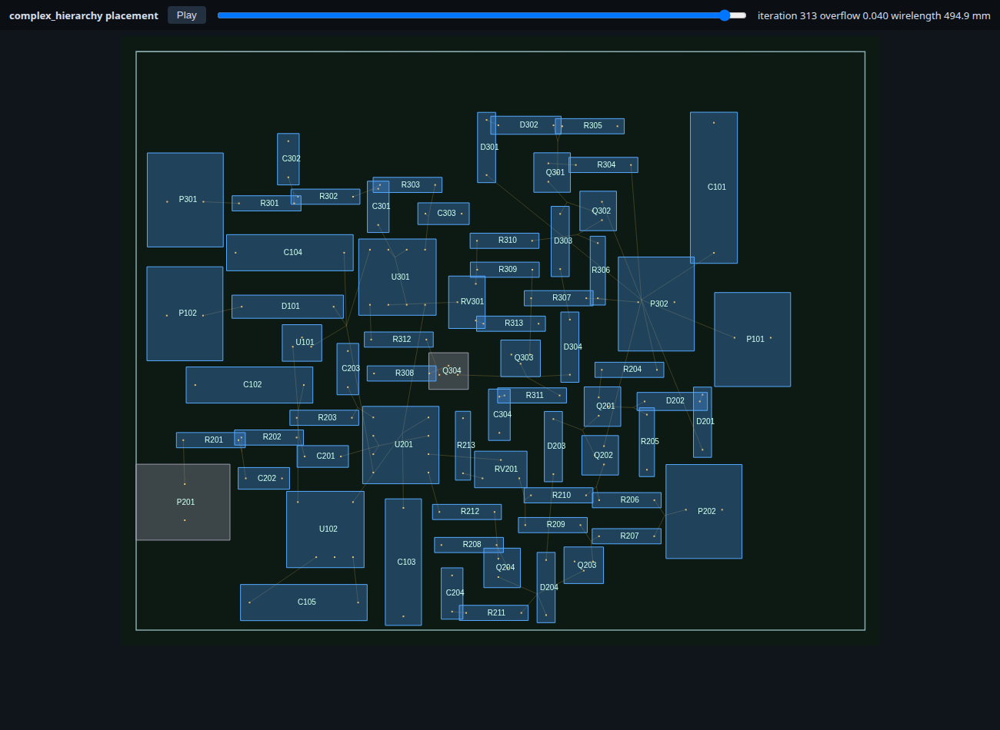
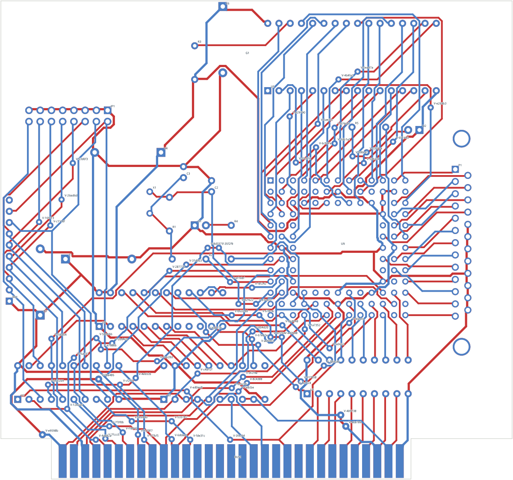

# The placer (`pcb-placer`) and the coupled layout loop

`pcb-placer` replaces the spring-plus-pairwise-pushing placer described in the
[trust audit](reviews/2026-09-21-trust-audit.md). Together with
[`pcb-router`](router.md) it forms the automatic layout flow:

```sh
# Placement only (writes the project plus placement.html, an animated playback)
cargo run --release -- place-kicad-board <source-dir> <board-id> <out-dir> [placer.json]

# Coupled placement and routing
cargo run --release -- layout-kicad-board <source-dir> <board-id> <out-dir> <router.json> [layout.json]
```

## Results (2026-09-21, cold: all movable footprints re-placed, zero copper)

Every board below is placed and routed automatically, is electrically complete
in native KiCad (zero unconnected items, zero clearance/courtyard findings) and
has zero internal violations. The only remaining native findings are
silkscreen label cosmetics (2–19 per board), which the existing
`repair-kicad-silkscreen` tool reduces further.

| Board | Movable | Auto placement → routed | Human placement → routed |
| --- | ---: | --- | --- |
| ECC83 | 6 / 15 | 9/9, 0 vias, 368 mm | 9/9, 1 via, 344 mm |
| Complex hierarchy | 66 / 68 | 50/50, 0 vias, 1318 mm | 50/50, 0 vias, 1330 mm |
| PIC programmer | 55 / 63 | 34/34, 1 via, 1722 mm | 34/34, 1 via, 1907 mm |
| Interf-U | 22 / 25 | 110/110, 71 vias, 5103 mm | 110/110, 58 vias, 4789 mm |

Placement takes 0.6–3 s, routing 0.2–25 s. Both routed columns use the same
router and rules. On Interf-U the human placement is still better (fewer vias,
less copper); on PIC and the hierarchy board the automatic one is.

| Global placement (hierarchy board) | Placed and routed (Interf-U) |
| --- | --- |
|  |  |

## How it works

1. **Lowering.** Footprints become bodies (courtyard plus pad bounding box,
   rectangular or round) with pins at their true offsets. Locked footprints,
   footprints without nets, and footprints on the board edge (connectors) stay
   fixed; everything else may move and turn in 90° steps. Large nets get a
   smaller weight so power does not collapse the layout. Pad boxes cover
   the drill. A through-hole part blocks the other side only with its
   holes and pads, and a part with a courtyard on both sides with that
   one too, against parts on either side. A hollow part (a shield outline) blocks only with its
   pads, and with its courtyard against parts with holes, since KiCad
   forbids holes in a courtyard unless the courtyard is malformed and
   KiCad skips it. A board cutout keeps only copper away: a connector body
   may reach over its peg holes. A footprint's own mask graphics (an RF
   modulator's exposed 22 x 32 mm area) are part of its body, also where
   it blocks with its courtyard's shape (`mask_openings`, below).
2. **Routing halos.** A PCB routes in the same plane it places in. Every body
   gets a halo proportional to its pin count; halos count as body area and as
   spacing. If the board cannot afford them they shrink uniformly.
3. **Global placement** (ePlace/RePlAce formulation). Body area is electric
   charge; the potential solves Poisson's equation on the board with a
   spectral method, so the spreading force acts at a distance and points to
   free space. Fixed parts and everything outside the outline are fixed
   charge; filler charge decides how much whitespace stays between the parts.
   Wirelength is the weighted-average model on true pin positions. Nesterov's
   method with a Barzilai–Borwein step minimizes
   `wirelength + lambda * density` while `lambda` grows until overlap is gone.
   Rotations are chosen greedily every few iterations.
4. **Annealing legalization.** Moves, quarter turns and swaps are judged on
   wirelength plus an overlap penalty that grows until no overlap survives.
   It starts cold so the global result is refined, not scrambled. An exact
   nearest-legal-position pass is the safety net. When it fails, it runs
   again with the stuck parts first. Crowded boards then walk down
   relaxation levels:
   - smaller halos, then none;
   - spacing down to the copper clearance;
   - a 0.1 mm grid;
   - bodies closer to the edge, as far as their copper allows;
   - where the project lets courtyards overlap, bodies shrunk to their
     fabrication outline and pads.

   The level used is reported, and the router-driven moves keep to it.
   Several seeds run in parallel (`placement_seeds`, 3; the layout asks for
   16, see the race below); the best placement by the placer's own key
   (fewest illegal parts, least missed constraints, least wirelength; a
   tie to the earlier seed) is kept, the others are the race's
   alternatives. The seeds share the work budget: seed k is kept while the
   seeds before it used less (three at least). They run in a pool of the
   process's search threads, judged in seed order whatever finishes first,
   in batches sized from the kept seeds' work (`race_seeds`), so the seeds
   run and kept do not depend on the threads; `board-placer.json` reports
   `seeds` (kept), `seeds_run`, `seed_kept`, `seeds_work_seconds` and
   `pool_work_seconds` (what the layout's clock counts: the kept seeds on
   the reference machine's eight threads).
5. **Refinement.** Greedy legal moves, rotations and swaps that strictly
   reduce wirelength.
6. **The placement race.** Wirelength is not routability. The layout ranks
   the seeds' legal placements (those that keep the constraints as well as
   the kept one) by RUDY: each net's spanning-tree length times its track
   pitch spread over its bounding box, summed per 16 x 16-node router tile,
   above a quarter of the tile's free capacity (every layer less obstacles
   and pad copper; `pcb_congestion::rudy_overflow`). The best three by that
   score are probed by the router for 75 s of work each, side by side, and
   the one with the fewest unfinished nets routes on (ties to the better
   ranked). Ranking takes 10-100 ms a placement (lowering, rasterizing);
   the 16 seeds cost placement wall time (about 30 s a board on the quick
   tier) but no extra placement work. Quick tier, 2026-10-10, one binary
   (x402), the plain race of three seeds against the pre-ranked race of 16:
   best race probe 204 -> 189 unfinished nets, open after the first route
   149 -> 112, KiCad unconnected 98 -> 64 (6 boards better, 2 worse),
   passes 16 -> 18. `congestion_score: "none"` in layout.json asks for the
   plain race; `congestion_model` ranks with the learned predictor
   instead (an experiment, [congestion-model.md](congestion-model.md)).
7. **Coupling.** `layout-kicad-board` routes the placement once, then the
   router and placer take turns on one in-memory state: congested footprints
   are nudged, the router reroutes only what the nudge touched, and moves are
   kept when the board improves. See [coupling.md](coupling.md).

The written board is checked: every pad must land exactly where the placer's
model said it would, including rotated footprints (KiCad stores pad and text
angles as absolute values).

## A fast no, and the budget inside the passes (2026-10-15)

A board without room used to cost every relaxation level an anneal and a
legalisation in vain, each part without a spot searching the whole board
(urchin's 80 parts on 80 x 40 mm with its key grids as rows: 742 s of
wall on four threads; the work budget was checked only between levels,
so a seed overran its 600 s by a quarter). Now:

- **Before placement** (`placement_room::outline_holds`, after the
  constraints are applied; input errors, exit 2): a user's `row` that fits
  the outline's box in no orientation it may take, and the parts an edge
  constraint holds at one edge on one side that need more length than the
  edge has. Only parts too deep to stand two behind each other within
  their `max_mm` count, each by its shortest tight body; the two that could
  overhang the edge's ends at the edge-copper level count their copper
  only. Regions were checked this way already (`region_holds`); all such
  errors are now said together. Not for an automatic outline (the layout
  grows it). Urchin's case: exit 2 in 0.04 s.
- **At once, before the levels** (`place`, `hopeless`): when even the
  last (loosest) level's bodies cannot all be placed, by area (the movable
  tight bodies with the least spacing need more than a side's outline
  area) or by strips (`strips_hold`: bodies at least `t` across meet any
  line at most `floor(height / t)` times, so their least extents along it
  sum to at most that times the width), no level runs: the parts are
  legalized once from the global placement with the hurried search below,
  the rest are unplaced, and `Placement::overfull` (`"overfull": true` in
  board-placer.json) says why. Both tests are exact (a necessary
  condition for any packing): a board that can be placed never takes
  this way, so its placement is unchanged. Hollow parts (those without a
  courtyard block with their pads alone), parts held at an edge or
  reaching over it, and cutouts are left out of the strips. Urchin
  without its rows on 60 x 40 mm: exit 1 in 3 s.
- **Inside the passes** (`out_of_work`, a thread-local stop the running
  `place` sets from `work_limit`): past the budget, a part without a spot
  in `legalize` searches only as many rings as 15 mm of a 0.5 mm grid (3
  mm of the fine grid) instead of the board; `evict_for`, `refine`,
  `repair_relations` and `align_orientations` stop; the retry with the
  stuck parts first is skipped. A placement within its budget is
  unchanged. Urchin without rows on 80 x 40 mm is not hopeless by either
  test (its switches have no courtyard: their pads alone block, which
  could interleave), so it still takes the levels up to the budget.

The placement's `room` (`placement_room::room`, in board-placer.json and
the verdict, see [agents.md](agents.md)) puts the room in numbers: per
side the usable area (outline less the edge band and the fixed bodies),
the movable bodies with spacing, the utilization, the area missing at a
target of 0.7, the smallest outline at that target (area, strips with the
target's slack, the largest part, rows and edge sets) and, when parts
found no place, a suggested outline.

## Where the wirelength goes (measured 2026-10-14)

`PCB_PLACER_TRACE=<file>` writes, per seed, the weighted wirelength after
global placement, annealing, legalization and refinement (and at the
designer's poses with `PCB_PLACER_DESIGNER`), the relaxation level, and
per movable part how far each stage moved it and what it met where the
annealer left it. `experiments/placement-loss/` prepares tasks as the
runner does, places them (`measure.py`, 16 seeds and the layout's 600 s of
work via `PCB_PLACER_WORK_SECONDS`) and tabulates (`analyse.py`,
`compare.py`). On the 30 quick-tier boards plus hackrf, video, the three
OpenESC boards, both SNSPs and zpn (the kept seed, x652's placer):

| Stage ratio | Median | Range |
| --- | ---: | --- |
| annealed / global | 0.83 | 0.36-1.54 |
| legal / annealed | 1.04 | 1.00-1.45 |
| final / legal (refinement) | 0.97 | 0.74-1.01 |
| final / annealed | 1.00 | 0.88-1.29 |
| final / designer | 0.85 | 0.16-1.77 |

- The legalizer is not where the wire goes in sum: the global placement is
  30-90 % longer than the final one, and the annealer, not the
  legalizer, removes that. Legalization adds 8 % over all boards and
  refinement wins 5 % back; a few crowded boards lose more (Castor 25 %,
  MIDAS-MK2 28 % before refinement, 21 and 12 % after), where the
  nearest-spot legalizer moves 100-120 parts, some 20-30 mm.
- Four ways to legalize or place better found nothing within the seeds'
  noise (median final wirelength on the six gap boards): keeping the
  annealer's legal parts and reflowing only the conflicted ones (-0.5 %
  on the tier), pushing overlapping parts apart a grid step at a time
  before that (+2 %), filler whitespace in the global placement (+2 %,
  +1 %), four times the annealer's moves (+4 %). The annealer is
  converged under the current rules.
- What the gap to the designers is: the routing halos. Without halos the
  six gap boards' final wirelength drops 22 % (median 23 %), to 0.87-1.27x
  the designers'; a spacing of 0.2 instead of 0.5 mm drops it 4 %. The
  designers' own placements are illegal at our full level for nearly
  every part (Castor 156 of 163, MIDAS-MK2 192 of 197): designers put
  parts courtyard to courtyard.
- The annealer does not see all the legality test forbids across the
  board: a through-hole part's holes meet bodies at half the spacing, and
  its copper-only far-side boxes not at all (Castor: 33 of 69 parts the
  legalizer had to move were invisible to the annealer).
  `anneal_far_side_gaps` (placer option, off) gives the annealer the
  legality test's gaps; it halves the parts legalization moves on Castor
  but wins no wirelength, and on the layout it is flat on the quick tier
  (x700 against x651: 19 passes both, unconnected 29 to 30, starved
  thermals 12 to 17, vias -4 %) and worse on two crowded boards (video
  240 to 315 unconnected, OpenESC 4in1 120 to 132; SNSP-CPU-01 239 to
  224 and mask bridges 22 to 5).
- `shared_halos` (placer option, off): neighbours keep the larger of their
  two halos between them instead of the sum; the halo budget and the
  global placement's charge count one halo per gap. Six gap boards' median
  final wirelength -6 %. Quick tier (with the annealer's gaps, x700):
  passes 19 to 20, unconnected 30 to 24, starved thermals 17 to 9, vias
  -5 %; but on the crowded boards zpn_devboard loses its pass (one mask
  bridge, vias 299 to 348) and hackrf's vias go 429 to 673. Not a default.

## Routing room from congestion (measured 2026-10-14, off)

`routing_room` (placer option, off): after a seed is placed with the
pin-count halos, each movable part's halo becomes its pin-count halo
times `factor * demand / median demand` (RUDY around the part's body
grown by 1 mm, nets a pour carries left out; none below half the median,
at most twice the pin-count halo), with `factor` chosen so the halos take
`routing_room_share` (1.0) of the area the level's halos took; the parts
anneal again from the legal placement (small moves), legalize and refine.
Parts the new halos leave without room fall back to the level's halo,
then to none; a seed whose pass still fails keeps the pin-count halos
and ranks after the others. `routing_room_all_parts` (on) lets parts the
level left without halo get one. The moves after routing keep the
per-part halos (`Relaxation::halos`). Code `crates/pcb-placer/src/room.rs`,
scripts `experiments/routing-room/`.

What the routed boards say (x693 tier and x652 gap runs, 35 boards;
`halo_use.py`, `analyse.py`): the routing density in a part's 1 mm band
does not follow its pin count (Spearman about 0 per board, -0.3 to 0.4)
but follows the RUDY demand there (median 0.6, 0.1-0.8) and the 25 s
probe's history (similar). On boards with full halos 15-76 % of the halo
area carries under 5 % of its routing capacity; keeping the half of the
halo area with the highest RUDY keeps 58-79 % of the routing inside
halos on the crowded boards, the half by pin count about 50 %.

What the layouts say (seed-repeated pairs, seeds 1, 101, 201, logs
`build/room-pair-*`): the option never fires on video, OpenESC 4in1 and
hackrf (their kept level has no halos; hackrf drops to it because one
part finds no room at the first level). On the five boards where it
fires, passes over the 15 runs: off 11, share 1.0 within the level 9,
share 1.0 all parts 11, share 0.75 9, share 0.5 9. Share 1.0 moves HPWL
by -15 % (BAGEL), -6 % (MK2.1) and +5 to +9 % (MK2, Castor, zpn); share
0.5 shortens HPWL on all five (median -8 %) and routed length on four,
with unconnected medians still 0 but single errors (a mask bridge, one
open connection, a starved thermal) costing two passes. Quick tier
(x737 against x722, one seed): 22 to 24 passes, unconnected 22 both,
vias -3.7 %. Within the seed noise; not a default. Video's routing
differs by up to 130 unconnected between runs of the same placement
(x732 and x736 with identical placements: 392, 314, 325, 262 for seed 1).

## Placement work against the CPU (calibrated 2026-10-14)

Budgets count placement work (`pcb_placer::work`, 150 M units a second
of one thread); the layout's wall clock only guards. `PCB_PLACER_DEBUG`
prints per phase `placer phase <name>: <wall> s, cpu <thread cpu> s, work
<counted> s (<counted / cpu>)`; the CPU time comes from
`/proc/thread-self/schedstat`, so the ratio is the calibration whatever
the load (absolute values still drift with it: keyboar_'s anneal measured
0.89 to 1.45 at loads 25 to 50; compare boards run side by side).

Before, the legaliser booked 3-15 % of its CPU time on the 0xCB panels
(and the wall guard fired, so results followed the machine's load:
vaio_re 63 or 151 open, glasgow "deadline reached"), the annealer 25-50 %
on boards with many relations (glasgow, MIDAS, Castor) against 100 % on
keyboar_. Profiled with callgrind (instructions per counted unit, about
42 on the calibrated anneal), what was not counted:

- a cutout's outline (the panels' slots between the copies, thousands of
  points) was walked nine times per pad, counted once per part: now one
  pass with a box prefilter decides unless an edge comes near the pad
  (exact: the full test runs then), counted per edge visited (a quarter
  unit); the 0xCB pcb-panel's legalisation went from 224 s to 28 s of CPU
  a pass;
- box lists (hollow parts, far sides, pads) and their pair tests: counted
  as the annealer does (8 + 3 per box, 1 per pair);
- the other part's box (two turns) and the linked-pair lookup per
  same-side test in the legality test (4 units, and log2(linked)/2);
- relations: each anchor a relation measures from costs about 4 units
  (glasgow's decoupling capacitors are each near any of 23 supply pins),
  and finding a part's relations scans every anchor; counted in the
  annealer's move work and the legaliser's penalty;
- pin positions in wirelength sums: 3 units a pin;
- parts held at an edge: their pads' offsets and the board's box on every
  test (eviction of a held connector, five times what it counted); the
  edge and region lists, scanned per test (half a unit an entry);
- exact speed-ups: a part not held at an edge no longer computes its pads'
  edge offsets in every snap, overlap and hard-constraint test.

Work ratio by phase (work / thread CPU; each pair placed at once on the
two threads of a core, one seed, 720 s of work; before = x738's counting):

| Board | Before (all; anneal, legalise, evict, refine, repair) | After |
| --- | --- | --- |
| 0xCB pcb-panel | 0.11; 0.52, 0.03, -, -, - | 0.95; 0.87, 0.93, 0.90, 1.50, 2.15 |
| 0xCB panel | 0.11; 0.45, 0.07, 0.07, 0.22, 0.08 | 0.77; 0.66, 0.77, 0.63, 0.65, 0.75 |
| glasgow | 0.40; 0.31, 0.40, 0.23, 0.48, 0.14 | 1.08; 0.98, 1.01, 1.05, 1.16, 1.12 |
| vaio_re | 0.72; 0.72, 0.49, -, 0.78, 0.61 | 0.98; 0.93, 0.80, -, 1.24, 1.08 |
| MIDAS-MK2 | 0.52; 0.49, 0.50, -, 0.62, 0.09 | 1.07; 0.98, 1.45, -, 1.63, 1.29 |
| Castor | 0.68; 0.59, -, -, 1.52, 0.23 | 0.98; 0.88, 1.14, -, 1.57, 0.84 |
| urchin | 0.86; 1.11, 0.23, -, -, - | 1.08; 1.09, 1.02, -, 1.00, - |
| keyboar_ (reference) | 1.02; 1.02, 0.61, -, 0.55, - | 1.02; 1.01, 1.17, -, 1.04, - |

(the pcb-panel's base placement was stopped after its first two
legalisations, 209 s of CPU; keyboar_ and the 0xCB panel from separate
pairs.) Global placement counts about twice its CPU time (1.5-2.3),
unchanged: it is 1-3 % of the work. A single seed's placement is
byte-identical before and after on glasgow, vaio_re, MIDAS-MK2, Castor,
urchin, spell_tome and keyboar_: the work changes where budgets stop
(the race's seed count, a level's or the annealer's work limit), not
what a seed does.

## Panels and courtyards on the far side (2026-10-14)

- **Copies of a tabbed panel** (`keep_copies`, on): the copies are one
  outline piece, so `keep_on_pieces` cannot tell them apart; their nets
  can (KiKit names a copy's nets `Board_N-...`). Where two or more net
  groups hold the same references (with pin counts), each with fixed
  parts whose boxes do not overlap, every movable part of a copy gets a
  region: the board's box cut between its copy's fixed parts and each
  other copy's, on the axis they are farther apart. Boards whose
  nets form one group (all others, and panels whose copies share net
  names: the PolyKybd molecules, OpenESC's 4in1 panel) do not change.
  Since 2026-10-15 the cut is halfway moved by half the difference of the
  board's margins beyond all copies' fixed parts (kept between the two
  copies): the copies repeat one layout, so each copy's region lies around
  its fixed parts as the board lies around all of them. Halfway alone cut
  SmartSpin2k's copies (fixed parts at each copy's top, 2.3 mm from the
  board's top edge and 40.5 mm from its bottom) through their own parts:
  162 of the designer's 630 movable parts outside their copy's region,
  none now; the 0xCB panels' cuts move by at most 0.75 mm. Each copy's
  parts also start global placement at their region's centre
  (`Constraints::starts`) instead of the common start, which clamped the
  other copies' parts against their regions' near borders.
- **A repeated reference** in a constraint (panels repeat every
  reference): an edge, rotation or place entry with a `uuid` is about the
  footprint with that uuid (`describe-kicad-board` lists them; the task
  generator writes one for every entry of a repeated reference). Without
  one, the entries name the parts in turn: the n-th edge, rotation or
  place entry for J3 is about the n-th J3 in board order. All of them
  used to land on the first J3 (one connector asked to touch the left,
  top and bottom edges at once); in turn, a task with entries only for
  the copies at an edge bound them to other copies (the molecules' fixed
  J1, J3 and J4 missed 17 edges by whole tile pitches).
- **Courtyards on the far side of parts on one side**
  (`Component::far_courtyard`): a back-mounted hot-swap switch has its
  14 mm square on the front; KiCad checks it against the front
  courtyards and holes of every part, the switches on the back included.
  The legality test and the annealer now keep one part's far courtyard
  from the other's far side (holes, pads, courtyard) at the bodies' gap;
  neighbour searches reach `far_reach` farther where such parts exist.
  woagboard's 26-28 courtyard overlaps go to 0.

## Mask openings block placement (2026-10-15)

A footprint's own mask graphics (filled F.Mask or B.Mask polygons,
rectangles, circles, strokes) bare the copper under them: another
footprint's pad there is exposed next to the opening, and KiCad reports
solder_mask_bridge for every such pad of another net. The body's box has
held them since the bodies agent (`body_on_side`), but a part whose
courtyard covers less than three quarters of that box blocks with its
courtyard's shape and its pads (`hollow`), and the openings were lost
there. SNSP-CPU-01's J2 (an RF modulator: a 12 x 5 mm courtyard around
four pins, a 22 x 32 mm F.Mask polygon beside it) held T1 and C61 in the
layout, SNSP-CPU-1CHIP's RF1 held T1; J2 is fixed, but a movable part
lost them alike. Now that shape includes the part's mask graphics on its
side (`mask_openings`, on), held to the body's box, so the legality test
and the annealer (both test the shape) keep other parts' bodies and pads
the bodies' spacing away, fixed and movable parts alike. Where KiCad's
mask margin, max(minimum web + `pad_to_mask_clearance`,
`solder_mask_to_copper_clearance`), exceeds the copper clearance the
openings grow by the difference (eternal-keypad and protoesp 0.10 mm,
USB_Cable_Tester 0.08, WLED_Matrix and USB_Keypad 0.05; none of them has
such a part). Pads of the opening's own net are kept out too (KiCad
exempts them; a whole pad of one net is rare). Courtyard-less parts
already blocked with their mask graphics, whole-body parts with their
box, and mask graphics on a part's far side are far-side copper.

Only three boards of the 109 have a part with a courtyard and mask
graphics past it (SNSP-CPU-01 4, SNSP-CPU-1CHIP 2, USB_Cable_Tester 1).
`experiments/mask-openings/pads_under_openings.py` counts other
footprints' pads under a footprint's mask graphics: 0 on all 109
designers' boards; on the 109 v16 layouts only SNSP-CPU-01 (6 pads of T1
and C61 under J2) and SNSP-CPU-1CHIP (4 pads of T1 under RF1). Layouts
(tasks v6, four threads, one run a side), x1055 against x1110:

| board | pads under openings | solder_mask_bridge | unconnected | errors | vias |
| --- | --- | --- | --- | --- | --- |
| SNSP-CPU-01 | 6 / 0 | 15 / 0 | 102 / 147 | 16 / 2 | 1812 / 1615 |
| SNSP-CPU-1CHIP | 4 / 0 | 16 / 0 | 2 / 0 (passes) | 16 / 0 | 757 / 678 |

SNSP-CPU-01's front is 73 % full (76 % with J2's opening). Another
seed won the race (seed 3 instead of 12; its race probe left 308
unfinished nets against 317), its first route left 215 open terminals
against 114, and it ended with 45 more unconnected items. One run a side
cannot tell a reshuffle of a crowded board from a cost of the rule; the
v16 layout (x862, the parts under J2) had 152.

## What went wrong on the way (kept as lessons)

- A density target below 1 can never be met when every part is larger than a
  bin; overflow plateaued at 0.24–0.40 and the layout froze. Bodies are now
  exclusive at density 1 and whitespace is controlled by halos and fillers.
- Greedy largest-first legalization doubled the wirelength by exiling small
  passives. The global placement was fine; the annealing legalizer fixed it.
- Minimum wirelength is not routability: the most compact Interf-U placement
  has the best wirelength and does not route. Only routing feedback tells.

## Known limits / next steps

- Bodies are rectangles or discs; rotations are quarter turns; the placer
  never changes a footprint's side by itself (`back`/`front` constraints
  do, see [constraints.md](constraints.md)).
- Constraints: see [constraints.md](constraints.md). No alignment
  constraints yet.
- Congestion drives nudges of individual parts, but does not yet feed the
  global placer's density term (coupling step 3).
- Silkscreen labels are not placed; the separate repair tool handles most.
- Pin swapping runs once after placement when the layout config names a
  `pin_swaps` file ([pin-swap.md](pin-swap.md)); it is not yet part of the
  move loop. No gate swapping.
- The spectral solve is a direct O(n^3) cosine transform (64 bins); an FFT or
  a GPU kernel becomes relevant for boards with thousands of parts.
