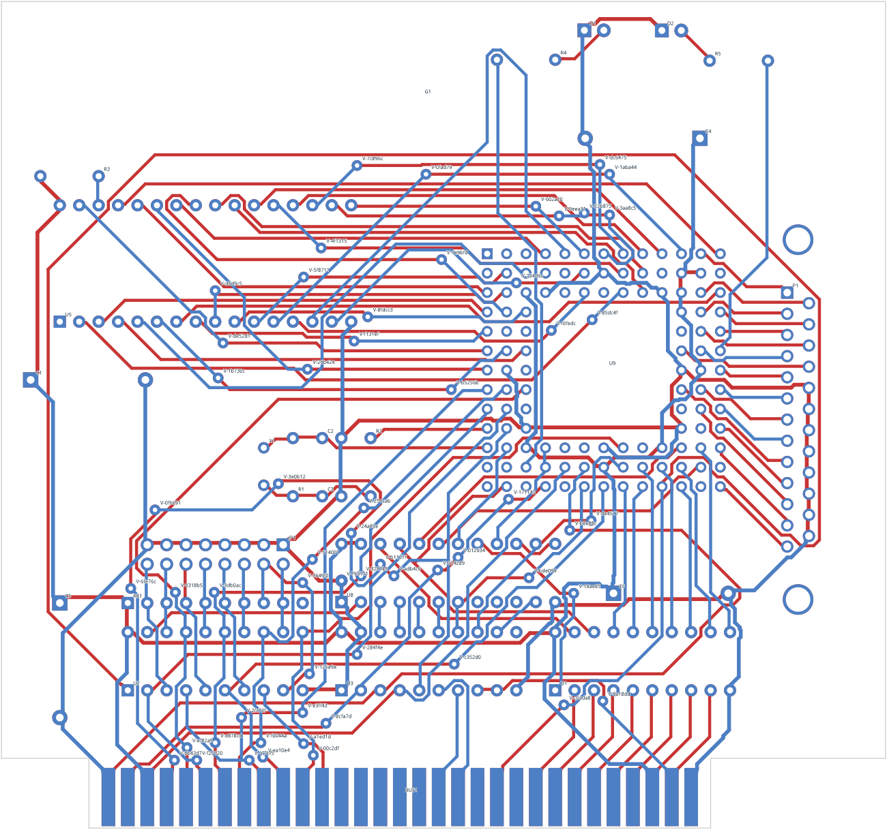

# The whole-board router (`pcb-router`)

`pcb-router` is the project's routing core. It replaces the per-net,
file-to-file sequential router described in the
[trust audit](reviews/2026-09-21-trust-audit.md).

```sh
cargo run --release -- route-kicad-board \
  <source-directory> <board-id> <output-directory> [config.json|auto]
```

The command parses the board once, routes every connection in memory, checks
the result with an exact internal verifier, writes the project once, and runs
native KiCad verification once as the final gate. It exits non-zero when the
internal verifier or KiCad finds anything.

A config file that only tunes the router (no `connection_rules`) still takes
its rules from the project. `{"frame_directory": "<dir>"}` additionally
writes the board after every negotiation iteration as
`<dir>/attempt-NN/frame-NNNN.kicad_pcb`; `docs/images/animate.py routing`
turns those frames into a GIF (the README's routing animation is
Interf-U, cold, 81 iterations).

## Results (2026-09-21, one thread, cold boards, zero initial copper)

| Board | Nets | `pcb-router` | Old internal router | Freerouting 2.2.4 |
| --- | ---: | --- | --- | --- |
| ECC83 | 9 | 9/9, **0.2 s**, 1 via, 344 mm | 9/9, 104 s, 8 vias, 388 mm | complete |
| Complex hierarchy | 50 | 50/50, **1.2 s**, 0 vias, 1330 mm | 50/50, 487 s, 10 vias | 49/50 (one open), 8.5 s routing |
| PIC programmer | 34 | 34/34, **2.9 s**, 1 via, 1907 mm | 34/34, 308–1272 s, 39–53 vias | 33/34 (one open) |
| Interf-U | 110 | 110/110, **22.5 s**, 58 vias, 4789 mm | 94/110 at the 1800 s cap | 110/110, 49 s routing, 44 vias, 5051 mm |

Times are routing only; the single native KiCad gate adds about 6 s per
board. Every `pcb-router` result above passes native ERC/DRC/parity with zero
findings and zero internal violations. The Freerouting hierarchy and PIC
figures are the ones retained by the trust audit of 2026-09-21; ECC83 and
Interf-U were re-run during the audit.



## How it works

1. **Lowering (once).** The adapter (`crates/pcb-kicad/src/board_router.rs`)
   turns pads, holes, rule areas, existing copper, the outline and the resolved
   per-net rules into a format-independent `pcb_router::Board`.
2. **Lattice.** A pitch and phase are chosen so that as many pad centres as
   possible fall on nodes (through-hole boards live on an imperial lattice).
   Tight channels count ten times more than pad centres: a channel between two
   neighbouring pads that the narrowest track fits through with less than
   half a pitch to spare needs a node row within that slack of its centre, or
   the pad row is a wall. (ngdevkit's 0.75 mm BGA with 0.28 mm balls and
   0.15 mm rules leaves 0.01 mm of slack; 0.125 or 0.075 mm lattices reach
   its inner balls, 0.1 mm cannot.)
3. **Static maps (once per rule class).** Per layer and node: free, blocked, or
   owned by one net (its own pads). Nodes within one chord sagitta of an
   obstacle get exact per-edge checks, so there is no blanket safety margin
   eating narrow channels.
4. **Occupancy.** Routed copper is stamped into per-class occupancy maps as the
   zone where another net's centreline or via may not be. Stamps are reference
   counted per net, so rip-up is an exact decrement; a restamp builds the
   net's new list first and changes only the counts of the stamps that
   came or went (a rerouted branch, not the branches kept). They are exact: a node's
   disc covers the cells closer than the clearance (in whole nanometres), so
   two tracks at exactly their clearance are legal, as KiCad has it (0.4 mm
   pad pitch with 0.2 mm tracks and clearance). On a lattice no node lies
   closer to an axis step than to its ends; a diagonal step passes the nodes
   on its bisector closer, so it stamps those too, and every node stamps,
   into a second family of maps, the start cells of the diagonal steps that
   would pass it too closely (one lookup per diagonal move in the search).
   The distance between two segments of a lattice is always attained at a
   node of one of them, so these two stamps together are exact. What stays
   quantised is the spacing of parallel diagonals: multiples of pitch/√2,
   so on a 0.127 mm lattice three 0.25 mm tracks with 0.2 mm clearance fit
   an axis channel of 1.15 mm but not a diagonal one (5 steps are 0.449 mm).
5. **Negotiated congestion.** Every net is routed allowing overlaps at a cost.
   Contested nodes get more expensive from iteration to iteration (present
   factor and history). Only nets still in conflict are touched, and of those
   only the conflicting branches; the remaining tree components are
   reconnected. A net in conflict for eight iterations running is ripped up
   whole every eighth: the branches it kept may be what boxes the other net
   in (Interf-U's edge fingers, where a kept branch fenced the neighbour's
   finger on the only layer that reaches it). Branches a rip-up keeps stay
   stamped while the net is searched again; the search masks its own stamps
   (`mask_own`, an epoch that never repeats: the old Jacobi mask reused
   generation 1 for every net, so a previous net's stamps passed for the
   current one's). Fixed branches (plane skeletons, escape stubs) therefore
   hold their ground even in the hard rerouting at the end, where a bulk
   rip-up used to unstamp them and other nets crossed them.
   `escape_stub_mm` (off) fixes a straight stub outward for every pad of a
   fine-pitch row before negotiation; it did not gain on Tiny Tapeout or
   ColdFire yet. `fixed_plane_stubs` connects every surface pad of a pour
   net to an inner plane by a stub and via before the signals route (only
   inner planes count: on the empty board every pad touches its own
   layer's pour, which the signals then cut to pieces); the KiCad ladder
   runs it as a rung when the plain pour connection left pour-net pads
   open (Framework mainboard half: 13 open -> 3, then complete as tracks). Under `PCB_ROUTER_DEBUG` the
   conflict spots of stuck nets name the nets stamping them, and
   `PCB_ROUTER_DUMP=x0,y0,x1,y1` (mm) prints the lattice of that region per
   layer once few nets remain (statics, occupancy, the stuck nets' nodes).
6. **Search.** A* over (layer, node) with preferred layer axes, bend and via
   costs. Few-target searches use a layer-direction-aware bound; many-target
   searches (power nets, tree components) use an exact coarse octile distance
   transform.
7. **Resolution.** If negotiation stalls, the most contested nets are removed
   and reinserted with all other copper as hard obstacles; partial trees are
   kept and reported. Since 2026-10-15 a net in conflict loses only its
   conflicted branches (and those left dangling by them), not the whole
   tree, whatever the negotiation's every-eighth-iteration whole rip-up
   would say, and an incomplete net without conflicts keeps its tree; the
   hard search then joins the rest to what is left (`resolve_keeps_partial`;
   `PCB_ROUTER_OLD_RESOLVE` rips them up whole as before). Ripped up whole,
   a net searched again from one pad among copper that no longer gives
   way often found nothing: MegaDrive's cold route left 19 signal nets
   with no copper at all after the repair (ten VD, five VA, ZA0, ZA8,
   ZD4, PA6; 4 now), and vaio_re's narrow-signal attempt +3V3E with 3 of
   43 pads.
8. **Cleanup.** Each net is rerouted alone with pure geometric cost and a high
   via cost; the result is kept only if strictly cheaper.
9. **Verification.** `pcb_router::verify` measures true distances between all
   emitted copper, obstacles and the outline, independent of the lattice.

### Pads no path reaches (2026-10-15)

A net's tree grows by one multi-target search at a time and stops at the
first search that finds nothing. In negotiation only what never changes
(pads, rule areas, the outline, hard thermal guards) stops a search, so a
board-wide search that fails proves its open pads unreachable for the
whole negotiation. Since 2026-10-06 two such failures make the net keep to
its corridors (`hopeless_searches`, link's wasted board-wide searches),
and from then on a corridor that missed ended the net, open pads and all,
and left it blocked. SNSP-CPU-01's GND (199 pads, four walled in at two
connectors, J3 and P6): 195 pads in iterations 0 and 1, then 48, 30, 21
for the rest of the negotiation while the signals took the room; the hard
repair could not bring it back (178 unconnected in KiCad). The narrower
corridors of 3c1f81d (a tile more every sixth reroute, not every third)
made the miss happen there: 55 open before it, 178 since. The pads a
board-wide search did not reach are now left out of the net's later
searches in that negotiation (`NetState::unreachable`,
`unreachable_terminals`; `PCB_ROUTER_OLD_HOPELESS` for A/B). Route mode,
cold, 4 threads, with the repair's change above (x881 against x902, this
change on main before 670454c; KiCad's unconnected items): SNSP-CPU-01 178
to 5 (GND's 4 walled-in pads and one signal), MegaDrive 137 to 70, vaio_re
8 to 5, mackerel-30 0 to 0, DSP-ADAU1452 0 to 1 (the ladder had time for
the 0.05 mm rung and left the narrow-signal step 52 s of work instead of
142). Either change alone loses somewhere: the pad rule alone took vaio_re
to 41 (its tracks rung, 634 to 132 open, became the best and its narrow
attempt ripped +3V3E up whole: 3 of 43 pads).

### The probe ladder (2026-10-03)

On boards with four or more layers and 120 or more connections the KiCad
adapter does not split the ladder's budget by a fixed rule (each rule tried
failed some board: docs/todo.md). Every rung (exclusive planes, connected
pours, plane stubs, pour nets as tracks) is lowered and negotiates for
`probe_seconds` (75) with `Router::probe`, which keeps its whole state; the
rung with the fewest unfinished nets (conflicted or incomplete) is resumed
with `Router::resume` for a third of what is left, then finished and
polished. A probe that finishes everything stops the probing, and only the
leading router stays in memory. The probes run side by side (as many as
fit half the memory available, judged by the first router's size), with
the outcome of probing one after the other: a probe's budget is work, the
fewest unfinished nets lead, a tie goes to the earlier rung, and only the
probes up to a rung that finishes everything count. The layout's placement
race probes its placements the same way. Finer pitches follow as before when
connections stay open.

### Hole clearance

Copper keeps two distances from a via: the copper clearance from its ring
and the board's hole clearance from its drill; with a thin ring the second
binds. Both enter the stamps (trace and via against via) and the static
map around pads, and the exact verifier checks copper-to-hole as well as
hole-to-hole. The same holds for a pad's plated hole: other nets' tracks
and vias keep the hole clearance from its drill, which reaches past a thin
ring (jetson's J2: 0.55 drill in 0.75 copper, clearance 0.125, hole
clearance 0.25: a via 0.769 from the centre kept the copper rule and was
0.244 from the hole). The pad's own net is exempt, as in KiCad, whose
tracks end on the drill; its vias keep the pad copper's rule
(`StaticMaps::via_owner`).

### Memory (2026-10-03)

A thread's search scratch is the largest part of a big board's footprint
(cost, parent and generation marks per lattice state, one scratch per
worker thread), followed by the per-class occupancy and static maps. Marks
that only deduplicate within one operation are bitsets cleared from the
list of what was touched (stamp marks per map, the own-stamp mask per
thread); search generations are 16-bit and cleared on wrap. ATAT1800 (four
layers, 3952 x 1227 nodes): 8.65 GB -> 5.52 GB peak, identical result.
Next candidates: the static maps per class (41 bytes per node and class)
and fewer scratches on boards where parallel batches are small.

2026-10-09: verbose runs print the maps' sizes after the lattice line
(`memory: ...`). Per node and layer, for C rule classes of which S are
searched (net classes and their neck classes; the rest are pour brushes,
read only by the pour model): static maps 7C bytes (the trace map 4, the
edge directions 1, their owner 2), per node 1 (vias blocked) and for a
searched class 6 more (via owner, free layers), and the mask openings'
differences only where they are; occupancy 6C (a 16-bit count for the trace and two diagonal maps) plus
2C per node for the via maps; the search records `hot` 12S (were 16C);
history, guard and cover 12 plus 4 per node; a search scratch 12 per state
(were 20: the tree and target marks are hash maps of the few nodes they
hold), one for the router and one per worker thread that routes a batch.
Copies of a router (the via reduction's snapshot, the layout's trials)
share the static maps and leave the scratch, the stamp marks and `hot`
behind; the via reduction's whole copy had doubled every board's peak.
Route mode, one attempt, 4 cores, x155 -> x161: Castor 1391 -> 687 MB,
SNSP-CPU-01 2209 -> 1536, katia 6292 -> 4315, identical routes; layout
mode (x155 -> x160, 2 threads): CyberKeeb2040 6916 -> 3395 MB, Qfwfq 3330
-> 1414, identical boards. Threads hardly speed the search (k30-SBC: 34.2, 32.4, 31.3 s on 1,
2, 4 threads) and each holds a scratch: run boards side by side with few
threads each (`RAYON_NUM_THREADS`, the runners' `--threads`).

## Two-level search

Every connection is first planned on a coarse graph of 16 x 16-node tiles
(per layer, with via edges between layers). A tile costs more the fuller it
is, with the fill maintained incrementally from the occupancy maps, and more
again where conflicts keep happening. The lattice A* then runs only inside the
planned corridor (one tile of margin); nets that keep losing negotiations get
wider corridors, and a failed corridor falls back to the plain window and the
whole board. This is the "graph layer tells the geometric layer where to go"
idea; it halved the time on the large boards and reduced vias and copper.

## Copper pours

Zones covering at least a tenth of the board are pours. Pads inside a pour
are connected; other pads get a short stub and a via to the nearest free pour
node. After routing, the pour's solid pieces are labelled on the lattice;
islands holding pads are stitched to the main piece with vias, and pads that
cannot be stitched are routed to it. Around pads that connect to a pour, other
nets pay extra so the thermal spokes survive. If the router or KiCad still
sees open items, the pour nets are routed as tracks instead and the better
board is kept.

### Thermal spokes as KiCad counts them

A pad joins a pour through thermal spokes, and KiCad's DRC reports a
starved thermal where it counts fewer than two. The spoke model
(`kicad_spokes`, on; `analyze_pours_full`, `router/fill.rs`) follows
zone_filler.cpp and drc_test_provider_zone_connections.cpp of KiCad 10:

- a spoke runs from the pad's centre to its box grown by the gap, half the
  zone's minimum width and 0.005 mm, and is kept where that end lies in
  the fill (a brush centre within half the minimum width) or in another
  pad's spoke whose end lies in this one (pads side by side);
- it is as wide as the zone's spoke width but no wider than the pad, and
  none is drawn when that is narrower than the minimum width; other nets'
  clearances then cut it, and it counts where a brush still fits from
  the ring half a gap around the pad to its end;
- the DRC ignores spokes into a fill piece that touches nothing but the
  pad ("isolated island"); a piece with any second item (another pad's
  spokes, a track or via of the net, the pad's own track, which touches
  its spokes outside the pad's drill hole: a through-hole pad's fill
  reaches the pad only up to its hole, so a track leaving between the
  spokes touches none of them, `track_meets_spokes`) is no island, and
  connects what it touches (KiCad joins a track to every fill piece its
  copper overlaps, not only at its ends);
- while a pad is short, the DRC counts each track segment connected to it
  that starts within half a gap of it and ends in fill (on any layer, in
  this layer's fill; a kept spoke is fill, as far as other nets'
  clearances leave it), and falls back to the island spokes only when
  nothing else counts.

Whether a point lies in the fill is asked off the lattice (`FillProbe`:
the obstacles and the other nets' routed copper at their exact
distances), since the lattice misses brush centres a fraction of a pitch
from a node. Measured with `experiments/pour-fidelity` (`census.py`,
`spokes.py`, `causes.py`) on 44 routed boards (4274 thermal pad layers,
171 starved findings): the old model flagged 77 of them and 866 pads KiCad
does not; this one flags 116 and 87 (19 more are pads it does not have:
pads sharing a number, custom pads). Thermal reliefs do not cut spokes
(KiCad adds them after the reliefs). Spokes of pads apart meet whatever
their directions (KiCad asks only that each end lies in the other spoke;
a pad doubled at one spot has one set of spokes).

What KiCad's filler and DRC do besides, modelled since (2026-10-14, the
fill2 agent; census: 129 to 146 findings predicted, 28 to 13 missed, 90
to 27 false alarms, pads not modelled 14 to 12):

- spokes in the pad's own frame (`Board::pad_spokes`, `PadSpokes`): turned
  with the pad (0xCB's parts at 45 degrees), at its spoke angle (a
  rectangular pad's `thermal_bridge_angle 45` gives diagonal spokes to its
  box grown by the gap); the routing guards keep the box's axes (in the
  pad's frame they cost Hub 6 connections);
- a pad's clearance override replaces the zone's clearance in the fill,
  also when smaller (`Board::fill_clearance`, in the probe and in the
  static fill map, where overridden pads are stamped last);
- hatched zones (`Plane::hatch`): the spoke's end half a web out, a ring a
  spoke wide around each thermal pad (in the fill the spoke ends are
  tested against and in the final fill), and the holes on KiCad's grid
  (turned about the origin, smoothed, a web left along the fill's edge,
  holes cut small by the edge or around a whole ring filled) for the
  DRC's track ends;
- a spoke cut off from its pad by clearances near the pad still crosses
  the ring, but brings no item to the piece it lands in (k30's U14.12);
- other pads' kept spokes across a pad's ring count as its spokes
  (`foreign_spokes`), the DRC counting every crossing of the fill;
- a track or via is an item of every piece its copper overlaps
  (`track_touch_fill`), each straight run one item; a pad is one item of
  an outline however many of its pieces it reaches; a pad's spokes that
  overlap (all of them without a hole) make the pieces they land in one
  outline, as does a neck between pieces the lattice cuts (`neck_joins`);
- tracks of a pad at the same spot count for both (USB-C A1 and B12);
  pads merged into a larger pad of their number are checked on the
  layers where they are copper of their own (`Board::merged_pads`);
- brush centres keep the clearances to 3 microns (KiCad's pruning
  epsilon and arc approximation), track ends test what clearances leave
  of a spoke anywhere across it, a spoke's end is searched for along the
  spoke (a neck exactly the minimum width), and an end in a sliver the
  lattice misses joins the piece a straight run of fill reaches.

Thermal vias inside an exposed pad (`inner_pads`, on;
`PCB_ROUTER_NO_INNER_PADS`; 2026-10-14). KiCad's filler treats a pad
inside a larger pad of its net like any thermal pad: it cuts its relief
(inside the larger pad's, so nothing changes there), in a hatched zone adds
its ring (pad + gap to pad + gap + spoke width, clipped only by the zone's
outline, then by other nets' clearances), builds its four spokes from its
centre and keeps them where their ends land in that fill or meet another
spoke; it knocks the plated holes of all thermal pads out of the fill at
the end. The DRC checks every pad by its own ring (half a gap out): the
crossings of any fill outline with it, an outline over the larger pad
holding both pads (no island). So in a hatched zone (0xCB's QFN, U3.45 on
B.Cu) each via has its ring and four spokes into it, and a via at the pad's
corner, whose ring and outer spokes the neighbouring pins' clearances take,
keeps one spoke: starved. In a solid zone the larger pad's relief takes the
vias' spokes, and what crosses a via's ring is the larger pad's own spokes
from its centre: one running right through the ring counts twice, one
grazing it once, none none (no finding). The model: merged pads get
records on every layer, reliefs and rings (`thermal_ring_pads`); spokes of
pads of one terminal meet; a spoke of a pad inside its terminal's pad that
lands counts (the outline holds both pads); foreign spokes across such a
pad's ring are sampled from their centre and count twice when both ends
lie outside the ring; a merged pad's DRC tracks are those whose copper
overlaps its own (KiCad's connectivity: the exposed pad's tracks crossing a
via), and no fill lies in a thermal pad's plated hole (a track to a via's
centre ends in none). The DRC's track-end test keeps other nets'
clearances to half a micron (`TRACK_END_TOLERANCE`, `track_end_tolerance`;
`PCB_ROUTER_OLD_TRACK_ENDS`) rather than the spokes' 3 microns: 0xCB's
corner via has a track from it ending 1.5 microns outside a sliver of fill
between two pins. Half a micron is KiCad's DRC epsilon (`GetDRCEpsilon`,
ADVANCED_CFG `m_DRCEpsilon` 0.0005 mm), which its clearance tests subtract
from every clearance; the starved-thermal check itself tests the point
against the fill with none, and the filler prunes with its own micron.
Exact gives two false alarms, a micron loses those four findings. `experiments/pour-fidelity/pads_in_pads.py`
lists the pads inside pads of a board.

A starved via inside an exposed pad gets a track of its own
(`add_inner_spokes`, `inner_spokes`, on; `PCB_ROUTER_NO_INNER_SPOKES`):
`manual_spokes` cannot help it (a merged pad has no lattice nodes), so a
straight track of the net's width runs from its centre into the fill over
the exposed pad, in a hatched zone its own ring, its copper wholly inside
the exposed pad's (every clearance the pad keeps, it keeps), the shortest
of sixteen directions; KiCad's DRC counts a track connected to the via that
starts in its ring and ends in fill as a spoke. It is kept only if the
model then finds the via no longer short, and emitted as exact copper
(`NetState::inner_spokes`).

The fill model reads every zone of a pour net as KiCad fills it, also in
the tracks rung, whose pours do not connect (`tracks_rung_fill`, on;
`PCB_ROUTER_OLD_TRACKS_FILL`; 2026-10-15): a hatched zone's hatch, its
rings and its outline as in the connecting rungs, for the spoke verdicts,
manual spokes, island vias and stubs and inner spokes there. The DRC's
track rule tests the segments as the router emits them
(`track_end_junctions`, on; `PCB_ROUTER_OLD_TRACK_RUNS`): a straight run
from the pad ends at the first junction, where another branch of the net
leaves it and `materialize` cuts the segment, not at its turn (0xCB's
MX3.S1: the run passed a junction in fill and ended 12 microns inside a
hatch hole, KiCad's segment ended at the junction; reading the hatch
without the cut lost its track spoke, its two island spokes stood in for
it, and no island via was added).

Zones of one net that meet on a layer are checked apart (`zone_seams`,
on; `PCB_ROUTER_NO_ZONE_SEAMS`; 2026-10-15). KiCad 10 fills each zone on
its own: the fill is built over the zone's outline and the outlines of the
net's zones it collides with (`ZONE::BuildSmoothedPoly`), trimmed to its
own outline, and the outlines of the net's zones of a strictly higher
priority are cut out of it last (`subtractHigherPriorityZones`); equal
priorities overlap. The fills meet at the higher zone's outline, the seam,
with no clearance between them. The DRC tests every zone and layer apart
(`testZoneLayer`): a pad's spokes are the crossings of its ring with that
zone's fill, the isolated islands are that zone's, the tracks those ending
in that zone's fill, and a zone whose fill does not cross the ring is no
connection. So a pad whose ring the seam crosses is checked against each
zone with the spokes on its side (Telemetry's USB shield pads: three
spokes in the whole-board zone of priority 1, one into the edge zone of
priority 11, starved there). The model keeps one fill per net and layer
and counts, per zone of the layer (`Plane::above`, the outlines cut from
it; `Router::in_zone_part`), the spokes whose crossing of the ring lies in
the zone's part (a spoke the seam splits lengthwise counts in both), the
island spokes, other pads' crossings and the tracks ending there, by the
DRC's rule; the worst zone's shortfall (`SpokeRecord::seam_short`,
`seam_zone`) adds to the pad's, and a manual spoke for it must end in that
zone's part. Not modelled: per-zone fill settings (the layer's fill uses
one zone's clearance and minimum width, Telemetry's band zones keep 0.25
mm, the whole-board zone the class's 0.2) and islands the seam alone
makes. Zone outlines drawn with arcs are followed (they were dropped,
`PCB_KICAD_OLD_ZONE_ARCS`): Telemetry's band zones were polygons through
their other corners.

A spoke's clearance test runs from the ring to where the fill's own brush
centres begin, the gap and half the minimum width past the pad, rather than
to its end 5 microns further (`spoke_clear_to_fill`, on;
`PCB_ROUTER_OLD_SPOKE_CLEAR`): Telemetry's D12.1 has a spoke into a strip
exactly the minimum width between its relief and D12.2's clearance, whose
brush centres lie on one line 2 microns short of the spoke's end.

After a layout move's reroute the pours are refreshed (pads the rerouted
signals cut off are routed again), and a plane end whose fill the signals
took is trimmed back to its junction (`trim_dangling_plane_ends`;
USB_Cable_Tester's dangling /SHLD stub).

`render.py` draws KiCad's fill and our map around a pad.

A pad still short after the stitching gets straight tracks into its pour
(`manual_spokes`, on): a track of the net's own class from the pad into a
piece KiCad keeps, which the DRC counts as a spoke; a track keeps the net
class's clearance, often less than the zone's. A pad whose spokes reach
only islands (pieces nothing else of the net touches, typical of inner
planes the signals cut up in the tracks rung) gets, when no straight track
reaches kept fill, a stitching via from the island to the net's main piece
on another layer (`island_vias`), and failing that a straight track of its
own on that layer into the island (`island_stubs`): the island then holds
two items and the DRC counts its spokes. The stub changes no connection
(the island hung on the pad already); it is what KiCad's rule asks for.
k30's tracks rung: 14 starved thermals to 1; mackerel-30's: 19 to 3.

### KiCad's connection width (necks)

KiCad's `connection_width` check (drc_test_provider_connection_width.cpp,
10.0.7) runs only when the board setup has a minimum connection width
(`min_connection`, 0 by default) or a custom `connection_width` rule; the
netclasses have none. Per net and copper layer it unites every zone fill
(teardrops are zones), track, flashed via and flashed pad
(`TransformShapeToPolygon`, `ERROR_OUTSIDE`, `ARC_HIGH_DEF`), fractures
the union and walks each outline (`POLYGON_TEST`, a `VERTEX_SET`): at every
concave vertex it looks for the nearest other vertex of the same outline
that is not its neighbour, nearer than the minimum less twice (DRC epsilon
0.0005 + the board's max error + the fill's extra margin 0.0005 mm), seen
from inside, with the outline bulging further than that in x and in y on
both sides of the cut (`isSubstantial`). Each pair is a finding; its width
is the two vertices' distance, its place their midpoint (not in the JSON
report). Nothing is ignored but rule areas; a pad's own copper is part of
the union. `experiments/pour-fidelity/necks.py` reproduces the check
vertex for vertex on kicad-cli's own fill (`--refill-zones --save-board`)
and names each neck; it agrees with KiCad's report on every board that has
findings (OpenESC's 199 are KiCad's error cap). KiCad's test is local:
it also pairs vertices across a narrow gap between two parts of one
outline.

KiCad's filler removes necks narrower than the zone's minimum thickness
(deflate and inflate, again after other nets' zones are knocked out), so
on a solid zone with `min_thickness` at least the minimum connection width
there are none from the fill. What it does not prune, and what the census
finds: in hatched zones the thermal rings (added after the pruning), the
border it restores around another net's teardrop in the iterative refill
(issue 24758, a band of the minimum thickness clipped to the unhatched
fill), and pad corners against hatch holes; and tracks narrower than the
minimum (a warning on OpenESC). kicad-cli's DRC with `--refill-zones`
also rebuilds the teardrops of every pad that has them enabled, which the
router's pour model knows nothing of.

So the router does not predict them; it repairs them with KiCad's fill
(`necks.rs`, on; `PCB_KICAD_NO_NECK_REPAIR`). When the final DRC reports
connection_width errors (errors only: the check's severity is the
project's, warning on most boards), kicad-cli refills and saves a copy of
the board, the net's copper on the layer (KiCad's fill outlines, the
net's pads, tracks and vias) is drawn on a 4 micron raster tile by tile,
and the passages narrower than the limit that lead to copper wider than
it on both sides are found from the distance map (a pixel whose wider
neighbours form two arcs, one each way along the passage). Over each a
track of the net as wide as the minimum runs along the passage into the
wide copper on both sides, where it keeps the net classes' clearances to
other copper and other nets' fills (their teardrops), the hole clearance
to drills and the edge clearance; shifted sideways or shortened when not.
The board is checked again; the tracks are kept while the necks go down
and no other error type or the unconnected count goes up, all together or,
failing that, by halves (at most six checks). The raster finds the same
necks KiCad reports on WLED_Matrix and USB_Keypad (7 of 7, 12 of 13, 3 of
3, 4 of 4). `pcb-maker repair-kicad-necks <dir> <id>` runs it on a routed
directory; the result's `board-router.json` has `neck_repair`.

The board setup's minimum connection width is also a floor on every track
width the router chooses (2026-10-15): when the project rates
connection_width findings as errors or warnings (KiCad's default is a
warning; `ignore` sets no floor), `min_connection` raises the class widths,
the narrow-signal width and the neck width (`project_rules.rs`,
`KiCadBoardRouterConfig::min_connection_mm`, `apply_width_floor`), and the
lowering raises every class and the neck to it again, so a configuration
file's or a requested net class's widths keep it as well; stubs, escapes,
manual and inner spokes take their net's class or neck width, and the
neck repair's tracks are the minimum rounded up to a micron. A warning
does not fail the pass rule, but it is what the user sees in KiCad's
DRC, so warnings floor the widths too. `PCB_MIN_CONNECTION_FLOOR=error`
floors only at error severity, `off` never. `board-router.json`'s `rules`
names the floor, the severity, the narrowest class width and the neck
width the board was routed with.

### Plane skeleton (fallback)

When a pour ends up shredded by the signal routing, stitching after the fact
cannot repair it (ngdevkit's ground pour: 1536 pieces, 171 stranded pads,
274 stitching vias for six of them). The skeleton secures the pour's
continuity first: the pour net is routed as a plain tree, biased six-fold
onto the layer its pours cover most, against the still empty board, and
that tree is *fixed* for the rest of the run (never ripped up, never the
pour net's conflict). After routing, every part of it that lies in solid
pour copper is trimmed away again, so only the hops the pour cannot provide
remain, and the usual stitching adds what the trimmed pieces still need.
Where the pour alone would have done, the skeleton costs signals room on the
plane layer (dut-c3: 7 more vias, 8 % more copper), so it is the second rung
of the attempt ladder, not the default.

## The attempt ladder

`route-kicad-board ... auto` runs attempts until one is clean (no open
items, no internal violation, no starved thermal in KiCad's DRC) and keeps
the best otherwise: pours connected; pours connected with the plane
skeleton; pour nets as tracks; then the same on finer lattices (0.075 and
0.05 mm) as long as the time projected from the previous attempt stays under
`refine_budget_seconds` (240 s). StickHub is the board that needs the finer
rung: 8 open on the regular lattice, clean at 0.075 mm.

After the rungs, the finer pitches and the best rung's seed rounds, a
board still open gets one more attempt: the best attempt with signal nets
at the project's narrowest predefined width (its width menu, when that is
narrower than a class; poured nets, grounds and rails keep their class
width), and with the board's minimum clearance when the project rates
clearance findings as warnings; or, with no narrower width, only the
minimum clearance. In route mode the step has the ladder's budget plus a
half. In the layout's ladder the work end is the ladder's budget, so the
rungs used to leave the step nothing (the A13 module: 126 open to 17 by
the step in one run, not run in the next). There, when the step applies,
the ladder keeps work back for it once its first attempt has run
(`narrow_reserve_share` of that attempt's work, default 0.75, at least
240 s, at most 0.4 of the work left at the start and 600 s, none when
that cap is under the step's 180 s minimum; `PCB_NARROW_RESERVE`
overrides the share). The reservation is a floor (2026-10-15): a further
rung, a finer pitch, the seed retries or a seed round starts only if its
projected work (the last attempt's, times the square of the pitch ratio
on a finer lattice; seeds count once each) leaves all of it, and their
work deadlines end where it begins (seeds side by side each their share).
A board the ladder completes releases it. The step then
runs if half the reservation and at least 180 s are still there, and
negotiates a third of what is left (60-900 s, never more than the
attempt it varies), but at least what the ladder's first attempt
negotiated, within the reservation and half of what is left, with its
router's work deadline at what is left, so it ends inside the layout's
end (`PCB_LADDER_OLD_RESERVE` restores the reservation before 2026-10-15:
at least 120 s, checked against the last attempt's work, the step's
negotiation from what is left only). Its work counts in the ladder's
(`work_seconds`), and when it does not run `skipped` says why. Boards
where the step does not apply, and route mode, are unchanged.

In a layout, a board far from complete after its first route where the
step applies gets the step alone instead of the ladder (2026-10-15): one
attempt with the first route's pour mode, signals narrow, refine pitches
off, negotiating three quarters of what is left after a clean-up capped
at a tenth of it (30-120 s; `direct_narrow_budget`), its work deadline the
layout's end; the layout keeps it if KiCad finds it better than the first
route. Far from complete is the old "many open" (more than 5 % of the
terminals, four layers with pours: no moves, no resume, no polish) or,
where the step applies, more than 2 % (at least 10): jetson's 31 open (its
limit 27) used to send it into moves and a resume (388 s of
work for 31 to 25 open) that left 218 s and no ladder. The ladder's
probes, its continued rung and its reserved step took 900-1000 s on such
boards, and none of its class-width attempts beat the first route
(module, DSP-ADAU1452, vaio_re on x833). `PCB_LAYOUT_OLD_FIRST_ROUTE_BUDGET`
restores the old split.

When that attempt leaves at least 240 s of the layout's work and
connections open, the attempt runs once more in the other pour mode (pour
nets as tracks after pours connected, and the other way round), with the
same split of what is left (`direct_narrow_budget`) and that work as its
deadline; the layout keeps the better board as before (KiCad's open
items, then starved thermals). vaio_re: 410 s left, the tracks attempt
55 open against 76, KiCad 35 to 21 unconnected. A second seed round, the
class-width ladder and probing both pour modes for the attempt itself
were measured and lost (docs/handover.md, "after the narrow attempt");
`PCB_LAYOUT_NARROW_CONTINUATION` (stop, tracks, seeds, ladder) and
`PCB_LAYOUT_NARROW_CONTINUATION_FLOOR` choose them for experiments, and
`skipped` says when the attempt did not run.

## Via reduction

Once the board is complete, the nets that have vias are renegotiated from the
converged state with the via cost doubled per round, up to three rounds. A
round is kept only if nothing opens and the via count drops; otherwise the
state is restored. This is where most of the via savings come from: the
cleanup pass alone cannot remove a via, because a single net rerouted against
all other copper is boxed in, while renegotiation lets the neighbours move.

## Determinism and the wall clock (2026-10-14)

Every routing decision is taken in work (search expansions at
`EXPANSIONS_PER_SECOND`, placement work at the placer's own rate), so the
same input and thread count give the same board however busy the machine
is (`PCB_ROUTER_FINGERPRINT` prints phase fingerprints to compare runs).
The wall clock only guards: in route mode at `GUARD` (4) times a budget
(the attempt ladder's own budget only once the wall clock over 4 is ahead
of its work by more than a twentieth of that budget: the work counts only
search expansions, not KiCad's checks), in a layout at its deadline, 1.1
times its budget (`WALL_GUARD`). Where
the wall clock, not the work, stops something, the run says so once per
kind in its log (`wall guard: the wall clock cut the run short (...)`)
and in its report (`cut` in `board-router.json` and `board-layout.json`,
from `pcb_router::router::wall_cuts`); `run.py` copies it into the row
(`cut`, also `["timeout"]` for a run the harness killed) and `compare.py`
marks such rows CUT and leaves them out of better / same / worse. The
command line's exit code is 3 for an incomplete result with a cut
(docs/agents.md, section 4).

A layout's routers stop at the layout's end in work (router
`deadline_work`, armed before every phase from what is left of
`total_seconds`), not at the wall-clock deadline. The placement's seeds run
in a pool (`race_seeds` in board_placer.rs), as many at once as the
process has search threads (`RAYON_NUM_THREADS`), a seed starting as a
thread frees; they are judged in seed order as if one ran after the
other, and the batches they start in are sized from the kept seeds' work,
so the seeds run, the seeds kept and the placement do not depend on the
threads. The clock counts the kept seeds as the reference machine runs
them (eight threads, the router's calibration: `pool_work_seconds`); the
part beyond the longest seed (`work_seconds`) counts toward that end, not
toward the budgets. Until 2026-10-14 the seeds ran in waves as wide as the
machine's cores, each as long as its slowest seed, and the waves' work
counted, so the end followed the cores (video: 392 s of waves beyond its
longest seed on four cores, 281 s on eight). The first
route's negotiation gets at most half of what is left before it, so that
the hard repair after it has as much (a deadline inside the negotiation
leaves every net still in conflict open). `PCB_ROUTER_NO_WALL_GUARD` drops
the layout's wall-clock deadline too: the work alone decides, for checking
that a run is deterministic on a machine too busy for its budget.

Memory decides only how many routers run side by side (the placement
race's probes, the probe ladder's rungs, the regular rungs, the seeds),
never which count: they are judged in order as if one ran after the other,
a probe the work left would not have started counting for nothing (the
probe ladder checked the work left only between waves, so under the
layout's `deadline_work` the number of rungs judged followed the memory
free at the start; it now checks before each probe of a wave).

A router given no negotiation budget (`negotiation_seconds` unset) has
its default 900 s in work too; it used to be 900 s of wall clock and the
only limit of the attempts the ladder repeats from a probed rung (the best
rung's seeds, the narrow-signal and relaxed-clearance steps: video's
narrow-signal attempt stopped wherever the load had brought it), and the
pour nets' pre-negotiation in route mode has its minute in work.

The phase budgets after negotiation (resolve, clean-up, via reduction,
thermal spokes: `clock` and `spent`) count the pour analyses as work beside
the search (`budget_work`): a clean-up on a pour board spends much of its
time checking that a batch strands no pour pad (Sisu: 21-47 s of pour
checks in a 61-66 s budget, uncounted until 2026-10-14, so its budget ran
on in wall clock with the load and the route-mode guard once stopped it).
An analysis costs `POUR_NODE_NANOS` (18) per lattice node inside the net's
pour, `POUR_STAMP_NANOS` (26) per stamp of the net and `PROBE_ITEM_NANOS`
(42) per item its fill probe indexes or looks at (`fill::FillProbe`
counts them; the spoke tests). Calibrated on seven boards (Castor, Sisu,
reCamera, USB_Cable_Tester, spell_tome, 1337-v4.0, k30-SBC; route mode, one
thread, load 15-31), recalibrated after the router-overhead round (x872)
made the analysis about twice as fast: three runs pooled, the model gives
0.71-1.08 of the analyses' wall time per board by the median (the big
boards 0.85-1.08; the same constants on one board vary 0.6-1.2 from run to
run with the load, the small boards most). `PCB_ROUTER_POUR_TRACE` prints each analysis's counts,
modelled work and wall time for recalibrating; the verbose `profile work:`
line splits wall time, search work and pour work by phase, and the
clean-up's last line says how much of its budget it used and how much of
that was pour analyses. Not counted: the negotiation's stamping and
conflict bookkeeping (its limit is search expansions; at one thread its
wall time runs 10-40 % ahead of search and pour work), the pour analyses
in the ladder's and the layout's work tallies and in `deadline_work`
(those still count search expansions), and the manual spokes' fill
probe.

What remains load-dependent: a
run that reaches the wall clock first (a
machine slower or busier than the work's calibration by more than the 10 %
margin: video's placement took 980-1275 s of wall clock for 193 s of work
on four pinned cores beside other jobs), and the harness's timeout. Both
are reported as above.

## Known limits / next steps

- Two copper layers, through vias only (the core is N-layer; the adapter is
  not yet).
- Existing tracks are obstacles; they are not yet adopted as tree components.
- Only pours covering at least 10 % of the board are connected through;
  smaller zones are treated as routing. Arcs in existing copper are refused.
- 45° lattice output, no any-angle/arc post-processing yet.
- Rules come from the `.kicad_pro` (net classes, patterns, minimums); custom
  DRC rules and per-layer rules are not read.
- Nets with disjoint search windows are routed in parallel; on large boards
  with long nets almost nothing is disjoint and the router is effectively
  single threaded. Jacobi-style parallel routing of overlapping nets (each
  against the current copper, then all re-stamped) was tried and converges
  far worse (Interf-U: 448 s and 44 vias against 81 s and 28 vias); the
  option `jacobi_batch` is kept off.
- No gate swapping, no differential pairs, no length tuning. Pin swapping
  is a separate step before routing ([pin-swap.md](pin-swap.md)).
