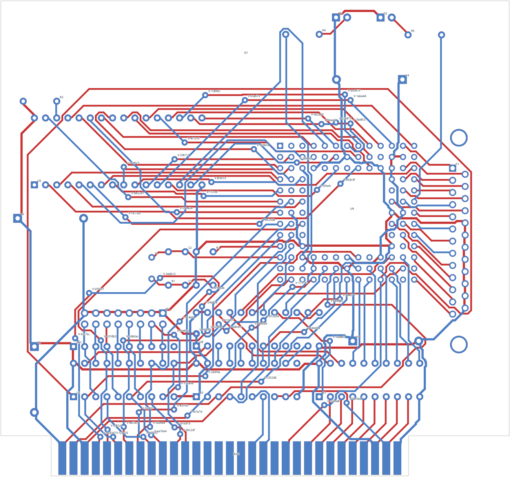

# The whole-board router (`pcb-router`)

`pcb-router` is the project's routing core. It replaces the per-net,
file-to-file sequential router described in the
[trust audit](reviews/2026-09-21-trust-audit.md).

```sh
cargo run --release -- route-kicad-board \
  <source-directory> <board-id> <output-directory> [config.json|auto]
```

Every key of `config.json` with its type, default and doc comment is in
the generated [configuration reference](config-reference.md).

The command parses the board once, routes every connection in memory, checks
the result with an exact internal verifier, writes the project once, and runs
native KiCad verification once as the final gate. It exits non-zero when the
internal verifier or KiCad finds anything.

A config file takes its rules from the project too: the project's rules
are the base, and each key the file sets replaces the project's value of
that key (`edge_clearance_mm`, `hole_clearance_mm`,
`solder_mask_to_copper_mm`, `solder_mask_bridge_severity`, ...), so
`{"seeds": 4}` routes by exactly the rules of `auto`. `connection_rules`
and `default_rules` together are the classes: a file setting either
replaces the project's classes (the project gives every net its entry);
the custom rules' per-net floors and pair clearances stay
(`project_rules::router_config_over_project`; until 2026-10-21 a file
dropped the project's mask rules, and one with classes every other
project rule). `{"frame_directory": "<dir>"}` additionally
writes the board after every negotiation iteration as
`<dir>/attempt-NN/frame-NNNN.kicad_pcb`; `docs/images/animate.py routing`
turns those frames into a GIF (the README's routing animation is
Interf-U, cold, 81 iterations).

## Results (2026-09-21, one thread, cold boards, zero initial copper)

| Board | Nets | `pcb-router` | Old internal router | Freerouting 2.2.4 |
| --- | ---: | --- | --- | --- |
| ECC83 | 9 | 9/9, **0.2 s**, 1 via, 344 mm | 9/9, 104 s, 8 vias, 388 mm | complete |
| Complex hierarchy | 50 | 50/50, **1.2 s**, 0 vias, 1330 mm | 50/50, 487 s, 10 vias | 49/50 (one open), 8.5 s routing |
| PIC programmer | 34 | 34/34, **2.9 s**, 1 via, 1907 mm | 34/34, 308–1272 s, 39–53 vias | 33/34 (one open) |
| Interf-U | 110 | 110/110, **22.5 s**, 58 vias, 4789 mm | 94/110 at the 1800 s cap | 110/110, 49 s routing, 44 vias, 5051 mm |

Times are routing only; the single native KiCad gate adds about 6 s per
board. Every `pcb-router` result above passes native ERC/DRC/parity with zero
findings and zero internal violations. The Freerouting hierarchy and PIC
figures are the ones retained by the trust audit of 2026-09-21; ECC83 and
Interf-U were re-run during the audit.



## How it works

The code (`crates/pcb-router/src`): `router.rs` holds the shared state
(`Router`, `NetState`, `Scratch`, the lattice nodes and branches, the
work constants) and the small helpers; `router/` has one file per part of
`impl Router`, in the order of a run: `build` (the lowering into maps),
`escapes`, `guards` (thermal guards and the spoke repairs
`free_thermal_spokes`, `free_lost_spokes`), `prepare` (a net's search state),
`stamping` (occupancy, rip-up, conflicts), `route_net`, `planner` (tile
corridors), `search` (the lattice A*), `update`, `batching`, `global`, `driver`
(the phases, budgets and clocks), `fixed`, `negotiate`,
`pour_refresh`, `vias` (via reduction), `finish`, `pour_analysis`, `fill`
(the fill probe), `spokes` (KiCad's spoke model), `manual_spokes`,
`pour_dump`, `stitch`, `cleanup`, `resolve` (the hard repair), `output`;
beside them `config`, `result`, `heap` (the open list), `hash`, `wall`
(wall-clock cuts), `profile`, `congestion` (tile views for the congestion
model) and `tests`.


1. **Lowering (once).** The adapter (`crates/pcb-kicad/src/board_router/`)
   turns pads, holes, rule areas, existing copper, the outline and the resolved
   per-net rules into a format-independent `pcb_router::Board`.
2. **Lattice.** A pitch and phase are chosen so that as many pad centres as
   possible fall on nodes (through-hole boards live on an imperial lattice).
   Tight channels count ten times more than pad centres: a channel between two
   neighbouring pads that the narrowest track fits through with less than
   half a pitch to spare needs a node row within that slack of its centre, or
   the pad row is a wall. (ngdevkit's 0.75 mm BGA with 0.28 mm balls and
   0.15 mm rules leaves 0.01 mm of slack; 0.125 or 0.075 mm lattices reach
   its inner balls, 0.1 mm cannot.)
3. **Static maps (once per rule class).** Per layer and node: free, blocked, or
   owned by one net (its own pads). Nodes within one chord sagitta of an
   obstacle get exact per-edge checks, so there is no blanket safety margin
   eating narrow channels.
4. **Occupancy.** Routed copper is stamped into per-class occupancy maps as the
   zone where another net's centreline or via may not be. Stamps are reference
   counted per net, so rip-up is an exact decrement; a restamp builds the
   net's new list first and changes only the counts of the stamps that
   came or went (a rerouted branch, not the branches kept); a node one step
   from the node before on its layer and in its class marks only its
   footprints' leading edge (`Fresh`: the offsets the node before did not
   cover), which lists the same cells in the same order. They are exact: a node's
   disc covers the cells closer than the clearance (in whole nanometres), so
   two tracks at exactly their clearance are legal, as KiCad has it (0.4 mm
   pad pitch with 0.2 mm tracks and clearance). On a lattice no node lies
   closer to an axis step than to its ends; a diagonal step passes the nodes
   on its bisector closer, so it stamps those too, and every node stamps,
   into a second family of maps, the start cells of the diagonal steps that
   would pass it too closely (one lookup per diagonal move in the search).
   The distance between two segments of a lattice is always attained at a
   node of one of them, so these two stamps together are exact. What stays
   quantised is the spacing of parallel diagonals: multiples of pitch/√2,
   so on a 0.127 mm lattice three 0.25 mm tracks with 0.2 mm clearance fit
   an axis channel of 1.15 mm but not a diagonal one (5 steps are 0.449 mm).
5. **Negotiated congestion.** Every net is routed allowing overlaps at a cost.
   Contested nodes get more expensive from iteration to iteration (present
   factor and history). Only nets still in conflict are touched, and of those
   only the conflicting branches; the remaining tree components are
   reconnected. A net in conflict for eight iterations running is ripped up
   whole every eighth: the branches it kept may be what boxes the other net
   in (Interf-U's edge fingers, where a kept branch fenced the neighbour's
   finger on the only layer that reaches it). Branches a rip-up keeps stay
   stamped while the net is searched again; the search masks its own stamps
   (`mask_own`, an epoch that never repeats: the old Jacobi mask reused
   generation 1 for every net, so a previous net's stamps passed for the
   current one's). Fixed branches (plane skeletons, escape stubs) therefore
   hold their ground even in the hard rerouting at the end, where a bulk
   rip-up used to unstamp them and other nets crossed them.
   `escape_stub_mm` (off) fixes a straight stub outward for every pad of a
   fine-pitch row before negotiation; it did not gain on Tiny Tapeout or
   ColdFire yet. How the escape stubs stamp ("Fine-pitch escapes"
   below) decides whether a 0.4 mm row can leave at all. `fixed_plane_stubs` connects every surface pad of a pour
   net to an inner plane by a stub and via before the signals route (only
   inner planes count: on the empty board every pad touches its own
   layer's pour, which the signals then cut to pieces); the KiCad ladder
   runs it as a rung when the plain pour connection left pour-net pads
   open (Framework mainboard half: 13 open -> 3, then complete as tracks). Under `PCB_ROUTER_DEBUG` the
   conflict spots of stuck nets name the nets stamping them, and
   `PCB_ROUTER_DUMP=x0,y0,x1,y1` (mm) prints the lattice of that region per
   layer once few nets remain (statics, occupancy, the stuck nets' nodes).
6. **Search.** A* over (layer, node) with preferred layer axes, bend and via
   costs. Few-target searches use a layer-direction-aware bound; many-target
   searches (power nets, tree components) use an exact coarse octile distance
   transform.
7. **Resolution.** If negotiation stalls, the most contested nets are removed
   and reinserted with all other copper as hard obstacles; partial trees are
   kept and reported. Since 2026-10-15 a net in conflict loses only its
   conflicted branches (and those left dangling by them), not the whole
   tree, whatever the negotiation's every-eighth-iteration whole rip-up
   would say, and an incomplete net without conflicts keeps its tree; the
   hard search then joins the rest to what is left (the switch back,
   `PCB_ROUTER_OLD_RESOLVE`, was removed on 2026-10-16). Ripped up whole,
   a net searched again from one pad among copper that no longer gives
   way often found nothing: MegaDrive's cold route left 19 signal nets
   with no copper at all after the repair (ten VD, five VA, ZA0, ZA8,
   ZD4, PA6; 4 now), and vaio_re's narrow-signal attempt +3V3E with 3 of
   43 pads. Then the trouble-makers' repair (`trouble_repair`, on since
   2026-10-23; `PCB_ROUTER_TROUBLE=0` turns it off; not in a layout's
   move trials): each net still open, most open first, is routed through
   other copper at a price, the nets it overlaps lose the crossed
   branches and are routed again hard, and the exchange is kept when the
   open terminals of all of them drop (a ten-pad bus net may cost a
   short net a pad; docs/experiments/human-level-routing.md), or stay
   the same and fewer of the nets are open (a tie that gathers the open
   terminals into fewer nets; `PCB_ROUTER_TROUBLE_TIES=0` refuses ties).
   Refused: more nets displaced than the trouble-maker's limit (12, or
   twice its open terminals where that is more: video's GND with 283
   open terminals may displace 32 nets, a two-pad net 12;
   `PCB_ROUTER_TROUBLE_VICTIMS`, `_PER_OPEN`), a pour net in the way,
   fixed copper. Up to three rounds while a round keeps an exchange; a
   refused net is tried again only after an exchange was kept, all
   within half the attempt's negotiation in work. Most open terminals
   first; the surveyed order (`PCB_ROUTER_TROUBLE_ORDER=few`: each net's
   priced search alone first, the fewest victims per terminal closed
   first) was measured and not kept (docs/changelog.md, 2026-10-23).
   An exchange's victims are routed again on their corridors first,
   and a victim left with more open terminals than it had then in its
   window (not grown fourfold as the hard search's, never board-wide)
   while the exchange can still pass (`PCB_ROUTER_TROUBLE_LOCAL=0` the
   full hard search); an exchange is undone as soon as the victims
   routed so far leave it no way to pass (`PCB_ROUTER_TROUBLE_EARLY=0`
   routes them all first): a victim routed keeps its terminals, so the
   open terminals of the trouble-maker and of the victims routed so far
   bound the result from below. The victims' failing searches through
   the grown window and the board were most of the repair's work; an
   exchange costs 1.6 to 5 times less, the gap boards try about half
   as many again in the same bound, and the v19 placements' gap boards
   end at 653 unconnected instead of 702 (docs/changelog.md, "trouble
   repair: cheaper exchanges"). Corridors alone were cheaper still but
   lost MegaDrive's designer route, whose victims need the detour.
   Since 2026-10-27 a refusal's blockers are looked up in the map that
   counts each conflict, nets left in a one-sided conflict after the
   victims' reroute are routed again once; a last pass with ejection
   chains was built, off, and removed on 2026-11-04 ("The last
   connections" below).
8. **Cleanup.** Each net is rerouted alone with pure geometric cost and a high
   via cost; the result is kept only if strictly cheaper.
   After the via reduction and the spoke repairs, the straightening
   (`straighten`, "Straightening" below) takes stair-steps and jogs out of the signal nets' paths.
9. **Verification.** `pcb_router::verify` measures true distances between all
   emitted copper, obstacles and the outline, independent of the lattice.

### Pads no path reaches (2026-10-15)

A net's tree grows by one multi-target search at a time and stops at the
first search that finds nothing. In negotiation only what never changes
(pads, rule areas, the outline) stops a search, so a
board-wide search that fails proves its open pads unreachable for the
whole negotiation. Since 2026-10-06 two such failures make the net keep to
its corridors (`hopeless_searches`, link's wasted board-wide searches),
and from then on a corridor that missed ended the net, open pads and all,
and left it blocked. SNSP-CPU-01's GND (199 pads, four walled in at two
connectors, J3 and P6): 195 pads in iterations 0 and 1, then 48, 30, 21
for the rest of the negotiation while the signals took the room; the hard
repair could not bring it back (178 unconnected in KiCad). The narrower
corridors of 3c1f81d (a tile more every sixth reroute, not every third)
made the miss happen there: 55 open before it, 178 since. The pads a
board-wide search did not reach are now left out of the net's later
searches in that negotiation (`NetState::unreachable`; the A/B switch
`PCB_ROUTER_OLD_HOPELESS` was removed on 2026-10-16). Route mode,
cold, 4 threads, with the repair's change above (x881 against x902, this
change on main before 670454c; KiCad's unconnected items): SNSP-CPU-01 178
to 5 (GND's 4 walled-in pads and one signal), MegaDrive 137 to 70, vaio_re
8 to 5, mackerel-30 0 to 0, DSP-ADAU1452 0 to 1 (the ladder had time for
the 0.05 mm rung and left the narrow-signal step 52 s of work instead of
142). Either change alone loses somewhere: the pad rule alone took vaio_re
to 41 (its tracks rung, 634 to 132 open, became the best and its narrow
attempt ripped +3V3E up whole: 3 of 43 pads).

**Unreachable pads join each other** (2026-10-21, `Config::apart_trees`,
`PCB_ROUTER_NO_APART_TREES`). The pads left out stayed apart from each
other too: jiran-ble-lite is a split keyboard's two halves in one file,
joined only by a frame whose mouse-bite holes no track crosses, and both
halves' pads are GND. The tree grew on the left half and the right half's
20 GND pads were each an unconnected item (KiCad 20; the designer's own
board has 1, the two halves' GND). Now, after the net's tree is done,
the terminals marked unreachable are joined among themselves: a tree of
their own from the first of them, by board-wide searches from that tree
alone (the main tree's region is not searched again), then the next one
left (`route_apart`). Their terminals stay unconnected by the net's
count, and the net stays partial: the router's open count is the same,
KiCad's falls to the one item between the trees (jiran on its v18
placement 20 to 1; on the designer's below). A walled-in pad alone costs
one search of its wall. Fingerprints of Castor, k30-SBC, jetson and Sisu
are unchanged (no such group there).

### KiCad's connectivity (2026-10-21)

In the 5 834-board intake, 192 boards (119 with nothing but unconnected
items beyond the designer's findings) were complete by the router's count
while KiCad's DRC, zones refilled, reported unconnected items: the
router's model of what KiCad connects was wrong. The causes, the fixes
and the census (`experiments/kicad-connectivity/census.py`) are in
docs/changelog.md, "KiCad connectivity agreement". What the model now
holds:

- **Terminals are KiCad's items.** Pads of one number are one terminal
  only where they overlap on a copper layer they share (an exposed pad's
  thermal vias, a pad with holes in it), and the overlap is transitive
  (2026-10-21): an exposed pad on F.Cu and its copy on B.Cu are one item
  through the thermal vias that overlap both (MSign's U1.21, Sisu's
  U2.11), a reversible diode's SMD pads on both sides one through its
  through-hole pad (urchin's and eternal-keypad's D_SMD_TH), so pads of
  one number are grouped by overlap and the largest of a group is the
  terminal. Pads of one number at one place on different layers with
  nothing between them (an edge connector's or a USB-C shell's top and
  bottom pads, an edge-mount SMA's) are two items to KiCad, which wants
  them joined by a via: two terminals. KiCad 9's footprint jumpers join
  pads without copper: `(duplicate_pad_numbers_are_jumpers yes)` the pads
  of one number, `(jumper_pad_groups ("1" "2") ...)` the pads of a
  group's numbers (kicad-cli 10.0.7: no unconnected item between them);
  such pads are one terminal too (ducktop2's bms, its WAGO terminals). A net named by a number ("14", "0") is
  a net like any other: a net form of one unquoted number ("(net 6)",
  KiCad 9 and before) is a net code, resolved through the board's net
  table (`net_codes`, `item_net`) for tracks, vias and graphics; the
  lowering used to take every name of digits for a code and left such
  nets unrouted. A copper graphic with a net that is only strokes (a line,
  an arc, a circle's ring) is an item of KiCad's connectivity like a pad:
  a terminal at the middle of its first piece, unless it lies on copper
  of a terminal of its net already. A filled graphic with a net is a
  terminal at its centre, and the router's stub from the node the
  search reached inside it to that centre is not written
  (`graphic_stubs`, 2026-10-27): KiCad 10 passes over a track inside a
  pad in its dangling check, not one inside a graphic, and flagged the
  stub (WLED_Matrix's `Net-(AE1-A)` rectangle, left on the board by the
  designer's antenna feed when the layout moved the antenna: kicad-cli
  10.0.7 found the stub `track_dangling` and the track from outside
  ending inside the rectangle connected). A stub whose anchor joins
  other copper of the route (a via, another track) stays. KiCad does not
  flag every such stub (on the expansion tier's pdlc, CleverHand EMG_DAQ
  and minuet light it did not; their findings are the same without
  them), but none carries a connection: oculink_port's 34
  `track_dangling` (route mode, 30 s) were such stubs and are gone.
- **The pour model connects only what KiCad's fill connects.** A solidly
  connected pad (`connect_pads yes`, `zone_connect 2`) joins a fill piece
  only where the fill reaches its copper: a free node of the piece within
  the brush's half width of the pad, or a straight run of fill (the fill
  probe, off the lattice) from a node within two pitches beyond it
  (`solid_fill_reaches`; a piece within 0.8 mm counted before). A pad set
  to no zone connection is cut out of the fill at the zone's clearance
  and half the minimum width (`isolated_knockouts`), as another net's
  pad, so only a track from it into the fill joins it; in a hatched zone
  at the pad's own clearance (its or its footprint's local clearance)
  where that is larger (2026-10-21: KiCad 10.0.7's
  buildCopperItemClearances takes the clearance between zone and pad; a
  solid zone's knockoutThermalReliefs takes the zone's own clearance or a
  `physical_clearance` rule, not the pad's). A thermal relief is the
  thermal gap alone in both (THERMAL_RELIEF_GAP_CONSTRAINT), whatever
  the pad's clearance. The pour masks
  keep a node only where the brush (half the zone's minimum width) fits
  inside the zone's outline and clear of the regions other zones take,
  at the clearance the fill probe keeps from them
  (`Board::excluded_clearance`): a column of nodes on the outline joined
  pieces KiCad's fill keeps apart. Another net's zone of the same
  priority is filled first when its uuid is the larger
  (ZONE::HigherPriority). A spoke is no wider than the pad, a custom
  pad's no wider than its anchor (KiCad caps it by the pad's size, which
  is the anchor's): a custom pad with an anchor narrower than the zone's
  minimum width gets no spoke and joins the pour only by a track.
- **The emitted copper is checked** (`verify::copper_components`): a net
  routed with tracks alone, its terminals joined by the copper of the
  net that overlaps on a shared layer (pads, the pads merged into a
  terminal, existing copper, graphics, the emitted tracks and vias; a
  custom pad through its contact only), as KiCad's connectivity without
  pours sees it. A terminal the copper leaves apart (a stub dropped for
  clearance after the status was taken) makes the net partial: a route
  complete by the router's count is one whose tracks KiCad finds
  connected. A pour net's connections stay the pour model's (fill only
  adds connections in KiCad, so the check cannot judge a pour net).

- **A via of the net in a hatched zone has a thermal relief**
  (2026-10-21). KiCad 10 treats such a via like a thermal pad where the
  zone's pads connect by thermals (knockoutThermalReliefs: a relief of
  the thermal gap, a ring, four spokes; with `connect_pads yes` or
  `thru_hole_only` it connects solidly, `Hatch::via_reliefs`). The fill
  probe keeps brush centres out of the reliefs of the net's vias, routed
  or on the board (`FillProbe::relieved_vias`), and the rings count as
  fill; the pour map clears the relief's nodes but for the via's four
  spokes along the axes (`cut_via_reliefs`). issue6284's U102.6: its
  spoke ended in the relief of a via of its own net, the model joined the
  pad to the via's piece through it and called the board complete;
  IotThermalCamera's Tgnd: a diagonal neck of the lattice past a via
  joined two pieces the relief keeps apart.

- **A net tie joins no nets** (2026-10-21). KiCad 7's
  `(net_tie_pad_groups "1, 2")` (and, on a board before version
  20220817, a footprint whose keywords start with "net tie": all its
  pads) lets the footprint's copper short the group's pads; KiCad's
  connectivity still counts each pad as an item of its own net
  (kicad-cli 10.0.7 on a NetTie-2_SMD_Pad0.5mm between nets A and B: a
  track of A to pad 1 alone leaves pad 2 and B's other pad unconnected;
  tracks of A and B to their pads, over the bridge, find nothing). So the
  pads stay ordinary terminals and the tie's nets are routed as before,
  each to its own pad. What changed is the bridge: copper of no net that
  overlapped both pads, which made every tie pad dead (neotron-pico's
  NT901 to NT912, all 24 of its open connections on both placements;
  ghoul's 6, protoesp's 10 to 13). KiCad lets the tie's own nets touch
  the bridge anywhere (an A track ending on its middle: clearance against
  pad 2 only) and keeps every other net clear of it. A lattice node has
  one owner, so the lowering keeps the bridge as copper of no net less a
  disc around each tie pad's centre of the pad's net's clearance, half
  its track width and 0.1 mm (`carve_net_tie`, cells of 0.02 mm): the
  pad's net ends its track there, other nets keep clear of the rest and
  of the pads. The cost is a sliver of bridge other nets could come
  within the clearance of (beside a tiny tie's middle, 0.12 mm on
  ghoul's 0.2 mm pads at most).

What still disagrees on the 65 boards with a licence (one): a dimension
drawn on a copper layer, which KiCad's fill keeps clear of and the
lowering does not lower (robotique's BioGenius; the lowering gaps 2
package's).

### The probe ladder (2026-10-03)

On boards with four or more layers and 120 or more connections the KiCad
adapter does not split the ladder's budget by a fixed rule (each rule tried
failed some board: docs/todo.md). Every rung (exclusive planes, connected
pours, plane stubs, pour nets as tracks; each keeps the layers a
`disallow track` rule closes for a net closed, "Project rules" below) is lowered and negotiates for
`probe_seconds` (75) with `Router::probe`, which keeps its whole state; the
rung with the fewest unfinished nets (conflicted or incomplete) is resumed
with `Router::resume` for a third of what is left, then finished and
polished. A probe that finishes everything stops the probing, and only the
leading router stays in memory. The probes run side by side (as many as
fit the memory, judged by the first router's maps: "Memory limits" below,
and since 2026-11-04 no more than the search threads, `at_most_the_threads`;
docs/profiling.md, "Memory, the second round"), with
the outcome of probing one after the other: a probe's budget is work, the
fewest unfinished nets lead, a tie goes to the earlier rung, and only the
probes up to a rung that finishes everything count. The layout's placement
race probes its placements the same way. In route mode the probes
together take at most half of the ladder's budget (`PROBE_SHARE`: each
`probe_seconds` or half the budget over the rungs, 3.75 s on a 30 s
budget with four rungs; the intake's 4-layer boards probed 4 x 75 s on
30 s), and the continuation stops where the ladder's work bound ends ("The
work bound in route mode" below). Under a limit of the process's own that
two routers of the first one's size do not fit (the leader stays in
memory while the next probe runs), there are no probes: the rungs run one
after the other in the regular ladder. Finer pitches follow as before when
connections stay open.

### Hole clearance

Copper keeps two distances from a via: the copper clearance from its ring
and the board's hole clearance from its drill; with a thin ring the second
binds. Both enter the stamps (trace and via against via) and the static
map around pads, and the exact verifier checks copper-to-hole as well as
hole-to-hole. The same holds for a pad's plated hole: other nets' tracks
and vias keep the hole clearance from its drill, which reaches past a thin
ring (jetson's J2: 0.55 drill in 0.75 copper, clearance 0.125, hole
clearance 0.25: a via 0.769 from the centre kept the copper rule and was
0.244 from the hole). The pad's own net is exempt, as in KiCad, whose
tracks end on the drill; its vias keep the pad copper's rule
(`StaticMaps::via_owner`).

### Vias in pads (2026-10-21)

A via inside an SMD pad is a defect on a reflowed board: the open hole
takes the pad's solder (a 0.3 mm drill in a WS2812B-2020's 0.7 mm pad
leaves the LED unsoldered), and KiCad's DRC does not flag it. Until
2026-10-21 a surface pad of a net let that net's vias in wherever the
whole via fit inside its copper (`StaticMaps::via_owner`), so congested
boards put their ground vias in ground pads (the fence's LED row: 3 to
14 on four layers, 28 at 34 mm on two). Now the lowering lists every SMD
pad (`smd` and `connect` pads, their padstack shapes too) in
`Board::no_via_pads`, and every via keeps its annular ring out of their
copper: another net's vias their clearance beyond it as from any copper,
the pad's own net's may touch it from outside (no clearance between a
via and its own pad: a pad of a pour net gets its via beside the pad,
the stub of length zero). Through-hole pads hold no via either way (their
copper keeps every via at its clearance; a hole that reaches past a thin
ring lets its own net's vias within only the hole clearance, as before).

One SMD pad per footprint is exempt: an exposed pad (a QFN's, a DFN's,
an SOIC's thermal pad), the largest SMD pad, at least twice any other
SMD pad's area, its centre strictly inside the box of the centres of at
least three other pads. The pins enclose it, a via is the designer's way
out (KiCad's own footprints carry thermal vias there) and a large pad
keeps its solder. A tab beside a row of pins (SOT-223, D-PAK, SOT-89)
is not exposed: a track reaches it from outside. SMD pads of one number
that touch or lie within 0.5 mm of each other are one pad to the test,
of their boxes' box (`exposed_pad`, shared with score-kicad-board's
count; 2026-10-21): an exposed pad drawn on both sides (Sisu's U2.11,
MSign's U1.21, LC_PAMV4b's U3.25, ZSWatch's IC401.33: an F.Cu and a B.Cu
copy at one place, thermal vias between) was its own copy's "other pad
of its size", both copies were listed and the pad's pour-net vias had to
go beside a pad its pins enclose; a pad split into pieces is one too.
Two same-number pads apart (a connector's shield tabs) stay two.

The via-owner map does not depend on the pads' order: a node an earlier
pin of the net left to the net (`beside`) stays the net's where the
exposed pad holds a whole via (with the pins before the pad, KiCad's
usual order, the pad's arm found the node blocked and gave it to no
net, losing legal via sites along the pad's edge).

A touch electrode is exempt too (2026-10-23, `touch_electrode` in
board_router/lower.rs): a footprint whose only pad is of a custom shape,
copper art no part is soldered to. d20_pcb's J2 is a face of the die,
enclosed by the footprint's own copper frame on F.Cu and by a keepout on
B.Cu, and the whole die is the footprint's solder mask opening; the
designer reaches it with a via in the face's corner. A mask opening
keeps every via out (`solder mask opening` keepouts); a touch
electrode's own opening (labelled `... of the touch electrode J2`)
leaves its net the vias that lie inside its pad (`own_opening` and
`via_inside` in grid.rs: the via-owner arms of a via inside its net's
own copper, not the `beside` arm of a listed pad, where only the mask
web parts the via from the pad's solder). KiCad bridges only copper of
different nets in one opening. Other footprints' openings keep their
rule: letting an exposed pad's mask windows hold its vias moved Sisu's
fingerprint run from 23 to 29 unconnected, and letting vias in beside
pads under an opening routed OpenRX-Mono's U.FL from 12 to 23.

`via_in_pad: true` in the router config restores the rule of before for
boards whose vias are filled and capped. score-kicad-board's "vias in
pads" (SMD pads under 2 mm but an exposed pad, the drill over the pad's
copper as the router lowers it, `lower_pad`; until 2026-10-27 the pad's
box with rounded corners) stays the check.

**Which vias the rule covers** (2026-10-27). Every via the router writes
is a layer change of a branch the search took (`Router::emit`, output.rs),
and the search takes a via step only where `StaticMaps::via_allowed`
says so, the map built from `no_via_pads` above; a branch kept from an
earlier round is tested against it again (`branch_is_legal`). The
negotiation, the hard repair, the lost-spoke reroute, a pad's pour stub
(the search from the pad to the pour) and the escape stubs' branches
(the search starts at the stub's node; a stub itself is a track) all
search, so all ask the map. The island stitches ask it directly
(stitch.rs). A differential pair's link is a net of its own in the
search (its pads are another net's to it, so its via keeps the
clearance beyond them), its return and crossover vias keep out of every
pad's copper, their own net's too (`return_via_clear`, `clear_layers`).
Length-matching meanders, the solid step and the neck tracks move or
add tracks and zone connections, no via. The map measures the pad's
lowered copper (a chamfered corner cut, a trapezoid's slanted sides),
as KiCad draws it: the nightly of 2026-10-26 counted 3 of our vias in
pads on koeg and bumwings_v001_core that were the pads' own net's vias
in a chamfer's cut (D23.4, D83.4: 0.3465 and 0.3005 mm from the via's
centre to KiCad's pad polygon, ring 0.3) and beside a trapezoid's slant
(SW32.1: 0.4337 mm, ring 0.4); the score's rounded box counted them.
Unit tests: `a_pads_own_via_keeps_its_ring_out_of_a_chamfered_or_trapezoid_pads_copper`
(board_router/tests.rs: every node the pad's net may hold a via on keeps
the ring out) and `a_via_in_a_chamfered_corner_or_beside_a_trapezoids_slant_is_not_in_the_pad`
(quality.rs).

### Vias in BGA pads (2026-10-28)

A fine-pitch BGA's inner balls have no way out but a via in the pad: at
0.5 mm pitch with 0.305 mm balls (MIDAS-MK1.1's U106, a TFBGA-153) the
gap between two balls is 0.195 mm, and a 0.09 mm track with 0.09 mm
clearance needs 0.27. The designer of MIDAS put ten vias in U106's pads,
centred (0.35/0.25 and 0.4/0.25 mm, the class via being 0.8/0.4); the
router, which puts no via in an SMD pad (above), left U106's B2, C2, M5
and M6 open on our placement and on the designer's alike ("The last
connections (2026-10-27)"). Of the 109 designers' boards of the sweep (tasks v7), 61 have vias in small SMD pads (3138 vias; score-kicad-board's
`vias_in_pads_at`, filled or not), nearly all in two-pad passives,
power FETs and test points where a track would do (OpenESC 4in1's 281
in PDFN-8 FETs, bumwings' 64 in SOD-123 diodes, MokyaLora's 45 in test
pads), and only three hold vias in pads that no track can leave: the
two MIDAS boards (U106, 5 pads each) and byrantech's laptop motherboard
(two WLCSP-9, U7 and U13, the middle ball each). Two more boards have
such pads with no designer via in them (the rule leaves them closed and
the verdict names them): vd-rd's sbc module (U200, a DDR3 BGA-96 at 0.8
mm, 16 balls) and byrantech's laptop keyboard (U2, an aQFN-73: AC9, AC11
and AC13 on RESET, the keyboard's open RESET of the diagnosis table).

**The rule** (board_router/via_in_pad.rs, `plan`; router config
`via_in_pad`). A footprint is admitted when the designer's board holds a
via in one of its small SMD pads (score-kicad-board's vias in pads,
filled or not: the board's own vias, read before `--strip`, or the
`--reference` board's; same reference or same footprint name), when the
router config names it (`"via_in_pad": ["U106"]`, a reference or a
footprint name with or without its library; `{"part": "U106", "via_mm":
[0.35, 0.25]}` with a size), or with `via_in_pad: true` (every footprint;
the old switch, which also opens every SMD pad to the search's vias as
before). `false` admits none. KiCad's rule language has no via-in-pad
constraint, and none of the 14 `.kicad_dru` files of the corpus says
anything about vias in pads, so no custom rule admits one. On an
admitted footprint only the pads that need it get a via: an SMD pad of a
net with two pads or more, not the exposed pad, its centre strictly
inside the box of the footprint's other pads' centres on its layer, that
no track leaves (`enclosed_pads`): on a raster of a twentieth of the
pitch (5 to 25 um) of the footprint's pads on that layer, a cell is
blocked for a net where it lies closer than half the neck width plus the
larger clearance to another net's pad (or an unconnected one); a flood of
the net's free cells from the raster's border and from every cell where
the net's class via fits (a BGA's empty middle, which the search reaches
with its own vias) that does not reach the pad leaves it enclosed. On
MIDAS's U106 that is B2, C2, M5, M6 and N2 (the designer's other five
vias sit in balls next to the empty middle, where a class via fits). The
other pads of the footprint keep the rule above.

**The via.** Centred in the pad (MIDAS's designer vias lie within 5 um
of their pads' centres), of the designer's most common size in that
footprint's pads where it fits, else of the largest size the project
names that fits (its predefined via sizes, `via_dimensions`, and the
pad's class via), each within the board's via minimums (board setup
`min_via_diameter`, `min_through_hole_diameter`, `min_via_annular_width`
and custom rules on every via). It fits when its drill lies inside the
pad's copper, its copper keeps the larger clearance of both from every
other net's pad on any layer (a through via meets a capacitor on the back
under the BGA: MIDAS's C125 lies 0.14 mm from U106's K8 on B.Cu), its drill the
hole clearance from that copper, and the hole-to-hole spacing from every
hole, the board's vias and the vias placed before it; a pad that already
holds a via (the board's own, kept in route mode) keeps it. Pads without
a fitting size are named (`refused`).

**Lowering and output.** Each planned via is copper of the pad's net: a
ring on the pad's layer, and on the other layers the pad's terminal there
(`MergedPad::padstack`, as a KiCad 9 padstack's other shapes are; solid
to a pour, as KiCad joins a via), its drill a hole of the net. The pad's
terminal reaches every layer, so the search ends on the via's copper on
an inner layer or the back without a stub; other nets keep their
clearance from it as from a through-hole pad, and the pad stays in
`no_via_pads` (no search via inside it). The plan depends on the board
and the settings only, so every lowering (probes, rungs, moves) places
the same vias. `emit_routes` writes them (found by their obstacles'
labels, `<pad> via in pad hole`) as vias with `(capping yes) (filling
yes)` (KiCad 9's via protection, IPC-4761 type VII), counted in the
net's vias. score-kicad-board's "vias in pads" leaves filled and capped
vias out (`filled_vias_in_pads` counts them, `vias_in_pads_at` lists
every via in a small pad with its part, pad, size and offset; the cost
estimate counts both: the process costs extra). board-router.json's
`vias_in_pads` (and board-layout.json's `routed.vias_in_pads`) reports
`placed`, per admitted footprint the rule, the size and the pads, and
under `closed` the footprints whose enclosed pads no rule admits; the
verdict's next_actions name such a footprint, its pads and its open nets
and the opt-in when one of those nets is open (`via_in_pad_actions`).
`describe-kicad-board` gives the same report before a run.

**The harness.** The tiers strip the designer's board before the binary
sees it, so run.py passes what the designer's board shows, as the task's
constraints pass the designer's placement wishes: score-kicad-board's
`vias_in_pads_at` on the designer's board (cached per board file in
`build/designer-vias-in-pads.json`) become the router config's
`via_in_pad` entries (part, footprint, the designer's most common size;
the row's `via_in_pad` lists the parts), unless the task sets the key or
`--designer-via-in-pad off`. A binary without the list gives none, so
older binaries run as before.

**Measured** (off build/bin/pcb-maker-x1872 = main 5905bf9a, on
build/bin/pcb-maker-vip1-e, the branch rebased on it; the same rows on
x1871 against vip1-a/-b/-c before the rebase, identical; KiCad
unconnected / strict pass / new strict findings / vias / work s; our vias
in small SMD pads, the filled ones not counted / filled):

| Board | off | on |
| --- | --- | --- |
| MIDAS-MK1.1, layout (tasks v7, the sweep's budget) | 5 / no / 0 / 210 / 1319; 0 / 0 | **0 / pass** / 0 / 265 / 633; 0 / 5 (B2, C2, M5, M6, N2, 0.35/0.25) |
| MIDAS-MK1.1, designer tier (route on the designer's placement, scale 0.69) | 5 / no / 0 / 134 / 970 | **0 / pass** / 0 / 149 / 189 |
| MIDAS-MK1, layout | 5 / no / 0 / 219 / 1443 | 1 / no / 0 / 248 / 1387; 4 vias (C2, M5, M6, N2): B2 refused, C112 on B.Cu under it |
| laptop motherboard, layout | 25 / no / 0 / 502 / 1155 | the same board: U7.B2 and U13.B2 `refused` (the designer's 0.5/0.3 via, the board's minimum, has a drill wider than the 0.25 mm ball) |

On MIDAS-MK1.1 the open items off were the four balls and a GND zone
island; on, KiCad finds the board complete (the N2 via joins the ground
there). The layout's work halves (1319 to 633 s): no ladder past the
first complete route. KiCad's DRC is clean of new findings; the vias
(0.35 mm over 0.305 mm balls, drill 0.25 inside the copper) keep 0.15 mm
to the neighbouring balls' vias and 0.1725 mm to their copper (0.09
required), the drills 0.2225 mm to it (hole clearance 0.2). MIDAS-MK1
shows the placement's side: the placer does not know a via goes through
under the BGA and put a 0603 on the back under B2, so B2 stays open (its
via is `refused`); a placement that keeps the back free under enclosed
pads is the next step (since 2026-10-28 the placer keeps it free:
docs/placer.md, "Length maxima and the far side of vias in pads
(2026-10-28)"; MIDAS-MK1 then places all five vias).

*The expansion tier* (route mode, 8 x 1, 30 s): 46 of 46 boards byte for
byte identical (558 unconnected, 24 strict passes, 0 new strict
findings, 4256 vias, work 1139.5 s both); 15 of them get `via_in_pad`
entries from their designer's boards (vias in passives and connector
pads), none has an enclosed pad. *The eleven dense boards* (layout, seed
1, 3 x 2; x1872 against vip1-e): 11 of 11 result boards byte for byte
identical (931 unconnected, 1 strict pass, 6 new strict findings, 8792
vias, work 14484 s both); 8 of them get designer entries, none an
enclosed pad. MIDAS-MK1.1 on the head rebased on main 39fc92d6
(build/bin/pcb-maker-vip1-g): the same row (0 unconnected, pass, 265
vias, work 632.6 s).

Default: on where the designer's board has them (it is the designer's
statement about the fab, and nothing changes elsewhere). Open: blind or
micro vias (the placer keeps the other side free under a BGA's enclosed
pads since 2026-10-28: docs/placer.md, "Length maxima and the far side of
vias in pads"), a dogbone fan-out for 0.65 mm and
coarser BGAs whose balls a track can leave one at a time (the enclosure
test sees a way out there; capacity is the router's; built on
2026-11-04: "Prepared fan-outs for BGAs").

A path no longer hops: a via within the hole-to-hole spacing (the drill
plus `hole_to_hole`) of the previous via of the path being searched is
not taken (`hops_from_a_via`; the net's routed branches kept theirs
apart already by `own_via_near`). With vias out of the pads Castor's
Net-(C33-Pad1) went up and down again through two vias 0.25 mm apart to
pass a back-side track, which KiCad reports as hole_to_hole whatever
the nets.

**Large pads inside a ring (2026-11-06).** Sisu_SSE-9's sixteen dome
switches (3210:SW_Dome_Nokia_3210, SW2 to SW17) are a 4 mm centre pad
0.4 mm inside a 6.2 mm ring pad of another net (a custom pad whose
primitive is an unfilled circle); the designer leaves each centre pad by
a via in it, 0.9 to 1.8 mm off its centre. Route mode left 16 of the
board's 18 open items there (router-ceiling.md, bug 3): the evidence
counted vias in small pads only (a 4 mm pad is not small), and
`enclosed_pads` looked only at fields of nine pads or more. Now:

- *The evidence.* score-kicad-board lists the vias in large SMD pads
  apart (`vias_in_large_pads_at`, `vias_in_large_pads`; not counted as
  vias in pads, the cost estimate's), and `designer_entries` reads both
  lists; run.py's `designer_via_sites` passes both to the router config's
  `via_in_pad` (cached under `large:<sha256>` beside the small pads'
  entry, which older binaries keep reading; a binary is asked once
  whether it lists them). The rule still puts vias only in enclosed pads.
- *Enclosed in a footprint of a few pads* (`enclosed_pads`, fewer than
  nine pads on the layer): a pad whose centre lies inside the box of
  another net's pad of the footprint (`ringed`) is a candidate, and the
  same flood judges it (no track of its net leaves, no via of its class
  fits beside it).
- *The via's place.* A large pad (2 mm across or more) whose centre does
  not keep the rules gets the via at the nearest point of a 0.05 mm
  raster on it that does (`sites`; `PlannedVia::pad_at` joins it to its
  pad in the lowering), and no planned via goes into a rule area without
  vias (`via_keepouts`, the board's and the footprints' zones). At the
  centres four of Sisu's switches were refused (LEDs on the back under
  them) and SW9's via lay in the keepout under U11, the modem (KiCad's
  items_not_allowed).

**Measured** (the designer tier as above): Sisu_SSE-9 **18 -> 1**
unconnected (17 vias placed: 16 dome switches, 0.4/0.3 mm as the
designer's, four off their centres, and LS1's; vias 288 -> 306; the
one left is the modem's RESET, congestion; its 5 skew findings, a USB
skew rule, are as before). The fingerprints' Sisu (route mode on the v16
layout's placement, a quarter of the budget) 29 -> 7. No other board of
the tiers gets a large-pad entry that changes its plan (the designer,
expansion and short tiers' other rows are identical in unconnected
items, vias and length where no other fix applies). A first build put
every via at its pad's centre: four switches refused and SW9's via in
U11's keepout (Sisu 4 unconnected and an items_not_allowed finding);
hence the off-centre sites and the keepouts.

### Board edges and copper of no net (2026-10-21)

KiCad 10.0.7's copper_edge_clearance measures copper against more than
the outline (checked with kicad-cli on boards made for it): an unplated
slot (an NPTH pad whose drill sizes differ, a milled hole; "NPTH pad of
J1") is board edge, a round NPTH hole, a plated slot and an oval drill
of equal sizes are not (they keep the hole clearance); a graphic on the
Margin layer, on the board or in a footprint, is edge with its stroke
and its fill (Edge.Cuts strokes count as lines of no width), a text on
Margin is not. The lowering (`board_router/lower.rs`) gives an unplated
slot's hole obstacle the edge clearance as its clearance floor (the
hole kind keeps the larger of it and the hole clearance, tracks and
vias alike) and lowers Margin graphics as keepouts on every copper layer
at the edge clearance plus the arcs' chord error (`margin_obstacles`;
KiCad's zone filler knocks Margin out too, and the static maps' fill
keeps them). buganini's USB-C shell slots, facade60's switch slots and
michpro's Margin outline were the rules boards' edge findings.

Copper of no net keeps KiCad's Default class: other copper keeps the
larger of its own clearance and Default's (a board graphic of no net, a
footprint's copper graphic, a footprint's text on copper; a graphic
whose net is not routed keeps that net's class). Before, such copper
kept only the routed net's clearance. Footprint graphics on several
layers at once (KiCad 9's `(layers "B.Cu" "B.Mask")`: tuxkeychain's
GRAPHIC3 logo, 10 findings at 0.01 to 0.07 mm) are copper on their
copper layers and openings on their mask layers; only a single `(layer
...)` was read, so they were neither. A footprint's visible texts
(`fp_text`, KiCad 8's `property`) on a copper layer are copper of no
net, on a mask layer openings, as the board's texts are: the stroke
font's box (`footprint_text_box`), in the footprint's frame (KiCad 7 and
8 store the text's angle relative to the footprint's), a knockout text
its plate, a hidden one nothing (jnftech's test points with their Value
on F.Cu: clearance and shorting_items against "Value field" in the
intake).

Two shapes were smaller than KiCad's: an arc graphic is flattened to
chords up to 0.005 mm inside the arc, so its stroke now grows by that
tolerance (name-card's 10.7 mm antenna arc AE1: a track 0.1978 mm from
it under 0.2); a rounded-rectangle pad's corner named in `(chamfer ...)`
with a `chamfer_ratio` of 0 is sharp, not rounded (`roundrect_pad.rs`;
AQEYE's solder jumpers: tracks 0.126 mm from the sharp inner corners
under 0.2, checked with kicad-cli).

The router's copper had no copper_edge_clearance in the nightly sweep of
2026-10-27 (all 113 errors of the type in its 109 layouts are footprint
pads, footprint graphics or the designer's own board graphics; run.py's
strict rule leaves one new, osprey's AE1 antenna polygon over a cutout,
a placement: docs/placer.md, "Far-side mask openings and copper graphics
at cutouts"). A test (`an_inner_cutouts_edge_and_an_outline_arc_keep_the_edge_clearance`)
pins the two curved cases: a convex outline arc (its chords inside the
board) and a round cutout (its chords inside the hole, the arc bulging
towards the copper): tracks and vias 0.48 mm from either true arc are
flagged under 0.5, 0.52 mm pass, at chord ends and between them.

### Dimensions, text boxes, cached copper texts and padstacks (2026-10-21)

Checked with kicad-cli 10.0.7 on boards made for each (the unit tests in
`board_router/tests.rs`, lowering_gap_tests, use the same boards):

- **Dimensions** on a copper layer are copper of no net
  (`dimension_shapes`): an aligned or orthogonal dimension's two
  extension lines (from the extension offset to the extension height past
  the crossbar; an orthogonal one's second line runs from its point to
  the crossbar's end), the crossbar, the arrows (27.5 degrees, the arrow
  length; pointing out, or in on tails with `(arrow_direction inward)`)
  and the text's stroke-font box. KiCad measures from the lines' centres,
  not their drawn thickness: tracks 0.19, 0.15, 0.10, 0.064 and 0.05 mm
  from the crossbar, an extension line's start, an orthogonal second
  extension and an arrow, as zero-width lines predict; the lowering uses
  zero-width capsules. A leader, centre or radial mark is a line between
  its points; KiCad 5's stored lines (`feature1` ... `arrow2b`) are read
  as they are. shrimp-18's GameBit ("Dimension '10' on F.Cu": three
  shorting_items), robotique-udes' BioGenius (B.Cu).
- **Text boxes** (`gr_text_box`, a footprint's `fp_text_box`, in its
  frame) on copper are their box, filled, grown by half the stroke: KiCad
  measures from the outline grown so, `(border yes)` or not, and from the
  glyphs inside (a track 0.05 mm past the stroke of either). On a mask
  layer the box is an opening. A hidden one is nothing. A box of `start`
  and `end` keeps those corners whatever its `angle`: KiCad's parser
  turns the text, not the box (a box turned off the axes is written as
  `pts`). The intake has no text box on copper or
  mask (all 80 are on silk, fab or user layers).
- **A cached (TrueType) text on copper** is drawn by KiCad from the font
  installed, not from the file's render cache (TomKeddie's six-line SAO
  sign in Cantarell bold, 5.8 mm: KiCad's plotted glyphs up to 0.92 mm
  outside the cached ones, median 0.14; tracks 0.22 mm from the cache were
  0.02 from KiCad's). Each line of the cache is also copper as a box, in
  the text's frame, grown by a tenth of the text's height
  (`cached_text_line_boxes`). The stroke-font box the mask openings use
  would cover a centred six-line text 1.7 times as wide as it is. 42 such
  texts on 22 intake boards. **Since 2026-11-06 the stroke-font box is
  copper too** (`drawn_graphic_shapes`, the mask path's code, which
  `mask_graphic_shapes` is now), and a knockout text's plate covers it: a
  face KiCad does not have is drawn in a stand-in (fontconfig's: Noto Sans
  Bold here for Quanta75's "Blrrpix Tweak" and "Urbanist SemiBold",
  MIDAS's "ROG Fonts", OpenFC's "Tokyo"), 15 to 30 % wider than the cache
  (pcbnew 10.0.7's polygons against the caches, every cached copper text
  of the designer, expansion and short tiers: the stroke box holds each
  across). Quanta75's '0bsilab' knockout plate: the cache x 84.8 to 112.8
  mm, KiCad's plate x 81.0 to 116.4, our I2C1-SDA track at x 80.5 to 81.2
  inside it, every strict finding of both Quanta75 boards (clearance,
  shorting_items, solder_mask_bridge; router-ceiling.md, bug 2). The box
  closes the gaps between a cached text's lines and is wider than a face
  KiCad has (TomKeddie's Cantarell, installed here): the price of not
  knowing which faces KiCad has (fontconfig would say; not asked).
  Measured on the designer tier (scale 0.647, main 406dcb94 against the
  branch): **both Quanta75 boards pass the strict rule** (Bare: clearance
  2 and solder_mask_bridge 5 to none; Stamp: clearance 2,
  shorting_items 2, solder_mask_bridge 1 to none); the four MIDAS boards
  ("MIDAS" in ROG Fonts on F.Cu) route differently and pass as before
  (MIDAS-MK1.1's first complete attempt comes later: 191 to 634 s of
  work); OpenFC's four cached layer labels change nothing. The short
  tier's MIDAS-MK1.1 layout: 1 open both, vias 242 to 244.
- **Padstacks** (KiCad 9's `(padstack (mode front_inner_back) (layer
  "Inner" ...) (layer "B.Cu" ...))`, `(mode custom)` per copper layer): the
  pad's other shapes are copper of its net on their layers
  (`padstack_variants`), and the back's mask aperture is the back
  copper's. adrianmarple's Raspberry Pi header (1.2 mm on F.Cu, 1.778 on
  B.Cu) and dennisss's lens mounts (4 mm on F.Cu, 3 on B.Cu): B.Cu
  tracks shorted and bridged to the larger back copper. Since 2026-10-21
  the pad's own shape is copper only on F.Cu and the layers the stack
  does not name (it was on every layer: under a smaller back shape the
  model had copper KiCad has not, and `copper_components` called a B.Cu
  track that ended there connected). Each named layer's shape is merged
  into the pad's terminal (`MergedPad::padstack`): the terminal's nodes
  on that layer lie in that shape, a track ending on it ends on the
  terminal, its zone connection, thermal relief and spokes are the
  pad's, its spokes' frame its own size. A pad whose every layer the
  stack names keeps its own shape everywhere.
- **Blind, buried and micro vias** on the board (a blind via's layers
  "F.Cu" and "In1.Cu") are copper on the layers from their first to their
  last (`via_layers`), a through via on every layer; they were copper on
  every layer, so a track on another layer over one was kept off it and
  `copper_components` could join through it. The router's own vias are
  through vias.
- **A plated through-hole pad is copper on every layer, whatever its
  `layers` list names** (`LayerTable::pad_mask`, 2026-10-27). One that
  lists no copper layer (`(layers "*.Mask")`, a DevKitC's mounting pins)
  KiCad shorts on F.Cu, an inner layer and B.Cu; until 2026-10-27 a pad
  listing some copper layers was copper only on those, and that was
  wrong: pcbnew 10.0.7 loads `("*.Mask" "F.Cu" "B.Cu" "In1.Cu")`,
  `("F.Cu" "*.Mask")` and `("In1.Cu")` alike on all four layers of a
  four-layer board, flashed, and kicad-cli's DRC measures tracks against
  the ring there. koeg's 1 mm SWD header J5 (35 such pads on the board)
  had an /right/XC1 track on In2.Cu through J5.3's ring, 0.365 mm from
  its centre (a shorting_items with /right/SWDIO; the router saw only
  the 0.5 mm hole on In2.Cu and kept its hole clearance) and a
  /right/DEC3 track 0.01 mm from it (clearance 0.09). An SMD pad keeps
  its list. `remove_unused_layers` is not read: such a pad stays copper
  on every layer to the router (KiCad leaves it off the layers where
  nothing connects; kept the stricter way).
- **An arc ending where it starts** is a whole circle with `mid` across
  from `start` (`outline::arc_points`: cnlohr's ring pad, a custom pad's
  arc primitive; jetson's two small rings on In4.Cu).
- **Footprint graphics of a net** stay copper of no net: KiCad 10.0.7
  connects nothing to them and keeps every net's copper, their own net's
  and their own pad included, at the clearance (an antenna polygon of net
  A: clearance findings at 0 mm against its pad and an A track, the pad
  unconnected), which is what the lowering did (Default's clearance).

### Solder mask bridges (2026-10-15)

KiCad 10.0.7's `solder_mask_bridge` (DRC_TEST_PROVIDER_SOLDER_MASK): items
of two nets bridge when an item on a mask layer (a pad with that mask
layer, an untented via, a mask graphic or text) comes within the board's
`solder_mask_min_width` plus both mask expansions of another such item,
or when covered copper (a track, a tented via, zone fill) comes within
`solder_mask_to_copper_clearance` (the project's rules) plus the
opening's expansion. A pad's expansion is its own `solder_mask_margin`,
else its footprint's, else the board's `pad_to_mask_clearance`; a via's
the board's; a text has none. Pairs of one net never bridge; a plain
opening (a graphic, a mask-only pad) bridges once it exposes two nets.
Vias are tented unless the setup says otherwise (`(tenting ...)`, KiCad
9's `(tenting front back)`, the old plot setting `(viasonmask yes)`).

The lowering keeps it as keepouts of the opening's net: graphics, texts
and mask-only pads (see the island and bodies sections of
docs/changelog.md), and a pad's aperture, which other nets' tracks and
tented vias keep at the solder-mask-to-copper clearance plus the pad's
expansion, untented vias at the web plus both expansions (a pad or
footprint margin of its own also keeps its margin plus half the web, the
older rule). A cached TrueType text on a mask layer also opens the stroke
font's box: KiCad draws a face it does not have in a stand-in, not from
the cache. Only where the project rates solder_mask_bridge an error
(KiCad's default); at warning or ignore the router keeps the looser rules
of before (OpenESC 4in1-mini: the exact rule took its warnings 29 to 2 and
cost 9 unconnected). Not modelled: via-to-via mask spacing (no corpus
board has untented vias with a web or an expansion), pads placed under
another part's opening (placement's: the placer keeps other parts' pads
out of a hole's own mask margin on the far side since 2026-10-27,
docs/placer.md), zone fill under openings.

**A zone's fill under a footprint's mask graphic** (2026-10-27,
MokyaLora in the third fresh-agent trial): one new `solder_mask_bridge`,
"Rectangle of J6 on B.Mask" against "Track [GND] on B.Cu". J6 is a U.FL
whose B.Mask rectangle covers its two GND pads; the router lowers it as
an opening (footprint graphics on `*.Mask` have been openings since
2026-10-15) of GND, the one net under it, and let a GND track under it.
KiCad 10.0.7's check (`checkMaskAperture`) records the first copper it
finds in an aperture and reports the opening with that item when copper
of a second net follows: the report names the first item, not the
other net's. With pcbnew 10.0.7 on the trial's result board: every track
in the rectangle removed, the bridge stays (then against J6's own pad
2); J6's signal pad set to GND, it stays; the VSYS zone on B.Cu removed,
it goes. The placement put J6 on the designer's VSYS zone, whose fill
KiCad lays under the opening around the GND pads: the second net is
VSYS's fill, which no route keeps out (the router's pour model counts an
opening's pours only where no pad is under it, and KiCad fills under
mask graphics). The verdict's action for a bridge at a footprint's mask
graphic now says so (move the part off the zone, keep the zone's fill out
of the opening, or allow solder mask bridges in the footprint), where it
said "the router keeps them". Left: the placer could keep a part's mask
graphics off zones of nets other than its pads' (as it keeps other
parts' pads out of them, docs/placer.md, "Mask openings block
placement"), or the router could write a rule area without pours over
such an opening; neither is built.

A pad whose layers open the mask on a side it has no copper on (c-lydia's
U3: `(layers "F.Mask" "B.Cu" "F.Paste")`) bridges other nets' copper under
that opening to itself ("Front solder mask aperture ... Track on F.Cu ||
Pad on B.Cu"): the aperture is lowered on that side too, of the pad's net,
whatever the copper clearance (2026-10-21).

Openings the designer drew along their own tracks (AntonSievering's
0.54 mm F.Mask strips along RF lines, a pad at one end, over the GND pour;
bostang's strips from U1's pins; eigenhari's B.Mask segments) expose the
pour's fill once the tracks are stripped: KiCad bridges the pad, the pour
and whatever is routed under them. Taking such an opening for no net's
where it reaches farther than the pour's clearance from its pads (the
pour shows) made AntonSievering 7 to 11 findings and eigenhari's PQ_PL2 6
to 9 (the pads' own stubs leave under the strips), so the opening stays
the pad's net's; only the designer's track along the whole strip avoids
the bridge. The same holds for an opening over pads of several nets
(Sisu's J_LCD1 rectangle, ringshout's J2): a track leaving a pad inside it
bridges. The strict rule subtracts the designer's own pairs (opening and
pad, opening and zone) but not the opening and our track; see
docs/changelog.md, "Committed on 2026-10-21 (lowering gaps 2)".

### Project rules (2026-10-21)

`project_rules.rs` resolves the router's rules from the project, as
KiCad 10.0.7's DRC reads it:

- **Board setup.** A minimum the project does not state takes KiCad's
  default (board_design_settings.cpp, confirmed by the intake's DRC
  reports): `min_track_width` 0.2 (the neck-down width then is 0.2, not
  the 0.127 of a project whose minimum is 0), `min_via_diameter` 0.5,
  `min_through_hole_diameter` 0.3, `min_via_annular_width` 0.1, edge
  clearance 0.5, hole clearance and hole to hole 0.25.
  `rules.kicad_defaults` in `board-router.json` lists the ones taken.
- **Via sizes.** Every class's via is floored by the board setup
  (`project_rules.rs`, `floored`): the diameter at least
  `min_via_diameter`, the drill at least `min_through_hole_diameter`, and
  the diameter at least the drill plus twice `min_via_annular_width`
  (0.05 at the least): a netclass via that is illegal grows its diameter,
  never shrinks its drill. A `.kicad_dru`'s `via_diameter`, `hole_size`
  and `annular_width` rules raise it further per net (below). The vias
  the router writes take their class's size (`lower.rs`, the output's
  `rules.via_drill`; stitching by the class; a differential pair's vias
  and return vias the larger of its two nets'). A router options file
  that sets its own `connection_rules` or `default_rules` gives the sizes
  it names. Census of the nightly of 2026-10-27 (109
  layouts, kicad-cli 10.0.7): 0 `annular_width`, `drill_out_of_range`,
  `via_diameter` or `padstack` findings on a via; all 156 such findings
  (18 boards) are footprint pads' own (the RP2040's thermal-via pads on
  0xCB-1337, the 7805 on the mackerel boards, hackrf's fiducials), on the
  designer's board too. They are not the router's: the verdict sets them
  apart without a reference (`pad_own`, docs/agents.md, section 4).
- **Net classes.** A pattern matches as a wildcard or as an anchored
  regular expression (KiCad's `EDA_COMBINED_MATCHER`: `.*(_TAP|V_POE).*`
  is the latter, `+3V3` only the former). A net takes every class
  assigned to it (explicitly, by a KiCad 6/7 class's net list, by every
  pattern it matches), and each value from the first of them by
  `priority` that has one, else from `Default` (KiCad 8's composite
  classes; a class without a width is Default's width, not 0.2). A pair
  of nets keeps the larger of the two clearances, as in KiCad. The rules
  are keyed by connection as the lowering looks them up: a board with a
  bare net beside a hierarchical one of that name (meshsat's
  `/VIN_CELL` and `VIN_CELL`) keeps the slash (since 2026-10-21; before,
  the hierarchical net fell back to Default's rules).
- **Custom rules** (`<project>.kicad_dru`, `project_rules/dru.rs`). The
  file is parsed (comments, units mm/mil/in/um, escapes) and each
  condition evaluated, three-valued, for what the router lays: tracks and
  vias against tracks, vias and pads (SMD, plated, NPTH), on each copper
  layer the rule's `(layer ...)` names, both ways round (KiCad's
  conditions are commutative). Evaluable: `Type`, `NetClass` (a
  constituent's or the composite's name, case-insensitive, wildcards),
  `NetName`, `Net` (also `A.Net == B.Net`), `Layer`, `Pad_Type`,
  `Via_Type`, `isPlated()`, `hasNetclass()`, `hasExactNetclass()`,
  `existsOnLayer()`, the blind/buried/micro via tests (false: through
  vias only). Area tests (`intersectsArea()`, `insideArea()`,
  `enclosedByArea()`, by an area's name or uuid; since 2026-10-27) are
  false on layers the named zones and rule areas (the footprints' too)
  do not have, and where no area has the name; on the areas' layers
  they are unknown (where the item lies). A clearance whose condition is
  unknown only by such tests is kept wherever it may hold: on the pairs
  of nets, the kinds and the areas' layers it can match, over the whole
  layer (`approximated`, "where a rule area may hold"). Anything else
  (courtyards, references, sizes, component classes, diff pairs, and an
  area test beside one of those) is unknown; a rule whose result depends
  on it is not lowered. Nets are grouped by what the condition can tell
  apart, so a rule costs the number of groups squared, not of nets.

  KiCad applies the last matching rule (`EvalRules`); the router keeps,
  for each value, the largest of every rule that can match: never less
  than KiCad asks. Every lowered value is a floor: a custom rule never
  lowers a clearance below the net class's (`apply_custom`, and
  `Resolved::new` takes the larger of a pair rule and the classes), and
  two rules on one pair give the larger, not the later. KiCad's custom
  rules replace the implicit net-class rule even when smaller (a JLCPCB
  template's 0.127 mm "Min. Spacing" after a 0.2 mm class). The reason:
  the condition is three-valued and the router lays items whose final
  neighbours it does not know, so it keeps what every rule that can match
  asks, and a smaller value is honoured only where it is surely the last
  rule for every item pair it covers, which the lowering cannot prove for
  the class rule it would undercut. The router therefore never makes a
  KiCad clearance error from a rule, but it can refuse a board the
  designer made routable by lowering a pair's clearance (the rule is
  reported `applied` with the classes kept). Copper graphics and the
  pour's fill take no pair rule either (`rules::obstacle_kind` gives a
  graphic no item kind, the fill brush keeps its class): KiCad applies a
  net-conditioned rule to every copper item of the net. A fourth item
  kind (a graphic or a fill, matched only by rules without a type
  condition) would carry them; the table of kinds is 3 x 3 today. For clearance, hole clearance, edge clearance and hole
  to hole, a rule does not count where a later rule with a minimum of the
  same constraint surely matches (JLCPCB's template ends with "Min.
  Spacing" 0.127 mm on everything, after "Pad to Track" 0.2 mm: KiCad
  checks 0.127 between pads and tracks, AMLing2's drone carrier); the
  nets are grouped by the later conditions too. Lowered: `clearance` per net (a rule on one set of nets
  against every net raises that set; against every pair, every net),
  `track_width` min, max and opt per net (a rule's minimum also floors
  the neck-downs and the narrow-signal width of the nets it matches: the
  router's `width_floor`), and per layer where the rule holds on some
  layers only (since 2026-10-24, below), `connection_width` min as a
  track width minimum (since 2026-10-24, below), `via_diameter`, `hole_size` (vias) and
  `annular_width` per net, and `edge_clearance`, `hole_clearance` and
  `hole_to_hole` for the board (the router has one value each). A
  clearance that no per-net value keeps exactly is a pair rule of the
  router (`ClearanceRule`, "Rules beyond the classes" below): a rule
  between two sets of nets (ChengminLi's flyback, 2.5 mm primary to
  secondary), one from some item kinds only (JLCPCB's and PCBWay's "Pad
  to Track": tracks against pads), one on some layers (`(layer outer)`,
  `(layer inner)`). Per pair of the condition's net groups and both ways
  round, the lowering evaluates the condition for each pair of kinds (a
  track or a via against a track, a via, an SMD or a plated pad) on each
  layer and lists the layers it holds on; a rule true for every kind on
  every layer that raising a set of nets keeps goes to the per-net
  clearances as before. The router's pads are one kind: a rule on SMD
  pads holds for plated pads too (`approximated`). A rule whose project
  severity (or its own `(severity ...)`) is below an error is not
  lowered (hole_to_hole is a warning by KiCad's default, also under its
  KiCad 8 name `hole_near_hole`). Every constraint of every rule is in
  `board-router.json`'s `rules.custom_rules` with a status: `applied`,
  `approximated` (kept more widely: SMD and plated pads alike, one
  value for the board, a via rule on every layer), `no_effect` (the classes and board setup keep at least as much,
  or nothing routed matches), `not_routing` (silk, text, courtyards, pad
  holes, zone connections, assertions), `skipped` (severity, or a layer
  the board lacks) or `unmodelled` (creepage, length and skew without
  `length_matching` or in time units, diff pairs without `diff_pairs`,
  physical clearances, disallows other than blind, buried and micro vias
  and the `disallow track` that surely holds for a net on a layer,
  rules on what is unknown). `rules.unmodelled` lists the last one line
  each; the verdict's next_actions name them when a route is incomplete,
  and `drc-kicad-board` prints them on a `next:` line when KiCad finds
  errors.

  The placer has one copper clearance (`copper_clearance_mm`, the
  bodies' floor): the classes' largest and, since 2026-10-24, the
  largest a custom rule asks between the pads of every two nets on some
  layer (`rules.pad_clearance_mm`, evaluated for an SMD or plated pad
  against one, after the later rules). Until then a rule on some layers
  only reached the router alone, as a pair rule: on the OpenESC 4in1
  boards (0.16 mm on F.Cu and B.Cu, 0.09 inside) the placer packed pads
  0.09 mm apart and KiCad found 170 and 222 clearance errors between
  pads of two parts (changelog, "the OpenESC clearance regression"). A
  rule between two sets of nets or from pads to tracks only is no such
  floor (the placer would keep every part 2.5 mm from every other for
  ChengminLi's isolation).

  **Track widths per layer** (2026-10-24). A `track_width` rule that
  holds on some layers only (a `(layer ...)` clause, or a condition on
  `A.Layer`) is kept per layer: the lowering evaluates the condition for
  a track of each net group on each copper layer (`Lowered::layer_width_min`,
  `_max`, `_opt`, per layer and net), and the project gives the router,
  per net it holds for, the bounds on each layer
  (`NetRules::layer_widths`, the every-layer bounds and the board's
  minimum track width and connection floor folded in). The router splits
  those nets' classes by their widths per layer
  (`ClassRules::class_widths`, `class_floors`; the class's `trace_width`
  is the widest, for what reads one value) and routes each layer at its
  own width: the class's width held inside the layer's bounds (its opt
  where it has one). Layers whose widths differ are stamp variants of
  their own (`Resolved::layer_variant`, as layers of different pair
  clearances were): the stamps of a variant measure both classes' tracks
  at that variant's widths, the static maps keep pads and the outline at
  each layer's half width, a node stamps its layer's footprints, and the
  emitted tracks, the escape and pad-centre stubs and the neck-downs
  (per layer: the board's neck or the layer's minimum, never wider than
  the layer's track) take the width of their layer. Vias keep one size.
  The router's check of the result (`verify_with_rules`, in
  board-router.json's internal violations where a net has widths per
  layer) holds each track to its layer's minimum and the pair clearances
  per layer. OpenESC's "2 oz outer copper, track width" (0.16 mm on
  F.Cu and B.Cu over classes of 0.09) routes 0.16 outside and 0.09 inside
  and is reported `applied`; until then every track of every layer was
  0.16 (`approximated`). The layer clearance of the same file was exact
  before (a pair rule per layer). Boards without such a rule build the
  same classes, variants and stamps as before. What remains approximated:
  via rules on some layers (below: no benchmark board has one), SMD against
  plated pads, one value for the board's edge and hole clearances.

  **Connection width** (2026-10-24). A custom `connection_width` rule's
  minimum is a floor on the width of the tracks of the nets it holds for,
  lowered as a `track_width` minimum: per net, or per layer where it
  holds on some layers only (`Lowered::layer_width_min`, into
  `NetRules::layer_widths`), the neck-downs with it (a neck is never
  narrower than its layer's minimum), reported `applied` ("connection
  width at least 0.15 mm: a floor on the track width"); its max and opt
  mean nothing to KiCad and are not read. KiCad checks the union of a
  net's copper on each layer ("KiCad's connection width (necks)"
  below); the router's share of it is the width of what it lays. It
  floors where the project (or the rule's own `(severity ...)`) rates
  connection_width findings errors and, by default, warnings
  (`PCB_MIN_CONNECTION_FLOOR=errors`: errors only; `BoardFacts::
  connection_floor_warnings`); the board setup's `min_connection` alike,
  on every layer (the floor folded into each layer's bounds). No board of
  the corpus has a custom connection_width rule; the board setup's minimum
  is above the board's minimum track width on OpenESC's two 4in1 boards
  only (0.16 over 0.09, warning) of the 60 benchmark boards with a
  .kicad_dru or in the expansion tier, so the new default moves those two
  alone: their inner layers route at 0.16 again, as the designer's do
  (no track of the designer's narrower than 0.16 on any layer).

  **Disallowed layers and rule widths on every rung** (2026-10-27). A
  `disallow track` rule whose condition surely holds for a net's track
  on a layer (`dru::track_disallowed`, KiCad's `inDiffPair()` known, as
  for the pairs' own layers) closes that layer to the net: the project
  gives the router, per net, the closed layers
  (`KiCadBoardRouterConfig::track_disallowed`), and every lowering keeps
  the net's class off them (`RuleClass::layers`, intersected with a
  pair's layers; the static maps block the others, vias pass), so every
  rung of the ladder, its seed retries, the probed rung's continuation
  in the other pour mode and the steps honour it whatever they do with
  the pours. Only a rule whose findings are errors closes a layer (its
  own severity, else the project's `items_not_allowed`): OpenAIO-Whoop's
  "In1 and In6: GND planes, no tracks" is a warning. The rule is
  reported `applied` ("tracks of N nets kept off the layers it
  disallows"). Until then only the pairs' nets were kept off (phase 3 of
  differential pairs) and the exclusive planes kept the rest off the
  ground layers on the rungs that have them: on ducktop2's right_io the
  probes ranked the pours-as-tracks rung first (122 nets unfinished
  against the plane stubs' 123), which has no plane at all, and other
  nets' tracks crossed the "right solid ground layers" (In1, In3, In6;
  58 items_not_allowed). A net the rules close on every layer keeps
  every layer (no rule asks that). Beside it, the narrow-signal step
  keeps the widths a rule gives (`ruled_widths`, "Rules beyond the
  classes" below): on oculink_port its attempt had put the pairs' nets
  at 0.15 mm, under the `inDiffPair()` rule's 0.1712 mm (70 tracks,
  track_width 19 -> 89 with the crossovers' candidate x15071). Boards
  without such rules lower the same classes as before. Measured:
  docs/changelog.md, "Committed on 2026-10-27 (every ladder rung keeps
  the disallowed layers closed; the narrow step keeps rule widths)".

  **Via rules on some layers** (census 2026-10-24). KiCad 10.0.7, measured
  with kicad-cli on a four-layer board with one through via (0.4/0.2 mm)
  and one rule at a time: a `hole_size` rule holds whatever its
  `(layer ...)` (the drill is one); `via_diameter` and `annular_width`
  are evaluated on F.Cu alone for a via of one size (its padstack's every
  layer is F.Cu), so a rule on `outer` or `F.Cu` holds and one on `inner`
  or `B.Cu` only never fires; `disallow via` with any layer clause
  catches a through via, a condition `A.Layer == 'In1.Cu'` does not. The
  lowering takes a via rule where any of its layers holds (`approximated`):
  exact for hole sizes and for rules that include F.Cu, more than KiCad
  asks (never an error) for diameter and annulus rules on inner or back
  layers only. On the 14 boards with a .kicad_dru and the expansion tier's
  46 (36 via, hole and annulus rules on 9 boards) no via rule has a layer
  condition, and the only one with a layer clause that matches a via is
  minuet light's and FUEL4EP's "Annular ring width (via and PTH)" (`(layer
  outer)`, 0.075 mm, `no_effect`: the classes keep more; exact, outer
  includes F.Cu); their hole rules on `outer` and the power manifold's
  (NPTH and castellated pads) match no via. None has `via_count` or
  `disallow via`. Their other via
  rules (`via_diameter`, `hole_size`, `annular_width` on every layer:
  JLCPCB's and PCBWay's templates on the laptop boards, tuxkeychain,
  ErgoSNM, AMLing2's drone carrier, the power manifold) are `no_effect`
  (the classes and the board setup keep them) except the power manifold's
  two that depend on the via's own size (`unmodelled`). Nothing was
  changed for vias: no board asks.

  What the lowering cannot do yet (the edge clearance from NPTH slots
  and Margin graphics it does since 2026-10-21, "Board edges and copper
  of no net" above): a
  later rule that loosens an earlier one only inside an area or a
  courtyard (ChengminLi's "YPS jumper pins (intended bridge)", 0.5 mm
  between the Y capacitor jumper's primary and secondary pins under the
  2.5 mm isolation: the router keeps 2.5 mm there and cannot reach the
  jumper's pins, 2.54 mm apart); clearances of pours (the pour model
  keeps the classes', not the pair rules', from other nets' tracks).

### Rules beyond the classes (2026-10-21)

`Config::net_rules` (`crates/pcb-router/src/rules.rs`), filled by
`project_rules.rs` and copied by `core_config`, holds what the classes
cannot say: a track width floor per net, clearance rules between two
sets of nets per pair of item kinds and per layer, and the hole-to-hole
spacing a via keeps from a pad hole of its own net. `None` (a project
without them) routes as before, byte for byte.

- **Classes split by group.** `ClassRules::split` puts nets in groups
  (the nets no rule tells apart: the same side of every rule) and gives a
  net a class of its own group and width floor; a class keeps its index
  for the first nets that need no other, so rules that split nothing (the
  same-net hole spacing alone, a rule the classes keep) leave the board's
  classes, the lattice and every stamp as they were (Castor, k30 and
  jetson, whose projects rate hole to hole an error, route with identical
  fingerprints).
- **Width floors.** A net's class width rises to its floor, and its neck
  class is the board's neck width or its floor, the wider
  (`with_neck_classes`, `neck_width_of` for stubs and escapes): a
  `track_width (min ...)` rule on some nets holds in their neck-downs and
  in the narrow-signal step (the lowering sets the narrow width as the
  class width; the floor raises it again). Since 2026-10-27 the step
  narrows only nets at their class's width: a net whose width a rule
  gives (a `track_width` opt that holds for it on every layer; a
  differential pair's width from a rule on `inDiffPair()`, set by
  `with_pairs`) keeps it (`ruled_widths`; "Disallowed layers and rule
  widths on every rung" above).
- **Widths per layer** (2026-10-24). A net of `NetRules::layer_widths`
  gets a class of its widths and floors per layer
  (`ClassRules::class_widths`, `class_floors`; `width_on`, `floor_on`,
  `neck_width_on`), and `Resolved::layer_variant` tells layers apart
  where any net's bounds differ, so that each variant's stamps and each
  layer's static maps measure the tracks at that layer's width
  (`variant_layer`: the layer a variant's widths are read on). A net
  whose bounds give the same width and floor on every layer keeps one
  class, as before.
- **Pair clearances.** `Resolved` tabulates, per pair of groups, pair of
  kinds (track, via, pad) and layer variant (layers the same rules hold
  on), the clearance the rules ask beyond the classes. The stamps are
  built per pair of classes and per layer variant (`stamps[class][variant
  * classes + querying]`; one variant without layer-qualified rules):
  track to track, track to via and via to track per variant, via to via
  the largest of every layer's (a through via meets the other via on
  every layer). A node stamps its layer's footprints; a step from a layer
  of another variant stamps whole footprints, not the leading edge. The
  static maps keep a pad, an existing track or an existing via (told
  apart by the lowering's labels; copper graphics are none of them) at
  the class's clearance or the rule's, per layer for tracks and the
  largest over the obstacle's layers for vias; the pad stubs
  (`stub_is_clear`) too. A pad also keeps what its net's tracks keep: the
  net leaves it by a stub off the lattice that only the pad's clearance
  protects (tuxkeychain's outer-layer 0.127 mm over classes of 0.1 left
  stubs 0.104 mm from other tracks without it). A pad-centre stub (the
  cosmetic stub from the node a route ends on inside a pad to the pad's
  centre, at the track's width: wider than a narrow pad, it reaches past
  the pad's copper) is checked against fixed copper when it is laid and
  against every net's routed copper when the routes are emitted, where a
  stub too close is dropped (`finish`): that check now holds the rules
  too (`verify::verify_with_rules`; tuxkeychain's 0.3 mm GND stubs along
  pad 2 of U4, a QFN's 0.2 mm pad, 0.104 mm from the track and the stub
  of HPL's pad 1 under the 0.127 mm rule, 3 findings). The internal verifier of the board router
  (`verify`, the attempt ladder's count) checks the classes' clearances
  only; KiCad checks the rest.
- **Same-net hole to hole.** Where the project rates hole_to_hole findings
  errors (KiCad 8's `hole_near_hole` too), a via keeps the board's hole to
  hole from the plated holes of its own net's pads (KiCad checks drilled
  holes whatever their nets: nuclone's VSS via 0.464 mm from J3's VSS pad
  hole at 0.5). Before, its own net was exempt from the hole and kept only
  the pad copper's rule.

### Memory (2026-10-03)

A thread's search scratch is the largest part of a big board's footprint
(cost, parent and generation marks per lattice state, one scratch per
worker thread), followed by the per-class occupancy and static maps. Marks
that only deduplicate within one operation are bitsets cleared from the
list of what was touched (stamp marks per map, the own-stamp mask per
thread); search generations are 16-bit and cleared on wrap. ATAT1800 (four
layers, 3952 x 1227 nodes): 8.65 GB -> 5.52 GB peak, identical result.
Next candidates: the static maps per class (41 bytes per node and class)
and fewer scratches on boards where parallel batches are small.

2026-10-09: verbose runs print the maps' sizes after the lattice line
(`memory: ...`). Per node and layer, for C rule classes of which S are
searched (net classes and their neck classes; the rest are pour brushes,
read only by the pour model): static maps 7C bytes (the trace map 4, the
edge directions 1, their owner 2), per node 1 (vias blocked) and for a
searched class 6 more (via owner, free layers), and the mask openings'
differences only where they are; occupancy 6C (a 16-bit count for the trace and two diagonal maps) plus
2C per node for the via maps; the search records `hot` 12S (were 16C);
history, guard and cover 12 plus 4 per node; a search scratch 12 per state
(were 20: the tree and target marks are hash maps of the few nodes they
hold), one for the router and one per worker thread that routes a batch.
Copies of a router (the via reduction's snapshot, the layout's trials)
share the static maps and leave the scratch, the stamp marks and `hot`
behind; the via reduction's whole copy had doubled every board's peak.
Route mode, one attempt, 4 cores, x155 -> x161: Castor 1391 -> 687 MB,
SNSP-CPU-01 2209 -> 1536, katia 6292 -> 4315, identical routes; layout
mode (x155 -> x160, 2 threads): CyberKeeb2040 6916 -> 3395 MB, Qfwfq 3330
-> 1414, identical boards. Threads hardly speed the search (k30-SBC: 34.2, 32.4, 31.3 s on 1,
2, 4 threads) and each holds a scratch: run boards side by side with few
threads each (`RAYON_NUM_THREADS`, the runners' `--threads`).

### Memory (2026-10-22)

What a router holds now, per node and layer, for C rule classes of which
S are searched (the 2026-10-09 sizes above, before):

- static maps per class: the trace map 2 bytes (16-bit owners, as the
  edge and via owners; was 4); the blocked unit steps a bit and, for the
  one node in a hundred that has any, their directions and exempt net
  apart (`EdgeMap`; were 3 bytes dense); per node the via block a bit
  (was a byte), and for a searched class the via owner 2 and the free
  layers 1 byte up to 8 layers, 2 up to 16, else 4 (`LayerBits`; was 4);
- the search records (`hot`) 8 bytes per searched class (were 12): the
  history, the static map's 16-bit value and an index into the table of
  (guard, cover) pairs of the board (`hot_pours`; few pairs: a pour net
  and the guard's), built in place when they change (a second set beside
  the first, while the lost-spokes step set and restored its guards, was
  katia's peak: 1.1 GB);
- a net's stamp list 4 bytes a stamp (the map above the cell's bits in
  one word where they fit, `Stamped`; were 8);
- one search scratch per router, allocated on its first search (a router
  that never searches, the pour measure's, has none), and the scratches
  the jobs of a parallel batch use pooled with the router
  (`ScratchPool`): until now every pool thread kept a scratch of its own
  in a thread local, beside the router's and after it was gone, so one
  thread held two;
- the via reduction's snapshot leaves out the occupancy and the tiles'
  claims (the sum of the nets' stamps): a revert takes the changed nets'
  stamps off and the snapshot's back (`restore_lean`);
- the allocator: glibc's malloc maps every block of a MiB or more and
  unmaps it when freed (`configure_allocator`, M_MMAP_THRESHOLD, set
  first thing in `main`). Its threshold otherwise grows to the largest
  block freed (up to 32 MB), the lattice maps (a few MB a layer) came
  from the heap after the first router and stayed resident: katia held
  1.75 GB with no router left after its first attempt, 0.24 GB now.

The pour measure of the board written (`measure_pours`) drops the
source board's parse and its own before it builds its router (jetson's
25 MB file parses to 240 MB; the measure was its peak).

Unchanged: the occupancy (2 bytes per map and node: per class L + 1
maps and 2L diagonal maps), the history (4 bytes per node and layer and
the via layer), the guard and the cover (4 bytes per node and layer
where there are pours), a scratch's 12 bytes per state. On katia
(2775 x 1077 nodes, 4 layers, 10 classes, 8 searched) the occupancy and
the search records are now 67 % of the maps (741 and 730 of 2185 MB). Every route and fingerprint
is the same (docs/changelog.md, "router memory").

### Memory (2026-10-23)

The second round, every route and fingerprint the same (docs/changelog.md,
"router memory, round 2"):

- the occupancy a byte a count (`Occupancy`; two until now): a count is
  how many nets' stamps cover a cell, a handful where nets overlap; a
  count of 255 or more keeps 255 in its byte and the rest in a side map,
  so every count is exact. Nothing keeps a
  second copy (the via reduction's snapshot leaves it out since
  2026-10-22; only the layout's trial copies of a whole router carry
  one). Not shared between classes: classes apart in their vias only have
  the same trace and diagonal maps (katia's three neck classes; a neck
  class and its net class the same via map), but sharing them changes
  the nets' stamp lists, which the fingerprint hashes. Not sparse: a
  search step reads a count per neighbour, and a tile-sparse map costs it
  an indirection;
- the search records (`hot`) a set per class of some net, and one set for
  the classes of one static trace map (classes apart in their vias only):
  of a record only the static map's value depends on the class (the
  history, the guard and the cover are the layer's). A neck class (no net
  of its own) has none: a step into a neck zone reads its net class's
  record with the neck's static map value, which is what the neck's
  record held. Katia's eight searched classes are four net classes and
  four necks: 730 MB of records, 365 now; jiran-ble-lite 422 to 211;
- the guard and the cover maps in 16 bits (`owner16`, as the records
  hold them; were 32), and the lost-spokes step's copy of the guard with
  them; the via cover (a word a node) none on a board without pours.

The maps on the seven boards (MB, one router, one thread; the largest
memory line): katia 2189 -> 1408 (occupancy 741 -> 371, records 730 ->
365, history/guard/cover 162 -> 117), jiran-ble-lite at 0.05 mm 1589 ->
1141, the laptop motherboard 636 -> 497, Sisu 491 -> 379, k30 247 -> 194,
jetson 223 -> 165, Castor 193 -> 134. Katia's largest now: occupancy 370,
the records 365, the static maps 347, a scratch 147, the pour analysis's
transient maps 137, the stamp lists 124.

### Memory (2026-10-26)

The third round (docs/profiling.md, "Memory"; docs/changelog.md, "memory
round 3"), every route and fingerprint the same: the stamp lists as
varint differences (1.5 bytes a stamp, were 4), the search arrays shared
by the process's routers (a net's search takes idle arrays of its lattice
and gives them back; a router held its own and a spare per batch thread
for its life), the occupancy in four bits a count (was a byte). The
profile (`PCB_ROUTER_MEM_PROFILE=1`) prints the resident size's highs,
the phases and every live router's parts. The router's `memory: N MB in
maps` keeps counting a scratch per router (`Scratch::bytes_for`), now an
upper bound.

### Memory limits (2026-10-21)

How many routers the ladder runs side by side (the rung probes, the rungs
after its first attempt, the seeds; since 2026-11-04 at most the search
threads, `RAYON_NUM_THREADS`) follows the tightest of the process's
limits (`MemoryLimits` in board_router/memory.rs): its address space
(RLIMIT_AS, against its virtual size), its cgroup's memory.max (cgroup
v2, every level up to the root; v1's memory.limit_in_bytes; against the
memory in use less the reclaimable inactive_file), an explicit limit
(`PCB_MAKER_MEMORY_MB` or the router setting `memory_mb`, the smaller,
against the resident size) and half of MemAvailable (shared with the rest
of the machine). Until then only MemAvailable counted (and a router was
the process's peak after the first attempt, plus 2200 MB a rung for a
KiCad check that no longer runs inside a rung), so a harness's cap went
unseen: 456 runs of the 5 834-board intake died at a 3 GiB cap, their peak
2.4 to 5.2 times the router's maps with two to four routers at once.

A router's peak is estimated from its lattice maps (the router's
`memory: N MB in maps`, read from `Router::memory_report` as each
attempt builds it; `maps_mb` in board-router.json): the maps and 600 MB
beside them resident, the maps and 760 MB of address space, times a
margin of 1.25 (`router_peak_mb`; 1.2 times and 540 MB, 1.3 times and
780 MB until 2026-10-23, when the occupancy, the search records and the
pour maps shrank; 1.7 and 460, 2.0 and 550 until 2026-10-22, when the
maps shrank and freed blocks went back to the system). Measured with one
router at a time and one thread, a ladder of 60 s of work without probes
and seeds (the whole process's peak, x1622, 2026-10-23):

| board | maps MB | peak RSS | RSS / maps | VmPeak | VM / maps |
|---|---|---|---|---|---|
| katia (4 layers, 10 classes) | 1408 | 1763 | 1.25 | 2029 | 1.44 |
| jiran-ble-lite at 0.05 mm (2) | 1141 | 1212 | 1.06 | 1506 | 1.32 |
| byrantech laptop motherboard (6) | 497 | 774 | 1.56 | 979 | 1.97 |
| Sisu_SSE-9 (v16 placement) | 379 | 554 | 1.46 | 736 | 1.94 |
| k30-SBC (v16) | 194 | 357 | 1.84 | 598 | 3.08 |
| jetson (v16) | 165 | 744 | 4.51 | 903 | 5.47 |
| Castor (v16) | 134 | 328 | 2.45 | 565 | 4.22 |

What lies beside the maps hardly follows them (katia 355 MB, jetson 579):
a slope of 1, and the offsets pass jetson by 21 MB resident and 22 MB of
address space before the margin. The table of 2026-10-22 (x1600):

| board | maps MB | peak RSS | RSS / maps | VmPeak | VM / maps |
|---|---|---|---|---|---|
| katia (4 layers, 10 classes) | 2189 | 2534 | 1.16 | 2809 | 1.28 |
| jiran-ble-lite at 0.05 mm (2) | 1589 | 1608 | 1.01 | 1954 | 1.23 |
| byrantech laptop motherboard (6) | 636 | 897 | 1.41 | 1112 | 1.75 |
| Sisu_SSE-9 (v16 placement) | 491 | 721 | 1.47 | 912 | 1.86 |
| k30-SBC (v16) | 247 | 406 | 1.64 | 629 | 2.55 |
| jetson (v16) | 223 | 796 | 3.57 | 1052 | 4.72 |
| Castor (v16) | 193 | 392 | 2.03 | 571 | 2.96 |

jetson holds the most beside its maps (its 25 MB file parsed, 240 MB,
and lowered); the line passes it by 12 MB before the margin. The table
of 2026-10-21 (x1225):

| board | maps MB | peak RSS | RSS / maps | VmPeak | VM / maps |
|---|---|---|---|---|---|
| DevMubarak1 pidgin_translator (2 layers) | 244 | 255 | 1.05 | 343 | 1.41 |
| sssamuelll sam17-power-v2 (2) | 739 | 981 | 1.33 | 1273 | 1.72 |
| sikaxn nz (6) | 298 | 380 | 1.28 | 587 | 1.97 |
| zOnlyKroks WK-3 (4) | 763 | 1280 | 1.68 | 1509 | 1.98 |
| mark69163 PRODIGY-MOTHERBOARD (4) | 580 | 929 | 1.61 | 1137 | 1.96 |
| Castor (v16 placement) | 264 | 669 | 2.54 | 879 | 3.33 |
| k30-SBC (v16) | 319 | 792 | 2.49 | 1018 | 3.19 |
| jetson (v16) | 302 | 969 | 3.22 | 1149 | 3.80 |

The ratio falls with the maps' size: what a router holds beside its maps
(the board parsed and lowered, its pours, the router's records; 290 MB of
jetson's before any router) weighs most on the small ones, so a line
(slope and offset) fits all eight where one ratio would size the large
boards three times too big. The routers that run at once are as many as
fit what is free under each limit (MemAvailable: half of it); at least
one. The decisions that change what the ladder attempts go by the limit
itself, a fixed number, not by what is free: a finer pitch is not tried
when one router of it (its maps grow with the square of the pitch ratio)
does not fit a limit of the process's own, and the probes do not run when
two do not, and not when one router of it would take more than 0.4 of
MemTotal (until 2026-10-21 that rule took the process's peak resident
size after the ladder's first rung, which followed how many probes had
run side by side; now the same maps estimate, resident). No decision of
the ladder reads the process's peak any more. Without such
a limit nothing changes but how many run at once, which never changes a
result. The ladder logs the limits as it starts (`memory limits: ...`)
and every side-by-side count with its reason (`ladder: 1 of 3 rungs side
by side (about 2090 MB a router (561 MB of maps), 2428 MB usable under the
address space limit (RLIMIT_AS))`); board-router.json has them as
`memory_limits`. The layout's placement race sizes its probes from
`memory_mb`, which is MemAvailable or less under a limit of the
process's own (a count only: its outcome is the one of probing one
placement after the other).

## Two-level search

Every connection is first planned on a coarse graph of 16 x 16-node tiles
(per layer, with via edges between layers). A tile costs more the fuller it
is, with the fill maintained incrementally from the occupancy maps, and more
again where conflicts keep happening. The lattice A* then runs only inside the
planned corridor (one tile of margin); nets that keep losing negotiations get
wider corridors, and a failed corridor falls back to the plain window and the
whole board. This is the "graph layer tells the geometric layer where to go"
idea; it halved the time on the large boards and reduced vias and copper.

## Capacitated corridors (2026-10-24)

**Removed on 2026-11-04** (`capacitated_corridors` with
`capacitated_retries`, `_stuck` and `_growth`,
`PCB_ROUTER_CAPACITATED_CORRIDORS`, `_GROWTH`, `_STUCK`; off;
docs/handover.md, "Removed experiments (2026-11-04)"): the router's
plan, its learning and pcb-global's `CorridorPlan` are gone; the search
counters stay (`pcb_router::search_counts`, the verdict's `corridors`:
corridor, window and board searches, `hopeless_skips`). The design and
the measurements below are kept as they were.

An experiment behind `capacitated_corridors` (router config, off;
`PCB_ROUTER_CAPACITATED_CORRIDORS` overrides it, `capacitated_corridors`
in the KiCad router settings). Florian's idea: route the board as a graph
first, with hard capacities, and when the geometric search cannot get
through a corridor, teach the graph instead of searching wider.

**Design** (`pcb_router::capacitated`, `router/capacitated.rs`,
`pcb_global::corridors`):

- **The plan.** When a negotiation starts, the router builds pcb-global's
  global route of its own board (`CorridorPlan`: the capacities per
  boundary and layer and the via sites of docs/global-route.md, the
  PathFinder negotiation, 1.5 mm tiles). pcb-global depends on
  pcb-router, so the plan reaches the router through a trait
  (`CapacitatedPlan`) and a factory pcb-kicad registers
  (`register_corridor_planner`, in `core_config`); without one the switch
  does nothing. An `update` (a moved part) drops the plan; the next
  negotiation builds it again.
- **The corridor.** A net the plan routes searches, in the negotiation
  (not the hard repair, not the clean-up), inside its plan's tiles and one
  tile around, mapped onto the router's 16-node tiles by overlap (the
  band). The tile planner (`plan_corridor`, its fill cost) picks the way
  inside the band first (one router tile of margin, the band its wall);
  if that search fails, the whole band is searched. No widening with the
  reroutes, no window, no board.
- **A miss** (no path in the band) is located on the plan: the plan tiles
  the search reached (its closed nodes, per layer) against those it did
  not; every boundary of the net's global route with one side reached and
  the other not, and every via tile of the route reached on one of its
  layers only, is where it failed. The net is not marked blocked: it
  stays in the negotiation.
- **The learning** (after the batch, `learn_from_misses`): each such
  boundary (and via site) loses one track (via), never below the tracks
  (vias) the routed copper puts across it now (its floor: every net's
  branches walked, each crossing at the net's demand). The nets through
  the lowered boundaries are planned again, then the nets that missed
  (pcb-global's incremental path: their routes out, routed again in that
  order against the others' usage at the negotiation's last prices), and
  the missed nets are routed again in their new corridors, up to
  `capacitated_retries` (2) rounds; nets still missing then wait for the
  next iteration (`deferred`). A miss nothing could be learned from (no
  boundary between reached and unreached tiles, or every floor held) sends
  that net's next search to the window and the board (`fallbacks_nothing_learned`).
- **No global path.** A net whose plan does not reach every terminal
  under the learned capacities searches the window and the board, as
  without the switch (`fallbacks_no_path`), within the same two-failure
  rule (`hopeless_searches`). A net the plan does not have (all its pads
  in one 1.5 mm tile) uses the tile planner as without the switch.
- **Conflicts teach too** (`capacitated_stuck`, 4;
  `PCB_ROUTER_CAPACITATED_STUCK`, 0 off): every second iteration, a net in
  conflict for four iterations running lowers the boundary of its global
  route with the most conflict cells in its two tiles, and is planned
  again with the nets through it (the reading of "the negotiation ejects
  the net from it repeatedly").
- **Width** (`capacitated_growth`, 0; `PCB_ROUTER_CAPACITATED_GROWTH`):
  with a value, the band grows a plan tile every that many reroutes of
  the net (at most ten), as the tile planner's corridors grow (added
  after the first tier: the variant `g6` below).
- **Work.** The plan's build and re-plans count in the router's work at
  pcb-global's model (5 units a capacity distance test, 30 a state popped,
  150e6 units a second), converted to search expansions at the reference
  rate (`UNIT_EXPANSIONS`) and added to the router's expansions, so every
  budget counts them; the floors' walk at a sixteenth of an expansion a
  step. A router with the switch off is unchanged: the expansion tier at
  x14200 with the switch off is identical to main's x1754 row for row.

**The instrumentation** (the verdict's `corridors`, every run, either
setting; summed over every router of the process, the ladder's attempts
and probes alike): per mode (`negotiation`, `hard`) and kind (`corridor`:
the tile planner's corridor, or with the switch the planner inside the
band; `band`; `window`; `board`) the searches, how many found a path and
their work in seconds; `plans_built`, `plan_work_seconds`, `misses`,
`reductions`, `conflict_reductions`, `floor_held`, `no_boundary`,
`replans`, `replanned_nets`, `replan_work_seconds`, `retries`,
`fallbacks_no_path`, `fallbacks_nothing_learned`, `deferred`,
`floor_work_seconds`, `hopeless_skips`.

**Measured** (2026-10-24, all at pinned work rates, `PCB_ROUTER_NO_WALL_GUARD=1`
so that every row is deterministic; logs `build/corr1-*`). Off: main's
x1754 (the expansion tier, the fingerprints) and x14202 with the switch
off (the dense boards: identical to x1754 on the three dense boards x1754
finished, and x14200 off identical to x1754 on all 46 tier rows). On:
x14200 (`s4`: as designed, one plan tile around the route), x14201
with `PCB_ROUTER_CAPACITATED_STUCK=0` (`s0`: the misses' learning alone)
and x14202 with `PCB_ROUTER_CAPACITATED_GROWTH=6` (`g6`: the band grows a
plan tile every six reroutes, as the tile planner's corridors grow; the
fingerprints and the dense boards ran this one, the best on the tier).

*Expansion tier* (46 boards, 8 x 1, 30 s of work; cells KiCad's
unconnected items, `*` a pass; the 25 boards not listed are the same in
all four):

| Board | off | s4 | s0 | g6 |
| --- | ---: | ---: | ---: | ---: |
| rpi_cm5_dronecarrier | 3 | 8 | 7 | 8 |
| ducktop2 bms | 0* | 0* | 2 | 0* |
| musicbrain-busboard | 0* | 0* | 1 | 0* |
| OpenRX-Mono | 12 | 16 | 11 | 12 |
| node_v6_0_0 | 32 | 34 | 31 | 28 |
| ZSWatch-Watch-DevKit | 2 | 3 | 2 | 3 |
| epdInky ED052TC4-Adapter | 2 | 8 | 7 | 6 |
| tuxkeychain | 11 | 6 | 7 | 9 |
| driver_cplex_rp2040 | 87 | 64 | 70 | 39 |
| snaphat main_board | 0* | 0* | 2 | 0* |
| power-manifold backplane | 1 | 3 | 2 | 1 |
| MSign mainboard | 19 | 13 | 35 | 14 |
| nervous-ecg | 4 | 3 | 2 | 3 |
| OpenDeck-r3.1.2 | 12 | 13 | 8 | 5 |
| facade60_daughterboard | 9 | 17 | 15 | 12 |
| Miniboard | 6 | 11 | 20 | 10 |
| magnetorquer_control_board | 1 | 0* | 0* | 0* |
| Zulassungskarte | 1 | 2 | 2 | 1 |
| CompassTag | 1 | 3 | 2 | 2 |
| anthracite-bottom | 0* | 0 | 0* | 0* |
| Wonkle | 364 | 442 | 442 | 442 |
| **sum** | **588** | **667** | **689** | **616** |
| passes (strict) | 20 | 20 | 18 | 21 |
| new errors | 3 | 2 | 2 | 2 |
| vias | 4308 | 4463 | 4427 | 4658 |
| length mm | 112520 | 110280 | 109603 | 109760 |
| work s | 1250.5 | 1280.8 | 1261.2 | 1247.9 |

Wonkle (271 nets, four negotiation iterations in its 30 s) is the same
442 in every variant: its first six reroutes run the same corridors in
all three. It ends its negotiation with fewer nets in conflict than off
(254 against 260), and the hard repair then leaves 793 open terminals
against 723: a board decided by the repair on an unconverged
negotiation. Without it, `g6` is 174 against 224.

*Fingerprints* (Castor, k30-SBC, jetson, Sisu; 1 x 4, a quarter of the
budget; x1754 against x14202 `g6`; cells unconnected / strict new errors
/ vias / length mm / work s):

| Board | off (x1754) | `g6` (x14202) |
| --- | --- | --- |
| Castor | 0 / 0 / 240 / 5287 / 174 | 0 / 0 / 306 / 5660 / 135 |
| k30-SBC | 0 / 1 / 343 / 14368 / 277 | 0 / 1 / 371 / 14733 / 275 |
| jetson | 20 / 0 / 584 / 10759 / 315 | 22 / 0 / 602 / 10831 / 315 |
| Sisu | 23 / 0 / 379 / 5553 / 315 | 24 / 0 / 407 / 5561 / 285 |
| sum | 43 / 1 / 1546 / 35967 / 1082 | 46 / 1 / 1686 / 36784 / 1011 |

Passes 2 / 2 (Castor and k30-SBC; strict 1 / 1). `g6` there: 669 misses, 522 reductions, 7372 conflict reductions, 606 re-plans, 450 retries, 211 deferred, 18 fallbacks after nothing learned, none for want of a global path; the plans' and re-plans' work 5.8 s.

*The eleven dense boards* (route mode on the v19 placements at the task
budgets, 3 x 2; x14202 off against `g6`; same cells):

| Board | off (x14202) | `g6` (x14202) |
| --- | --- | --- |
| video | 125 / 0 / 1198 / 39165 / 1107 | 216 / 0 / 1324 / 35956 / 1090 |
| OpenESC 4in1 | 108 / 0 / 150 / 2256 / 1248 | 109 / 0 / 143 / 2108 / 1120 |
| 4in1-mini | 72 / 0 / 118 / 1545 / 905 | 56 / 0 / 135 / 1508 / 960 |
| Glasgow | 144 / 0 / 329 / 4881 / 1262 | 162 / 0 / 347 / 4458 / 1258 |
| SmartSpin2k | 117 / 113 / 1201 / 24688 / 688 | 132 / 113 / 1260 / 24656 / 719 |
| MegaDrive | 157 / 0 / 1270 / 32617 / 1030 | 198 / 0 / 1685 / 32919 / 1199 |
| SNSP-CPU-01 | 119 / 0 / 1365 / 22495 / 882 | 182 / 0 / 1196 / 19637 / 847 |
| split72_left | 25 / 0 / 884 / 20941 / 1255 | 46 / 0 / 1049 / 19856 / 1260 |
| protoesp | 65 / 2 / 275 / 5148 / 733 | 71 / 2 / 265 / 4808 / 1003 |
| DSP-ADAU1452 | 25 / 0 / 206 / 7111 / 1056 | 42 / 0 / 204 / 6048 / 1033 |
| 0xCB panel | 53 / 0 / 277 / 4847 / 1140 | 53 / 1 / 327 / 5190 / 1195 |
| **sum** | **1010 / 115 / 7273 / 165694 / 11305** | **1267 / 116 / 7935 / 157145 / 11685** |

Passes 0 / 0. Better only on 4in1-mini (72 to 56); the 0xCB panel ties
at 53 (its plan reaches not every terminal of many nets: 16 905
searches went to the window for want of a global path).

The learning, summed (`g6`; tier / fingerprints / dense): misses 404 /
669 / 2212; boundaries lowered after a miss 376 / 522 / 2383; after
conflicts 15 646 / 7372 / 41 795; floors that held 9808 / 2401 /
38 539; misses that named no boundary 8 / 0 / 175; re-plans 2341 / 606
/ 2324 (21 989 / 10 010 / 62 784 nets); retries 307 / 450 / 1722;
deferred 97 / 211 / 490; fallbacks after nothing learned 46 / 18 / 343,
for want of a global path 0 / 0 / 16 908; plans built 242 / 16 / 69;
the plans' and re-plans' work 5.3 / 5.2 / 43.5 s.

**Where the time goes** (the instrumentation; the share of the verdicts'
work summed over the boards):

| | tier off | tier `g6` | dense off | dense `g6` |
| --- | ---: | ---: | ---: | ---: |
| negotiation corridor | 781 s (62.5 %), 207706 / 206206 | 669 s (53.6 %), 251942 / 248940 | 6255 s (55.3 %), 486905 / 452573 | 3887 s (33.3 %), 687811 / 633465 |
| negotiation band | - | 31 s (2.5 %), 3003 / 2599 | - | 2482 s (21.2 %), 54346 / 52134 |
| negotiation window | 4 s (0.3 %), 119 / 69 | 1 s (0.1 %), 50 / 5 | 1042 s (9.2 %), 11022 / 9949 | 355 s (3.0 %), 17251 / 16469 |
| negotiation board | 3 s (0.2 %), 26 / 0 | 2 s (0.2 %), 20 / 0 | 151 s (1.3 %), 1057 / 197 | 113 s (1.0 %), 748 / 0 |
| hard corridor | 33 s (2.6 %), 3241 / 1388 | 48 s (3.9 %), 4753 / 1811 | 472 s (4.2 %), 23289 / 7130 | 986 s (8.4 %), 37777 / 12207 |
| hard window | 339 s (27.2 %), 44669 / 43755 | 360 s (28.9 %), 46550 / 45130 | 1913 s (16.9 %), 58939 / 52939 | 2128 s (18.2 %), 68834 / 58964 |
| hard board | 27 s (2.2 %), 158 / 1 | 30 s (2.4 %), 205 / 14 | 362 s (3.2 %), 1648 / 337 | 528 s (4.5 %), 1922 / 428 |
| plans, re-plans, floors | - | 5.7 s (0.5 %) | - | 46.3 s (0.4 %) |
| the rest (pours, lattices, checks) | 63 s (5.0 %) | 100 s (8.0 %) | 1109 s (9.8 %) | 1159 s (9.9 %) |
| work in all (boards) | 1250 s (46) | 1248 s (46) | 11305 s (11) | 11685 s (11) |

(Cells: work, its share, searches / found.)

**Reading.**

- **The default stays off.** On the tier the best variant (`g6`) has
  more unconnected items (616 against 588; Wonkle +78, the other 45
  boards 174 against 224), one pass more (21), the same work (1247.9
  against 1250.5 s): it fails the unconnected condition. As designed
  (`s4`): 667, 20 passes, work +2.4 %; the misses' learning alone
  (`s0`): 689, 18 passes. Fingerprints 46 against 43 (vias +9 %, work
  -7 %); dense boards 1267 against 1010 (+25 %, work +3 %, vias +9 %).
- **Where the time goes** (off). The negotiation's corridor searches are
  55 to 63 % of the work, the hard repair's window searches 17 to 27 %.
  The negotiation's window and board searches, the wider searches this
  experiment was to replace, are 0.5 % of the tier's work and 10.5 % of
  the dense boards', almost all on two boards: protoesp (57 % of its
  work: its tile-planner corridors found a path in 10 209 of 22 774
  searches, the window then in 5348 of 5362) and SmartSpin2k (52 %:
  16 863 of 26 219, then 3288 of 3475); MegaDrive 14 %, the others 0 to
  5 %. Board-wide searches: in the negotiation 26 on the tier (none
  found), 1057 on the dense boards (197 found), 1.3 %; in the hard
  repair 158 (1 found) and 1648 (337 found), 2 to 3 %. No search was
  skipped for two board-wide failures (`hopeless_skips` 0 everywhere).
- **The premise holds on two boards, and there the learned corridor
  costs what the window did.** Elsewhere the negotiation's corridors
  seldom miss (0.7 % of the tier's corridor searches off; the
  capacitated corridors miss in 0.16 %), so the misses' learning has
  little to learn from; it is cheap (plans and re-plans 0.4 to 0.5 % of
  the work). On SmartSpin2k the band search takes the window's place at
  the window's price (63 % of its work, 12 222 of 12 232 found; 10
  misses) and ends worse (132 against 117); on protoesp too (63 %, 306
  misses, 270 reductions; 71 against 65, and 1003 s of work against the
  733 the off side needed).
- **The corridors' shape decides.** Inside the band the tile planner
  picks the way as before, but the band follows the plan, and nets that
  keep losing cannot take the room around it: widening the band with the
  reroutes recovers most of the tier's loss (`g6` 616 against `s4`'s
  667), and the conflicts' learning beats none (`s4` 667 against `s0`
  689). On the long negotiations of the dense boards the conflicts'
  learning lowers boundaries by the ten thousand (41 795; floors held
  38 539 times), the plans the corridors follow keep moving, and the
  repair has more to do (its corridor searches 986 s against 472, its
  window searches 2128 against 1913): video +91, SNSP-CPU-01 +63,
  MegaDrive +41, split72_left +21.
- **Wonkle** (271 nets, four iterations in its 30 s) gives 442 in every
  variant (its first six reroutes run the same corridors in all three).
  It ends the negotiation with fewer nets in conflict than off (254
  against 260); the hard repair then leaves 793 open terminals against
  723.

**What would change the verdict.** Capacities that see what stops the
lattice inside a tile (pin access: dense misses named no boundary 175
times, and the floors held 38 539 times), so that one miss teaches the
right boundary instead of a track at a time; a band search cheaper than
the window on the boards whose planner corridors fail (protoesp,
SmartSpin2k), which is where the idea applies; a conflict learning
tied to the negotiation's progress (none leaves the corridors stuck,
every second iteration moves them too much on long negotiations).
Outside the negotiation, the plan could serve as an oracle for the hard
repair's board-wide searches (1648 on the dense boards, 337 found).

## Copper pours

Zones covering at least a tenth of the board are pours. Pads inside a pour
are connected; other pads get a short stub and a via to the nearest free pour
node. After routing, the pour's solid pieces are labelled on the lattice;
islands holding pads are stitched to the main piece with vias, and pads that
cannot be stitched are routed to it. Around pads that connect to a pour, other
nets pay extra so the thermal spokes survive. If the router or KiCad still
sees open items, the pour nets are routed as tracks instead and the better
board is kept. The stub's via stays out of the pad (SMD pads hold no via,
"Vias in pads").

A pour that must stay whole on every rung (a ground plane on an inner
layer) is an `add_pours` entry with `"plane": true`: beside the zone the
router writes a rule area that keeps every net's tracks off that layer
(`plane <net> <layer>`, vias allowed), which the lowering keeps as a track
keepout on every rung and KiCad checks. `exclusive_planes` keeps other
nets off only on the rungs that use it (the plane-stub and tracks rungs
let them in).

A rule area that keeps tracks out but lets pours in (`(copperpour
allowed)`: such a `plane` area, a hand-drawn "no tracks on the plane"
area) does not stop the pour's fill in the model either
(`Board::fill_passes`: the static maps take it after the rest, as solder
mask openings, so the fill trace keeps what lies under it). Before
2026-10-21 it did: the fence's four-layer boards, whose In1.Cu GND zone
carries a `GND plane: no tracks` area, routed as if the plane had no
fill at all (GND by tracks and vias), and an `add_pours` plane hid its
own fill.

**A pour kept whole where it matters** (2026-10-21). On two layers a
`plane` is no answer (every crossing needs the back), and
`plane_cut_cost` did not stop the cutting on the fence (37 pieces at 46
mm; why, and `pour_integrity`, below). `keep_whole` in an `add_pours` entry names regions, parts or boxes,
where the pour stays one piece: each is written as a rule area `keep
whole <net> <layer>` with everything allowed (KiCad has no rule by net:
the area only marks the region), and the lowering makes it a keepout of
that net (`Obstacle::net` the pour's): other nets' tracks stay off the
layer there, their vias out (`StaticMaps::via_owner` names the pour's
net in it), the pour's own tracks and vias pass, and its fill fills it.
The router's verifier checks other nets' copper against it.

**How whole the pours stayed.** After the final route (route mode's
ladder; a layout's board kept) the board written is lowered with its
tracks and vias as copper, a router is built on it without routing, and
its pour analysis labels the pieces per pour and layer
(`Router::pour_report`): the pieces holding copper of the net (what
KiCad keeps), each one's area (its free lattice nodes times the pitch
squared, plus half the brush along its rim), slivers under 0.25 mm² left
out, and the pour's area inside the outline. The verdict's `pours` and
board-router.json's `pour_quality` carry it with other nets' track
length on the layer (`cut_mm`, as score-kicad-board's `cut_by_mm`), and a
pour in more than 5 pieces, or whose largest piece holds less than half
its copper, gets a next action. It counts as no work; with
`pour_integrity` set the ladder measures each two-layer attempt the same
way to rank it (below). Against KiCad's own fill (benchmarks/fence/pour-pieces.py) on
the fence's two-layer boards at 34, 40, 44, 46 and 48 mm: the copper
within 2 % (403.5 against 411 mm², 1080 against 1071), the largest
piece within 6 %, the pieces within about 10 % (16 and 16, 48 and 45,
37 and 41, 31 and 29, 41 and 42); four layers, In1.Cu: 1 piece of 2045
mm² against KiCad's 2016 mm² and two slivers of 2 mm².

**Why `plane_cut_cost` did nothing on the fence, and `pour_integrity`**
(2026-10-22). Three reasons. (1) The rung that wins on two layers is
pours as tracks (46 mm, x1404: connected 19 open, skeleton 10, tracks
0), and with its pours not connected a pour masked nothing: `covered`
was built from the nets' connected pour masks only, so `layer_cut` was 1
on every layer and the cut cost never entered its search, its vias or
its corridor plan. (2) Where it did enter (the connected rungs) it is
the same factor on every covered node, whatever the step cuts: a nick at
a pour's rim costs what a cut through the one corridor joining two
halves costs (and `layer_cut` is relative to the least covered layer, so
a board poured on both layers pays nothing). (3) Nothing ranked attempts
by their pours: the ladder kept the fewest open, then starved thermals,
then vias and copper.

`pour_integrity` (router and route config, default 0: off, main's code
path before it; two-layer boards only) addresses each when set (1 is
what was measured):
- a pour not connected covers what KiCad would fill (its masks computed
  for `covered` alone, counted in the build), so the tracks rung pays
  `plane_cut_cost` like the connected ones;
- what a cut severs (`Router::refresh_sever`, router/sever.rs): per
  pour and layer, the fill as the routes leave it (the pour's nodes free
  of other nets' copper) is split into wide cores (its opening by a disk
  of 0.6 mm) and corridors, the corridors cut into chunks of 1.2 mm; on
  the graph of cores and chunks a chunk that is an articulation point
  severs the parts its removal leaves outside the largest, and a step or
  via of another net on its nodes pays `layer_cut` times `1 + 20 *
  pour_integrity * severed` (the share of the pour). A core, a dead end's
  tip or one of two parallel corridors severs nothing. It is recomputed
  after a batch's rip-up (negotiation and clean-up) when copper changed,
  at most at a tenth of the search since the last refresh (`SEVER_SHARE`;
  30 ns a node, `SEVER_NODE_NANOS`, as pour work);
- the ladder ranks equally open attempts (open, then starved thermals)
  by their pours before their vias and copper: each judged attempt's
  board is measured as the verdict's `pours` line measures the final one
  (`measure_pours`, charged as a lowering and a build), its loss
  (`pour_loss`: per pour the share of the zone outside the largest
  piece plus 0.01 a piece beyond the first) in steps of 0.02
  (`pour_rank`); the attempt line shows `pours lost`. The check gate
  lets an attempt as open as the best with better pours be checked
  whatever its vias.

On four layers and more it changes nothing: there the inner planes stay
whole on the rungs that keep signals off them, and pricing them for the
tracks rung cost the expansion tier 197 unconnected items (x1570: 761 to
958; MSign 69 to 137, ZSWatch 3 to 63) and the fingerprints' jetson 20
to 85, Sisu 25 to 52.

Measured at 1 (x1571 against x1539, 2026-10-22), and so left off by
default: it does not keep the
fence's two-layer pour whole. Layouts of the fence (GND on B.Cu):

| board | x1539 | x1571 |
|---|---|---|
| 46 mm (`router-cut10.json`) | complete, 265 vias, 4604 mm; 9 pieces, largest 170 mm² (5 %), copper 13 %, 182 islands, cut 2043 mm | 1 unconnected, 338 vias, 4910 mm; 12 pieces, largest 621 mm² (18 %), copper 38 %, 126 islands, cut 1778 mm |
| 44 mm (free dimension's) | complete, 440 vias; 44 pieces, largest 6 %, copper 37 %, cut 1842 mm | complete, 423 vias; 50 pieces, largest 6 %, copper 42 %, cut 1737 mm |
| 40 mm (free dimension's) | complete, 404 vias; 45 pieces, largest 13 %, copper 39 %, cut 1674 mm | complete, 500 vias; 48 pieces, largest 6.5 %, copper 28 %, cut 1863 mm |

Four times the sever weight (`pour_integrity` 4) or `plane_cut_cost` 30
at 46 mm: 1 and 3 unconnected, 35 and 30 pieces, largest 9 %, cut 2068
and 1933 mm. The other nets' track on B.Cu does not shrink with its
price: the board needs the back for its crossings (1700-2100 mm of it
on every run), and those tracks mesh the fill into 130-180 islands
without GND copper. Pricing what a cut severs moves where the tracks
cross, not how much of the back they take. Route mode, the expansion
tier's 27 two-layer boards (x1571 against x1542): unconnected 431 to
422, vias 2128 to 2153, the pours mixed (better: pdlc 65 to 82 % for
the largest piece, dreamV1_0 85 to 92; worse: MakerTiles' B.Cu 72 to
37 %, HB-UNI-SEN-BATT 1 to 9 pieces). It does not apply to the tier's
19 boards of four layers and more (spliced from x1542); the
fingerprints (Castor, k30-SBC, jetson, Sisu, 1 x 4) are identical.

### Thermal spokes as KiCad counts them

A pad joins a pour through thermal spokes, and KiCad's DRC reports a
starved thermal where it counts fewer than two. The spoke model
(`kicad_spokes`, on; `analyze_pours_full`, `router/fill.rs`) follows
zone_filler.cpp and drc_test_provider_zone_connections.cpp of KiCad 10:

- a spoke runs from the pad's centre to its box grown by the gap, half the
  zone's minimum width and 0.005 mm, and is kept where that end lies in
  the fill (a brush centre within half the minimum width, and the end
  itself keeping every clearance: KiCad tests the point, so an end a few
  microns inside another pad's clearance drops the spoke where a brush
  centre beside it would still fit within the probe's tolerance;
  anthracite's R503.2, 2026-10-21) or in another pad's spoke whose end
  lies in this one (pads side by side);
- it is as wide as the zone's spoke width but no wider than the pad, and
  none is drawn when that is narrower than the minimum width; other nets'
  clearances then cut it, and it counts where a brush still fits from
  the ring half a gap around the pad to its end;
- the DRC ignores spokes into a fill piece that touches nothing but the
  pad ("isolated island"); a piece with any second item (another pad's
  spokes, a track or via of the net, the pad's own track, which touches
  its spokes outside the pad's drill hole: a through-hole pad's fill
  reaches the pad only up to its hole, so a track leaving between the
  spokes touches none of them, `track_meets_spokes`) is no island, and
  connects what it touches (KiCad joins a track to every fill piece its
  copper overlaps, not only at its ends);
- while a pad is short, the DRC counts each track segment connected to it
  that starts within half a gap of it and ends in fill (on any layer, in
  this layer's fill; a kept spoke is fill, as far as other nets'
  clearances leave it), and falls back to the island spokes only when
  nothing else counts.

Whether a point lies in the fill is asked off the lattice (`FillProbe`:
the obstacles and the other nets' routed copper at their exact
distances), since the lattice misses brush centres a fraction of a pitch
from a node. Measured with `experiments/pour-fidelity` (`census.py`,
`spokes.py`, `causes.py`) on 44 routed boards (4274 thermal pad layers,
171 starved findings): the old model flagged 77 of them and 866 pads KiCad
does not; this one flags 116 and 87 (19 more are pads it does not have:
pads sharing a number, custom pads). Thermal reliefs do not cut spokes
(KiCad adds them after the reliefs). Spokes of pads apart meet whatever
their directions (KiCad asks only that each end lies in the other spoke;
a pad doubled at one spot has one set of spokes).

What KiCad's filler and DRC do besides, modelled since (2026-10-14, the
fill2 agent; census: 129 to 146 findings predicted, 28 to 13 missed, 90
to 27 false alarms, pads not modelled 14 to 12):

- spokes in the pad's own frame (`Board::pad_spokes`, `PadSpokes`): turned
  with the pad (0xCB's parts at 45 degrees), at its spoke angle (a
  rectangular pad's `thermal_bridge_angle 45` gives diagonal spokes to its
  box grown by the gap); the routing guards keep the box's axes (in the
  pad's frame they cost Hub 6 connections);
- a pad's clearance override replaces the zone's clearance in the fill,
  also when smaller (`Board::fill_clearance`, in the probe and in the
  static fill map, where overridden pads are stamped last);
- hatched zones (`Plane::hatch`): the spoke's end half a web out, a ring a
  spoke wide around each thermal pad (in the fill the spoke ends are
  tested against and in the final fill), and the holes on KiCad's grid
  (turned about the origin, smoothed, a web left along the fill's edge,
  holes cut small by the edge or around a whole ring filled) for the
  DRC's track ends;
- a spoke cut off from its pad by clearances near the pad still crosses
  the ring, but brings no item to the piece it lands in (k30's U14.12);
- other pads' kept spokes across a pad's ring count as its spokes
  (`foreign_spokes`), the DRC counting every crossing of the fill;
- a track or via is an item of every piece its copper overlaps
  (`track_touch_fill`), each straight run one item; a pad is one item of
  an outline however many of its pieces it reaches; a pad's spokes that
  overlap (all of them without a hole) make the pieces they land in one
  outline, as does a neck between pieces the lattice cuts (`neck_joins`);
- tracks of a pad at the same spot count for both (USB-C A1 and B12);
  pads merged into a larger pad of their number are checked on the
  layers where they are copper of their own (`Board::merged_pads`);
- brush centres keep the clearances to 3 microns (KiCad's pruning
  epsilon and arc approximation), track ends test what clearances leave
  of a spoke anywhere across it, a spoke's end is searched for along the
  spoke (a neck exactly the minimum width), and an end in a sliver the
  lattice misses joins the piece a straight run of fill reaches.

Thermal vias inside an exposed pad (2026-10-14). KiCad's filler treats a pad
inside a larger pad of its net like any thermal pad: it cuts its relief
(inside the larger pad's, so nothing changes there), in a hatched zone adds
its ring (pad + gap to pad + gap + spoke width, clipped only by the zone's
outline, then by other nets' clearances), builds its four spokes from its
centre and keeps them where their ends land in that fill or meet another
spoke; it knocks the plated holes of all thermal pads out of the fill at
the end. The DRC checks every pad by its own ring (half a gap out): the
crossings of any fill outline with it, an outline over the larger pad
holding both pads (no island). So in a hatched zone (0xCB's QFN, U3.45 on
B.Cu) each via has its ring and four spokes into it, and a via at the pad's
corner, whose ring and outer spokes the neighbouring pins' clearances take,
keeps one spoke: starved. In a solid zone the larger pad's relief takes the
vias' spokes, and what crosses a via's ring is the larger pad's own spokes
from its centre: one running right through the ring counts twice, one
grazing it once, none none (no finding). The model: merged pads get
records on every layer, reliefs and rings (`thermal_ring_pads`); spokes of
pads of one terminal meet; a spoke of a pad inside its terminal's pad that
lands counts (the outline holds both pads); foreign spokes across such a
pad's ring are sampled from their centre and count twice when both ends
lie outside the ring; a merged pad's DRC tracks are those whose copper
overlaps its own (KiCad's connectivity: the exposed pad's tracks crossing a
via), and no fill lies in a thermal pad's plated hole (a track to a via's
centre ends in none). The DRC's track-end test keeps other nets'
clearances to half a micron (`TRACK_END_TOLERANCE`) rather than the
spokes' 3 microns: 0xCB's
corner via has a track from it ending 1.5 microns outside a sliver of fill
between two pins. Half a micron is KiCad's DRC epsilon (`GetDRCEpsilon`,
ADVANCED_CFG `m_DRCEpsilon` 0.0005 mm), which its clearance tests subtract
from every clearance; the starved-thermal check itself tests the point
against the fill with none, and the filler prunes with its own micron.
Exact gives two false alarms, a micron loses those four findings. `experiments/pour-fidelity/pads_in_pads.py`
lists the pads inside pads of a board.

A starved via inside an exposed pad gets a track of its own
(`add_inner_spokes`):
`manual_spokes` cannot help it (a merged pad has no lattice nodes), so a
straight track of the net's width runs from its centre into the fill over
the exposed pad, in a hatched zone its own ring, its copper wholly inside
the exposed pad's (every clearance the pad keeps, it keeps), the shortest
of sixteen directions; KiCad's DRC counts a track connected to the via that
starts in its ring and ends in fill as a spoke. It is kept only if the
model then finds the via no longer short, and emitted as exact copper
(`NetState::inner_spokes`).

The fill model reads every zone of a pour net as KiCad fills it, also in
the tracks rung, whose pours do not connect (2026-10-15): a hatched
zone's hatch, its
rings and its outline as in the connecting rungs, for the spoke verdicts,
manual spokes, island vias and stubs and inner spokes there. The DRC's
track rule tests the segments as the router emits them: a straight run
from the pad ends at the first junction, where another branch of the net
leaves it and `materialize` cuts the segment, not at its turn (0xCB's
MX3.S1: the run passed a junction in fill and ended 12 microns inside a
hatch hole, KiCad's segment ended at the junction; reading the hatch
without the cut lost its track spoke, its two island spokes stood in for
it, and no island via was added).

Zones of one net that meet on a layer are checked apart (2026-10-15). KiCad 10 fills each zone on
its own: the fill is built over the zone's outline and the outlines of the
net's zones it collides with (`ZONE::BuildSmoothedPoly`), trimmed to its
own outline, and the outlines of the net's zones of a strictly higher
priority are cut out of it last (`subtractHigherPriorityZones`); equal
priorities overlap. The fills meet at the higher zone's outline, the seam,
with no clearance between them. The DRC tests every zone and layer apart
(`testZoneLayer`): a pad's spokes are the crossings of its ring with that
zone's fill, the isolated islands are that zone's, the tracks those ending
in that zone's fill, and a zone whose fill does not cross the ring is no
connection. So a pad whose ring the seam crosses is checked against each
zone with the spokes on its side (Telemetry's USB shield pads: three
spokes in the whole-board zone of priority 1, one into the edge zone of
priority 11, starved there). The model keeps one fill per net and layer
and counts, per zone of the layer (`Plane::above`, the outlines cut from
it; `Router::in_zone_part`), the spokes whose crossing of the ring lies in
the zone's part (a spoke the seam splits lengthwise counts in both), the
island spokes, other pads' crossings and the tracks ending there, by the
DRC's rule; the worst zone's shortfall (`SpokeRecord::seam_short`,
`seam_zone`) adds to the pad's, and a manual spoke for it must end in that
zone's part. Not modelled: per-zone fill settings (the layer's fill uses
one zone's clearance and minimum width, Telemetry's band zones keep 0.25
mm, the whole-board zone the class's 0.2) and islands the seam alone
makes. Zone outlines drawn with arcs are followed (they were dropped,
`PCB_KICAD_OLD_ZONE_ARCS`): Telemetry's band zones were polygons through
their other corners.

A spoke's clearance test runs from the ring to where the fill's own brush
centres begin, the gap and half the minimum width past the pad, rather than
to its end 5 microns further: Telemetry's D12.1 has a spoke into a strip
exactly the minimum width between its relief and D12.2's clearance, whose
brush centres lie on one line 2 microns short of the spoke's end.

After a layout move's reroute the pours are refreshed (pads the rerouted
signals cut off are routed again), and a plane end whose fill the signals
took is trimmed back to its junction (`trim_dangling_plane_ends`;
USB_Cable_Tester's dangling /SHLD stub).

`render.py` draws KiCad's fill and our map around a pad.

A pad still short after the stitching gets straight tracks into its pour
(`manual_spokes`, on): a track of the net's own class from the pad into a
piece KiCad keeps, which the DRC counts as a spoke; a track keeps the net
class's clearance, often less than the zone's. A pad whose spokes reach
only islands (pieces nothing else of the net touches, typical of inner
planes the signals cut up in the tracks rung) gets, when no straight track
reaches kept fill, a stitching via from the island to the net's main piece
on another layer (`island_vias`), and failing that a straight track of its
own on that layer into the island (`island_stubs`): the island then holds
two items and the DRC counts its spokes. The stub changes no connection
(the island hung on the pad already); it is what KiCad's rule asks for.
k30's tracks rung: 14 starved thermals to 1; mackerel-30's: 19 to 3.
The stubs were off since 2026-10-21 (Florian: they only silence KiCad's
isolated-island finding; `PCB_ROUTER_ISLAND_STUBS=1` turned them on) and
were removed on 2026-11-04 (docs/handover.md, "Removed experiments
(2026-11-04)"); the island vias stay on. What that costs: changelog, "starved thermals at
scale".

### Starved thermals at scale (2026-10-21)

In the 5 834-board expansion intake starved_thermal was the second
largest finding type beyond the designer's board (120 boards, 103
blocked by it alone). A census of those 103 routed boards
(`experiments/pour-fidelity/census.py` on the intake's routes) found the
model short of KiCad there in a way the 44-board census was not: of 252
starved pad rows it predicted 69, missed 145 and had no row for 38. The
stripped (empty) boards, censused the same way, split the findings: on
about half the pads KiCad counts fewer than two spokes before any track
is routed (the designer's own tracks gave the second), on the rest the
signals took a spoke. What changed (route mode on the 40 boards of the
103 with a usable licence, 8 x 1 at the intake's 30 s, x1232 against
x1241: 69 new starved findings to 36, 1 board passing to 19, no other new
error, unconnected 4 to 2, vias 1542 to 1532):

- A zone's solid connection is the terminal pad's (`kicad_spokes`). The
  lowering gives zone connections per pad label, and the largest pad of a
  label is the terminal: an exposed pad set to solid made its thermal vias
  solid too, and they had no records (ray4477's U1.33, OpenAir's U5.17 and
  U6.17, starved in KiCad with one spoke each). The pads merged into the
  terminal keep the zone's relief and ring; inner spokes reach them inside
  any pad of their number on the layer (on B.Cu the 2.5 mm pad that is not
  the terminal). A pad is solid where the zones it lies in are: a small
  solid zone of the net elsewhere on the layer no longer makes every pad
  of the layer solid (Apex's GND on F.Cu: C1.2, C2.2 and C6.2 had no rows).
- Another net's zone of a higher priority keeps its clearance
  (`Board::excluded_clearance`): its fill reaches its outline, and this
  zone's brush centres keep the larger of the two zones' clearances and
  half the minimum width from it in the fill probe (the spoke ends, the
  track ends, manual spokes); a keepout's region is cut exactly, as before.
  At a track end of the net the margin is waived (the track keeps the
  other fill away itself: robotique's D3.1). USSTRocketry's LM2576.1
  (/Vin under GND's zone of priority 3) and smkent's LED1.1 had a spoke and
  a manual spoke the model counted into fill KiCad does not have. The pour
  masks, which the routing's pour connectivity reads, keep the old margin:
  with it OpenFC (short tier) lost two connections in its first route and
  robotique's ladder moved to the tracks rung.
- A manual spoke is kept only when the model then counts it, the shortest
  of the first four straight tracks into kept fill, and none passes the
  net's own copper on its way: `materialize` cuts the track at the
  junction and KiCad's DRC tests the segment from the pad, which then ended
  in the relief (1999AZZAR's U2.19: two manual spokes, neither counted).
- A pad the model sees without any spoke (none counted, none into an
  island, none of another pad's across its ring, no track into the fill)
  is no finding to the model; 22 of the 85 new findings on the 40 boards
  were such pads with one spoke in KiCad (USB-C shield and B1/B12 pads,
  buttons). It gets one
  straight track into kept fill (`spokeless_tracks`, on;
  `PCB_ROUTER_NO_SPOKELESS_TRACKS`), which KiCad's DRC counts only while
  the pad is short. Not for pads whose spokes KiCad does not draw at all
  (narrower than the minimum width).
- Spokes the signals cut are given back (`free_lost_spokes`, after
  `free_thermal_spokes`; `PCB_ROUTER_NO_LOST_SPOKES`): for each pad the
  model finds starved, the strips of its failed spokes from the pad's edge
  to the spoke's end plus the fill's clearance; every complete signal net
  with copper within the clearance and half the minimum width of one is
  routed again with the strips closed to it (the thermal guard at 10 000),
  and kept when it is complete and the pour nets' starved spokes go down
  (74th's ESP32-H2 C1.2: two spokes on the empty board, one after a loop
  of signals around it). `free_thermal_spokes` keeps a move only on the
  same condition now (it moved every net crossing a starved corridor of
  the pad's box: Squantor's 10x10 alubox went from 38 vias to 96 when its
  budget was left; with the condition 48).

Left: KiCad spokes the model misses in tight spots (spoke ends against a
track or a neighbour's relief the model finds a few hundredths of a
millimetre too close, spokes of adjacent pads meeting), thermal vias on a
layer where no pad of their number holds them (ray4477's U1.33 on In1.Cu:
merged pads have no lattice nodes for a manual spoke), island-only pads
(tag-designs' U5.6, U5.7) and per-label isolated connections in the
lowering (74th's J3.S1: its SMD pads set to no connection make its
through-hole pads isolated too; a per-pad list from pcb-kicad's lowering
would fix it).

**Starved pads solid by default** (2026-10-21). `solid_starved_thermals`
was opt-in; it is on unless false now. After the ladder, the pads KiCad's
DRC finds starved get `(zone_connect 2)` and the board is checked again
(one more KiCad check, charged as work); the pads whose spokes reach only
an isolated island of fill too (no spoke count in the finding: before
they were skipped, though solid joins the pad to the piece and the
finding goes: mackerel-30-proto's four, KiCad 10.0.7). The solid board is
kept only when KiCad finds no more unconnected items and fewer findings
than before (`solid_kept`): on k30-SBC's v18 route the four solid pads
took the starved thermals away and left J1.39, between J1.14 (solid) and
J1.15 on a 0.635 mm card connector, unconnected twice; the board of before
is restored. What it changes: mackerel-30-proto, Castor (fingerprint
route) and the boards in docs/changelog.md, "net ties, same-number pads,
starved thermals". What it costs: a KiCad check where starved pads are
left, and the designer's thermal relief on those pads (a soldering
choice; false keeps it).

### The pour model against KiCad's islands (2026-10-26)

Four starved thermals of the fine-pitch escapes' tier (BloopBox J1.1,
backplane J4.A1, anthracite-bottom J107.1 and J107.4) and LC_PAMV4b's
J9.1 on main were KiCad errors the router did not prevent. The census
(`experiments/pour-fidelity/census.py`: the model on the board as
written, `dump-pour-map`, against KiCad's own fill and DRC rule,
`spokes.py`) on the tier's routed boards (x14482, both switch settings)
split them: the model saw three of the five starved (J1.1, J107.4,
J9.1: spokes only into isolated islands, the pad's own track the one
spoke counted) and missed two (J4.A1, J107.1: no spoke at all in the
model), and on top it flagged 23 to 26 pads per run that KiCad does not.
What KiCad does that the model did not:

- **A higher zone of another net is knocked out by its fill, not its
  outline.** zone_filler.cpp's `buildDifferentNetZoneClearances` grows
  the higher zone's *filled* polygons by the zones' clearance
  (`ZONE::TransformShapeToPolygon` uses `m_FilledPolysList`), and its
  iterative refill (`ZoneFillIterativeRefill`, on by default in 10.0)
  hands back what the higher zone's island removal deletes. So the lower
  zone fills over its own copper inside the higher zone (anthracite's
  GNDPWR via inside the +5V zone on In2.Cu: a disc of GNDPWR fill that
  J107.1's spoke lands in, one counted spoke, starved) and the gaps the
  higher zone cannot fill (backplane's J4.A1 inside VIN's zone on F.Cu:
  one spoke into such a gap, an isolated island). The model now
  reclaims that fill (`Router::reclaimed_fill`, router/reclaim.rs): near
  the net's own pads, vias and tracks inside a region `Plane::excluded`
  leaves to another net's zone, a node is the net's brush centre where
  no brush centre of that zone (its outline less its own exclusions, its
  static fill map, the routed copper of other nets in its brush's
  occupancy) lies within the zones' clearance and both brushes' halves.
  The pour analysis adds those nodes to the net's fill, the fill probe
  takes them as inside (`FillProbe::reclaimed_at`).
  `PCB_ROUTER_NO_RECLAIM` turns it off.
- **The zone's island removal** (`island_removal_mode`, now
  `Plane::island_min_area`: always, never, or below an area). KiCad
  deletes only pieces with no connection at all; a piece holding a
  track or via of the net is kept even where no pad reaches it, and the
  DRC counts a pad's track that ends over it (anthracite's J107.4 with
  the switch off: three tracks ending, on other layers, over pieces of
  In2.Cu's +5V fill that hold a via; the model, which kept only pieces
  a pad reaches, counted one). A zone that never removes islands keeps
  every piece, one by area those of the area. In the reclaimed fill the
  higher zone's pieces it removes are not its fill (a bounded flood of
  its brush centres, diagonals included; one larger than 20 mm² at a
  0.1 mm lattice is taken as kept).
- **The board setup's minimum spoke count and the finding's severity.**
  The DRC's minimum is `min_resolved_spokes` (KiCad's default 2; 1 on
  17 of the tier's 46 boards, 0 on one), and a project that ignores
  `starved_thermal` gets no finding (5 boards). Every false alarm of the
  census was such a pad: one spoke on a board that asks for one, or any
  shortfall on a board that ignores the finding. The model now takes
  both from the project (`min_resolved_spokes` in the router settings,
  router `min_spokes`, 0 where ignored; `SpokeRecord::required`), and
  everything that counts spokes (the manual spokes, the lost-spoke
  repair, the island vias) asks for that many.

- **A spoke beside a plated hole.** KiCad's spoke runs from the pad's
  centre and the plated hole is knocked out of the fill at the end, so
  what is left of a diagonal spoke beside a large drill reaches nearer
  the centre than the hole's radius along the spoke; a track leaving
  along an axis touches it there and is an item of the piece (the
  fingerprint k30-SBC's C16.1 on In1.Cu: 0.8 mm drill, its stub straight
  down; the model began the spoke's strip at the hole's radius along the
  spoke and saw an isolated island). A track now meets a spoke where a
  point of its centreline outside the hole lies within its half width of
  the whole strip.

**What the router does with it.** The model's starved pads on the board
as written are measured with the pours' pieces after the final route
(`measured_board`, one lowering and one router; no work) and written to
board-router.json (`predicted_starved_thermals`: pad, net, layer,
spokes, island spokes, tracks). The repairs inside the route (manual
spokes into the main piece, island vias to another layer's pour, the
lost-spoke reroute) act on the same model, which now sees the reclaimed
fill and asks for the board's minimum. Where they cannot (J1.1: two
DFN escapes enclose its F.Cu fill; no other layer pours GND) and KiCad
does not check the board (`skip_native_verification`, the expansion
tier), the pads the model finds starved get KiCad's solid connection,
as `solidify_starved_thermals` gives the pads KiCad finds starved on a
checked board, when the project allows it (`solid_starved_thermals`):
the board is measured again and kept when the model then finds fewer
starved pads (`solid_by_model` in board-router.json). On a checked
board KiCad's own findings stay the last resort, as before.

**Measured.** The census on the tier's x14482 boards: with the switch
on, KiCad 5 starved pads, the model 5 of them (was 3) and no false
alarm (was 23); off, 1 and 1 (J9.1) and none (was 26); on the
fingerprints' boards (x14701's routes, the switch off) 1 and 1 (k30's
J1.39) and none (C16.1 before the plated-hole fix). The expansion tier
(x14703, 8 x 1, 30 s; the model's starved count on the final board
against KiCad's starved_thermal findings, board by board): equal on all
46 boards with the switch off and on (0 and 0 everywhere). Before its
solid step the model found 1 pad off (J9.1) and 5 on (J9.1, J1.1,
J4.A1, J107.1, J107.4), the same pads KiCad reported on x14482's
boards. Against x14482 (main's code):

| | x14482 off | x14703 off | x14482 on | x14703 on |
| --- | --- | --- | --- | --- |
| KiCad unconnected | 588 | 589 | 556 | 557 |
| passes (strict) | 21 | 21 | 22 | 24 |
| new errors | 1 | 0 | 5 | 0 |
| vias | 4312 | 4280 | 4295 | 4263 |

The rows that moved: LC_PAMV4b's error goes both ways, BloopBox's and
anthracite-bottom's (on) too, both now passing; backplane keeps 2
unconnected and loses its error; MSign (starved thermals ignored by its
project) 19 to 20 off, 18 to 19 on; every other board routes as before.
The fingerprints (x14703, both switch settings): the model's count equals
KiCad's on all four (k30's J1.39). Left then: on the dense boards the
model predicted 4 starved pads KiCad does not report (glasgow's U1.57,
video's U15.59, U21.7, U21.8); see the next section.

### Thermal vias, custom pads and necks (2026-10-26)

The four pads were taken for thermal vias of exposed pads that KiCad
connects through their vias to an inner plane. KiCad's DRC has no such
path: `testZoneLayer` (drc_test_provider_zone_connections.cpp, 10.0.7)
checks every pad that flashes on the zone's layer and whose zone
connection there is thermal, by the crossings of its ring with that
zone's fill, the isolated islands apart, and its connected tracks; a
via elsewhere on the pad's net is no spoke. What the four were
(kicad-cli's fill and `pcbnew` on the written boards, the model's
`dump-pour-map`):

- **Glasgow's U1.57** is a thermal via, but one set to solid: the
  exposed pad on F.Cu has no zone connection of its own (thermal), its
  25 vias `(zone_connect 2)`. KiCad resolves the connection per pad
  (`EvalZoneConnection`: the pad's own, else the footprint's, else the
  zone's), so the vias are no thermal pads and are not checked. The
  lowering already listed every pad's own setting
  (`Board::solid_pad_obstacles`, `isolated_pad_obstacles`), but the
  spoke model took a merged pad's connection from its label (the
  exposed pad's) and gave every via a relief and spokes. Now a pad
  merged into its terminal that is not the terminal's own copper has its
  own zone connection (`Router::merged_pad_thermal`): set to solid or to
  none it has no spokes and no relief; the label's solid connection
  still joins the terminal (the vias' own layers included) as before.
  The same holds after the solid step on a checked board, which writes
  `(zone_connect 2)` on every pad of a label: 0xCB's U3.45 vias on F.Cu
  were a false alarm on the board as left.
- **Video's U15.59** (a SIMM socket's pin, +5V on In2.Cu): KiCad's four
  spokes all land in islands, and two tracks of the pad (on In1.Cu) end
  inside the pad over its spokes, which KiCad's DRC counts (its fill
  test is a point in the zone's polygons on the layer, any layer's
  track). The model had two of the spokes blocked (another net's track
  cuts them beyond the ring) and so no fill over the pad there. KiCad
  keeps a spoke whose end lands (its filler tests the end alone) and
  cuts the clearances out of it afterwards, which reach no further in
  than the pad's edge: a blocked spoke's part over its pad is fill to
  the DRC's track rule now.
- **Video's U21.7 and U21.8** (a DIP's VPP and VCC pins): each has one
  spoke and one track that ends over a piece of fill KiCad keeps and the
  model took for an island: the lattice cuts it from the piece holding
  copper of the net. U21.7's piece (50 mm²) meets the one with a via
  through a strip 0.26 mm wide between the zone's edge and a /DQ1 via's
  clearance (the minimum width 0.25 mm: its brush centres lie on a line
  10 microns from the nearest node); U21.8's sliver (0.4 mm²) touches the
  pad's own track through a channel 0.08 mm wide between the two pins'
  reliefs. A piece holding nothing is now kept for the track rule when
  brush centres join it to a kept piece (`Router::neck_joined`): from
  its rim, for each other piece with a node within ten pitches, the four
  closest pairs of nodes are tried by a flood of brush centres
  (`FillProbe::fits`) on a grid of a twelfth of the pitch, 8-connected,
  in the pair's box grown by one and a half pitches, until a centre
  comes within the minimum width of the other node (KiCad's pruning
  deflates and inflates by half of it, so two sets of centres that close
  are one outline, and a centre that close to the net's track touches
  its copper); up to six pieces are chained.
- **SNSP-CPU-01's P7.1** (a JST custom pad, circle anchor, polygon
  primitive) came up on the 30 s routes: the lowering gave custom pads
  no spoke frame, so their spokes ran along the axes of the copper's box
  and one landed in an island, where KiCad's run at 45 degrees (the
  anchor's default angle) and land nowhere (no connection, no finding).
  A custom pad without spoke templates gets KiCad's frame now
  (zone_filler.cpp, buildThermalSpokes: the dummy pad's bounding box at
  orientation 0, from the box's centre, turned with the pad;
  `custom_pad_local_geometry`, `PadSpokes::custom`). Pads whose custom
  spoke templates KiCad follows are not modelled (none on the sets).

**Routing keeps its model.** With the first three rules on in routing
too (x14850), the in-route repairs (manual spokes, island vias, the pour
connectivity's spoke islands) changed 7 of 61 routes (the fingerprints'
four identical):
on the dense boards protoesp, DSP-ADAU1452 and split72_left (unconnected
unchanged; on DSP-ADAU1452 a reclaimed piece of GNDD fill inside VAA's
zone, which KiCad's VAA fills, now counted P307.2's second track, so no
island via was placed and KiCad's solid step took the pad instead), on
the expansion tier ZSWatch, AUSIGN, Miniboard (6 to 10 unconnected) and
brickpico (unconnected 557 to 561, vias 4263 to 4252, passes 24 and 24).
So they hold for the measurement only (router `measured_thermals`, on
in `measured_board` and dump-pour-map; `measure_pours`, which ranks the
ladder's attempts by their pours, keeps routing's model), and
`PCB_ROUTER_MEASURED_THERMALS=1` turns them on while routing for a
trial.

**Measured** (route mode, `PCB_WORK_RATE=3.15e6,150e6`, no wall guard;
x1838, main, against x14853; the model's predicted starved pads on the
final board against KiCad's starved_thermal findings, by pad label and
layer; "same route" is the written board byte for byte):

| set | boards | KiCad's starved | x1838 missed / false | x14853 missed / false | predictions changed | same route |
| --- | --- | --- | --- | --- | --- | --- |
| dense, 30 s, 3 x 2 | 11 | 1 (0xCB U3.23 B.Cu) | 1 / 3 (0xCB U3.45 F.Cu, glasgow U1.57 In1.Cu, SNSP-CPU-01 P7.1 F.Cu) | 1 / 0 | 3 | 11 of 11 |
| expansion tier, 8 x 1 | 46 | 0 | 0 / 0 | 0 / 0 | 0 | 46 of 46 |
| fingerprints, a quarter budget, 1 x 4 | 4 | 1 (k30 J1.39) | 0 / 0 | 0 / 0 | 0 | 4 of 4 |
| pour3's dense routes (x14703, both escape settings; the model alone) | 22 | 0 | 0 / 8 (U1.57, U15.59, U21.7, U21.8 twice) | 0 / 0 | 4 | - |
| pour3's tier and fingerprint routes (the model alone) | 100 | 2 (k30 J1.39 twice) | 0 / 0 | 0 / 0 | 0 | - |

The act step (the model's starved pads made solid on a board KiCad does
not check, `solid_by_model`) fires on the same four tier boards as
before (BloopBox's J1.1, backplane's J4.A1, anthracite-bottom's J107.1
and J107.4, LC_PAMV4b's J9.1: connector pins, no exposed pad). An
exposed pad whose vias are set to solid is no longer predicted at all
(glasgow, 0xCB on the dense boards), so on an unchecked board it would
not be made solid for nothing.

On the eleven boards of pour3's full-budget routes (x14703, both escape
settings; the model alone on the written boards, `dump-pour-map` and the
DRC's rule) the four false alarms go (4 to 0 on each). Left: 0xCB's
U3.23 on B.Cu (a QFN pin with a 0.15 mm gap at 45 degrees, in two
panel copies), which KiCad finds starved with one spoke and the model
not: the model blocks a spoke KiCad keeps and counts a track over the
pad KiCad does not (tight spots, "Starved thermals at scale"; on x1838
too; the next section). Not modelled: the zone's `thru_hole_only`
connection (SMD pads solid, the rest thermal; Castor and jetson have two
such zones, whose SMD pads the model takes for thermal) and `no`;
neither changes a thermal via.

### The last miss, and the exact model while routing (2026-10-26)

**0xCB's U3.23 on B.Cu.** The panel holds four copies of the board; the
QFN pin (1.075 x 0.25 mm at 45 degrees, GND, a hatched zone with a
0.15 mm gap, 0.3 mm clearance and a 0.2 mm web) is starved in KiCad on
Board_2 and Board_3, one spoke each and no track counted. The model had
two errors that cancelled on Board_2 and not on Board_3:

- **A spoke end in its own ring, by microns.** The spoke along the pin
  towards the exposed pad ends (gap, 5 microns and half a web past the
  pin) in the pin's own hatch ring, between U3.22's clearance and the
  exposed pad's corner. KiCad's fill ends 0.5 microns short of that
  point (pcbnew's fill, the board as written): the spoke is dropped. The
  model's ring test found a brush centre for it 1 to 2 microns inside
  U3.22's clearance (`in_ring` at the probe's `EPSILON` of 3 microns; at
  1 micron it finds none), kept the spoke as blocked and, by the rule
  for a blocked spoke's part over its pad, counted the pin's own track,
  which ends over the pin there: two, not starved (Board_3; Board_2 had
  the same track and so one, starved by accident). In the measurement a
  spoke's end now lies in a ring only where a brush keeps the clearances
  to a micron (`SPOKE_END_RING_TOLERANCE`, the filler's pruning micron).
- **A spoke cut short of its end that joins the fill beside it.** On
  Board_2 a VCC track runs 0.69 mm below the pin; its clearance cuts the
  diagonal spoke 0.06 mm before the fill's own brush centres begin, so
  `spoke_clear` (a brush across the spoke at every step to there) found
  it blocked. KiCad adds the spoke, cuts the clearances out and prunes:
  the remnant joins the fill to its side and crosses the ring, one
  spoke. In the measurement a spoke that fails `spoke_clear` still
  counts where a flood of brush centres (a quarter of the brush's
  radius apart, 8-connected) from the spoke at the ring, through the
  spoke and through the fill, reaches the fill (`spoke_joins_fill`).

Both hold for the measurement only (`measured_thermals`). With them the
model's U3.23 rows match KiCad's on all four copies (Board_0 no spoke,
Board_1 two, Board_2 and Board_3 one).

**The prediction check** (the model alone on the written boards,
`dump-pour-map` and the DRC's rule, x1840 against x14870; predicted
starved pads against KiCad's starved_thermal findings, by pad label and
layer; missed / false):

| routes | boards | KiCad's starved | x1840 | x14870 | predictions changed |
| --- | --- | --- | --- | --- | --- |
| pour4's dense, 30 s (x14853) | 11 | 1 (0xCB U3.23 B.Cu) | 1 / 0 | 0 / 0 | 1 |
| pour4's tier (x14853) | 46 | 0 | 0 / 0 | 0 / 0 | 0 |
| pour4's fingerprints (x14853) | 4 | 1 (k30 J1.39) | 0 / 0 | 0 / 0 | 0 |
| pour3's dense, both escape settings (x14703) | 22 | 0 | 0 / 0 | 0 / 0 | 0 |
| pour3's tier and fingerprints, both settings (x14703) | 100 | 2 (k30 J1.39 twice) | 0 / 0 | 0 / 0 | 0 |
| this A/B's tier, off and on | 92 | 0 | 0 / 0 | 0 / 0 | 0 |
| this A/B's fingerprints, off and on | 8 | 2 (k30 J1.39 twice) | 0 / 0 | 0 / 0 | 0 |
| this A/B's dense, task budgets, off | 11 | 0 | 0 / 0 | 0 / 0 | 0 |

**The exact model while routing** (`PCB_ROUTER_MEASURED_THERMALS=1`, all
of the measurement's rules: thermal vias by their own connection, a
blocked spoke's part over its pad, necks, custom pads' frame, and the
two above). Route mode, `PCB_WORK_RATE=3.15e6,150e6`, no wall guard; off
is x1840 (main's default), on is x14870 with the variable; one run a
side (a second run of the tier on each side gave the same 46 boards byte
for byte); errors are the strict new findings, starved thermals apart;
work in work seconds:

| set | KiCad unconnected | passes (strict) | errors | starved thermals | vias | work | same route |
| --- | --- | --- | --- | --- | --- | --- | --- |
| expansion tier, 8 x 1, 30 s, off / on | 557 / 564 | 24 / 22 | 0 / 0 | 0 / 0 | 4263 / 4244 | 1143.0 / 1147.1 | 39 of 46 |
| fingerprints, 1 x 4, a quarter budget | 42 / 42 | 1 / 1 | 20 / 20 | 1 / 1 (k30 J1.39) | 1562 / 1562 | 1074.5 / 1075.3 | 4 of 4 |
| dense, 3 x 2, task budgets | 1010 / 1010 | 0 / 0 | 115 / 115 | 0 / 0 | 7429 / 7431 | 11076.0 / 11084.1 | 8 of 11 |

What moved and why (the first spoke verdict that differs, from
`PCB_ROUTER_SPOKE_DEBUG` reruns where they reproduced the runs, else the
two models' verdicts on the written board):

- siderakb's Miniboard, 6 to 10 unconnected (73 to 63 vias): the first
  two rungs route alike; in the narrow-signal step the trouble round
  closed 9 open terminals off and none on (the exchanges' pour checks
  judged differently; the two models' verdicts on the written boards
  are equal, so the pad is one of an intermediate state). A second run
  of each side gave the same boards; the rerun with the spoke debug did
  not (the debug output changes this board's route: 10 off, 5 on), so
  the pad is not named.
- siderakb's facade60_daughterboard, 0 to 2 unconnected, pass lost
  (102 to 94 vias): C15.2's right spoke, cut by a track's clearance,
  joins the fill beside it in the exact model (`spoke_joins_fill`), so
  the routing no longer guards it as blocked.
- marchmare's snaphat main_board, 0 to 1 unconnected, pass lost: the
  mounting holes H26.1 to H31.1 (custom pads) get KiCad's frame, their
  spokes at 45 degrees instead of along the axes.
- AMLing2's rpi_cm5_dronecarrier (the same counts) and AUSIGN (86 to 85
  vias): J6.MP and J16.MP (custom pads, their spokes from the copper's
  centre: the one into the other pad's relief now lands); U8.41's
  thermal vias, `(zone_connect 2)` on the input board, lose their
  reliefs and spokes.
- brickpico (the same counts): H1.1's vias (a pad-and-via mounting
  hole, the footprint's `(zone_connect 2)`) lose their spokes. ZSWatch (the same counts): the written boards' verdicts are
  equal, an intermediate state differs.
- 0xCB (53 and 53 unconnected, 277 to 279 vias): off the routing placed
  manual spokes for C8.2, C9.2 and R6.1 and left no pad starved; on it
  placed U1.1's and KiCad found one of U3.45's thermal vias starved, so
  the solid step set all 60 of U3.45's pads (four copies of 15) to
  solid: the designer's relief is lost.
- video (the same counts): no manual spoke for U18.30 on the router's
  layer 2 (the exact model counts it fed). DSP-ADAU1452 (the same
  counts): none for P503.1 on layer 2.

**The default stays the inexact model while routing** (router
`measured_thermals` off; `PCB_ROUTER_MEASURED_THERMALS=1` for trials):
the tier is worse (7 more unconnected, 2 passes fewer: Miniboard,
facade, snaphat), the fingerprints are identical and the dense set
equal but for vias (+2) and 0xCB's relief. What the inexact model gets
right by accident is conservatism: it gives every thermal via a relief
and spokes and sees a spoke blocked where the clearances only nick it,
so it finds more pads short and spends manual spokes and inner spokes
on them, and its routing guards keep more spoke corridors open. The
exact verdicts take that margin away where the router's later repairs
(the narrow-signal step's exchanges, the manual spokes) relied on it.
The measurement keeps the exact model.

The spoke debug (`PCB_ROUTER_SPOKE_DEBUG`) is not neutral: with it,
Miniboard, ZSWatch and brickpico route differently on both sides
(Miniboard 10 off, 5 on), while the tier without it repeats byte for
byte.

### The solid step per pad (2026-10-26)

The solid step (`solidify_starved_thermals` on a board KiCad checks, the
pour model's `solid_by_model` on one it does not) gave `(zone_connect 2)`
to every pad of a starved pad's label: its reference and number. A label
can be many pads: an exposed pad and its thermal vias share a number,
and a panel repeats each reference once per copy. On 0xCB's panel (the
exact model while routing, the section above) KiCad found one of
U3.45's vias starved and the step set all 60 pads of U3.45 (four copies
of two SMD pads of the exposed pad and 13 thermal vias) solid, the
designer's relief lost on 59.

Now the step is per pad (`set_pads_solid`, board_router/route.rs): of a
label only the pads within `SOLID_PAD_MATCH_MM` (5 microns) of a starved
pad's point are set solid, the point being KiCad's finding's (its pad
item's `pos`, `solid_pads_of_findings`) or the pour model's (the starved
records' anchors, `StarvedThermal::at`, `KiCadPredictedStarved::at` in
board-router.json's `predicted_starved_thermals`). A pad's place on the
board is the footprint's plus the pad's turned by the footprint's angle,
as the lowering computes a terminal's anchor. KiCad resolves the zone
connection per pad (the pad's own first, `EvalZoneConnection`), so one
pad's setting changes only that pad's fill. The fallback is the whole
label, as before: a label without points, or with a point no pad of it
lies at (a pad whose position does not read, a finding's point off the
pad's position); the log says so (`starved pads not found at KiCad's
points: all pads of ... connected solid`). The model's starved list stays
one entry per label and layer (its counts, which decide whether the
model's step is kept, are unchanged); the entry carries every starved
pad's point.

**Measured** (route mode, `PCB_WORK_RATE=3.15e6,150e6`, no wall guard;
x1844, main, against x14941; pads set solid by the step, KiCad's
starved thermals and unconnected items on the final board; "same route"
is the written board byte for byte, the solid pads' `(zone_connect 2)`
aside; the tier also with this branch rebased onto x1845, x14942
against x1845: 46 of 46 byte for byte):

| board (set) | pads solid x1844 / x14941 | KiCad starved after | KiCad unconnected | findings | same route |
| --- | --- | --- | --- | --- | --- |
| 0xCB panel, U3.45 (dense, task budget, 1 x 2, `PCB_ROUTER_MEASURED_THERMALS=1`; KiCad's step) | 60 / 1 (the starved via of one copy) | 0 / 0 | 53 / 53 | 327 / 327 | yes, all but the 59 pads' `(zone_connect 2)` |
| protoesp, video, DSP-ADAU1452, SNSP-CPU-01 (dense, task budgets, 4 x 2, the default model; KiCad's step) | 1, 22, 6, 1 / the same | 0 / 0 | 65, 125, 33, 117 / the same | 624, 196, 599, 306 / the same | 4 of 4 byte for byte |
| BloopBox J1.1, backplane J4.A1, anthracite-bottom J107.1 and J107.4, LC_PAMV4b J9.1 (expansion tier, 8 x 1, 30 s; the model's step) | 1, 1, 2, 1 / the same | 0 / 0 | 557 / 557 (the tier) | 0 / 0 new errors (the tier) | 46 of 46 boards byte for byte |
| framework_mobo_lefthalf (short tier, its layout, 3 x 2; KiCad's step) | 2 / 2 | 0 / 0 | 0 / 0 | pass / pass | yes (1337-v4.0 and eternal-keypad too) |
| jetson, k30-SBC (fingerprints, a quarter budget, 2 x 4; KiCad's step) | 1 and 4 / the same | 0 and 1 / the same | 13 and 0 / the same | | 2 of 2 byte for byte |

On every board but 0xCB each starved label is one pad, so per pad and per
label are the same. The short tier's 1337-v4.0, whose layout took the
step on x1780 (placer.md, "Only thermals starved"), did not take it on
either side here, nor did eternal-keypad.

### The solid step in rounds (2026-11-06)

The solid step ran once: it set the pads KiCad found starved solid,
checked the board once and kept it when KiCad found no more unconnected
items and fewer findings. A solid pad changes the fill, and the pad
beside it can be starved only on the board after that round: on the
designer tier of 2026-11-06 k30-SBC failed the strict rule on J1.39 alone
(starved after J1.14 and its neighbours went solid) and ghoul on RN3.3
alone (router-ceiling.md, bug 1). Now the step runs in rounds
(`solid_rounds`, board_router/route.rs, at most `SOLID_ROUNDS` = 4, one
KiCad check a round, charged as the single check was): each round sets
the pads starved on the board before it solid (a pad solid already is no
change; a round that changes nothing ends the step) and checks the board.
The board kept is the best KiCad saw (`solid_kept` against the best
before, the board before the step first: KiCad's final say as before). A
round whose board is no better but has nothing new besides starved
thermals (the findings grew by no more than the starved thermals did, no
unconnected item more) leads to the next round: ghoul's RN3.3 solid
starves RN3.1 and RN3.2 of the same array (68 findings to 69), and only
the round after that clears them. A round with anything else new ends the
step. `solid_starved` in board-router.json records the pads tried, the
rounds, whether the board kept has solid pads and the pads of the rounds
after it (`undone`, set back); the verdict's thermal action names the
pads kept, the pads undone and the pads starved after the last round.

**Measured** (the designer tier, route mode on the designer's placement,
scale 0.647, 970.5 s of work, rates pinned, 2 x 1; main 406dcb94 against
the branch, `build/bugs1/designer-base.log` and `designer-fin.log`):
k30-SBC's two rounds (C9.2, J1.14, U14.34, U16.16, then J1.39; 30
findings to 26) and ghoul's three (J2.S1, L2.2, RN3.4; RN3.3, 68 to 69
findings, on; RN3.1 and RN3.2, kept) leave no starved thermal: **both
pass the strict rule** (they failed on that pad alone), their routes
byte for byte the same. The only other board with a second round is
video (two pads more solid, no other change; it fails on an open item).
15 of the 109 boards ran the step at all; 99 rows are identical to
main's in unconnected items, vias, length and work. A round is one
KiCad check, counted with the board's checks (`kicad_checks_charged`:
k30-SBC 2 to 3).

### KiCad's connection width (necks)

KiCad's `connection_width` check (drc_test_provider_connection_width.cpp,
10.0.7) runs only when the board setup has a minimum connection width
(`min_connection`, 0 by default) or a custom `connection_width` rule; the
netclasses have none. Per net and copper layer it unites every zone fill
(teardrops are zones), track, flashed via and flashed pad
(`TransformShapeToPolygon`, `ERROR_OUTSIDE`, `ARC_HIGH_DEF`), fractures
the union and walks each outline (`POLYGON_TEST`, a `VERTEX_SET`): at every
concave vertex it looks for the nearest other vertex of the same outline
that is not its neighbour, nearer than the minimum less twice (DRC epsilon
0.0005 + the board's max error + the fill's extra margin 0.0005 mm), seen
from inside, with the outline bulging further than that in x and in y on
both sides of the cut (`isSubstantial`). Each pair is a finding; its width
is the two vertices' distance, its place their midpoint (not in the JSON
report). Nothing is ignored but rule areas; a pad's own copper is part of
the union. `experiments/pour-fidelity/necks.py` reproduces the check
vertex for vertex on kicad-cli's own fill (`--refill-zones --save-board`)
and names each neck; it agrees with KiCad's report on every board that has
findings (OpenESC's 199 are KiCad's error cap). KiCad's test is local:
it also pairs vertices across a narrow gap between two parts of one
outline.

KiCad's filler removes necks narrower than the zone's minimum thickness
(deflate and inflate, again after other nets' zones are knocked out), so
on a solid zone with `min_thickness` at least the minimum connection width
there are none from the fill. What it does not prune, and what the census
finds: in hatched zones the thermal rings (added after the pruning), the
border it restores around another net's teardrop in the iterative refill
(issue 24758, a band of the minimum thickness clipped to the unhatched
fill), and pad corners against hatch holes; and tracks narrower than the
minimum (a warning on OpenESC). kicad-cli's DRC with `--refill-zones`
also rebuilds the teardrops of every pad that has them enabled, which the
router's pour model knows nothing of.

So the router does not predict them; it repairs them with KiCad's fill
(`necks.rs`, on; `PCB_KICAD_NO_NECK_REPAIR`). When the final DRC reports
connection_width errors (errors only: the check's severity is the
project's, warning on most boards), kicad-cli refills and saves a copy of
the board, the net's copper on the layer (KiCad's fill outlines, the
net's pads, tracks and vias) is drawn on a 4 micron raster tile by tile,
and the passages narrower than the limit that lead to copper wider than
it on both sides are found from the distance map (a pixel whose wider
neighbours form two arcs, one each way along the passage). Over each a
track of the net as wide as the minimum runs along the passage into the
wide copper on both sides, where it keeps the net classes' clearances to
other copper and other nets' fills (their teardrops), the hole clearance
to drills and the edge clearance; shifted sideways or shortened when not.
The board is checked again; the tracks are kept while the necks go down
and no other error type or the unconnected count goes up, all together or,
failing that, by halves (at most six checks). The raster finds the same
necks KiCad reports on WLED_Matrix and USB_Keypad (7 of 7, 12 of 13, 3 of
3, 4 of 4). `pcb-maker repair-kicad-necks <dir> <id>` runs it on a routed
directory; the result's `board-router.json` has `neck_repair`.

**Bent passages and gaps (2026-10-27).** The nightly of 2026-10-27 left
connection_width errors (rated errors by the project) on USB_Keypad (4)
and WLED_Matrix (3) after the repair, the strict rule's only new findings
there besides WLED_Matrix's dangling stub (above, "KiCad's
connectivity"): KiCad's findings on a zone carry no place, so the strict
rule never matches them to the designer's. `necks.py` named them, all
in the hatched GND pour on F.Cu, none in a track (the connection-width
floor on track widths holds; it cannot reach the fill): two webs between
a hatch hole and a sliver of one at C1.1's thermal ring (0.053 and 0.080
mm, curved: the straight walk from the narrowest pixel left the copper,
so the raster found 4 of the 8 necks), and five gaps (pairs of KiCad's
vertices across empty space): two bays with a mouth of 0.109 mm between
the lobes of SW5's rings under /Vol+, a sliver of a hatch hole at C1.2's
spoke, a slit between a hatch strand and a fill border at a via, a pinch
at R15's teardrop. What changed (`necks.rs`):

- A saddle whose straight walk leaves the copper walks the ridge of the
  distance map each way (the widest neighbour onwards) to the wide
  copper, and the track bends at the narrowest pixel; only where the two
  ways leave the pixel in opposite directions (more than 120 degrees
  apart: the round of a corner has two arcs of wider neighbours too,
  both inwards) and the passage is two pixels wide at least.
- **Slots**: the empty pixels a closing of the net's copper by a disc of
  the limit's diameter fills, each connected piece that is a pinch (it
  meets the empty space beyond in two stretches or more, or two
  regions), a slit (twice the limit long, three times as long as wide),
  or a bay or a hole as long and as wide as the limit, lying between two
  parts of one piece of copper (KiCad pairs vertices of one outline) that
  holds an item of the net (an island of the fill is left out of KiCad's
  connections until a track touches it; bridged, it wanted joining: 2 to
  11 unconnected in a trial). The tip of a hatch hole and the round of a
  concave corner are none. Each slot gets bridges, tracks of the minimum
  width from wall to wall across it, each through the first pixel no
  bridge covers yet, along the way the space widens there, until every
  pixel lies under one; the bridges that keep their clearances are the
  slot's repair. KiCad's gap pairs hang on vertices nanometres apart
  where its union joins arcs (the raster's outlines, simplified, do not
  reproduce them: a port of POLYGON_TEST on them found none of the five),
  so every slot that can be a gap is bridged.
- The trials try the holes' bridges after the rest (holes are many and
  seldom KiCad's: WLED_Matrix 74 of 131 slots), stop at the first board
  without necks, and then prune: with up to `NECK_PRUNE_TRIALS` (8) more
  checks, halves of the slots' bridges, holes first, go again while the
  necks stay as few. `NeckRepair::tracks` counts segments now.

Measured on the night's result boards (`pcb-maker repair-kicad-necks` on a
copy): USB_Keypad 4 to 0 (14 tracks, 2.5 mm), WLED_Matrix 3 to 0 (260
tracks, 42 mm). In the layouts (tasks v7, the sweep's budget), see
docs/changelog.md, "Committed on 2026-10-27 (length rules in layouts,
connection-width gaps)".

The board setup's minimum connection width is also a floor on every track
width the router chooses (2026-10-15): when the project rates
connection_width findings as errors, `min_connection` raises the class
widths, the narrow-signal width and the neck width (`project_rules.rs`,
`KiCadBoardRouterConfig::min_connection_mm`, `apply_width_floor`), and the
lowering raises every class and the neck to it again, so a configuration
file's or a requested net class's widths keep it as well; stubs, escapes,
manual and inner spokes take their net's class or neck width, and the
neck repair's tracks are the minimum rounded up to a micron. Since
2026-10-24 warning severity (KiCad's default) floors as well, and so does
a custom `connection_width` rule (per layer where it has a layer clause:
"Project rules" above). Until then a warning set no floor (a warning
does not fail the pass rule, and on OpenESC, minimum 0.16 over classes of
0.09, the only benchmark boards where it matters, the floor cost routing
in route mode on 2026-10-15: 4in1-mini 52 to 89 unconnected, 4in1 104 to
121); once the widths were per layer the inner layers routed at 0.09 and
KiCad reported 225 connection_width warnings where the designer's boards
have 1 and 0 (changelog, "connection width floor"). `PCB_MIN_CONNECTION_FLOOR=errors`
floors errors only, `off` never; `ignore` never floors. `board-router.json`'s `rules` names the
floor, the severity, the narrowest class width and the neck width the
board was routed with.

### Plane skeleton (fallback)

When a pour ends up shredded by the signal routing, stitching after the fact
cannot repair it (ngdevkit's ground pour: 1536 pieces, 171 stranded pads,
274 stitching vias for six of them). The skeleton secures the pour's
continuity first: the pour net is routed as a plain tree, biased six-fold
onto the layer its pours cover most, against the still empty board, and
that tree is *fixed* for the rest of the run (never ripped up, never the
pour net's conflict). After routing, every part of it that lies in solid
pour copper is trimmed away again, so only the hops the pour cannot provide
remain, and the usual stitching adds what the trimmed pieces still need.
Where the pour alone would have done, the skeleton costs signals room on the
plane layer (dut-c3: 7 more vias, 8 % more copper), so it is the second rung
of the attempt ladder, not the default.

## The attempt ladder

`route-kicad-board ... auto` runs attempts until one is clean (no open
items, no internal violation, no starved thermal in KiCad's DRC) and keeps
the best otherwise: pours connected; pours connected with the plane
skeleton; pour nets as tracks; then the same on finer lattices (0.075 and
0.05 mm) as long as the time projected from the previous attempt stays under
`refine_budget_seconds`. StickHub is the board that needs the finer
rung: 8 open on the regular lattice, clean at 0.075 mm. The default
budget is 240 s, a fifth of `ladder_budget_seconds` where that is more
(route mode: 1200 s by default, so 240 s), and in a layout's ladder 0.4
of the work left before the layout's end where that is more (the share
the narrow-signal step's reserve may take; since 2026-10-21: the fence's
two layers at `total_seconds` 3000 started the ladder with 2241 s left
and stopped at 759 s of work, the 0.075 mm lattice projected at 367 s
against 240; its ladder's budget was also at most 1200 s, now the
layout's work left unless the router config gives `ladder_budget_seconds`).
A lattice not tried is in the verdict's next_actions
(`skipped`) with its projected seconds and the value of
`refine_budget_seconds` that tries it.

Attempts rank by their open count (KiCad's, or the router's where KiCad
did not check), then starved thermals, then, with `pour_integrity` set
on a two-layer board with pours, by how much of the pours they lost
(`pour_rank`, 2026-10-22:
"Why `plane_cut_cost` did nothing on the fence"), then vias and copper.

In route mode since 2026-11-07 the leader's variants come first and
the rungs of other pour modes only where their probe was close ("The
leader first (2026-11-07)" below). After the rungs, the finer pitches
and the best rung's seed rounds, a board still open gets one more
attempt: the best attempt with the signal
nets of the Default class at the project's narrowest predefined width (its
width menu, when that is narrower than Default's; poured nets, grounds,
rails, nets whose width a custom rule gives and, since 2026-11-06, every
net of another class keep their class width: "The narrow-signal step's
classes (2026-11-06)" below), and with the board's minimum clearance when the project rates
clearance findings as warnings; or, with no narrower width, only the
minimum clearance. In route mode the step has what is left of the
ladder's work bound (below; until 2026-10-21 the ladder's budget plus a
half). In the layout's ladder the work end is the ladder's budget, so the
rungs used to leave the step nothing (the A13 module: 126 open to 17 by
the step in one run, not run in the next). There, when the step applies,
the ladder keeps work back for it once its first attempt has run
(`narrow_reserve_share` of that attempt's work, default 0.75, at least
240 s, at most 0.4 of the work left at the start and 600 s, none when
that cap is under the step's 180 s minimum; `PCB_NARROW_RESERVE`
overrides the share). The reservation is a floor (2026-10-15): a further
rung, a finer pitch, the seed retries or a seed round starts only if its
projected work (the last attempt's, times the square of the pitch ratio
on a finer lattice; seeds count once each) leaves all of it, and their
work deadlines end where it begins (seeds side by side each their share).
A board the ladder completes releases it. The step then
runs if half the reservation and at least 180 s are still there, and
negotiates a third of what is left (60-900 s, never more than the
attempt it varies), but at least what the ladder's first attempt
negotiated, within the reservation and half of what is left, with its
router's work deadline at what is left, so it ends inside the layout's
end (`PCB_LADDER_OLD_RESERVE` restores the reservation before 2026-10-15:
at least 120 s, checked against the last attempt's work, the step's
negotiation from what is left only). Its work counts in the ladder's
(`work_seconds`), and when it does not run `skipped` says why. Boards
where the step does not apply, and route mode, are unchanged.

In a layout, a board far from complete after its first route where the
step applies gets the step alone instead of the ladder (2026-10-15): one
attempt with the first route's pour mode, signals narrow, refine pitches
off, negotiating three quarters of what is left after a clean-up capped
at a tenth of it (30-120 s; `direct_narrow_budget`; since 2026-10-21 the
caps grow with what is left, the negotiation at most 900 s or half of
it, the clean-up at most 120 s or a twentieth: unchanged up to 1800 s
left, where a layout of 3000 to 6000 s used to end near its first route
and twice 1020 s), its work deadline the
layout's end; the layout keeps it if KiCad finds it better than the first
route. Far from complete is the old "many open" (more than 5 % of the
terminals, four layers with pours: no moves, no resume, no polish; a
bounded round of moves there, tried on 2026-10-21, only lost time: see
the changelog's fence benchmark pass) or,
where the step applies, more than 2 % (at least 10): jetson's 31 open (its
limit 27) used to send it into moves and a resume (388 s of
work for 31 to 25 open) that left 218 s and no ladder. The ladder's
probes, its continued rung and its reserved step took 900-1000 s on such
boards, and none of its class-width attempts beat the first route
(module, DSP-ADAU1452, vaio_re on x833). `PCB_LAYOUT_OLD_FIRST_ROUTE_BUDGET`
restores the old split.

When that attempt leaves at least 240 s of the layout's work and
connections open, the attempt runs once more in the other pour mode (pour
nets as tracks after pours connected, and the other way round), with the
same split of what is left (`direct_narrow_budget`) and that work as its
deadline and its ladder's budget (until 2026-10-21 at most 1200 s); the layout keeps the better board as before (KiCad's open
items, then starved thermals). vaio_re: 410 s left, the tracks attempt
55 open against 76, KiCad 35 to 21 unconnected. A second seed round, the
class-width ladder and probing both pour modes for the attempt itself
were measured and lost (docs/changelog.md, "after the narrow attempt");
`PCB_LAYOUT_NARROW_CONTINUATION` (stop, tracks, seeds, ladder) and
`PCB_LAYOUT_NARROW_CONTINUATION_FLOOR` choose them for experiments, and
`skipped` says when the attempt did not run.

**The work bound in route mode** (2026-10-21). Without a layout's work
deadline (`deadline_work`), the ladder's whole work stays within
`ladder_budget_seconds` and 5 % (`ladder_work_bound`,
`LADDER_WORK_TOLERANCE` in board_router/budget.rs): the rung probes, the
probed rung's continuation, the rungs, the finer pitches, the seeds and
the narrow-signal and minimum-clearance steps, each router's resolve,
clean-up, via reduction and stitching included. Every router the ladder
starts has a work deadline (router `deadline_work`): the ladder's first
attempt all that is left under the bound; the rungs of a pitch after it an
even share of what is left when the first of them starts (`rung_share`,
decided before they run, so the rungs side by side stay within the bound
together and are still judged in order); seeds side by side a share each;
a step what is left. A negotiation gets at most half of what is left
(`bounded_negotiation`: the floor of 60 s gave a 30 s budget's rungs 60 s
each), the probes together half of the budget (`PROBE_SHARE`), a finer
pitch starts only if its projected work fits what is left, and nothing
starts with less than a twentieth of the budget left
(`bound_allows_attempt`). Where the narrow-signal step applies, the
first attempt's work (at most what is left) is kept for it once that
attempt leaves connections open (`route_step_reserve`), released when a
board completes; the step runs if half of it is still there. Beyond the
bound goes only what a router does past its deadline (a fresh router's
first negotiation iteration, the phases that finish a negotiation the
deadline stopped): on the expansion tier at 30 s (x1261) the ladder's
work was 9-34.2 s, median 31.3, against a median of 52.7 and up to 254 s
before, and no row was cut by the wall guard (13 before); at 300 s
289-329 s. A budget B means at most about 1.15 B of work. Until then a 30 s budget meant 60 s of
negotiation a rung and 75 s a probe, the narrow-signal step had the
budget plus a half, and only the regular ladder's next rung checked the
budget. The layout's ladder (its deadline_work path) is unchanged.

Since 2026-10-21 route mode's ladder also counts each attempt's manual
spokes (the pour analyses and fill probes that repair starved thermals
after the negotiation, `add_manual_spokes`; `manual_spokes_work_seconds`
in board-router.json): no work deadline ends them, and on Vortac's
panels they were 30 s of every attempt beside 5 s of search, uncounted,
so the rungs after the continuation ran and the 90 s wall guard cut
every run. And no step starts with less left under the bound than the
ladder's first attempt took to the end of its first negotiation
iteration (`first_iteration_fits`), which a fresh router does whatever
its deadline: megaduck's narrow-signal step started with 3.9 s left and
did 17.6 s in its one iteration (45 s of work for a bound of 32 s); the
step is then skipped, with why; nor with less than a fifth of the
first attempt's work (since the same day, `step_cost_fits`: "The probes'
overhead" below). `PCB_LADDER_SEARCH_ONLY` (until the ladder review
fixes `PCB_LADDER_UNCHARGED_SPOKES`) and
`PCB_LADDER_NO_FIRST_ITERATION_GATE` restore the count and the start rule
before (for attributing rows). The layout's ladder counts neither.
Since the same day route mode's ladder counts all of an attempt's work
(every pour analysis and fill probe, its lattice's build, its board's
lowering; "All the work charged" below) and gives each router its share
in search work by the routers' proportion of search so far; the first
iteration that a step needs room for includes the first attempt's
lattice and lowering.

**The ladder in code, and its faults** (2026-10-21). The ladder is
`Ladder` in board_router/ladder.rs, its steps in order (`Ladder::run`):
`probes` (the rung probes, their leader's continuation), `rungs` (every
pitch's rungs and the last rung's seed retry, `pitch_skipped` for the
finer pitches' gates), `seed_rounds`, `steps` (narrow-signal, then
minimum clearance). Its bookkeeping (the work, the reserves, the bound,
the best board, the check gate) is the struct's state; the routing,
KiCad's check and the memory measure are a `LadderRunner`, route.rs's
`KiCadRunner` for the board and a scripted one in ladder_tests.rs that
tests the transitions. Every attempt runs isolated (`isolate`,
`catch_unwind`; a thread's join error counts the same): a panic in a
probe, the continuation, a rung, a seed retry or round, or a step is
logged (`ladder: <attempt> failed (panic: ...); the ladder goes on with
its best board`), listed in `attempts_failed` of board-router.json and in
the verdict's `next_actions`, and the ladder goes on with the best board
it holds; only when no attempt gave a board does the run end with an
internal error (exit 4, "no attempt of the ladder produced a board: N
failed (...)"). A panicked probe counts no work (its router is gone); a
panicked continuation leaves the probed rung to the regular rungs.
`PCB_MAKER_TEST_PANIC_ATTEMPT=<kind>[:<n>|:all]` (probe, continuation,
rung, seeds, step) makes the n-th attempt of a kind panic, for tests. A
board beyond the router's maps (more than 65 533 nets, more than 32
copper layers; `pcb_router::grid::check_capacity`) is an input error of
the lowering (exit 2) naming the limit and the count, no longer a panic
in the router (whose nets were limited to 15 bits until then).

**KiCad's checks in the ladder** (2026-10-15). Every attempt routes
without KiCad's check (10 to 50 s of kicad-cli on a big or hatched board;
in a layout counted as modelled work, below); the ladder then checks only
the attempts that could still win (`CheckGate` in board_router/budget.rs). An attempt's open count is the
router's (unconnected terminals and internal violations) plus KiCad's
unconnected items, so the router's count is a lower bound with no slack:
an attempt whose router count is above the best checked board's open
count, or equal to it with no starved thermal on the best and no fewer
vias and copper, cannot win and is not checked. The ladder's first board
is always checked (it is the measure), and so is any board the router
finishes (KiCad's agreement decides whether the ladder stops). Route mode
uses this rule alone, which keeps every decision of the ladder. The
layout's final ladder (`kicad_check_top`, 2) checks only attempts among the
two best by the router's measures (open count, then vias, then copper),
the layout's own board counted first; KiCad decides between the attempts
checked. Past the wall-clock deadline no
further attempt starts, so an attempt is checked only if it could beat
both the ladder's best and the layout's board (`kicad_kept`); a ladder
board left unchecked is never kept by the layout.

**KiCad's checks as work** (2026-10-15, check_work.rs). In a layout every
KiCad check (the board kept after the moves and the polish, each checked
attempt of the final ladder, the neck repair's checks and its KiCad fill)
counts a modelled cost in the layout's work (the neck repair's within the
work left since 2026-10-21: as many checks as it pays for, at least a fill,
a trial and the board as chosen, else the repair does not run and its
note says so; it used to be charged after it, past `total_seconds` by up
to eight checks): `CHECK_SECONDS` (3.6 s) plus
`SECONDS_PER_THOUSAND_HATCH_HOLES` (1.7 s) per thousand holes of the
board's hatched copper zones (area on each copper layer over the square of
the hatch pitch), and since 2026-10-21 `COMPLEX_OUTLINE_SECONDS` (20 s)
for a board with more than `COMPLEX_OUTLINE_ITEMS` (200) graphic items on
Edge.Cuts (the slow plain boards were the complex outlines: katia,
ghoul, ULK, slab-pcb, SmartSpin2k's panel, 15 to 34 s against 3.6), at
most 50 s; the inputs come from the board file before
the layout starts (`layout: a KiCad check counts ...`). The cost does not
depend on whether the DRC cache answered the check, so a warm run ends
where a cold one does; a check the gate skips counts nothing. In
the ladder it is in its work tally (`spent`, the ladder's budget,
`deadline_work`) and in its arithmetic: the work kept for the
narrow-signal step is the step's reserve plus one check
(`reserve_with_check`), an attempt starts only if its projected work and
its check leave the reserve whole, and every router's work deadline (the
rungs', the seeds', the probed rung's continuation, the step's) ends a
check before the ladder's end. The ladder reports it apart
(`kicad_check_work_seconds`, `kicad_checks_charged` in board-router.json),
the layout too (`kicad_check_seconds`, `kicad_checks_charged`,
`kicad_check_work_seconds` in board-layout.json; the verdict's
`kicad_check_work_seconds`; `check work N x S s = T s` on the
`layout: done` line). Route mode (no layout) counts none: its ladder is
unchanged. The model, measured: docs/changelog.md, "Committed on
2026-10-15 (KiCad check work)".

### The narrow-signal step's classes (2026-11-06)

Until 2026-11-06 the step narrowed every signal net whose class width lay
above the menu's narrowest width, whatever the class. It exists for a wide
Default (ohdsp's DSP board: 0.5 mm, its signals drawn at 0.135), but on
trial 7's Sisu_SSE-9 (docs/reviews/2026-11-06-fresh-agent-trial-7.md) it
also wrote the impedance classes RF_ANT (0.1422 mm, a 50 ohm microstrip)
and RF_ANT_INT (0.1102 mm, a stripline) and the power classes Power_3V3
(0.3) and Power_VBATT_3V8 (0.5) at the menu's 0.1 mm, which KiCad's DRC
does not check. Now the step narrows the Default class only
(`KiCadBoardRouterConfig::narrows_class_of`): a net whose width no class
of the project other than Default gives (`project_rules::width_class`,
the first of its classes by priority that states a width, as
`rules.narrowed` attributes it; a class that sets only a clearance is
Default's) and that routes at Default's width (a custom rule that changes
its width keeps it, as an `opt` rule's net always did). Every class the
designer named keeps its width, a class at Default's own width too (the
A13 module's lcd-lines and usb-lines, katia's LED_DATA and USB_D, both
0.127 and 0.2 like their Default): a class is a choice, and the reader
cannot tell an impedance from a habit. Poured nets, grounds and rails keep
theirs as before. A project whose only nets wider than the menu are in
named classes has no step at all (`narrow_step_applies`): no reserve, no
attempt (jetson-nano-baseboard, glasgow, SUMEC_MK_IV, koeg-board-pcb,
capybully and the two chiffre boards of the tasks).

**The census** (the 2026-11-05 nightly, main 93162bd9,
over the 109 task boards: the old rule's nets from each project's
lowering, the board written measured per net: a net counts as narrowed
when more than half its copper is at the menu width below its class's;
the scratch test that did it was not kept). The step applies to 34 boards.
The old rule would narrow 5431 Default nets on 27 boards and 300 nets of
named classes on 12: 154 in classes wider than Default (12 boards:
jetson's impedance classes Z90_in, Z90_ext, Z100_in, Z100_ext and Z85_in
at 0.25 mm beside Default's 0.125, 103 nets; ghoul's Switching and
Power, Sisu's two power classes, katia's PWR, koeg's USB and PWR, the
chiffre and capybully USB classes, SUMEC's Signal, glasgow's Power,
Neotron's Power, the A13's power-lines), 55 narrower (Sisu's RF_ANT and
RF_ANT_INT, katia's KEY at 0.15 beside 0.2) and 91 at Default's width
(the A13 and katia classes above). The kept result came from the step on
9 layouts (Sisu, katia, Hub, ohdsp, ATAT1800, the A13 module and glasgow
by the attempt instead of the ladder; vaio_re and framework_mobo by the
ladder's step) and 11 designer-tier routes (vaio_re, glasgow, Hub, Sisu,
laptop keyboard, ATAT1800, Quanta75, ohdsp, two PolyKybd boards, the
A13). Named classes were narrowed in the kept result on four boards,
each in both tiers: Sisu (RF_ANT 8 nets, RF_ANT_INT 1, Power_3V3 5,
Power_VBATT_3V8 2), the A13 module (lcd-lines 24, usb-lines 7,
power-lines 2), katia (layout: LED_DATA 51, USB_D 4, PWR 6) and glasgow
(Power: VUSB). None of the four rows passed (Sisu 18 and 21 unconnected,
katia 62 and 15, the A13 3 and 1, glasgow 87 and 15): no board completed
only by narrowing a named class, so there is no switch for the old rule.
`"use_narrow_signals": false` still turns the step off.

**Measured** (x1922, main a7ffdf79, against `build/bin/pcb-maker-narrow1-a`,
the reference's work rates; runs `build/narrow1-*`):

| Tier | Rows | Unconnected | Strict passes | Results |
| --- | ---: | ---: | ---: | --- |
| Short tier (layout, a third of the budget) | 12 | 21 -> 21 | 7 -> 7 | 12 boards byte for byte (0xCB-1337 and framework_mobo narrow Default only) |
| Expansion tier (route, 30 s) | 46 | 558 -> 558 | 24 -> 24 | 46 byte for byte (epdInky and Miniboard narrow Default only) |
| Fingerprints (route, 0.25) | 4 | 42 -> 42 | 1 -> 1 | every phase's fingerprint the same (jetson's step no longer applies, its 7.5 s reserve gone; Sisu's step did not run) |
| Designer tier, the boards with named classes (route, 0.673) | 14 | 72 -> 75 | 4 -> 4 | 10 byte for byte; glasgow 15 -> 18, the A13, koeg, capybully the same counts |
| Layouts of the boards that change (the task budget) | 10 | 195 -> 195 | 3 -> 4 | the placements byte for byte; capybully 6 -> 0 (a strict pass gained), Sisu 24 -> 20, the A13 6 -> 5, katia 62 -> 63, glasgow 73 -> 83; jetson, SUMEC, koeg, both chiffre byte for byte |

The designer tier's boards (route mode): Sisu, Hub, ohdsp's DSP board, the
A13 module, katia, glasgow, jetson, SUMEC_MK_IV, koeg-board-pcb,
capybully, both chiffre boards, Neotron-Pico, ghoul. Hub (Default 0.2 ->
0.15, 150 nets) and ohdsp (0.5 -> 0.135, 183 nets) narrow as before; on
Sisu the step ran in both arms (45 open with the RF and power classes
narrowed, 43 without) and the probed rung's continuation was kept in
both. The A13 module's step was kept in both and routed its 90 Default
nets at 0.1016, now with lcd-lines and usb-lines at 0.127 and power-lines
at 0.2: one unconnected in both. glasgow's step narrowed one net (VUSB,
class Power, 0.25 -> 0.15) and gained as a re-run of the best attempt
with its reserve (234 s of work, 36 -> 30 router-open, KiCad 18 -> 15);
without it the ladder ends at 769 s of its 1009 s, 18 unconnected. In
the layouts the classes are kept where the step's attempt is the result:
Sisu's RF_ANT (8 nets at 0.1422), RF_ANT_INT (MODEM_ANT1 at 0.1102),
Power_3V3 (5 at 0.3) and Power_VBATT_3V8 (2 at 0.5), katia's KEY (92 nets
at 0.15), LED_DATA, USB_D and PWR, the A13's three classes;
`rules.narrowed` lists Default alone on each. glasgow's layout (123 open
after the first route in both) runs the final ladder where it ran the
narrow attempt instead of it (VUSB its one narrowed net): 73 -> 83, inside
its seed spread (124 to 173 over nine seeds of x1828,
benchmarks/agent-tasks/dense-noise.json); capybully's ladder kept 262 s
for the step (at 0.2 mm its USB_data pair, 7 open) and now spends them on
two more rungs, the second complete. CPU on a pinned pair (cores 0-3 against 4-7, route mode, the
designer's placements, one board after the other, load 8 to 11): Sisu
968 against 951 CPU s for 929 and 987 s of work (the step's attempt
differs; per work second -7.7 %), ohdsp 713 against 731 for 861 s each
(+2.6 %), both results byte for byte: within the pairs' noise.

Decision: in by default. No tier lost a strict pass (the layouts gained
one), the tiers' unconnected sums are equal but for the designer tier's
glasgow (+3, the step's re-run gone with a step that narrowed one power
net), and every named class keeps its width. A board whose connections
need a named class narrower gets it from the designer's rules (the
class's width in the project, or a custom `track_width` rule giving it as
`opt`), not from the step.

### The leader first (2026-11-07)

Until 2026-11-07 route mode's ladder spent its work in a fixed order:
every pour mode on the regular pitch, then every pour mode on each finer
pitch, then the best rung's seed rounds and the steps. On the designer
tier's boards with open items of ours the kept attempt used a median
15 % of the ladder's work while 28 % went to rungs that ended far worse,
and every pass more work bought came from another try of the best rung's
kind (router-ceiling.md, "The budget test"). Since then
(`Ladder::leader_ladder`, board_router/ladder.rs; route mode on a board
of two rungs or more; `leader_first`, default on, and
`PCB_LADDER_LEADER_FIRST` 0 or 1 over it), once the leader's attempt
leaves connections open:

- **The leader** is the probed rung the ladder continued; on a board
  without probes (fewer than four layers or 120 connections, or no room
  for two routers) its rungs run on the regular pitch as before, side by
  side, and the best of them leads. The last rung's immediate seed retry
  is gone in this order (the leader's seed round replaces it).
- **(A)** a seed round of the leader (`seed_round`), **(B)** the
  leader's rung on each finer pitch the projection admits
  (`pitch_skipped`, unchanged), **(C)** on a probed board the other
  rungs on the regular pitch, **(D)** those rungs on the finer pitches
  the leader ran on; then the best rung's seed rounds (up to three in
  all) and the narrow-signal and minimum-clearance steps as before.
- **The gate** (`leader_gate_admits`, `LEADER_GATE_FACTOR` 2): a rung of
  another pour mode runs in (C) and (D) only where its probe left at
  most twice the leader's unfinished nets (on a board without probes:
  its regular attempt's open count against the leader's). A rung not
  probed (the probing stopped at a rung that finished everything) runs.
  A rung kept out is a line in `skipped` with both counts ("the rung
  pours=connect did not run: its probe left 272 unfinished, more than 2
  times the leader's 113 (pours=tracks; leader_first)"), and the log's
  "ladder: the leader first: ..." line names the plan.
- **The shares.** The bound is unchanged (`ladder_work_bound`, the
  narrow-signal step's reserve first). (A) to (C) share what is left for
  rungs and seeds evenly as each starts: the plan counts the seed round
  as one attempt (its seeds split its share; as many seeds as the share
  pays at the leader's cost, at most four), each finer pitch the
  projection admits and each admitted regular rung; (D) has what they
  leave. The judge is unchanged (open, starved, pours, vias, copper).
  A layout's ladder (`deadline_work`) keeps the order before.

Measured on the designer tier (route mode on the designer's placement,
all 109 boards at scale 0.647, 970.5 s of work, 1 thread a board, rates
pinned; main 406dcb94 as base, `build/lad1/`): the 54 boards that were
not complete after one attempt ran in each arm, the other 55 are
identical by construction (both parts act only after an attempt leaves
connections open; every one of them had a single attempt in base too)
and are taken from base.

| Arm | Strict passes | Unconnected | Passes gained | Passes lost | Ladder work (54 boards) |
| --- | ---: | ---: | --- | --- | ---: |
| base (406dcb94) | 68 | 2756 | | | 39 707 s |
| the leader first | **71** | 2750 | video, BAGEL-MK1.1-Avocado, DSP-ADAU1452 | none | 37 863 s |
| the residue window alone | 71 | 2757 | video, poly_corne_split42_right, BAGEL, DSP-ADAU1452 | poly_kybd_split72_left | 38 084 s |
| both | 71 | 2753 | the same four | poly_kybd_split72_left | 36 884 s |

The leader first, board by board: video passes by its leader's seed
round (the connect rungs, 272 to 305 unfinished at their probes against
tracks' 113, do not run; the round's 2 seeds: 0 open), BAGEL by its
leader's seed round too (3 seeds: 0 open, where base reached 4 open on
the 0.075 mm lattice; 627 s of work against 967), DSP-ADAU1452 by the
step on another rung (the plane stubs kept out, the two admitted rungs
with larger shares: connect 20 open against base's 26, and the
narrow-signal step varying it 0 open with 94 s of work where base's
varied tracks to 2); Batch_1 3
-> 2, osprey 2 -> 1, OpenESC's 4in1 15 -> 12 unconnected; module 1 -> 3
(its connect rung, kept out at 161 unfinished against tracks' 33, was
what the base's narrow step varied: the probe's misjudgment of open
problem 3) and WLED_Matrix 1 -> 2; the census estimated one pass
(video), three came. Guards on main 83ef270f against the branch: the
expansion tier at 30 s 24 -> 25 strict (nervous-ecg), 558 -> 557
unconnected, no pass lost; the short tier (layout mode) and the
fingerprints at the quarter budget identical; CPU in two pinned pairs
1511 -> 1397 s (video) and 1431 -> 1388 s (koeg-board).

### The residue in a window (2026-11-07, off)

`renegotiate_residue` (router/residue.rs; `residue_window`, off by
default; `PCB_ROUTER_RESIDUE=1`), after the trouble repair in `finish`,
when at most 12 nets are open (`RESIDUE_MAX_NETS`): per open net its
open pads (those with a node) and the pads of its tree nearest them,
their box grown by 2 mm, boxes that overlap merged into windows. Per
window: every net routed as tracks (not given up, without a pour of its
own) loses the branches with a node in the box and those left dangling
at a junction on them (`rip_up_in`), the negotiation's history inside the
box is reset (nodes, search records, tiles), the open nets and the
ripped ones negotiate again jointly (`negotiate_from` from the price's
start value, nested like the via reduction's, the board not judged
hopeless) and are repaired hard (`resolve_remaining`). The round is kept
only when the open terminals drop with no net more open than before, no
conflict and no pour pad newly cut off from its main piece
(`keep_residue`, `pour_stranded`); else everything is restored
(`restore_lean`) and the window grows to 4, then 8 mm
(`RESIDUE_MARGINS_MM`). Its work is the attempt's search and pour work,
within a third of what the attempt's work deadline leaves and at least
the hard and trouble repairs' work (`RESIDUE_SHARE`). The windows are in
board-router.json's `diagnostics.residue` (nets, box, rounds, nets
ripped up, open before and after, kept, work).

On the designer tier (table above) it closes 46 to 53 terminals in 22
to 24 of 93 to 97 windows over 77 attempts, for about 7000 s of work
(19 % of the arm's ladder work); alone it passes video (its continuation
closed: 2 -> 0 open), the corne's right half, BAGEL and DSP-ADAU1452, on
top of the leader first only the corne. It loses poly_kybd_split72_left:
the window closes the continuation's last two open terminals by the
router's count (43 nets ripped up, 161 s of work), the complete board
then gets the via reduction and the polish (732 s of work against 257),
KiCad finds 12 open on it, and the narrow-signal step that completes the
board in base is left 50 s. So it stays off: what it adds on the
designer tier (one pass over the leader first) is what it loses. Next
for it, if it is taken up again: judge a kept window by KiCad's count
before the board's polish, and keep the via reduction's work out of an
attempt the residue completed by the router's count only.

## Via reduction

Once the board is complete, the nets that have vias are renegotiated from the
converged state with the via cost doubled per round, up to three rounds. A
round is kept only if nothing opens and the via count drops; otherwise the
state is restored. This is where most of the via savings come from: the
cleanup pass alone cannot remove a via, because a single net rerouted against
all other copper is boxed in, while renegotiation lets the neighbours move.

## The bend round (2026-11-06)

The census ("What the routes look like (2026-11-05)" below) found our
routes jog 1.5 times as often as the designer's and staircase 2.3 times,
and proposed a bend-reduction round after the via reduction. It is on:
`reduce_bends` (router/bends.rs, `Config::bend_round`;
`PCB_ROUTER_NO_BEND_ROUND` turns it off, a diagnostic for A/B), part of
the clean-up's phase, after the via reduction and before the thermal
spoke repairs (which so see the routes as they stay) and the
straightening.

**What it does.** Once the board is complete (nothing open, no
conflict), every complete signal net with a jog or a staircase (pour
nets keep their stubs and skeleton) is ripped up and rerouted alone
against all other copper with the clean-up's search (no history, no
layer preference, the clean-up's via cost, exact) at `bend_round_cost`
(1.0 mm per 45 degrees, ten times `bend_cost`). The nets go densest
first (jogs and staircases per millimetre of the net: a reroute's work
grows with the net's length, its gain with the steps). A reroute is kept
by `keep_bend_round` on the net's own tally: still complete and out of
conflict, no via more, at most `bend_round_length` (1 %) longer, no
staircase more and fewer jogs and staircases together, all counted in
the router's model by the census's rules (`jogs_and_staircases`: maximal
chains of bends each returning to the direction the one before left
within 2 mm, two a jog, three or more a staircase; the bends by the
straightening's `bend_score` rule). Otherwise the old branches go back.
Every eight reroutes kept, and at the end, the
pour nets' islands (their pads off the main piece and their spoke
islands, `pour_islands`: what the stitching adds vias for; with
`pour_aware_polish`) and the pads the spoke model finds starved
(`starved_pads`) are counted against the counts before the round; if one
grew, the shortest prefix of the reroutes kept that grows it ends with
the culprit, found by halving, and the culprit and every reroute after it
go back, the last first. Each reroute was routed against those before
it, so only a prefix is a state the round passed through: taking back
one from the middle (the first version) left later reroutes routed over
the culprit's old copper (0xCB panel: two nets in conflict); counting the
stranded pads alone (`pour_stranded`) missed spoke islands, and Castor's
stitching added 4 vias. If the board's tally then fails the rule, all go
back. Its work is at most `bend_round_share` (5 %) of the route's work
before it, and a third of what is left before the work deadline; the
reroutes stop four pour checks' work before that, and the one under way
finishes (poly_kybd_split72_left: 31.6 s of a budget of 23.5 s). It is the clean-up's work (phase
2), and a trial without a clean-up (`cleanup_passes` 0: the layout's move
trials) skips it. `PCB_ROUTER_FINGERPRINT` prints "fingerprint after bend round". The
verbose line: `bend round at 1.00 mm: N nets with jogs, R rerouted, K
kept, T taken back; open, vias, length, jogs, staircases before -> after;
work of the budget (the route's work before it)`.

**The renegotiation, measured first and left out.** The proposal was the
via reduction's twin: rip up the nets with steps and renegotiate them at
a raised bend cost so that their neighbours move too. On CyberKeeb2040
(designer placement, budget scale 0.673; 101 nets with steps) at 0.3 mm:
starting at the via reduction's price of sharing (0.5) the round left a
connection open and vias 134 to 203 (jogs 276 to 261); at the price the
negotiation reached (97) nothing opened but vias went 134 to 239 and
length +3 % (jogs 276 to 204, staircases 38 to 14); mackerel-30-proto at
the reached price: vias 303 to 1096, length +14 %. Every round failed the
rule and was reverted, at 48 to 59 s of work. Ripping up a hundred nets
at once and routing them back in batches, the first take the lanes of
the later, which then change layers; the bend cost cannot win back what
that costs. A net rerouted alone against the others moves into free
space only, and keeps only what costs nothing.

**Measured** (snapshot build/bin/pcb-maker-bend1-k: main 39b10b9f with
the round; the off arm the same binary with `PCB_ROUTER_NO_BEND_ROUND`,
whose fingerprints are the nightly's of 2026-11-05 byte for byte; runs
in build/bend1/). Census counts (census.py, on the routed boards against
the designer's), off / on:

| boards | bends | jogs | staircases | crossings | vias | layer changes | track (mm) |
|---|---|---|---|---|---|---|---|
| designer tier at 0.673, keyboar_ | 1093 / 941 | 175 / 138 | 29 / 4 | 7 / 7 | 28 / 28 | 64 / 65 | 6796 / 6781 |
| CyberKeeb2040 | 1530 / 1345 | 293 / 226 | 19 / 6 | 4 / 4 | 138 / 137 | 227 / 227 | 13522 / 13522 |
| mackerel-30-proto | 3399 / 3364 | 525 / 509 | 59 / 55 | 0 / 0 | 301 / 301 | 409 / 409 | 22125 / 22130 |
| the three (designer's) | 6022 / 5650 (3875) | 993 / 873 (384) | 107 / 65 (13) | 11 / 11 (6) | 467 / 466 (1048) | 700 / 701 (651) | 42443 / 42433 (43836) |
| dense, task budget (scale 1.0), 0xCB panel | 943 / 910 | 109 / 100 | 25 / 18 | 13 / 13 | 192 / 193 | 105 / 103 | 4744 / 4739 |
| SmartSpin2k_Panelized | 2300 / 2139 | 144 / 124 | 23 / 19 | 4 / 4 | 438 / 438 | 483 / 479 | 14251 / 14237 |
| poly_kybd_split72_left | 4753 / 4707 | 499 / 476 | 225 / 224 | 38 / 38 | 770 / 770 | 682 / 682 | 17792 / 17788 |
| expansion tier, the 23 complete boards | 8768 / 8694 | 994 / 971 | 192 / 189 | 85 / 83 | 1453 / 1452 | 1452 / 1451 | 52930 / 52907 |

Jogs and staircases fell on every one of the six designer-placement
boards and on 10 of the 23 complete expansion boards (13 the same, none
more). The expansion tier's 30 s leave the round little: it ran on 15
of the 46 boards, with budgets of 0.0 to 1.1 s. The census's ranking
table on the three designer-tier boards, ours over the designer's
(pooled): jogs x2.59 to x2.27, staircases x8.23 to x5.00, bends x1.55 to
x1.46, vias x0.45 to x0.44, detour (median) 1.151 to 1.148; on the
expansion tier jogs x1.03 to x1.01, staircases x0.99 to x0.98, bends
x0.86 to x0.85, crossings x1.81 to x1.77.

Completion and findings: the expansion tier 24/46 (strict 24) and 558
unconnected in both arms, every row's pass, unconnected and strict
findings the same (Multi_saturation_module 7 to 6 vias); the short tier
at its budget (layout mode, one board at a time, 2 threads) 7/12 strict
in both, 21 unconnected, 5 strict findings in both, vias 1144 to 1149
(USB_Cable_Tester 84 to 89: its layout polishes twice, and the second
polish's via reduction kept a round off (90 to 84) and none on (89));
the six designer-placement boards complete and strict in both arms. The
fingerprints (Castor, k30-SBC, jetson, Sisu at the quarter budget):
jetson and Sisu identical (incomplete: no round), Castor and k30-SBC
changed with connectivity, vias (240, 343) and strict findings (none,
k30's one starved thermal) as before; Castor 5287 to 5285 mm.

**Cost.** The round's work over the route's work before it: CyberKeeb
9.9 of 316 s (3.1 %), keyboar_ 10.1 of 242 s (4.2 %), mackerel 15.1 of
305 s (the cap), Castor (fingerprint) 6.4 of 131 s, k30-SBC 8.0 of 158 s,
SmartSpin2k 7.6 of 370 s, 0xCB panel 2.8 of 124 s, poly_kybd 31.6 of
500 s (budget 23.5 s: the last reroutes and checks run past it). The
rows' work: the three designer-tier boards 876 to 911 s (+4.0 %), the
dense three +2.0 to +2.1 %, the expansion tier 1140 to 1145 s (+0.4 %),
the short tier 2877 to 2899 s (+0.8 %), the fingerprints Castor +3.7 %
and k30-SBC +2.9 %. CPU on pinned pairs (off on CPU 2, on on CPU 3 at
once, designer placement at 0.673): the CPU seconds swing with the nightly beside them (off on CPU 2, on on CPU 3: CyberKeeb 234 to 252 s, keyboar_ 220 to 220 s, mackerel 321 to 343 s, Castor 200 to 220 s; an earlier pair of the same round 289 to 293, 222 to 216, 303 to 310, 213 to 222 s), and the phases before the round, the same work in both arms, differ as much (Castor's via reduction 143 against 159 s of wall clock); the round's own wall clock is its work (the clean-up's phase on Castor 17.4 to 21.9 s for 5.9 s more of work, on CyberKeeb 32.4 to 39.5 s for 9.9 s): 2 to 4 % of a row's CPU.

**What it was measured against.** At 0.3 mm (the first try) net by net
without the cap the three designer-tier boards took jogs 993 to 903 and
staircases 107 to 68; at 0.5 mm 886 and 66; at 1.0 mm 844 and 60; at 2.0
mm (with the cap) CyberKeeb gained more (jogs 293 to 204) but mackerel
less (525 to 502; 27 reroutes kept of 99 against 43 of 116 at 1.0) and
keyboar_'s staircases fewer fell (29 to 8): 1.0 is the safe value. Three
passes over the nets (the second over those with steps left) took
CyberKeeb's model count from 276 to 226 against 233 in one, at 2.6 times
the work: one pass. Sorted by the steps alone, mackerel's long nets took
the cap (12 kept of 40 tried); by steps per millimetre 43 of 116. A
global `bend_cost` of 0.3 (the census's measurement) took the three to
834 jogs and 63 staircases, at +18 to 25 % CPU and three expansion-tier
passes; the round gets near that at a fifth of the cost and opens
nothing.

**Decision.** In, on by default at 1.0 mm (`bend_round_cost`), within 5 %
of the route's work. No tier lost a pass or gained an unconnected item;
jogs and staircases fell on every designer-placement board measured and
on no board rose. It closes a part of the gap: the three designer-tier
boards still jog 2.3 times as often as their designers. What is left is
forced by other nets' copper (a net rerouted alone keeps 15 to 35 % of
its reroutes) and needs the neighbours moved without a renegotiation's
cost.

## Pin-row gaps and compaction in the clean-up (2026-11-06)

The census ("What the routes look like (2026-11-05)" below) left two gaps
after the bend round: pin-row crossings (x3.1 of the designer's, most of
them between pads wider than the 1.5 mm `pin_row_cost` charges) and
bundling (x0.38: 9 % of our track length runs beside another net within
0.6 mm, 23 % of a designer's). Both levers stay in the clean-up, where no
net is left open.

**Lever 1: the gaps from 1.5 to 2.6 mm, charged in the clean-up only.**
The lowering lists them too (`PIN_ROW_CLEANUP_PITCH_MM`, lower.rs) as
`PinRowGap::cleanup_only`. `mark_pin_rows` marks them after the gaps
charged everywhere, so none takes a node of one; `pin_row_costs` gives
them 0 (the negotiation routes as before: charged there they cost 46
unconnected on 2026-10-23), `pin_row_cleanup_costs` the full
`pin_row_cost` (2 mm). The search and the comparison (`geometric_cost_of`)
take the clean-up's costs with `Router::cleanup_rows`, set by `clean_up`
and the bend round. The straightening already lets no new path into a
gap where the old one was not (`pin_row_foreign`, now these gaps too).
The bend round keeps no reroute with a pin-row crossing more
(`BendTally::crossings`: entries into another net's gap, `row_crossings`).

Not in the via reduction's clean-up. Charged there too, CyberKeeb2040
(designer placement at 0.673) went 137 to 151 vias: its round 1 ended at
147 instead of 134 vias (the charge changed which reroutes the round's
clean-up kept, and the round's renegotiation starts from them), and its
crossings stayed 4. Without it the board is the base's measure for
measure (build/aes2/d-novias). On the expansion tier the via reduction's
share was most of the drop (crossings 64 to 37 with it, 57 without:
nixie_board 30 to 5 against 30 to 25).

**Lever 2: compaction** (router/compact.rs, `compact`, after the
straightening, part of the clean-up's phase). A run's segment S between
two segments of one direction D (a Z: D, S, D) slides along D: the leg
before grows by what the one after loses, so the length, the bends, the
vias and the ends stay as they were. For each Z of a complete signal
net's runs (S at least 0.5 mm long, at most 1 mm sideways, the legs a
step long at least) the pass finds the first slide that puts S on other
nets' copper (the occupancy alone, a load a node); the three positions
before it, the nearest first, are checked as the straightening checks a
window (`step_free` for every step, none of the net's other nodes, no
new node in another pad's guard, spoke corridor or pin-row gap, no more
of another net's pour, no more bends, stair-steps, jogs or staircases on
the run) and the first that runs beside other copper more than before
(`hug_of_path`: steps whose node across the step is occupied, about the
minimum spacing) is taken. After the pass, if a pour net has more islands
(`pour_islands`) or the spoke model more starved pads, the shortest
prefix of the changed nets that grows it ends with the culprit (by
halving); it and the nets after it go back. Its work: eight step checks
or 64 occupancy loads an expansion (CyberKeeb 63 078 checks, 0.6 M
loads: about 18 000 expansions). The verbose line: `compaction: N nets,
R runs slid, steps beside other copper B -> A, T nets taken back ...`.

**Measured** (census counts on the routed boards by census.py's rules;
build/aes2/; base build/bin/pcb-maker-aes2-base = main 7ae80293, lever 1
alone build/bin/pcb-maker-aes2-h4 as committed, both levers
build/bin/pcb-maker-aes2-r1; route mode). Crossings by the pads' pitch
(up to 1.5 mm / 1.5 to 2.6 mm / wider), base / lever 1 / both:

| boards | crossings | jogs | staircases | bends | vias | track (mm) | bundling | spacing spread (mm) |
|---|---|---|---|---|---|---|---|---|
| expansion tier, 30 s, the 23 complete boards | 11/64/8, 11/57/7, 11/57/7 | 971, 943, 938 | 189, 188, 187 | 8694, 8615, 8610 | 1452, 1437, 1437 | 52907, 52886, 52886 | 0.1058, 0.1041, 0.1076 | median 0.029, -, 0.029 |
| designer tier at 0.673: keyboar_ | 0/7/0, the same, the same | 138, 138, 138 | 4, 4, 4 | 941, 941, 941 | 28, 28, 28 | 6781, 6781, 6781 | 0.0260, 0.0260, 0.0262 | 0.0088, -, 0.0093 |
| CyberKeeb2040 | 0/4/0, the same, the same | 226, 226, 226 | 6, 6, 6 | 1345, 1345, 1345 | 137, 137, 137 | 13522, 13522, 13522 | 0.1568, 0.1568, 0.1574 | 0.0372, -, 0.0292 |
| mackerel-30-proto | 0/0/0, the same, the same | 509, 509, 506 | 55, 55, 53 | 3364, 3364, 3364 | 301, 301, 301 | 22130, 22130, 22130 | 0.2246, 0.2246, 0.2398 | 0.0332, -, 0.0276 |

Lever 1 changed four of the 23 complete expansion boards (crossings
fewer on three: nixie_board 30 to 25, TokayEdge 12 to 10, snaphat's
main_board 3 to 1; HB-UNI-SEN 3 to 5 with 90 to 79 vias) and left the
three designer-tier boards as they were: their crossings (keyboar_'s 7,
CyberKeeb's 4) are all between the castellated pads of a Pro Micro or a
Pico module (2.54 mm), and every way out from under the module crosses
one. Compaction raised the bundling on 15 of the 23 (lower on 2:
atmega32u4-prototyping-board 0.168 to 0.164, 3117_AUSIGN 0.033 to
0.032) and on all three designer-tier boards, with vias and track length
the same on every one of the 26 and jogs fewer on 5, more on none. The
census's ranking on the expansion tier, base against both levers: pin-row
crossings pooled x1.77 to x1.60 of the designer's, bundling's median per
board x0.43 to x0.48 (still worse on 19 of 23), jogs pooled x1.01 to
x0.97, vias x0.49 to x0.48; on the three designer-tier boards bundling
0.1713 to 0.1794 pooled, spacing spread x1.04 to x0.87.

Completion and findings: the expansion tier 23 complete and 558
unconnected in all three arms, strict passes 24 in all, every row's
strict findings the same (bms, incomplete, 229 to 228 vias with both
levers); the three designer-tier boards complete in all arms. The short
tier at its budget (layout mode, one board at a time, 2 threads), base
against both levers: 7/12 strict in both, 21 unconnected, 5 strict
findings, vias 1149 to 1148, length 21432 to 21484 mm (eternal-keypad
2988 to 3039 mm: its layout's later steps differ; complete and strict in
both). The fingerprints (Castor, k30-SBC, jetson, Sisu at the quarter
budget): the negotiation's ("before resolve") identical on all four,
jetson, k30-SBC and Castor identical up to the compaction (lever 1
changes nothing there), Sisu changed by lever 1 (374 vias against 373,
5596 mm against 5597, 29 unconnected and its strict findings as
before); Castor 240 vias and no finding, k30-SBC 343 vias and its one
starved thermal, jetson 13 unconnected in both. The work: the expansion
tier 1152 s, 1148 s, 1150 s; the designer three 911, 911, 912 s; the
short tier 2899 s in both. CPU on pinned pairs (base on CPU 2, both
levers on CPU 3 at once, designer placement at 0.673): CyberKeeb2040
220.6 to 225.7 s, Castor 164.8 to 168.2 s (+2 %, the phases before the
clean-up as different: the via reduction 146.1 against 150.6 s of wall
clock for the same work); the clean-up's phase 38.7 against 38.3 s and
16.9 against 17.1 s, the compaction 63 078 and 10 202 step checks (0.1
to 0.2 % of the route's work).

**Built and left out.**

- *A hug discount in the search*: a step whose node across it is
  occupied costs (1 - h) of itself (the heuristic scaled to stay below
  the cheapest way). In `clean_up` at h = 0.01 with a tie-break (a
  reroute as cheap as the old route kept when it hugs more with no jog,
  staircase or crossing more), measured with lever 1 in the via
  reduction: the designer three bundling 0.169 to 0.203, but length
  +1.6 % (42400 to 43058 mm), staircases 71 to 76; the expansion tier
  bundling 0.104 to 0.136, but unconnected 558 to 562 (Miniboard), jogs
  more on 12 of 23 boards, length more on 10. The rerouted nets move the
  via reduction and the bend round after them, so nothing holds by
  construction. In the bend round at h = 0.2: bundling 0.169 to 0.182,
  bends 5687 to 5798, keyboar_'s staircases 4 to 12. Neither in.
- *Compaction inside the straightening*, every free slide within 1 mm
  checked step by step: bundling on the designer three 0.169 to 0.185,
  but the straightening's pour check took back whole nets with it
  (musicbrain-busboard: 31 nets kept out, jogs 250 to 279, staircases
  106 to 134) and it checked 2.4 M steps there against 0.14 M. A pass of
  its own after the straightening, with its own pour check and the
  occupancy scan first, took the musicbrain change out and its work to
  0.1 M checks.

**Decision.** Both in, no switch. Lever 1 improves the crossings on the
boards it changes (3 of 4; the other 19 complete boards and the three
designer-tier boards are untouched) and moves no pass, unconnected item
or strict finding; vias and length fell. Compaction raises the bundling
on 18 of the 26 complete boards measured at no cost in vias, length,
jogs or connectivity by construction. Both close little of the gaps:
what is left is the negotiation's (lanes spread by the history, tracks
under modules), which a single-net pass after it cannot change.

## Straightening (2026-10-23)

The search costs `bend_cost` (0.1 mm) per 45 degrees of direction change
against the direction a node was reached from: a direction change, not a
per-step zigzag. But its state is the (layer, node), not the arrival
direction too, and a node is closed at its first arrival, so among the
many shortest paths of an octilinear lattice it often keeps one that
steps sideways and back. The negotiation's detours leave jogs on top, and
the clean-up does not take them out: it keeps a reroute only when it is
strictly shorter (length plus vias), and a path with fewer bends is
mostly as long. score-kicad-board's `aesthetics` counts what that looks
like (docs/quality.md, "Aesthetics"; changelog 2026-10-23).

`straighten` (router/straighten.rs, `Config::straighten`, on by default;
`PCB_ROUTER_NO_STRAIGHTEN` turns it off) runs after the via reduction
and the thermal spoke repairs (which so see the routes as before), as
part of the clean-up's phase. For every complete
signal net (pour nets and fixed branches stay as they are) it lifts the
net's stamps and works on each branch one layer's run at a time: between
two of the run's corners (up to eight corners and 15 mm apart) it tries
the two shortest octilinear paths, the axis part first or the diagonal
part first, and takes one where the run has fewer bends, else fewer
stair-steps, else less turning in all (counted on the window and three
corners either side, by the measure's rule: turns of one sense within
1 mm and at most 90 degrees are one bend, two bends within 2 mm back to
the first direction a stair-step). Every step must be free as the hard
search judges one (the static map and its edge blocks, the other nets'
clearance zones at the node and beside a diagonal, exclusive pours), the
new nodes may touch none of the net's other nodes, branch ends and
junctions stay, and the new path may lie in no more of other nets'
thermal guards and pour pads' spoke corridors (`spoke_corridors`) than
the old one (without the guards the spoke repair after it moved such
paths out again, with vias: BAGEL-MK1 153 to 157 vias; with the guards
alone k30-SBC had a starved thermal more), and on no more of another
net's pour. Incomplete nets are left as they are (jetson: 130 nets
straightened); taking them too is open. A shortest path is never longer and no via moves,
so connections, vias and length cannot get worse. The net is stamped
again. With `pour_aware_polish` the pour nets' stranded pads are
counted before the first change and once after the pass (the pour nets
within a stamp's reach of what changed); where a count grew, the changed
nets go back to their old branches, the last changed first, until none
has grown (counted per net, the pour analyses' work moved the route
ladder's shares: flexypin's tracks rung 20.77 to 19.49 s). Eight step checks count as one
expansion of work. `PCB_ROUTER_FINGERPRINT` prints a fingerprint after
it. What it leaves and why (other nets' copper, pours and junctions),
and a search for the rest built and left out: "What the routes look
like (2026-11-05)" below.

## Fine-pitch escapes (2026-10-25)

A pad too narrow to hold a legal lattice node leaves by an escape stub
(router/escapes.rs, `escape_nodes`): a straight or bent segment from the
pad centre to a nearby legal node, kept as the first piece of copper of
the branch that starts there (the search starts and ends at the stub's
node). At 0.4 mm pitch with 0.2 mm pads, tracks and clearance (RP2040's
QFN-56) every pad of the row needs one even on a lattice aligned with
the pad centres: the centre line keeps exactly 0.2 mm from both
neighbours, and the static maps' margin (`SAFETY`, 2 nm) refuses an
exact fit, so the column inside the pad is blocked and the first legal
node is just beyond the pad's end. The stub along the column is legal to
the nanometre (`stub_is_clear`), as the designer's tracks are.

**What kept the rows open.** A stub stamped the lattice's discs grown by
the error of snapping an off-lattice sample to its node (`snap`, three
quarters of a pitch and a sagitta: 0.525 mm against 0.4 mm at a 0.1 mm
lattice with 0.2/0.2). Neighbouring stubs in a 0.4 or 0.5 mm row are
0.4 or 0.5 mm apart, so each stub covered its neighbours' and every pair
of adjacent escapes was in conflict whatever the negotiation did: the
conflict sits on the pads themselves, which nothing reroutes, and the
hard repair's test of a stub (`escape_is_free`: no other net within one
node of any of its cells) refused them too. Measured with
`PCB_ROUTER_DEBUG` on jfedor2/hid-remapper (x1823, the 30 s task budget,
0.1 mm lattice aligned with U3's and U103's rows, 27 nets open): at the
end of the negotiation every one of the 27 open nets had its conflict
spots on its own fine-pitch pads (the stub's cells), against the nets of
the neighbouring pads: the QFN rows of U3 and U103 (22 nets: QSPI,
USB_DP/DM, GPIO, JACK, UART, SWD, XOUT, SDA, +1V1, +1V2), the USONs U5
and U105 (0.3 mm pads at 0.5 mm, half a pitch off the lattice: oblique
stubs; QSPI_SD1, 1QSPI_SD3 and the far ends of the QSPI nets), the USB-C
connector's 0.5 mm row (1D-) and U3's ground pad 19 between XIN and
XOUT. Not the lattice phase (0.1 mm is aligned with the QFN rows), not
the neck-down (the neck is the 0.2 mm track), not the order.

**The change** (`Config::exact_escape_stubs`; KiCad config
`exact_escape_stubs`; `PCB_ROUTER_EXACT_ESCAPES` overrides either):

- A stub along a lattice line (one segment, parallel to an axis through
  its node: the pad's centre line on an aligned lattice) is lattice
  copper: its nodes, from the one at or beyond the pad centre to the
  escape node, stamp a branch node's footprints, and the hard repair
  tests those nodes alone, exactly as a branch's.
- A stub off the lattice's lines stamps its measured footprint
  (`escapes::stub_footprint`): the nodes closer than the radius to the
  stub, the nearer node of every axis step that passes closer (a step's
  nearest point to an off-lattice vertex may lie between its nodes), the
  via nodes closer than the via radius and the diagonal steps passing
  closer; exactly the radius is legal, as for the discs.
- A pad leaves by straight stubs along a lattice line where it has any;
  bent and oblique stubs only where none leaves. What a bent stub
  reaches, the lattice reaches from the straight stub's node, and the
  bent ones of a pad beside its own net's pad (U3's +3V3 pad 44 into the
  gap to pad 43) had covered the neighbour on the other side.

Stubs off the lattice's lines keep the hard repair's test of their
sampled nodes and the nodes beside them (`escape_is_free`): an exact
test of such a stub against other copper needs where that copper's
centrelines are, which the occupancy (zones, not centrelines) does not
say.

**Measured.** The steps one at a time on the remapper at 30 s (KiCad
unconnected): x1823 33; lattice-line stubs exact 24 (x14470); straight
stubs first 14 (x14471); oblique stubs measured, both ends of a close
step 6 (x14473); the nearer end only 0 (x14474, the change).

*jfedor2/hid-remapper in route mode* (the designer's placement, tracks
stripped, the intake's 30 s of work, 1 x 1; routed / KiCad unconnected /
new errors / vias / length / work):

| | x1823 (off) | x14475 (on) |
| --- | --- | --- |
| 30 s | 93/120 / 33 / 0 / 109 / 2057 mm / 31.9 s | **120/120 / 0 / 0 / 95 / 2548 mm / 31.9 s, pass** |
| 300 s | 102/120 / 19 / 0 / 63 / 2881 mm / 250.2 s | **120/120 / 0 / 0 / 92 / 2520 mm / 67.3 s, pass** |

The designer's board has 100 vias and 1052 segments. Off and on with
one binary (x14476, `PCB_ROUTER_EXACT_ESCAPES=0` and `1`) give x1823's
and x14475's rows; the default-off head (x14477) routes the remapper and
the 22 tier boards that moved exactly as x1823.

*The expansion tier* (46 boards, 8 x 1, 30 s; x1823 identical to
x1821 on every row): 24 boards route identically; KiCad unconnected 588
to 556, passes 20 to 21 (strict too), new errors 3 to 8, vias 4308 to
4291, work 1250 to 1155 s; better 10, same 33, worse 3. The rows that
moved (routed / unconnected / new errors):

| Board | off (x1823) | on (x14475) | Why |
| --- | --- | --- | --- |
| node_v6_0_0 | 55/77 / 32 / 0 | 67/77 / 11 / 0 | 64 SMD pads under 0.35 mm |
| facade60_daughterboard | 41/47 / 9 / 0 | 47/47 / 0 / 0, pass | no pad under 0.35 mm: wider pads that hold no node leave by stubs too |
| ch32v003_rbo12864h-wfi | 19/21 / 2 / 0 | 21/21 / 0 / 0, pass | 28 pads under 0.35 mm |
| 3117_AUSIGN | 69/70 / 1 / 0 | 70/70 / 0 / 0, pass | 68 pads under 0.35 mm |
| rpi_cm5_dronecarrier | 125/129 / 3 / 0 | 128/129 / 1 / 0 | 354 pads under 0.35 mm |
| tuxkeychain, nervous-ecg, OpenRX-Mono, MSign | 11, 4, 12, 19 | 9, 2, 11, 18 | fewer open |
| BloopBox_LED-Board-I2C | 7/8 / 1 / 0 | 8/8 / 0 / 1 | complete; a connector pad's thermal starved by the new route |
| pdlc | 23/33 / 10 / 0 | 23/33 / 10 / 1 | a via 0.16 mm from NT1's net-tie copper (KiCad's hole clearance): the router reads that copper as its net's, an older gap the new route met |
| anthracite-bottom | 139/139 / 0 / 0, pass | 139/139 / 0 / 2 | two starved thermals at J107's PTH pads (In2.Cu) |
| backplane | 77/78 / 1 / 0 | 76/78 / 2 / 1 | one connection and a starved thermal at J4 |
| ED052TC4-Adapter | 36/37 / 2 / 0 | 34/37 / 4 / 0 | its first attempt better (16 to 8 open), the kept result worse |
| bms | 99/99 / 0 / 0, pass | 91/99 / 7 / 0 | the probes rank the plane-stubs rung first (85 against 86 unfinished nets; tracks ranked first before, 81 against 88) and its continuation ends with 9 open |

The four starved thermals are at through-hole connector pads (no
escape stubs); they come with routes moved elsewhere, as do the ladder's
changed choices.

*The fingerprints* (route mode on the v16 placements, 1 x 4, a quarter of
the budget, `PCB_ROUTER_FINGERPRINT`, no wall guard; routed / KiCad
unconnected / new errors / vias / work): unconnected 43 to 42, new
errors 20 and 20, passes 2 and 2 (strict 1 and 1); Castor and k30-SBC
route identically.

| Board | off (x1823) | on (x14475) |
| --- | --- | --- |
| jetson | 320/340 / 20 / 0 / 584 / 315 s | 327/340 / 13 / 0 / 606 / 308 s |
| Sisu | 184/192 / 23 / 20 / 379 / 315 s | 180/192 / 29 / 20 / 373 / 315 s |

**Default: off.** By the rule (unconnected not worse in total, passes
not fewer, errors not more on the tier and the dense boards) the tier
loses on errors (3 to 8) while it wins on connections and passes; the
dense boards and the fingerprints gain a little (8 and 1 connections).
The switch closes the remapper at its task budget. Open: why the
starved thermals and the net-tie via appear (other routes, not the
stubs), and an exact hard-repair test for oblique stubs.


*The eleven dense boards* (route mode on the v19 placements at the task
budgets, 3 x 2, `PCB_ROUTER_NO_WALL_GUARD`; routed / KiCad unconnected /
vias / work): 9 of 11 route identically; unconnected 1020 to 1012, new
errors 115 and 115 (SmartSpin2k's 113 and protoesp's 2 as before),
passes 0 and 0, vias 7283 to 7367, work 11034 to 11092 s.

| Board | off (x1823) | on (x14475) |
| --- | --- | --- |
| poly_kybd_split72_left | 403/420 / 25 / 884 / 1255 s | 413/420 / 9 / 955 / 1191 s |
| DSP-ADAU1452 | 168/190 / 25 / 206 / 1056 s | 162/190 / 33 / 219 / 1178 s |

**Chasing the five new errors** (2026-10-26). The net tie: the lowering
carved a tie's bridge back where its own nets end their tracks, so a via
of a tie net could come within the hole clearance of the bridge's copper
(KiCad's hole_clearance holds against the bridge for every net). The
whole bridge now keeps every via out (an obstacle for vias only, beside
the carved one for tracks; on by default, not part of the switch):
pdlc's error goes, and FUEL4EP's two (a hole clearance and a starved
thermal, the designer's net tie) with it; the fingerprint and dense
boards with net ties (k30-SBC, split72, protoesp, MegaDrive) route as
before. The expansion tier with it
(x14482, the switch off and on; off identical to x1823 on every other
row):

| | off | on |
| --- | --- | --- |
| KiCad unconnected | 588 | 556 |
| passes (strict) | 21 | 22 |
| new errors | 1 (LC_PAMV4b's starved thermal, as before) | 5 |

The four starved thermals left with the switch on (BloopBox J1.1,
backplane J4.A1, anthracite J107.1 and J107.4) are at connector
through-hole pads, where routes moved for reasons unrelated to the
stubs. What the chase guessed at first (a B.Cu track counted as an F.Cu
spoke, spokes off the board's edge) was not it; see "The pour model
against KiCad's islands (2026-10-26)": the model on the written board
already saw J1.1, J107.4 and LC_PAMV4b's J9.1 starved (spokes into
islands, no repair possible: no straight track reaches the main piece,
no other layer holds a pour of the net) but nothing acted on it where
KiCad does not check the board; J4.A1 and J107.1 lie inside another
net's zone of a higher priority, whose fill KiCad knocks out of the
lower zone, not its outline, and the model saw no spoke at all. A
longer thermal guard (the corridor reaching as far as another net's
centreline starves a spoke: the gap, the zone's minimum width and
clearance, half a track; for every pad, then only for pads with two or
fewer spokes that land on the empty board) took the errors with the
switch on from 8 to 5 but moved starved thermals rather than removing
them (ZSWatch and anthracite got new ones) and cost connections with
the switch off (588 to 596, then 606: MSign 19 to 35, OpenDeck 12 to 14);
not kept.

**Default: on** (2026-10-26, with the pour model matching KiCad's
starved thermals, "The pour model against KiCad's islands"). The four
starved thermals the switch brought, and LC_PAMV4b's on main, are now
predicted and connected solid where KiCad does not check the board.
The rule (unconnected not worse, passes not fewer, errors not more on
the tier) holds: the expansion tier on x14703, one binary, the switch
off and on: KiCad unconnected 589 to 557, passes 21 to 24 (strict
too), new errors 0 and 0, vias 4280 to 4263; better 10 boards (node_v6
32 to 11 unconnected; facade60, AUSIGN, ch32v003 and BloopBox to
passes), worse 3 (bms 0 to 7: the probes rank another rung first, as
on x14475; ED052TC4 2 to 4; backplane 1 to 2). The fingerprints (1 x
4, a quarter of the budget): unconnected 43 to 42 (jetson 20 to 13,
Sisu 23 to 29), new errors 20 and 20, passes 2 and 2 (strict 1 and 1),
the model's starved count equal to KiCad's (k30's J1.39, 1 and 1).
The eleven dense boards (route mode on the v19 placements at the task
budgets, 3 x 2, no wall guard; x14703 off and on): 9 of 11 route
identically; unconnected 1018 to 1010 (poly_kybd_split72_left 25 to 9,
DSP-ADAU1452 25 to 33), new errors 115 and 115 (SmartSpin2k's 113 and
protoesp's 2), passes 0 and 0, vias 7359 to 7429, work 11031 to 11076
s. There the model predicts 4 starved pads KiCad does not report, both
ways (glasgow's U1.57 on In1.Cu, video's U15.59, U21.7 and U21.8 on
In2.Cu: thermal vias of exposed pads on inner layers, the limit "Starved
thermals at scale" names); KiCad checks those boards, so nothing acts on
them. The test fixture f1 closes its last connection with it (its
goldens updated). `exact_escape_stubs: false` in the router settings
or `PCB_ROUTER_EXACT_ESCAPES=0` turns it off. Open: an exact
hard-repair test for oblique stubs. Where a pad's escape nodes lie in a pocket the
lattice closes, a corridor stub leaves it off the lattice: "Corridors
of pocketed pads (2026-11-05)" below.

**Stubs that meet only through their nodes** (2026-11-06, trial 7). Two
bent stubs off the lattice's lines are tested against each other only
through their nearest nodes (each stamps the nodes its exact geometry
keeps away; the other's conflict test reads its own sampled nodes), and
those nodes can lie exactly at the clearance radius while the stubs do
not. Sisu_SSE-9's pinned layouts left +3.3V and +1V1 out of U7's 0.4 mm
pitch pads (0.8 x 0.2 mm) on bent stubs at Power_3V3's 0.3 mm, 0.10 mm
apart under its 0.15 mm: each stub's nodes 0.45 mm from the other stub,
the radius, so the negotiation saw no conflict; the router's own check
of the emitted copper found it (`internal_violations` 4, KiCad's
`clearance` 2; the designer's board has none). The emission's stub
check (`finish::clear_stubs`, which dropped cosmetic pad-centre stubs
already) now necks such an escape stub down to its class's neck width
on its layer (one stub of a finding; the other only if the finding
stays): the connection is the same, the copper narrower near the pad.
The same layout replayed: 1 stub necked in the first route and in the
attempt, internal violations 0, KiCad's clearance 0, 20 unconnected as
before. It changes the copper only where the check found an escape stub
too close (2 of the 2026-11-05 nightly's 118 results had internal
violations at all, PolyKybd's, not looked into). Tests
`an_escape_stub_crowding_another_nets_stub_is_necked_down`,
`an_escape_stub_already_at_its_neck_is_kept_as_it_is`.

## Pin-row cost (2026-10-23)

score-kicad-board's pin-row crossings (docs/quality.md, "Aesthetics")
count another net's track between two adjacent SMD pads of a part: the
"snaking through SMD pins" reviewers see first. The straightening cannot
take them out (it keeps a run's corners and layer), so the search pays
for them.

**The gaps.** The lowering (`footprint_pin_row_gaps`,
crates/pcb-kicad/src/board_router/lower.rs) lists per footprint and
copper layer with three SMD pads or more the pairs of pads adjacent as
the measure pairs them (centres at most 1.25 times the closer pad's
nearest-neighbour distance apart) and at most 1.5 mm apart
(`PIN_ROW_PITCH_MM`: fine-pitch rows, SOIC and tighter; an SOT-23's
1.9 mm and a 2.54 mm row are ordinary routing to the negotiation; the
clean-up charges rows up to 2.6 mm since 2026-11-06, "Pin-row gaps and
compaction in the clean-up"), with the two pads'
nets: `Board::pin_row_gaps`. The router (`mark_pin_rows`, router/
build.rs) marks per layer the nodes between the two centres within
half of `pitch * (|nx| + |ny|)` of the line through them (n its normal):
a lattice path changes its distance from the line by at most that much
a step, so every path across the line has a node in the band, one where
the line runs along a node row (pads mostly lie on nodes). The marks are
a sorted list per layer (`Router::pin_row`), and a marked node's
`Hot::pour` index names the triple (guard, cover, gap) instead of the
pair (guard, cover): the search finds the gap where it already looks for
a guard, no map grows.

**The cost.** A step into a marked node by a net other than the gap's
two pads' costs `pin_row_cost` mm on top of its step cost (after the
congestion and layer factors, like a bend); the pads' own nets escape
through their gaps freely. The clean-up's comparison
(`geometric_cost_of`) counts the same per node, so it keeps a reroute
out of a gap when that is cheaper all told and none into one. The
straightening takes a gap node as it takes another net's thermal guard:
a new path may enter none where the old one was not. The ladder's
charging is unchanged (a cost, not work). `pin_row_cost` 0 builds no
marks and routes as before (fingerprints identical);
`pin_row_cost_mm` in the router settings sets it, else
`PCB_ROUTER_PIN_ROW_COST`.

**The default, 2 mm** (changelog 2026-10-23, "pin-row crossings"): on
the expansion tier (route mode, 30 s, 8 x 1, one binary at 0 and 2)
unconnected 625 to 592, passes 19 to 20, new errors 3 both, vias 4223 to
4308, length +0.3 %, crossings 211 to 197 (those within 1.5 mm 59 to
48). From 3 mm on (3, 4, 6 and 20 measured) two boards gain a starved
thermal (ZSWatch's X403 or X602, anthracite-bottom's J106: PTH pads of a
pour net, a pour-as-tracks GND track wrapped round them): a step in
another net's thermal guard costs `thermal_guard_cost` (10) times the
step, about 1.25 mm at 0.125 mm, so above 2 or 3 such steps a gap costs
more than a guard, and the spoke model passes what KiCad's refill
starves. Most crossings left are wider pairs, not charged: at 20 mm the
crossings within 1.5 mm fall 58 to 15 but those of 1.5 to 2.6 mm stay
116 to 121. Charging those too (2.6 mm at 2 mm cost) took 211 to 154
crossings but cost 46 unconnected (629 to 675) and a pass. At the task
budget on the designer's placement (the eleven boards furthest over the
designers' crossings) 2 mm took crossings 452 to 410 and 6 mm 437 to 365
(of the ten run at 6), but SNSP-CPU-01 went 6 to 11 unconnected (22 at
6 mm) and video 0 to 1.

**After a move (2026-11-03).** `mark_pin_rows` ran at construction only,
so `update` (the layout's moves and the move descent's trials) kept a
moved part's gap marks where the part had been and marked none where it
went; the fan-out step rebuilt them only with `fanout` on. `update` now
calls `mark_pin_rows` with and without the fan-out: every mark is built
again from the new board (the old ones go, the moved parts' gaps are
marked at their new place) before `build_hot`, and the fan-out's old via
sites are cleared before `mark_via_cells`. Its work goes on the work
clock as the fan-out's does, eight nodes a search expansion: the nodes
the gaps' boxes visit and the marks sorted (`pin_row_nodes` in
`PCB_ROUTER_BUILD_TRACE`), 2 600 to 13 000 nodes on the dense boards
(4in1-mini to protoesp), 330 to 1 600 expansions, about
0.0001 to 0.0005 s of work a move against the 0.03 to 1.8 s the update's
map rebuild counts (`update_work`). `Router::new` books nothing more
(route mode's work and fingerprints unchanged: the four identical line
by line, the routed boards byte-identical, x1877 against
pcb-maker-gaps1-a). Only a move of a part with a pin row changes
anything (an IC, an RGB LED's four pads; not a two-pad passive or a
through-hole part): on the eleven dense boards (layout, placer seed 1,
two threads, the sides side by side) only poly_kybd_split72_left
changed (U8's trials, then LED4 moved and kept): 7 and 7 unconnected,
vias 1098 to 1070, the sum 928 and 928, strict passes 1 and 1; on the
short tier spell_tome_bottom (after D1, a four-pad LED, moved: R1's
trials) and MIDAS (one of U501's trials; the board the same) changed,
unconnected 23 and 23, strict passes 8 and 8. The fix without the work
booking gives split72's and spell_tome's boards byte for byte: the marks
made the difference. Test
`a_part_moved_by_update_takes_its_pin_row_gaps_along` (router/tests.rs).

## Differential pairs (2026-10-23, phases 2 to 4 2026-10-24, polarity and skew 2026-10-25, runs not routed and return vias 2026-10-26)

`diff_pairs` in the router settings (route mode). **Default by need**
(phase 3): on where the project's custom rules ask for pairs, that is
where a `diff_pair_gap` or `diff_pair_uncoupled` constraint surely holds
for a net KiCad pairs on some layer (`KiCadDiffPairRule::asked`,
`KiCadBoardRouterConfig::diff_pairs_choice`), else off. The settings'
`diff_pairs` (true or false) always wins, then `PCB_ROUTER_DIFF_PAIRS`
(`1` or `0`); route-kicad-board alone applies the default
(`diff_pairs_by_need`), a layout's routes keep it off. The net classes'
diff pair width and gap do not ask: KiCad's DRC holds the class's gap
only as the pair's minimum (no finding for an uncoupled pair), most
projects carry KiCad's defaults (0.2 and 0.25 mm), and 12 of the
expansion tier's 25 boards with pairs set other values in a class (a USB
class),
among them those where the switch cost connections in phase 2 (AMLing2's
drone carrier, ausign, snaphat, ducktop2's bms). The code: crates/pcb-kicad/src/board_router/diff_pairs.rs, the rules in
project_rules.rs (`diff_pair_of`, `diff_pair_rules`) and
project_rules/dru.rs (`track_constraint`, `inDiffPair()`). Phase 1
(2026-10-23) routed the coupled runs first, in a router of their own,
and kept them as fixed copper; phase 2 (2026-10-24) makes each link a
net of the route itself, negotiated with every other net, and offsets
it into the pair's two tracks when the attempt is written.

**Pairs.** KiCad's convention (`DRC_ENGINE::MatchDpSuffix`): past
trailing digits and underscores a net name ends in `+`/`-` or `P`/`N`,
and the net with the other suffix exists: `D+`/`D-`, `USB_DP`/`USB_DN`,
`TX_P_1`/`TX_N_1` (not `USB_DM`). Per copper layer the pair's width is
the custom rules' `track_width` for a track of the pair there (the last
rule whose condition surely holds, `inDiffPair()` evaluated: KiCad's
`EvalRules`), else the class's `diff_pair_width`, else the net's width;
its gap the rules' `diff_pair_gap`, else the class's `diff_pair_gap`,
else its clearance (a rule's opt, else the class value held inside the
rule's min and max), never below what KiCad's clearance check lets the
two nets come (the class's diff pair gap where narrower than its
clearance, its implicit `isCoupledDiffPair` rule, else the clearance);
`diff_pair_uncoupled`'s max is read. The custom rules come first, as in
KiCad (a custom rule replaces the class's implicit diff pair rule). A
pair uses the layers with its first layer's width and gap (ducktop2's
DIFF_85: 0.183 mm on the outer layers, 0.114 on In2.Cu, so not In2).
The coupled runs take the pair's width; the pair's nets elsewhere (the
stubs, a pair that falls back) take it only where a custom rule sets it
(KiCad checks that one on every track of the pair; the class's
`diff_pair_width` only KiCad's interactive router takes; phase 1 widened
every pair's nets to it, which alone moved iorodeo from 87 to 93
unconnected). With the switch on, the custom rules a pair takes
(diff_pair_gap, diff_pair_uncoupled, track_width on `inDiffPair()`) are
reported `applied`.

**Pair points and links.** A positive and a negative pad of one part
(the labels' reference), at most 3 mm apart, nearest first, with no
other net's copper on the line between their centres (a GND pin between
D+ and D-, or an ESD part's pins across its body, are no pair point;
since 2026-11-05 a part's pads across a pin are, for a pair that has no
link otherwise, where the pin keeps a way out: "A pair point across a
pin" below), are a pair point. So is (phase 4) a pad of each of two two-pad parts
whose other pads lie as close (at most 3 mm: the pair's AC-coupling or
series capacitors, resistors, ESD diodes side by side), taken after the
pair points of one part: the pair couples from its connector up to the
capacitors, and the nets past them (another pair by name) from the
capacitors on (`series_parts`). A minimum spanning tree links the pair
points; pair points of one part (a USB-C receptacle's two rows) are
joined first, at no cost, and by ordinary routing: only links between
parts are coupled (phase 1 coupled the two rows of one receptacle, whose
launches face each other). A pair with no link falls back.

**Launches.** Per link end the search goes out from between the two pads
along the pads' normal, turned away from the part's middle (the middle
of its pads' copper; for a pair point of two series parts the middle of
both parts' pads, so that the launch leaves the parts on the pads' side,
2026-11-04; toward the link's other end where the parts do not say:
before, a series pair point went toward the far end, and right_io's
C150 and C151, a pair row whose source lay beside it, launched across
their bodies past the other pair's pads), and turned from it by up to a right angle in 15° steps, in
0.05 mm steps up to 4 mm; per direction the first *run start* where the
stubs' ends beside it (an offset to either side, each clear of every
other net's copper and of both pads by the pair's gap: at a crossed end
the nets swap sides), the run's straight lead (at least 2.5 offsets,
long enough that the link's copper keeps its clearance from the stubs'
ends) and the envelope at the lead's end (with 0.15 mm for lattice
nodes) are clear of every obstacle and the edge. Of the directions the
one closest to the pads wins, a right angle costing 1 mm. The lead and
the launch are on one layer. On the expansion tier no link fails for
want of a launch any more (phase 1: 30 of 60 pairs). **The link's own
stubs (phase 4).** A launch where straight stubs of the pair's width
from the pads to the stubs' ends keep every clearance (another net's
copper, keepouts, holes, the edge; the pair's other net its gap; the two
stubs at least `w + min(g, c)` apart; `stubs_clear`) and where the
envelope is clear along the whole lead wins over a closer one without:
the link carries those stubs, the router does not route them. A stub
starts where the line from the pad's anchor to its end leaves the pad,
less half its width (a card edge's 2.4 mm finger reaches under the
edge's mask opening; a mask opening over the pad is left by the stub, as
the router's `stub_is_clear` leaves it). At a *crossed* end (the pads'
order there against the run's: the positive pad on the side the run
gives the negative net) the stubs must cross, which only the router
can (with a via): that end's stubs stay the router's, its launch the
closest; the second end, unless only the second end's stubs are
straight. Since 2026-11-05 such an end gets a crossover in its lead where
the link carries the stubs to it, and otherwise the closest start that
leaves the router's crossing via room beyond the pads ("A pair's stubs in
the plan" below).

**The links in the negotiation** (`plan_pairs`, after each lowering of
a rung's board). Each link is a net of the route: its track the pair's
envelope (`2 w + g`), its via a disc holding two vias side by side as
far apart as at a right-angle turn (`2 dv / 0.7 + V`), a class per set
of pair layers (the widest envelope, clearance and via of its pairs;
`RuleClass::layers` keeps its tracks on the pair's layers: the static
maps block the others), its terminals the two launches (a contact of
0.15 mm), its copper the lead past the stubs' ends (other nets keep
clear of it). Each of the pair's nets gets a terminal at each stub end
(its copper the first track width of the run), the two ends of a link
merged into one terminal (`Board::terminal_copper`: a route may end on
either), so the router routes the stubs from the pads to the run's ends
as ordinary connections, with its pad exits, necks and vias (a crossed
end's stubs cross with a via). Where the link carries the stubs (phase
4) they are copper of the pair's nets (other nets keep clear), the pads
are of the run's terminal (no stub to route), and the link's copper is
the lead from the run's start (no other net between the two tracks'
beginnings: m2_card's ground vias sat in the lead's first half and
refused its runs). The router does not neck a link down near its
launches (`Router::prepare_net` skips "pair launch" pads): the lead, the
launch terminal's pad, is exactly as wide as the link's track, narrower
than track and clearance, so the link routed at the neck width (0.127
mm) for 1.5 mm from each launch, and the pair's offset tracks there
came within a ground via's clearance (m2_card: 0 of 9 links coupled,
then 9 of 9). The plan rides along in `Board::attachment`; the router
does not read it.

**Writing an attempt** (`finish_pairs`, in `write_attempt`, after
tightening). Each routed link's path (its route from launch to launch,
the route's own stubs to the launches dropped) gets the run start in
front of each end and half the lead straight along the launch's
direction, so that the tracks begin beside the stubs' ends; the
centreline is offset by `(w + g) / 2` to each side per layer run (mitred
inside a bend, bevelled outside), the positive net on its pad's side of
the first end; at a layer change each net gets a via `dv` (up to
`dv / 0.7`) out along the bisector; short jogs join the tracks to the
stubs' ends where those lie further out (the ends keep the router's
clearance, wider than a gap below it); where the link carries the stubs,
they are part of its copper (since 2026-11-05 of several centrelines
the first whose two nets keep their gap from each other, the others in
turn where it is refused: "Stubs and copper" below). The links' copper is checked
with `verify` against the board and every route near it (a finding
between a pair's own two nets counts only below their gap); a link with
another finding is refused. What holds is written as tracks and vias of
the pair's nets and is kept copper of the board the report is made on;
then each kept link's routed stubs are replaced by straight tracks from
the pads where those hold (the router's stubs leave the pads parallel at
the pads' pitch, which KiCad takes for a coupled piece out of the gap's
range). The links' nets and the stubs' end terminals go; the router's
diagnostics name the pair's nets for them. A link not routed, refused
or crossed leaves connections open: its stubs go (and after the
fallback what is left of them dangling, followed from the stub's end) and
the *fallback* routes the pair's nets with every other route kept (the board's
classes; 0.05 of the ladder's budget, at least 1 s,
`PCB_ROUTER_DIFF_PAIRS_WORK`; its work charged to the ladder as search).

**Layers (phase 3).** With the switch on, a pair's nets route in a
class kept to their layers (`RuleClass::layers`, set when the board is
lowered): those where no custom rule disallows their tracks (`disallow
track`) and where the rules' track width bounds hold the width they
route at (a class has one width: ducktop2's DIFF_90 is 0.1796 mm outside
and at most 0.111 on In2.Cu, so its nets keep to F.Cu and B.Cu). Phase 2
kept only the links' class to the pair's layers; the pairs' nets kept the
class they were lowered with, so their stubs and the fallback routed
them anywhere, and the fallback, which drops every other net's plane,
also dropped the exclusive ones: on ducktop2 the pairs' nets crossed its
solid ground layers (In1, In3, In6) and its impedance rule's In4 and In5,
items_not_allowed +89. The fallback now keeps other nets' exclusive
planes as keepouts for tracks (vias pass). Keeping the nets to the layers
their rules allow first moved them onto In2.Cu at the outer width (left_io:
37 track_width errors); hence the width bounds.

**A clean fallback (phase 3).** A link is kept only when each of its
pads' stubs reaches its end of the run (`stub_joined`: the router merges
a link's two ends into one terminal, so it may route a pad to the other
end, or leave it open at the budget, and phase 2 then wrote the run as an
island: left_io's J22_TX1 pair was "coupled" with neither pad joined);
otherwise it falls back as a refused link ("a pad's stub does not reach
the run"; 30 of the rule boards' 97 links with x1797). Since 2026-11-05
a stub reaches its end through the net's other pads on the way (an ESD
diode's pin) but not through the link's other end's pad, and a stub the
attempt left out is routed after it before the link falls back ("Stubs
and copper" below). A kept link's stub that ends
elsewhere on its end's copper gets a track to that end, where the run's
jog starts (`join_stub_ends`; else KiCad finds the jog dangling). After
the fallback, a failed link's stub is pruned from its end past a via
(`prune_stub`), then every fallen-back pair's nets lose what joins
nothing (`prune_dangling`: a track with an end that overlaps no copper of
the net, a via on no copper, a piece no longer than its width whose end
lies in no other copper where removing it splits nothing). A via with
copper on one layer stays: KiCad's teardrops may join it (m2_card's
CLOCK+ lost a connection when such a via went).

**No second route (phase 3).** Keeping the better of the pairs-on board
and a pairs-off board would need a second full route of the board (the
fallback routes only the fallen-back pairs' nets, with everything else
kept); it costs as much as the route itself, so it is not done. A refused
or failed link falls back as above instead.

**The layout's own routes (2026-11-04).** With `diff_pairs` on in a
layout's router config every route of the layout plans the pairs, not
only the final ladder: the outline's sizing, the first route, the
placement race's probes (and the candidate the pre-ranking puts first),
the moves' trials and the move descent's lower the board with the plan
(`lower_for_route` in diff_pairs.rs: `lower`, then `plan_pairs`, the
pairs' nets at the pairs' width, `with_pairs`, from the layout's start),
and the board the layout writes from its own router's state finishes
them (`finish_pairs` before the labels, the copper texts keeping off the
pairs' copper, the length rules' meanders leaving the coupled nets
alone, the pair copper written into the result board, the kept nets'
pair copper into the routes kept for `final_route_from_state` until
that was removed on 2026-11-04). Its
fallback gets its share of the layout's work left (`work_budget` of it,
as a ladder of that budget: 5 %, at least 1 s), booked to the layout's
work; where the budget is spent the fallback runs at its minimum and
the run's `skipped` says so. Until then a layout lowered its own boards
without the plan and wrote them without `finish_pairs`: where its final
ladder did not run, or the ladder's pairs attempt was judged worse, the
uncoupled first route stood with `verdict.diff_pairs` null and the
`diff_pair_*` action saying "diff_pairs off" (pairs2: jetson on both
seeds, ducktop2's left_io on seed 1). Now the board kept is a coupled
attempt whichever stage made it, board-router.json's and the verdict's
`diff_pairs` are filled from it whenever the setting is on (with `on`,
`default` and `reason`; stderr `layout: diff pairs on the layout's own
routes: ...`), and a run where only the first route ran and left pairs
uncoupled says so in one line with the lever (`diff_pairs: only the
first route ran ...`: a larger `total_seconds` where the first route
took the budget, the pairs' reasons where it routed every connection).
A move whose trial board plans the pairs otherwise (a pair point or a
link gained or lost: the links are nets of the route, and
`Router::update` needs the same nets, `UPDATE_NEEDS_SAME_NETS`) is not
tried, as a move to another sub-board is not. **The plan's work** is
booked by the layout's stage that lowers (`lower_for_route` returns it):
a model of the obstacles it looks at, 4 ns per obstacle of a board-wide
scan and 28 ns per obstacle or outline edge tested by distance at the
reference's rate (`PLAN_SCAN_NANOS`, `PLAN_TEST_NANOS`; one plan
measured at 0.24 s of the reference on right_io, 0.67 s on left_io, 0.90
s on jetson, the model -20, -10 and +35 % off). Route mode's ladder (and
so a layout's final ladder) still does not book it: booked there with
the lowering, it moved the expansion tier's route mode at 30 s with the
pairs on (brickpico: the four rungs' plans took 2 s from the
continuation's negotiation, 0 -> 19 unconnected and its pass lost;
tuxkeychain's vias 72 -> 79), so it stays as it was, an open item.
Without `diff_pairs` nothing changes: no plan, no work, the same boards.
**Measured** (docs/placer.md, "Following diff_pairs": ducktop2's right_io
and left_io and jetson-nano-baseboard, seeds 1 and 101): every run now
reports and couples pairs (jetson 5 to 11 where it coupled none), and
where the final ladder's board was kept before it is kept now; but the
links cost connections where the first route used to nearly complete:
jetson's first route leaves 60 open on the same placement where it left
2 (43 link nets, most not routed in the end), and the layout keeps 23
and 44 unconnected where it kept 0 and 9. With `diff_pairs` a layout
pays route mode's price of the pairs in every stage; the open item is
the router's (links that cannot route given up early): since 2026-11-05
they are ("Giving up on a link" below).

**Giving up on a link (2026-11-05).** *The diagnosis* (jetson-nano-
baseboard seed 1, x1907's code with a trace, `PCB_ROUTER_LINK_TRACE=1`:
per negotiation iteration and after the hard repair each link's state,
conflicts and search work; the same board as x1907's, 23 unconnected).
The kept placement plans 43 links. In its first route (the race's probe,
then the resumed negotiation, iterations 10 to 24 at the price cap) 6 to
11 of the 43 links are settled at any time; at the negotiation's end 9
are, 4 have no path even through other nets' copper from the first
iteration (CSI_C_CLK, CSI_C_D0, CSI_C_D1, CSI_D_D1: `blocked`, out of the
negotiation for good), and 30 are in conflict in every iteration, their
conflicts not falling (PCIE0_RX2's 235 cells to 103, PCIE0_TX0's 90 to
125). The links' searches are 55 of the negotiation's 204 s of search
work (27 % for 43 of about 400 nets) and 74 of 261 s with the repair;
the 21 links not routed in the end took 51 s of it. The hard repair,
links first, routes 13 of the 30 (22 routed, 21 not: "the hard repair
found no room" 17, "no path" 4); of the 22 the board written couples 9
(6 a pad's stub does not reach the run, 5 copper refused). The negotiation
converges around them: 164 to 179 nets stay in conflict at the cap from
iteration 4 to 24 (about 130 of them not links), where the same placement
without the plan leaves 2 open after its first route; the race's ripped
count of the kept placement is 655 with the plan, 76 without. The pairs'
nets then: 33 pairs fall back and the fallback (45 s of work) routes
their 66 nets with everything else kept: 33 routed, 14 already joined, 19
left with 32 terminals open. The narrow-signal attempt the layout keeps
is the same story (25 of 43 links not routed, 21 of them in conflict
through all 33 iterations, links 90 of 401 s of the negotiation's search
work); its fallback routes 49 of the 66 nets, 9 already joined, 8 left
with 8 open: KiCad's 23 unconnected.

*The give-up* (`GiveUp` in pcb-router's board.rs, the rule and the
release in router/give_up.rs; the settings' `diff_pair_give_up`, else
`PCB_ROUTER_DIFF_PAIRS_GIVE_UP=1`; **off by default**, the measurement
below). A board whose adapter can say what a net stands in for
carries it in `Board::attachment`'s `give_up`; pcb-kicad's pairs' plan does
(`PairPlan`: every link is optional, and `net_with_links` makes a pair's
net as `plan_pairs` lowers it with only the links still standing: its
pads as lowered, each standing link's stubs' ends added and merged).
After every negotiation iteration (not the via reduction's) each link
counts the round (`GiveUpRecord`): settled (complete without a conflict)
starts it afresh; *pathless* (incomplete without a conflict, the
negotiation's search found no path even through other nets' copper:
`NetState::blocked`, out of the negotiation for good) gives it up at
once ("no path"); *in conflict* counts a round unsettled and its lowest
conflict count so far, once the price of sharing has reached
`min_present` (100; below it the negotiation is still sorting the nets
out and the links that settle later are in conflict too). After
`min_rounds` (8) such rounds a link whose conflicts have not fallen below
their lowest for `stall_rounds` (4) goes ("no room"), and every link goes
after `max_rounds` (16) (`GiveUpRule`,
`PCB_ROUTER_GIVE_UP=min,stall,pathless,max[,present]`). A
link given up loses its copper and is no net of the route any more
(`released`: not routable, `Trivial` in the statuses, so no open count
holds it; the ripped count, the probes' standing and the score do not
see it); its pair's two nets take their terminals without it
(`GiveUp::released`: the pads as lowered, the other links' run ends still
merged), lose their copper and are prepared again, and the next
iteration routes them uncoupled, in the same attempt. The link's lead and
the stubs' ends stay in the static maps (the lead as the link's copper,
the ends as the pair's own): the maps are not rebuilt. A move's trial
board, planned again, is given up on alike before `Router::update`
compares its nets (`with_releases`), so the moves still apply.
*The retry*: in the hard repair, once the nets in conflict are ripped up
and before they are routed again (`resolve_remaining`, `retry_released`),
each link given up for want of room (its fewest conflicts first) is tried
once more as the repair tries a link: its pair's nets lose their copper
and take their terminals with the link again (`GiveUp::standing`), the
link is routed hard, then the pair's nets; where all three complete and
the pair's nets leave no more terminals open than before, the link
stands again, else everything goes back as it was; within a quarter of
the negotiation's work (at least 10 s), not in a move's trial. Reported:
the verdict's and board-router.json's `diff_pairs.given_up` (links given
up), their cause in `not_routed` "given up in the negotiation: no room"
or "...: no path", the pair's `why` "the coupled run was not routed
(given up in the negotiation: ...)", the router's `Diagnostics::released`
(net, reason, iteration, work). A pair whose links not kept were all
given up and whose nets the attempt routed needs no fallback (its 5 %
is not spent). `PCB_ROUTER_LINK_TRACE=1` prints the trace the diagnosis
used, and each link given up or standing again.

*The rule, measured* (jetson seed 1, the layout as pairs3 ran it, rounds
counted from the first iteration; the first two without the retry): at
4, 3 and 10 rounds every link but five goes in the race's probes (38 of
43, most at the fourth round), the first route leaves 15 open, the
layout ends with 0 unconnected and 2 pairs coupled; a retry after the
repair (every net fixed) found room for none, the retry in the repair
after the rip-up for 6 (still 2 coupled); at 12, 5 and 24 rounds 25 given
up, 75 open after the first route, 12 unconnected after the
narrow-signal attempt and its pours-as-tracks attempt, 7 coupled and 1
partly; at 8, 4 and 16 with the retry: 26 given up, 3 standing again, 4
unconnected, 9 coupled and 1 partly (x1907: 23, 8 and 1). That rule on
the other five runs (the table below, "8, 4, 16") held jetson seed 101
(44 -> 7 unconnected, 5 -> 6 coupled) and right_io, but cost left_io 4
and 5 of its 6 coupled pairs and 11 and 23 connections: ducktop2's links
settle later (the final ladder's attempts raise the price by 1.5 an
iteration, a layout's first route by 2), and counted from the first
iteration they went before they could. Counted from the price of 100
(the rule's default) a link has its first rounds free on every rung: the 8th
counted round comes at iteration 21 of a ladder's attempt, 15 of a
layout's first route. The links that end coupled are not told apart by
their conflicts: on x1907's trace of the narrow-signal attempt 4 of the
9 links coupled in the end were in conflict in nearly every one of its
33 iterations and routed by the hard repair, the other 5 settled only
after 10 to 22, while 21 links in conflict throughout never routed; so
the rule trades coupled links for connections, and when it counts
decides where.

**A pairs' check at the first route (2026-11-05; built, measured,
removed).** The fallback for a layout whose planned first route leaves
far more open than an unplanned one would was built as a check after the
race: the kept placement probed again without the plan (the same work,
counted as the race counts: open terminals after the rip-up), and where
the planned probe left more than ten and a quarter more open terminals,
the layout went on with the unplanned router, its later stages lowering
without the plan and only the final ladder planning the pairs. Measured
on jetson seed 1 with the give-up at 4, 3 and 10 rounds: the planned
probe left 574 open terminals (38 links given up by then), the unplanned
76, so the layout went on uncoupled and ended at 0 unconnected with no
pair coupled (its first route left 2 open, so no ladder ran), where the
same layout with the plan ended at 0 unconnected with 2 pairs coupled
(the planned first route left 15 open), and at 8, 4 and 16 rounds at 4
with 9. A 75 s probe does not predict the first route once links can be
given up: the planned negotiation is slower to settle, not worse at its
end. It gave the wrong answer and nothing used it, so it was removed
(no switch without a documented use). The better test compares after the
first route (a planned and an unplanned first route of the kept
placement), which costs a second first route: an open item.

**Measured** (2026-11-05, as pairs3 measured: the router's
`{"diff_pairs": true}`, run.py at the pinned reference rates, `--jobs 1
--threads 4`, two layouts at a time; outputs in build/pairs4/). "x1907"
is pairs3's "off" row (`pair_rows` off, x1907's default; build/pairs3/),
"8, 4, 16" the give-up with its rounds counted from the first iteration
(`pcb-maker-pairs4-f`), "gated" the same rounds counted from the price of
100 (`pcb-maker-pairs4-g`, the code as committed with
`diff_pair_give_up: true`). Pairs: found / coupled / partly / fallen
back; links coupled of planned; the reasons per pair ("side": fewer than
two parts side by side, "stub": a pad's stub does not reach the run,
"copper": its copper too close, "gave up": given up in the negotiation,
"no room": the hard repair found no room); links given up; KiCad
unconnected; `diff_pair_gap_out_of_range`; CPU seconds (the machine's
load differed between the runs, up to 43 against pairs3's 17 to 34);
the router's open terminals after the first route:

| board, seed | run | pairs | links | reasons (pairs) | given up | unconnected | gap | CPU s | first open |
| --- | --- | --- | --- | --- | ---: | ---: | ---: | ---: | ---: |
| jetson, 1 | x1907 | 75 / 8 / 1 / 66 | 9/43 | side 34, no room 19, stub 5 | 0 | 23 | 0 | 1440 | 60 |
|  | 8, 4, 16 | 75 / 9 / 1 / 65 | 10/43 | side 34, gave up: no room 22, copper 5 | 26 | 4 | 0 | 1606 | 159 |
|  | gated | 75 / 9 / 1 / 65 | 10/43 | side 34, gave up: no room 21, stub 5 | 25 | 10 | 0 | 1808 | 263 |
| jetson, 101 | x1907 | 75 / 5 / 3 / 67 | 9/45 | side 35, no room 23, stub 5 | 0 | 44 | 0 | 1551 | 110 |
|  | 8, 4, 16 | 75 / 6 / 2 / 67 | 8/47 | side 33, gave up: no room 24, stub 5 | 27 | 7 | 0 | 1392 | 43 |
|  | gated | 75 / 5 / 2 / 68 | 7/45 | side 35, gave up: no room 28, stub 4 | 32 | 16 | 0 | 1566 | 75 |
| right_io, 1 | x1907 | 21 / 1 / 2 / 18 | 3/12 | side 14, no room 4, stub 4 | 0 | 23 | 59 | 2026 | 50 |
|  | 8, 4, 16 | 21 / 1 / 2 / 18 | 3/12 | side 14, gave up: no room 5, gave up: no path 1 | 9 | 19 | 47 | 1446 | 56 |
|  | gated | 21 / 1 / 1 / 19 | 2/12 | side 14, gave up: no room 6, gave up: no path 1 | 10 | 16 | 56 | 1354 | 71 |
| right_io, 101 | x1907 | 21 / 1 / 2 / 18 | 3/12 | side 14, stub 5, no room 1 | 0 | 14 | 45 | 1962 | 48 |
|  | 8, 4, 16 | 21 / 1 / 1 / 19 | 2/12 | side 14, gave up: no room 6 | 10 | 14 | 86 | 1639 | 44 |
|  | gated | 21 / 0 / 2 / 19 | 2/12 | side 14, gave up: no room 5, stub 3 | 6 | 13 | 60 | 1565 | 47 |
| left_io, 1 | x1907 | 39 / 6 / 3 / 30 | 9/33 | stub 13, side 12, no room 6 | 0 | 37 | 81 | 2117 | 88 |
|  | 8, 4, 16 | 39 / 2 / 1 / 36 | 3/31 | side 14, gave up: no room 14, stub 9 | 16 | 48 | 69 | 1778 | 109 |
|  | gated | 39 / 5 / 3 / 31 | 8/32 | side 15, stub 10, gave up: no room 8 | 12 | 22 | 141 | 2122 | 92 |
| left_io, 101 | x1907 | 39 / 6 / 4 / 29 | 11/33 | side 13, stub 13, no room 4 | 0 | 30 | 95 | 2712 | 95 |
|  | 8, 4, 16 | 39 / 1 / 4 / 34 | 5/36 | side 14, gave up: no room 13, stub 9 | 20 | 53 | 91 | 1948 | 99 |
|  | gated | 39 / 3 / 2 / 34 | 5/34 | gave up: no room 14, side 12, stub 9 | 20 | 46 | 86 | 1839 | 120 |

Without the plan the same layouts leave jetson 0 and 9 unconnected
(pairs2, "before off"). The give-up counted from the first iteration
brings jetson to 4 and 7 with as many pairs coupled (9 and 6 against 8
and 5) and holds right_io, but costs left_io 4 and 5 of its 6 coupled
pairs and 11 and 23 connections. Gated, jetson comes to 10 and 16 (23 and
44 at x1907) with 9 and 5 coupled, right_io to 16 and 13 (23 and 14) with
one pair fewer on seed 101 (1 -> 0, partly 2 -> 2), left_io seed 1 to 22
(37) with one pair fewer (6 -> 5); but left_io seed 101 loses 3 of its 6
coupled pairs and 16 connections (30 -> 46), and the gap findings rise on
two of the four ducktop runs (left_io seed 1 81 -> 141, right_io seed 101
45 -> 60). By the brief's
rule (jetson's unconnected near its unplanned count with its coupled
pairs at or above x1907's, ducktop2 losing at most one coupled pair) the
give-up does not go in by default: **`diff_pair_give_up` is off**, a
setting (and `PCB_ROUTER_DIFF_PAIRS_GIVE_UP=1`) for a board that loses
connections to its pairs. What blocks it: left_io's links settle late and
in its dense ladder attempts a link given up is mostly not re-coupled by
the retry (left_io seed 101: 20 given up, 5 links coupled against 11),
and jetson's unconnected stays above its unplanned count (10 and 16
against 0 and 9): the links stay in the negotiation until the price is
high and cost the first route as before (seed 1: 263 open after it where
x1907 left 60; the narrow-signal attempt recovers most). *Route mode* on the expansion
tier's 25 boards with pairs at 30 s with `diff_pairs` on (`--jobs 4
--threads 1`; against pairs3-b's rows, which x1907 routes): counted from
the first iteration, unconnected 669 -> 677 (AMLing2's drone carrier 10
-> 14, Miniboard 9 -> 13), links coupled 18 -> 18, pairs coupled 7 -> 8,
passes 10 -> 10 (ch32v003's one pair given up, its pass kept); gated,
every board's unconnected, pass, links and pairs as before, only
brickpico routed otherwise (11 links given up, vias 52 -> 32): at 30 s
the price rarely reaches 100. **Identity**: with the give-up off (the
default) and without pairs nothing changes: video's and MegaDrive's place checks with the
default router settings and with `diff_pairs` on are byte for byte
x1911's, route mode on EMG_DAQ_ADS1292 is byte for byte with equal
fingerprints, and the expansion tier's 25 pair boards in route mode at
30 s with `diff_pairs` on route byte for byte as x1911 (`pcb-maker-pairs4-h`).

**Stubs and copper (2026-11-05, branch pair-stubs).** Two reasons a
link falls back recur in every measured run whatever the placement and
the negotiation: "a pad's stub does not reach the run" (5 to 11 links a
run on right_io, left_io and jetson, 18 to 23 on left_io with pair rows)
and "its copper is ... from ..." (3 to 5). *The diagnosis*
(`PCB_ROUTER_PAIRS_WHY=1`: per link that falls back for its stubs the
pad, the stub's end, the run's start and direction and what the pad's
copper reaches; per finding that refuses copper what of the link it is
on and what it hits, `[partner]` for the pair's other net; per write a
`pairs why: written` summary), x1912's writer (a binary with the lines
alone, its boards byte for byte x1912's) on the three boards in route
mode on the designer's placement at the task budget (1500 s of work) and
in one layout each at seed 1, every attempt's write counted
(build/pairs5/Dwhy-*, L-x1912-*):

| cause | designer's placements | layouts, seed 1 | of them at a crossed end |
| --- | ---: | ---: | ---: |
| the pair's net open at the attempt's end, no track at the pad | 50 | 81 | 90 of 131 |
| the net open, the pad's copper going elsewhere (other pads, the link's far end) or ending short | 22 | 9 | 7 of 31 |
| the net routed, the pad joined through other pads (the connector's other row, an ESD part, the part at the run's far end) | 11 | 23 | 17 of 34 |
| the net routed, the pad joined to the link's other end (merged into one terminal with this end) | 12 | 4 | 5 of 16 |
| the net routed, the pad's copper ending short of the end | 1 | 2 | 0 of 3 |
| the stub reaching the run through another pad of its net on the way (the check followed tracks and vias from the pad, not pads: right_io's ETH_MDI pairs through U501/U502) | 5 | 0 | 5 of 5 |
| all | 101 | 119 | |

The open nets are the most (162 of 220): the stub is a connection of
the pair's net like any other, and at the attempt's end its net is open
there; a crossed end, whose stubs must cross (with a via, or round a
pad), is open far more often than a straight one. Every copper refusal
but one is between the pair's own two nets (38 pairs over the six runs'
attempts; the one other, left_io's HUB_DS2, its run 0.03 mm inside
J22_CC2's clearance): the run's offset tracks follow the router's centreline,
and where that centreline changes layer in a turn, turns back on itself
or jogs aside for less than the offset, the two vias land on the other
net's track (jetson's PCIE1_TX0: a via 0.14 mm into the partner's
track, AMLing2's USB2: a layer change followed by a 0.14 mm diagonal),
or the inner track folds across the outer. Phase 4's hairpin removal and
the vias spread out (`despiked`, `VIA_SPREADS`) did that, but only with
the crossovers on (off by default).

*The fixes* (in diff_pairs.rs, the writer: the plan and the negotiation
are as they were):

- **Centrelines.** A routed link's copper is first, as before, the
  route as it is with its vias where the router put them; where the check
  refuses it, the next of several other coppers whose two nets keep their
  gap from each other (`own_copper_clear`, the check's rule between a
  pair's nets) is checked, in turn, until one holds (`centrelines`): the
  route with its vias spread out where they come too near the other net
  (`VIA_SPREADS`, before only with the crossovers on), without hairpins
  and short jogs (`despiked` at 2.5 offsets, before only with the
  crossovers on), with each layer change in a turn moved back along the
  segment before it (or on along the one after it) by two via offsets
  and a width (`vias_on_straights`), both, and with the jogs straightened
  at 5 and 10 offsets. Those were not checked by the router: where such
  copper meets a link's that lies on its route, it alone is refused
  (`LinkCopper::moved`; so is a link whose stubs are still to route), not
  both as before. On the same routes (jetson's designer placement at 600 s of
  work, x1912's writer, by a switch of the branch's binary checked byte
  for byte against x1912 on the drone carrier and since removed, and
  this one: the attempts are the same up to the first write,
  build/pairs5/same/) a first version (the cleanest copper
  first, the vias spread by default, both of two meeting links refused)
  gained three links and lost three that the route as it is had coupled;
  this one gains two and loses none (19 -> 21 links, 17 -> 19 pairs
  coupled).
- **A stub through a pad.** A stub reaches its end through the net's
  other pads and kept copper on the way (`stub_joined`), not through the
  link's other end's pad (a route from the pad to that pad and on to
  this end's stub makes the run a loop beside it).
- **The stubs routed after the attempt** (`repair_stubs`). A link whose
  copper holds and whose stubs do not all reach the run is not given up
  at once: each missing stub is routed from its pad to its stub's end on
  a board where every route and every holding link's copper is kept, the
  pair's net with those two terminals alone (its other pads and its
  merged pads out, so that the route cannot end elsewhere), one stub per
  net a round, the other nets' pours as they are (a stub crossing a pour
  pays as in the attempt; without them the atmega32u4 board's stub dove
  under its run on B.Cu and left a GND island, its pass lost). Where
  every stub routes and reaches its end, the link is kept and the pad's
  old way to the run (to the other end, through other pads) goes where
  the stub closes a loop with it (`cut_old_connection`, then
  `prune_dangling`); a pair whose net was open goes to the fallback,
  which completes it around the link. Its work is the fallback's
  (`work_seconds`, charged to the ladder); the verdict's
  `diff_pairs.stubs_routed` counts the stubs.

A pair point with a ground pin between P and N (HDMI connectors) and
ESD diodes without a second pair point are not these causes: they are
"fewer than two parts side by side" (jetson 34 of its 75 pairs), left
as they were.

*Measured* (the router's `{"diff_pairs": true}`, run.py at the pinned
reference rates, `--jobs 1 --threads 4`, at most two at a time beside two
stage-1 screens and the nightly; outputs in build/pairs5/; x1912's rows
by a binary with the `pairs why` lines alone, its boards byte for byte
x1912's). Pairs: found / coupled / partly / fallen back; links coupled
of planned; the reasons per link ("stub": a pad's stub does not reach
the run, "copper": its copper too close, "no path": the coupled run not
routed, no path in the negotiation, "no room": the hard repair found no
room, "close": the launches too close, "no launch": no launch clear of
the pads, "side": fewer than two parts side by side); stubs routed after
the attempt in the board kept; KiCad unconnected;
`diff_pair_gap_out_of_range`; CPU seconds (the load ran from 30 down to
5 over the morning and x1912's route-mode rows ran first, so CPU is no
comparison between rows; the pinned pair on the expansion tier below
is):

| board, placement | run | pairs | links | reasons | stubs routed | unconnected | gap | CPU s |
| --- | --- | --- | --- | --- | ---: | ---: | ---: | ---: |
| jetson, the designer's | x1912 | 75 / 18 / 2 / 55 | 20/82 | no path 26, copper 14, close 10, stub 6, no room 5, no launch 1 | 0 | 14 | 0 | 1978 |
|  | pairs5 | 75 / 19 / 2 / 54 | 21/82 | no path 26, copper 19, close 10, no room 5, no launch 1 | 1 | 15 | 0 | 1217 |
| right_io, the designer's | x1912 | 21 / 4 / 0 / 17 | 4/23 | close 6, no path 6, side 6, stub 4, no room 2, copper 1 | 0 | 35 | 59 | 1887 |
|  | pairs5 | 21 / 4 / 2 / 15 | 6/23 | close 6, no path 6, side 6, copper 2, no room 2, stub 1 | 0 | 35 | 49 | 1926 |
| left_io, the designer's | x1912 | 39 / 3 / 0 / 36 | 3/41 | stub 14, no path 11, no room 6, side 5, close 4, no launch 3 | 0 | 93 | 35 | 3412 |
|  | pairs5 | 39 / 4 / 0 / 35 | 5/41 | no path 11, stub 9, no room 6, side 5, close 4, copper 3, no launch 3 | 2 | 92 | 38 | 1827 |
| jetson, seed 1 | x1912 | 75 / 8 / 1 / 66 | 9/43 | side 34, no room 19, stub 6, copper 5, no path 4 | 0 | 23 | 0 | 1320 |
|  | pairs5 | 75 / 9 / 1 / 65 | 10/43 | side 34, no room 19, copper 9, no path 4, stub 1 | 0 | 23 | 0 | 1373 |
| right_io, seed 1 | x1912 | 21 / 1 / 2 / 18 | 3/12 | side 14, no room 4, stub 4, no path 1 | 0 | 23 | 59 | 1570 |
|  | pairs5 | 21 / 1 / 3 / 17 | 4/12 | side 14, no room 4, stub 2, no path 1, copper 1 | 1 | 23 | 61 | 1443 |
| left_io, seed 1 | x1912 | 39 / 7 / 2 / 30 | 9/32 | stub 16, side 15, no path 3, no room 2, copper 2 | 0 | 26 | 115 | 1665 |
|  | pairs5 | 39 / 7 / 4 / 28 | 11/32 | side 15, stub 10, copper 6, no path 3, no room 2 | 2 | 30 | 119 | 1505 |
| left_io, seed 101 | x1912 | 39 / 6 / 3 / 30 | 9/34 | stub 17, side 12, no path 5, no room 3 | 0 | 33 | 120 | 2812 |
|  | pairs5 | 39 / 8 / 4 / 27 | 13/34 | side 12, stub 9, no path 5, copper 4, no room 3 | 4 | 32 | 133 | 2774 |

*On the same routes* (route mode at 600 s of work, x1912's writer and
this one on one binary, build/pairs5/same/: the attempts are alike up
to the first write): jetson's designer placement 19 -> 21 links, 17 / 2
-> 19 / 2 pairs, right_io's 4 -> 8 links, 4 / 0 -> 4 / 4, left_io's
1 -> 2 links, 1 / 0 -> 1 / 1; no link coupled before is lost. Of the
stubs the repair tried there 3 of 21 routed: on these dense boards most
open nets stay open with everything else fixed (left_io's layout: 6 of
38). *Route mode on the expansion tier's 25 pair boards* at 30 s
(`--jobs 2 --threads 1`, x1912 and this branch side by side): links
coupled 18 -> 26, pairs coupled 7 -> 11, partly 10 -> 12, unconnected
669 -> 670 (MSign 82 -> 83: one more piece of its three-layer GND pour
cut off, KiCad's zone items 4 -> 5, on the same route with four stubs
routed after it), passes 10 -> 10, CPU 951 -> 955 s.
An earlier build of the copper's alternatives and the stub check
without the repair gave 18 -> 21 links and 7 -> 8 pairs with unconnected
and passes as x1912's; the rest came with the repair. With the repair's board keeping only the pairs' pours
the atmega32u4 board's stub dove under its run on B.Cu and left a GND
island (0 -> 1 unconnected, its pass lost): the other nets' pours stay
in the repair's board, and it routes elsewhere (0 unconnected, the pair
coupled). *Identity*: without pairs nothing changes: video's and
MegaDrive's place checks with the default router settings and with
`diff_pairs` on, and route mode on EMG_DAQ_ADS1292 with its
fingerprints, byte for byte x1912's.

*The decision.* These are fixes to the pair model, not switches, and
they are on: on the same routes no coupled link is lost and every board
gains (jetson +2 links, right_io +4, left_io +1); on the full runs links
coupled rise on every measured board (jetson's designer placement 20 ->
21, right_io's 4 -> 6, left_io's 3 -> 5; the seed-1 layouts 9 -> 10, 3
-> 4, 9 -> 11, left_io's seed 101 9 -> 13; the expansion tier 18 -> 26) and coupled pairs rise or
stay with more partly coupled (jetson 18 -> 19 and 8 -> 9, left_io's
designer placement 3 -> 4, right_io 4 / 0 -> 4 / 2 and 1 / 2 -> 1 / 3,
left_io's seed 1 7 / 2 -> 7 / 4, seed 101 6 / 3 -> 8 / 4); KiCad's unconnected moved by -1 to +4
(jetson's designer placement 14 -> 15, left_io's seed-1 layout 26 -> 30,
and at seed 101, run for this, 33 -> 32), within what one placement does from seed to seed and run to
run (left_io at seed 1: 37 with x1907, 26 with x1912; 22 to 48 across
pairs4's variants), each a different
attempt kept once the writer changes the work (jetson's designer
placement: 727 s of work left after the first attempt against 717, the
later rungs on other deadlines); `diff_pair_gap_out_of_range` 59 -> 49 and 59 -> 61 on
right_io, 35 -> 38, 115 -> 119 and 120 -> 133 on left_io (more of it
coupled, more pieces KiCad checks). No part was left out: the
one fix that hurt a board in its first form (the repair without the
other nets' pours, the atmega32u4 board's pass) was changed, not
dropped. No new switch.

*What is left.* Most stubs that do not reach are nets the attempt left
open (162 of 220), and on the dense boards the repair routes few of
them after the attempt (3 of 21 on the same routes, 6 of 38 in left_io's
layout): the room is gone by then; that is the negotiation's (the links'
stubs as connections that must route, or their ends placed where the
stubs are short), not the writer's. Crossed ends are open far more
often than straight ones; the crossover in the lead (off) is the model's
answer, a repaired stub at a crossed end dives under the run. Partner
refusals remain where a layer change sits in the run's lead
(`vias_on_straights` leaves the first and last two points alone:
right_io's HUB_DS4) and at turns sharper than 90 degrees next to a via.
A pair point with a ground pin between P and N (HDMI) and an ESD part
without a second pair point are the "side" reason, untouched here.

**A pair's stubs in the plan (2026-11-05, branch pair-stub-connections).**
The stubs that do not reach their run are mostly nets the attempt left
open ("Stubs and copper": 162 of 220 with x1912's writer). *The
diagnosis* (`PCB_ROUTER_PAIRS_WHY=1`, its `pairs why: open` lines, x1913
with the lines alone, its boards byte for byte x1913's, build/pairs6/Ddiag-*
and Ldiag-*; the same six runs as "Stubs and copper": route mode on the
designer's placements of jetson, right_io and left_io at 1500 s of work and
one layout each at seed 1, every attempt's write counted). The connection
model first: a stub the link does not carry is a connection the negotiation
must close. Its pad stays a terminal of the pair's net (only the pads whose
stubs the link carries are merged into the run's terminal, and those never
lack a stub), the run's two ends one terminal, so the router routes the pad
to the run as it routes any terminal; no stub is left untried because its
pad counts as joined. Per open stub the line tells (a) the end's kind
(crossed: the pads' order against the stubs' ends', the stubs must cross
there with a via; straight), (b) what the hard repair recorded for the net
(`Diagnostics::repair`: joined in the negotiation through others' copper,
incomplete, no path even through others' copper, skipped by the work
deadline, not taken up), and (c) what keeps the pad from its stub's end in
the attempt's state: the pad routed to the end alone on the planned board
with every route of the attempt, in a window of 3 mm round the two, then
again with the other nets' routes, the link's own route, the partner's
routes and the plan's copper (the leads, the stubs' ends, the carried
stubs, other links') taken away in turn, the first that frees it named:

| what keeps the pad from its end | end | joined in the negotiation | incomplete | no path | skipped | not taken up | all |
| --- | --- | ---: | ---: | ---: | ---: | ---: | ---: |
| the plan's copper (or nothing frees it) | crossed | 4 | 2 | 45 | 0 | 3 | 54 |
| the plan's copper | straight | 11 | 4 | 0 | 0 | 0 | 15 |
| the other nets' routes | crossed | 11 | 0 | 0 | 2 | 0 | 13 |
| the other nets' routes | straight | 24 | 0 | 0 | 1 | 0 | 25 |
| the partner's routes | crossed | 5 | 0 | 0 | 0 | 0 | 5 |
| the partner's routes | straight | 6 | 4 | 0 | 1 | 0 | 11 |
| the link's own route | crossed | 4 | 0 | 0 | 0 | 1 | 5 |
| the link's own route | straight | 4 | 0 | 0 | 0 | 2 | 6 |
| nothing: room after the attempt | straight | 3 | 0 | 0 | 2 | 3 | 8 |
| the pad merged into another terminal of its net | both | 0 | 4 | 1 | 0 | 0 | 5 |
| all | | 72 | 14 | 46 | 6 | 9 | 147 |

(147 open stubs in the six runs: jetson's designer placement 14, right_io's 2,
left_io's 54; the layouts 10, 9 and 58.) Two findings. *Crossed ends walled
in by the plan* (54, 45 of them with no path even through other nets'
copper; nearly all in left_io's layout, its USB-C receptacles J22 and J23
and the hub's TX pairs): the crossed end's launch is the closest clear one
(0.65 mm from the pads on J22_TX1), its stubs' ends an end offset apart and
the lead in front, so the via the crossing needs has no room between the
pads and the ends. *Straight ends* are open mostly where other nets'
routes, the partner's or the link's own route took the way in the
negotiation and the hard repair found none (25 + 11 + 6 + 8), and where the
plan's copper walls them in (15): the planned board alone (the reach check
below) shows those ends reachable from their pads only past the run's lead
or round other links' copper, typically a stub of 1 to 4 mm past a QFN's
neighbouring pins and its decoupling capacitors (left_io's U1700, U2000).

*The plan's own check* (`PCB_ROUTER_PAIRS_REACH=1`, a diagnostic: per
plan, per stub the router is to route, the pad routed to its stub's end on
the planned board alone, before any route; where it does not reach, the
first of the link's lead, the partner's plan copper, the other links' plan
copper and the board's other pads whose removal frees it, with what lies
near the straight stub). On the designer's placements of x1913's plan:
jetson 6 of its 78 router's stubs do not reach, left_io 20 of 92,
right_io 11 of 34 (crossed ends 2, 9 and 1 of them); the straight ones
mostly past the run's lead (a stub of 1 to 4 mm whose straight line passes
other nets' pads), and right_io's ETH_MDI pairs where the launch turned by a
right angle and one pad lies behind the other along the run. With the
fix below: jetson 6 of 42, left_io 14 of 82 (crossed 1), right_io 11 of
36 (crossed 1).

*The fix* (the plan; the negotiation's connections, the search, its data
and its hot loop as they were):

- **The crossover, on, where the link carries the stubs to it**
  (`crossovers()`, `CROSSOVERS_BY_DEFAULT` true; the setting
  `PCB_ROUTER_DIFF_PAIRS_CROSSOVER` gone). A crossed end's crossover
  ("Polarity", "The safe crossover") is planned only where straight stubs
  from the pads to its stubs' ends keep every clearance (`Launch::fixed`):
  a crossover whose stubs the router routes walls the pads in (on the
  expansion tier the ch32v003 board's D+ pad had no legal node beside the
  crossover's copper, its net open, its link lost). On the designer's
  placements (the first plan) 23 of jetson's 25 crossed links get one, 7
  of left_io's 14, 3 of right_io's 5.
- **Room for the crossing** (`Lead::Crossing`, `CROSSING_ROOM`). A crossed
  end without a crossover keeps its stubs the router's and its launch the
  closest whose start lies at least a via, its clearance on both sides and
  a track (`via + 2 c + w`, 1.2 mm at 0.2/0.2/0.6) beyond the pads' stubs'
  starts along the run: the router's stubs cross there with a via, which
  had no room at 0.65 mm (left_io's J22).

Built and measured, left out: **the pairs' nets after the links in the
hard repair** (`repair_ranks`: the nets the repair takes up, links first
as before, then the nets with a stub's end, "pair run", then the rest;
before, the pairs' nets came in the routing order among the others, and
on jetson's designer placement the repair's work deadline skipped six
open stubs' nets). With it the designer placements of jetson and left_io
routed byte for byte as without it, or one link's reasons apart (left_io:
81 against 78 unconnected), and the expansion tier as without it but
MSign (74 against 73): no evidence it helps, so out. And **ends a route
reaches** (a launch whose
router's stubs have the last two tracks and clearances of their straight
line clear, `approach_clear`, preferred over a closer one without). On
the plan's own check it cut jetson's unreachable stubs from 6 to 2, but on
the expansion tier (route mode, 30 s, with the crossovers) it moved
launches further out: links coupled 30 -> 26, the drone carrier 4 -> 63
unconnected (another rung kept), the ch32v003 board's launches too close
for a run (its link lost); out by the rule.

*Measured* (the router's `{"diff_pairs": true}`, run.py at the pinned
reference rates, `--jobs 1 --threads 4`, at most two at a time beside the
skeleton race; outputs in build/pairs6/: x1913's rows are pairs5's
pcb-maker-pairs5-m (its boards byte for byte x1913's: the diagnosis
reruns, build/pairs6/Ddiag-* and Ldiag-*, wrote the same boards), right_io
at seeds 101 and 7 run for this with x1913; "pairs6" is
`pcb-maker-pairs6-i`, the code as committed). Pairs: found / coupled /
partly / fallen back; links coupled of planned; links falling back for
"a pad's stub does not reach the run" (stub) and for their copper
(copper); stubs routed after the attempt; coupled links through a
crossover; KiCad unconnected; `diff_pair_gap_out_of_range`; CPU seconds
(the load differed between the rows, x1913's from the morning's pairs5):

| board, placement | run | pairs | links | stub | copper | stubs routed | crossovers | unconnected | gap | CPU s |
| --- | --- | --- | --- | ---: | ---: | ---: | ---: | ---: | ---: | ---: |
| jetson, the designer's | x1913 | 75 / 19 / 2 / 54 | 21/82 | 0 | 19 | 1 | 0 | 15 | 0 | 1216.8 |
|  | pairs6 | 75 / 25 / 2 / 48 | 27/82 | 0 | 13 | 3 | 9 | 10 | 0 | 1802.5 |
| right_io, the designer's | x1913 | 21 / 4 / 2 / 15 | 6/23 | 1 | 2 | 0 | 0 | 35 | 49 | 1926.4 |
|  | pairs6 | 21 / 4 / 3 / 14 | 7/23 | 2 | 1 | 3 | 2 | 36 | 50 | 1623.9 |
| left_io, the designer's | x1913 | 39 / 4 / 0 / 35 | 5/41 | 9 | 3 | 2 | 0 | 92 | 38 | 1827.0 |
|  | pairs6 | 39 / 7 / 0 / 32 | 8/41 | 9 | 1 | 3 | 3 | 78 | 51 | 1644.3 |
| jetson, seed 1 | x1913 | 75 / 9 / 1 / 65 | 10/43 | 1 | 9 | 0 | 0 | 23 | 0 | 1373.0 |
|  | pairs6 | 75 / 11 / 4 / 60 | 15/53 | 1 | 13 | 0 | 5 | 23 | 0 | 1350.1 |
| right_io, seed 1 | x1913 | 21 / 1 / 3 / 17 | 4/12 | 2 | 1 | 1 | 0 | 23 | 61 | 1443.0 |
|  | pairs6 | 21 / 0 / 3 / 18 | 3/12 | 0 | 3 | 0 | 0 | 25 | 55 | 1512.7 |
| left_io, seed 1 | x1913 | 39 / 7 / 4 / 28 | 11/32 | 10 | 6 | 2 | 0 | 30 | 119 | 1504.5 |
|  | pairs6 | 39 / 8 / 3 / 28 | 12/30 | 2 | 7 | 3 | 5 | 37 | 122 | 1570.3 |
| left_io, seed 101 | x1913 | 39 / 8 / 4 / 27 | 13/34 | 9 | 4 | 4 | 0 | 32 | 133 | 2774.0 |
|  | pairs6 | 39 / 12 / 5 / 22 | 17/34 | 5 | 1 | 3 | 9 | 38 | 87 | 1469.6 |
| right_io, seed 101 | x1913 | 21 / 3 / 3 / 15 | 7/12 | 1 | 3 | 4 | 0 | 12 | 47 | 1674.1 |
|  | pairs6 | 21 / 2 / 3 / 16 | 6/12 | 1 | 1 | 2 | 1 | 12 | 79 | 1617.7 |
| right_io, seed 7 | x1913 | 21 / 1 / 2 / 18 | 3/12 | 1 | 3 | 0 | 0 | 21 | 67 | 1527.0 |
|  | pairs6 | 21 / 2 / 2 / 17 | 5/12 | 1 | 2 | 1 | 1 | 12 | 62 | 1116.4 |

The open stubs of the six runs the diagnosis used (the pairs' `pairs why:
open` lines): 147 -> 101 (jetson's designer placement 14 -> 19, right_io's
2 -> 14, left_io's 54 -> 37, the seed-1 layouts 10 -> 5, 9 -> 9, 58 ->
17); crossed ends 78 -> 17, with no path in the negotiation 46 -> 1; the
straight ones 69 -> 84 (more links routed, more stubs to reach). *Route
mode on the expansion tier's 25 pair boards* at 30 s (`--jobs 2 --threads
1`; x1913 is pairs5's XP-pairs5-m): links coupled 26 -> 28, pairs coupled
11 -> 15, partly 12 -> 11, unconnected 670 -> 591 (Wonkle 419 -> 355,
MSign 83 -> 73, the drone carrier 10 -> 5), passes 10 -> 10 (ausign 1 ->
0 unconnected, its pass won; brickpico 0 -> 1, its pass lost, 9 -> 8
links: its crossed links are not routed either way, the crossovers' copper
moved its attempt), crossovers 0 -> 5, CPU 955 -> 744 s side by side on
different loads. *Identity*: without pairs nothing changes: video's and
MegaDrive's place checks with the default router settings and with
`diff_pairs` on, and route mode on EMG_DAQ_ADS1292 with its six
fingerprints, byte for byte x1913's (build/pairs6/ident/).

*The pieces apart* (the same runs): the crossovers alone (the
crossing room off) on the designer's placements: jetson 20 / 3 coupled /
partly, 23 links, 12 unconnected; left_io 1 / 1, 2 links, 109
unconnected (x1913 5 links, 92), so the crossing room carries left_io;
on the expansion tier the crossovers alone gave 30 links and 16 pairs and
the crossing room took the drone carrier's links 7 -> 4 (another attempt
kept) and gave MSign one (28 and 15 together). The hard repair's order on
top of both changed nothing (above).

*The decision.* Fixes to the pair model, no switch: on. Coupled links rise
on every board but right_io's layouts, and coupled pairs with them:
jetson's designer placement 21 -> 27 links (19 / 2 -> 25 / 2 pairs, 15 ->
10 unconnected), left_io's 5 -> 8 (4 -> 7 pairs, 92 -> 78), right_io's
6 -> 7 (4 / 2 -> 4 / 3, 35 -> 36); the seed-1 layouts of jetson 10 -> 15
(9 / 1 -> 11 / 4, 23 -> 23) and left_io 11 -> 12 (7 / 4 -> 8 / 3, 30 ->
37), left_io's seed 101 13 -> 17 (8 / 4 -> 12 / 5, 32 -> 38); the tier
26 -> 28 links, 11 -> 15 pairs, 670 -> 591 unconnected. Right_io's layouts
went 4 -> 3 and 7 -> 6 links at seeds 1 and 101 (one pair fewer each), so
a third seed was run: at seed 7 3 -> 5 links (1 / 2 -> 2 / 2, 21 -> 12
unconnected); over the three seeds 14 -> 14 links, the pairs lost and won
on links no crossover or crossing room touched (seed 1: none of its links
crossed in either run, the layouts apart from the first route on: 50
against 62 open), so seed noise. Unconnected: left_io's layouts +7 and
+6 (at seed 1 the pairs' nets 23 -> 21, the rest GND and power pieces; at
seed 101 the pairs' nets 16 -> 26 with 4 more pairs coupled), within what
one placement moves from seed to seed and build to build (left_io at seed
1: 37 with x1907, 26 with x1912, 22 to 48 across pairs4's variants); the
rest fall or hold. The rule's letter ("every measured board") fails on
right_io's seeds 1 and 101; it is judged as noise on the three seeds, and
said so here. The two pieces left out are out by the rule (the approach)
or for want of evidence (the order).

*What is left.* The open stubs now are straight ends (84 of 101): other
nets' routes (23), the plan's copper (20: the run's lead in front of an
end whose straight stub passes other pads, a launch turned by a right
angle with one pad behind the other, right_io's ETH_MDI pairs), the
partner's routes (18) and room left after the attempt (13); ends a route
reaches need a launch check that does not move launches out (the approach
did, and cost links), or a stub reserved in the negotiation. Crossed ends
without a crossover (left_io 7 of 14 crossed links) route their crossing
with a via in the room now kept; a crossover where the router routes the
stubs walls the pads in (the pads' entries would have to be kept clear).
Right_io's and left_io's gap findings (diff_pair_gap_out_of_range) move
with the copper written (left_io's seed 101 133 -> 87, right_io's seed
101 47 -> 79).

**A pair point across a pin (2026-11-05, branch pair-points; split ends
and launches turned for their stubs built, measured, left out).** The
largest remaining fall-back is "fewer than two parts with the pair's pads
side by side" (x1915: jetson's layouts 26 and 35 of 75 pairs, ducktop2's
5 to 14 of 21 and 39). *The diagnosis* (`PCB_ROUTER_PAIRS_WHY=1`'s new
`pairs why: side` line: per pair without a link its pads by part, its pair
points, the pads of one part with another net's copper between them and
whose, those of one part further apart, and per positive pad the nearest
negative pad of another part; the first plan of each of x1915's
placements: jetson's designer placement and seed-1 layout, pairs4's
seed-101 layout, ducktop2's designer placements and pairs6's layouts at
seeds 1, 101 and 7; build/pairs7/side/, shapes.py and shapes2.py):

| shape | pairs | a run with a pin point | with a split end too |
| --- | ---: | ---: | ---: |
| one pair point; the other pads on series parts (AC-coupling capacitors, series resistors, ESD diodes) the placement put apart | 96 | 0 | 40 (their nearest pads at most 5 mm apart) |
| one pair point; the other part's positive and negative pads further apart (more than 3 mm: a USB switch with D+ and D- across its body, ducktop2's U2013) | 14 | 0 | (in the 40) |
| a part's pads with another net's pin between them (a ground pin: jetson's HDMI ESD and redriver parts IC18 and IC2, ducktop2's HDMI receptacle J30 and J24) | 30 | 17 (with a second pair point: a link as any) | 27 (10 more with a split end) |
| all | 140 | 17 | 67 |

(Jetson's designer placement has none; per placement with split ends:
ducktop2's designer placements 5 and 6 pairs, 3 and 3 with a run; jetson's
layouts 26 and 35, 16 and 8; left_io's layouts 14 and 12, 4 and 7;
right_io's 14, 14 and 14, 6, 12 and 8.) The 73 left are series parts
further apart than 5 mm, the placer's to keep side by side (`pair_rows`).
*Legal?* KiCad checks a pair's gap only where two of its segments run
coupled (`diff_pair_gap_out_of_range` pairs P and N segments whose
projections overlap with nothing between them) and counts the rest as
uncoupled length, checked only against a `diff_pair_uncoupled` maximum:
neither ducktop2 nor jetson sets one (their rules are gaps and widths), so
a run from the one pair point to a point near the far pads, the last
millimetres uncoupled, was legal for all 67; the plan checked the planned
tails against such a maximum where a project sets one.

*Built*, for a pair that has no link as before (every other pair's plan is
as it was):

- **A pair point across a pin** (`PointKind::Pin`; in): a part's positive
  and negative pads at most 3 mm apart with another net's copper on the
  line between them (`straddles`), nearest first, after the side-by-side
  ones. Its launch is any pair point's (from between the pads along their
  normal, out of the part; its stubs the router's where straight ones do
  not clear the pin). *The pin kept clear* (`walled_pin`): the pin must
  get out of a window of 1.5 mm round it (`grid_reaches`: a flood fill at
  0.05 mm of a track of the pair's width, at the neck width within 1.5 mm
  of a narrow pad, from the pad's own cells, every other net's copper at
  its clearance) past straight stubs from the pads to their ends and the
  run's lead; else no run, and the pair's `why` says "the pin between its
  pads (U17.4) would be walled in by its stubs". On the expansion tier's
  MSign the two USB muxes (UQFN-10 at 0.4 mm, D+ and D- across a ground
  pin, another pair beside them) were such pins: planned, MSign's route
  left 107 against x1915's 73 unconnected at 30 s, and 105 to 142 against
  42 to 86 at 26 to 34 s; with the check neither is planned (86, 74, 57,
  42: x1915's). Jetson's IC2 and IC18 and ducktop2's J30 and J24 keep a
  way out.
- **A split end** (built, measured, left out): where the pair points were
  then of one part, the nearest positive and negative pads not in a pair
  point, at most 5 mm apart and at least 3 mm from the pair point, ended
  the run; its launch started between the two pads toward the link's
  other end, its stubs the router's (the *tails*: ordinary connections of
  the pair's nets in the same attempt), a crossed split end like any
  crossed end, and the run refused where a `diff_pair_uncoupled` maximum
  was below the planned tails. Reported per pair as `split`, with
  `split_ends` and `split_coupled`.
- **Launches turned for their stubs** (B; built, measured, left out).
  The straight-end stubs the negotiation leaves open (84 of x1915's 101 on
  pairs6's six runs) are partly the plan's: the reach check
  (`PCB_ROUTER_PAIRS_REACH`) finds on the designer placements' first plans
  6 of jetson's 42 router's stubs, 13 of left_io's 88 and 11 of right_io's
  46 that do not reach their ends on the planned board alone (straight
  ends 6, 13 and 10), mostly freed without the link's own lead (pads 1 to
  4 mm behind the run's start, the straight stub past other pads or the
  partner's pad, the lead closing the way in from the front) or walled in
  by a part's other pads (right_io's RJ45 J500: a launch turned a right
  angle, one pad behind the other). Built: the check at plan time
  (`grid_reaches` from each pad to its stub's end past every other net's
  copper, the run's lead and the other stub's end; against the router's
  trial on the same plans it catches 25 of the 30 straight stubs the
  router does not reach, and calls 21 of the 120 it does unreachable; the
  reach check's lines now carry its verdict, `grid`), and where the chosen
  launch's stubs did not both reach, the cheapest other clear start *no
  further from the pads* (any angle, the positive pad on the same side, at
  most 12 tried) whose stubs did. Pulling a launch back along its
  direction is not possible: its start is already the first clear one
  along it, and its lead the shortest the run allows (the reserve plus two
  steps: at 0.2/0.2 mm about 0.65 mm), so a lead in front of a stub cannot
  come closer.
- **Reported** (in): per coupled pair in the verdict's `skews` its
  `uncoupled_mm` (the longer net's length less the coupled run, KiCad's
  uncoupled length; before only in board-router.json's `pairs`).
  `PCB_ROUTER_PAIRS_WHY` prints `pairs why: points` (a pair's pair points
  by kind), `pairs why: side` (a pair still without a link) and `pairs
  why: walled`. The verdict's next action for a `diff_pair_*` finding
  names the pin rule beside "side by side".

*Measured* (the router's `{"diff_pairs": true}`, run.py at the pinned
reference rates, `--jobs 1 --threads 4`, two runs at a time beside other
work; outputs in build/pairs7/). "x1915" is pairs6's `pcb-maker-pairs6-i`
(build/pairs6/), whose boards x1915 writes byte for byte (jetson's designer
placement routed by both here: the same board; router round 5 changed no
route), and x1915 itself for jetson's seed-101 layout and the left_io
designer placement at 1450 and 1550 s (its spread); "pins" is
`pcb-maker-pairs7-p1` (the code as committed: it routes the expansion
tier's four changed boards byte for byte as the committed build), "pins +
split" `pcb-maker-pairs7-a5` (with split ends; jetson's designer row is
pairs7-a2, the same code there), "pins + split + B" `pcb-maker-pairs7-a7`
with the launches turned for their stubs. Pairs: found / coupled / partly
/ fallen back; links coupled of planned; the reasons per pair ("side":
fewer than two parts side by side, "stub": a pad's stub does not reach the
run, "copper": its copper too close, "no path", "no room": the run not
routed, "close": the launches too close, "no launch"); split ends coupled
of planned; `uncoupled_mm` (summed over the coupled pairs; of it the split
pairs'); KiCad unconnected; `diff_pair_gap_out_of_range`; CPU seconds
(loads differed; the jetson designer pair x1915 / pins ran side by side):

| board, placement | run | pairs | links | reasons | split ends | uncoupled mm (split pairs) | unconnected | gap | CPU s |
| --- | --- | --- | --- | --- | --- | ---: | ---: | ---: | ---: |
| jetson, the designer's | x1915 | 75 / 25 / 2 / 48 | 27/82 | no path 27, copper 13, close 10, no room 4, no launch 1 | 0/0 | 130 (0) | 10 | 0 | 1665.8 |
|  | pins | 75 / 25 / 2 / 48 | 27/82 | no path 27, copper 13, close 10, no room 4, no launch 1 | 0/0 | 130 (0) | 10 | 0 | 1689.7 |
|  | pins + split | 75 / 25 / 2 / 48 | 27/82 | no path 27, copper 13, close 10, no room 4, no launch 1 | 0/0 | 130 (0) | 10 | 0 | 1689.7 |
|  | pins + split + B | 75 / 21 / 2 / 52 | 23/82 | no path 29, copper 14, close 11, no room 4, no launch 1 | 0/0 | 115 (0) | 13 | 0 | 1341.1 |
| right_io, the designer's | x1915 | 21 / 4 / 3 / 14 | 7/23 | close 6, no path 6, side 6, stub 2, no room 1, copper 1 | 0/0 | 104 (0) | 36 | 50 | 1623.9 |
|  | pins | 21 / 4 / 3 / 14 | 7/23 | close 6, no path 6, side 6, stub 2, no room 1, copper 1 | 0/0 | 104 (0) | 36 | 50 | 1962.5 |
|  | pins + split | 21 / 6 / 4 / 11 | 10/26 | no path 7, close 6, side 3, no room 1, copper 1, stub 1 | 2/3 | 121 (11) | 34 | 42 | 1746.7 |
|  | pins + split + B | 21 / 6 / 4 / 11 | 10/26 | no path 7, close 6, side 3, no room 1, copper 1, stub 1 | 2/3 | 121 (11) | 34 | 42 | 1957.5 |
| left_io, the designer's | x1915 | 39 / 7 / 0 / 32 | 8/41 | no path 11, stub 9, side 5, close 4, no launch 4, no room 4, copper 1 | 0/0 | 147 (0) | 78 | 51 | 1644.3 |
|  | pins | 39 / 7 / 0 / 32 | 8/42 | no path 11, stub 9, close 5, side 4, no launch 4, no room 4, copper 1 | 0/0 | 147 (0) | 78 | 51 | 1499.0 |
|  | pins + split | 39 / 3 / 1 / 35 | 4/44 | no path 12, stub 11, close 5, no room 5, no launch 4, copper 3, side 2 | 0/2 | 27 (0) | 85 | 40 | 1686.9 |
|  | pins + split + B | 39 / 4 / 1 / 34 | 5/44 | no path 12, no room 7, stub 7, close 5, copper 4, no launch 4, side 2 | 0/2 | 124 (0) | 87 | 30 | 1595.0 |
| left_io, the designer's at 1450 s | x1915 | 39 / 5 / 1 / 33 | 6/41 | no path 11, stub 8, no room 6, side 5, close 4, no launch 4, copper 2 | 0/0 | 127 (0) | 90 | 56 | 1418.5 |
|  | pins + split | 39 / 5 / 1 / 33 | 6/44 | no path 12, stub 8, close 5, copper 5, no launch 4, no room 4, side 2 | 0/2 | 115 (0) | 93 | 43 | 1376.3 |
| left_io, the designer's at 1550 s | x1915 | 39 / 6 / 0 / 33 | 7/41 | no path 11, stub 8, no room 6, side 5, close 4, no launch 4, copper 1 | 0/0 | 132 (0) | 80 | 40 | 1495.4 |
|  | pins + split | 39 / 3 / 1 / 35 | 4/44 | no path 12, stub 11, close 5, no room 5, no launch 4, copper 3, side 2 | 0/2 | 27 (0) | 85 | 40 | 1306.5 |
| jetson, seed 1 | x1915 | 75 / 11 / 4 / 60 | 15/53 | side 26, copper 13, no path 12, no room 11, stub 1, no launch 1 | 0/0 | 202 (0) | 23 | 0 | 1350.1 |
|  | pins | 75 / 21 / 2 / 52 | 23/47 | side 30, no room 13, copper 5, no path 4, no launch 2 | 0/0 | 369 (0) | 21 | 0 | 1165.2 |
|  | pins + split | 75 / 24 / 1 / 50 | 26/69 | no path 17, no room 15, side 10, copper 8, no launch 2, stub 1 | 2/10 | 547 (75) | 27 | 0 | 1128.6 |
| jetson, seed 101 | x1915 | 75 / 11 / 3 / 61 | 16/45 | side 35, no room 17, copper 6, no path 5, not routed (other) 1 | 0/0 | 121 (0) | 29 | 0 | 1010.5 |
|  | pins | 75 / 12 / 2 / 61 | 15/51 | side 29, no room 22, copper 5, no path 4, close 3, not routed (other) 1, no launch 1 | 0/0 | 180 (0) | 42 | 0 | 1321.8 |
|  | pins + split | 75 / 13 / 2 / 60 | 15/65 | no room 26, side 14, copper 12, no path 7, stub 2, not routed (other) 1, no launch 1, close 1 | 1/9 | 257 (3) | 47 | 0 | 1069.3 |
| right_io, seed 1 | x1915 | 21 / 0 / 3 / 18 | 3/12 | side 14, no room 5, copper 3, no path 1 | 0/0 | 71 (0) | 25 | 55 | 1512.7 |
|  | pins | 21 / 2 / 3 / 16 | 5/14 | side 12, no room 6, no path 2, stub 1 | 0/0 | 154 (0) | 31 | 43 | 1648.4 |
|  | pins + split | 21 / 3 / 2 / 16 | 5/18 | side 8, no room 8, no path 2, stub 2, no launch 1 | 2/3 | 130 (26) | 28 | 45 | 1351.2 |
| right_io, seed 101 | x1915 | 21 / 2 / 3 / 16 | 6/12 | side 14, no room 4, stub 1, copper 1 | 0/0 | 290 (0) | 12 | 79 | 1617.7 |
|  | pins | 21 / 3 / 3 / 15 | 7/14 | side 12, stub 3, copper 2, no room 2 | 0/0 | 288 (0) | 14 | 89 | 1725.0 |
|  | pins + split | 21 / 11 / 2 / 8 | 15/24 | copper 4, no room 3, side 2, close 1, no path 1 | 6/9 | 546 (104) | 14 | 97 | 1566.4 |
| right_io, seed 7 | x1915 | 21 / 2 / 2 / 17 | 5/12 | side 14, no path 4, copper 2, stub 1 | 0/0 | 319 (0) | 12 | 62 | 1116.4 |
|  | pins | 21 / 4 / 2 / 15 | 7/14 | side 12, no path 4, close 1, stub 1, copper 1 | 0/0 | 258 (0) | 15 | 42 | 1148.8 |
|  | pins + split | 21 / 8 / 2 / 11 | 11/20 | side 6, copper 4, no path 4, close 1 | 4/6 | 457 (141) | 16 | 41 | 1432.4 |
| left_io, seed 1 | x1915 | 39 / 8 / 3 / 28 | 12/30 | side 14, copper 7, no path 4, no room 4, stub 2, not routed (other) 1 | 0/0 | 421 (0) | 37 | 122 | 1570.3 |
|  | pins | 39 / 8 / 3 / 28 | 12/30 | side 14, copper 7, no path 4, no room 4, stub 2, not routed (other) 1 | 0/0 | 421 (0) | 37 | 122 | 1497.7 |
|  | pins + split | 39 / 13 / 7 / 19 | 20/39 | copper 9, side 8, stub 5, no room 3, no path 2 | 6/7 | 651 (29) | 21 | 81 | 1256.6 |
| left_io, seed 101 | x1915 | 39 / 12 / 5 / 22 | 17/34 | side 12, no path 7, stub 5, no room 4, copper 1 | 0/0 | 406 (0) | 38 | 87 | 1469.6 |
|  | pins | 39 / 12 / 5 / 22 | 17/34 | side 12, no path 7, stub 5, no room 4, copper 1 | 0/0 | 406 (0) | 38 | 87 | 1109.7 |
|  | pins + split | 39 / 11 / 5 / 23 | 16/41 | no path 8, no room 6, copper 6, side 5, stub 5 | 4/7 | 335 (25) | 40 | 93 | 1342.9 |

*Route mode on the expansion tier's 25 pair boards* at 30 s (`--jobs 2
--threads 1`): x1915 28 links, 15 pairs coupled, 11 partly, 591
unconnected, 10 passes; pins 29, 16, 11, 585 (ZSWatch 2 -> 3 with a pair
coupled across its connector's pin, node_v6 18 -> 11 with its pin pair
planned and not coupled), 10 passes; pins and split ends 30, 18, 10, 586
(the Eurorack module and ducktop2's bms a pair more each; MSign 73 -> 71),
10 passes; and B on top 32, 18, 11, 538 (MSign 71 -> 23, brickpico a link
more), 10 passes. MSign's 30 s route swings by tens with any change of the
plan (15 to 142 unconnected across this package's variants at 26 to 34 s).
*Identity*: without pairs nothing changes: video's and MegaDrive's place
checks with the default router settings and with `diff_pairs` on, and
route mode on EMG_DAQ_ADS1292 with its six fingerprints, byte for byte
x1915's (build/pairs7/ident/), and on the head rebased onto main (x1917,
the corridor escape stubs) byte for byte x1917's (build/pairs7/ident17/;
the four changed tier boards route there as before the rebase).

*The decision.* **Pins in**, no switch: where a pin point changes the plan
coupled pairs rise (jetson's layouts 11 -> 21 and 11 -> 12, right_io's 0
-> 2, 2 -> 3, 2 -> 4, the tier 15 -> 16), and everywhere else the boards
are x1915's byte for byte (the designer placements: no pin pair there, or
left_io's J24 whose launches are too close; left_io's layouts). KiCad's
unconnected moved -2, +13, +6, +2 and +3 on the five layouts it changed
(the tier -6): every new link is a net of the negotiation and costs room,
the known price of the pairs (jetson seed 101 left 44 with x1907 and 29
with x1915; right_io seed 7 21 with x1913 and 12 with pairs6), so within
what one placement moves from build to build, said so here.
**Split ends out**: they couple the most (right_io's seed 101 11 pairs
against 2, left_io's seed 1 13 / 7 against 8 / 3, right_io's designer
placement 6 / 4 against 4 / 3, jetson seed 1 24 against 21 with pins) but
cost left_io's designer placement 7 -> 3 coupled pairs (8 -> 4 links, 78
-> 85 unconnected), and at 1450 and 1550 s of work 5 -> 5 and 6 -> 3: its
two split links (USBC1_DP and PD1's host pair at the USB switch) never
coupled and four pairs coupled before lost theirs (no room, copper, a
stub); left_io's seed 101 lost one (12 -> 11). A piece that helps some
boards and hurts another stays out: the code is gone, the numbers stay.
**B out**: on the designer placements it turned 3 of jetson's launches and
4 of left_io's, none of right_io's, and cost jetson 4 coupled pairs (25 ->
21, 10 -> 13 unconnected), left_io +1 pair (3 -> 4, 85 -> 87); on the plan's
own check it freed 1 of the 30 unreachable straight stubs and lost one on
left_io. The bounded alternatives rarely exist; the grid check stays as the
reach diagnostic's `grid` verdict.

*What is left.* The "side" pairs now are series parts the placement put
apart (73 of the 140 diagnosed, more than 5 mm apart; with split ends 40
more pairs would get a run): the placer's (`pair_rows`, off), or split ends
with a gate that keeps them off a board as dense as left_io's (where its
two split links never coupled and displaced four coupled pairs): tried on
2026-11-06 and left out again, "Split ends with a gate" below.
Straight-end stubs the negotiation leaves open stay as pairs6 left them: their way in is mostly other nets' routes,
the partner's and the room after the attempt, and the plan's part (the
lead in front, a part's pins round the pad) has no closer launch; a stub
reserved in the negotiation is the open item.

**Split ends with a gate (2026-11-06, branch split-ends; built, measured,
left out).** The split end of "A pair point across a pin" built again with
a gate, planned after the full links and given up in the negotiation
before them; the code is gone again (build/pairs8/split-ends-g3.patch
holds it whole, the outputs are in build/pairs8/).

*The diagnosis* (pairs7's outputs, build/pairs7/; the plan of every split
link again with `pcb-maker-pairs8-diag`, pairs7's code with a
`pairs why: split` line: tails, crossing, densities; build/pairs8/diag/,
joined.py). *Which links are split on left_io's designer placement*: two,
both at the USB switch U2003 on B.Cu (D+ and D- across its body, 4.33 mm
apart): USBC1_DP from the FPC connector FPC101 (a 38 mm run) and
PD1_HOST_SWITCHED_DP from U2001 (8 mm). Both are *crossed with no
crossover* (the run's positive side is the negative pad's; a split end's
stubs are the router's, so no crossover fits and the tails would cross
under or round the part), so their split ends were launched again further
out (tails 2.82 / 2.50 and 2.58 / 2.52 mm, where the same switch's ends
elsewhere have 2.16). Neither coupled in pairs7's three runs (1450, 1500,
1550 s): USBC1_DP's own copper met its partner's (0.000 mm), PD1's run
found no room in the hard repair. *What the four pairs lost*: the split
links cost the attempts' *work* more than their room. In all three runs
the first attempt (pours as tracks) negotiated 90 to 280 s longer (748 ->
1027, 712 -> 813, 723 -> 817 s) and the attempt the ladder keeps (signals
at 0.091 mm) had 507 -> 347, 452 -> 335, 569 -> 350 s of work, leaving
191 to 211 open where x1915's left 180 to 208. The pairs lost (J22_TX2, J23_TX2 "no room in
the hard repair", HUB_DIS6 a stub, USBC1_SSRX copper) are ones that flip
between x1915's three runs too (J22_TX2 1, 1, 0; J23_TX2 0, 1, 0;
HUB_DIS6 1, 2, 2 links), except USBC1_SSRX (coupled in all three of
x1915's, in 1 of 3 with split ends): it runs from FPC101 to C2009/C2010,
which sit over U2003, along USBC1_DP's run. *The candidate gates*, per placement split links coupled of
planned (pairs7's outcomes with every split link present; tails: the
longer pad-to-run-start distance; "crowd": pads of other nets within 3 mm
of the split pads' middle; no project sets `diff_pair_uncoupled`, so a
gate on it keeps them all):

| placement | all | tails <= 1 | <= 2 | <= 2.5 | <= 3 | blocked share in 3 mm <= 0.3 | crowd <= 14 | no crossing tails | both of the last |
| --- | ---: | ---: | ---: | ---: | ---: | ---: | ---: | ---: | ---: |
| left_io, the designer's | 0/2 | 0/0 | 0/0 | 0/0 | 0/2 | 0/0 | 0/0 | 0/0 | 0/0 |
| right_io, the designer's | 2/3 | 0/0 | 0/0 | 2/2 | 2/3 | 0/0 | 2/2 | 2/3 | 2/2 |
| left_io, seed 1 | 6/7 | 0/0 | 3/3 | 6/7 | 6/7 | 5/5 | 6/7 | 6/7 | 6/7 |
| left_io, seed 101 | 4/7 | 0/0 | 1/2 | 4/7 | 4/7 | 3/5 | 4/7 | 4/7 | 4/7 |
| right_io, seed 1 | 2/3 | 0/0 | 0/1 | 2/3 | 2/3 | 1/1 | 2/3 | 2/3 | 2/3 |
| right_io, seed 101 | 6/9 | 0/0 | 2/3 | 5/6 | 5/6 | 4/7 | 6/9 | 6/8 | 6/8 |
| right_io, seed 7 | 4/6 | 0/0 | 2/2 | 4/6 | 4/6 | 4/5 | 4/6 | 4/6 | 4/6 |
| jetson, seed 1 | 2/10 | 0/0 | 0/6 | 1/8 | 1/8 | 1/7 | 2/6 | 1/8 | 1/5 |
| jetson, seed 101 | 1/9 | 0/0 | 1/4 | 1/8 | 1/9 | 1/7 | 0/3 | 1/9 | 0/3 |
| expansion tier (bms, Eurorack, node_v6, MSign) | 3/4 | 0/0 | 1/1 | 3/4 | 3/4 | 2/3 | 3/4 | 3/4 | 3/4 |
| all | 30/60 | 0/0 | 10/22 | 28/51 | 28/55 | 21/40 | 29/47 | 29/55 | 28/45 |

A tail is at least half the pads' span, so no split end has tails of 1 mm
or less, and 2 mm drops ducktop2's USB switches (2.16 mm: right_io's gains).
A tail cap of 2.5 mm keeps left_io's designer placement as before only
because its two links were launched again past a crossing (every link with
crossing tails has tails of 2.58 mm or more); the share of the region
blocked for the pair's track (sampled at 0.1 mm in 2 and 3 mm round the
split pads, in a 6 mm band along the run, in the run's 1 mm corridor) does
not tell the outcomes apart (left_io's designer pair 0.36 and 0.45 in
3 mm, the USB switches' ends elsewhere 0.28 to 0.41, mostly coupled).
Crossing tails: 1 of 5 coupled (both of left_io's designer placement among
them; their tails 2.58 to 4.80 mm); a crowd of 15 or more other pads: 1
of 13 (10 of jetson's AC-coupling capacitors and series resistors by the
module's connector, left_io's designer pair with 22 each, right_io's GbE
capacitor among 27).

*Built* (`pcb-maker-pairs8-g1` to `-g3`): the split end as pairs7 built it
(the nearest P and N pads at most 5 mm apart and 3 mm from the pair
point, the run ending between them toward the link's other end, the tails
the router's), and

- *the gate* (`split_refusal`): no split link where its tails would cross
  (crossed with no crossover; g1 on), where more than 14 other nets' pads
  lie within 3 mm of the split pads' middle (g2 on), or where its tails
  and the other end's routed stubs exceed the rules' `diff_pair_uncoupled`
  (none here); the pair's `why` says which ("a split end's tails would
  cross (no crossover fits)", "a split end among 19 other pads within
  3 mm (at most 14)");
- *the plan's order*: the full links first, the split links after them
  (their nets, launches and copper after every full link's, the
  crossovers' neighbour room of the full links' launches alone), so that
  the full links are planned exactly as without split ends;
- *the give-up for split links* (`GiveUp::optional` true for a split link
  whatever `diff_pair_give_up`): a split link without room goes by the
  give-up's rule (8, 4, 16 rounds counted from the price of 100; g1, g2),
  or at its first round unsettled once the price counts (g3: `GiveUp::eager`,
  `GiveUpRule::eager`);
- *reported*: per pair `split_end` (its pads and planned tails, in
  board-router.json's pairs and the verdict's skews), `split_ends` and
  `split_coupled`.

Tests covered the gate, a crossed split end with and without a
crossover, the plan's order (a split pair before a full one in the pairs'
order: the full link's plan as without split ends, its net first) and the
give-up (split links alone optional, eager).

*Measured* (as pairs7: run.py at the pinned rates, `--jobs 1 --threads 4`,
three runs at a time; x1927 against g1; g2 differs from g1 only on the
three placements where the crowd gate refuses links, the others planned
alike; g3 on all where it differs from g2. Pairs found / coupled / partly
/ fallen back; links coupled of planned; split links coupled of planned;
KiCad unconnected; `diff_pair_gap_out_of_range`; CPU seconds):

| board, placement | x1927 | g1 | g2 | g3 |
| --- | --- | --- | --- | --- |
| jetson, the designer's | 75/26/2/47, 28/82, 10 unc, 0 gap, 1400 s | the same board (no split end), 1861 s | the same | the same |
| right_io, the designer's | 21/4/4/13, 8/23, 34, 47, 1575 s | 21/5/4/12, 9/26, split 1/3, 44, 43, 1821 s | 21/6/3/12, 10/26, 1/2, 43, 58, 1972 s | 21/5/3/13, 8/26, 1/2, 39, 40, 1720 s |
| left_io, the designer's (1450 / 1500 / 1550 s) | 3 / 3 / 4 coupled, 111 / 104 / 101 unc | the same boards (both split links refused: crossing tails) | the same | the same |
| jetson, seed 1 | 75/17/0/58, 19/54, 52, 0, 1181 s | 75/8/2/65, 10/65, 0/7, 79, 0, 1318 s | 75/10/3/62, 13/65, 0/3, 47, 0, 1479 s | 75/15/2/58, 18/65, 0/3, 53, 0, 1586 s |
| jetson, seed 1, layout budget x0.97 / x1.03 | 13 / 13 coupled, 61 / 56 unc | | 10 / 12, 69 / 61 | 11 / 12, 55 / 52 |
| jetson, seed 101 | 75/5/1/69, 6/53, 74, 0, 909 s | 75/7/2/66, 9/66, 2/13, 78, 0, 1080 s | 75/10/2/63, 12/66, 1/7, 72, 0, 1146 s | 75/9/2/64, 11/66, 1/7, 72, 0, 1064 s |
| right_io, seed 1 | 21/4/4/13, 8/15, 13, 71, 1287 s | 21/5/2/14, 8/19, 0/4, 11, 69, 1492 s | as g1 | 21/6/2/13, 10/19, 0/4, 17, 106, 2028 s |
| right_io, seed 101 | 21/3/2/16, 6/12, 12, 66, 1278 s | 21/6/2/13, 9/16, 3/3, 11, 60, 1407 s | as g1 | 21/6/2/13, 10/16, 2/3, 12, 53, 1968 s |
| right_io, seed 7 | 21/4/0/17, 6/13, 13, 79, 1399 s | 21/6/2/13, 9/19, 3/5, 20, 57, 1549 s | as g1 | 21/2/1/18, 3/19, 0/5, 11, 81, 1889 s |
| left_io, seed 1 | 39/8/2/29, 11/29, 29, 126, 1353 s | 39/13/4/22, 18/35, 3/6, 36, 95, 1404 s | as g1 | 39/9/4/26, 14/35, 0/6, 30, 118, 1391 s |
| left_io, seed 101 | 39/10/4/25, 16/30, 32, 119, 1271 s | 39/16/3/20, 21/39, 4/9, 31, 88, 1330 s | as g1 | 39/16/3/20, 22/39, 1/9, 27, 124, 1442 s |

Every layout kept the same placement as x1927's (the footprints' places
compared): the plan does not move the placer, so the rows differ by the
route alone. The expansion tier's 25 pair boards at 30 s (`--jobs 2
--threads 1`): x1927 16 pairs coupled, 12 partly, 30 links, 586
unconnected, 9 passes, 681 CPU s; g1 (and g3) 18, 11, 31, 587, 9, 678
(778) s: the Eurorack module and ducktop2's bms a pair more each
(their split ends couple), MSign 73 -> 71, node_v6 11 -> 14 (its XTAL
"pair" split, its stub not reaching). *Identity*: video's and MegaDrive's
place checks (default settings and `diff_pairs` on) and route mode on
EMG_DAQ_ADS1292 with its eight fingerprints are x1927's byte for byte
(build/pairs8/ident/); the designer placements of jetson and left_io
(every budget) route to x1927's boards byte for byte.

*The decision: out* (the rule: coupled pairs up on every measured board,
unconnected not beyond seed noise). The gate does what it was built for:
left_io's designer placement is x1927's board at all three budgets, and
the layouts of ducktop2 gain (g1: left_io's 8 -> 13 and 10 -> 16, right_io's
4 -> 5, 3 -> 6, 4 -> 6; the tier 16 -> 18), at -2 to +7 unconnected
(right_io's seed 7 13 -> 20, left_io's seed 1 29 -> 36). What blocks it is jetson's
seed-1 layout: its split links never couple (0 of 7, 0 of 3, 0 of 3) and
they cost the full links theirs, 17 -> 8 coupled with g1, and with the
crowd gate (three split links left) 13 / 17 / 13 -> 10 / 10 / 12 at three
layout budgets (x0.97, x1, x1.03), every g2 run below every x1927 run; the
losses are spread over the board (CSI pairs far from any split end), the
work and room of three more links in a negotiation already at the price
cap. Giving split links up at once (g3) brings jetson's seed 1 to 11 / 15 /
12 with fewer unconnected (55 / 53 / 52 against 61 / 52 / 56), still a
pair or two under x1927 at each budget, and costs the split links that
settle late elsewhere: right_io's seed 7 4 -> 2, left_io's seed 1 only 8 ->
9 (split links 0 of 6 coupled where g1 had 3 of 6). right_io's designer
placement adds 5 to 10 unconnected in every variant (34 -> 44, 43, 39;
left_io's designer runs move 101 to 111 across budgets). So no variant
couples more on every board; the code stays out, the numbers here.

*What is left.* Split ends help where the board has room (ducktop2's
layouts, the tier) and cost on jetson, where even the links that are
planned do not couple; a gate would need a measure of the board's
congestion before the route (jetson's layouts leave 50 to 80 unconnected
either way), not of the split end's own neighbourhood. The placer's side
(`pair_rows`, off) keeps the pair's series parts side by side and needs
no split end. Seen on the way: x1927 routes these placements worse than
x1915 did (left_io's designer placement 3 to 4 coupled and 101 to 111
unconnected against 5 to 7 and 78 to 90; jetson's seed-1 layout 52 against
23): the narrow-signal step's Default-only rule of x1923, "A regression
found by the pair work" below.

**A regression found by the pair work (2026-11-06, branch
pair-route-regression; measured, no code change).** The bisect of the
gap "Split ends with a gate" saw between x1915 and x1927. Route mode on
left_io's designer placement (pairs5's placement, `{"diff_pairs": true}`,
1500 s of work, `PCB_WORK_RATE=3.15e6,150e6`, `--jobs 1 --threads 4`,
three runs at a time; build/bisect1/, run1.sh, table.py). Pairs coupled
(partly), the kept attempt (the narrow-signal step in every row; the
ladder's first attempt, the probed rung's continuation, is the same in
every row: 252 router-open, 806 s of work), `rules.narrowed`:

| snapshot | KiCad unconnected | coupled | routed | kept attempt: open, work | narrowed classes |
| --- | ---: | --- | --- | --- | --- |
| x1915 (pair stubs in the plan) | 78 | 7 (0) | 165/220 | 180, 507 s | (not reported yet) |
| x1917 (corridor escape stubs) | 78 | 7 (0) | 165/220 | 180, 507 s | |
| x1918 (pin pair points) | 78 | 7 (0) | 165/220 | 180, 507 s | |
| x1922 (trial 7 fixes) | 78 | 7 (0) | 165/220 | 180, 507 s | POWER_MID 11, POWER_HI 8, Default 121 |
| **x1923 (narrow-signal step: Default only)** | **104** | **3 (1)** | 156/220 | 230, 517 s | Default 121 |
| x1924 (escape stubs necked) | 104 | 3 (1) | 156/220 | 230, 517 s | Default 121 |
| x1925 (the bend round) | 104 | 3 (1) | 156/220 | 230, 517 s | Default 121 |
| x1926 (skew groups' layers) | 104 | 3 (1) | 156/220 | 230, 517 s | Default 121 |
| x1927 (pin-row gaps, compaction) | 104 | 3 (1) | 156/220 | 230, 517 s | Default 121 |

At pinned rates the runs repeat: x1915's and x1918's boards are byte for
byte the same, x1915 gives pairs7's 78 and x1927 pairs8's 104; x1923 to
x1927 write different copper (the bend round, the compaction) with the
same counts. The step is x1922 -> x1923, commit eef5c662, "The
narrow-signal step's classes (2026-11-06)" above.

*Confirmed* on jetson's seed-1 placement (x1927's layout's placed board,
build/bisect1/src) in route mode with pairs on at 1500 s, and on ducktop2's
bms (the expansion tier's task, no pairs) at 1500 s (budget scale 50):

| board | x1915 | x1922 | x1923 | x1927 |
| --- | --- | --- | --- | --- |
| jetson, seed-1 placement: unconnected, coupled (partly), kept attempt | 28, 15 (2), the first (56 open) | 24, 17 (2), the step (49 open; Z100_ext 40, Z90_in 29, Z100_in 20, Z90_ext 12, Z85_in 2 nets at 0.125 of 0.25 mm) | 37, 13 (2), the first (77 open; no step) | 38, 14 (2), the first (87 open) |
| bms, the designer's placement | | 0, complete at 192 s of work, no step | 0, the same | |

On jetson the step no longer applies at all (its impedance classes are its
only nets wider than the menu): x1922's kept attempt was the step, with
103 nets of the Z90, Z100 and Z85 classes at Default's 0.125 mm; x1923
keeps the first attempt and spends the rest on rungs that open more (144).
x1915 against x1922 (28 and 24, the first attempt 56 against 77
router-open) is a change of the first attempt between them, not followed
here. The layout's 52 (pairs8) is the same placement at the layout's
smaller route budget. bms completes before any step, so at the task
budget plain routing loses nothing there.

*The mechanism.* Until x1922 the narrow-signal step narrowed every signal
net above the menu's narrowest width whatever its class. On left_io its
kept attempt routed all 8 POWER_HI nets (class 1.0 mm) and all 11
POWER_MID nets (0.6 mm) at 0.091 mm: SYS_3V3 with 505 mm of copper at
0.091, USB_PORT_5V 255 mm, PD1_VBUS_GATED 175 mm (DIFF_90 kept its 0.1796
in both). Since x1923 (`narrows_class_of`) they keep their class widths
(but for 0.1 mm necks at pads); the same attempt with about the same work
(507 and 517 s) leaves 230 router-open instead of 180, and the wide power
copper takes the room four coupled pairs had. The tiers did not show it:
at 30 s the step rarely runs (narrow1's expansion tier was byte for byte,
the step on two boards that narrow Default only), the census judged
passes (left_io never passes), and ducktop2's io boards are not task
boards.

*The decision: x1923 stays.* x1915's 78 and jetson's 24 came from writing
1 A power nets and 90 and 100 ohm impedance nets below their class widths,
which KiCad's DRC does not check: the old baseline's flaw, not a gain. A
step that narrows named classes partway (to Default's width) would still
break the designer's power classes and is not proposed. *The consequence:*
pair numbers from before x1923 (pairs5 to pairs7: left_io's designer
placement at 78 to 90 unconnected with 5 to 7 coupled pairs, jetson's
seed-1 layout at 23) are not a valid baseline; compare pair work against
x1923 or later (pairs8's x1927 rows).

**The verdict.** `diff_pairs` in `board-router.json` and the verdict:
`on`, `default` (`rules`: the project's rules ask; `off`: nothing asks;
`explicit`: the setting or `PCB_ROUTER_DIFF_PAIRS`), `reason` (the rule
and the net it holds for, or why nothing asks; route mode reports it on
every board), and with the switch on `found`, `coupled` (every link), `partly_coupled`, `fallen_back`,
`links`, `links_coupled`, `crossed`, `crossovers` (2026-10-25), `coupled_mm`, `uncoupled_mm`
(after the route, per coupled pair the longer net's tracks less the
coupled run: KiCad's measure), `skew_mm`, `meanders`, `skews` (per coupled pair; with its `uncoupled_mm` since 2026-11-05; 2026-10-25,
"Skew and length" below), `not_routed` (2026-10-26: the links whose run
was not routed, by cause; "Runs not routed at the task budget" below),
`given_up` (2026-11-05: of those, the links the negotiation gave up with
`diff_pair_give_up`, their cause "given up in the negotiation: no room"
or "...: no path"; "Giving up on a link" above), `stubs_routed`
(2026-11-05: the stubs routed after the attempt, "Stubs and copper"
above), `pair_vias`, `return_vias`, `return_net` (2026-10-26, "Return vias"
below), `work_seconds` (the fallback's), and in
board-router.json per pair its nets, width, gap, source and why links
fell back (`fewer than two parts with the pair's pads side by side`,
`the launches are too close for a coupled run` (under 1 mm),
`the coupled run was not routed (<cause>)`, `a pad's stub does not reach the run`,
`its copper is ... from ...`).

**Measured** (route mode, 30 s, 8 x 1; off x1753, main at 4d9965e; on
x1766): docs/changelog.md, "Committed on 2026-10-24 (differential pairs,
phase 2)", and phase 1's in "Committed on 2026-10-23 (differential pairs,
phase 1)". The expansion tier's 21 boards without pairs route as with the
switch off (x1762, identical rows); on the 25 with pairs unconnected 556
-> 576, passes 9 -> 7, new errors 1 -> 3; the rule boards' gap findings
113 -> 83: the switch stays off. The
launches work (no "no launch" fallback; 55 links, 16 coupled); what
costs is the negotiation itself: on MSign's mainboard six
link nets of the envelope's width in the dense USB corner leave its
power nets (VDD, +5V, VBUS) tens of terminals short at 30 s although
only two links couple (19 -> 75); on AMLing2's drone carrier (3 -> 9) the CSI
bundle at the CM5 connector: six of twelve link runs not routed, three
refused; on ducktop2's bms (0 -> 5) the one current-sense link is
refused and the board's other nets lose what the negotiation spent on
it. A link that fails costs more than its pair: the board's negotiation
converged around it.

**Measured, phase 3** (route mode, 30 s of work, one thread, the
board's own tracks kept, KiCad's DRC with `--refill-zones`, as phases 1
and 2; off x1791, main; on x1797, the default by rules): on the 7 boards
with diff_pair_gap rules KiCad's errors 601 -> 186, gap findings 114 ->
74, unconnected 1 283 -> 1 262, items_not_allowed 20 -> 0 (no board
worse; off routes ducktop2's pair nets onto its disallowed layers too),
vias 1 096 -> 966; 154 pairs, 3 of 97 links coupled. Most of the gain is
the pairs' nets at the rules' width (oculink: track_width 454 -> 105) and
on the layers the rules allow, not coupling. The expansion tier's 46
boards (no board's rules ask) are identical to x1791, rows and routed
boards byte for byte: the default flips by rule. Tables: docs/changelog.md,
"Committed on 2026-10-24 (differential pairs: on where the rules ask; the
disallowed layers)".

**The coupled share (phase 4, 2026-10-24).** On the 7 rule boards
phase 3 coupled 3 of 97 links. Per fallback reason, in the order of the
brief (route mode, 30 s of work, one thread, the board's own tracks
kept, KiCad's DRC with `--refill-zones`; no setting, so the default by
rules fires on all 7; x1798 is main):

| step | snapshot | links coupled | KiCad errors | unconnected | gap findings | dangling | vias |
|---|---|---|---|---|---|---|---|
| main | x1798 | 3/97 | 186 | 1 262 | 74 | 40 | 966 |
| 1 the link's own stubs | x14240 | 11/97 | 151 | 1 258 | 84 | 39 | 970 |
| 2 refusals: no neck at a launch | x14241 | 19/97 | 98 | 1 232 | 73 | 39 | 965 |
| 3 runs not routed: links first (not kept) | dev | 19/97 | 103 | 1 249 | 74 | 37 | 958 |
| 4 series parts as pair points | x14243 | 22/150 | 96 | 1 227 | 69 | 40 | 981 |

(1) *A pad's stub does not reach the run* (30): the router merges a
link's two run ends into one terminal, so a pad's route may end at the
other end, or the pad is dead (m2_card's J1, 5 mm by 0.2 mm pads at 0.4
mm pitch: at the pair's width no node in the pad, and the run's end
0.3 mm before it). The link now carries straight stubs where they fit
(above, "The link's own stubs"; the pads join the run's terminal) and
reserves its lead from the run's start. Left: 19 (26 with step 4), at
ends whose stubs stay the router's: in a debug run identical to x14243,
97 of the 276 pad pairs at a link end had no launch with straight stubs
(95 of them on the ducktop2 boards), and 35 were planned again as a
crossed end (or for launches too close), whose stubs the router must
cross, on fine-pitch pads too (oculink_port's RX pairs, J2 at 0.4 mm). The `crossed` count was inverted until now (it
counted the ends whose order matches): phase 2's and 3's crossed links
were the uncrossed ones. (2) *Copper refused* (14 after step 1): the
offset tracks came within a ground via's clearance beside the launches;
the link's route there was 0.127 mm wide, not the envelope's 0.54 (the
router necked it down near its launch terminal, whose pad, the lead, is
narrower than track and clearance). The router no longer necks at pair
launches: refused 14 -> 2, m2_card 3 -> 9 of 9. (3) *Run not routed*
(48): the link nets fail even in the hard searches (oculink_m2's ten 96
mm links from F.Cu to B.Cu), not for want of priority: putting them
first in the routing order (`routing_order`) left 19 coupled and cost 17
connections; a smaller via disc (`2 dv + V`, no turn allowance) coupled
one fewer and refused 5 more. Neither kept. (4) *Fewer than two pair
points* (65, ducktop2's pairs through AC capacitors): two two-pad parts
side by side are a pair point (above, "Pair points and links"): 65 ->
22, 97 -> 150 links. Requiring the parts parallel as well (x14242: 138
links, 24 coupled, errors 88) cost 18 connections on the ducktop2
boards: not kept.

| board | gap/uncoupled/length x1798 -> x14243 | errors | unconnected | vias | dangling | links coupled/total | uncoupled mm |
|---|---|---|---|---|---|---|---|
| ducktop2-center | (20, 0, 0) -> (14, 0, 0) | 20 -> 14 | 499 -> 499 | 479 -> 465 | 0 -> 1 | 2/28 -> 5/54 | 5 -> 12 |
| ducktop2 left_io | (16, 0, 0) -> (15, 0, 0) | 16 -> 15 | 351 -> 356 | 235 -> 239 | 1 -> 0 | 0/27 -> 0/41 | 0 -> 0 |
| ducktop2 right_io | (25, 0, 0) -> (38, 0, 0) | 27 -> 40 | 185 -> 166 | 124 -> 154 | 1 -> 3 | 0/12 -> 1/23 | 0 -> 1 |
| OpenAIO-Whoop | (1, 0, 1) -> (1, 0, 1) | 0 -> 0 | 187 -> 183 | 35 -> 36 | 0 -> 0 | 0/2 -> 0/4 | 0 -> 0 |
| oculink m2_card | (0, 0, 0) -> (1, 0, 0) | 71 -> 2 | 10 -> 2 | 21 -> 22 | 3 -> 0 | 0/9 -> 9/9 | 0 -> 10 |
| oculink_m2 | (12, 0, 0) -> (0, 0, 0) | 23 -> 4 | 14 -> 9 | 58 -> 47 | 1 -> 2 | 1/10 -> 4/10 | 2 -> 8 |
| oculink_port | (0, 0, 0) -> (0, 0, 0) | 29 -> 21 | 16 -> 12 | 14 -> 18 | 34 -> 34 | 0/9 -> 3/9 | 0 -> 8 |

Totals: links coupled 3/97 -> 22/150, errors 186 -> 96, unconnected
1 262 -> 1 227, gap findings 74 -> 69, dangling 40 -> 40, vias 966 ->
981. The fallbacks left with x14243: run not routed 80, a pad's stub
does not reach the run 26, fewer than two pair points 22, launches under
1 mm apart 11, no launch 7, copper refused 4. The ducktop2 boards stay
far from complete at 30 s (499, 356, 166 open) and move by ten
connections either way with any change to the plan; their links mostly
fail with the board (49 of 54, 41 of 41, 22 of 23 not coupled). The
expansion tier's 46 boards (no board's rules ask) are identical to x1798,
rows and routed boards byte for byte. Tables: docs/changelog.md,
"Committed on 2026-10-24 (differential pairs: the coupled share)".

**Polarity (2026-10-25; off by default; made safe 2026-10-27, still off: "The safe crossover" below; on since 2026-11-05 where the link carries the stubs to the crossover: "A pair's stubs in the plan" above).** A link is *crossed* where the
pads' order at one end is against the run's (the positive pad on the side
the run gives the negative net). Two remedies exist. *A swap at the part*
(P and N exchanged on the part's pins where the schematic allows it) needs
swap data: KiCad has none, and the one hook here (pin-swaps.json,
docs/pin-swap.md, layout mode) is set on none of the rule boards, so no
swap is made. *A crossover in the run* is built: at the crossed end's
launch (`crossover`, `Launch::crossover`) the stubs' ends keep the pads'
order (the stubs do not cross, so the link can carry them straight), one
net (the *straight* one) runs on from its stub's end, the other *dives*:
out by what its via needs (a via's radius plus the clearance, or the
drill's radius plus the hole clearance, plus half the width, from the
straight track), a via, a track across under the straight net on the
nearest other layer of the pair's, a via on the straight net's far side,
back on the launch layer two offsets beside it. The run starts past it,
its centreline beside the straight track (the run's lead and envelope
checked there as at any launch). On the launch layer every track of the
diving net lies two offsets (a gap) from the straight one, so KiCad's gap
check (which pairs any P and N segments whose projections overlap with
nothing between, KiCad 10's drc_test_provider_diff_pair_coupling) sees the
gap; where the link carries the stubs their ends lie an offset from the
centreline (not the router's wider end offset), so the tracks before the
crossover are a gap apart as well. Either net may run straight, the first
that fits; the crossover's copper (tracks, both vias on every layer with
their holes; hole to hole and hole clearance from other holes and copper)
keeps every clearance, and is copper of the pair's nets in the plan (other
nets keep clear of it). The second end gets it, else the first; an end
whose crossover leaves both ends' stubs to the link first. With it come
two changes the crossed links needed once they reached the copper check:
the link's path loses its hairpins (`despiked`: a point where the path
turns back by more than a right angle goes, two turns the same way with
less than 2.5 offsets between them meet at the lines' crossing; the raw
path is the alternative where that copper is refused), and a kept link's
vias keep their holes' clearance in the fallback's board (the fallback
routed beside them at the copper clearance: hole_clearance errors on
oculink_m2). Verdict: `crossovers` (coupled links through a crossover).
`PCB_ROUTER_DIFF_PAIRS_CROSSOVER=1` turns all three on.

**Skew and length (2026-10-25; on with the pairs).** After the fallback,
per pair with a kept link (`match_skew`), the two nets' lengths from their
copper: the routes' and the kept links' tracks, and each via at the
stackup's height between the outermost layers of the tracks that end on
it (`copper_heights`: the board's `stackup`, each copper layer at its
middle; else the board's thickness spread over its copper layers), as
KiCad measures with the stackup's height. The offset tracks are measured,
not the centreline: at a bend of θ the outer track is longer by about
`2 d tan(θ/2)`, and a crossover's diving net carries two vias. The target
is the custom rules' `skew` maximum for the pair's nets (the least over
the layers; `project_rules`, `KiCadDiffPairRule::max_skew`), else the
pair's gap; a `length` rule's minimum (or its opt) is a target length for
both nets. Where the nets lie further apart than the target (or a net is
shorter than the length), the shorter net gets a meander on a straight
track of its coupled run: rectangular bumps with 45° corners away from
its partner, `max(w + c, 2 w)` wide and apart, at most `max(3 w, 2 g)`
high, as few as hold the length and their height bisected so that they
add exactly what it lacks; the longest straight tracks first, per track
the meander near its start, in its middle, near its end, the first whose
copper keeps every clearance (`refused_groups`); none where none fits.
The meander's tracks are written as a KiCad tuning pattern (`generated`,
`tuning_pattern`, `diff_pair_skew`): KiCad 10's gap check skips a tuning
pattern's tracks (their bumps would otherwise be P and N pieces out of the
gap's range). KiCad's own `skew` rule compares every net the rule matches
(without `within_diff_pairs`), so a rule over a class compares more than
one pair; the pass matches each pair. KiCad has no skew check without a
rule; the gap as the default target is this router's. Verdict and
board-router.json: `skew_mm` (the largest skew of a pair with a coupled
link, from the written board), `meanders`, and `skews` (per such pair its
nets, both lengths, the skew, the target and what the meander added; the
verdict keeps it, unlike `pairs`); per pair in board-router.json
`skew_mm`, `skew_target_mm`, `meander_mm`. `PCB_ROUTER_DIFF_PAIRS_SKEW=0`
turns the meanders off (the skew is still measured).

**Measured (2026-10-25).** The 7 rule boards, route mode, 30 s of work,
one thread, the board's own tracks kept, KiCad's DRC with
`--refill-zones`, no setting (the default by rules fires on all 7); unlike
the phases before, the wall guard raised to 1200 s (`deadline_seconds`)
on both sides: at 90 s the ducktop2 boards were cut by the wall clock on a
loaded machine (x1820's ducktop2-center 96 s of work against 419 s uncut)
and their rows depended on the load. Off side x1820 (main); the crossovers
with x14400 (the code before the default flipped: crossovers on, meanders
off with `PCB_ROUTER_DIFF_PAIRS_SKEW=0`); the default with x14401 (the
branch: crossovers off, meanders on). Gap, uncoupled and length are
KiCad's diff_pair_gap_out_of_range, diff_pair_uncoupled_length_too_long and
length_out_of_range plus skew_out_of_range; errors are KiCad's errors;
dangling are track_dangling and via_dangling.

*Polarity* (x1820 -> x14400 with crossovers; links coupled with the
crossovers among them in brackets):

| board | gap/uncoupled/length | errors | unconnected | vias | dangling | links coupled/total | uncoupled mm |
|---|---|---|---|---|---|---|---|
| ducktop2-center | (12, 0, 0) -> (8, 0, 0) | 15 -> 11 | 499 -> 499 | 700 -> 684 | 0 -> 0 | 3/54 -> 4/54 (3) | 6 -> 12 |
| ducktop2 left_io | (15, 0, 0) -> (30, 0, 0) | 15 -> 30 | 356 -> 360 | 239 -> 238 | 0 -> 2 | 0/41 -> 3/41 (1) | 0 -> 8 |
| ducktop2 right_io | (38, 0, 0) -> (54, 0, 0) | 40 -> 54 | 166 -> 179 | 154 -> 146 | 3 -> 1 | 1/23 -> 1/23 (0) | 1 -> 1 |
| OpenAIO-Whoop | (1, 0, 1) -> (1, 0, 1) | 0 -> 0 | 183 -> 183 | 36 -> 36 | 0 -> 0 | 0/4 -> 0/4 | 0 -> 0 |
| oculink m2_card | (1, 0, 0) -> (1, 0, 0) | 2 -> 2 | 2 -> 2 | 22 -> 22 | 0 -> 0 | 9/9 -> 9/9 (0) | 10 -> 10 |
| oculink_m2 | (0, 0, 0) -> (11, 0, 0) | 4 -> 14 | 9 -> 1 | 47 -> 38 | 2 -> 0 | 4/10 -> 9/10 (5) | 8 -> 32 |
| oculink_port | (0, 0, 0) -> (1, 0, 0) | 21 -> 29 | 12 -> 14 | 18 -> 12 | 34 -> 34 | 3/9 -> 3/9 (3) | 8 -> 12 |

Totals: links coupled 20/150 -> 29/150 (12 through a crossover), errors
97 -> 140, unconnected 1 227 -> 1 238, gap findings 67 -> 106, vias 1 216
-> 1 176. Of the 106 gap findings 2 are on pairs with a coupled link: the
rise is on the pairs that fall back, whose two nets the fallback routes
apart (KiCad pairs any of their segments with overlapping projections and
nothing between, at any distance). The fallbacks: run not routed 83 -> 78,
a pad's stub does not reach the run 25 -> 18, fewer than two pair points
22 -> 22, launches under 1 mm apart 11 -> 12, no launch 7 -> 7, copper
refused 4 -> 6. Perturbed (the router's `first_seed` 2; on the ducktop2
boards, where the seed changes nothing, the ladder's budget at 28 and 32
s): seed 2 coupled 17 -> 25, errors 110 -> 296 (oculink_port 24 -> 183:
its ladder kept a narrow rung, track_width 22 -> 147), unconnected 1 228
-> 1 231, gap 73 -> 137; left_io is the same at every budget (gap 15 ->
30, unconnected 356 -> 360), right_io's unconnected is worse at each
(166 -> 186, 178, 179; gap 39 -> 27, 38 -> 52). ducktop2-center with
crossovers at 28 and 32 s was refused memory by the ledger and has no
row. Where it works it works: oculink_m2 couples 9 of 10 links (5 through
a crossover) and leaves 1 connection open instead of 9. But coupled links
rise while errors, gap findings and unconnected rise too, on both
perturbations: **not the default** (`PCB_ROUTER_DIFF_PAIRS_CROSSOVER=1`).
What stops it: the crossovers crowd a dense connector's neighbours
(oculink_port's TX stubs at J1 fail beside the RX crossovers, which couple
instead), and the links they let through reach the copper check and are
refused there (a run turning back at a via, which swaps the pair's sides
in the plane: the vias of a U-turn on a layer change collide), and each
refused link is a pair that falls back.

*Skew and length* (x1820 -> x14401, the default): every row identical
(the routes are; the meanders add copper only): links coupled 20/150,
errors 97, unconnected 1 227, gap findings 67, skew/length findings 1
(OpenAIO-Whoop's `/USB_D_P` is not routed: KiCad's skew from a net of
length 0; it has no coupled link) both ways, vias 1 216. Eight pairs got a
meander (oculink_port TX0 0.61 mm, TX1 0.32, TX2 2.05; oculink_m2 TX0 to
TX3 0.21 to 0.49; ducktop2-center's WIFI_PCIE_TX_RAW 0.27), their skew now
0.000 mm; the other coupled pairs lay within their gap already (m2_card's
nine at most 0.002 mm, two of center's 0.007), but for right_io's
GBE_REFCLK at 0.562 mm, whose run has no straight track with room for the
bumps. Largest skew of a coupled pair: 0.562 mm on right_io, 0.007 mm on
the other boards. The meanders' tracks are tuning patterns in the written
boards; KiCad's gap findings are unchanged on every board. With the
crossovers on as well (x14400, seed 0, meanders on against off): the same
rows, the meanders longer (a crossover's diving net carries two vias from
F.Cu to B.Cu: oculink_port's RX0, RX1 and CLOCK got 5.32, 3.23 and 4.71
mm). The expansion tier's 46 boards (no board's rules ask) are identical
to x1820 with x14401, rows and routed boards byte for byte. Tables:
docs/changelog.md, "Committed on 2026-10-25 (differential pairs: polarity
and skew)".

**Runs not routed at the task budget (2026-10-26).** At 30 s, 83 of the
rule boards' links fell back as "run not routed", most of them on the
ducktop2 boards, which are far from complete at that budget. The
diagnosis ran at the task budget instead: the intake's deep run, 300 s
of work (`--budget-scale 10` on the intake's 30 s task, wall guard 1200
s), route mode, one thread per board. The verdict now says why each such
link was not routed (`not_routed` in `diff_pairs`, and the pair's `why`
in board-router.json), from a record the router keeps of its last hard
repair (`Diagnostics::repair`: per net it took up, whether the
negotiation had joined it, whether it was in conflict, and why the repair
skipped it, if it did; `not_routed_cause`):

- *a launch has no legal node*: a launch terminal is a dead pad
  (`dead_pads`): the envelope does not fit there, between pads or in
  another net's pour;
- *no path in the negotiation*: incomplete without a conflict when the
  negotiation ended: even through other nets' copper the link's envelope
  or via disc found no way past the fixed copper, or its searches gave up;
- *the hard repair found no room*: in conflict when the negotiation
  ended, and the hard repair, which takes every other net's copper as
  fixed, found no path (the negotiation ejected it);
- *no hard repair: the attempt was judged hopeless*: the attempt the
  ladder kept had been judged hopeless (a quarter of its nets without any
  path), and such an attempt runs no hard repair: its nets in conflict are
  ripped up and stay open;
- *the hard repair's budget ran out before it* (its own budget or the
  attempt's work deadline).

On the four small rule boards at 300 s (x14810, which routes as main's
x1835: rows identical) 9 links were not routed: 7 on oculink_port (6
with no hard repair: the attempt the ladder kept, pours connect at 0.05
mm, 6 open, had stopped as hopeless; 1 no room) and 2 on OpenAIO-Whoop
(1 no path, 1 no room); oculink_m2 and m2_card had none. The envelope
passing between pads, a launch in a pour and the repair's budget did
not come up. At 1200 s (the three oculink boards, x14810) oculink_port
still had 4 not routed (3 with no hard repair, 1 no room) and its ladder
stopped after 399 s of work with no rung left: structure, not budget.
The ducktop2 boards were not run at 300 s: each needs about 16 GB, which
the shared machine did not have that afternoon (a first request waited
2 h in the memory ledger); their 30 s rows are below, the 300 s rows
pending.

**The fix: links first in the hard repair, also on a hopeless attempt.**
The hard repair (`resolve_remaining`) takes the pairs' links (a net whose
terminals are pcb-kicad's "pair launch" ones) before every other net, and
searches for them even on an attempt judged hopeless, within the budget a
repair has otherwise (the negotiation's seconds, at least 60): a link left
open costs its pair a fallback, which costs more than the link. The other
nets keep the routing order and the hopeless attempt's no-repair rule;
on a board without links nothing changes (the expansion tier below).

| 300 s, 4 small rule boards | snapshot | links coupled | KiCad errors | unconnected | gap findings | dangling | vias | not routed |
|---|---|---|---|---|---|---|---|---|
| main (with the diagnosis) | x14810 | 14/32 | 106 | 163 | 55 | 37 | 165 | 9 |
| links first, hopeless repaired (return vias off) | x14812, `PCB_ROUTER_DIFF_PAIRS_RETURN_VIAS=0` | 17/32 | 62 | 158 | 39 | 5 | 160 | 2 |
| the branch (return vias on) | x14814 | 17/32 | 61 | 158 | 38 | 5 | 170 | 2 |

Per board, x14810 -> x14814 (errors are KiCad's errors, gap its
diff_pair_gap_out_of_range, dangling track_dangling and via_dangling):

| board | links coupled | errors | unconnected | gap | dangling | vias | not routed |
|---|---|---|---|---|---|---|---|
| OpenAIO-Whoop | 0/4 -> 0/4 | 0 -> 0 | 148 -> 148 | 1 -> 1 | 0 -> 0 | 65 -> 65 | 2 -> 2 |
| oculink m2_card | 9/9 -> 9/9 | 1 -> 1 | 1 -> 1 | 0 -> 0 | 2 -> 2 | 17 -> 17 | 0 -> 0 |
| oculink_m2 | 4/10 -> 4/10 | 36 -> 43 | 3 -> 2 | 31 -> 37 | 1 -> 2 | 60 -> 70 | 0 -> 0 |
| oculink_port | 1/9 -> 4/9 | 69 -> 17 | 11 -> 7 | 23 -> 0 | 34 -> 1 | 23 -> 18 | 7 -> 0 |

On oculink_port the six links the hopeless attempt left ripped up are
searched again and route; three more couple, its 23 gap findings and the
34 dangling GND tracks on In1.Cu go (the attempt the ladder keeps is now a
different one), track_width 44 -> 15. oculink_m2 has no link not routed,
but the repair's order moves its other nets: 7 more gap findings (31 ->
38 without the return vias), one connection fewer open. The remaining
fallbacks on the four boards: a pad's stub does not reach the run 8,
copper refused 3, no launch 2, fewer than two pair points 2, run not
routed 2 (Whoop: no path 1, no room 1).

**Return vias (2026-10-26; on with the pairs).** Beside each via of a
kept link (both nets' at each layer change, a crossover's too) a via of
the *reference net* where one fits (`place_return_vias`): the settings'
`diff_pair_return_net` (a net by name), else the net named `GND` (past a
sheet path), else of the poured nets whose name ends in `GND` the one with
the most pads; a net with no pour gets none (`return_net`). The return
via is the pair's via size. It is searched outward from the pair's via,
first straight away from the via's partner (the other net's via of that
layer change), then turned by 30° steps up to 120° either way, its ring
from touching the pair via's ring to at most **0.5 mm** from it
(`RETURN_GAP`, in 0.05 mm steps), the nearest first. A candidate is kept
where (`joins_pour`) the reference net's pour reaches it on two layers
(KiCad calls a via joined on one layer dangling): inside the pour's
outline and outside the pours above it, with six of sixteen points
around its ring, a fill's half minimum width out, clear of every other
net's copper by the larger of the pour's and that net's class clearance
(holes by the hole clearance) and of the reference net's own pads that
join by a thermal relief by the pour's thermal gap (oculink_m2's 6 mm GND
pad left a return via in its gap: KiCad's fill did not reach it); and
where (`return_via_clear`) it keeps every clearance the router checks
(`verify` with the project's rules: other nets' copper and holes, the
edge), hole to hole and hole clearance from the kept links' vias and every
hole (the reference net's too), and no overlap with the reference net's
pads or vias or the other return vias. They join the reference net's
route (written as its vias). Verdict and board-router.json: `pair_vias`,
`return_vias`, `return_net`; per pair in board-router.json and in the
verdict's `skews` `pair_vias` and `return_vias`.
`diff_pair_return_vias: false` (or `PCB_ROUTER_DIFF_PAIRS_RETURN_VIAS=0`)
turns them off. Measured (300 s, x14812 with them off against x14814):
10 return vias beside 28 pair vias (oculink_m2 9 of 20, oculink_port 1 of
8; m2_card's coupled runs change no layer, OpenAIO-Whoop couples none),
errors 62 -> 61, unconnected 158 -> 158, gap findings 39 -> 38, dangling 5
-> 5: not worse, so on. The checks came from the versions before: x14811
took the pour by its outline alone and checked holes against routed vias
only (six hole_to_hole findings at the rule's 0.5 mm against the pairs'
vias, which the board holds as obstacles, and one via KiCad called
dangling); x14812 and x14813 left one via in the GND pad's thermal gap
(dangling and an unconnected item).

**Measured at 30 s (2026-10-26, continuity).** The 7 rule boards as the
tables before (route mode, 30 s of work, one thread, KiCad's DRC with
`--refill-zones`, no setting, wall guard 1200 s; the ducktop2 boards one
at a time at their measured 30 s peaks: center 14.2 GB, left_io 2.3,
right_io 2.7), main's x1835 against the branch's x14814:

| board | links coupled | errors | unconnected | gap | dangling | vias | return vias / pair vias | not routed |
|---|---|---|---|---|---|---|---|---|
| ducktop2-center | 2/54 -> pending | 18 -> | 499 -> | 16 -> | 0 -> | 686 -> | | 42 -> |
| ducktop2 left_io | 0/41 -> 0/41 | 17 -> 17 | 337 -> 337 | 17 -> 17 | 1 -> 1 | 240 -> 240 | 0 / 0 | 26 -> 26 |
| ducktop2 right_io | 1/23 -> 1/23 | 38 -> 38 | 159 -> 159 | 38 -> 38 | 2 -> 2 | 145 -> 145 | 0 / 0 | 11 -> 11 |
| OpenAIO-Whoop | 0/4 -> 0/4 | 0 -> 0 | 185 -> 185 | 1 -> 1 | 0 -> 0 | 39 -> 39 | 0 / 0 | 2 -> 2 |
| oculink m2_card | 9/9 -> 9/9 | 2 -> 2 | 2 -> 2 | 1 -> 1 | 0 -> 0 | 22 -> 22 | 0 / 0 | 0 -> 0 |
| oculink_m2 | 4/10 -> 4/10 | 4 -> 4 | 9 -> 9 | 0 -> 0 | 2 -> 2 | 47 -> 54 | 7 / 12 | 1 -> 1 |
| oculink_port | 3/9 -> 3/9 | 21 -> 21 | 12 -> 12 | 0 -> 0 | 34 -> 34 | 18 -> 20 | 2 / 6 | 0 -> 0 |

Over the six boards with both sides: every row as main's but the vias
(511 -> 520: 9 return vias beside 18 pair vias, on oculink_m2 and
oculink_port): links coupled 17/96, errors 82, unconnected 704, gap
findings 57, dangling 39 both ways. ducktop2-center's branch row is
pending: at its 14.2 GB the ledger did not start it in over an hour on the
shared machine (main's row is x1835's). At 30 s the links not routed are
a matter of budget: on left_io (26), right_io (11) and OpenAIO-Whoop (2)
the hard repair's budget ran out before them (the attempt's work deadline
had passed), oculink_m2's one found no room; the links-first rule changes
nothing where the repair does not run.

The expansion tier's 46 boards (route mode, 8 x 1, 30 s; no board's rules
ask for pairs, so no link and no return via) are identical with main's
x1842 and the branch's x14815, rows and routed boards byte for byte
(unconnected 557, passes 24 both ways). Tables: docs/changelog.md,
"Committed on 2026-10-26 (differential pairs: runs not routed; return
vias)".

**The safe crossover (2026-10-27).** Three changes to the crossover of
"Polarity" above, each measured on the rule boards below.

- *A fallen-back pair leaves no crossover copper.* The crossover's tracks
  and vias are part of its link's copper (`LinkCopper`, built only for a
  routed link), written only where the link couples end to end: both
  stubs reach the run (`stub_joined`), the run is routed, the copper
  check passes (`refused_groups`); the plan's own copper of the link (the
  lead, the stubs' ends, the carried stubs, the crossover, "pair ..."
  obstacles) goes with the board as lowered (`finish_pairs` truncates
  the obstacles), and the router's stubs of a failed link go as before
  (`stub_path`, `prune_stub`, `prune_dangling`). The code did this
  already; the unit test
  `a_crossed_pair_that_falls_back_leaves_no_crossover_copper` holds it
  (a crossed pair with a crossover whose run is not routed, and one whose
  copper is refused: no pair copper written, no crossover via or track in
  the pairs' routes, no "pair" obstacle on the board, nothing of the
  pair's nets dangling, the fallback joins the pads). On the boards the
  refused crossover of oculink_m2's CLOCK pair (x15070) left no via
  where it was planned. The gap findings of 2026-10-25 on pairs that
  fell back are the fallback's own routes: it routes the two nets as
  ordinary nets, and KiCad pairs any of their segments with overlapping
  projections and nothing between; the off side has them too (x1854 at
  30 s: 54 of left_io's and right_io's 55 gap findings are on pairs that
  fell back), and their number moves with what the fallback routes of
  the pairs that fell back.
- *Room beside the neighbours' launches* (`Neighbour`,
  `neighbour_room`). With crossovers on, every link end's launch is
  found once on the board as lowered (before any link's copper): its
  straight stubs, the leads from their ends (the pair's width and
  clearance) and its run's lead (the envelope with the launch's lattice
  margin, the link class's clearance), as `launch` checks them. A
  crossover keeps its clearance from those of the other pairs within its
  reach, with its tracks, its vias (copper and hole) and the run's lead
  past it (whose centreline lies beside the straight net, off the pads'
  middle): one that reaches into a neighbour's is not taken; one that
  leaves less than `ROOM` (the pair's gap plus its clearance) costs up
  to `ROOM_COST` (5 mm, more than the search's reach), and the search
  goes on along the direction, so the crossover with the most room wins,
  at the launch or further along; where none fits, the crossed end's
  stubs are the router's as without crossovers. On oculink_port (x15071
  without the leads, x15073 with them, both against x1854 off): the
  four TX pairs' launches at J2 carry their stubs at both ends again
  (with the crossovers of 2026-10-25, x1853, none of the four did at J2;
  x15071 one), and at 30 s 7 of its 9 links couple (3 off), errors 21 ->
  3.
- *A link's vias spread where they crowd the other net* (`own_vias_clear`,
  `VIA_SPREADS`, with the crossovers): where a via of one net comes
  within the gap of the other net's copper, or its hole within the hole
  clearance (oculink_m2's CLOCK pair with x15070: a via of its run 0.299
  mm from the other net's copper, its hole clearance 0.330), the link's
  copper is built again with the vias 1.5, 2 and 3 times as far out, the
  first that clears kept; the copper check still judges it, so it only
  stands in for copper that check would refuse. Its effect is not
  separable from the ladder's choice of attempt: at 30 s oculink_m2
  coupled 9/10 without it (x15073) and 6/10 with it (x15074, another
  attempt kept: four links refused, against their own or a neighbour's
  via holes; errors 10 -> 3, gap findings 8 -> 0, unconnected 2 -> 6), at
  300 s 10/10 both ways, where oculink_port went 4/9 ->
  5/9 coupled, errors 53 -> 36, gap findings 18 -> 9 with it; the other
  rows at 30 s (ducktop2-center not run with x15073) are the same both
  ways.

*Measured* (route mode, one thread, the board's own tracks kept,
KiCad's DRC with `--refill-zones`, no setting: the default by rules
fires on all 7; wall guard 1200 s; the ducktop2 boards one at a time;
gap is KiCad's diff_pair_gap_out_of_range, errors KiCad's errors,
dangling track_dangling and via_dangling). Off side x1854 (main),
crossovers off; on side x15074, the branch with the crossovers on by
default (the code of the final branch x15075 but for that default):

| 30 s | links coupled | errors | unconnected | gap | dangling | vias | return vias / pair vias | crossovers |
|---|---|---|---|---|---|---|---|---|
| ducktop2-center | 2/54 -> 2/54 | 18 -> 14 | 499 -> 499 | 16 -> 12 | 0 -> 0 | 689 -> 690 | 3/4 -> 7/10 | 0 -> 2 |
| ducktop2 left_io | 0/41 -> 1/41 | 17 -> 24 | 337 -> 346 | 17 -> 24 | 1 -> 0 | 240 -> 248 | 0/0 -> 0/2 | 0 -> 1 |
| ducktop2 right_io | 1/23 -> 4/23 | 38 -> 95 | 159 -> 151 | 38 -> 36 | 2 -> 3 | 145 -> 94 | 0/0 -> 3/6 | 0 -> 1 |
| OpenAIO-Whoop | 0/4 -> 0/4 | 0 -> 0 | 185 -> 185 | 1 -> 1 | 0 -> 0 | 39 -> 39 | 0/0 -> 0/0 | 0 -> 0 |
| oculink m2_card | 9/9 -> 9/9 | 2 -> 2 | 2 -> 2 | 1 -> 1 | 0 -> 0 | 22 -> 22 | 0/0 -> 0/0 | 0 -> 0 |
| oculink_m2 | 4/10 -> 6/10 | 4 -> 3 | 9 -> 6 | 0 -> 0 | 2 -> 0 | 54 -> 57 | 7/12 -> 23/36 | 0 -> 3 |
| oculink_port | 3/9 -> 7/9 | 21 -> 3 | 12 -> 12 | 0 -> 1 | 34 -> 34 | 20 -> 18 | 2/6 -> 13/26 | 0 -> 4 |

Totals at 30 s: links coupled 19/150 -> 29/150 (11 through a
crossover), errors 100 -> 141, unconnected 1 203 -> 1 201, gap findings
73 -> 75, dangling 39 -> 37, vias 1 209 -> 1 168, return vias 12 beside
22 pair vias -> 46 beside 80. The fallbacks: a pad's stub does not reach
the run 26 -> 13, copper refused 5 -> 8, run not routed 82 -> 82, the
rest as before. Where the crossover works it works: oculink_port 3/9 ->
7/9 coupled, errors 21 -> 3; oculink_m2 4/10 -> 6/10, unconnected 9 -> 6;
ducktop2-center's errors 18 -> 14. What blocks the default is ducktop2's
two io boards: right_io's errors 38 -> 95 are 58 items_not_allowed (other
nets' tracks, ETH_CT, MCU_3V3, on the "right solid ground layers"): the
ladder's probes ranked another rung first (pours=tracks with 122 nets
unfinished against pours=connect with plane stubs at 123; off 125
against 123, so off continues the plane stubs), a rung without exclusive
planes, so the one attempt it kept routes over the solid ground layers:
a ladder matter the crossover tips by one net; and
left_io's gap findings 17 -> 24 and unconnected 337 -> 346 (one link more
coupled, the fallback's routes of the pairs that fell back elsewhere;
all its 41 links but one fall back either way at 30 s).

| 300 s, 4 small rule boards | links coupled | errors | unconnected | gap | dangling | vias | return vias / pair vias | crossovers |
|---|---|---|---|---|---|---|---|---|
| OpenAIO-Whoop | 0/4 -> 0/4 | 0 -> 0 | 148 -> 148 | 1 -> 1 | 0 -> 0 | 65 -> 65 | 0/0 -> 0/0 | 0 -> 0 |
| oculink m2_card | 9/9 -> 9/9 | 1 -> 1 | 1 -> 1 | 0 -> 0 | 2 -> 2 | 17 -> 17 | 0/0 -> 0/0 | 0 -> 0 |
| oculink_m2 | 4/10 -> 10/10 | 43 -> 2 | 2 -> 0 | 37 -> 0 | 2 -> 0 | 70 -> 63 | 9/20 -> 23/50 | 0 -> 6 |
| oculink_port | 4/9 -> 5/9 | 17 -> 36 | 7 -> 6 | 0 -> 9 | 1 -> 34 | 18 -> 26 | 1/8 -> 8/14 | 0 -> 2 |

At 300 s (the intake's deep run: `--budget-scale 10`) links coupled 17/32
-> 24/32, errors 61 -> 39, unconnected 158 -> 155, gap findings 38 ->
10, dangling 5 -> 36, vias 170 -> 171: oculink_m2 couples all ten links
(six through a crossover) and its 37 gap findings go; oculink_port's 34
dangling GND tracks on In1.Cu come back (the attempt the ladder keeps is
another one, as before x14814), track_width 15 -> 25 (necks at 0.127 mm
at the pads of more routed pair nets) and 9 gap findings on its pairs
that fell back. An earlier candidate (x15071, the room without the lead)
showed what else moves at 30 s: on oculink_port the ladder had work left
for the narrow-signal step, whose attempt (signals at 0.15 mm, kept)
narrowed the pairs' nets below their `inDiffPair()` width rule (70 of
their tracks at 0.15 mm, track_width 19 -> 89): the narrow-signal step
does not know the pairs' width rule, crossovers or not.

**Not the default** (until 2026-11-05: the crossover is on since, only
where the link carries the stubs to it, "A pair's stubs in the plan"
above; the switch `PCB_ROUTER_DIFF_PAIRS_CROSSOVER` is gone). Coupled links rise at both budgets, and at 300 s
errors, unconnected and gap findings fall too, but at 30 s errors (+41,
right_io +57) and gap findings (+2, left_io +7) rise in total: the switch
stays (`PCB_ROUTER_DIFF_PAIRS_CROSSOVER=1`, `CROSSOVERS_BY_DEFAULT`),
off. The branch (x15075) with the switch off routes the four small rule
boards at 30 s as x1854 (rows and routed boards identical), and the
expansion tier's 46 boards (route mode, 8 x 1, 30 s; no board's rules ask
for pairs) are identical to x1854 with x15071 (crossovers on by default)
and with x15075, rows and routed boards byte for byte (unconnected 557,
passes 24). Left: the ladder keeping exclusive planes in every rung where
the rules disallow items on a layer (right_io), the narrow-signal step
keeping the pairs' width rule (both done 2026-10-27: "Disallowed layers
and rule widths on every rung" in "Project rules"), and the U-turn at a run's layer change (a
crossover in its staggered vias). Tables: docs/changelog.md, "Committed on
2026-10-27 (differential pairs: the crossover kept only when its link
couples)".

**Phase 2's remaining items, and what was learnt.**
(1) A link must not cost the board: the gate failed on boards where the
link nets lose or are refused. Candidates: a link net that stays in
conflict after a few iterations dropped from the negotiation (and its
pair's connections handed back to the pair's nets in the same router,
which needs the core to drop and add connections mid-run); or the ladder
running a rung without the pairs and keeping the better board (it costs
budget on every board with a link). (2) Refusals: of 55 links 20 are
refused, mostly a pair's own or a neighbour's ordinary copper inside the
run's offset tracks where the negotiation ended with conflicts. (3)
Polarity: a crossed end (14 of the coupled or partly coupled links on the
tier) now crosses in the stubs with a via, which the router places; KiCad
then counts the crossed stubs as uncoupled and, where they run parallel,
out of the gap's range (the fixture's LVDS pair). 2026-10-25: a crossover
in the lead is built and measured, not the default (above, "Polarity");
left: a crossover where the run changes layers anyway (its two vias
staggered, no via added: a U-turn at a layer change needs one) and the
swap at a part, which needs swap data no rule board has; 2026-10-27 a
crossover leaves the neighbours their stubs and a fallen-back pair keeps
none of its copper (above, "The safe crossover"), measured, still not
the default. (4) Length and
skew (KiCad's `length`, `skew`): the coupled run's offset makes the outer
track of each bend longer by `2 d tan(θ/2)`. Done 2026-10-25 (above, "Skew
and length"): measured from the written copper, matched by a meander on
the shorter net, a KiCad tuning pattern; left: a meander where the run has
no straight track with room (right_io's GBE_REFCLK, 0.562 mm), and length
matching across pairs (a bus's `length` rule over several pairs, which
KiCad's `skew` without `within_diff_pairs` compares too). (5) GND return
vias beside each pair via: done 2026-10-26 (above, "Return vias"), placed
after the route where room is left, not reserved in the link's via disc
(`2 dv / 0.7 + 2 V + 2 c`), which would cost the links room in the
negotiation. (6) Per-layer widths in one run (ducktop2's DIFF_85,
0.183 mm outside, 0.114 on In2): the router has widths per layer for a
net since 2026-10-24 (`NetRules::layer_widths`, "Project rules" above:
classes split by their widths per layer, a stamp variant per layer
width), so a link class may now carry the pair's width per layer; what
is left is to give the links' classes those widths (the pairs' rules are
`inDiffPair()` conditions, which the custom rules' lowering does not
turn into widths per layer), the offset per layer at the write, and then
the class's layers all the pair's (and the pairs' nets no longer kept off
the layers where one width breaks the bounds, phase 3's "Layers").
(7) Done in phase 4: pairs through series parts (a capacitor pair as a
pair point of two parts; "fewer than two pair points" 65 -> 22 on the
rule boards). (8) Done in phase 3: the pairs' nets keep to the layers their rules
allow (above, "Layers").
(9) Coupled branches (a T at an ESD part) instead of one run per link.

## Length and skew rules (2026-10-26)

`length_matching` in the router settings (default on;
`PCB_ROUTER_LENGTH_MATCHING=0` or `1` where the settings name none).
KiCad's custom `length` and `skew` constraints over single nets and
groups of nets (a memory bus, a camera bus, a USB group) were lowered as
`unmodelled` until now, and KiCad reported `length_out_of_range` and
`skew_out_of_range` on every routed board with such a rule. The pairs'
pass ("Skew and length" above) matched only the two nets of a coupled
pair. The code: crates/pcb-kicad/src/project_rules.rs (`length_rules`),
board_router/lengths.rs (the pass), board_router/meander.rs (the bumps,
the heights, the tuning pattern, shared with diff_pairs.rs).

**Census.** Of the 109 boards of tasks v7 and the 46 of the expansion
tier, two have such a rule in their `.kicad_dru`, both in v7, none in the
expansion tier. The board setup has no length rule of its own: 106 of the
155 projects carry `tuning_pattern_settings` (the interactive tuner's
default amplitudes and spacings, no DRC check; 6 differ from KiCad's
defaults), none has a KiCad 10 tuning profile (`tuning_profiles`, a net
class's `tuning_profile`), and every project rates `length_out_of_range`
and `skew_out_of_range` errors. The designer's own boards meet their
rules (kicad-cli 10.0.7, zones refilled: no finding); the routes do not
(the designer tier x1832 at 1143 s of work, the 30 s route below):

| board | rule | nets | bounds | designer | x1832 designer tier | 30 s route, x1840 |
|---|---|---|---|---|---|---|
| oro-os link | `ULPI_exact_length`: `length` on class ULPI | 12 ULPI nets | 31.4 to 31.6 mm | 0 | 12 length | 12 length |
| Sisu_SSE-9 | `USB 90 ohm differential geometry on L2 and L5`: `skew` on class USB on In1.Cu and In4.Cu (with track_width, diff_pair_gap, diff_pair_uncoupled) | 11 USB nets (5 pairs and a lone net) | 0.5 mm | 0 | 3 skew | 4 skew |

Beyond the two tiers, the intake (benchmarks/expansion/data/boards) has
seven more boards with such rules: hstarmans firestarter's compute board
(`DVP_Bus_Length_Matching`: `length` 25 to 27 mm on 10 nets of class
DVP_BUS), OpenAIO-Whoop (two USB `skew` rules, rated warnings by the
project: not lowered), jorisplusplus pcdock's base board (`length` with an
opt only: KiCad checks min and max, so no finding), KiCad's QA boards
issue24772 (`skew` in picoseconds: unmodelled) and four length or skew QA
boards (length_calculations twice, skew_group_matched_drc,
skew_within_diff_pairs_drc). firestarter, OpenAIO and
skew_group_matched_drc are measured with the two below.

**Lowering** (`project_rules::length_rules`). Per net and copper layer,
the rule KiCad applies to a track of the net there (`dru::track_rule`:
the last whose condition surely holds, `inDiffPair()` known from the
names), for `length` and `skew` separately; the nets are grouped by the
rule (its index: two rules of one name are two groups), as KiCad's
matched-length check groups items by the rule that matched them. Per
member the layers the rule holds on and whether its vias count (KiCad
evaluates a via's rules on its first layer, F.Cu for a through via:
Sisu's rule on In1.Cu and In4.Cu counts those layers' tracks and no via).
A rule rated below an error (its own `(severity ...)` or the project's
`length_out_of_range` or `skew_out_of_range`) is passed over, as is one
with no bound in lengths (KiCad 10's `ps`). `(within_diff_pairs)` makes
a skew compare the two nets of each pair only. With the switch on
(`with_lengths`) a `skew` and a `length` with only a minimum are reported
`applied`, a `length` with a maximum `approximated` (the minimum is met,
the maximum only checked), and leave `rules.unmodelled`.

**Measuring as KiCad does** (`kicad_length`). A net's length for a rule
is its tracks on the rule's layers, its vias at the stackup's height, and
inside a pad that a net's tracks leave once, the straight line from the
pad's position to where they leave instead of the tracks' way there. A
via's height is between the outermost layers of what it joins: the
tracks ending on it and the pads it lies in (a via in an SMD pad to a
track on B.Cu counts the whole stack). The heights (`copper_heights`,
now shared): the outer copper layers at the board's faces, an inner one
at its middle, a dielectric's sublayers (`addsublayer`) summed. Fitted
on KiCad's QA board length_calculations, whose cases KiCad holds within
1 µm (the unit test reproduces four of them exactly and the pad case
within 5 µm: KiCad's pad is rounded); until then the pairs' heights
took each layer's middle and the first sublayer only, and oro's four
routed ULPI nets that met 31.5 mm by that measure were 31.69 to 31.97 to
KiCad (its F.Cu to In5.Cu via 1.215 mm, not 0.98). On the 30 s routes
below, of the nine routed nets KiCad reports a length for, eight agree
with the verdict's to 0.1 µm (firestarter's DVP_PCLK and Y2 to Y8, Sisu's
MODEM_USB_PHY_N); firestarter's DVP_Y9 is 0.024 mm longer by the
verdict's measure (30.856 against 30.832 mm; not meandered, it is over
its maximum either way).

**Meanders** (`match_lengths`, when each attempt is written, after the
differential pairs, before the routes are emitted). The `length` rules
first, then the `skew` rules on the lengths they made. A net below a
`length` minimum is lengthened to the rule's opt (held inside the
bounds), else to the middle of its bounds, else to its minimum; a net
further than a `skew` maximum below the longest net of its group to the
longest less half the maximum. Only a completely routed net that is not
the net of a coupled pair (the pairs' pass matches those; a meander on
one track of a coupled run would part the pair) gets one. A meander is
`meander::bumps` on a straight track of the net on a layer the rule
counts: bumps `max(w + c, 2 w)` wide and apart, at most `max(1 mm, 3 w)`
high (KiCad's single-track default amplitude), then half and a quarter
of that, their height bisected to add exactly what is missing, as many
as hold it or fewer (the rest on other tracks), at the track's start,
end, middle and up to twelve places between, either side; the first
whose copper keeps every clearance (`core::verify` against the board's
obstacles near the net and every route near the meander) and that parts
no branch, via or pad of the net from the track. The longest tracks
first; what is left of a split track is tried again. The meander's
tracks are the route's (the internal checks see a connected net) and are
grouped as a KiCad tuning pattern (`tuning_mode "single"`, the rule's
target and bounds). A `length` maximum is not kept: the router's search
has no per-net length bound (the A* cost is the path's; a bound would
need the net's whole tree, its pads' order, in the search), so a net
longer than its maximum is reported (`note`), and a group's longest net
sets its skew target whatever it is. Verdict and board-router.json:
`lengths` (per rule and net `length_mm`, `target_mm`, `min_mm`,
`max_mm`, `meander_mm`, `within`, `note`; docs/agents.md).

**Measured** (route mode, the designer's placement with its tracks
stripped, one thread, KiCad's DRC with zones refilled; off x1840 (main),
on x14861 (this branch). Length and skew are KiCad's length_out_of_range
plus skew_out_of_range, errors all of KiCad's errors).

*30 s of work* (the wall guard 1200 s):

| board | length/skew | errors | unconnected | vias | meanders |
|---|---|---|---|---|---|
| oro-os link | 12 -> 5 | 22 -> 15 | 183 -> 183 | 146 -> 146 | 7 of 12 nets, 37.2 mm, 19 patterns |
| Sisu_SSE-9 | 4 -> 1 | 10 -> 7 | 111 -> 111 | 160 -> 160 | 4 of 11, 34.4 mm |
| firestarter compute | 10 -> 8 | 10 -> 8 | 3 -> 3 | 164 -> 164 | 9 of 10, 47.3 mm, 27 patterns |
| OpenAIO-Whoop | 0 -> 0 | 0 -> 0 | 185 -> 185 | 39 -> 39 | none (its skew rules are warnings): board identical |
| QA skew_group_matched_drc | 5 -> 5 | 5 -> 5 | 0 -> 0 | 0 -> 0 | none (the undefined class, below) |

Totals: length/skew findings 31 -> 19, errors 47 -> 35, unconnected 482
-> 482, vias 509 -> 509 (the routes are the same: the meanders add
copper only). oro: the seven routed ULPI nets at 31.500 mm, 1.9 to 12.8
mm of meander each; its five findings left are the five ULPI nets the
route left open (KiCad: length 0). Sisu: MODEM_USB_N, RP_USB_P and
RP_USB_N (fallen-back pairs) matched to MODEM_USB_P (39.29 mm), its
finding left MODEM_USB_PHY_N (8.7 mm of In1.Cu, 36 mm short: 5.8 mm
placed); its other findings: diff_pair_gap 3 -> 4 (one more on the RP_USB pair,
both of whose nets got a meander), uncoupled 3 -> 2. firestarter: XCLK and Y8 to
26.000 mm; PCLK, Y3, Y4 and Y6 lengthened by 6.7 to 11.1 mm and still
short; Y2, Y5 and Y7 (inside the bus) got one 0.35 mm bump each; Y9 is
over its maximum (30.8 mm). No KiCad clearance finding was added on any
board (every type but length, skew and the pairs' is unchanged).

*The expansion tier* (46 boards, 8 x 1, 30 s; no board has a length or
skew rule): x1840 (build/pour5-exp-off-x1840) against x14861, 46 of 46
routed boards byte-identical, rows identical (routed, vias, KiCad's
findings, work).

*At the task budget* (the designer tier, `--tier designer`, 1500 s of
work, 2 x 1; the two census boards, both in tasks v7):

| board | length/skew | errors | unconnected | vias | meanders |
|---|---|---|---|---|---|
| oro-os link | 12 -> 1 | 12 -> 1 | 1 -> 1 | 370 -> 370 | 11 of 12 nets at 31.500 mm (0.35 to 11.2 mm each); ULPI_D4 32.94 mm, over the maximum |
| Sisu_SSE-9 | 4 -> 1 | 14 -> 11 | 17 -> 17 | 281 -> 281 | RP_USB_N, RP_USB_P (33.0 and 37.2 mm) and MODEM_USB_P to MODEM_USB_N's 58.31 mm; RP_USB_PHY_P 9.6 of 53.8 mm placed (its finding) |

Sisu's other findings are unchanged at this budget (diff_pair_gap 7,
uncoupled 3). After main took the pairs' return vias (x1843), the
branch rebased (x14863) routes Sisu at 30 s and at the task budget, oro
and the QA board at 30 s byte-identically to x14861 (Sisu's pairs fall
back, so no return via is placed): the tables stand. Default: **on**
(the findings fall on the three boards whose rules are lowered;
unconnected and vias do not change; errors fall).

**What is left.** (1) Room: on a dense bus the router lays the nets side
by side at the clearance, and no bump fits beside a track with a
neighbour at its clearance on both sides (firestarter's Y2, Y5 and Y7
get one small bump each); the outermost nets take the length. Room needs
the route to leave it (a bus's lanes spread, or the meander as a routing
cost), not a pass after it. (2) A maximum: a net longer than its rule's
maximum stays so (firestarter's DVP_Y9, 30.8 mm against 27). (3) Nets
the route leaves open have no length to match (oro's five unrouted ULPI
nets are its remaining findings). (4) A coupled pair in a skew group of
several pairs: its nets are the pairs' pass's, which matches the pair to
itself, not to the group (Sisu's pairs fell back, so the pass here
matched them as single nets; on a pair net KiCad's gap check then finds
the meander out of the pair's gap: Sisu's diff_pair_gap 3 to 4).
(5) A net class named in `netclass_assignments` that the project does
not define (KiCad's QA board skew_group_matched_drc: `DIFF_PAIR`) is not
the net's class to the lowering, so the rule holds for no net there;
KiCad's `hasNetclass()` sees it.

**Layouts and the maximum (2026-10-27).** The nightly's layout sweep of
2026-10-27 left oro's 12 ULPI nets out of range (`length_out_of_range`
12, the strict rule's only new findings there): its board-router.json
reported the rule `unmodelled` and the verdict had no `lengths`. The
layout writes its own routes (`board_layout.rs`, `emit_routes` after the
moves and the polish) and only the ladder's attempts went through
`write_attempt` and `match_lengths`; oro's first route took the whole
budget (1250 s of work), no ladder ran, so no net got a meander. KiCad's
measures of the 12 against their pads' octilinear distance on that
placement: 2 nets open (D1, DIR: 0), 2 short (NXT 22.5, STP 25.9 mm:
the missing meander), 4 whose pads lie further apart than the maximum
already (D3 to D6: 32.7 to 37.6 mm octilinear against 31.6, U1's ULPI
pins on its far side from U6: the placement's), 4 longer by their routes'
detours (CK 44.6 for 24.1, D7 37.8 for 25.4, D0 and D2 32.5 for 21.5 and
27.0, two vias each). The rule is read right (class ULPI, 31.4 to 31.6 mm)
and measured as KiCad measures (route mode on the designer's placement
matches its numbers, above).

- A layout's own routes get the meanders, the tuning patterns and the
  report as an attempt does (`finish_lengths`; the rule `approximated`,
  the verdict's `lengths`). The meanders join the routes, so the final
  route from the router's state keeps them with the nets' copper; the
  patterns go into the board written, not into the placement the ladder
  routes again.
- **The length repair** (`Router::repair_lengths`, after the clean-up;
  `Config::length_bounded`, the nets of `length` rules with a maximum and
  that maximum): each complete net over its maximum, by the lattice's
  measure (a via at 1.6 mm over the copper layers), the furthest over
  first, is routed again by geometry (the clean-up's search) through the
  copper in its way at a price (`PCB_ROUTER_LENGTH_REPAIR_PRESENT`, 2);
  the nets it then overlaps (at most 16, no pour net) lose the branches
  it crosses and are routed again around it as the trouble repair routes
  its victims; kept when the net is 0.5 mm shorter and no terminal of
  any of them more open, else undone. It has its own budget (5 % of the
  negotiation's, 10 s of work at least), as the manual spokes do.
  Measured on oro (route mode from the night's placement, 300 s of work,
  `PCB_ROUTER_LENGTH_DEBUG`): the priced search finds the short ways (CK
  37.7 to 28.0 mm, D7 40.5 to 28.7, D5 62.8 to 41.3), but the 4 to 13
  nets in each way cannot all go round in the ULPI fan-out (open 2 to 4
  up to 2 to 16): 0 of 7 kept, 10 s of work. Before it, a share of the
  congestion price for the bounded nets in the search and the corridor
  planner (half, rerouted after the others; build/bin/pcb-maker-rules2-d) was tried:
  in route mode on the same placement 4 ULPI nets open instead of 2 and
  12 connections instead of 8, lengths no better; dropped.
- The verdict's note on a net over its maximum says why: its pads further
  apart in a straight line than the maximum ("the placement decides"),
  else no shorter way found round the other nets.

In the layout (tasks v7, the sweep's budget, the same placement and
routes as main's x1870): `length_out_of_range` 12 -> 10, NXT and STP met
by meanders (9.0 and 5.6 mm) on the layout's own routes; 4 open as
before; no pass.

What is left: the placement. A `length` maximum is a bound on the
distance of the net's pads, which the placer does not know (oro's U1
turned with its ULPI pins away from U6); a near-constraint from the rule
for the two parts (pins of the bounded nets within the maximum less a
margin) would be the placer's share. The router cannot make a net shorter
than its pads lie apart. Since 2026-10-28 the placer keeps such a net's
pins within 0.8 of the maximum (`length_maxima`; docs/placer.md, "Length
maxima and the far side of vias in pads (2026-10-28)"): oro's layout
12 -> 5 `length_out_of_range`, seven ULPI nets met at 31.500 mm.

## Length minima: the placer's share and the reroute (2026-11-04)

Fresh-agent trial 6's firestarter `compute` (docs/reviews/2026-11-04-fresh-agent-trial-6.md):
`DVP_Bus_Length_Matching` asks 25 to 27 mm of ten nets from the camera
FPC J2 to the ESP32-S3 module U2; the layout put J2 so near U2 that the
routes were a third of the minimum, and route mode on the designer's
placement left six of ten short. Two levers, so that an agent need not
keep the designer's tracks by hand: the placer keeps a minimum's two
parts apart (`length_minima`, docs/placer.md, "Length minima
(2026-11-04)"), and the router routes a net still short after its
meanders again with room beside it (`length_reroute`). Both are
measured below and both stay off: the reroute met a length only with
the placer's floor, and the floor cost the firestarter connections.

**Census** (the nightly of 2026-11-04, main 688b59ca; the intake's
`.kicad_dru` files grepped for `length` and `skew` constraints; the
board setup: 27 projects carry KiCad 10's `tuning_profiles`, every one
empty, and no net class names one, so the custom rules are the only
length rules):

| board | where | rule | bound | nets | the nightly's result (within / under / over / no copper the rule counts; KiCad's findings) |
| --- | --- | --- | --- | --- | --- |
| oro-os link | tasks v7: the sweep, the designer tier | `ULPI_exact_length`, `length` | 31.4 to 31.6 mm (a window) | 12 ULPI | sweep layout 8 / 1 / 3 / 0, 4 `length_out_of_range`; designer route 11 / 0 / 1 / 0, 1 |
| Sisu_SSE-9 | tasks v7: the sweep, the designer tier, the fingerprints | `USB 90 ohm differential geometry on L2 and L5`, `skew` on In1.Cu and In4.Cu (a matched group) | 0.5 mm | 11 USB | sweep 4 / 0 / 0 / 7, none; designer 4 / 0 / 0 / 7, none |
| hstarmans firestarter `compute` | the intake (the expansion data's quick run; trial 6) | `DVP_Bus_Length_Matching`, `length` | 25 to 27 mm | 10 DVP | x1902 here: layout seed 1 5 / 4 / 1 / 0, seed 101 4 / 6 / 0 / 0; route mode on the designer's placement 3 / 6 / 1 / 0 |
| KiCad QA length_calculations (two copies) | the intake | `CASE_1` to `CASE_8`, `length` | windows of 0.0002 to 0.021 mm | 6, 8 | not lowered: the classes are assigned but not defined in the project (item (5) of "What is left" above) |
| KiCad QA time_calculations, issue24772 fw16_MCIO8i | the intake | `length` and `skew` in ps | - | - | unmodelled (no bound in lengths) |
| OpenAIO-Whoop | the intake | two `skew` 5 mm | - | 2 pairs | rated warnings by the project: not lowered |
| jorisplusplus pcdock base_board | the intake | nine `length` with an opt only | none | - | no bound: KiCad has no finding, nothing to do |
| QA skew_group_matched_drc, skew_within_diff_pairs_drc | the intake | `skew` 3 mil | - | - | the undefined class again; within pairs |

The short tier and the expansion tier (46 boards) have no length rule.
Of the task boards only oro and Sisu carry one; oro's has a minimum
(31.4 mm), Sisu's skew a relative one (the group's longest less 0.5 mm),
which the placer does not hold (a group's minimum moves with its
longest net) and the reroute does.

**What a meander adds** (route mode on the designer's placement, x1902,
`route-off` below). The route between two pins is 1.02 to 1.04 times
their octilinear distance (DVP_Y2 12.57 mm for 12.34, Y3 10.39 for
10.00, Y4 9.35 for 8.97, Y5 11.48 for 11.03). The bumps at full height
(1 mm, 0.45 mm apart at 0.25 mm wide and 0.2 mm clearance) add 2.2 mm a
millimetre of straight track; on this bus the meanders added 0.97 of
the route on Y3, 0.69 on Y4, about half on PCLK, Y7 and Y8 (the last
two reached the target), and nothing on Y5 and Y6 and 0.35 mm on Y2,
which run inside the bus with a neighbour at the clearance on either
side. So a net whose pins lie closer than half its minimum is short
whatever the route does with room beside it; that is the placer's
share. The meanders already spread over the net's straight tracks (the
work list of `meander_net`: the longest first, as many bumps as hold
the rest, fewer where not, what is left of a split track tried again;
`meanders_spread_over_the_nets_straight_tracks` pins it): where they
fall short the tracks have no room, not too few tracks.

**The reroute** (`length_reroute`, `PCB_ROUTER_LENGTH_REROUTE`, off by
default; in
`match_lengths`, so in route mode, every written attempt and a layout's
own routes). The nets still below their minimum after their meanders
(or below their skew group's) lose their routes and meanders and are
routed again by a router of their own (`reroute_with_room`, the pairs'
fallback's way): every other net's tracks and vias kept as copper, those
farther than 1.5 mm from the rerouted nets' pads kept off by the
clearance plus half a meander's full height (else a quarter), so that
the route leaves room for bumps on either side; the escapes from a
fine-pitch connector keep the plain clearance. One net at a time, the
most short first, so that a bus's short nets fan out from each other
into the lanes the others left; a short net keeps its escapes (its
route within 1.5 mm of its pads) until its turn; those that find no
route with room go together at the clearance. Then each is meandered
again, and all are kept when every one connects and the sum of their
misses from their windows is smaller; else, one at a time, each alone
with the other routes as they are, kept where it ends nearer its
window. Its work (1 % of the ladder's budget a net, at least 1 s) is
charged to the ladder and the layout. The verdict's `lengths` gives per
net `rerouted_mm` (before and after, where kept) and
`reroute_work_seconds`; the length action says how much meander was
added, how many reroutes were kept and how much is still missing, then
the lever.

**Measured.** *Route mode on the designer's placement* (the expansion
tier's stripped copy, the router's default budget, two threads; off
x1902, on `-k` and `-m`, the reroute's two stages): the same board, 0
unconnected, 7 `length_out_of_range` (6 under, DVP_Y9 over), 3 of 10
within, CPU 455 s off and 381 to 409 on (the machine's load; work 294 s
off, 304 on). The six short nets (Y2 to Y7) all found a route together at
the full budget (Y2, Y4 and Y6 with room, Y3, Y5 and Y7 only at the
clearance), but their meanders then added 17.1 mm where they had added
24.9: undone; alone, with the bus around them, none found a route with
room. At a 60 s ladder (the probes before) the routers' 1 s each was too
little for the last nets. The bus's inner nets need the whole bus spread,
or the inner layer: the designer runs Y2 to Y7 on In2.Cu, which our
route keeps for the GND pour.

*Layouts* (the firestarter, the placer's `length_minima` off as by
default, the reroute on, `-p`, against x1902; KiCad unconnected /
`length_out_of_range` (under, over) / nets within / CPU s):

| seed | off (x1902) | the reroute on (`-p`) |
| --- | --- | --- |
| 1 | 5 / 5 (4, 1) / 5 of 10 / 2055 | 5 / 5 (4, 1) / 5 / 2006: DVP_Y5 8.83 to 9.72 mm |
| 101 | 11 / 6 (6, 0) / 4 / 1361 | 12 / 6 (6, 0) / 4 / 1373: DVP_PCLK 15.7 to 17.6 mm |

The placements are byte for byte the same; the reroute ran in every
written attempt and on the layout's own routes (four to six nets each
time; the group's reroute found no route for all of them on four of six
tries, kept everything on one, and alone it kept one to three nets), but
no net crossed its minimum: the same length findings, a little more
meander (44.8 against 43.9 mm, 55.9 against 54.0), KiCad one unconnected
item more at seed 101 (the work it charged, 14 s, changed the ladder's
later attempts: the router's own count is 11 both).

With `length_minima` on as well (docs/placer.md, "Length minima
(2026-11-04)") the reroute kept DVP_Y4 (14.1 mm and 7.6 of meander to
13.6 and 8.1, still short at 21.7) and, alone, DVP_Y6 (16.7 and 6.6 to
20.4 and 5.6: 26.0, within) at seed 101; at seed 1 it tried DVP_Y9 and
undid it.

*Identity*: the reroute runs only for a net below a rule's minimum after
its meanders. Castor_and_Pollux's mainboard (no length rule) routed in
route mode from the nightly's placement at the short tier's budget (400
s, two threads) gives byte for byte the same board with x1902 and `-n`
(work 164.16 s both).

Default: **off** (`length_reroute`, `PCB_ROUTER_LENGTH_REROUTE=1` turns it
on): on no board did a length finding go, in route mode the board is the
same at more work, and in a layout it costs work and once a connection.
With the placer's floor it met one net more (DVP_Y6, above), so it stays
as the switch to try with `length_minima`.

Unit tests: `meanders_spread_over_the_nets_straight_tracks`,
`a_net_short_in_a_bus_is_routed_again_with_room_for_its_meanders` (a net
between two neighbours at 0.5 mm, 30 mm for a 40 mm minimum: no bump
fits; the reroute takes it out of the bus and meanders it within, every
clearance kept, the neighbours untouched; off, it stays short),
`a_track_is_cut_where_it_enters_a_pads_reach` (board_router/lengths.rs)
and `length_findings_say_which_nets_are_unrouted_and_which_over_by_what`
(verdict.rs: what was added, the reroutes kept, what is missing).

## Skew groups' layers (2026-11-06)

`length_rule_layers` in the router settings (default `"designer"`;
`PCB_ROUTER_LENGTH_RULE_LAYERS` where the settings name none: `designer`,
`rule` or `off`) and `layer_preference_cost` (default 10;
`PCB_ROUTER_LAYER_PREFERENCE_COST`). Fresh-agent trial 7
(docs/reviews/2026-11-06-fresh-agent-trial-7.md) left it open: Sisu_SSE-9's
`.kicad_dru` gives its USB class a `skew` of 0.5 mm with the condition
`A.Layer == 'In1.Cu' || A.Layer == 'In4.Cu'`, and KiCad counts a net's
copper on those layers alone, so a net routed elsewhere is not checked by
the rule and leaves its group, and one routed onto them joins it. Since
x1922 the report says so (`routed off the rule's layers`); the route did
nothing about it.

**What the designer does.** The designer's board (kicad-cli's DRC: no
skew finding) runs only MODEM_USB_N and _P on In1.Cu (72.8 and 72.6 mm,
4 mm of B.Cu at the ends); the other eight USB nets lie on the outer
layers only (MODEM_USB_PHY 10 mm on B.Cu, MCU_USB 2 mm and RP_USB_PHY 7 mm
on F.Cu, RP_USB 4 mm of F.Cu and 26 mm of B.Cu): the group is one pair.
The package that asked for this assumed the designer keeps all eleven on
In1.Cu and In4.Cu; the board says otherwise, and putting the short local
runs on the inner layers would make them join a group they cannot match
(7 mm against 72). So the preference follows the designer's side.

**The preference.** `admit_length_rule_layers` (board_router/
layer_preference.rs, called by `route-kicad-board` and
`layout-kicad-board` once the settings are read): for each net of a
`length` or `skew` rule whose layers are some of the board's copper
layers only, the first board of the `--reference` and the input with
tracks of such a net says the side: tracks on the rule's layers, the net
prefers the rule's layers; tracks only elsewhere, it prefers the other
layers the rules leave open (`disallow track` kept); no tracks, nothing.
`"rule"` gives every net of such a rule the rule's layers (the package's
first design), `"off"` nothing; a net of several such rules prefers what
all of them prefer, none where they disagree. The router
(`pcb_router::Config::layer_preferences`, by net name) multiplies a step
off a net's preferred layers by `layer_preference_cost` in every search
of the net (the negotiation, the hard and trouble repairs, the clean-up,
the via reduction, the bend round) and in its corridor's plan; a
differential pair whose two nets prefer the same layers has its coupled
links (nets of their own on the lowered board, `diff_pairs::link_name`)
prefer them too. A soft disallow: a net that finds no way on its side
still routes. stderr says what was admitted (`length rules: 10 nets of
rules on some layers only prefer a side of them (length_rule_layers
"designer"): on the rule's layers MODEM_USB_N, MODEM_USB_P; off them
...`); the verdict's `lengths` gives per net `layers` (its tracks'),
`in_group` (KiCad counts copper of it for the rule) and `preferred`
(`F.Cu, B.Cu (off the rule's layers, by the designer's board)`).

**Measured** (route mode on the designer's placement as the trial ran
it: `route-kicad-board <designer> Sisu_SSE-9 <out> auto --strip`, the
default budget of 1200 s of work, `PCB_WORK_RATE=3.15e6,150e6`; KiCad's
unconnected items, `skew_out_of_range`, the nets with copper the rule
counts and of them those within the window, the pair findings
`diff_pair_gap_out_of_range` plus `diff_pair_uncoupled_length_too_long`,
vias, CPU seconds; the router's open count of the ladder's first attempt
in brackets):

| binary, setting | unconnected | skew | in the group, within | pair findings | vias | CPU |
| --- | --- | --- | --- | --- | --- | --- |
| x1925 (twice: unpinned and pinned) | 18, 18 [40] | 7, 7 | 8, 1 | 3 | 297 | 1000, 1166 |
| preference at cost 1.01 (a perturbation, no preference to speak of) | 18 [46] | 5 | 6, 1 | 0 | 279 | 1364 |
| `"rule"`, cost 3 | 19 [41] | 7 | 8, 1 | 1 | 286 | 1238 |
| `"designer"`, cost 3, no link preference | 18 [41] | 5 | 6, 1 | 0 | 283 | 979 |
| `"designer"`, cost 3, coupled runs held to the side (a hard mask), twice | 19 [46], 22 [46] | 0, 0 | 2, 2 and 0, 0 | 2, 0 | 278, 363 | 1123, 1540 |
| `"designer"`, cost 3 (soft link preference) | 20 [44] | 4 | 5, 1 | 1 | 291 | 1364 |
| `"designer"`, cost 10 (twice: 10 and 10.1) | 17, 17 [39] | 3, 3 | 4, 1 | 0 | 293 | 1284, 1323 |
| `"designer"`, cost 10, the default (-e) | 17 [39] (the board byte for byte the cost-10 run's) | 3 | 4, 1 | 0 | 293 | 1303 |

The run-to-run spread is wide: the 1.01 perturbation moved the first
attempt from 40 to 46 open and the skew findings from 7 to 5, so one
run's connections say little; the group's shape is what moves with the
setting. `"rule"` grows nothing (MCU_USB's 2 mm between two pads stays on
F.Cu: two vias cost more than the preference saves) and keeps the seven findings at a
connection more; the hard mask on the coupled runs empties the group but
cost one to four connections in both runs (the two pairs' coupled runs
had to fit F.Cu and B.Cu); the soft preference at cost 10 keeps
MODEM_USB on In4.Cu, RP_USB, MCU_USB and RP_USB_PHY_P off, and leaves
RP_USB_PHY_N (12.9 mm of it on In1.Cu) and 0.8 mm of MODEM_USB_PHY_N
on In4.Cu: 3 skew findings (the two and MODEM_USB_P,
0.99 mm shorter than its partner, the pairs' pass's), 17 unconnected.

*Layouts* (tasks v7, the sweep's settings, the layout's default seed;
run.py): the task's input carries no tracks, so `"designer"` admits
nothing (stderr: `no designer's board with their tracks`) and the board is
byte for byte x1925's (20 unconnected, `skew_out_of_range` 1,
`diff_pair_uncoupled_length_too_long` 3; CPU 1464 and 1578 s). With
`"rule"` (cost 3): 24 unconnected for 20, `skew_out_of_range` 2 for 1
(5 nets in the group, 3 within, against 5 and 4), CPU 1628 s.

*Identity*: without a layer-limited length or skew rule nothing is
admitted (`config.length_layer_preferences` empty, the core's
`layer_preferences` `None`, every net's mask 0: the search's factor and
the planner's are exactly 1). The short tier and the expansion tier have
no length rule: x1925 against `-e`, the expansion tier (1 x 1) 46 of 46
routed boards byte for byte the same (24/46 pass, 558 unconnected in
both), the short tier (1 x 2) 12 of 12 (7/12 strict, 21 unconnected in
both).

Default: `"designer"` at cost 10. What is left: the designer tier and
run.py's route mode strip the board before routing and pass `--reference
none`, so they admit nothing (a router config key with the designer's
side per net, as `via_in_pad` carries the designer's vias, would bring
it there); a layout from a netlist import has no designer's tracks
either, and there no rule of thumb is measured (the long net on the
rule's layers, the short ones off, would be one).

Tests: `a_net_routes_on_its_preferred_layers` (pcb-router: a net between
two pads routes on layer 1 against its direction where it prefers it,
on layer 0 otherwise, and a preference for every layer is none),
`a_skew_groups_nets_prefer_the_side_of_its_layers_the_designer_routes_them_on`,
`rules_that_disagree_on_a_net_give_it_no_preference`
(board_router/layer_preference.rs),
`a_pairs_links_prefer_the_layers_both_its_nets_prefer`
(board_router/diff_pairs.rs), `a_net_routed_off_a_rules_layers_is_not_of_its_group`
(lengths.rs: `layers` and `in_group`).

## CPU profile (2026-10-25)

Where a route's CPU goes and how to profile it: [profiling.md](profiling.md).
The search is 76 to 90 % of a route's CPU (its heuristic a further 4 to
7 %); inside it the heap's sift (15 to 18 %), the neighbour steps' search
nodes and occupancy bytes (18 to 26 %) and the hop test (3 to 9 %). The
profile round made the hop test walk only where a via can lie within its
reach (`SearchNode::since_via`), the heap's root wait for the next push
(`KeyHeap`), and the expansion prefetch its neighbourhood: identical
routes, 9 to 12 % less CPU. The second round (2026-10-27) prefetched the
rest of an expansion's maps and the next pop's node; the third gave the
search's open list a decrease-key (`SearchHeap`, the slot in the node:
no stale pops) and the restamp one decode a stamp list: identical
routes, 1.3 to 6.8 % less CPU. The fourth (2026-11-04) profiled what
came since (the length and neck repairs, vias in BGA pads, the trouble
repair's extra reroute, the pin-row gaps after moves, the race's
copies): of it only the via-in-pad plan cost (node_v6_0_0's route 59 %,
jetson's 9.5 %: every lowering flooded each large footprint's pad field
again); it keeps each footprint's enclosed pads by their exact inputs.
The pour analyses (a third of the pour boards' routes) visit the windows
around a pad's nodes nearest first and only for the pieces near the
pad, and label the pour map by runs: identical routes, 11.9 % less
router CPU as the geometric mean of twelve boards in route mode (node_v6
-45 %, nrf24_remote -31 %, the busboard -20 %, brickpico -12 %, the
fingerprint boards -2.2 %), 1.5 % less in four dense layouts.

## Determinism and the wall clock (2026-10-14)

Every routing decision is taken in work (search expansions at
`expansions_per_second`, placement work at the placer's
`work_per_second`), so the same input, thread count and work rates give
the same board however busy the machine is (`PCB_ROUTER_FINGERPRINT`
prints phase fingerprints to compare runs). The rates are measured at
the start of every route, layout and placement unless pinned ("The
machine's rates" below): results depend on the measured rates unless
`PCB_WORK_RATE` pins them, as the benchmark tiers do.
The wall clock only guards: in route mode at `GUARD` (4) times a budget
(the attempt ladder's own budget only once the wall clock over 4 is ahead
of its work by more than a twentieth of that budget: in route mode the
work counts only search expansions, not KiCad's checks), in a layout at
its deadline, `wall_guard` (default 2) times its budget. A layout counts each
KiCad check at a cost modelled from the board, the same cached or not
("KiCad's checks as work" above), so its end in work no longer leaves
10 to 50 s of uncounted wall clock per check. Where
the wall clock, not the work, stops something, the run says so once per
kind in its log (`wall guard: the wall clock cut the run short (...)`)
and in its report (`cut` in `board-router.json` and `board-layout.json`,
from `pcb_router::router::wall_cuts`); `run.py` copies it into the row
(`cut`, also `["timeout"]` for a run the harness killed) and `compare.py`
marks such rows CUT and leaves them out of better / same / worse. The
command line's exit code is 3 for an incomplete result with a cut
(docs/agents.md, section 4).

A layout's routers stop at the layout's end in work (router
`deadline_work`, armed before every phase from what is left of
`total_seconds`), not at the wall-clock deadline. The placement's seeds run
in a pool (`race_seeds` in board_placer/seed_race.rs), as many at once as the
process has search threads (`RAYON_NUM_THREADS`), a seed starting as a
thread frees; they are judged in seed order as if one ran after the
other, and the batches they start in are sized from the kept seeds' work,
so the seeds run, the seeds kept and the placement do not depend on the
threads. The clock counts the kept seeds as the reference machine runs
them (a pool of eight threads, `REFERENCE_THREADS`: `pool_work_seconds`); the
part beyond the longest seed (`work_seconds`) counts toward that end, not
toward the budgets. Until 2026-10-14 the seeds ran in waves as wide as the
machine's cores, each as long as its slowest seed, and the waves' work
counted, so the end followed the cores (video: 392 s of waves beyond its
longest seed on four cores, 281 s on eight). The first
route's negotiation gets at most half of what is left before it, so that
the hard repair after it has as much (a deadline inside the negotiation
leaves every net still in conflict open). `PCB_ROUTER_NO_WALL_GUARD` drops
the layout's wall-clock deadline too: the work alone decides, for checking
that a run is deterministic on a machine too busy for its budget.

**A debug flag only prints** (2026-10-26). A flag that prints
(`PCB_ROUTER_SPOKE_DEBUG`, `PCB_ROUTER_FINGERPRINT`, `PCB_ROUTER_DEBUG`
and the like) must not change what the router counts or caches, since
the work decides the budgets: a question the debug output asks that is
counted as work, or an answer it leaves in a cache that a later
question then finds for free, moves the route. Until 2026-10-26 the
spoke debug asked the fill probe questions of its own
(`blocker`, `fill_at`, `in_ring`, `in_hatch_hole`, the necks' pieces)
whose items, queries and vertices were charged as pour work and whose
hatch holes and neck verdicts stayed cached: on F1 it raised the pour
work from 0.20 to 0.36 s, and on the expansion tier (x1844, route mode,
30 s) Miniboard routed to 6 unconnected without the flag and 10 with it
(10 and 5 with the exact model on), and ZSWatch's and brickpico's boards
moved too.
Now those questions go through `FillProbe::quietly`: their counts are
put back, the probe keeps no hole they decide (`hole_kept`) and the
spokes no neck verdict (`is_quiet`), an index they build is charged
where the probe first needs it outside (`unpaid_index`), and the
router's probe shapes are not built for them (a polygon is measured
without its index there; the answers are printed, never used).
`PCB_ROUTER_FINGERPRINT`'s pour analysis before stitching was charged
too (F1: 0.200 to 0.205 s of pour work); it runs under
`Router::uncharged` now, which puts the router's pour and probe counters
back (and prints the fingerprint alone before the probe shapes exist).
`tests/fixtures.rs` (`debug_flags_change_neither_the_route_nor_its_work`)
routes F1 without flags and with each of the two and compares the
written board byte for byte and the work counted; the router's unit test
`a_fill_probe_counts_nothing_for_the_debug_output` the probe's counts.
A new debug output that asks the probe or the router anything goes
through the same two scopes.

Memory decides only how many routers run side by side (the placement
race's probes, the probe ladder's rungs, the regular rungs, the seeds),
never which count (a limit of the process's own, a fixed number, decides
whether the probes and a finer pitch run at all: "Memory limits" above): they are judged in order as if one ran after the other,
a probe the work left would not have started counting for nothing (the
probe ladder checked the work left only between waves, so under the
layout's `deadline_work` the number of rungs judged followed the memory
free at the start; it now checks before each probe of a wave).

A router given no negotiation budget (`negotiation_seconds` unset) has
its default 900 s in work too; it used to be 900 s of wall clock and the
only limit of the attempts the ladder repeats from a probed rung (the best
rung's seeds, the narrow-signal and relaxed-clearance steps: video's
narrow-signal attempt stopped wherever the load had brought it), and the
pour nets' pre-negotiation in route mode has its minute in work.

The phase budgets after negotiation (resolve, clean-up, via reduction,
thermal spokes: `clock` and `spent`) count the pour analyses as work beside
the search (`budget_work`): a clean-up on a pour board spends much of its
time checking that a batch strands no pour pad (Sisu: 21-47 s of pour
checks in a 61-66 s budget, uncounted until 2026-10-14, so its budget ran
on in wall clock with the load and the route-mode guard once stopped it).
An analysis costs `POUR_NODE_NANOS` (23) per lattice node inside the net's
pour, `POUR_STAMP_NANOS` (6) per stamp of the net, and for its fill probe
(`fill::FillProbe`, the spoke tests) `PROBE_ITEM_NANOS` (9) per item it
indexes or looks at, `PROBE_QUERY_NANOS` (850) per query (a point tested
against its index: the bucket lookups and the polygon test, whatever the
items) and `PROBE_VERTEX_NANOS` (9) per polygon vertex its shape tests go
through. Recalibrated 2026-10-15 (x1013, route mode, one thread, v16
placements) on twelve boards, six of them hatched (Batch_1, WLED_Matrix,
USB_Keypad, Qfwfq, 1337-v4.0, the A13 module; Castor, Sisu, reCamera,
k30-SBC, USB_Cable_Tester, spell_tome solid): per board 0.89-1.12 of the
analyses' wall time (spell_tome, 1.1 s of analyses, 1.41). The items-only
model (18 / 26 / 42 ns, calibrated on seven boards with few or no hatched
zones) gave the hatched boards 0.34 (Batch_1) to 1.82 (A13): a hatched
zone's probe asks many more points (hatch holes, rings, each brush centre
a query of about a microsecond whatever its items), and Batch_1's board
cutouts (polygons of up to 134 vertices) are measured in every query near
them, so its probes ran 220 ns per item instead of 20-80.
The same constants on one board vary 0.8-1.2 from run to run with the
load. `PCB_ROUTER_POUR_TRACE` prints each analysis's counts,
modelled work and wall time for recalibrating; the verbose `profile work:`
line splits wall time, search work and pour work by phase, and the
clean-up's last line says how much of its budget it used and how much of
that was pour analyses. Not counted: the negotiation's stamping and
conflict bookkeeping (its limit is search expansions; at one thread its
wall time runs 10-40 % ahead of search and pour work), the pour analyses
in the layout's work tallies and in `deadline_work` (those still count
search expansions). Route mode's ladder counts the manual spokes' since
2026-10-21 ("The work bound in route mode") and every pour analysis,
lattice build and lowering since the same day ("All the work charged"
below).

**The manual spokes** (2026-10-21). `add_manual_spokes` runs after
every finish: per starved pad a full pour analysis, then one per
candidate track it tries (Vortac's panel: 34 tracks, 27 s of analyses
in 28 s of wall clock per attempt, and its fill probes were not counted
at all). Now an analysis of routes it did not change is reused (the
state after a kept track is the one its trial analysed; after a track
not kept, the one before: an analysis is a function of the routes), its
fill probes count as pour work, it is a phase of its own in the
profile (`manual spokes`), and it has a budget in work (the
negotiation's work, at least `MANUAL_SPOKES_SECONDS`, 60 s: a bound no
ordinary board reaches) and stops at the wall-clock deadline, but not at
the work deadline (the negotiation before it has usually reached that,
and starved thermals are repaired however the budget went). On six
boards with manual spokes (CompassTag, RS485M, Zulassungskarte,
ch32v003, backplane, nervous-ecg) the boards and the fingerprints are
those of x1366; Vortac's phase went from 28 s to 13 s.

**Where the wall clock went** (2026-10-21). Every route ends with a
`wall accounting:` line and board-router.json's `wall_accounting`: the
ladder's wall clock and work, the machine's measured share of the work
rate and the guards' stretch (below), then thread seconds (routers side
by side add up) of the lattices built, the lowerings, the routers'
preparation, each phase with the search and pour work it counted, and
kicad-cli's runs. What the phases' wall clock has beyond their work is
what the budgets do not see. Since "All the work charged" the line
starts with the ladder's work by kind (search, pour, lattices,
lowerings, KiCad's checks; `wall_accounting.charged`) and gives the
lattices' and lowerings' modelled work beside their thread seconds.

**All the work charged** (2026-10-21). Route mode's ladder counted an
attempt's search expansions and its manual spokes; the rest of what a
router does cost wall clock and no work: the negotiation's pour refresh
and the finishing phases' pour checks (on the expansion tier 0 to 15 s
a board beside a budget of 30, brickpico 15.3 s), the lattice builds
(ChengminLi's 16 classes: 15 builds, 24 to 40 thread seconds), the
stamping of the static maps, the lowerings. Now an attempt's work is
all of it, each priced from what it counted, the same on every machine
and at every load (a measured duration would make the ladder's
decisions follow the load):

| charge | where it happens | unit (reference nanoseconds) | calibration |
|---|---|---|---|
| search | every phase's searches | `expansions_per_second` (3.15e6 a second) | 2026-10-16, unchanged |
| pour analyses and fill probes | the negotiation's pour refresh, `unfinished` (the probes' ranking), resolve, clean-up, via reduction, thermal spokes, stitching, manual spokes (`RoutingResult::pour_work`, `Router::pour_work`) | `POUR_NODE_NANOS` 23 per node inside the pour, `POUR_STAMP_NANOS` 6 per stamp, `PROBE_ITEM_NANOS` 9, `PROBE_QUERY_NANOS` 850, `PROBE_VERTEX_NANOS` 9 | 2026-10-15, unchanged (0.89 to 1.12 of the analyses' wall clock per board) |
| lattice builds | `Router::new`: the static maps of every class (the outline, every obstacle's nodes, the tight steps), the nets' terminals and pour masks, the occupancy and search records (`BuildCounts`, `RoutingResult::build_work`) | `BUILD_MAP_NANOS` 22 per node of every class's maps (cells x layers x classes), `BUILD_TEST_NANOS` 11 per node tested, `BUILD_EDGE_NANOS` 2.75 per shape edge measured, `BUILD_STEP_NANOS` 22 per edge a tight node's eight steps measure | 2026-10-21, below |
| lowerings | `lower`, per attempt and per rung probe's board | `LOWERING_EXPRESSION_NANOS` 26 per expression of the board file | 2026-10-21, below |
| KiCad's checks | layouts only | `CHECK_SECONDS` 3.6 s and the hatch and outline terms | 2026-10-15 and 2026-10-21, unchanged |

All are seconds of the reference at one thread, scaled to the process's
rate as the pour model is (`reference_time_scale`). The build's
constants were fitted on 83 distinct builds of the expansion tier's
boards and the named boards (route mode at 4 s, one thread,
`PCB_ROUTER_BUILD_TRACE`, the fastest of each build's repeats scaled by
the machine's measured share at load 20 to 30): the model is 1.0 of the
sum, 0.6 to 1.6 per board (10 % to 90 %), and two builds of one board
in one process differ by 1.34 times (median, at most 2) at that load,
so the spread is mostly the load's. A first model that counted only
the obstacles' nodes and the polygons' corners came out 0.28 to 2.8 a
board (the outline, the tight steps, the pour masks and the fields of
large polygons were missing).
ChengminLi's builds alone at one thread are 0.74 of the model's (1.99 s
for 1.48 s at 0.1 mm, 3.67 for 2.61 at 0.075 mm); three side by side
at load 16 to 30 took 2.7 times the model, as its search did (the
lattices of 16 classes are memory bound). On the expansion tier the
lattices' model is 0.87 of their thread seconds times the measured
share, the search's and pour model's 1.28. A lowering is 0.5 to 22 ms
(the median 19 and 26 ns an expression in two runs), under 0.1 % of
any budget, and charged for completeness.

The ladder charges each kind (`Ladder::charge`, `charged`): an
attempt's result carries its router's pour and build work and its
lowering (`pour_work_seconds`, `build_work_seconds`,
`lowering_work_seconds` in its report); a probe counts its search, its
pour work and its lattice (`LadderRunner::work`), the rungs' lowerings
for the probes count when they happen, the probed rung's continuation
its own search and pour work beyond its probe's. The routers stop as
before on their search alone (`deadline_work`, the negotiation's
limit): a router given the same share searches byte for byte as before.
What changes is the share: the ladder turns a share of what is left
under its bound into a router's limits in search work by the share of
search in the routers' work so far (`search_fraction`, at least a
quarter, 1 before any search; the lowerings apart): the continuation's
deadline and negotiation, the rungs' deadlines and negotiation and
their `run_work`, the seeds' deadlines, the steps' deadline and
negotiation (`router_work`). The ladder's first attempt, or its rung
probes, have no proportion to go by: they went beyond the bound by their
own pour work and lattices (the five rows of the expansion tier above
36 s of work: musicbrain 42.6 s, a first attempt of 34 s of search and
8.4 s of pour work), and VortacDesign's probes alone were 54 s of work
on a budget of 30 (34.6 s of it the three connect probes' pour
refresh), so its continuation got nothing and the board went from 125
to 202 open (since "The probes' overhead" below: the first attempt
stops on all its work, the probes' pour refresh and lattices cost a
fraction, Vortac 125 open again). The verdict has `pour_work_seconds` and
`lattice_work_seconds` (with the lowerings) beside `work_seconds`.

`PCB_LADDER_UNCHARGED_POUR` restores the count before (search and manual
spokes, search shares), `PCB_LADDER_SEARCH_SHARES` charges all but
gives the routers their shares as search work; `PCB_ROUTER_BUILD_TRACE`
prints every build's and lowering's counts, modelled work and wall
clock (for recalibrating). A layout's ladder and its work tallies are
unchanged: they count search expansions and KiCad's checks.

**The probes' overhead** (2026-10-21). Charging all the work showed what
the probe ladder spent beside its search; most of it is gone now, not
hidden, each part still charged:

- *The fill probes' polygon tests.* The negotiation's pour refresh (from
  the third iteration on, per pour net, `refresh_pour`) runs a full pour
  analysis, twice when pads are off the plane (with and without their
  stubs), and every analysis checks every pad's spokes with the fill
  probe (`kicad_spokes`). On Vortac's panel 90 % of an analysis of GND
  was the probe measuring its points against the board cutouts and a
  copper logo, polygons of 71 to 1589 corners, every corner for every
  query near them (29.5M corners an analysis, 307 ms of modelled work).
  The probe now measures polygons of more than 48 corners
  (`INDEXED_POLYGON_VERTICES`) by their edges near the point
  (`geometry::PolygonIndex`: edges in cells of 0.25 mm or more and in
  rows for the crossing test, built once a router, `Router::probe_shape`):
  the same answers (`distance_below` is the distance's comparison;
  `distance_within` the distance where it is below a cap, which `slack`
  and `in_ring` ask only there), 2.5M corners and cells an analysis, 65
  ms. The counts are the work: `PROBE_VERTEX_NANOS` per edge and cell a
  query goes through, `PROBE_ITEM_NANOS` per edge put in a cell. The
  fingerprints of Vortac's attempt are those of before.
- *The static maps.* Every router built every class's static maps (the
  outline, the obstacles' nodes, the tight steps: about half a build),
  and the four rung probes, the rungs of a pitch, the seeds and the steps
  of one board built the same maps again and again. They are a function
  of the board's outline, obstacles, classes and the nets' classes, the
  lattice, which classes are searched and the rules beyond the classes,
  so routers of the same inputs share them now (`shared_statics`, a
  process-wide cache by a 128-bit key of those inputs' exact debug
  forms, while a router or a hold holds them; `Config::share_static_maps`).
  A router that shares them builds its own maps only
  (`BUILD_SHARED_MAP_NANOS`, 12 ns a node; fitted on the shared builds of
  eleven probed boards at 4 s, the fastest of each board's repeats scaled
  by the measured share, 11.7 over their sum, 7.0 to 20.6 a board) and
  its nets' preparation. The ladder holds the maps of the routers it
  starts (`hold_static_maps`, `LadderRunner::hold`), so that which router
  starts first does not decide who builds them. The connected pours'
  masks (`compute_pour_masks`) are held with them by the board's pours
  (`POUR_MASKS`): the three connected probes lower one board. The routing
  is the same (`PCB_ROUTER_NO_SHARED_STATICS` builds them all anew). How
  the shared build is charged: "The canonical charge" below (until the
  ladder review fixes a router that found its maps counted its own maps
  only, so the charge followed what the process happened to hold).
- *The continuation's share.* The leader's continuation builds no
  lattice: its share of the bound becomes search work by its own probe's
  proportion of search and pour work (`built_router_work`), not by all
  the routers' with their lattices (`PCB_LADDER_CONTINUATION_LATTICE`).
  A leader routing its pours as tracks did no pour work where the
  connected probes beside it did a third of theirs (Vortac).
- *The first attempt's limits.* With no proportion of search to go by,
  the ladder's first attempt had all that is left of the bound as search
  and its pour analyses and lattice on top (musicbrain: 33.3 s of search,
  8.4 of pour work, 42.6 s for a bound of 31.5). It stops on all its
  work now (`Config::limits_count_all`: its work deadline counts its
  search, pour work and build, its negotiation's limit its search and
  pour work; `PCB_LADDER_SEARCH_LIMITS` restores the search limits). The
  rung probes keep their search limits: with their pour work and
  lattices out of their shares (`PCB_LADDER_PROBES_COUNT_ALL`) they
  stopped an iteration earlier and two leaders of the expansion tier
  changed (ducktop2's from tracks to plane stubs, 1 to 7 open); equal
  search is what the ranking compares.
- *A step's realistic cost.* A step starts only with a fifth of the
  ladder's first attempt's work left under the bound
  (`step_cost_fits`, `STEP_LEAST_SHARE`; `PCB_LADDER_NO_STEP_COST_GATE`
  for the rule before): its first iteration fitting what was left let
  steps start with a second (iorodeo, ducktop2, tuxkeychain) and leave
  hundreds of nets in conflict; on the expansion tier's logs every step
  started with less than a tenth of that work lost, and facade60 won
  with a third.

What is left: the probes' search overshoot (a probe stopped after the
iteration that crossed its share: MSign's four probes searched 5.1 to
5.2 s on shares of 3.75; since 2026-10-22 it stops between the batches,
"The probes' overshoot" below), each router's own maps (MSign 0.19 s a probe),
the connected probes' pour refresh at the analyses' remaining cost (the
nodes inside the pour and the spoke queries: Vortac 1.9 to 4.5 s a
probe), the key of the static maps (the obstacles' debug form, in the
fitted constant).

**The probes' overshoot** (2026-10-22). A negotiation checked its work
limit (`negotiation_expansions`) and the work deadline only after a
whole iteration, and an iteration of a big board is seconds of work: a
rung probe went past its share by up to an iteration (MSign's four 5.06
to 5.26 s of search on shares of 3.75, iorodeo's 3.84 to 4.99), work the
ladder charged and the continuation lacked. Now a probe's limit binds
between the batches of an iteration too (`negotiate_from`,
`Router::in_probe`), from its second iteration on (its first is whole
whatever its limit: `first_iteration_expansions`), so it stops within a
batch of its share (MSign 3.75 to 3.97 s). The nets of the batches after
the cut keep their routes of the iteration before and the history stays
as it was; the probe's count of unfinished nets (the ranking) is taken
there. The cut's rest is kept (`CutIteration`: its batches, the
iteration's index, the windows' growth and the price of sharing), and
`resume` routes it first and ends that iteration as it would have ended
(`finish_cut_iteration`: `end_iteration`'s history and pour refresh, the
replan, the price grown), so the leading probe and its continuation
search what they searched before, the continuation with the other
probes' overshoot as more work (a test checks that a cut probe resumed
is the probe that finished its iteration, expansion for expansion).
That rest is outside the continuation's negotiation limit, as the
overshoot was. Only the probes are cut inside an iteration. Two
variants lost on the expansion tier (docs/changelog.md, probe
overshoot): cutting every negotiation (the continuation's and the via
reduction's rounds too: ZSWatch 3 to 9 unconnected after a continuation
cut with seven nets in conflict) and cutting the probes with the
continuation starting afresh from the cut board; both lost ducktop2's
pass (its leader cut at 84 unfinished nets, its continuation 2 open).
`PCB_ROUTER_LIMITS_BETWEEN_ITERATIONS` restores the rule before.

**The canonical charge** (2026-10-21, ladder review fixes). With the
static maps shared, who found its maps and who built them depended on
the order routers were built in, and that on how many rungs, probes and
seeds ran side by side, which follows the memory available
(MemAvailable, a cgroup's use): a router that found the maps of an
earlier one (the last built stayed in the process) counted its own
maps, one that did not the whole build, and the difference (0.3 to 6 s
of work a board) went into every share after it. So the charged work,
and the routing, depended on the machine's free memory
(docs/reviews/2026-10-21-review-ladder-work.md, finding 1). Now:

- *A router's price is canonical.* `Router::build_work` is the build as
  if the router built everything itself (`build_counts`: every class's
  nodes at `BUILD_MAP_NANOS`, the static maps' tests, the nets'
  preparation and their pours' masks), whether it built its maps or
  found them, and `Router::shared_build` names the parts routers of the
  same inputs share, each with its key: the static maps beyond the
  router's own (nodes at `BUILD_MAP_NANOS` less `BUILD_SHARED_MAP_NANOS`,
  their tests, edges and tight steps; `statics_key`) and the connected
  pours' masks (`pour_masks_key`). A router's own counts do not depend on
  the cache any more (a first attempt that stops on all its work,
  `limits_count_all`, stops where it did when it built them).
- *The ladder charges each shared part once a phase.* A phase is the
  probes, a pitch's rungs (with the last rung's seed retry), a seed
  round, a step (`Ladder::new_phase`). In the rungs' order, the first
  router of a key charges the shared parts, the others their own maps
  (`Ladder::lattice_charge`); seeds charge their own maps once a seed
  and the shared parts once. Charging happens in the order the ladder
  judges the attempts, which does not depend on how many ran at once,
  and a rung that ran in a wave and that the order never reached
  charges nothing, as before. The total is what a single-threaded run
  of the ladder charges: one router after the other, each phase building
  each key's maps once and every later router of the phase sharing them
  (with the canonical price, a single-threaded run and a run with three
  side by side charge the same; charging a found map as a whole build
  instead would charge four lattices for four probes that build one,
  and seeds `retry` builds for one).
- *What is charged once is built once.* The ladder holds the maps of
  every rung it starts for the rest of the pitch, a lone rung's as a
  wave's (`rung_wave`): the pitch's later rungs and the last rung's seeds
  find them. The probes hold theirs once the first probe's router
  passed the memory gate, and the regular pitch after them goes on with
  the probes' phase (the same boards: its rungs find the maps, `carried`;
  without that a probed board's regular rungs rebuilt them, which x1404
  charged as found when the last held maps were still in the process); a
  seed round and a step hold their own (`route_seeds`, the router). Before the seed retry the
  pitch releases every rung's maps but the retried rung's. Nothing else
  keeps maps: the cache's entries are weak (until now the last maps
  built stayed for the process's life, `cache.1`: a router's worth after
  a 0.05 mm rung, and one set across a layout's move routers), and the
  pours' masks are held by the holds alone (they were the last four
  boards' for the process's life). `wall_accounting.lattice_work_seconds`
  counts what the holds built beside the routers' own builds
  (`physical_build_work`), so it is the charged lattice work where the
  ladder ran every router it charged (it still counts builds outside the
  ladder's charge: rungs of a wave the order never reached, routers built
  before the ladder).
- *One lowering an attempt.* A rung's board is lowered once, for its
  hold, and routed as lowered (`LadderRunner::route_lowered`); a wave's
  hold lowered its rungs a second time before (and only a wave of two or
  more: the lowerings charged followed the side-by-side count too). Seeds
  share one lowering and charge it once (it was charged `retry` times).
  The probes' boards are lowered for the probes and the regular pitch's
  rungs lower theirs again: two lowerings done, each charged once.
- *The memory.* The probes' memory gate counts the other rungs' static
  maps held beside the two routers (`too_small_for_beside`: the distinct
  keys beyond the first router's, at its `statics` size), and nothing is
  held or charged before it passes. `MemoryLimits` names the static maps
  and pour masks the process holds (`held: static maps N MB, pour masks M
  MB` in the `memory limits:` line; `held_maps_bytes`); they are in the
  resident size every limit's free memory is measured from.

The determinism check (VortacDesign, MSign, ChengminLi alone, with
`PCB_MAKER_MEMORY_MB` small enough for one router at a time and large)
and the tiers are in docs/changelog.md (ladder review fixes). Smaller
fixes of the same review: a negotiation bound of nothing is one search
expansion (`negotiation_expansions`; 0 means no limit, and the bound
held only because the work deadline was reached too), the router's
`run_work` is search work against search work (the via reduction's extra
allowance compared search work left with half of all the work), and
`PCB_LADDER_SEARCH_ONLY` names what `PCB_LADDER_UNCHARGED_SPOKES` did
(the search alone, not only the spokes).

**The search's calibration** (2026-10-16). `EXPANSIONS_PER_SECOND` is
the reference's rate: search expansions per second of a router's phases
(negotiation, resolve, clean-up, via reduction, thermal spokes,
stitching: their wall clock without the pour analyses, which count by
their own model) on the 5950X nearly idle (load under 10 at the start),
one search thread (`RAYON_NUM_THREADS=1`), route mode on the v16
placements. Measured on x1150 (main 8e8b4ba plus the `profile rate:`
line), each board pinned to eight physical cores (the ladder's probes and
rungs still run side by side as std threads), five routers summed on Sisu
and jetson:

| board | expansions | phase seconds | per second | inside `search` | pour work / wall |
|---|---|---|---|---|---|
| Castor | 611.7M | 183.4 | 3.34M | 3.81M | 29.1 / 19.4 s (1.50) |
| jetson | 3555.5M | 1101.2 | 3.23M | 3.57M | 16.4 / 16.1 s (1.02) |
| k30-SBC | 638.5M | 195.2 | 3.27M | 3.58M | none |
| Sisu | 2458.5M | 801.4 | 3.07M | 3.49M | 33.6 / 30.6 s (1.10) |
| urchin | 56.2M | 20.3 | 2.78M | 3.17M | none |
| spell_tome | 2.3M | 1.0 | 2.27M | 3.27M | 1.6 / 1.7 s (0.93) |

The median, 3.15M, is the constant since 2026-10-16 (it was 2.0e6, an
idle eight-core machine's negotiation before four speed rounds): a
second of work is now a second of the phases' wall clock on the
reference at one thread, where it was 0.6-0.7 s. Every budget in
seconds buys about 1.57 times the expansions it bought. Inside `search`
alone the rate is 10-15 % higher (the phases' rest: the corridor planner,
rip-up, stamping, conflict bookkeeping). `PCB_ROUTER_SEARCH_RATE=1`
times every search for that column; the verbose `profile rate:` line
prints the phases' expansions and seconds, the pour analyses' work and
wall, and the constant. The pour model (`POUR_*`) was checked, not
changed: work over wall 0.93-1.10 on spell_tome, Sisu and jetson, 1.50 on
Castor (its analyses ran faster idle than in their loaded calibration).
The reference is the fastest the machine runs a thread: under a tier's
load (all cores busy, SMT siblings, the all-core clock) the same work
takes longer (see benchmarks/agent-tasks/README.md, "How to measure",
for the tiers' parallelism). Since 2026-10-21 the constant is the
reference's rate, which the start-up calibration scales to the machine
(below).

**After the guard** (2026-10-15): once the layout's wall-clock deadline
has passed, the layout goes straight to finishing (`WallStop`,
`LayoutStep` in board_layout.rs): the board kept so far, its labels,
KiCad's check and the report run; the placement race, the move trials
(checked before each trial, not only each move), the resume, the polish,
the final ladder and the attempt after the narrow-signal attempt do not
(each skip noted as a `layout` cut). Inside a router, a negotiation that
resumes from an earlier one (a resume, a move's trial, the via reduction)
does not start an iteration past the deadline, and the pour stitching
leaves stranded pads stranded instead of their hard reroute; a fresh
router still negotiates once (without it there is no board). In the
ladder only an attempt that could beat the kept boards is checked
(above). v16's poly_kybd_split72_left ran three move trials of 60-200 s
after the deadline and was killed at 1800 s with no result.

**The machine's rates** (2026-10-21, `work_rate.rs` in pcb-kicad). The
rates that turn seconds into work were the reference's constants, so a
second of work was a second of a 5950X core nearly idle, and any machine
slower than that by more than the layout's 10 % margin (a laptop, a CI
runner, the macOS snapshot's machine, this one above load 45) had every
non-trivial layout cut (exit 3): 0xcb-static at 40 s pinned to one
logical CPU ended at 20 s of work after 50 s of wall clock. Now every
`route-kicad-board`, `layout-kicad-board` and `place-kicad-board`
measures the machine first (about a second, once per process, before
the run's clock starts): a fixed search on a canned lattice (40 x 30 mm,
two layers at 0.1 mm, 24 crossing nets and keepouts, 240 k nodes and
about 50 MB of maps, beyond the caches as a board's are) on one thread,
five rounds; and a fixed placement (40 parts, 20 global iterations, 15 M
units) as three copies at once on the process's threads, the placement
race's first batch, three rounds. Each workload's work is the same on
every machine (a unit test checks), so the fastest round's rate against
the same workload's on the reference
(`REFERENCE_CANNED_EXPANSIONS_PER_SECOND` 6.9 M,
`REFERENCE_CANNED_PLACER_PER_SECOND` 155 M, measured here at load 12)
scales the reference's rates (`REFERENCE_EXPANSIONS_PER_SECOND` 3.15e6,
`REFERENCE_WORK_PER_SECOND` 150e6) to this machine's
(`set_expansions_per_second`, `set_work_per_second`). The pour analyses'
nanoseconds and KiCad's check model, both measured on the reference,
scale with the search's rate (`reference_time_scale`). The placer's rate
is measured with three copies at once because the placement race's
clock counts its seeds as the reference's eight threads run them: with
fewer threads than three (one pinned CPU) a seed gets that share, and
the placer's rate says so; the search's work is counted as one thread
does it, so its rate is one thread's. The fastest round counts, not the
median: another job's burst on the core or its sibling halves a round
for a moment (pinned at load 16: 5.4, 5.0, 5.8 and 2.96 M a second, one
process after another), and a layout's minutes average such bursts.

The work counters are unchanged, so a run is byte-identical for given
rates, and results now depend on the measured rates unless they are
pinned: `PCB_WORK_RATE=<expansions/s>[,<placer units/s>]` (a search rate
alone scales the placer's alike; `3.15e6,150e6` is the reference's), or
the router settings `work_rate` and `placer_work_rate`
(`PCB_WORK_RATE` wins). A bad value is an input error (exit 2). The
first line of a run is `work rate: ...` (applied, source, measured, the
canned rates and their share of the reference's); every verdict has
`work_rate`, `placer_work_rate`, `work_rate_source` (`measured`,
`PCB_WORK_RATE`, `config`, `reference`), `work_rate_measured`,
`placer_work_rate_measured` and `work_wall_ratio` (work over wall), and
the `layout: done` line prints the ratio and the rates. To repeat a run,
pin the rates its verdict recorded. The tiers pin the reference's (run.py
`--work-rate`, default `3.15e6,150e6`; `measured` lets each binary
measure), so rows compare across machines and loads; the rows carry the
verdict's rate fields, summary.json the setting and the medians of the
measured rates. `pcb-maker calibrate-work-rate [rounds]` prints the
measurement alone.

The layout's wall guard is a config default now (`wall_guard`, 2, was the
const 1.1): with the rates measured, a second of work is about a second
of the machine's wall clock, so the guard is only a margin for load and
for what the work does not count (KiCad's checks beyond their model, a
board whose placement units run faster or slower than the canned ones,
the load changing after the measurement), not a budget; a run that hangs
still ends. run.py's timeout follows it: the budget times the guard plus
300 s, at least 1800 s. `PCB_ROUTER_NO_WALL_GUARD` still drops it.

**The guards stretch for pinned rates** (2026-10-21). With the rates
pinned (`PCB_WORK_RATE`, the router settings `work_rate`), a second of
work is a second of the pinned machine's, not of this one: the tiers pin
the reference's, and at a load of 25 this machine measures 0.4 to 0.6 of
it, at 60 0.3 to 0.4. Every wall-clock guard was then a budget in
disguise: route mode's 90 s guard of a 30 s budget held 32 s of work
only above 0.36 of the reference, so the boards that used their budget
(OpenDeck, brickpico, Wonkle, ChengminLi, megaduck) were cut whenever
the tier ran beside other work, and a layout at a work-over-wall ratio
of 0.32 to 0.42 (v18b's four cut rows: katia, Batch_1, Quanta75, the
0xCB panel, measured at 0.41 to 0.74 of the reference's search rate and
0.20 to 0.40 of its placer rate) reached its 2 x budget. Now the guards
stretch by the pinned rate over the measured one
(`KiCadWorkRate::wall_stretch`: the search's in route mode, the larger
of the search's and the placer's in a layout; at least 1, at most
`MAX_WALL_STRETCH`, 4, or `PCB_WALL_STRETCH_MAX`; 1 with the rates
measured): route mode's `deadline_seconds`, the layout's `wall_guard`
and the router's `GUARD` (`guard()`). The `work rate:` line and the
ladder's line say so; the verdict has `wall_stretch`, and run.py copies
it into the rows. run.py's timeouts allow for the cap when it pins the
rates (`WALL_STRETCH_MAX`: the intake's 180 s for a 30 s budget becomes
420 s, a layout's 3300 s 12 300 s); they are hang guards, the binary's
own guard ends a run first. A machine slower than a quarter of the
pinned rate is still cut, and says so.

What remains load-dependent: the measured rates themselves (pin them for
comparisons), a run that reaches the wall clock first (a machine that
gets much busier after the measurement), and the harness's timeout. Both
are reported as above.

**The order of the file** (2026-10-16): the lowering takes pads and
obstacles in the order the board holds them, and that order reached the
board (homebrew_486's race kept another seed from a file that differed
from another in pcbnew's order of each footprint's graphics). Every
command that places or routes sorts the board as it reads it
(`canonical_order::parse_board`): footprints by reference (natural
order), then uuid; in each footprint the pads by number, then position,
the graphics by layer and content, the zones by content, each kind in
the places it held. So two saves of one board (KiCad's, the import's,
the schematic flow's) route alike, and the boards written are in that
order (the placed and the routed board are byte-identical from any input
order). A save may also spell one angle two ways (a footprint at -180 or
180, a pad at -90 or 270 relative to it): pads, rotations and rectangles
take their sine and cosine exact for quarter turns
(`geometry::degrees_sin_cos`), so the two lower alike. Top-level graphics, zones, tracks and the net list are not
sorted (KiCad's save sorts those too, by uuid; nothing measured here
followed them).

## Nets split by sub-board (2026-10-27)

A panel of different boards (the OpenESC 4in1 panel: the 30 x 30 4in1
and the 20 x 20 4in1-mini, joined by two tabs with rows of mouse bites)
shares net names between its boards: GND, +BATT, the ESC sheets' nets,
`Net-(Q6-G)` of two different Q6. No copper joins the boards on the
designer's own board: KiCad's DRC reports 130 unconnected items there, each
between the two boards, one per net present on both (130 nets; 0 errors).
After the tabs are broken they are different nets. Routed as one net, the
router tried to join them over the tabs (a track over a tab is cut when
the panel is broken, and the mouse bites leave 0.3 mm of board).

**The pieces** (`sub_boards::Pieces`, crates/pcb-kicad/src/sub_boards.rs):
the board's area (its outline loops less its cutouts, even-odd) on a
raster of about 1500 cells along the longer side (0.05 to 0.25 mm),
opened by `NECK_RADIUS_MM` = 1 mm (a chamfer distance to the outside,
eroded, the cores grown back by the same radius): necks narrower than
2 mm fall away. A core of 20 mm² or more and a twentieth of the largest
core is a piece; the board area on no piece that touches two pieces is a
tab. Only pieces tabs join count: boards drawn as separate loops
(zpn_devboard, the Modular Hub's three boards) are `keep_on_pieces`'
(placer.md) and stay as they were (the Hub with its GND split three ways:
19 to 22 KiCad unconnected at seed 1, the measured escape correction's
route moving its placement). On the 109 sweep boards: the 4in1 panel 2
pieces (2 tabs), every other board none, the four panels of copies
included (their tabs are wider; the copies are `panel_copies`').
SNSP-CPU-01 has a 15 x 16 mm strip a row of slots sets off (1.8 mm
bridges): a core under a twentieth of the board's, so no piece.

**The rule** (`split_router_nets`, at the end of the lowering, so every
lowering of a board agrees: the ladder's attempts, the moves' trials, the
placer's guidance): a net whose terminals lie on two pieces or more
becomes one net per piece, unless

- a terminal lies on a tab (KiCad's net may run over it), or
- other copper of the net (a kept track or via, a merged pad, a copper
  graphic) lies on a tab or over two pieces (the designer joined them), or
- a pour of the net spans two pieces whose boxes overlap (it cannot be
  cut to one).

The piece of the net's first terminal keeps the net; each other piece
gets a new net of the same name and class. Terminals, their pads'
obstacles, merged pads, the net's other copper and the pin-row gaps go to
their piece's net; a pour on one piece goes to that piece's net, one over
several (the 4in1 panel's GND on the inner layers covers both boards) is
cut to each piece's box. The writer names copper by the net's name, so
the board KiCad checks has one net of that name again. Pours do not join:
where KiCad's fill does join two pieces (a solid tab), KiCad reports
nothing across them and nothing needs excusing. `sub_board_nets: false`
in the router config keeps every net whole. `PCB_ROUTER_SUB_BOARD_DEBUG`
prints the nets split and those kept whole.

**KiCad's check, per sub-board** (`excuse_across`, applied to every
kicad-cli DRC report the binary reads, drc-kicad-board's too): KiCad
still sees one net, so it reports an unconnected item between the
pieces for each such net. The same rule on the checked board's own pads,
tracks, arcs and vias (`board_split_nets`) names the nets split; per net,
as many items between two pieces as the net's pieces less one are moved
from `unconnected_items` to `unconnected_across_sub_boards` in drc.json
(the report keeps every other field of KiCad's). Further items across
pieces stay counted: KiCad's ratsnest may join an island left open within
one piece to the other piece. An item's place off every piece (a zone's
corner beyond the edge) takes the nearest piece within 1 mm. The
designer's own 4in1 panel: 130 items, all moved, 0 counted.

Inside a layout or a placement, the nets whose items may be excused are
those on several sub-boards by design (`designed_nets`, noted for the
process): the nets the placement split (pins of parts whose board is
known on two) and the nets with pads of two footprints of one reference
(two parts of one reference are two boards' parts). Where the placement
did not know the parts' boards, it may have put a net's parts on both:
its items across then count (a net the tool spread over two boards is
not the design). Without a placement (route-kicad-board, drc-kicad-board)
the checked board's own places decide.

## The last connections (2026-10-27)

The nightly's layout sweep of 2026-10-27 (main e7a12a8, tasks v7) left
12 boards within five connections of a strict pass and with no new DRC
finding. Each was diagnosed from the night's artifacts (the result
board, its drc.json, `inspect-routing-run --reference`, the layout log),
the designer's own board under KiCad's DRC, the designer tier's route of
the designer's placement, and layouts again with
`PCB_ROUTER_TROUBLE_WHY` (which names why each trouble exchange was
refused). KiCad's open items, by cause:

| Board | Open | Net(s) | What keeps it open | Whose |
| --- | --- | --- | --- | --- |
| jiran-ble-lite | 1 | GND | the two halves' GND, joined only by the frame's mouse-bite tabs; the designer's own board has the same item | input |
| jetson-nano-baseboard | 1 | TMDS_D0_C_N | J1.11 in the HDMI connector's 0.4 mm row to R8.2, which other nets' tracks box in on F.Cu; every exchange either refused as "fixed copper in its way ()" (a bug, below) or a trade (1 open to 1 or 2) | routing |
| OpenAirScope | 1 | GND | one ground pad stranded off the pour's main piece (an island on F.Cu); the SD-card nets beside it trade places (27 exchanges "1 open to 1") | routing |
| BAGEL-MK1.1-Avocado | 1 | Net-(U504-ILM) | U504 (VQFN-HR on B.Cu) placed with pin 9's only exit facing another net's large THT pad: no path even through other copper from the first iteration ("the priced search closes nothing"); the designer tier fails the sibling U704.2 alike | placement |
| ULK_sl_PG1316s | 2 | +1V5, GND | SW43 and U3 placed on the panel's frame below the half, across a mouse-bite tab no track crosses (the designer's: on the half) | placement |
| laptop keyboard | 2 | RESET, VSS_PA | RESET: SW1 to U2's AC pads, no path at the class's 0.2/0.127 from the first iteration, on the designer's placement too (designer tier: the same item); VSS_PA: U2.F23 (aQFN inner pad, the designer's 0.127 mm neck) to C12, refused trades and GND among the victims | RESET: lattice/rules; VSS_PA: routing |
| woagboard | 4 | Switch8, Switch15, Switch28, GND | SW8 and SW15 placed on the right half with their nets on U9 on the left, SW28 the other way; the halves are joined only by mouse-bite bridges. GND: a zone island between the halves, the designer's own | placement (3), input (1) |
| ULK | 4 | reset_r, Net-(U5-+), GNDA | RSW2 placed on the panel's top rail, U5 on its bottom frame, across mouse-bite tabs (the designer's: on the right half) | placement |
| Quanta75_BareRP2040_JLCPCBAoptimized | 4 | +3V3 (U1.10, U1.22), USB4+ (J7.A6), ~RESET (U1.26) | RP2040 QFN-56 (0.4 mm) and USB-C (0.5 mm) pads boxed in by the neighbours' exits; exchanges refused as trades (1 to 1, 2 to 2, 1 to 2) | routing |
| reCamera_S101_v1.1 | 4 | GND | MIC1's four pads walled by the footprint's own copper ring (dead pads); the designer's own board leaves 3 | footprint (input) |
| SUMEC_MK_IV | 5 | GND, MCU/SHLD, +12V | R12 and C19 (GND and SHLD, 4 items): the designer's own board leaves the same 4; IC2.11: a 0.45 mm pad no track of the class "High Power" (2.0 mm) enters (a dead pad; "Not targets" in handover.md) | input (4), rule (1) |
| MIDAS-MK1.1-revA | 5 | MEM_CMD, MEM_DAT3, U106-CLK, U106-VDDIM, GND | U106, a TFBGA-153 at 0.5 mm: four inner balls only a via in the pad reaches (the designer's board has them; the router puts no via in an SMD pad by default, and the class via is 0.8 mm); the designer tier fails the same four. GND: a zone island, as on the designer tier | rule (4), routing (1) |

Grouped: of the 34 open items, 10 are the input's (the designer's own
board has them, or the footprint walls its pads), 5 a rule (a class
wider than a pad, no via in a BGA's pad), 10 placement (9 items of 7
parts put across a panel's mouse-bite tabs, which `sub_boards` does not
take for a cut: only necks under 2 mm of board are; one pad the placer
faced into another net's pad), 1 the lattice and the class's width (the
keyboard's RESET, on the designer's placement too), and 8 routing:
fine-pitch rows (jetson 1, keyboard 1, Quanta75 4) and two ground pads
off their pour's main piece (OpenAirScope, MIDAS). On none of the
routing ones did the budget run out while a repair converged: the
trouble repair spent 0.0 to 5.7 s of work on them and refused every
exchange.

**Two faults of the trouble repair** (on by default).

- *Blockers by the conflict's own map* (`Router::conflict_maps`,
  stamping.rs; `blockers`, trouble.rs). A conflict of an escape stub is
  counted in its stub's class map, the neck class where the stub is
  narrower than the track; `blockers` looked the cell up in the node
  class's map at that cell, found no net stamping it there, and refused
  the exchange as "fixed copper in its way ()" with an empty list
  (jetson's TMDS_D0_C_N and USB/C_USBSS_TX6_P, the OpenAirScope's
  Display-RTC/CMD and DAT0, in the first route and the ladder alike).
  The conflicts are now listed with the map that counts each, and the
  blockers are the nets stamping that map there.
- *A one-sided conflict after the victims' reroute.* With the blockers
  named, TMDS_D0_C_N's exchange ended "clean false (TMDS_D0_C_N against
  [HDMI_SHIELD])": the victim, of a wider clearance, routed hard around
  the trouble-maker in its own map, and the trouble-maker's neck-width
  map still saw the victim within its clearance. The nets still in
  conflict after the victims are routed now lose the conflicted
  branches and are routed again hard, once, in their own maps, before
  the exchange is judged.

`PCB_ROUTER_TROUBLE_WHY` now also names, for an exchange refused as not
clean, the nets left in conflict and what their conflicts name.

**The last pass** (`Config::last_connections`, router config
`last_connections`, `PCB_ROUTER_LAST_CONNECTIONS`; off by default;
removed on 2026-11-04, docs/handover.md, "Removed experiments
(2026-11-04)"; the measurements below are kept as they were).
Once the trouble repair's rounds leave at most that many open terminals
(a signal net's unconnected ones, a pour net's pads off its main piece;
only nets not complete are counted, so a complete board analyses no
pour), a last pass runs within the same work (the repair's budget,
half the negotiation's, and the router's deadline): ejection chains
three deep (`push_on`: a victim left open is routed through others in
turn, the nets of the chain protected, each step kept when it leaves
the nets it changed with fewer open terminals and none in conflict),
the victims routed board-wide (no corridor or window first), no early
undo (it counts the victims' terminals before a chain can close them),
and pour nets as trouble-makers and as victims. The rounds' refusals on
these boards are mostly pure trades, "1 open to 1, 1 nets open to 1 (1
displaced)": two nets for one place at a fine-pitch row, where the chain
finds the displaced net's only way through the trouble-maker itself
(refused: "it would displace the net the exchange is for").

**Measured** (layout mode, tasks v7, the sweep's budgets and seeds;
off x1863 = main 60395783; the fixes build/bin/pcb-maker-last1-g, the
fixes and the last pass pcb-maker-last1-f, both on x1866's main; KiCad
unconnected / strict pass / new strict findings / vias / work s / CPU
s):

| Board | off (x1863) | the fixes (the default) | the fixes and the last pass at 8 |
| --- | --- | --- | --- |
| reCamera_S101_v1.1 | 4 / no / 0 / 69 / 395 / 1163 | 4 / no / 0 / 69 / 394 / 1038 | 4 / no / 0 / 69 / 397 / 818 |
| BAGEL-MK1.1-Avocado | 1 / no / 0 / 364 / 1460 / 3104 | 1 / no / 0 / 364 / 1460 / 2837 | 1 / no / 0 / 367 / 1394 / 2993 |
| SUMEC_MK_IV | 5 / no / 0 / 123 / 924 / 3010 | 5 / no / 0 / 123 / 924 / 2170 | 5 / no / 0 / 123 / 931 / 2102 |
| jetson-nano-baseboard | 1 / no / 0 / 607 / 1326 / 3230 | 1 / no / 0 / 607 / 1325 / 3083 | 1 / no / 0 / 607 / 1324 / 3180 |
| OpenAirScope | 1 / no / 0 / 344 / 1425 / 3242 | 1 / no / 0 / 344 / 1425 / 3012 | 1 / no / 0 / 344 / 1422 / 3289 |
| keyboard | 2 / no / 0 / 271 / 1178 / 2595 | 2 / no / 0 / 271 / 1178 / 2090 | 2 / no / 0 / 271 / 1208 / 2746 |
| MIDAS-MK1.1-revA | 5 / no / 0 / 258 / 1326 / 2909 | 5 / no / 0 / 258 / 1326 / 2251 | 5 / no / 0 / 258 / 1326 / 3026 |
| jiran-ble-lite | 1 / no / 0 / 79 / 605 / 1006 | 1 / no / 0 / 79 / 605 / 944 | 1 / no / 0 / 79 / 605 / 921 |
| ULK_sl_PG1316s | 2 / no / 0 / 144 / 1143 / 1609 | 2 / no / 0 / 144 / 1143 / 1511 | 2 / no / 0 / 144 / 1146 / 1469 |
| woagboard | 4 / no / 0 / 134 / 1420 / 3286 | 1 / no / 0 / 205 / 1423 / 1908 (WOAG) | 4 / no / 0 / 134 / 1420 / 2290 |
| Quanta75_BareRP2040_JLCPCBAoptimized | 4 / no / 0 / 243 / 1212 / 3252 | 4 / no / 0 / 243 / 1212 / 2378 | 4 / no / 0 / 243 / 1317 / 2976 |
| ULK | 4 / no / 0 / 108 / 1454 / 2894 | 4 / no / 0 / 108 / 1454 / 2156 | 4 / no / 0 / 108 / 1462 / 2334 |

Sums: off 34 unconnected; the fixes 31 (woagboard's three, the
placement's, below); with the last pass 34. No pass gained or lost, no
new finding, work within a few seconds of off except Quanta75 with the
last pass (1212 to 1317 s: the narrow-signal step's work went to the
pass and a regular rung; still inside the layout's budget). CPU seconds
are from a loaded, shared machine (load 20 to 45), not pairs: not a
claim.

WOAG: the fixes' binary was built on main 7adb78e (x1866), whose placer
change of the day (copper graphics keep the edge margin from cutouts, a
hole's mask margin to the far side) moved woagboard's placement (the
other eleven placements are byte-identical to x1863's): SW8 and SW15 now
sit on the left half with U9, SW28 on the right with U5, and all three
connect; KiCad's one item left is the designer's own GND island. The
routing on x1866's placement is the same with and without the fixes:
x1866 alone gives the same row (90/91, 1 unconnected, 205 vias, work
1422.6 s) on a byte-identical placement. It confirms the diagnosis
above (those three were placement) and is not the router's gain.

The expansion tier (route mode, 8 x 1, 30 s): the faults' fixes alone
(the last pass off, the default) route all 46 boards identically (558
unconnected, 24 passes, 1 new error, 4256 vias, work 1139 to 1140 s).
With the last pass on at 8: 558 to 555 unconnected, passes 24 and 24,
new strict errors 0 to 1, vias 4256 and 4256, work 1139 to 1147 s;
moved: Miniboard 6 to 5 (an exchange kept), nervous-ecg 2 to 0
unconnected with 1 clearance error (the last pass kept nothing there;
its work moved the ladder's projection so the 0.075 mm rung ran, and
that rung's board, with one violation of the router's own check between
a GND track and Net-(U3-BIN), ranks before two open), AUSIGN 86 to 78
vias, magnetorquer and rpi_cm5_dronecarrier the same counts, other
vias.

The eleven dense boards (layout mode, seed 1, 3 x 2; off x1863, on the
fixes' binary): 10 of 11 identical in every count (unconnected, vias,
work: 4in1-mini 81, 4in1 106, split72_left 21, DSP-ADAU1452 11, video
190, SmartSpin2k 21, Glasgow 143, the 0xCB panel 0 and a pass,
SNSP-CPU-01 53, MegaDrive 110). protoesp's placement differs (73 to 79
unconnected, 1 to 7 new strict errors): the binary's base, x1866, places
it differently (its placer change of the day), and x1866 itself on that
placement gives the same row (79 unconnected, 7 new strict errors, 429
vias, work 1455.4 s): the move is the placer's, not the router's.

**Default: off.** The last pass closed no connection on the 12 boards
it was built for, and on the expansion tier it moved three connections
and one router-check violation, mostly through the ladder's timing; it
stayed a switch for experiments until 2026-11-04 (removed). The two
faults' fixes are on. What
would close these boards is not a deeper rip-up: the placement's mouse-
bite tabs as cuts (`sub_boards` taking a row of NPTH holes across a neck
as one), a via in a BGA's pad where the project's designer used one
(`via_in_pad`; since 2026-10-28, "Vias in BGA pads": MIDAS-MK1.1 passes),
and, for the fine-pitch rows, the exit order decided
before negotiation (open problem 2 in handover.md).


## Fan-out before negotiation (2026-10-28)

**Removed on 2026-11-04** (the step, `fanout` with `fanout_cost` and
`PCB_ROUTER_FANOUT`, `_COST`, `_DEPTH`, `_FREE`, `_VIAS`, `_WHY`; it was
off; docs/handover.md, "Removed experiments (2026-11-04)"). What stays of
it is the plan's dense pads and their straight ways out
(`Router::fanout_plan`, router/fanout.rs), which the crossing census
reads; the measurements are kept as they were.

"The last connections" above put 8 of the 34 open items of the night's
near misses down to fine-pitch rows: two nets for one exit, every
trouble exchange a pure trade. The question: does the row have an exit
for every pad, and would deciding the exits before the negotiation (a
fan-out step) close them?

**Diagnosis.** Each open item on the four boards, from the night's
result boards (2026-10-27, layout) and route mode on the night's
placements (x1871 and x1872, `PCB_ROUTER_TROUBLE_WHY`): the pad's
straight ways out (a track of the class from the pad's centre along
the eight lattice directions, `PCB_ROUTER_FANOUT_WHY`'s count along
the axes, the statics only), what took each one in the result (the
first other net's copper a track there would meet, measured from the
pad's centre; the pad's half length in brackets), and whether the
row's joint assignment (`assign_exits` below, on the statics) serves
every pad:

| Board | Open item | Row | Ways out | What took them | Joint assignment |
| --- | --- | --- | --- | --- | --- |
| Quanta75_BareRP2040 | +3V3, U1.10 | RP2040 QFN-56, 0.4 mm, B.Cu, 14 a side | 2 (out, in) | out: Column9's track (U1.9's net) turning across the tip at 0.70 mm (0.44); in: Column10's via at 0.47 mm | all 56 pads served, none short |
| | +3V3, U1.22 | the same, the right side | 2 | out: +1V1's track at 0.96 mm; in: XOUT's via at 0.37 mm | served |
| | ~RESET, U1.26 | the same | 2 | out: SWD's track at 0.95 mm; in: +1V1's track at 1.03 mm | served |
| | USB4+, J7.A6 | USB-C, 0.5 mm, B.Cu | 2 | out: USB4-'s track (A7 to B7) at 0.57 mm (0.58); in: USB4-'s via at 0.84 mm | served (B6, the other USB4+ pad, against the row's order: a via) |
| OpenAirScope | layout: a GND island (no row); route mode: CMD U14.11, SD_DAT3 U14.7 | CM1624 UDFN-16, 0.4 mm, F.Cu | 1 each (inward: the exposed pad) | U14.11 out: DAT3's via at 0.29 mm (0.31, at the tip); U14.7 out: SD_CMD's via at 0.63 mm | served but U14.10 (DAT3), whose outward way meets a part 0.4 mm out (no way 0.5 mm deep) |
| laptop keyboard | VSS_PA, U2.F23 | nRF aQFN inner pad, 0.4 mm | 0 at the class's 0.127 mm neck, none diagonal | NT1 (the net tie to GND) above, the exposed pad, the outer ring's pads | no way out: not a fan-out case (the neck and the lattice) |
| jetson-nano-baseboard | TMDS_D0_C_N, J1.11 to R8.2 | HDMI 0.5 mm (two staggered rows) | J1.11: out free beyond 2 mm in the result | the boxed end is R8.2, the 0402 AC-coupling capacitor: HDMI_PWR's track and TMDS_CLK_C_N's via and track round it; R8.2 has three ways along the axes, no row | not a row: no fan-out case |
| k30-SBC (open problem 2) | U10 pad 8's spoke | a pour net's pad | - | the neighbours' exits in its spoke corridors | pour nets take no part (below) |

So the pattern is the one the hand-over guessed, on Quanta75 and
OpenAirScope (6 of the 8 items, route mode or layout): a pad of a
0.4-0.5 mm row has two straight ways out (one where the exposed pad
closes the inner end), and both were taken by its neighbours' copper
close to its tip: a via just beyond the tip (Column10, XOUT, USB4-,
DAT3, SD_CMD) or a track turning across it (Column9, +1V1, SWD,
USB4-). The row itself has a way out for every pad, all along the
axes: the shortage is not capacity but who takes the space in front of
whose tip. Where the neighbour's net must cross the pad's (U1.9's
Column9 heads right, U1.10's +3V3 left; U14.10's DAT3 and U14.11's CMD)
no assignment on one layer serves both: one of them needs a via, and
in a 0.4 mm row a via fits only beyond the neighbours' tips (0.3 mm
via radius and 0.2 mm clearance against 0.4 mm pitch). The keyboard's
and jetson's items are no row problem.

**The step** (`Config::fanout`, router settings `fanout`,
`PCB_ROUTER_FANOUT`; router/fanout.rs). Once per router (and after a
move, `update`), before the negotiation:

- *Dense pads*: single-layer pads of signal nets on parts of four pads
  or more, where another net's pad lies closer than 0.65 mm, or the pad
  has at most two straight ways out along the axes
  (`PCB_ROUTER_FANOUT_FREE`, 2; 0: fine pitch only). Pour nets take no
  part: their pads join by spokes and stubs.
- *Ways out* (`ExitRun`): from the lattice node at the pad's centre, a
  straight run in each of the eight lattice directions, from the first
  node outside the pad to `fanout_depth` (0.5 mm) beyond it, every node
  and step legal for the net (the statics). On an outward axis, also
  runs to a via site: the
  first two nodes, a via's spacing apart, beyond the neighbours' runs
  where the class's via is allowed (`VIA_REACH` 3 mm).
- *Costs*: how far the run points from the net's nearest pad on another
  part (1 - cos), 2 more into the pad's own part (under the package: a
  way in leads only to a via; facade60's U4 lost two pads given their
  inward way), 0.25 more on a diagonal, 1.25 for a via site. *The row's
  order*: per part, layer and outward side, tracks leaving on the layer
  keep the pads' order, so the most pads whose targets follow the row's
  order stay (the longest run of the targets' coordinates along the row
  that does not fall), and the others (crossers) pay 1.5 more on their
  ways without a via.
- *The joint choice* (`assign_exits`): two runs of different nets
  conflict when their centrelines come closer than both half widths and
  the clearance (a via site by its radius); each pad gets at most one
  run, no two chosen in conflict, the most pads first, the least cost
  second: per group of pads linked by conflicts, a greedy start (most
  constrained pads first) repaired by augmenting steps (a pad without
  a run takes one whose conflicts are at most two pads that can move),
  then an exact search within 20 000 nodes.
- *The hand-over to the search*: the chosen runs are reservations, not
  fixed copper. Another net's step within a track and clearance of a
  chosen run costs `fanout_cost` (6 mm) per crossing, spread over the
  band's nodes as a pin-row gap's cost (the same marks and the same
  lookup, a cost per entry, `pin_row_costs`); its via within reach of
  the run, or of a chosen via site on any layer, costs `fanout_cost`
  once (bit 4 of `via_marks`). The pad's own net pays nothing; a net
  that has no other way still crosses (the fallback: a price, not a
  wall). The clean-up's comparison counts the same; the straightening
  enters no other net's reservation.
- *Work*: the nodes walked, the pairs compared and the search's nodes,
  eight to a search expansion, on the work clock.

`PCB_ROUTER_FANOUT_WHY` prints every dense pad with its ways, their
costs, the chosen one, crossers, pads short and pads with no way out.

**Measured** (off: build/bin/pcb-maker-x1872, main 5905bf9a; on:
build/bin/pcb-maker-fan1-g with `PCB_ROUTER_FANOUT=1`, the committed
step; tasks v7, the reference work rate; KiCad unconnected / strict
new findings / vias / work s).

*Route mode on the night's placements* (the 2026-10-27 sweep's, the
task budgets, 5 x 2):

| Board | off | on |
| --- | --- | --- |
| jetson-nano-baseboard | 1 / 0 / 607 / 1258 | 1 / 0 / 611 / 1259 |
| k30-SBC | 0, pass / 0 / 847 / 366 | 0, pass / 0 / 289 / 553 (another rung kept: tracks, not exclusive planes) |
| laptop keyboard | 2 / 0 / 186 / 716 | 2 / 0 / 194 / 728 |
| OpenAirScope | 2 (CMD U14.11, SD_DAT3 U14.7) / 0 / 274 / 681 | 2 (DAT3 U14.10, SD_DAT3 U14.7) / 0 / 262 / 569 |
| Quanta75_BareRP2040 | 3 (Column7, 8, 10: U1.7, U1.8, U1.11) / 1 starved / 223 / 1027 | 3 (Row4 U1.30, two GND) / 3 starved / 243 / 977 |

Sum 8 and 8 unconnected, strict findings 1 and 3. On Quanta75 the
three top-row pads connect while another row's pad and the ground pour
(U1's exposed pad, Y1.2) lose; on OpenAirScope the UDFN's pair trades
CMD for DAT3: the trade the trouble repair refused, made before the
negotiation instead.

*Layout mode* (the sweep's budgets and seeds, 5 x 2, `--quality`):

| Board | off | on |
| --- | --- | --- |
| jetson-nano-baseboard | 2 / 1 (items_not_allowed) / 623 / 1261 | 1 / 0 / 760 / 1275 |
| k30-SBC | 0 / 1 (starved thermal) / 455 / 1095 | 0, **pass** / 0 / 465 / 454 |
| laptop keyboard | 2 / 0 / 254 / 1218 | 2 / 0 / 334 / 1218 |
| OpenAirScope | 0, **pass** / 0 / 285 / 1115 | 2 / 0 / 300 / 1411 |
| Quanta75_BareRP2040 | 4 / 0 / 251 / 1065 | 3 / 2 (starved thermals) / 274 / 1327 |

Sum 8 and 8 unconnected, strict findings 2 and 2, strict passes 1 and
1 (k30 gained, OpenAirScope lost).

*The expansion tier* (route mode, 46 boards, 8 x 1, 30 s): unconnected
558 to 510 (Wonkle 364 to 322 of it), strict passes 24 to 23 (gained
rpi_cm5_dronecarrier and magnetorquer_control_board; lost
EMG_DAQ_ADS1292, snaphat main_board and anthracite-bottom), new errors
1 and 1 (strict 0 and 0), vias 4256 to 4331, work 1140 to 1136 s;
better 8, same 31, worse 7 (OpenRX-Mono 11 to 20, node_v6 11 to 16,
driver_cplex 87 to 93 among them). The tier at 30 s is noisy: x1872
itself with the history seeded (`PCB_ROUTER_SEED` 1 and 2) on nine of
its boards went 31 to 42 and 31 to 34 unconnected and lost or traded
passes (EMG_DAQ and snaphat flip with the seed; anthracite-bottom did
not). Earlier variants on the tier, all losing passes: every dense pad,
pour nets included, the inward cost 0.5 (-b): 589 unconnected, 23
passes; fine pitch only (-c, `PCB_ROUTER_FANOUT_FREE=0`): 579, 25 (+4
-3); that at 3 mm and 0.3 mm deep: 564, 22. facade60's U4 lost two pads
in -b and -c (inward ways chosen, the outward ones then a neighbour's via
site): the inward cost of 2 since -e. A run stopped short by fixed
copper counted as a way (-h): Quanta75 in route mode 3 to 7 unconnected,
backed out.

*The eleven dense boards* (layout, placer seed 1, 3 x 2): unconnected
931 to 966, strict passes 1 and 1 (the 0xCB panel); better video 202 to
175, 4in1-mini 91 to 77, SNSP-CPU-01 111 to 92, SmartSpin2k 118 to 113;
worse 4in1 88 to 122, MegaDrive 118 to 142, split72_left 7 to 30,
protoesp 66 to 82 (its strict findings 6 to 3), DSP-ADAU1452 3 to 4,
glasgow 127 to 129.

*Identity*: with the switch off the fingerprints (route mode on the v16
placements, a quarter of the budget: Castor, k30-SBC, jetson, Sisu) are
identical to x1872's line by line, and every row the same.

*Work*: the step's own work is a few tens of thousands of nodes a
router (k30: 21 000 to 33 000, eight to an expansion: about 0.001 s of
work); the work differences above are the routes'.

**Default: off; removed on 2026-11-04.** The diagnosis holds (the rows have a way out for
every pad; the neighbours' vias and turns take them), but reserving the
ways before the negotiation does not close the near misses: on the four
boards it moves which pad of a crossing pair stays open, it cost
OpenAirScope's layout pass and three of the tier's passes, and the dense
boards end 35 connections worse. What the rows need is the crossing
decided as a topology inside the negotiation (which net of a crossing
pair dives, and its via placed where the neighbours leave room), not a
price on space reserved before any route exists. The step stayed as a
switch with its report (`PCB_ROUTER_FANOUT_WHY`, with the switch on)
until 2026-11-04; the crossing census (`PCB_ROUTER_TROUBLE_WHY`) names
a board's boxed-in fine-pitch pads instead.


## Crossings decided in the repair (2026-11-03)

**Removed on 2026-11-04** (the move, `crossing_dive`, which was off;
docs/handover.md, "Removed experiments (2026-11-04)"). The census below
stays (`PCB_ROUTER_TROUBLE_WHY`); the measurements are kept as they were.

"Fan-out before negotiation" above ended with the rows' problem put as a
topology: two nets of one fine-pitch row whose targets lie on opposite
sides cannot both leave on the layer, one of them needs a via beyond the
neighbours' tips, and nothing decides which. This decides it inside the
trouble repair, after the negotiation, as a move of its own
(router/dive.rs).

**The census** (`PCB_ROUTER_TROUBLE_WHY`; no work charged; router/dive.rs,
`crossing_census`). After the repair, for every signal net still open: each
of its open dense pads (the fan-out's dense pads, `fanout_plan` on the
statics, of which no branch of the net ends at the pad), its straight
ways out (the runs along the axes), the nets whose copper closes each
(closer to the run than both half widths and the clearance; a via by its
radius), by a via or a track, and whether that net has a pad in the same
row (part, layer and outward side, within 1.5 mm along it) whose target
crosses this one's (the pads' order along the row against their
targets'): a *crossing pair*. Open nets without an open dense pad are
named as such. The nine open items of the five boards (route mode on the
night's placements, the 2026-11-03 sweep's; the switch off, which routes
as x1884; the census of the router whose rung was kept):

| Board | Open item | Its pad | What closes it | Crossing pair |
| --- | --- | --- | --- | --- |
| Quanta75_BareRP2040 | GPIO24 (U1.36) | RP2040 QFN-56, 0.4 mm, B.Cu | both straight ways: +3V3's track (U1.33) and REB's (U1.35), both targets on the other side | yes |
| | XIN (U1.20) | the same | one of two: +3V3's via (U1.22) | yes |
| | Column5 (U1.14) | the same | one of three: Column6's track (U1.13) | yes |
| OpenAirScope | CMD (U14.11), SD_CMD (U14.6) | CM1624 UDFN-16, 0.4 mm | no straight way 0.5 mm deep on the statics | no (no way, no via site) |
| jetson-nano-baseboard | Net-(IC7-VBUS_DET) (IC7.5) | dense, one way | its one way free | no |
| | CAM_I2C_SDA | no dense pad | - | no |
| laptop keyboard | VSS_PA (U2.F23) | nRF aQFN inner pad | no straight way out (the control) | no |
| | RESET | no dense pad | - | no |
| k30-SBC | none (0 open, a strict pass) | U10 pad 8 is a pour net's pad: not in the census | - | - |

So 3 of the 9 items are crossing pairs, all on Quanta75's RP2040 row,
as the fan-out table had it (four items on the 2026-10-27 placement,
three on this one); OpenAirScope's two pads have no straight way out on
this placement and the keyboard's VSS_PA has none either: no dive
reaches them (no via site), as it should not. (A straight way is the
fan-out's notion, not the router's: asked whether any lattice path from
the pad's legal nodes leaves its neighbourhood, reaches a via site or
another pad of its net, neither board has a closed pad on the nightly
placements of 2026-11-03 and 2026-11-04: VSS_PA's pocket reaches 1 mm
beyond the pad, and the CM1624's pads without a straight way have no
legal node of their own (narrower than track and clearance from their
neighbours: the router's escape stubs leave them, which that test does
not judge); the placer's `pad_exits` asks that question of every placement:
placer.md, "Pads without a way out (2026-11-04)".)

**The move** (`Config::crossing_dive`, router setting `crossing_dive`,
`PCB_ROUTER_CROSSING_DIVE`; off, removed on 2026-11-04). In the repair's rounds (and its last
pass), once an open net's exchange is refused:

- *Detection* (`crossing_pairs`): an open dense pad P of the net A, a row
  neighbour Q of a net B whose target crosses A's, and B's copper
  closing one of P's straight ways out.
- *Trials*: both assignments (A dives and B stays; B dives and A stays) at
  each of the diver's via sites (the fan-out's: on the outward axis,
  beyond the neighbours' runs, two at most), each stub once, at most 8
  trials a trouble-maker. A trial: the diver loses its branches at the
  row's pad (and what hangs on them alone) and takes a stub, the lattice
  line from the pad's last terminal node on the run to the site and a
  via there to the furthest other layer where that is legal on the
  statics (`dive_stub`; a free end, as the escape stubs). The nets the
  stub overlaps lose the branches it crosses; what its own conflicts
  still name (a wider class's clearance) goes whole; more victims than
  the exchange allows, or a pour net among them, refuses the trial.
  Then, hard, as the exchange routes its victims (their corridors first,
  their windows for those left worse, and for the pair any still open):
  the net that stays on the layer, the other victims, the diver from its
  via. Where the diver's route does not take the via (the stayer's
  reroute freed its way on the layer), the stub goes, or its part beyond
  the furthest node the route joins; the nets still in conflict lose
  those branches and are routed hard once more (the exchange's
  one-sided case).
- *Judge*: the trial whose nets end with the fewest open terminals,
  fewer than before and none in conflict, is kept (replayed from its
  saved state); else the board is as it was. Its work (the plan's nodes
  once a pass, the detection's nodes, the trials' searches) is on the
  work clock inside the repair's budget.

`PCB_ROUTER_TROUBLE_WHY` logs every dive tried: each trial, its open
terminals before and after and the nets left open, and the one kept.

**Measured** (off: x1884, the nightly of 2026-11-04 on 688b59ca for the
tier and the fingerprints, the router of x1882 to x1889; on: the
switch on, `build/bin/pcb-maker-cross1-c` to `-f`, one code but for the
logging and each stub tried once; tasks v7, the reference work rate;
KiCad unconnected / strict pass / new strict findings / vias / work s).

*Route mode on the night's placements* (2 x 2, the task budgets):

| Board | off (x1884) | on (cross1-c) | dives tried, kept (all rungs) |
| --- | --- | --- | --- |
| jetson-nano-baseboard | 2 / no / items_not_allowed 1 / 623 / 1258 | the same board | 62, 10 |
| laptop keyboard | 2 / no / 0 / 189 / 781 | 2 / no / 0 / 180 / 831 | 7, 1 |
| OpenAirScope | 2 (CMD, SD_CMD) / no / 0 / 268 / 576 | 2 (CMD, SD_DAT3) / no / 0 / 268 / 576 | 7, 2 |
| Quanta75_BareRP2040 | 3 / no / starved_thermal 2 / 199 / 749 | the same board, work 837 | 42, 0 |
| k30-SBC | 0, pass / 0 / 246 / 553 | the same board | 0, 0 |

Dives are kept, but in rungs the ladder does not keep (jetson's
continued probe saw 2 open terminals and no crossing pair; the dives
closed connections in the other rungs, 9 to 2 on HDMI_PWR's IC6, 9 to 0
on #SHUTDOWN_REQ's IC12, 2 to 0 on USBC_SCL's IC7), or in the kept rung
on pairs that were not left open at the end anyway (the keyboard's nRF
aQFN: Net-(U2-DCCH) at U2.AB2 and Col_8 at U2.L24, each 1 open to 0;
the routes move, 9 vias fewer). On Quanta75, the one board whose items
are crossing pairs, every trial in the kept rung closes the crossing
and opens another net: GPIO24 diving leaves REB and REA open; REB diving
leaves Row6 open (1 to 1); XIN diving leaves XIN itself open, +3V3
diving Row2; Column5 diving Column4. The via beyond the RP2040's row
lands where the key matrix's rows run on the other side (Row2, Row5,
Row6 on F.Cu), and their reroute finds no other way: the same trade the
exchanges refuse, one net further on. Routing the diver before the
other victims (an experiment on cross1-f) gave the same board; looking
further along the axis for sites where a via meets no copper yet
(cross1-g) found none within 3 mm on any of the three pads. Neither is
kept.

*The expansion tier* (route mode, 46 boards, 30 s; off the nightly of
2026-11-04, on cross1-d): unconnected 558 to 556, strict passes 24 to 25,
new errors 1 and 1 (strict 0 and 0), vias 4256 to 4264, work 1140 to
1134 s; better 2, same 44, worse 0. Moved: tag-designs CompassTag 1 to
0 and a strict pass (dives kept, 3 of 32 trials), EwoudVV ducktop2 bms
7 to 6 (1 of 4 kept); rpi_cm5_dronecarrier (vias 157 to 161), pdlc (29
to 28) and ED052TC4-Adapter (length +0.1 mm) with the same counts and no
dive kept: the trials' work on the work clock moves the later phases'
budgets.

*Layout mode* (the sweep's budgets and seeds, 2 x 2, `--quality`; off
x1890, whose rows equal the nightly sweep's of 2026-11-04 on 688b59ca
board for board; on cross1-e, built on 688b59ca):

| Board | off | on | dives tried, kept |
| --- | --- | --- | --- |
| jetson-nano-baseboard | 2 / no / items_not_allowed 1 / 623 / 1261 | 2 / no / items_not_allowed 1 / 623 / 1267 | 5, 1 |
| laptop keyboard | 2 (RESET, VSS_PA) / no / 0 / 254 / 1218 | the same board, work 1080 | 7, 1 |
| OpenAirScope | 1 (SD_CK) / no / 0 / 276 / 1411 | 1 (SD_CK) / no / 0 / 277 / 1411 | 4, 0 |
| Quanta75_BareRP2040 | 4 (+1V1, GPIO24, Column11, Column3) / no / 0 / 251 / 1065 | the same board, work 1111 | 31, 0 |
| k30-SBC | 0 / no / starved_thermal 1 / 455 / 1095 | the same board | 0, 0 |

The same open items on every board; no pass gained or lost, no finding
new.

*The eleven dense boards* (layout, the sweep's seeds, 2 x 2; off the
nightly sweep of 2026-11-04 and x1890 for the two it had not reached;
on cross1-f; not seed 1: the nightly's rows were the off side for free,
on one base with the on side):

| Board | off | on | dives tried, kept |
| --- | --- | --- | --- |
| 0xCB-1337 panel | 0, pass / 0 / 301 / 260 | the same | 0, 0 |
| protoesp | 49 / no / 0 / 360 / 1215 | 49 / no / 0 / 360 / 1216 | 18, 0 |
| glasgow revC3 | 127 / no / 0 / 340 / 1501 | the same | 4, 0 |
| video | 202 / no / 0 / 1396 / 1510 | 204 / no / 0 / 1397 / 1513 | 8, 0 |
| OpenESC 4in1-mini | 78 / no / 0 / 126 / 955 | 78 / no / 0 / 126 / 961 | 13, 0 |
| OpenESC 4in1 | 88 / no / 0 / 165 / 1486 | the same | 0, 0 |
| SmartSpin2k_Panelized | 105 / no / 0 / 766 / 1348 | the same | 0, 0 |
| DSP-ADAU1452 | 5 / no / 0 / 250 / 1413 | the same | 0, 0 |
| MegaDrive | 118 / no / 0 / 2018 / 1532 | 125 / no / 0 / 2047 / 1535 | 86, 4 |
| SNSP-CPU-01 | 97 / no / 0 / 1768 / 1232 | 90 / no / 0 / 1820 / 1226 | 144, 9 |
| poly_kybd_split72_left | 7 / no / 0 / 1070 / 1464 | 7 / no / 0 / 1070 / 1482 | 21, 0 |

Sum 876 to 878 unconnected, strict passes 1 and 1, no new finding.
Moved: SNSP-CPU-01 97 to 90 and MegaDrive 118 to 125 (dives kept in the
first route and the moves' reroutes, the layouts' trajectories then
part), video 202 to 204 with no dive kept (the trials' work moves the
later budgets); the other eight the same counts, five of them the same
board.

*Identity*: with the switch off the fingerprints (Castor, k30-SBC,
jetson, Sisu; route mode from v16, 1 x 4, budget scale 0.25) are
identical to the nightly's of 2026-11-04 line by line, and every row the
same; route mode on the five boards above gives x1884's rows byte for
byte. With the switch on (cross1-f): Castor, k30-SBC and
jetson identical (jetson's trials all undone, 1.8 s more work), Sisu
29 to 28 unconnected and 373 to 371 vias (its fingerprints part after
the repair: a dive kept).

**Default: off; removed on 2026-11-04.** The move works where it is a move: it closes crossing
pairs inside the repair (jetson's IC6, IC7 and IC12, the keyboard's nRF
aQFN, OpenAirScope's U1 and U5, the tier's CompassTag and bms, Sisu),
and the switch off changes nothing. But on the five boards it was built
for it closes none of the items left at the end: of their nine open
items only Quanta75's three are crossing pairs, and there the dive
trades the crossing for a key-matrix row on the other layer; the rest
have no straight way out (no via site) or are no row's. The expansion
tier gains two connections and a pass with no loss, but layout mode
moves the dense boards both ways (MegaDrive 118 to 125, SNSP-CPU-01
97 to 90) by the trajectory, not by the five boards' items. The rule
(on only if the five boards gain and nothing loses) keeps it off. What
the RP2040 row needs next is the dive's via landing judged with the
other layer's routes: a site priced by the nets it displaces there, or
the displaced row net's own dive (a chain of two), rather than a third
net's reroute that fails.


## Prepared fan-outs for BGAs (2026-11-04)

The question (the owner's): for ball-grid parts that need a fan-out, would
escapes prepared before routing make routing more efficient, or does the
search find good ways out anyway? Each ball's escape is found by the search
per net in negotiation order; the fan-out for fine-pitch rows ("Fan-out
before negotiation") was negative because rows are not short of exits. A
grid array is different: an inner ball leaves only through a diagonal gap
(a stub and a via, the dog-bone) or a via in its pad.

**The census** (`experiments/bga-fanout/census.py`, KiCad's pcbnew on the
boards; `build/bga1/census/`). The task boards' grid arrays: SMD pads of
one size, round or square, three rows and columns of three pads or more,
the pitch (median nearest-neighbour distance) at most 1.27 mm; ten
footprints on nine boards. Each ball of a net (two pads or more) on three
boards, classified by the copper at it: the designer's own board, our
layout (the nightly sweep of 2026-11-04, `layout/result`) and our route on
the designer's placement (the matched designer tier of that night):
via in pad, dog-bone (a track to a via inside the ball field, the box of
the centres grown by half a pitch; diagonal when the via sits half a pitch
off along both axes), surface (a track leaving the field before any via),
joined (a track to another ball of the net first), zone, stub (a track to
nothing), open (no copper). The ring is the ball's distance from the
field's box in pitches. Signal balls (nets without a pour of 4 mm2 or
more):

| Board, part | Pitch, grid | Balls (signal) | Board | in pad / dog-bone (diagonal) / surface / joined, zone, stub / open | open inner signal balls (ring 2+) | dog-bone stub median mm | dog-bone exit layers | KiCad unconnected at its pads / on its nets |
| --- | --- | --- | --- | --- | --- | --- | --- | --- |
| laptop motherboard U7 | 0.4 mm, 3 x 3 | 9 (5) | designer | 1 / 0 (0) / 4 / 0 / 0 | 0 of 0 | - | - | - |
|  |  |  | our layout | 0 / 0 (0) / 3 / 0 / 3 | 0 of 0 | - | - | 4 / 7 |
|  |  |  | ours, designer placement | 0 / 0 (0) / 4 / 0 / 2 | 0 of 0 | - | - | 3 / 4 |
| laptop motherboard U13 | 0.4 mm, 3 x 3 | 9 (5) | designer | 1 / 0 (0) / 4 / 0 / 0 | 0 of 0 | - | - | - |
|  |  |  | our layout | 0 / 0 (0) / 3 / 0 / 3 | 0 of 0 | - | - | 4 / 8 |
|  |  |  | ours, designer placement | 0 / 0 (0) / 4 / 0 / 2 | 0 of 0 | - | - | 3 / 3 |
| vd-rd sbc module U200 | 0.8 mm, 16 x 6 | 91 (51) | designer | 0 / 27 (20) / 24 / 0 / 0 | 0 of 22 | 0.57 | B.Cu 27 | - |
|  |  |  | our layout | 0 / 18 (5) / 31 / 2 / 0 | 0 of 22 | 1.47 | B.Cu 7, In1.Cu 7, In2.Cu 4 | 0 / 3 |
|  |  |  | ours, designer placement | 0 / 21 (8) / 29 / 0 / 1 | 0 of 22 | 1.16 | B.Cu 11, In1.Cu 5, In2.Cu 5 | 1 / 1 |
| BAGEL-MK1.1 U102 | 0.5 mm, 18 x 13 | 74 (20) | designer | 0 / 7 (0) / 11 / 2 / 0 | 0 of 0 | 0.66 | B.Cu 6, In2.Cu 1 | - |
|  |  |  | our layout | 0 / 5 (0) / 17 / 2 / 0 | 0 of 0 | 1.28 | B.Cu 4, In2.Cu 1 | 0 / 0 |
|  |  |  | ours, designer placement | 0 / 8 (0) / 14 / 2 / 0 | 0 of 0 | 0.71 | B.Cu 2, In1.Cu 3, In2.Cu 3 | 0 / 0 |
| BAGEL-MK1 U102 | 0.5 mm, 18 x 13 | 74 (24) | designer | 0 / 9 (0) / 13 / 2 / 0 | 0 of 0 | 0.66 | B.Cu 7, In2.Cu 2 | - |
|  |  |  | our layout | 0 / 4 (0) / 18 / 2 / 0 | 0 of 0 | 0.73 | B.Cu 3, In1.Cu 1 | 0 / 0 |
|  |  |  | ours, designer placement | 0 / 6 (0) / 16 / 2 / 0 | 0 of 0 | 0.67 | B.Cu 1, In1.Cu 3, In2.Cu 2 | 0 / 0 |
| Glasgow revC3 U30 | 0.8 mm, 11 x 11 | 120 (101) | designer | 0 / 33 (32) / 64 / 4 / 0 | 0 of 32 | 0.57 | B.Cu 31, In2.Cu 2 | - |
|  |  |  | our layout | 0 / 0 (0) / 27 / 6 / 72 | 28 of 36 | - | - | 76 / 103 |
|  |  |  | ours, designer placement | 0 / 0 (0) / 51 / 6 / 48 | 22 of 36 | - | - | 48 / 53 |
| MIDAS-MK1 U106 | 0.5 mm, 14 x 14 | 29 (9) | designer | 6 / 0 (0) / 3 / 0 / 0 | 0 of 4 | - | - | - |
|  |  |  | our layout | 4 / 2 (0) / 3 / 0 / 0 | 0 of 4 | 1.78 | B.Cu 2 | 0 / 1 |
|  |  |  | ours, designer placement | 4 / 2 (0) / 3 / 0 / 0 | 0 of 4 | 1.01 | B.Cu 1, In2.Cu 1 | 0 / 0 |
| MIDAS-MK1.1 U106 | 0.5 mm, 14 x 14 | 29 (9) | designer | 6 / 0 (0) / 3 / 0 / 0 | 0 of 4 | - | - | - |
|  |  |  | our layout | 4 / 1 (0) / 3 / 0 / 1 | 1 of 4 | 2.08 | B.Cu 1 | 1 / 1 |
|  |  |  | ours, designer placement | 4 / 2 (0) / 3 / 0 / 0 | 0 of 4 | 1.01 | B.Cu 2 | 0 / 0 |
| laptop keyboard U2 | 0.5 mm, 24 x 24 | 52 (51) | designer | 0 / 1 (0) / 48 / 1 / 1 | 0 of 0 | 0.45 | B.Cu 1 | - |
|  |  |  | our layout | 0 / 3 (0) / 44 / 3 / 1 | 0 of 0 | 0.50 | B.Cu 3 | 1 / 2 |
|  |  |  | ours, designer placement | 0 / 0 (0) / 47 / 3 / 1 | 0 of 0 | - | - | 2 / 2 |
| osprey U1 | 0.5 mm, 24 x 24 | 47 (45) | designer | 0 / 0 (0) / 44 / 0 / 1 | 0 of 0 | - | - | - |
|  |  |  | our layout | 0 / 3 (0) / 40 / 2 / 0 | 0 of 0 | 1.45 | F.Cu 3 | 0 / 0 |
|  |  |  | ours, designer placement | 0 / 1 (0) / 41 / 2 / 1 | 0 of 0 | 0.91 | F.Cu 1 | 1 / 1 |

In the census a ring is the distance from the field's box (vd-rd's 22
"inner" balls face the empty middle). The via_in_pad test's enclosed
balls (`describe-kicad-board`'s `vias_in_pads`): U200 16 (none on our
boards open; the designer used no via in a pad), MIDAS's U106 5 (the
designer's vias, admitted and placed), the laptop's U7 and U13 1 each
(B2: the designer's 0.5/0.3 via refused, its drill wider than the 0.25
mm ball), the keyboard's U2 3 (RESET's AC9, AC11, AC13); Glasgow's U30
none: a track at the neck width leaves every ball, one at a time, which
is exactly what the search cannot do for all of them at once. No other
task board has a grid array of 0.8 mm or coarser with balls beyond the
second ring.

**What the census says.** Where every ball has a way out the search
finds it: vd-rd's U200 (a DDR3 BGA-96 at 0.8 mm: two blocks of three
columns either side of three empty ones, so every ball is in the outer
ring or beside the empty middle) leaves every signal ball connected on
our layout and all but one on the designer's placement (18 and 21
dog-bones, against the designer's 27, most of them not in a diagonal
gap: its DDR classes' 0.2 mm clearance keeps their 0.45 mm via out of
one), and the fine-pitch parts (MIDAS's TFBGA-153 at 0.5 mm, the
nRF aQFN-73s, BAGEL's LGA-77) leave on the surface or through the vias
in pads, as their designers' do. Glasgow's U30 is the exception and the
one that matters: a BGA-121 at 0.8 mm with 0.35 mm pads, tracks 0.15 and
clearance 0.1499. One track passes between two balls (0.45 mm of gap
against 0.4498), so rings 0 and 1 can leave on F.Cu; rings 2 to 5 (36
signal balls) need a via, and the class's via (0.6/0.3) needs 0.625 mm
from a gap's centre to a ball's centre where there are 0.566. The search
puts no via in the field at all (0 dog-bones on both our boards), the
inner balls stay open (28 of 36 in our layout, 22 on the designer's
placement), and the designer's board shows the answer: 29 of 32 inner
signal balls on dog-bones of 0.4/0.2 mm, one of the project's predefined
via sizes, 32 of its 33 signal dog-bones in a diagonal gap (stubs 0.566
mm), 31 leaving on B.Cu. The 100 nets on U30 take 74 % of the route's search
work on our placement (route mode, `PCB_ROUTER_NET_WORK`), the 34 nets
of its inner rings 47 % (1.4 % a net against 0.18 % for the board's
other nets): the search spends most of the board's work looking for
ways out that do not exist at its via size.

So the answer to the owner's question is split. Where the balls have
ways out the search can take (the outer rings, a depopulated middle, a
via in the pad), it finds them and its escapes are near the designer's
(vd-rd, MIDAS, the aQFNs). Where they need a via the search cannot
place (Glasgow's inner rings, the class's via too large for a diagonal
gap), no search order finds one, and that is where the work goes: the
inner rings' nets cost five to eleven times a net's work of the board's
other nets. A prepared fan-out is then not an efficiency but the only way
out.

**The design** (`bga_fanout`, router settings, `PCB_ROUTER_BGA_FANOUT`;
board_router/bga_fanout.rs; on, see the decision). In the lowering, once
the board's copper, holes and rule areas are obstacles:

- *Grid arrays*: a footprint's SMD pads (the exposed pad left out), at
  least 16, three quarters of them round or square and of one size, at
  least four rows and four columns of three pads, the pitch (the median
  nearest-neighbour distance) at most 1.27 mm; the frame from the
  neighbours' directions.
- *Rings* (`rings_of`): a ball's ring is the steps along the axes to the
  nearest place without a ball, less one: the outer ring and the balls
  beside a depopulated middle (vd-rd's BGA-96, three columns either side
  of an empty three) are ring 0. Rings 0 to k leave on the surface, k
  the number of tracks of the balls' narrowest class that fit between two
  adjacent balls (Glasgow: one, so rings 0 and 1); every ball of a net in
  a deeper ring takes a dog-bone, unless its net's own via fits a
  diagonal gap (the footprint alone: the via's radius and the net's
  clearance, its drill and the hole clearance, within the room from the
  gap's centre to the four balls): there the search places the dog-bone
  itself, and the plan leaves the ball to it (ZSWatch's NORA-B106 at 1.1
  mm, whose two inner balls the search already left by vias: planning
  them only moved the 30 s route elsewhere, 2 to 4 open).
- *The site*: the diagonal gap toward the nearer way out along each axis
  (away from the middle on a full grid: each quadrant's vias on one
  grid, the straight channels between the rows of balls and vias left
  open), toward the net's other pads where both sides are as near; else
  the other three gaps in turn.
- *The via*: the largest of the class's via and the project's predefined
  sizes, within the board's minimums, whose copper keeps the larger
  clearance from every other net's copper on every layer (the far side's
  parts too), its drill the hole clearance and the hole-to-hole spacing
  from every hole, out of every SMD pad of its own net, clear of rule
  areas that keep vias out, and clear of the dog-bones planned before it
  (the outer rings first); the stub at the class's width, else the neck,
  clear on the ball's layer likewise. A ball with a via already (in its
  pad, `via_in_pad`, or the board's own) keeps it.
- *The hand-over*: the stub and the via ring on the ball's layer and the
  via on the others are fixed copper of the ball's net, the drill a hole
  of the net; on the other layers the via is the ball's terminal (merged
  as a padstack's copper, solid to a pour), so the search ends on it on
  any layer and other nets keep clear of it from the start. The vias are
  through vias: the layer the net leaves on is the search's (no inner
  layer is designated; designating one would take a via the board does
  not have, or cut a plane).
- *The fallback*: `emit_routes` writes a dog-bone only where the net uses
  it: a route segment of the net touches the via off the ball's layer, or
  the via or the stub beyond the ball on it, or a route via touches it,
  or a pour of the net lies at the via on another layer. A dog-bone the
  routes did not take is dropped from the board; its room was kept from
  the other nets during the route.
- *The placer* (`via_in_pad_far_side`, on): with the fan-out on, it keeps
  the far side free under the planned vias as under a via in a pad
  (`far_side_balls`: the inner balls by the footprint alone, the via the
  largest size that fits a gap among the four balls; the site from the
  same `rings_of` in the footprint's frame, both sides where both are as
  near).
- *Work*: the plan's distance tests and the obstacles it visits, one
  lowering expression each (26 ns of the reference), on the lowering's
  work, only for a part where it plans a dog-bone: a board the plan
  leaves alone lowers, works and routes as with the switch off.
- `PCB_ROUTER_BGA_FANOUT_WHY` prints each array's plan once a process
  (surface rings, inner balls, planned by via size, kept, refused);
  `PCB_ROUTER_NET_WORK=<file>` writes the search expansions per net
  (every router of the process) as JSON, the measure of the nets' share
  above.

**Measured** (tasks v7, the reference work rate; on: the switch on,
`PCB_ROUTER_BGA_FANOUT=1`, build/bin/pcb-maker-bga1-d and -e, one plan
on every board below but ZSWatch; off: the same binaries with the
switch off, whose rows equal the nightly's of 2026-11-04 on 688b59ca
board for board (Glasgow's layout 127 / 340 vias / 1501 s, its designer
tier route 55 unconnected, the expansion tier's 46 rows); KiCad
unconnected / strict pass / new strict findings / vias / length mm /
work s; the U30 nets' share of the search expansions; outputs in
`build/bga1/runs`):

| Glasgow revC3 | off | on |
| --- | --- | --- |
| route mode, the designer's placement (designer tier, scale 0.675, 1 x 1) | 55 / no / 0 / 224 / 3755 / 1032; U30's nets 85 %, its inner rings' 39 % | **15** / no / 0 / 281 / 4975 / 995; 78 %, 30 % |
| route mode, the night's placement (2 threads) | 123 / no / 0 / 318 / 4389 / 1258; 74 %, 47 % | **107** / no / 0 / 359 / 4651 / 1260; 76 %, 46 % |
| layout, the sweep's budget, seed 1 (2 threads) | 127 / no / 0 / 340 / 4297 / 1501 (first route 133); 70 %, 36 % | 124 / no / 0 / 380 / 5026 / 1500 (first route 149); 63 %, 21 % |
| layout, seed 101 | 125 / no / 0 / 316 / 4229 / 1502 (first route 136); 68 %, 27 % | 125 / no / 0 / 389 / 4927 / 1500 (146); 66 %, 22 % |
| layout, seed 301 | 120 / no / 0 / 297 / 4216 / 1293 (139); 68 %, 31 % | **94** / no / 0 / 390 / 5516 / 1500 (130); 73 %, 25 % |

U30's balls on those boards (signal balls; census.py on the results):

| Board | dog-bone / surface / joined / open | open by ring 0 / 1 / 2 / 3 | dog-bone vias by exit layer | unconnected at U30's pads |
| --- | --- | --- | --- | --- |
| designer placement, off | 0 / 51 / 6 / 48 | 12 / 14 / 14 / 8 | - | 48 |
| designer placement, on | 32 / 58 / 4 / 11 | 5 / 2 / 1 / 3 | In1.Cu 17, B.Cu 16, In2.Cu 9 (all dog-bones, pour balls' too) | 12 |
| night's placement, route, off | 4 / 28 / 2 / 71 | 18 / 24 / 19 / 10 | In1.Cu 3, B.Cu 2, In2.Cu 1 | 77 |
| night's placement, route, on (22 of 49 planned) | 18 / 22 / 2 / 63 | 17 / 24 / 14 / 8 | In1.Cu 11, B.Cu 5, In2.Cu 4, ... | 64 |
| layout seed 1, off | 0 / 27 / 6 / 72 | 22 / 22 / 20 / 8 | - | 76 |
| layout seed 1, on (49 of 49 planned) | 26 / 18 / 2 / 59 | 25 / 24 / 4 / 6 | | 63 |

On the designer's placement the plan does what the designer did: 43 of
U30's 49 inner balls (signal and pour) leave by their dog-bones, every
one in its diagonal gap (stubs 0.566 mm), the inner rings' open balls
fall from 22 to 4, and so do the outer rings' (26 to 7): the inner nets
no longer search for ways out through the outer rings' channels, and the
board ends 40 connections better at less work, 57 vias more (the
designer's board has about 416). On the night's placement 27 of
the 49 balls have no site: 17 capacitors on B.Cu sit under U30 (the
placer packed the decoupling there, as the designer does, but over the
gaps), and the plan refuses those gaps; 16 connections better. In
layout mode the placer keeps the far side free under the planned vias
(`far_side_balls`), every inner ball gets its dog-bone and the inner
rings close (28 to 10 open), but the outer rings do not: the passives
that were under U30 now ring it (the placement's "disc around the BGA",
"The designer as teacher"), the outer rings' surface ways out are
closed by them (44 to 49 open) and the first route ends 16 terminals
worse; KiCad's count moves 127 to 124, inside the board's seed noise
(124 to 173 over nine seeds, dense-noise.json). Over three seeds the
layout gains 29 connections (372 to 343: 127 to 124, 125 to 125, 120
to 94), no seed worse, at 40 to 93 vias more and 16 to 31 % more
length; the inner rings' nets' share of the search falls on every one
(36 to 21 %, 27 to 22 %, 31 to 25 %).

*The other boards.* The plan is a function of the lowered board; where it
places no dog-bone the lowering, its work and the route are the switch
off's (`fanout_work` 0, no obstacle added), and the placer's far side is
untouched where `far_side_balls` finds no array. `PCB_ROUTER_BGA_FANOUT_WHY`
on route mode at a fiftieth of the budget (`build/bga1/runs/plans-d`,
nine of the boards by the end of this work; the others follow from the
geometry): vd-rd's U200 has no inner ball (every ball faces the outside
or the empty middle), BAGEL's LGA-77 and the WLCSP-9s (under 16 pads)
are no grid to the plan, and MIDAS's U106 and the aQFN-73s at 0.5 mm
have no gap any via size fits (0.354 mm from a gap's centre to a ball's
centre, less the ball, against a via's radius and clearance), so the
plan places nothing there and the vias in pads stay the way out; the
dense boards but Glasgow have no grid array. *The expansion tier* (46
boards, route mode, 30 s, 4 x 1 here; the same rows at any thread count): with the switch on every
routed board equals the nightly's of 2026-11-04 byte for byte (558
unconnected, 24 strict passes, 4256 vias, work 1140 s) but ZSWatch with
bga1-d (the only array planned: M601's two inner balls, 2 to 4 open),
which bga1-e leaves to the search (its class's via fits): then all 46
byte for byte. *The eleven dense boards*: only Glasgow has an array
(the layout rows above are seed 1, the dense set's seed); the other ten
lower, place and route as off.

*Identity*: with the switch off Glasgow's layout (127 / 340 / 1501 s)
and its designer-tier route (55) are the nightly's boards byte for
byte; the fingerprints (Castor, k30-SBC, jetson, Sisu; route mode from
v16, 1 x 4, budget scale 0.25) are identical to the nightly's line by
line with the switch off and with it on (none of the four has a grid
array), and every row the same (42 unconnected, 1562 vias, work 1074
s). bga1-e routes Glasgow's designer placement byte for byte as bga1-d
(the plan the same: 45 planned, 4 refused, 43 used and written, 2
dropped).

**Decision: on** (since this section; bga1-f, `bga_fanout` unset). The
rule (on if the BGA boards gain and nothing loses) holds: Glasgow gains
40 connections on the designer's placement (55 to 15), 16 on the
night's placement in route mode and 29 over three layout seeds with
none worse, no new finding anywhere, and no other board of the
sweep's tasks, the expansion tier or the dense set moves. The cost is
vias and length on Glasgow (the dog-bones and their routes on the other
layers: 57 to 93 vias more). What is left on Glasgow is the placement's:
in layout mode the passives that the far-side rule moves out from under
U30 ring it and close the outer rings' surface escapes (25 and 24 of its
ring-0 and ring-1 balls open on seed 1), which the designer's placement
(the decoupling in rows under the array, between the vias) does not;
open problem 4.

`bga_fanout: false` in the router settings or `PCB_ROUTER_BGA_FANOUT=0`
turns it off. Open: the placer's room for the outer rings' escapes.
Blind and micro vias for the dog-bones: "Blind, buried and micro vias
(2026-11-05)" below.

## Prepared fan-outs for fine-pitch rows (2026-11-07)

Design 2 of the router ceiling (docs/router-ceiling.md): the BGA method
("Prepared fan-outs for BGAs" above) for the rows of fine-pitch parts.
Two earlier repairs of the rows were removed on 2026-11-04 ("Fan-out
before negotiation", "Crossings decided in the repair"): the first
reserved each pad's way out by a cost, so the negotiation still traded
which pad of a crossing pair stays open; the second decided the layer
change inside the repair, and its via landed on the other layer's routes.
This one fixes copper before routing, at exact geometry, and decides the
layer changes by the row's planar order with the via's landing checked
first.

**The plan** (`row_fanout`, router settings, `PCB_ROUTER_ROW_FANOUT`;
board_router/row_fanout.rs). In the lowering, after the BGA plan, for
every footprint of four SMD pads or more (the exposed pad left out):

- *Rows*: per layer, the pads whose long axis (a square pad: the side of
  the centres' box it lies on) points out of one side of the part, in
  order along that side; adjacent pads at most 1.05 x 0.65 mm apart and
  in line. A row is fine-pitch when its pitch is under 0.645 mm (the
  census's 0.65 mm, `FINE_PITCH`, without the 0.65 mm parts whose
  centres lie a nanometre either side of it).
- *Roles*: a pad of a signal net with a pad on another part gets an
  exit of copper; a pour net's pad, a pair's (`diff_pair_of`) and a
  custom pad (joined at its anchor) a corridor: a straight path the
  other exits keep their clearance from, no copper; a pad of no net, of
  a net of one pad, or of a net whose other pads are its part's own,
  nothing.
- *Exits at exact geometry*: a stub from the pad's centre straight out,
  at the class's width where that clears the neighbouring pads, else at
  the neck, to a landing at least `MIN_EXIT` (0.25 mm) beyond the row's
  tips where the track the search starts with (the neck where the
  router's neck zone holds the pad, the class's width elsewhere) is
  legal with `RHO` (0.09 mm, half the diagonal of the coarsest default
  lattice, 0.127 mm) to spare: some lattice node lies there whatever the
  lattice's phase. Tested off the lattice against the lowered board's
  copper, holes, rule areas and edge with no margin (an exact fit
  passes, as `stub_is_clear`).
- *The fan*: where two adjacent landings need more room than the pitch
  gives (two half tracks, a clearance and `RHO`: 0.49 mm at 0.2/0.2, so
  every 0.4 mm row), the exits fan from the row's middle: each pad's
  stub turns 45 degrees away from the middle by the room its side needs,
  the outer pads first, an inner pad that turns too later by as much as
  two parallel diagonals need to keep their clearance, and the pads
  that do not turn land beyond their neighbours' corners. One base
  depth for the row's turns, the first in 0.02 mm steps at which every
  exit, every landing and every pair of exits keep their rules.
- *The order*: the signal pads' targets (the nearest pad of the net on
  another part) as angles from the part's centre against the pads'
  order along the row; the longest increasing run stays on the layer, a
  pad outside it whose target crosses its signal neighbour's dives.
- *The via*: a diver's stub goes on beyond its landing, outward, to the
  first site (0.05 mm steps, at most 2 mm) where a via (the largest of
  the class's and the project's sizes, the shortest span the board
  allows) keeps every rule against the lowered board on every layer it
  spans and against the planned exits and landings, and where a
  straight run of the net's track 0.5 mm beyond the via's ring leaves it
  on another layer the net may route on (not another net's exclusive
  plane): the landing, checked before. A diver without such a site stays
  on the surface with its exit.
- *All or nothing*: a row any of whose exits or landings the board's
  copper or another exit closes is left to the search whole.
- *The hand-over*: each exit is fixed copper of its net (`<pad> row
  exit` segments, a `<pad> row landing` disc at its end); the landing is
  copper the pad's terminal reaches (`Board::terminal_copper`), so the
  search starts on its nodes and every other net keeps clear of the
  exit from the start; a diver's via is the pad's terminal on the other
  layers, as a dog-bone's. `emit_routes` writes an exit only where the
  net's route ends on its landing (then joining the route's end to the
  landing where KiCad would not see them touch) or uses its via off the
  pad's layer (then the via too); an exit the routes did not take is
  dropped.
- *Work*: the plan's distance tests and the obstacles it visits, one
  lowering expression each, on the lowering's work, for a part where a
  row is planned.
- `PCB_ROUTER_ROW_FANOUT_WHY` prints each row's plan once a process;
  `PCB_ROUTER_ROW_FANOUT_DIVE=0` plans the rows on the surface alone.

MEASUREMENTS-PLACEHOLDER

## Blind, buried and micro vias (2026-11-05)

The question (from the BGA work: "with through vias only, at 0.8 mm only
the outermost via ring escapes on each layer"): can the router use the
via kinds an HDI board is built with, a via that pierces only some
layers, so that the layers it skips stay free for other nets?

**What KiCad allows.** KiCad 8 dropped the board setup's switches
(`allow_blind_buried_vias`, `allow_microvias`): KiCad 10.0.7's design
settings have neither (`pcbnew.BOARD_DESIGN_SETTINGS` holds only
`m_MicroViasMinSize` and `m_MicroViasMinDrill`), so every board allows
every kind as far as KiCad is concerned; whether the fab builds them is
the designer's call. KiCad 6 and 7 projects still carry the switches in
`board.design_settings.rules`. KiCad 10 writes `(via blind ...)`,
`(via buried ...)` (both ends inner, new in 10) and `(via micro ...)`
with the span's end layers in `(layers ...)`. What its DRC does with
them, measured with kicad-cli 10.0.7 on a hand-made four-layer board
(`build/via1/kdrc`, scratch): a via is copper and a hole on its span
only (a track of another net on In2.Cu straight over a blind F.Cu-In1.Cu
via: no finding); two vias of disjoint spans meet nowhere (a blind
F.Cu-In1.Cu and a buried In2.Cu-B.Cu via of two nets at the same point:
no clearance, hole-to-hole or co-location finding); vias whose spans
share a layer keep hole-to-hole and the clearances, and two holes at
one point sharing a layer (a stacked micro via on a buried one) are
`holes_co_located`; a micro via takes `min_microvia_diameter` and
`min_microvia_drill` instead of `min_via_diameter` and
`min_through_hole_diameter`, and the board's `min_via_annular_width`
like any via; nothing checks a micro via's depth (F.Cu-In2.Cu and
F.Cu-B.Cu micro vias pass), so the one-dielectric rule is ours.

**The census** (`experiments/blind-vias/census.py`, KiCad's pcbnew;
`build/via1/census/`). The 109 task boards (the harvest under
benchmarks/real/external/github; github-sch holds schematics only):

| Layers | Boards | KiCad 6/7 switch `allow_blind_buried_vias` yes / no / absent (KiCad 8+) | `allow_microvias` yes | custom rules naming a via type | vias (through / blind / buried / micro) | grid arrays |
| --- | --- | --- | --- | --- | --- | --- |
| 2 | 58 | 1 / 29 / 28 | 1 | 0 | all through | laptop keyboard U2, osprey U1 (0.5 mm aQFN-73s) |
| 4 | 39 | 0 / 18 / 21 | 0 | 0 | all through | Glasgow revC3 U30 (BGA-121, 0.8 mm), vd-rd module U200 (BGA-96, 0.8 mm), BAGEL-MK1 and MK1.1 U102 (LGA-77, 0.5 mm), MIDAS-MK1 and MK1.1 U106 (TFBGA-153, 0.5 mm) |
| 6 | 10 | 0 / 2 / 8 | 0 | 0 | all through | laptop motherboard U7, U13 (WLCSP-9, 0.4 mm) |
| 8 | 2 | 0 / 1 / 1 | 0 | 0 | all through | - |

No task board uses a blind, buried or micro via (every via of the 109
designers' boards is a through via; koeg-board-pcb, which pcbnew cannot
load, by its file: 417 through vias), no custom rule names a via type,
and the only two projects whose switches allow them are two-layer
boards (bumwings_v001_core allows blind and buried vias, Qfwfq micro
vias), where every via is a through via anyway. Glasgow (four layers,
KiCad 7, `allow_blind_buried_vias: false`) and the other grid-array
boards are no near miss: their designers built them with through vias.
So **no task board allows them**, and the measure below is on the
expansion intake's boards that use them (benchmarks/expansion, the
harvest of 5 834 boards): 227 of its 19 102 board files have a via of
those kinds, 97 outside KiCad's own QA files, most of them copies or
KiCad's demo (RoyalBlue54L, a "blind" via of the whole stack, i.e. a
through via) or two-layer boards whose "micro" vias span both layers.
Those with a real span (`build/via1/census-expansion/census.md`):

| Board (expansion intake) | Layers | Vias: through / blind / buried / micro | Spans (count) |
| --- | --- | --- | --- |
| ahmadexp Open-Source-PC110 (two copies) | 10 | 2406 / 3682 / 0 / 0 | FC2-FC1 1729, BC1-BC2 1950 (user layer names) |
| OpenDrone OpenAIO-Whoop | 8 | 0 / 0 / 465 / 2479 | F.Cu-In1.Cu 1239, In1.Cu-In6.Cu 465, In6.Cu-B.Cu 1240 (stacked: 1+6+1) |
| shyba pardal fpga_large (csg324 breakout) | 4 | 0 / 0 / 0 / 604 | F.Cu-In1.Cu 448, In1.Cu-In2.Cu 147, In2.Cu-B.Cu 9 |
| SJSU urc-electrical HUB | 4 | 46 / 521 / 0 / 0 | F.Cu-In2.Cu 366, In1.Cu-B.Cu 136, F.Cu-In1.Cu 14 |
| knewter kvm-carrier (17 revisions and enclosures) | 6 | 13 to 135 / 167 to 494 / 0 / 0 to 20 | F.Cu-In1.Cu, In1.Cu-In2.Cu, In2.Cu-In3.Cu, In3.Cu-In4.Cu (r9: 151, 65, 21, 7) |
| theacodes kicanvas tomu-fpga | 4 | 0 / 53 / 0 / 196 | F.Cu-In1.Cu 29, In1.Cu-In2.Cu 53, In2.Cu-B.Cu 167 |
| SCFormulaElectric Negative_Celltap_2027 | 4 | 0 / 34 / 0 / 0 | F.Cu-In2.Cu 26, F.Cu-In1.Cu 8 |
| Purdue PSPL power_systems | 4 | 4 / 6 / 0 / 0 | F.Cu-In1.Cu 6 |
| a dozen more with 1 to 33 (arduino_uno_r3, the DSI interposer, Commo, ...) | 4 to 6 | | |

The grid arrays among them: fpga_large's Xilinx CSG324 (a breakout of
324 test pads, the router's synthetic example), tomu-fpga's iCE40UP5K
WLCSP-30, kvm-carrier's csBGA-64 at 0.5 mm and OpenAIO-Whoop's LGA-48
and LGA-14 at 0.5 mm.

**The model** (`blind_vias`, router settings, `PCB_ROUTER_BLIND_VIAS`;
board_router/via_spans.rs, `SpanModel` in the router):

- *What allows a span*: the router settings' `via_spans`
  (`F.Cu-In2.Cu`, `F.Cu-In1.Cu:micro`, or the keywords `blind`, `buried`,
  `micro`), else the designer's own vias of a span on the board (or the
  `--reference` board; `rules.via_spans_designer`, with their count and
  most common size), else a KiCad 6 or 7 project's switches
  (`rules.via_spans_project`). Kept: spans inside the stack, short of it,
  two layers at least; a micro via one dielectric deep (a designer's
  deeper "micro" via is taken as blind or buried). With the switch off,
  on two layers or with nothing allowing a span, `Board::via_spans` is
  empty and nothing below exists: the router's maps, its work and its
  routes are those of before.
- *The span of a via*: a via joins two layers; it takes the allowed span
  with the fewest layers holding both (`Board::via_span`), else it is a
  through via. Nets with a pour keep through vias (the pour model joins
  a via to the net's planes on every layer). The search takes no second
  via at the cell it just changed layers at (each would be a hole of its
  own there, `holes_co_located`), and at a cell of the net's own via only
  a via within that via's layers.
- *Its occupancy*: each class gets a via map per layer beside its via
  map (the union, which a through via reads): every item on a layer
  stamps that layer's map too, a via stamps its pierced layers' maps,
  traces and diagonal blocks only there. A via of a span reads the
  static maps' per-layer via blocks (`StaticMaps::via_layers`) and the
  per-layer maps of its layers (the most of them as its occupancy), the
  pour cuts and thermal guards of its layers only. So its price is what
  it occupies: a via that pierces two of six layers leaves the other
  four to other nets' tracks and vias, and is blocked only by what is on
  its own two.
- *The rules kept*: a via's clearance, hole clearance and hole-to-hole
  hold against what is on its layers; vias of disjoint spans are not
  checked against each other (as KiCad); the exact verifier
  (`verify.rs`) and the connectivity (`copper_components`) take a via's
  layers; a micro via is written at its own size (the designer's most
  common, else the project's `microvia_diameter`/`microvia_drill`, raised
  to `min_microvia_diameter`, `min_microvia_drill` and the annular width)
  where that is no larger than the classes' via, which the maps keep
  clear (a smaller via inside a legal one is legal); blind and buried
  vias take the class's via.
- *Written*: `(via blind|buried|micro (at ...) ... (layers <top>
  <bottom>) ...)`, the kind in the via's uuid.
- *The BGA fan-out*: a dog-bone's via takes the shortest allowed span
  from the ball's layer to a layer routable for the net (one its class
  may use, not another net's exclusive plane), a micro via at its own
  size, the site's clearances checked on that span's layers and against
  the planned dog-bones whose spans meet it; else a through via as
  before. The via's copper, its hole and the ball's terminal are on the
  span's layers. (The placer's `far_side_balls` still keeps the far
  side free under every planned via.)

**Measured** (`build/bin/pcb-maker-via1-a`, main x1907 and the branch;
route mode on the designer's placement with run.py, tracks stripped,
the task budget, 1200 s of ladder work, one search thread, the
designer's findings as the baseline; `experiments/blind-vias/tasks.py`
writes the two lists, off: the router's settings unchanged, on:
`blind_vias` and `via_spans` the designer's spans, which the stripped
board no longer shows; `summary.py` the table; outputs in
`build/via1/route-off`, `-on`). KiCad unconnected / strict pass / new
strict findings / vias of the result by kind / length / CPU seconds
(the machine loaded at 25 to 50 on 32 cores, two to eight jobs of
other agents beside):

| Board | off | on |
| --- | --- | --- |
| fpga_large (4 layers; micro F-In1, In1-In2, In2-B) | 360 / no / 0 / through 504 / 19 666 mm / 1766 s | **275** / no / 0 / micro 528, through 245 / 29 093 mm / 2318 s |
| OpenAIO-Whoop (8 layers; micro F-In1, In6-B, buried In1-In6) | 135 / no / 0 / through 73 / 1314 s | **117** / no / 0 / micro 82, buried 18, through 56 / 1389 s |
| kvm-carrier_r9 (6 layers; F-In1 ... In3-In4) | 37 / no / 0 / through 12 / 864 mm / 2473 s | 37 / no / 0 / blind 6, through 6 / 898 mm / 2970 s |
| HUB (4 layers; F-In2, In1-B, F-In1) | 0 / yes / 0 / through 29 / 1099 mm / 86 s | 0 / yes / 0 / blind 10, through 23 / 1099 mm / 84 s |
| Negative_Celltap_2027 (4 layers; F-In2, F-In1) | 0 / yes / 0 / through 22 / 2386 mm / 137 s | 0 / yes / 0 / blind 20, through 2 / 2386 mm / 130 s |
| power_systems (4 layers; F-In1) | 0 / yes / 0 / through 24 / 600 mm / 6 s | 0 / yes / 0 / through 24 / 600 mm / 10 s |
| tomu-fpga (4 layers; micro F-In1, In2-B, buried In1-In2) | 65 / no / 1 / 0 vias / 44 mm / 38 s | 65 / no / 1 / 0 vias / 44 mm / 49 s |

KiCad's DRC accepts every via written: no finding of any via, hole,
annular or drill type on any result (with the switch on as off), and no
new strict finding anywhere. The gains are where the board is hard:
fpga_large, the router's own synthetic CSG324 breakout to 324 test pads,
routes 173 of 324 connections against 133 (85 fewer KiCad unconnected
items), its micro vias leaving the array on In1.Cu while In2.Cu and
B.Cu stay free under them; OpenAIO-Whoop routes 105 of 177 against 77
(18 fewer KiCad items; its routed boards made kicad-cli 10.0.7's zone
refill crash in the run, with the switch off as on, a crash that does
not repeat: the numbers are kicad-cli's DRC with `--refill-zones` on
each run's kept board, `route.partial`). The boards that route complete
either way stay complete with fewer through vias (Celltap 22 to 2,
HUB 29 to 23). kvm-carrier_r9 and tomu-fpga are blocked by something
else: kvm routes 19 of 47 either way and stops early (the router finds
no path for the rest whether or not its vias pierce every layer); tomu
has no project file, and KiCad's 0.2 mm defaults on a board of 0201
parts route 1 of 27. The cost is CPU in the searches: the via step tries
each target layer's span apart (+31 % on fpga_large, +20 % on kvm, +6 %
on OpenAIO; the same work budget, so the extra is the step's own
price).

OpenAIO-Whoop's `.kicad_dru` shows what a 1+6+1 HDI board asks beyond
the spans: `disallow through_via` and `disallow blind_via` (only the
laser vias and the buried core), and no tracks on its In1/In6 planes.
The router reports such rules and does not keep them (`items_not_allowed`
on the designer's own board too): with the switch on its through vias
fall from 73 to 56 (17 of them GND's: a pour net keeps through vias), the
rest is open.

*Identity*: with no span allowed the router builds no per-layer maps
and runs the search's old via step; with the switch forced on
(`PCB_ROUTER_BLIND_VIAS=1`) the fingerprints (Castor, k30-SBC, jetson,
Sisu; route mode from v16, 1 x 4, budget scale 0.25,
`PCB_ROUTER_FINGERPRINT=1`) match x1907's line for line and the routed
boards byte for byte (`build/via1/fp-x1907`, `fp-via1-a`); none of the
109 task boards allows a span, so the sweep, the designer tier and the
expansion tier cannot move.

*The layout* (from_pcbench.py tasks of the four smaller boards: parts
stacked, connectors on their edges, the layout budget of 1500 s, one job
of two threads each side, the designer's spans in the router settings
for on; `build/via1/layout-off`, `-on`):

| Board | off | on |
| --- | --- | --- |
| kvm-carrier_r9 | 27 / no / 1 (starved_thermal) / through 17 / 863 mm / 3320 s | 28 / no / 1 (starved_thermal) / blind 15, through 6 / 888 mm / 3922 s |
| HUB | 0 / yes / 0 / through 34 / 1328 mm / 247 s | 0 / yes / 0 / blind 10, through 23 / 1365 mm / 436 s |
| Negative_Celltap_2027 | 0 / yes / 0 / through 40 / 2074 mm / 110 s | 0 / yes / 0 / blind 29, through 10 / 2070 mm / 148 s |
| power_systems | 0 / yes / 0 / through 33 / 678 mm / 106 s | 0 / yes / 0 / through 33 / 678 mm / 106 s |

kvm-carrier_r9's placement is the same board byte for byte either way
(the placer does not see the spans); its route connects 28 of 47 by the
router's count against 26, and KiCad counts one item more open (28
against 27): one seed, inside a layout's noise, but not a gain.

**Decision: off** (`blind_vias` unset). The evidence rule (on only if
every board that allows the spans gains or stays and nothing else
moves) holds in route mode (fpga_large 85 and OpenAIO-Whoop 18 KiCad
items fewer, the others equal, no new finding, the fingerprints
identical) but not in the layout (kvm-carrier_r9 27 to 28 at its one
seed), and the cost is real (the search's CPU +6 to +31 % in route mode,
HUB's layout +77 %, Celltap's +35 %). No task board allows a span, so
the default moves no tier either way; an agent that wants them says so
(`"blind_vias": true`, with `via_spans` on a board whose designer has no
such via yet). `PCB_ROUTER_BLIND_VIAS=1` turns it on for a run.

**What is left.** Stacked and staggered chains (a micro via on a
buried one, F.Cu-In1.Cu-In6.Cu at one place, as OpenAIO-Whoop's
designer stacks them: the search takes one via per cell; KiCad warns
`holes_co_located` for a stack, a fab builds it filled and capped);
spans for pour nets (their vias are through vias, which a 1+6+1 board's
`disallow through_via` refuses: OpenAIO-Whoop's 17 GND through vias);
the micro via's own size in the maps (a micro via is held to the
class's via's clearance zone, so a smaller micro via frees no room in
the plane it pierces); the `.kicad_dru`'s via-type rules kept rather
than reported (`disallow through_via`, layer rules per via type); the
placer's far side under a dog-bone whose span does not reach it; the
search's CPU (the via step's per-target spans).

## Corridors of pocketed pads (2026-11-05)

Branch lattice-corridors; binary `build/bin/pcb-maker-lat1-b` (the
change), against x1916 (main). The diagnosis is docs/placer.md's "A
far-side pad under fine pitch, and what it was (2026-11-05)": OpenFC's
U10 (SN74LVC1G3157, X2SON-6 with custom pads, B.Cu) holds its +3.3V pad
5 in a pocket between its corner pads. A custom pad joins only through
its anchor (`Terminal::contact`, a 0.01 mm disc), so none of U10's pads
has a legal lattice node of its own and each leaves by escape stubs to
nearby legal nodes. Pad 5's lie in the pocket, and the pocket's ways
out are the gaps between the corner pads (pads 3 and 4: 0.30 mm, 15 um
of play either side of the centre line for the class's 0.09 mm track
with 0.09 mm clearance; pads 1 and 6: 0.33 mm, 30 um), which the pocket
meets through a diagonal squeeze past pad 2's corner. Whether the pad
connects is the lattice's phase against U10's position on both axes.

**The census** (`experiments/corridors/census.py`; route mode on the
night's 109 placements, x1909's nightly of 2026-11-05, with
`PCB_ROUTER_CORRIDOR_CENSUS=1`, which prints one line per escape pad and
lattice: its escape nodes' pocket on the lattice open or closed, and
whether a corridor stub, below, leaves it; the first router built on
each lattice, the bare placement; open: among KiCad's unconnected items
of the night's result). Escape pads are what the router's lattice does
not hold: pads without a legal node of their own on the lattice.

| pads (the night's placements) | regular lattice (0.1 mm mostly) | 0.075 mm | 0.05 mm |
| --- | ---: | ---: | ---: |
| escape pads (no legal node of their own) | 923 on 37 boards, 50 footprints (145 open) | 756 on 31 boards | 652 on 25 boards |
| their escape nodes' pocket closed on the lattice | 2 (OpenFC's U10.5, ghoul's NT3.2) | 0 | 4 (RP2040_base's U19, QFN-56) |
| ... a corridor stub leaves it | 1 (U10.5; connected in the night's result) | 0 | 0 |
| ... no way out off the lattice either | 1 (NT3.2, a net tie; connected) | 0 | 4 (2 open) |

The finer columns route each of the 37 boards with escape pads at that
pitch alone (`grid_pitches_mm`, as the ladder's finer rungs). The escape
pads are mostly fine-pitch QFN rows and their likes (RP2040's QFN-56 on
five boards, an LFCSP-72, a QFN-24, an LQFP-176, the RP2354B, the
OpenRX's X2SON-4); their 145 open pads are dense boards' open
connections, not pockets: every one of them leaves its pocket on the
regular lattice. At 0.05 mm four of RP2040_base's QFN-56 pads (0.4 mm
pitch with tracks and clearance that fit the row exactly) have one or a
few escape nodes walled in and no way out at 5 um either: the path
search keeps a margin of at least 0.5 um, and an exact fit has none.
Open: a last margin of zero (as `stub_is_clear`'s fit) for such rows,
not built (the finer rungs rarely run and the tiers did not ask).

**One footprint, not a class.** On the night's placements the lattice
closes one pad's pocket that a path off the lattice leaves: OpenFC's
U10.5 (on the regular lattice; the night's result connected it on a
later rung). Which pads a fix touches is therefore OpenFC's U10 and
parts like it (custom pads joined at their anchors, pockets between
their own pads); the tiers below route identically. The OpenFC rows say
how often the phase decides there: on the 15 OpenFC placements of the
skeleton rounds U10.5 is open on 6 under x1916.

**(a) The lattice chooser counting the corridors** (its own commit on
the branch, removed in the next but one): `tight_channels` also counted a channel between
two pads of one part with less than half the widest pitch of play at
whose mouth lies a third pad of the part without a legal node of its own
(`own_region_is_narrow`, sampled at 10 um). It puts a node row on one of
U10's corridors for every offset of the part (its test), but the pad
stays open: the pocket reaches the corridor through a diagonal squeeze
the other axis's phase decides, and U10's own GND corridor (pads 1 and
3, along the other axis) pulled that phase where the squeeze is closed.
In route mode on OpenFC's placements it left U10.5 open on three of the
five skeleton placements (seeds 101, 201 and 401; table below). One axis per
channel cannot describe a two-dimensional pocket; not taken.

**(b) Corridor stubs** (`router/corridors.rs`, `Config::corridor_escapes`,
on; `PCB_ROUTER_CORRIDOR_ESCAPES=0` turns them off). After a single-layer
pad's escape stubs, its escape nodes' pocket is flooded on the lattice
(the class's legal nodes and steps, its neck class's where it has one):
open when it reaches a node 1 mm beyond the pad's box, a node where the
net's via may stand or another pad of the net (as `pad_exits`). Where it
is closed, a path is searched off the lattice: breadth first on a 5 um
raster of that window through the points where the net's track (its
width, else its neck) keeps every other net's copper, keepout and hole
at the clearances `stub_is_clear` asks, with a margin (10, 5, 2, 0.5 um,
the widest that finds one, so the path keeps to a corridor's middle),
from the pad's anchor to the first raster point at a legal node outside
the pocket whose own pocket is open. The path is straightened (from each
corner the farthest point a straight segment reaches with the exact
clearances), checked with `stub_is_clear` and `stub_keeps_edge`, and
kept as the pad's escape to that node: a polyline, stamped by its
measured footprint and written as copper like the bent stubs. OpenFC's
U10.5 leaves by a stub of three or four points through the corridor
between pads 1 and 6. The work is counted with the terminals' (the
flood's nodes as tests, the raster's distance tests as edges); pads
whose pocket is open pay the flood only (it stops at its first node
beyond the window, a via site or another pad of the net). The fixture
(`router/corridor_tests.rs`: U10's pads as the board file has them, one
layer, a row of narrow pads voting the lattice's phase, U10 moved by 0
to 0.09 mm against it): open on five of ten offsets without the stubs,
connected on all ten with them, no verify violation.

*OpenFC's placements in route mode* (the 15 placements of the skeleton
rounds: the race's five, `build/skel2-short/openfc/s*-on`, and plain
ten, `s*-off` there and `build/skel3-openfc/s*-off`; tracks stripped,
the task's router config at the short tier's budget, 400 s of ladder
work, 1 x 2; KiCad unconnected / strict pass / U10.5):

| placement | x1916 (main) | (a) the chooser (lat1-a) | (b) corridor stubs (lat1-b) |
| --- | --- | --- | --- |
| skeleton seed 1 | 2 / no / open | 0 / pass / connected | 0 / pass / connected |
| skeleton seed 101 | 1 / no / open | 1 / no / open | 0 / pass / connected |
| skeleton seed 201 | 1 / no / open | 1 / no / open | 1 / no / open (no way out) |
| skeleton seed 301 | 1 / no / open | 1 / no / connected (USB1.A7 open) | 2 / no / connected (D1-A open, a GND island) |
| skeleton seed 401 | 1 / no / open | 1 / no / open | 0 / pass / connected |
| plain seeds 1 to 701, 901 | 0 / pass each | 0 / pass each | 0 / pass each |
| plain seed 801 | 1 / no / open | 0 / pass / connected | 0 / pass / connected |
| total | 7 unconnected, 9 strict | 4, 11 | 3, 13 |

Vias 2342 / 2284 / 2319, length 28807 / 29094 / 28842 mm. On the
race's seed 201 U10 sits beside R34 (B.Cu, 0201) and Card1's GND pad:
both corridors end against them and no via fits in the pocket; the
path search finds no way out at 5 um either (the census line says
"none"). It is the placement's, not the lattice's: the diagnosis's fifth
row. Seed 301 connects U10.5 and loses D1-A (R16 to D1 on F.Cu, over U10)
in the same budget; its GND island on B.Cu was in the race's own row
before.

*What else moves* (x1916 against lat1-b):

| run | x1916 | lat1-b |
| --- | --- | --- |
| the short tier, layouts at its budget (12 boards, 2 x 2) | 7 of 12 strict, 21 unconnected, 1144 vias, 21486 mm | the same on every row |
| the fingerprints (route mode, v16 placements, 1 x 4, a quarter of the budget) | 2 pass (1 strict), 42 unconnected, 1562 vias | the same on every row |
| the expansion tier (route mode, 46 boards, 30 s, 4 x 1) | 24 of 46 strict, 558 unconnected, 4256 vias | the same on every row |

The short tier's OpenFC row (seed 1, plain) connects U10.5 either way.
*CPU* (pinned pairs, both at once on cores 4,5,20,21 and 6,7,22,23,
then swapped; route mode, 2 threads, KiCad's check skipped; user CPU
seconds): RP2040_base (85 escape pads, the night's placement, 300 s of
ladder work; identical result) x1916 270.6 and 301.0 against 268.3 and
298.5 (-0.9 % and -0.8 %, within the pair's noise); OpenFC's plain seed
801 (400 s) x1916 276.6 and 313.2 against 159.9 and 172.7: the ladder
stops when the board is complete instead of trying further rungs for
U10.5.

**Decision: corridor stubs on** (the rule: OpenFC's pad connects on
every placement, the short and expansion tiers lose no strict pass and
do not rise in unconnected, CPU within a few percent). U10.5 connects on
14 of the 15 placements in route mode and on all 20 layouts below; the
one it does not is the race's seed 201, which no router change opens
(no way out at 5 um; the placement's). The tiers and the fingerprints
route identically, CPU within the pair's noise.

*The skeleton race with the stubs* (OpenFC, ten seeds, layouts at the
short tier's task and budget, main plus the stubs (lat1-b), both arms
from the same binary, 2 threads each; KiCad unconnected / strict):

| seed | plain | `{"skeleton_race": {}}` |
| --- | --- | --- |
| 1 | 0 / pass | 0 / pass |
| 101 | 0 / pass | 0 / pass |
| 201 | 0 / pass | 1 / no: a +5V island on In3.Cu |
| 301 | 0 / pass | 1 / no: a GND island on B.Cu |
| 401 | 0 / pass | 0 / pass |
| 501 | 0 / pass | 0 / pass |
| 601 | 0 / pass | 0 / pass |
| 701 | 0 / pass | 0 / pass |
| 801 | 0 / pass | 0 / pass |
| 901 | 0 / pass | 1 / no: GND on F.Cu and In1.Cu not joined |
| strict passes | **10 of 10** (main: 9 of 10, seed 801 U10.5) | **7 of 10** (main: 1 of 5 in round 2, every loss U10.5) |

U10.5 connects on every row of both arms. The race's three losses are
pours, not U10: route mode on the race's placements of seeds 201 and 901
completes with the stubs (seed 901 without them leaves U10.5 open);
seed 301's GND island on B.Cu stays in route mode with and without the
stubs and was in round 2's row of that seed beside U10.5. *The short
tier with the race* (12 boards, lat1-b, `{"skeleton_race": {}}` against
the plain arm, layouts at its budget): **7 of 12 strict both, every
strict pass kept** (the same seven boards); unconnected 21 to 24
(framework_mobo_lefthalf 1 to 2, MIDAS-MK1.1-revA 1 to 2, reCamera_S101
4 to 5, none of them passing either way), vias 1144 to 1032, length
21486 to 20204 mm. Whether the race becomes the default is the placer's
decision (docs/placer.md, "A race over skeletons"): OpenFC no longer
loses it to the lattice; it loses three of ten seeds to pour islands.

### A custom pad's contact in a neighbour's clearance (2026-11-06)

A custom pad joins only through its contact (its anchor shape,
`Terminal::contact`), and escape stubs started at the anchor's centre.
Hub's three X2SON-4 regulators (U2, U3, U6;
PCM_Package_SON_AKL:Texas_X2SON-4_1x1mm_P0.65mm) have corner pads whose
0.148 mm anchors lie 0.244 mm from the centre pad's edge, under the
Default class's 0.2 mm clearance plus half the 0.127 mm neck: no stub
left them, and 9 of Hub's 12 open items were these pads
(router-ceiling.md, bug 4). The designer's tracks end on the anchors'
far side. Now, where the anchor's centre is not clear for the net's
narrowest track, the escape stubs start at the contact's points that are
(`contact_starts`, router/escapes.rs: a raster of 5 um, or a sixtieth of
the contact's extent, at least 10 um inside the contact, against the
obstacles within 2 mm, the farthest from the other copper first, four at
most); KiCad joins a track whose end lies in the anchor. The fixture
(`router/corridor_tests.rs`, `x2son4`: the footprint's pads as the board
file has them, one layer, five offsets against the 0.1 mm lattice):
every net routed and no verify violation with the starts, +3V3 open
without them.

**Measured** (the designer tier as above): Hub **12 -> 4** unconnected
(all nine X2SON-4 corner pads of U2, U3 and U6 connected; vias 196 ->
178; left: two GND zone pieces and two of U14's SPI pads, congestion).
No other board of the designer, expansion and short tiers changed by
it (rows identical but where another fix applies).

## What the routes look like (2026-11-05)

The HN thread on AI PCB tools ranked "routing quality" second among its
asks; our routes are judged by connectivity and DRC, and score-kicad-board's
`aesthetics` (bends, stair-steps, pin-row crossings; docs/quality.md) was
the only look at their shape. This census puts the measures a designer
would name side by side, ours against the designer's route of the same
board on the same placement.

**The measures** (`experiments/aesthetics/census.py`, pcbnew's reader,
the same code on both boards; per connection: per net of two pads or
more its pads less one, the same for any routing of one netlist):

- *bends*: score-kicad-board's rule (paths are a net's segments on one
  layer between a pad of the net, a via, a junction or a free end; a
  direction change of 5 degrees or more is a turn; turns of one sense
  within 1 mm summing to at most 90 degrees are one bend);
- *sharp bends*: bends of more than 95 degrees;
- *jogs*: two bends within 2 mm that return to the first direction, alone
  (a sidestep); *staircases*: three or more such bends in a chain, each
  within 2 mm of the next (a diagonal drawn in steps). Together they are
  score-kicad-board's stair-steps;
- *pin-row crossings*: score-kicad-board's (another net's track across
  the line between two adjacent SMD pads of one part), split at the
  1.5 mm pitch `pin_row_cost` charges;
- *vias*, and *layer changes*: a via or a through-hole pad where the
  net's tracks meet on two layers or more (a stitching via or a via into
  a pour is none);
- *detour*: a net's track length over the Euclidean spanning tree of its
  pads, over the nets without a zone that have tracks on both boards;
- *parallel runs*: straight segments of two nets on one layer, parallel,
  overlapping by 0.5 mm or more, at most 0.6 mm apart edge to edge;
  *spacing spread*: per pair of nets and layer the length-weighted
  standard deviation of that gap (a bus whose spacing wobbles), the
  board's the mean over the pairs with 2 mm or more; *bundling*: the
  parallel run over the board's track length (a designer runs buses side
  by side).

Bends and stair-steps agree with score-kicad-board's within a few bends
(CyberKeeb2040's designer board: 1467 bends and 118 stair-steps here,
1469 and 118 there; ours 1530 and 319 in both). Writing it
showed score-kicad-board took an SMD pad's copper layer from its part's
side; a reversible footprint's pads (the keyboards' hot-swap sockets)
lie on the other side, so a back track was not cut at such a pad and a
crossing between its pads was not seen. It now takes the layer the pad
lists (`Pad::outer`, crates/pcb-kicad/src/quality.rs; test
`a_reversible_footprints_pad_on_the_back_ends_a_back_path`): 20 of the
142 boards below change (our eternal-keypad 0.966 to 0.651 bends per
connection and 108 to 37 crossings, ErgoSNM 1.853 to 1.560 and 2 to 12),
the medians against the designer's barely (bends x0.905 to x0.899,
stair-steps +18 and crossings +0 the same).

**The census** (the nightly of 2026-11-05, main 93162bd; the boards we
route completely: nothing open by the router and no unconnected item by
KiCad). Ranked by how far we are from the designer: the boards where
ours is worse less those where it is better, over the boards; the ratio
is ours over the designer's (of the medians; pooled: the counts summed
over the boards over their connections).

The designer tier (route mode on the designer's placement at budget scale
0.673, 71 of 109 boards):

| measure | boards | designer (median) | ours (median) | ours / designer, medians | pooled, designer / ours | ours worse / same / better | (worse - better) / boards |
|---|---|---|---|---|---|---|---|
| bundling | 71 | 0.225 | 0.086 | x0.38 | - | 63 / 0 / 8 | +0.77 |
| jogs per connection | 71 | 0.119 | 0.182 | x1.53 | 0.241 / 0.235 | 46 / 1 / 24 | +0.31 |
| layer changes per connection | 71 | 0.209 | 0.245 | x1.17 | 0.281 / 0.315 | 45 / 0 / 26 | +0.27 |
| staircases per connection | 71 | 0.007 | 0.017 | x2.32 | 0.026 / 0.037 | 42 / 5 / 24 | +0.25 |
| pin-row crossings per connection | 71 | 0.003 | 0.010 | x3.13 | 0.029 / 0.019 | 32 / 22 / 17 | +0.21 |
| spacing spread (mm) | 69 | 0.036 | 0.040 | x1.12 | - | 36 / 0 / 33 | +0.04 |
| bends per connection | 71 | 1.996 | 1.697 | x0.85 | 2.131 / 2.027 | 32 / 1 / 38 | -0.08 |
| sharp bends per connection | 71 | 0.000 | 0.000 | - | 0.004 / 0.002 | 7 / 43 / 21 | -0.20 |
| detour | 66 | 1.242 | 1.172 | x0.94 | - | 18 / 0 / 48 | -0.45 |
| vias per connection | 71 | 0.466 | 0.271 | x0.58 | 0.582 / 0.316 | 12 / 0 / 59 | -0.66 |

The expansion tier (route mode at 30 s, 23 of 46 boards):

| measure | boards | designer (median) | ours (median) | ours / designer, medians | pooled, designer / ours | ours worse / same / better | (worse - better) / boards |
|---|---|---|---|---|---|---|---|
| bundling | 23 | 0.196 | 0.092 | x0.47 | - | 19 / 0 / 4 | +0.65 |
| pin-row crossings per connection | 23 | 0.000 | 0.004 | - | 0.010 / 0.019 | 9 / 10 / 4 | +0.22 |
| staircases per connection | 23 | 0.013 | 0.015 | x1.22 | 0.042 / 0.042 | 9 / 8 / 6 | +0.13 |
| spacing spread (mm) | 20 | 0.036 | 0.035 | x0.97 | - | 11 / 0 / 9 | +0.10 |
| layer changes per connection | 23 | 0.205 | 0.244 | x1.19 | 0.314 / 0.317 | 11 / 1 / 11 | +0.00 |
| jogs per connection | 23 | 0.130 | 0.140 | x1.07 | 0.210 / 0.217 | 11 / 0 / 12 | -0.04 |
| sharp bends per connection | 23 | 0.000 | 0.000 | - | 0.007 / 0.006 | 4 / 13 / 6 | -0.09 |
| bends per connection | 23 | 1.810 | 1.399 | x0.77 | 2.221 / 1.914 | 8 / 0 / 15 | -0.30 |
| vias per connection | 23 | 0.429 | 0.219 | x0.51 | 0.653 / 0.317 | 4 / 3 / 16 | -0.52 |
| detour | 23 | 1.215 | 1.164 | x0.96 | - | 3 / 0 / 20 | -0.74 |

Per board, ours (the designer's) per connection, detour, spread in mm and
bundling as a share:

<details><summary>The designer tier, 71 boards</summary>

| board | conn | bends | sharp | jogs | stairs | cross | vias | changes | detour | spread | bundled |
|---|---|---|---|---|---|---|---|---|---|---|---|
| 0xCB-1337/1337-v4.0 | 165 | 1.61 (1.59) | 0.00 (0.00) | 0.19 (0.06) | 0.07 (0.01) | 0.04 (0.02) | 0.22 (0.33) | 0.13 (0.19) | - | 0.06 (0.01) | 0.08 (0.11) |
| 0xCB-1337/panel | 660 | 1.43 (1.59) | 0.00 (0.00) | 0.17 (0.06) | 0.04 (0.01) | 0.02 (0.02) | 0.29 (0.33) | 0.16 (0.19) | - | 0.07 (0.02) | 0.07 (0.11) |
| 0xCB-1337/pcb | 320 | 1.71 (1.48) | 0.00 (0.00) | 0.22 (0.18) | 0.05 (0.00) | 0.02 (0.00) | 0.35 (0.53) | 0.17 (0.21) | - | 0.06 (0.02) | 0.23 (0.34) |
| 0xCB-1337/pcb-panel | 1280 | 1.70 (1.48) | 0.00 (0.00) | 0.16 (0.18) | 0.03 (0.00) | 0.03 (0.00) | 0.32 (0.53) | 0.33 (0.21) | - | 0.03 (0.02) | 0.09 (0.34) |
| 0xCB-Static/0xcb-static | 221 | 1.49 (1.69) | 0.00 (0.00) | 0.14 (0.13) | 0.00 (0.00) | 0.00 (0.00) | 0.03 (0.15) | 0.13 (0.10) | 1.06 (1.10) | 0.02 (0.01) | 0.14 (0.33) |
| explorer/Explorer | 558 | 1.47 (1.70) | 0.00 (0.00) | 0.08 (0.17) | 0.01 (0.03) | 0.01 (0.00) | 0.28 (1.89) | 0.32 (0.27) | 1.05 (1.20) | 0.03 (0.05) | 0.09 (0.25) |
| Qfwfq/qfwfq | 298 | 0.65 (2.00) | 0.00 (0.01) | 0.07 (0.08) | 0.00 (0.00) | 0.00 (0.01) | 0.11 (0.21) | 0.30 (0.19) | 1.10 (1.13) | 0.06 (0.03) | 0.03 (0.15) |
| bit-preserve/coco2 | 660 | 3.20 (3.94) | 0.00 (0.00) | 0.55 (0.62) | 0.02 (0.01) | 0.00 (0.00) | 0.43 (0.33) | 0.54 (0.49) | 1.15 (1.30) | 0.04 (0.05) | 0.14 (0.28) |
| d20_pcb/d20_pcb | 69 | 2.94 (3.97) | 0.00 (0.00) | 0.23 (0.49) | 0.07 (0.12) | 0.07 (0.10) | 0.51 (0.67) | 0.48 (0.58) | 1.23 (1.35) | 0.06 (0.10) | 0.19 (0.28) |
| spell_tome/spell_tome_bottom | 60 | 1.03 (1.20) | 0.00 (0.00) | 0.12 (0.05) | 0.02 (0.00) | 0.07 (0.00) | 0.27 (0.10) | 0.23 (0.10) | 1.11 (1.18) | 0.01 (0.02) | 0.03 (0.13) |
| laptop/power | 462 | 1.31 (1.15) | 0.00 (0.00) | 0.18 (0.08) | 0.06 (0.02) | 0.01 (0.01) | 0.27 (0.36) | 0.19 (0.26) | 1.27 (1.32) | 0.04 (0.06) | 0.05 (0.26) |
| USB_Cable_Tester/PCB | 206 | 2.54 (2.34) | 0.00 (0.04) | 0.39 (0.07) | 0.08 (0.00) | 0.01 (0.00) | 0.45 (0.53) | 0.46 (0.33) | 1.21 (1.39) | 0.05 (0.01) | 0.43 (0.22) |
| Business-Cards/USB_Keypad | 199 | 1.30 (3.03) | 0.00 (0.02) | 0.11 (0.08) | 0.02 (0.00) | 0.09 (0.10) | 0.30 (0.39) | 0.33 (0.25) | 1.11 (1.26) | - | 0.14 (0.01) |
| MyKiCad/framework_mobo_lefthalf | 182 | 1.30 (4.64) | 0.00 (0.01) | 0.11 (0.65) | 0.01 (0.13) | 0.05 (0.00) | 0.39 (1.12) | 0.43 (0.59) | 1.22 (1.57) | 0.06 (0.03) | 0.10 (0.31) |
| MyKiCad/zpn_devboard | 573 | 1.62 (3.83) | 0.00 (0.01) | 0.20 (0.61) | 0.03 (0.13) | 0.01 (0.02) | 0.24 (0.52) | 0.22 (0.25) | 1.20 (1.47) | 0.04 (0.04) | 0.16 (0.57) |
| mackerel-68k/mackerel-08-v1 | 564 | 2.48 (2.48) | 0.00 (0.00) | 0.34 (0.69) | 0.02 (0.00) | 0.00 (0.00) | 0.15 (0.37) | 0.30 (0.39) | 1.12 (1.15) | 0.02 (0.01) | 0.17 (0.13) |
| mackerel-68k/mackerel-10-v1 | 740 | 2.73 (2.12) | 0.00 (0.00) | 0.32 (0.30) | 0.02 (0.00) | 0.00 (0.00) | 0.27 (0.27) | 0.44 (0.32) | 1.18 (1.21) | 0.03 (0.03) | 0.21 (0.23) |
| mackerel-68k/mackerel-30-proto | 825 | 4.12 (2.20) | 0.00 (0.00) | 0.64 (0.29) | 0.07 (0.00) | 0.00 (0.00) | 0.36 (0.36) | 0.50 (0.39) | 1.21 (1.18) | 0.03 (0.04) | 0.22 (0.40) |
| SmartSpin2k/SmartSpin2k_Panelized | 1647 | 1.40 (2.00) | 0.00 (0.01) | 0.09 (0.19) | 0.01 (0.03) | 0.00 (0.00) | 0.27 (0.68) | 0.29 (0.36) | 1.27 (1.40) | 0.04 (0.06) | 0.09 (0.13) |
| eternal-keypad/eternal-keypad | 561 | 0.64 (0.51) | 0.01 (0.00) | 0.10 (0.02) | 0.01 (0.00) | 0.07 (0.03) | 0.11 (0.10) | 0.23 (0.09) | 1.06 (0.96) | 0.02 (0.01) | 0.05 (0.15) |
| urchin/main | 262 | 0.75 (0.88) | 0.00 (0.00) | 0.08 (0.06) | 0.01 (0.00) | 0.01 (0.02) | 0.16 (0.20) | 0.17 (0.20) | 1.05 (1.11) | 0.01 (0.02) | 0.04 (0.07) |
| atat-1800/ATAT1800 | 695 | 2.84 (1.82) | 0.00 (0.00) | 0.50 (0.12) | 0.07 (0.01) | 0.06 (0.01) | 0.33 (0.98) | 0.30 (0.24) | 1.09 (1.12) | 0.04 (0.05) | 0.07 (0.29) |
| ULK/ULK | 320 | 1.23 (1.04) | 0.00 (0.00) | 0.17 (0.03) | 0.01 (0.01) | 0.11 (0.00) | 0.35 (0.20) | 0.10 (0.19) | 1.15 (1.10) | 0.02 (0.07) | 0.05 (0.15) |
| ULK/ULK_sl_PG1316s | 362 | 1.01 (1.21) | 0.00 (0.00) | 0.10 (0.07) | 0.01 (0.01) | 0.04 (0.05) | 0.32 (0.17) | 0.12 (0.16) | 1.12 (1.13) | 0.01 (0.06) | 0.05 (0.14) |
| hackrf/hackrf-one | 1233 | 2.26 (2.00) | 0.03 (0.01) | 0.23 (0.28) | 0.04 (0.04) | 0.00 (0.00) | 0.34 (0.40) | 0.20 (0.18) | 1.21 (1.41) | 0.04 (0.02) | 0.18 (0.63) |
| OnBoard/E-Fidget-Lite | 66 | 1.70 (1.48) | 0.00 (0.00) | 0.12 (0.11) | 0.00 (0.00) | 0.03 (0.03) | 0.18 (0.30) | 0.17 (0.27) | 1.57 (1.49) | 0.08 (0.08) | 0.06 (0.07) |
| OnBoard/keyboar_ | 278 | 3.93 (2.13) | 0.00 (0.00) | 0.63 (0.13) | 0.10 (0.01) | 0.03 (0.00) | 0.10 (0.16) | 0.23 (0.17) | 1.15 (1.32) | 0.01 (0.02) | 0.03 (0.15) |
| OnBoard/krishveercard | 167 | 1.87 (2.08) | 0.01 (0.05) | 0.20 (0.17) | 0.00 (0.02) | 0.00 (0.01) | 0.40 (0.52) | 0.43 (0.46) | 1.15 (1.26) | 0.03 (0.05) | 0.08 (0.18) |
| OnBoard/MotionCubeViewAllForces | 102 | 0.92 (1.37) | 0.00 (0.01) | 0.04 (0.05) | 0.01 (0.01) | 0.03 (0.04) | 0.22 (0.28) | 0.25 (0.21) | 1.30 (1.71) | 0.05 (0.05) | 0.06 (0.18) |
| OnBoard/PixelWave | 1688 | 1.68 (1.19) | 0.00 (0.00) | 0.05 (0.35) | 0.00 (0.00) | 0.02 (0.36) | 0.40 (0.42) | 0.03 (0.04) | 1.19 (1.06) | 0.00 (0.03) | 0.10 (0.10) |
| slab-pcb/interchange-pcb-right | 442 | 3.02 (2.30) | 0.00 (0.00) | 0.49 (0.16) | 0.08 (0.04) | 0.01 (0.02) | 0.73 (0.46) | 0.77 (0.37) | 1.18 (1.37) | 0.05 (0.03) | 0.08 (0.45) |
| slab-pcb/slab-pcb-left | 420 | 2.60 (2.25) | 0.00 (0.00) | 0.42 (0.18) | 0.07 (0.01) | 0.00 (0.01) | 0.66 (0.57) | 0.72 (0.42) | 1.19 (1.38) | 0.03 (0.04) | 0.08 (0.32) |
| silkscreen-pcb/silkscreen_pcb | 437 | 1.73 (2.37) | 0.00 (0.01) | 0.15 (0.27) | 0.02 (0.08) | 0.02 (0.01) | 0.24 (0.44) | 0.29 (0.31) | 1.30 (1.36) | 0.05 (0.06) | 0.19 (0.22) |
| ISS-PCB/BAGEL-MK1 | 532 | 1.36 (0.85) | 0.00 (0.00) | 0.08 (0.08) | 0.04 (0.01) | 0.00 (0.00) | 0.29 (0.99) | 0.32 (0.21) | 1.29 (1.27) | 0.05 (0.06) | 0.10 (0.24) |
| MIDAS-MK1.1/MIDAS-MK1.1-revA | 661 | 0.99 (0.79) | 0.00 (0.00) | 0.12 (0.04) | 0.01 (0.00) | 0.03 (0.01) | 0.23 (0.41) | 0.12 (0.19) | 1.44 (1.28) | 0.05 (0.04) | 0.15 (0.21) |
| MIDAS-MK1/MIDAS-MK1-revA | 637 | 1.02 (0.83) | 0.00 (0.00) | 0.05 (0.05) | 0.01 (0.00) | 0.02 (0.00) | 0.22 (0.43) | 0.25 (0.20) | 1.17 (1.29) | 0.07 (0.04) | 0.09 (0.22) |
| ISS-PCB/MIDAS-MK2 | 636 | 1.32 (0.85) | 0.00 (0.00) | 0.17 (0.05) | 0.02 (0.00) | 0.04 (0.01) | 0.27 (0.63) | 0.18 (0.23) | 1.43 (1.24) | 0.07 (0.05) | 0.10 (0.23) |
| MIDAS-MK2.1/MIDAS-MK2.1-revA | 641 | 1.15 (0.85) | 0.00 (0.00) | 0.14 (0.05) | 0.02 (0.00) | 0.03 (0.01) | 0.28 (0.67) | 0.20 (0.22) | 1.28 (1.24) | 0.05 (0.05) | 0.11 (0.24) |
| ligra/ligra_back | 168 | 0.63 (0.98) | 0.00 (0.00) | 0.01 (0.05) | 0.01 (0.03) | 0.01 (0.01) | 0.11 (1.49) | 0.08 (0.21) | 1.20 (1.28) | 0.02 (0.06) | 0.08 (0.42) |
| jiran-ble-lite/jiran-ble-lite | 373 | 1.31 (1.55) | 0.00 (0.00) | 0.08 (0.07) | 0.00 (0.01) | 0.03 (0.01) | 0.21 (0.16) | 0.24 (0.23) | 1.15 (1.22) | 0.03 (0.03) | 0.07 (0.10) |
| little-red-rover/little_red_rover | 228 | 2.67 (3.18) | 0.00 (0.00) | 0.30 (0.29) | 0.06 (0.12) | 0.00 (0.00) | 0.63 (0.75) | 0.60 (0.42) | 1.08 (1.05) | 0.06 (0.05) | 0.26 (0.39) |
| M8SBC-486/homebrew_486 | 980 | 3.24 (7.51) | 0.00 (0.00) | 0.47 (1.22) | 0.02 (0.24) | 0.12 (0.14) | 0.45 (1.17) | 0.68 (0.95) | 1.14 (1.43) | 0.04 (0.05) | 0.18 (0.66) |
| Neotron-Pico/neotron-pico | 713 | 2.30 (1.33) | 0.00 (0.00) | 0.23 (0.09) | 0.13 (0.00) | 0.03 (0.01) | 0.30 (0.50) | 0.20 (0.14) | 1.24 (1.30) | 0.03 (0.04) | 0.09 (0.08) |
| Quanta75/Quanta75_BareRP2040_JLCPCBAoptimized | 475 | 1.58 (2.36) | 0.02 (0.00) | 0.12 (0.43) | 0.01 (0.00) | 0.00 (0.00) | 0.20 (0.20) | 0.25 (0.13) | 1.09 (1.22) | 0.03 (0.01) | 0.05 (0.34) |
| Quanta75/Quanta75_RP2040Stamp_JLCPCBAoptimized | 431 | 1.19 (2.45) | 0.00 (0.00) | 0.10 (0.39) | 0.00 (0.00) | 0.00 (0.00) | 0.11 (0.34) | 0.09 (0.12) | - | 0.01 (0.01) | 0.03 (0.22) |
| OpenMuscle-FlexGrid/OM-60-Flex | 141 | 0.72 (1.17) | 0.00 (0.00) | 0.04 (0.20) | 0.00 (0.03) | 0.00 (0.00) | 0.37 (0.85) | 0.45 (0.11) | 1.09 (1.14) | 0.01 (0.06) | 0.14 (0.39) |
| OM-FlexGrid-Flex/OM-FlexGrid-Flex | 120 | 1.28 (1.81) | 0.00 (0.00) | 0.18 (0.28) | 0.01 (0.03) | 0.00 (0.00) | 0.66 (1.00) | 0.66 (0.03) | 1.17 (1.64) | 0.05 (0.03) | 0.20 (0.63) |
| OpenFC-Lite/OpenFC | 337 | 1.67 (1.26) | 0.00 (0.02) | 0.17 (0.14) | 0.05 (0.01) | 0.03 (0.00) | 0.40 (1.77) | 0.31 (0.23) | 1.46 (1.34) | 0.04 (0.04) | 0.12 (0.10) |
| rosco_m68k/kicad | 585 | 5.63 (4.36) | 0.02 (0.04) | 0.65 (0.70) | 0.06 (0.05) | 0.00 (0.00) | 0.64 (0.69) | 0.76 (0.71) | 1.30 (1.39) | 0.02 (0.05) | 0.19 (0.43) |
| ergo-snm-keyboard/ErgoSNM_keyboard | 368 | 1.57 (1.67) | 0.00 (0.00) | 0.10 (0.03) | 0.01 (0.00) | 0.03 (0.01) | 0.08 (0.14) | 0.35 (0.31) | 1.29 (1.38) | 0.04 (0.05) | 0.05 (0.07) |
| Telemetry/TelemetryOnboard | 346 | 1.23 (0.79) | 0.00 (0.00) | 0.10 (0.01) | 0.01 (0.00) | 0.01 (0.00) | 0.19 (0.78) | 0.28 (0.16) | 1.12 (1.14) | 0.03 (0.03) | 0.09 (0.36) |
| capybully_keyboard/capybully | 421 | 0.88 (0.83) | 0.00 (0.00) | 0.04 (0.04) | 0.00 (0.00) | 0.00 (0.00) | 0.20 (0.14) | 0.21 (0.07) | 1.23 (1.34) | 0.03 (0.02) | 0.02 (0.18) |
| le_chiffre_keyboard_stm32/stm32_chiffre_36keys | 478 | 1.14 (1.26) | 0.00 (0.00) | 0.12 (0.09) | 0.01 (0.01) | 0.01 (0.01) | 0.14 (0.40) | 0.28 (0.22) | 1.14 (1.13) | 0.04 (0.04) | 0.08 (0.34) |
| le_chiffre_keyboard_stm32/stm32_hotswap_chiffre | 427 | 1.14 (1.29) | 0.01 (0.00) | 0.14 (0.09) | 0.01 (0.01) | 0.00 (0.01) | 0.13 (0.47) | 0.23 (0.23) | 1.13 (1.13) | 0.03 (0.03) | 0.08 (0.35) |
| nonSNES/SNSP-CPU-1CHIP | 723 | 3.26 (3.96) | 0.00 (0.00) | 0.47 (0.47) | 0.13 (0.08) | 0.03 (0.00) | 0.71 (0.95) | 0.71 (0.45) | 1.31 (1.28) | 0.04 (0.06) | 0.21 (0.61) |
| PolyKybd/poly_corne_split42_left | 991 | 2.16 (2.50) | 0.00 (0.00) | 0.22 (0.29) | 0.03 (0.05) | 0.01 (0.01) | 0.34 (0.76) | 0.41 (0.33) | 1.29 (1.28) | 0.05 (0.06) | 0.09 (0.34) |
| PolyKybd/poly_kybd_split72_left | 1772 | 2.68 (2.34) | 0.00 (0.01) | 0.28 (0.22) | 0.13 (0.03) | 0.02 (0.03) | 0.43 (0.76) | 0.38 (0.33) | 1.28 (1.32) | 0.07 (0.05) | 0.14 (0.34) |
| CharlieBoard/Blue_Line | 72 | 0.67 (0.99) | 0.00 (0.00) | 0.03 (0.06) | 0.00 (0.01) | 0.00 (0.00) | 0.36 (0.39) | 0.03 (0.01) | 1.05 (1.11) | - | 0.09 (0.01) |
| computie/k30-SBC | 566 | 3.55 (4.35) | 0.00 (0.00) | 0.43 (0.37) | 0.01 (0.01) | 0.00 (0.00) | 0.66 (0.88) | 0.82 (0.70) | 1.14 (1.47) | 0.04 (0.05) | 0.22 (0.78) |
| bumwings-kbd/bumwings_v001 | 270 | 2.06 (2.01) | 0.00 (0.00) | 0.26 (0.04) | 0.02 (0.01) | 0.00 (0.00) | 0.09 (0.47) | 0.09 (0.13) | 1.18 (1.12) | 0.00 (0.06) | 0.03 (0.02) |
| bumwings-kbd/bumwings_v001_core | 368 | 1.85 (1.68) | 0.00 (0.00) | 0.21 (0.05) | 0.03 (0.01) | 0.00 (0.00) | 0.21 (0.41) | 0.19 (0.14) | 1.16 (1.13) | 0.04 (0.00) | 0.03 (0.16) |
| bumwings-kbd/bumwings_v001_xiao | 293 | 2.20 (2.05) | 0.00 (0.00) | 0.27 (0.05) | 0.02 (0.01) | 0.00 (0.00) | 0.14 (0.48) | 0.14 (0.15) | 1.19 (1.12) | 0.05 (0.02) | 0.05 (0.16) |
| bumwings-kbd/bumwings_v001_xiao_s | 176 | 2.19 (3.18) | 0.00 (0.00) | 0.23 (0.12) | 0.00 (0.00) | 0.00 (0.00) | 0.12 (0.72) | 0.17 (0.19) | 1.09 (1.15) | 0.06 (0.03) | 0.06 (0.19) |
| bumwings-kbd/bumwings_v001R55_rp2040zero_sd | 165 | 2.05 (3.06) | 0.00 (0.00) | 0.20 (0.02) | 0.00 (0.00) | 0.00 (0.00) | 0.02 (0.53) | 0.10 (0.07) | 1.08 (1.20) | 0.04 (0.01) | 0.04 (0.23) |
| bumwings-kbd/bumwings_v001R55_xiao_sd | 172 | 2.24 (3.12) | 0.00 (0.00) | 0.23 (0.06) | 0.01 (0.00) | 0.00 (0.00) | 0.13 (0.52) | 0.18 (0.11) | 1.10 (1.21) | 0.01 (0.01) | 0.04 (0.22) |
| bumwings-kbd/bumwings_v001R64_nano_sd | 203 | 1.97 (2.80) | 0.00 (0.00) | 0.18 (0.09) | 0.01 (0.01) | 0.01 (0.00) | 0.05 (0.46) | 0.12 (0.09) | 1.09 (1.16) | 0.08 (0.00) | 0.02 (0.18) |
| bumwings-kbd/bumwings_v001R64_rp2040zero_sd | 192 | 2.03 (3.11) | 0.00 (0.00) | 0.20 (0.09) | 0.00 (0.03) | 0.00 (0.00) | 0.02 (0.45) | 0.06 (0.05) | 1.09 (1.19) | 0.03 (0.00) | 0.05 (0.22) |
| bumwings-kbd/bumwings_v001R64_xiao_sd | 206 | 2.26 (2.92) | 0.00 (0.00) | 0.20 (0.10) | 0.02 (0.00) | 0.01 (0.00) | 0.06 (0.42) | 0.12 (0.02) | 1.11 (1.19) | 0.07 (0.00) | 0.06 (0.21) |
| keyboards/ghoul | 895 | 1.94 (1.38) | 0.00 (0.00) | 0.26 (0.19) | 0.08 (0.01) | 0.01 (0.01) | 0.42 (0.56) | 0.36 (0.35) | 1.21 (1.13) | 0.05 (0.04) | 0.12 (0.33) |
| Castor_and_Pollux/mainboard | 443 | 2.05 (2.59) | 0.00 (0.00) | 0.23 (0.27) | 0.06 (0.02) | 0.01 (0.00) | 0.30 (0.81) | 0.19 (0.19) | 1.30 (1.36) | 0.05 (0.03) | 0.07 (0.16) |
| CyberKeeb2040/MainBoard | 682 | 2.24 (2.15) | 0.00 (0.00) | 0.43 (0.16) | 0.03 (0.01) | 0.01 (0.01) | 0.20 (1.04) | 0.33 (0.41) | 1.12 (1.20) | 0.04 (0.03) | 0.15 (0.32) |

</details>

<details><summary>The expansion tier, 23 boards</summary>

| board | conn | bends | sharp | jogs | stairs | cross | vias | changes | detour | spread | bundled |
|---|---|---|---|---|---|---|---|---|---|---|---|
| CleverHand-hardware/EMG_DAQ_ADS1292 | 48 | 2.46 (1.71) | 0.10 (0.02) | 0.19 (0.23) | 0.10 (0.10) | 0.00 (0.00) | 0.10 (0.46) | 0.08 (0.08) | 1.70 (1.17) | - | 0.11 (0.09) |
| bloop-box-led-board-i2c/BloopBox_LED-Board-I2C | 13 | 1.38 (1.69) | 0.00 (0.00) | 0.00 (0.08) | 0.00 (0.00) | 0.00 (0.00) | 0.15 (0.15) | 0.00 (0.08) | 1.23 (1.25) | 0.01 (0.00) | 0.16 (0.34) |
| bread-modular/noise | 56 | 1.27 (2.27) | 0.00 (0.00) | 0.11 (0.05) | 0.00 (0.00) | 0.00 (0.00) | 0.21 (0.62) | 0.32 (0.52) | 1.33 (1.61) | 0.02 (0.06) | 0.03 (0.09) |
| minuet/light | 57 | 0.79 (0.75) | 0.00 (0.00) | 0.07 (0.05) | 0.00 (0.00) | 0.00 (0.02) | 0.16 (0.37) | 0.05 (0.11) | 1.14 (1.11) | - | 0.01 (0.02) |
| christmas-cards/Julkort | 71 | 0.55 (0.72) | 0.00 (0.00) | 0.01 (0.03) | 0.00 (0.00) | 0.00 (0.00) | 0.39 (0.39) | 0.15 (0.17) | 1.11 (1.18) | - | 0.00 (0.00) |
| rv003usb/ch32v003_rbo12864h-wfi | 53 | 1.08 (0.81) | 0.02 (0.00) | 0.02 (0.04) | 0.02 (0.00) | 0.02 (0.02) | 0.06 (0.40) | 0.13 (0.21) | 1.21 (1.21) | 0.00 (0.17) | 0.06 (0.08) |
| Eurorack-Multi-Saturation-Module/Multi_saturation_module | 166 | 1.73 (3.74) | 0.00 (0.00) | 0.19 (0.22) | 0.02 (0.01) | 0.00 (0.00) | 0.04 (2.51) | 0.22 (0.67) | 1.09 (1.16) | 0.02 (0.05) | 0.04 (0.02) |
| HomeAutomation/HB-UNI-SEN-BATT_ATMega1284P_E07-900MM10S_CO2_FUEL4EP | 174 | 2.12 (3.09) | 0.00 (0.01) | 0.28 (0.26) | 0.01 (0.06) | 0.02 (0.01) | 0.52 (0.83) | 0.42 (0.49) | 1.25 (1.46) | 0.02 (0.06) | 0.12 (0.31) |
| OperationUrd/nixie_board | 249 | 2.28 (1.83) | 0.00 (0.00) | 0.43 (0.05) | 0.02 (0.00) | 0.13 (0.00) | 0.19 (0.19) | 0.19 (0.15) | 1.09 (1.12) | 0.01 (0.00) | 0.09 (0.02) |
| mini48-keyboard/mini48-keyboard_v2_mx_choc | 320 | 2.98 (3.00) | 0.00 (0.00) | 0.50 (0.38) | 0.07 (0.04) | 0.01 (0.01) | 0.26 (0.22) | 0.24 (0.21) | 1.16 (1.25) | 0.01 (0.04) | 0.02 (0.23) |
| yuiop/yuiop29re | 316 | 1.40 (1.94) | 0.00 (0.00) | 0.14 (0.20) | 0.02 (0.01) | 0.00 (0.00) | 0.43 (0.19) | 0.38 (0.13) | 1.10 (1.14) | 0.01 (0.01) | 0.09 (0.20) |
| ADDITIONAL-PROJECT/TokayEdge_Lite_Platform | 399 | 1.16 (1.81) | 0.00 (0.00) | 0.06 (0.13) | 0.01 (0.02) | 0.04 (0.01) | 0.21 (0.83) | 0.25 (0.21) | 1.19 (1.36) | 0.04 (0.06) | 0.08 (0.19) |
| snaphat-pcb/main_board | 269 | 0.95 (1.26) | 0.00 (0.01) | 0.10 (0.12) | 0.01 (0.01) | 0.02 (0.03) | 0.22 (0.27) | 0.17 (0.11) | 1.15 (1.20) | 0.04 (0.03) | 0.06 (0.13) |
| MusicBrain/musicbrain-busboard | 444 | 4.03 (2.87) | 0.00 (0.04) | 0.56 (0.27) | 0.24 (0.02) | 0.00 (0.03) | 0.54 (0.46) | 0.53 (0.56) | 1.15 (1.20) | 0.04 (0.03) | 0.13 (0.17) |
| ausign/3117_AUSIGN | 325 | 0.94 (0.84) | 0.00 (0.00) | 0.05 (0.03) | 0.01 (0.01) | 0.01 (0.01) | 0.26 (0.57) | 0.29 (0.11) | 1.16 (1.24) | 0.06 (0.02) | 0.03 (0.03) |
| MakerTiles/Screen | 87 | 1.86 (2.56) | 0.00 (0.00) | 0.20 (0.31) | 0.03 (0.03) | 0.00 (0.07) | 0.41 (1.01) | 0.32 (0.38) | 1.20 (1.41) | 0.04 (0.07) | 0.18 (0.56) |
| facade/facade60_daughterboard | 125 | 3.09 (2.48) | 0.00 (0.01) | 0.35 (0.24) | 0.04 (0.04) | 0.02 (0.00) | 0.82 (0.82) | 0.82 (0.36) | 1.81 (1.75) | 0.05 (0.03) | 0.30 (0.81) |
| pcb/flexypin-esp32c3-wroom-jig | 129 | 1.48 (1.63) | 0.00 (0.00) | 0.14 (0.19) | 0.02 (0.10) | 0.02 (0.00) | 0.23 (0.26) | 0.26 (0.30) | 1.23 (1.42) | 0.03 (0.01) | 0.08 (0.47) |
| brickpico/brickpico | 305 | 0.94 (0.84) | 0.00 (0.00) | 0.11 (0.04) | 0.01 (0.01) | 0.02 (0.01) | 0.09 (0.18) | 0.10 (0.09) | 1.21 (1.31) | 0.01 (0.05) | 0.07 (0.24) |
| anthracite/anthracite-bottom | 476 | 1.41 (1.86) | 0.00 (0.00) | 0.10 (0.18) | 0.01 (0.05) | 0.00 (0.00) | 0.31 (1.08) | 0.36 (0.33) | 1.23 (1.34) | 0.05 (0.04) | 0.11 (0.30) |
| atmega32u4-prototyping-board/atmega32u4-prototyping-board | 84 | 1.31 (1.56) | 0.00 (0.00) | 0.21 (0.11) | 0.01 (0.01) | 0.00 (0.00) | 0.13 (0.40) | 0.08 (0.06) | 1.14 (1.21) | 0.04 (0.03) | 0.15 (0.51) |
| wanbeiyu/proto | 84 | 1.27 (1.57) | 0.00 (0.00) | 0.20 (0.07) | 0.04 (0.01) | 0.02 (0.00) | 0.18 (0.43) | 0.12 (0.08) | 1.15 (1.22) | 0.04 (0.03) | 0.15 (0.51) |
| pcb-consortium/ICE40HX1K-TQ144 | 331 | 3.24 (5.63) | 0.06 (0.02) | 0.22 (0.76) | 0.03 (0.27) | 0.00 (0.00) | 0.58 (1.42) | 0.59 (0.97) | 1.14 (1.20) | 0.04 (0.06) | 0.19 (0.33) |

</details>

**What it says.** We are ahead of the designer on vias (x0.58), detour
(x0.94: shorter) and bends (x0.85; the straightening's work), and level
on sharp bends and the spacing of parallel runs. We are behind on:

1. **Bundling, by far** (x0.38, worse on 63 of 71): 23 % of a designer's
   track length runs beside another net within 0.6 mm, 9 % of ours
   (156 m against 59 m of parallel run in all; the median gap 0.24 mm
   against 0.30 mm). A designer lays a bus as a bundle; our tracks spread
   over the free board. Nothing in the search draws a track to its
   neighbour: a step costs its layer's direction cost times (1 + history)
   times (1 + present x occupancy), and the history the negotiation
   leaves on every contested node pushes the tracks apart
   (router/search.rs, the step's cost). This is the look of an
   autorouted board more than any bend.
2. **Jogs and staircases** (x1.53 and x2.32 of the medians, worse on 46
   and 42 boards; pooled level, homebrew_486's and PixelWave's designers
   jog a lot): sidesteps of 0.1 to 2 mm in the middle of runs (of our
   8122 jogs on the 71 boards 7763 are 45-degree pairs, 3281 between two
   runs of 2 mm or more), the keyboards and the mackerel boards most
   (keyboar_ 0.63 against 0.13, ATAT1800 0.50 against 0.12,
   mackerel-30-proto 0.64 against 0.29). They come from the negotiation:
   a 45-degree sidestep costs two `bend_cost` (0.1 mm per 45 degrees,
   one lattice step) and 0.04 mm of length a diagonal step, so any
   history or occupancy above about 0.3 mm on a lane moves the track over
   and back. On keyboar_ the row nets run in lanes through the switch
   footprints and bump 0.8 mm over the NPTH holes beside each hot-swap
   pad, where the designer runs the row in a lane clear of them. The
   straightening (above) cannot take what is left out: a diagnostic over
   the 23 complete expansion boards (`PCB_ROUTER_STRAIGHTEN_WHY` in
   experiments/aesthetics/straighten_search.patch, not on main) found
   1288 stair-steps left in the straightened nets (18 more on pour nets, 2
   on incomplete ones) and, for each, the furthest any window over it
   got: a step blocked by other copper 492 (38 %), more nodes on another
   net's pour 323 (25 %), no window (a junction or branch end of the net
   inside) 306 (24 %), another pad's thermal guard, spoke corridor or
   pin-row gap 120 (9 %), would go 47 (4 %: the pass's order), no
   shortest shape that helps 0, past the span limits 28.
3. **Layer changes** (x1.17, worse on 45): not the vias. Pooled over the
   71 boards our vias change layers 8633 times, the designer's 8853; the
   difference is through-hole pads used as a layer change (a track in on
   one side, out on the other): 2277 of ours, 879 of the designer's.
   That saves a via each and is no defect a reviewer would flag; it stays
   as it is.
4. **Pin-row crossings** (x3.13 of the medians, worse on 32, better on
   17; pooled ours are fewer, PixelWave's designer crosses 601 times).
   By the pads' pitch, ours (the designer's) over the 71 boards: up to
   1.0 mm 28 (19), 1.0 to 1.5 mm 239 (168), 1.5 to 2.0 mm 116 (664), 2.0
   to 2.6 mm 80 (29), wider 204 (118, mostly switch and hot-swap pads).
   `pin_row_cost` (2 mm) charges up to 1.5 mm and is a cost, not a wall:
   ours still has more there; from 2 mm up nothing is charged.

**Built and left out: a search for the stair-steps the shapes cannot
take.** The straightening tries two shapes per window (axis first,
diagonal first). For each stair-step left after them a search over
(node, arrival direction) in the window's box widened by 1 mm, from the
corner three before to three after it, for the path with the least
turning (100 axis steps a 45 degrees, nothing over 90 degrees) no longer
than the run, under the same rules (every step free as `step_free`
judges it, none of the net's other nodes, no new node in a guard,
corridor or pin-row gap, no more pour) and kept when the window's bend
score drops (experiments/aesthetics/straighten_search.patch,
`search_window`). On the 23 complete expansion boards (route mode, 30 s,
3 x 1): connectivity, vias and passes identical, length 52930 to 52927
mm, bends 8768 to 8734, jogs 994 to 985, staircases 192 to 181. On three
designer-tier boards with the largest jog gaps (budget scale 0.673):
keyboar_ jogs 175 to 175, CyberKeeb2040 293 to 290, mackerel-30-proto
525 to 506, the step checks 20 to 35 times the shapes' and CPU 172 to
182, 227 to 240 and 257 to 277 s (+5 to +8 %). A post-pass against the
other nets' copper has little left to take: what it would need moved is
another net. Not merged.

**Proposals**, none a pure post-pass:

- *Bundling*: a discount for a step at the minimum spacing beside another
  net's run in the same direction (a hug term in the step cost, in the
  negotiation's last iterations or in the clean-up only), or a compaction
  pass that shifts a run toward its neighbour where the lane is free
  (push, as an interactive router's "tighten"). Either changes routes, so
  connectivity and DRC must be measured; an estimate needs the
  experiment. It is the gap that matters most. Built on 2026-11-06
  ("Pin-row gaps and compaction in the clean-up" above): the discount
  in the clean-up's or the bend round's search cost length, connections
  or staircases and is left out; a compaction pass that slides a Z's
  middle segment beside other copper (length, bends and vias unchanged)
  took the expansion tier's bundling 0.104 to 0.108.
- *Jogs and staircases*: a bend-reduction round after the via reduction,
  its twin: renegotiate the nets with stair-steps at a raised `bend_cost`
  (the neighbours move too, which no single-net pass can do), keep the
  round only if nothing opens, vias and length do not grow and the
  stair-steps drop. What a raised bend cost does, measured with
  `bend_cost_mm` 0.3 for the whole route (router settings, x3 the
  default) against main: on the expansion
  tier (46 boards, 30 s, 3 x 1, build/bin/pcb-maker-aes1-why: main
  c0e5fca2 with an inert diagnostic, its rows as the nightly's) passes
  24 to 21 (EMG_DAQ_ADS1292, facade60_daughterboard, anthracite-bottom
  and ICE40HX1K-TQ144 left incomplete, magnetorquer_control_board
  complete), unconnected 558 to 578, vias 4256 to 4381, length +0.4 %,
  work 1140 to 1126 s; on the 19 boards complete in both bends 6521 to
  5476 (designer 7033), jogs 823 to 660 (586), staircases 168 to 72
  (71), layer changes 978 to 941 (912), crossings 80 to 83 (47), length
  42010 to 41486 mm. On the three designer-tier boards (budget scale
  0.673, all complete both ways): jogs 175/293/525 to 178/248/408
  (designer 37/109/238), staircases 29/19/59 to 5/4/54, bends 1093/1530/
  3399 to 1086/1340/2850, vias 28/138/301 to 38/152/270, CPU +18 to
  +25 %. A raised bend cost in the whole route costs completion; as a
  round after the board is complete that keeps only what opens nothing,
  it would take most of the 20 % of jogs and half the staircases on the
  boards it keeps, at the CPU of a renegotiation (the via reduction's
  rounds are the model). Built on 2026-11-06 as "The bend round" above:
  the renegotiation grew the vias in every round and is left out; each
  net with steps rerouted alone at 1.0 mm per 45 degrees, kept where it
  costs nothing, took the three boards' jogs 993 to 873 and staircases
  107 to 65 at +4 % work.
- *Pin-row crossings*: charge the gaps from 1.5 to 2.6 mm too, but in the
  clean-up's search and comparison only (`geometric_cost_of`, which keeps
  a reroute only when cheaper all told), not in the negotiation, where
  charging them cost 46 unconnected on the expansion tier (2026-10-23).
  The clean-up never leaves a net open, so connectivity holds; it reroutes
  one net against the others, so like the straightening it will be
  blocked often. 2026-10-23's negotiation-wide charge took the expansion
  tier's crossings 211 to 154; the clean-up alone would move a part of
  that. Built on 2026-11-06 ("Pin-row gaps and compaction in the
  clean-up" above): on the expansion tier's 23 complete boards the
  crossings of 1.5 to 2.6 mm went 64 to 57 (37 with the charge in the
  via reduction's clean-up too, which grew CyberKeeb2040's vias).

`census.py tier <run.log>` measures any route-mode run against the
designers (docs/benchmarks.md, "Route aesthetics census").

## Known limits / next steps

- Blind, buried and micro vias only where the board allows them and
  `blind_vias` is on ("Blind, buried and micro vias (2026-11-05)"); no
  stacked or staggered chains of them at one cell, pour nets keep
  through vias.
- Existing tracks and vias (route mode keeps them, `existing_tracks`) are
  fixed copper of their net; the pads a piece of them joins are merged
  into one terminal (`board_router/kept.rs`), so the connection counts as
  made, but new routes join the group at its first pad, not along a kept
  track (docs/agents.md, "Pre-routed nets").
- Only pours covering at least 10 % of the board are connected through;
  smaller zones are treated as routing. Existing arc tracks are lowered as
  their chords, grown by the flattening tolerance (refused before 2026-10-21).
- 45° lattice output, no any-angle/arc post-processing yet; the
  straightening only takes bends out on the lattice.
- Rules come from the `.kicad_pro` (net classes, patterns, minimums) and
  the `.kicad_dru` ("Project rules" above); clearances are per net and,
  where a rule names two sets of nets, some item kinds or some layers,
  per pair ("Rules beyond the classes"); rules on areas, creepage and
  lengths are reported, not kept.
- Nets with disjoint search windows are routed in parallel; on large boards
  with long nets almost nothing is disjoint and the router is effectively
  single threaded. Jacobi-style parallel routing of overlapping nets (each
  against the current copper, then all re-stamped) was tried and converges
  far worse (Interf-U: 448 s and 44 vias against 81 s and 28 vias); the
  option `jacobi_batch` was removed on 2026-10-16. Speculative routing
  (the next batches of an iteration routed side by side against the board
  as it was, a route kept where nothing it read had changed since, the
  same result as routing in turn; also for the clean-up's single-net
  trials, and a variant keeping a route unless its own path met changed
  copper) kept too few routes to pay (Castor 16 %, k30-SBC 8 %: the
  negotiation reroutes the nets of one congested area one after another,
  each reading what the one before changed). It was off and was removed
  on 2026-10-16 with its switches (`PCB_ROUTER_NO_SPECULATION`,
  `_SPECULATE_PATHS`, `_SPECULATION_CHECK`, `_SPECULATION_NO_TILES`,
  `_CLEANUP_WINDOW`); the code (`route_batches`, `ReadSet`,
  `clean_up_window`) is in commit e256657, which added it, and on main up
  to be4b012. Hard thermal guards (a pad's last two spoke corridors closed
  to other nets) and stitching vias during the negotiation, both measured
  worse and off, went with it.
- No gate swapping, no differential pairs, no length tuning. Pin swapping
  is a separate step before routing ([pin-swap.md](pin-swap.md)).
